# 🌊 Flink学习路线图 - 微粒化实时计算知识体系

> [!abstract] 📋 这份路线图你会得到什么
> - 🎯 **学习目标**：通过24个专精文档，系统掌握Flink实时计算技能
> - 📚 **设计理念**：单文档单概念，降低认知负担，提升学习效果
> - ⏱️ **学习时间**：24个主线单元的标注阅读时长合计550分钟，每个文档15-35分钟；含练习、调试与项目实践暂按30-40小时规划，该总投入为估计，需按实际进度调整
> - 🎮 **学习方式**：微粒化知识单元，支持灵活的学习路径选择
> - 💡 **核心优势**：以即学即用、知识衔接和渐进式技能构建为设计目标，实际效果需结合配套材料与练习验证

转岗大数据的小马看着招聘要求发愁："要求熟练掌握Flink，有实时计算项目经验。"他搜了一圈资料，发现Flink的学习内容既庞大又复杂——流处理、窗口、状态管理、水印...每个概念都很抽象，传统教程动辄几万字，看得头昏脑胀。"如果能把这些知识拆解成一口大小的小块就好了，"他想，"每次只学一个小概念，慢慢积累成体系。"

## 2026更新：Flink 2.2 实时 Data-AI 架构

原稿记录称：截至 2026-05-18，Apache Flink 官网文档导航显示 Flink 2.2 为 stable，且 2.2.1 bugfix 发布于 2026-05-15；该版本状态与发布日期尚未核实，不能作为生产选型依据。Flink 的学习重点正在从“实时计算框架”扩展到“实时数据 + AI”的基础设施。

建议在掌握窗口、状态、Checkpoint、Flink SQL 后阅读：

- [[【技术与工具】/Flink/22-Flink-2_2实时Data-AI架构|Flink 2.2实时Data-AI架构]]：理解 Materialized Tables、实时特征、在线推理与向量检索如何进入 Flink 体系。
- [[【技术与工具】/Flink/21-Flink-Agents事件驱动AI|Flink Agents与事件驱动AI]]：把实时事件流与 Agent 行为编排连接起来。
- [[【数据开发与数据架构】/07-数据服务架构/10-Agent-to-Data访问架构|Agent-to-Data访问架构]]：理解实时数据如何安全服务 Agent。

> [!note] 学习判断
> Flink 的优势不是“更快的批处理”，而是让事件时间、状态和连续计算成为企业 AI 系统的神经反射。

## 🎯 学习路径个性化选择

**根据你的技术背景选择最适合的学习路径**：

### 👨‍💻 **Java开发者路径**

Java开发者在学习Flink时具有天然的语言优势，能够快速理解Flink的面向对象编程模式。这类学习者应该重点关注DataStream API的深层应用，因为其强大的类型系统和函数式编程特性与Java 8+的Stream API设计理念相通。状态管理是Java开发者需要重点掌握的核心技能，它涉及复杂的内存管理和并发控制机制。性能调优方面，Java开发者可以充分利用JVM调优经验，结合Flink特有的内存管理机制实现最佳性能。建议投入6-8小时进行深度学习，重点理解Flink的类型系统、序列化机制和内存模型。

### 🐍 **Python数据分析师路径**

Python数据分析师转向Flink时，其数据处理思维和pandas操作经验能够快速转化为流处理优势。PyFlink提供Table API、SQL及DataStream API等接口，pandas经验有助于理解数据转换，但不能直接迁移pandas批处理代码；实时流处理还需学习动态表、时间语义和状态管理。Table API是这类学习者的重点突破口，其声明式编程风格更符合数据分析师的思维习惯。与现有Python生态工具的集成能力是关键技能点，包括与Kafka、Elasticsearch、数据库等系统的连接。环境搭建相对复杂，需要处理JVM和Python环境的双重配置，建议投入8-10小时，其中2-3小时专门用于环境配置和调试。

### 📊 **SQL业务分析师路径**

SQL业务分析师是最适合快速上手Flink的群体，因为Flink SQL提供了与传统SQL高度一致的语法体验。这类学习者的核心优势在于对业务逻辑的深度理解和SQL优化经验，能够快速将批处理查询思维转换为流处理模式。流表概念是理论突破的关键点，需要深度理解动态表、连续查询等核心概念。窗口函数是技能升级的重点，特别是时间窗口、滑动窗口等流处理特有的聚合方式。声明式编程风格使得这类学习者能够减少复杂的API编程，专注于业务逻辑实现，建议先投入4-6小时进行入门学习和基础练习；这只是规划估计，不代表达到生产应用水平，生产使用仍需完成状态、容错、连接器与部署运维验证。

### 🔧 **运维工程师路径**

运维工程师在学习Flink时具有系统架构和稳定性保障的独特视角，能够从生产环境的角度理解技术选型和架构设计。集群部署是核心技能，涉及YARN、Kubernetes、Standalone等多种部署模式的配置和管理。监控运维能力是关键竞争优势，包括指标采集、日志分析、性能监控和容量规划等全方位技能。故障排查能力直接决定了生产环境的稳定性，需要深度理解Flink的内部机制、常见故障模式和恢复策略。这类学习者应该偏向实践操作，通过大量的部署和运维实战积累经验，建议投入5-7小时，重点关注高可用架构设计和故障恢复机制。

> [!tip] 💡 微粒化学习的核心价值
> 就像搭积木一样，**每个小块都很简单，但组合起来可以构建复杂的系统**。每个文档都是一个可掌握的知识积木！

---

## 🗺️ Flink微粒化知识地图

### 📊 知识网络架构

```mermaid
%%{init: {"theme":"base","themeVariables":{"fontFamily":"PingFang SC, -apple-system, Source Han Serif SC, serif","fontSize":"16px","background":"#FDFBF5","primaryColor":"#FDFBF5","primaryTextColor":"#2D2A26","primaryBorderColor":"#6E6A60","secondaryColor":"#E8EFE8","secondaryBorderColor":"#8FA890","secondaryTextColor":"#2D2A26","tertiaryColor":"#FDFBF5","tertiaryBorderColor":"#9A9488","tertiaryTextColor":"#6E6A60","lineColor":"#6E6A60","textColor":"#2D2A26","mainBkg":"#FDFBF5","nodeBorder":"#2D5A3D","clusterBkg":"#F3EEDF","clusterBorder":"#9A9488","edgeLabelBackground":"#FDFBF5"},"flowchart":{"htmlLabels":true,"curve":"basis","padding":20,"nodeSpacing":60,"rankSpacing":70,"useMaxWidth":false},"themeCSS":".node rect, .node polygon, .node circle { stroke-width: 1.5px; } .edgePath .path { stroke-width: 1.5px; } .cluster-label .nodeLabel, .cluster-label foreignObject { color: #2D2A26 !important; } .edgeLabel, .edgeLabel foreignObject { color: #2D2A26 !important; background-color: #FDFBF5; } .edgeLabel rect { fill: #FDFBF5; }"}}%%
flowchart TB
    subgraph "🌱 基础认知层 (7个文档)"
        A1[01-流处理基本概念]
        A2[02-Flink核心特性]
        A3[03-Flink核心组件]
        A35[03.5-执行引擎深度解析]
        A4[04-Flink架构原理]
        A5[05-Flink环境安装]
        A6[06-第一个Flink程序]
        A1 --> A2 --> A3 --> A35 --> A4 --> A5 --> A6
    end
    subgraph "🚀 核心技能层 (10个文档)"
        B1[07-DataStream API基础]
        B2[08-Flink数据源配置]
        B3[09-数据转换操作]
        B4[10-Flink数据输出]
        B5[11-Flink窗口概念]
        B6[12-Flink时间语义]
        B7[13-Flink状态管理]
        B75[13.5-状态管理底层实现]
        B8[14-Flink水印机制]
        B9[15-Flink检查点机制]
        B1 --> B2 --> B3 --> B4 --> B5 --> B6 --> B7 --> B75 --> B8 --> B9
    end
    subgraph "🔧 应用实践层 (4个文档)"
        C1[16-Flink性能优化]
        C2[17-Flink SQL基础]
        C3[18-复杂事件处理CEP]
        C4[19-Flink与Kafka集成]
        C1 --> C2 --> C3 --> C4
    end
    subgraph "🎯 综合项目层 (3个文档)"
        D1[20-Flink与Hadoop生态集成]
        D2[21-流处理业务项目]
        D3[22-企业级Flink应用]
        D1 --> D2 --> D3
    end
    A6 --> B1
    B9 --> C1
    C4 --> D1
    style A1 fill:#e1f5fe
    style B1 fill:#f3e5f5
    style C1 fill:#fff3e0
    style D1 fill:#e8f5e8
```



### 🎯 学习密度控制标准

| 文档层次 | 核心概念数 | 新API数 | 阅读时长 | 认知负担 |
|---|---|---|---|---|
| **基础认知** | 1-2个 | 0-2个 | 15-20分钟 | 低 ⭐ |
| **核心技能** | 2-3个 | 3-5个 | 20-25分钟 | 中 ⭐⭐ |
| **应用实践** | 2-3个 | 5-8个 | 25-30分钟 | 中高 ⭐⭐⭐ |
| **综合项目** | 整合应用 | 综合运用 | 30-45分钟 | 高 ⭐⭐⭐⭐ |

---

## 📚 分层详细学习规划

### 🌱 第一层：基础认知层 (7个文档，总计120分钟)

**目标**：建立Flink的基础认知，能够理解核心概念并搭建开发环境

#### 📋 文档列表

**01-流处理基本概念** (15分钟)

这个文档专注于建立流处理与批处理的本质区别认知，通过两个核心概念的深度对比，结合直观的对比图表和两个典型应用示例，帮助学习者从根本上理解为什么需要实时计算。作为整个学习体系的起点，它不需要任何前置知识，学完后自然过渡到Flink特性的学习。

**02-Flink核心特性** (15分钟)

深度剖析Flink区别于其他流处理引擎的五大核心特性，包括精确一次处理保证、低延迟高吞吐、事件时间处理、状态管理和容错机制。通过与Storm、Kafka Streams、Spark Streaming等技术的横向对比，明确Flink的技术定位和最佳适用场景，为后续组件学习建立清晰的价值认知基础。

**03-Flink核心组件** (20分钟)

聚焦于Flink集群的两大核心组件JobManager和TaskManager的深度理解，详细解析它们在分布式计算中的职责分工、资源分配机制和相互协调方式。通过具体的任务调度流程和故障处理场景，建立对Flink分布式架构的直观认知，为深入学习执行引擎机制奠定基础。

**03.5-Flink执行引擎深度解析** (15分钟)
- 🎯 **单一焦点**：执行引擎内部机制
- 📊 **内容密度**：执行原理 + 任务调度 + 内存管理
- 🔗 **知识链接**：03-核心组件 → 04-架构原理

**04-Flink架构原理** (20分钟)
- 🎯 **单一焦点**：整体架构和数据流转
- 📊 **内容密度**：架构图解 + 执行流程 + 并行机制
- 🔗 **知识链接**：03.5-执行引擎解析 → 05-环境安装

**05-Flink环境安装** (20分钟)
- 🎯 **单一焦点**：本地开发环境搭建
- 📊 **内容密度**：安装步骤 + 配置验证 + 故障排除
- 🔗 **知识链接**：04-架构原理 → 06-第一个程序

**06-第一个Flink程序** (15分钟)
- 🎯 **单一焦点**：WordCount示例的理解和运行
- 📊 **内容密度**：1个完整示例 + 代码解释 + 运行验证
- 🔗 **知识链接**：05-环境安装 → 07-DataStream基础

### 🚀 第二层：核心技能层 (10个文档，总计225分钟)

**目标**：掌握Flink核心编程技能，能够开发基础的流处理应用

#### 📋 文档列表

**07-DataStream API基础** (20分钟)
- 🎯 **单一焦点**：DataStream的概念和基础用法
- 📊 **内容密度**：DataStream概念 + 3个基础操作 + 简单示例
- 🔗 **知识链接**：06-第一个程序 → 08-数据源配置

**08-Flink数据源配置** (20分钟)
- 🎯 **单一焦点**：各种数据源的连接方法
- 📊 **内容密度**：4种数据源 + 配置方法 + 实际示例
- 🔗 **知识链接**：07-DataStream基础 → 09-转换操作

**09-数据转换操作** (25分钟)
- 🎯 **单一焦点**：map、filter、flatMap等转换操作
- 📊 **内容密度**：5个转换函数 + 使用场景 + 实践练习
- 🔗 **知识链接**：08-数据源配置 → 10-数据输出

**10-Flink数据输出** (20分钟)
- 🎯 **单一焦点**：Sink操作和数据输出方式
- 📊 **内容密度**：3种输出方式 + 配置方法 + 输出验证
- 🔗 **知识链接**：09-转换操作 → 11-窗口概念

**11-Flink窗口概念** (25分钟)
- 🎯 **单一焦点**：窗口的概念和基本类型
- 📊 **内容密度**：3种窗口类型 + 使用场景 + 简单示例
- 🔗 **知识链接**：10-数据输出 → 12-时间语义

**12-Flink时间语义** (25分钟)
- 🎯 **单一焦点**：事件时间vs处理时间
- 📊 **内容密度**：2种时间概念 + 水印机制 + 实际应用
- 🔗 **知识链接**：11-窗口概念 → 13-状态管理

**13-Flink状态管理** (25分钟)
- 🎯 **单一焦点**：状态的概念和基础用法
- 📊 **内容密度**：状态类型 + 使用方法 + 简单示例
- 🔗 **知识链接**：12-时间语义 → 13.5-状态管理底层实现

**13.5-状态管理底层实现原理** (20分钟)
- 🎯 **单一焦点**：状态后端和存储机制
- 📊 **内容密度**：状态后端类型 + 存储原理 + 配置方法
- 🔗 **知识链接**：13-状态管理 → 14-水印机制

**14-Flink水印机制** (25分钟)
- 🎯 **单一焦点**：水印的概念和生成策略
- 📊 **内容密度**：水印原理 + 生成方式 + 实际应用
- 🔗 **知识链接**：13.5-状态管理底层实现 → 15-检查点机制

**15-Flink检查点机制** (20分钟)
- 🎯 **单一焦点**：检查点和故障恢复
- 📊 **内容密度**：容错原理 + 检查点配置 + 恢复验证
- 🔗 **知识链接**：14-水印机制 → 16-性能优化

### 🔧 第三层：应用实践层 (4个文档，总计100分钟)

**目标**：掌握生产环境中的Flink应用技能

**16-Flink性能优化** (25分钟)
- 🎯 **单一焦点**：基础的性能优化技巧
- 📊 **内容密度**：3个优化方向 + 具体方法 + 效果验证
- 🔗 **知识链接**：15-检查点机制 → 17-Flink SQL基础

**17-Flink SQL基础** (25分钟)
- 🎯 **单一焦点**：Flink SQL的概念和基础语法
- 📊 **内容密度**：SQL概念 + 基础查询 + 与DataStream对比
- 🔗 **知识链接**：16-性能优化 → 18-复杂事件处理CEP

**18-复杂事件处理CEP** (25分钟)
- 🎯 **单一焦点**：CEP的概念和基础使用
- 📊 **内容密度**：模式匹配 + 事件序列 + 实际应用
- 🔗 **知识链接**：17-Flink SQL基础 → 19-Flink与Kafka集成

**19-Flink与Kafka集成** (25分钟)
- 🎯 **单一焦点**：Kafka连接器的配置和使用
- 📊 **内容密度**：连接器概念 + Kafka配置 + 端到端示例
- 🔗 **知识链接**：18-复杂事件处理CEP → 20-Flink与Hadoop生态集成

### 🎯 第四层：综合项目层 (3个文档，总计105分钟)

**目标**：通过完整项目整合所有技能

**20-Flink与Hadoop生态集成** (35分钟)
- 🎯 **单一焦点**：Flink与Hadoop生态系统的集成
- 📊 **内容密度**：HDFS集成 + Hive集成 + YARN部署
- 🔗 **知识链接**：19-Flink与Kafka集成 → 21-流处理业务项目

**21-流处理业务项目** (35分钟)
- 🎯 **单一焦点**：实际业务场景的流处理解决方案
- 📊 **内容密度**：业务分析 + 技术实现 + 效果评估
- 🔗 **知识链接**：20-Flink与Hadoop生态集成 → 22-企业级Flink应用

**22-企业级Flink应用** (35分钟)
- 🎯 **单一焦点**：企业级应用的完整考虑
- 📊 **内容密度**：架构设计 + 技术选型 + 最佳实践
- 🔗 **知识链接**：21-流处理业务项目 → 职业发展路径

---

## 🎯 学习路径定制

### 🛣️ 灵活学习路径

**🚀 快速入门路径** (适合急需上手)：
```text
01 → 02 → 05 → 06 → 07 → 08 → 09 → 10
标注阅读时长合计：155分钟（约2.6小时），用于基础开发入门；练习与调试另计
```

**📚 系统学习路径** (推荐完整学习)：
```text
01 → 02 → ... → 22 (按序学习)
标注阅读时长合计：550分钟（约9.2小时），用于系统了解主线知识；掌握程度还需通过练习、调试与项目验证
```

**🎯 项目导向路径** (适合有经验开发者)：
```text
01 → 05 → 06 → 15 → 16 → 20 → 21 → 22
标注阅读时长合计：205分钟（约3.4小时），可按约4小时安排阅读；项目实施与验证时间另计
```

**🔧 运维专精路径** (适合运维工程师)：
```text
01 → 02 → 03 → 04 → 17 → 18 → 19
标注阅读时长合计：145分钟（约2.4小时），用于了解架构与部分应用概念；该路径未覆盖完整部署运维训练，须补充环境安装、高可用、监控告警和故障恢复实践
```

### ✅ 学习检查点

**🌱 基础层完成标志**：

基础认知层的掌握程度通过四个关键能力点来衡量：首先是对流处理与批处理本质区别的深度理解，能够在实际场景中准确判断技术选型；其次是对Flink核心特性和技术优势的清晰描述，具备向团队成员解释技术价值的能力；第三是成功搭建本地开发环境，具备独立进行Flink开发的基础条件；最后是能够独立运行WordCount示例程序，验证环境配置和基础API理解的正确性。

**🚀 技能层完成标志**：

核心技能层的评估标准体现在四个实战能力维度：DataStream API的熟练使用是基础，需要掌握map、filter、reduce等转换操作的灵活运用；数据源和输出配置能力决定了实际项目的可实施性，包括Kafka、数据库、文件系统等多种连接器的配置使用；窗口和时间语义的理解与应用是流处理的核心技能，涉及事件时间、水印机制等复杂概念的实践运用；状态管理和容错机制的掌握直接关系到生产环境应用的稳定性和可靠性。

**🔧 实践层完成标志**：

应用实践层的能力验证通过四个生产级技能来评判：Flink SQL开发能力代表了声明式编程的掌握程度，能够处理复杂的业务查询和数据变换需求；主要连接器的使用方法体现了系统集成能力，包括与大数据生态各组件的无缝对接；基础性能调优能力是生产应用的必要条件，涉及并行度设置、内存调优、网络优化等关键技术；生产环境部署运维能力则是技能体系的最终体现，包括集群部署、监控告警、故障处理等运维技能。

**🎯 项目层完成标志**：

综合项目层的成就评价基于三个企业级能力维度：独立完成端到端实时数据管道的能力体现了技术栈的全面掌握，从数据接入、处理转换到结果输出的完整链路设计与实现；分析和解决实际业务问题的能力展现了技术与业务的深度融合，能够将复杂业务需求转化为可执行的技术方案；达到企业级应用开发水准意味着具备了在生产环境中承担核心开发任务的能力，包括代码质量、架构设计、性能优化等全方位技能。

---

## 💡 学习效果最大化策略

### 🧠 认知负担控制

**每个文档的学习体验**：
> [!note]
> 📖 阅读 (5-10分钟)
>    ↓
> 💻 实践 (5-10分钟)
>    ↓
> 🔗 链接 (3-5分钟)
>    ↓
> ✅ 检查点确认

**知识巩固策略**：
- **即时实践**：学习设计目标是为每个可实践概念配备可运行代码；本路线图未展示全部配套代码，实际覆盖情况需逐篇确认
- **渐进复杂**：前一个文档是后一个的基础
- **多次重复**：重要概念在多个文档中强化
- **实际应用**：概念学习后立即在项目中使用

### 🔗 知识网络构建

每个文档的设计目标是包含以下内容，实际配置需逐篇确认：
- **前置链接**：明确需要的前置知识
- **核心内容**：当前文档的专精内容
- **后续链接**：指明下一步学习方向
- **相关链接**：横向关联的知识点

---

## 🚀 开始你的Flink微粒化学习之旅

### 📅 学习计划建议

**第1周：基础认知** (每天20分钟)
- 周一：01-流处理概念
- 周二：02-Flink特性
- 周三：03-核心组件
- 周四：04-架构原理
- 周五：05-环境安装
- 周末：06-第一个程序 + 复习巩固

**第2-3周：核心技能** (每天25分钟)
- 系统学习07-14文档
- 每学2个文档做一次综合练习

**第4周：应用实践** (每天30分钟)
- 学习15-19文档
- 重点关注实际应用技能

**第5周：综合项目** (集中时间)
- 完成20-22项目文档
- 进行完整的项目实践

### 🎯 成功学习的关键

> [!success] 🌟 微粒化学习的成功要素
> 1. **专注当下**：每次只专注一个小知识点
> 2. **立即实践**：学完立即动手验证
> 3. **及时链接**：主动建立知识点之间的联系
> 4. **循序渐进**：严格按照路径，不跳跃学习
> 5. **定期复习**：利用链接关系强化记忆

**现在就开始第一个15分钟的学习吧！** 🚀

---

**创建时间**：2024-06-29
**最后更新**：2026-05-18
**学习时长**：20分钟
**文档数量**：24个专精文档

#Flink #21-实时计算项目 #流处理 #微粒化学习 #知识密度控制 #多文档策略
