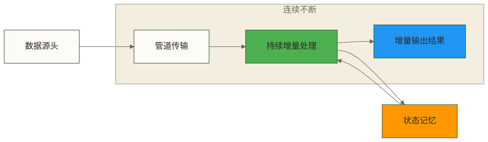
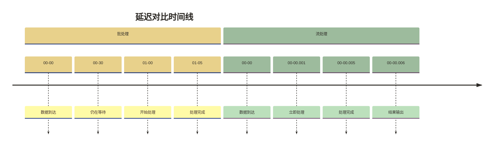
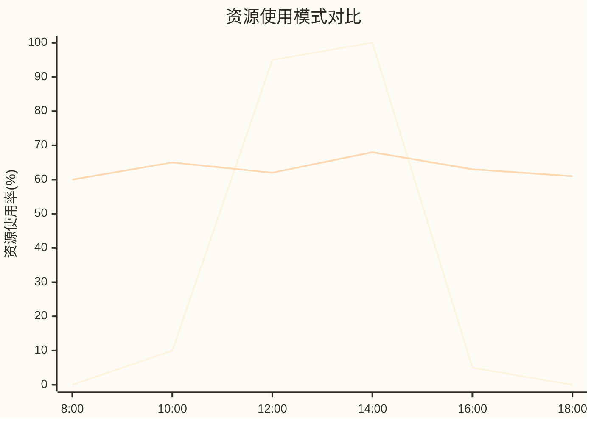
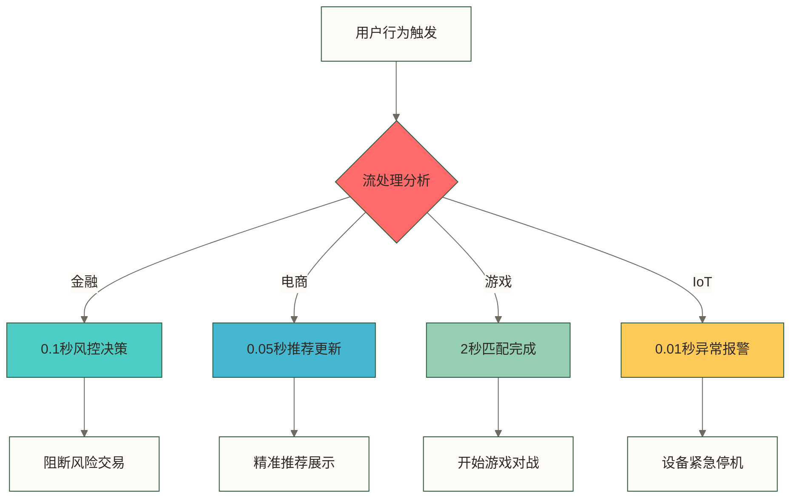
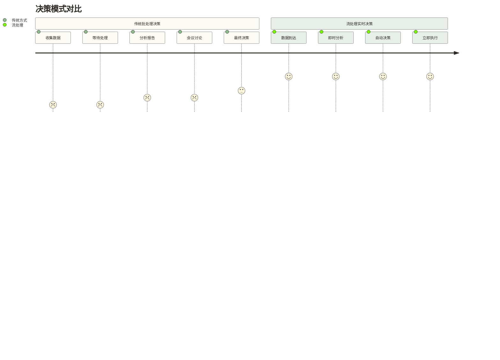

# 🌊 流处理基本概念 - 从自来水管道理解数据流

> [!abstract] 📋 本节概览
> - 🎯 **学习目标**：理解流处理vs批处理的本质区别，建立正确的数据处理思维
> - 📚 **前置知识**：无需任何前置知识，完全从零开始
> - ⏱️ **预计用时**：15分钟
> - 🔧 **核心概念**：流处理 和 批处理、实时计算的本质
> - 💡 **关键收获**：为什么现代业务离不开流处理思维

## 📊 数据处理的基本模式：批处理与流处理

### 🔄 批处理（Batch Processing）

**专业定义**：批处理是一种数据处理模式，系统会收集一定量的数据，然后一次性处理整个数据集。处理过程是离散的、有边界的，通常在预定的时间间隔内执行。

**核心特征解读**：

想象一下传统的邮政服务是怎么工作的？邮递员不会每收到一封信就立刻去送，而是先在邮局收集一定数量的邮件，然后按照路线统一派送。批处理就是这个道理！

系统首先会耐心地**收集数据**，就像邮局收集邮件一样，不着急立即处理。等到数据量够多了，或者到了预定的处理时间（比如每天晚上12点），系统才开始**批量处理**这些积累的数据。处理通常围绕一个有界数据集完成；结果可以分阶段输出，也可以在批次完成后集中输出。

这种方式有个明显的特点：数据之间存在**等待间隔**。就像你寄出的信件要等到下一班邮车才能被处理一样，数据也要等到下一个批次才能得到处理结果。

```mermaid
%%{init: {"theme":"base","themeVariables":{"fontFamily":"PingFang SC, -apple-system, Source Han Serif SC, serif","fontSize":"16px","background":"#FDFBF5","primaryColor":"#FDFBF5","primaryTextColor":"#2D2A26","primaryBorderColor":"#6E6A60","secondaryColor":"#E8EFE8","secondaryBorderColor":"#8FA890","secondaryTextColor":"#2D2A26","tertiaryColor":"#FDFBF5","tertiaryBorderColor":"#9A9488","tertiaryTextColor":"#6E6A60","lineColor":"#6E6A60","textColor":"#2D2A26","mainBkg":"#FDFBF5","nodeBorder":"#2D5A3D","clusterBkg":"#F3EEDF","clusterBorder":"#9A9488","edgeLabelBackground":"#FDFBF5"},"flowchart":{"htmlLabels":true,"curve":"basis","padding":20,"nodeSpacing":60,"rankSpacing":70,"useMaxWidth":false},"themeCSS":".node rect, .node polygon, .node circle { stroke-width: 1.5px; } .edgePath .path { stroke-width: 1.5px; } .cluster-label .nodeLabel, .cluster-label foreignObject { color: #2D2A26 !important; } .edgeLabel, .edgeLabel foreignObject { color: #2D2A26 !important; background-color: #FDFBF5; } .edgeLabel rect { fill: #FDFBF5; }"}}%%
flowchart LR
    A[数据到达] --> B[收集等待]
    B --> C[积累到一批]
    C --> D[统一处理]
    D --> E[输出结果]
    E --> F[等待下一批]
    F --> A
    
    style B fill:#ffeb3b
    style C fill:#4caf50
    style D fill:#2196f3
    style F fill:#ff9800
```

### 🌊 流处理（Stream Processing）

**专业定义**：流处理是一种持续处理数据流的模式，通常以增量方式处理到达的数据，不必等待整个数据集收集完成。数据处理和结果输出仍可能受缓冲、窗口、调度及背压影响，并非保证数据到达后立即输出结果。

**核心特征解读**：

流处理就像我们家里的自来水系统！当你打开水龙头的瞬间，水就立刻流出来了，不需要等水厂先收集一大桶水再统一处理后送给你。

这就是流处理的魅力：**数据到达后可以持续增量处理**，不必等待完整批次！不过，流处理也可能采用缓冲或窗口聚合，并存在排队和背压。这样有机会获得**低延迟**——毫秒到秒级是常见的设计目标示例，实际结果需要结合负载和完整链路测量。

更有意思的是，流处理可以处理**持续到达的无界数据流**，就像水龙头里的水一样，理论上可以持续流下去；流处理引擎也可以处理有界数据流。而且在处理过程中，系统还能**记住之前的状态**，比如记住某个用户之前的行为，这样就能做出更智能的决策。

## 📈 两种处理模式的深度对比

### 🔄 处理模式对比可视化

**批处理 vs 流处理时间轴对比**：

```mermaid
%%{init: {"theme":"base","themeVariables":{"fontFamily":"PingFang SC, -apple-system, Source Han Serif SC, serif","fontSize":"16px","background":"#FDFBF5","primaryColor":"#FDFBF5","primaryTextColor":"#2D2A26","primaryBorderColor":"#6E6A60","secondaryColor":"#E8EFE8","secondaryBorderColor":"#8FA890","secondaryTextColor":"#2D2A26","tertiaryColor":"#FDFBF5","tertiaryBorderColor":"#9A9488","tertiaryTextColor":"#6E6A60","lineColor":"#6E6A60","textColor":"#2D2A26","mainBkg":"#FDFBF5","nodeBorder":"#2D5A3D","clusterBkg":"#F3EEDF","clusterBorder":"#9A9488","edgeLabelBackground":"#FDFBF5"},"flowchart":{"htmlLabels":true,"curve":"basis","padding":20,"nodeSpacing":60,"rankSpacing":70,"useMaxWidth":false},"themeCSS":".node rect, .node polygon, .node circle { stroke-width: 1.5px; } .edgePath .path { stroke-width: 1.5px; } .cluster-label .nodeLabel, .cluster-label foreignObject { color: #2D2A26 !important; } .edgeLabel, .edgeLabel foreignObject { color: #2D2A26 !important; background-color: #FDFBF5; } .edgeLabel rect { fill: #FDFBF5; }"}}%%
gantt
    title 批处理 vs 流处理对比
    dateFormat X
    axisFormat %L
    
    section 批处理模式
    收集数据      :b1, 0, 10
    等待时间      :b2, 10, 20
    批量处理      :crit, b3, 20, 25
    输出结果      :b4, 25, 27
    
    section 流处理模式  
    数据1处理     :s1, 1, 2
    数据2处理     :s2, 3, 4
    数据3处理     :s3, 5, 6
    数据4处理     :s4, 7, 8
    持续输出     :crit, s5, 1, 27
```

**数据处理流程对比**：

```mermaid
%%{init: {"theme":"base","themeVariables":{"fontFamily":"PingFang SC, -apple-system, Source Han Serif SC, serif","fontSize":"16px","background":"#FDFBF5","primaryColor":"#FDFBF5","primaryTextColor":"#2D2A26","primaryBorderColor":"#6E6A60","secondaryColor":"#E8EFE8","secondaryBorderColor":"#8FA890","secondaryTextColor":"#2D2A26","tertiaryColor":"#FDFBF5","tertiaryBorderColor":"#9A9488","tertiaryTextColor":"#6E6A60","lineColor":"#6E6A60","textColor":"#2D2A26","mainBkg":"#FDFBF5","nodeBorder":"#2D5A3D","clusterBkg":"#F3EEDF","clusterBorder":"#9A9488","edgeLabelBackground":"#FDFBF5"},"flowchart":{"htmlLabels":true,"curve":"basis","padding":20,"nodeSpacing":60,"rankSpacing":70,"useMaxWidth":false},"themeCSS":".node rect, .node polygon, .node circle { stroke-width: 1.5px; } .edgePath .path { stroke-width: 1.5px; } .cluster-label .nodeLabel, .cluster-label foreignObject { color: #2D2A26 !important; } .edgeLabel, .edgeLabel foreignObject { color: #2D2A26 !important; background-color: #FDFBF5; } .edgeLabel rect { fill: #FDFBF5; }"}}%%
flowchart TD
    subgraph "批处理模式"
        A1[数据收集] --> A2[达到批次阈值]
        A2 --> A3[开始批量处理]
        A3 --> A4[一次性输出结果]
        A4 --> A5[等待下一批]
        A5 --> A1
    end
    
    subgraph "流处理模式"  
        B1[数据到达] --> B2[持续增量处理]
        B2 --> B3[增量输出结果]
        B3 --> B1
    end
    
    style A3 fill:#ffebee
    style B2 fill:#e8f5e8
```

### ⏱️ 速度比拼：谁更快？

这里有个很有趣的对比——如果把批处理和流处理比作快递服务，你就能马上理解它们的区别了！

**批处理就像传统快递**：
想象一下，你要寄一个包裹，但快递公司告诉你："我们每天下午3点统一发车，如果你上午10点寄件，需要等到下午3点才能出发，如果你下午4点寄件，要等到明天下午3点..."这就是批处理的节奏——**处理延迟通常是分钟到小时级别**的，你的数据要等到下一个"班车"才能被处理。

**流处理就像即时快递**：
而流处理更像按单响应的外卖配送，但配送仍需等待和执行时间。流处理可以追求**毫秒到秒级的低延迟**，实际延迟并无统一保证。原稿用淘宝下单后更新库存、推送卖家消息作类比；这里仅作为未核实的教学假设，不断言淘宝实际采用何种处理架构，交易系统或其他事件驱动服务也可能实现这些功能。

所以，当你需要**持续处理事件并低延迟更新结果**时，流处理是一类重要选择；同步事务、事件驱动服务等也能实现实时响应，具体方案取决于业务要求，低延迟流处理不等同于硬实时保证。

### 📊 资源使用：工厂 vs 流水线

让我用一个生产工厂的例子来解释两种处理方式的资源使用差异：

**批处理就像传统工厂**：
想象一个制造玩具的工厂，他们的工作方式是这样的：上午收集订单，下午统一开工，机器全力运转3小时，生产出所有玩具，然后停机休息。这种方式的特点是：

- 当开工时，**所有机器同时启动**，用电量瞬间飙升，处理能力爆表
- **单批次处理效率很高**，因为机器连续运转，不用频繁开关
- 但问题是**资源使用很不均匀**——要么全力运转，要么完全空闲

**流处理就像现代流水线**：
而流处理更像汽车厂的流水线，每个工位持续工作，车子源源不断地从生产线上下来：

- 在输入较平稳、容量配置合理时，**资源使用可以较连续**，但会随负载和状态变化
- 虽然单个产品的处理时间可能稍长，但整体**持续产出能力很强**
- 仍可能出现**资源闲置或过载**，需要监控、容量规划及背压处理

这就解释了为什么**批处理适合定期的大数据分析**，而**流处理适合需要持续响应的在线业务**！

## 🎯 流处理的核心价值与应用场景

### ⚡ 实时业务响应：毫秒必争的世界

在现代数字化业务中，**时间就是金钱**，有些场景还涉及安全。流处理可以帮助降低业务响应延迟，但**毫秒级端到端响应需要具体条件和测量验证**；安全关键业务还需专门的可靠性与实时性设计。

下面用几个业务场景作教学类比：其中品牌相关描述、响应时间及后续图表和决策时序数字均是原稿未核实的示例假设，不代表真实平台实现、实测性能或自动执行保证。

**🏦 金融风控的生死时速**
想象你的银行卡在海外被盗刷，罪犯正在ATM机前取钱。若批处理按日运行，可能要到下一批次才发现异常；教学上可假设流处理链路在**0.1秒内**给出可疑交易信号，并由获授权的风控系统决定是否冻结卡片。0.1秒及避免几万元损失均为原稿未核实的示例，不是性能或损失防止保证。

**🛒 电商推荐的精准投喂**  
当你在淘宝上点击了一双运动鞋，流处理系统马上就"懂"了你的心思，立刻调整首页推荐。不需要等到明天，就在这一瞬间，相关的运动装备就出现在了你的眼前。

**🎮 游戏匹配的无缝体验**
原稿以《王者荣耀》为类比，假设点击"开始匹配"后需要在几秒内从千万玩家中寻找技术水平相近的队友；这些规模和时长未核实，不代表该游戏实际机制。此类在线匹配通常要求及时响应，但仅凭这一需求不能断言必须使用流处理引擎，等待时间也取决于匹配规则与在线人数。

这就是流处理的魅力——它让系统有机会**持续感知、及时分析、低延迟响应**，实际响应时间与自动执行能力仍取决于完整业务链路！

### 📊 决策革命：从"事后诸葛亮"到"未卜先知"

传统的数据决策就像**"事后诸葛亮"**——等事情都发生了，我们才慢慢分析数据，写报告，开会讨论，最后做决策。而流处理让我们变成了**"未卜先知"**——能在事情发生的瞬间就做出反应！

**传统决策：慢工出细活，但可能错过时机**
想象一个电商平台的运营团队：
1. 周一收集上周的销售数据 📊
2. 周二开始分析用户行为 🔍  
3. 周三写分析报告 📝
4. 周四开会讨论策略 💬
5. 周五终于决定调整推荐算法 ✅

问题是，等到周五，用户的购买兴趣可能早就变了！

**流处理决策：瞬间反应，抢占先机**
而有了流处理的平台：
1. 用户浏览商品 👀
2. 0.1秒内分析行为模式 ⚡
3. 0.2秒内调整推荐策略 🎯
4. 0.3秒内展示个性化商品 🛍️

整个过程不到1秒！

这就像**从马车时代跳跃到高铁时代**——信息反馈可以更及时，但决策质量仍取决于数据质量、规则或模型，不能仅凭处理速度保证提升。

## 🔄 从批处理到流处理的思维转变

### 🧠 数据处理哲学的演进

**批处理思维**：追求数据的完整性和准确性，容忍一定的时间延迟，适合历史分析和报表生成。

**流处理思维**：追求响应的及时性和连续性，在不完整信息下做出决策，适合实时业务和在线服务。

**思维模式理解**：类似两种不同的学习方式
- **批处理思维**：类似传统学习，收集完整资料后进行深度分析，输出完整结果
- **流处理思维**：类似现代互动学习，基于当前信息立即响应，在持续交互中逐步完善

### 💼 业务模式的适应性

**适合批处理的业务场景**：
- 月度财务报表生成
- 历史数据挖掘分析
- 定期数据备份
- 机器学习模型训练

**适合流处理的业务场景**：
- 实时用户行为分析
- 动态价格调整
- 实时风险监控
- 智能设备控制

## 🚀 流处理技术栈的发展

### 📈 技术演进历程

**早期流处理**：简单的消息队列和事件处理系统，功能有限，可靠性不高。

**现代流处理**：以Apache Flink为代表的分布式流处理引擎，提供高吞吐、低延迟、强一致性的处理能力。

**技术演进理解**：类似交通工具的发展
- **早期流处理**：功能简单，可靠性有限
- **现代流处理**：高性能、高可用、高可靠，能够承载企业级业务

### 🎯 Apache Flink的定位

**技术定位**：Apache Flink是分布式数据处理引擎，提供流处理与批处理能力，是构建实时数据应用的可选方案之一；是否适合需要结合延迟、状态管理、数据源与运维成本评估。

**核心优势**：
- **流批一体**：统一的编程模型，降低学习成本
- **低延迟**：支持持续流处理；能否达到毫秒级响应取决于作业、负载及端到端链路
- **高吞吐**：支持大规模数据处理
- **状态一致性**：通过检查点等机制支持状态的精确一次语义；端到端语义依赖数据源、输出端和配置，不等于保证业务数据或计算逻辑准确
- **容错能力**：配置适当的检查点、重启策略及存储后可进行故障恢复；恢复仍可能造成暂停，不能保证业务始终不中断

**技术特点**：Flink是现代数据处理的先进代表
- 不仅处理速度快，更重要的是在高速处理中保持稳定性和可靠性
- 能够承载企业级的关键业务，是流处理技术的领先解决方案

---

## 📋 本节要点回顾

### ✅ 核心概念掌握检查
- [ ] 理解批处理和流处理的专业定义
- [ ] 掌握两种处理模式的核心特征
- [ ] 明白流处理的核心价值和应用场景
- [ ] 了解从批处理到流处理的思维转变
- [ ] 认识Apache Flink在流处理领域的地位

### 🎯 学习成果验证

**自测题**：
1. 批处理和流处理在延迟方面有什么本质区别？
2. 什么类型的业务场景更适合使用流处理？
3. 为什么现代企业越来越重视流处理技术？

### 🔗 学习路径连接
**已完成**：✅ 流处理基本概念  
**下一步**：[[【技术与工具】/Flink/02-Flink核心特性|Flink核心特性]] - 了解Flink的核心特性及其适用条件

记住：理解概念比记住语法更重要。只有真正理解了流处理的本质，才能在实际工作中灵活运用Flink！

---

**创建时间**：2024-06-29  
**最后更新**：2024-06-29  
**学习时长**：15分钟  
**难度等级**：⭐（初级）

#流处理 #批处理 #实时计算 #Flink #基础概念
