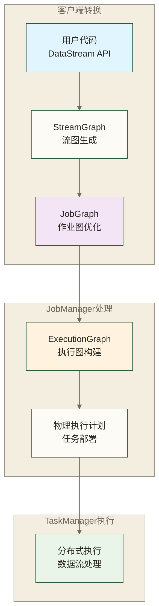
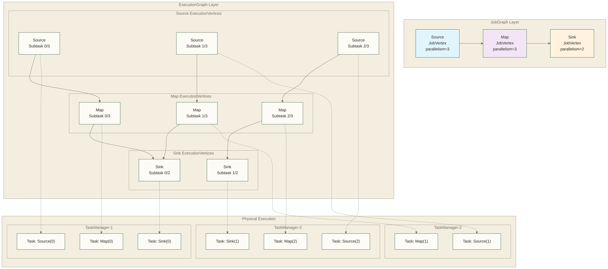
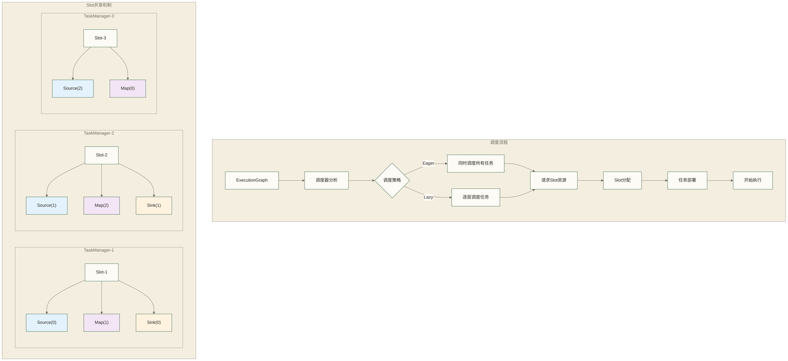
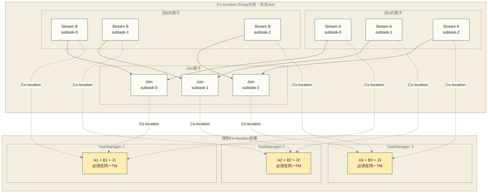

# ⚙️ Flink执行引擎深度解析 - 从代码到分布式执行的完整过程

> [!abstract] 📋 本节概览
> - 🎯 **学习目标**：深入理解Flink如何将用户代码转换为分布式执行计划，掌握执行引擎的核心工作原理
> - 📚 **前置知识**：03-Flink核心组件|Flink核心组件
> - ⏱️ **预计用时**：30分钟
> - 🔧 **核心概念**：JobGraph生成、ExecutionGraph构建、任务调度、算子链优化、并行执行
> - 💡 **关键收获**：理解Flink"黑盒"内部的工作机制，为性能调优和故障排查打下基础

## 🎯 为什么要理解执行引擎？

开发小王写了一个简单的Flink程序：数据源→map转换→sink输出，提交后却发现实际运行时变成了复杂的分布式任务网络。"我的代码这么简单，Flink内部到底做了什么？"这正是Flink执行引擎的核心价值——将用户的高层次代码转换为高效的分布式执行计划。

理解执行引擎不仅能帮你：
- **性能调优**：知道瓶颈在哪里，如何优化
- **故障排查**：理解错误产生的根本原因  
- **资源规划**：合理设置并行度和资源配置
- **架构设计**：设计更高效的流处理应用

## 🔄 从代码到执行的完整转换过程

### 📋 转换流程总览



### 🔍 第一阶段：StreamGraph生成

**StreamGraph定义**：StreamGraph是DataStream程序的图表示，包含算子节点和数据传输边；并非每个Transformation都对应一个独立StreamNode，分区等变换可能通过边或虚拟节点处理。

**生成过程详解**：
```java
// 用户代码示例
DataStream<String> source = env.addSource(new MySource());
DataStream<Tuple2<String, Integer>> mapped = source
    .map(new MyMapFunction())
    .keyBy(0)  
    .sum(1);
mapped.addSink(new MySink());

// StreamGraph生成过程
1. addSource() → 创建SourceStreamNode
2. map() → 创建MapStreamNode，连接到SourceStreamNode
3. keyBy() → 指定按键分区，不创建独立的KeyBy执行算子节点
4. sum() → 创建聚合算子对应的StreamNode，通过按键分区的数据边连接到Map对应节点
5. addSink() → 创建SinkStreamNode，连接到SumStreamNode
```

**StreamNode核心属性**：
```java
public class StreamNode {
    private int id;                          // 节点唯一标识
    private String operatorName;             // 算子名称
    private StreamOperator<?> operator;      // 具体算子实现
    private List<StreamEdge> inEdges;        // 输入边
    private List<StreamEdge> outEdges;       // 输出边
    private int parallelism;                 // 并行度
    private PartitionTransformation partitioner; // 分区策略
}
```

### 🎯 第二阶段：JobGraph优化

**JobGraph定义**：JobGraph是StreamGraph的优化版本，主要进行算子链(Operator Chain)优化，将可以链接的算子合并为一个JobVertex，减少网络传输开销。

**算子链优化原理**：
```java
// 链接条件判断
public boolean isChainable(StreamEdge edge) {
    StreamNode upStreamVertex = edge.getSourceVertex();
    StreamNode downStreamVertex = edge.getTargetVertex();
    
    return 
        // 下游算子只有一个输入
        downStreamVertex.getInEdges().size() == 1 &&
        // 上游算子只有一个输出  
        upStreamVertex.getOutEdges().size() == 1 &&
        // 分区策略是ForwardPartitioner
        edge.getPartitioner() instanceof ForwardPartitioner &&
        // 并行度相同
        upStreamVertex.getParallelism() == downStreamVertex.getParallelism() &&
        // 链接策略允许链接
        edge.supportsChaining();
}
```

**链接优化示例**：
```java
// 优化前：5个独立的算子
Source → Map → Filter → KeyBy → Sink

// 优化后：3个JobVertex（算子链）
[Source→Map→Filter] → [KeyBy] → [Sink]
//   JobVertex1         JobVertex2   JobVertex3
```

**算子链优化可视化**：

```mermaid
%%{init: {"theme":"base","themeVariables":{"fontFamily":"PingFang SC, -apple-system, Source Han Serif SC, serif","fontSize":"16px","background":"#FDFBF5","primaryColor":"#FDFBF5","primaryTextColor":"#2D2A26","primaryBorderColor":"#6E6A60","secondaryColor":"#E8EFE8","secondaryBorderColor":"#8FA890","secondaryTextColor":"#2D2A26","tertiaryColor":"#FDFBF5","tertiaryBorderColor":"#9A9488","tertiaryTextColor":"#6E6A60","lineColor":"#6E6A60","textColor":"#2D2A26","mainBkg":"#FDFBF5","nodeBorder":"#2D5A3D","clusterBkg":"#F3EEDF","clusterBorder":"#9A9488","edgeLabelBackground":"#FDFBF5"},"flowchart":{"htmlLabels":true,"curve":"basis","padding":20,"nodeSpacing":60,"rankSpacing":70,"useMaxWidth":false},"themeCSS":".node rect, .node polygon, .node circle { stroke-width: 1.5px; } .edgePath .path { stroke-width: 1.5px; } .cluster-label .nodeLabel, .cluster-label foreignObject { color: #2D2A26 !important; } .edgeLabel, .edgeLabel foreignObject { color: #2D2A26 !important; background-color: #FDFBF5; } .edgeLabel rect { fill: #FDFBF5; }"}}%%
flowchart TD
    subgraph "优化前：StreamGraph"
        S1["Source<br/>parallelism=4"]
        M1["Map<br/>parallelism=4"]  
        F1["Filter<br/>parallelism=4"]
        K1["KeyBy<br/>parallelism=4"]
        Si1["Sink<br/>parallelism=2"]
        
        S1 -->|Forward| M1
        M1 -->|Forward| F1
        F1 -->|Hash| K1
        K1 -->|Forward| Si1
    end
    
    subgraph "优化后：JobGraph"
        JV1["JobVertex1:<br/>[Source→Map→Filter]<br/>parallelism=4"]
        JV2["JobVertex2:<br/>[KeyBy]<br/>parallelism=4"]
        JV3["JobVertex3:<br/>[Sink]<br/>parallelism=2"]
        
        JV1 -->|Hash Partition| JV2
        JV2 -->|Forward| JV3
    end
    
    style JV1 fill:#e8f5e8
    style JV2 fill:#fff3e0
    style JV3 fill:#f3e5f5
```


**JobVertex核心结构**：
```java
public class JobVertex {
    private JobVertexID id;                  // 顶点ID
    private String name;                     // 顶点名称  
    private int parallelism;                 // 并行度
    private List<StreamOperator> chainedOperators; // 链接的算子
    private List<JobEdge> inputs;            // 输入边
    private ResourceRequirement resource;     // 资源需求
}
```

### 🚀 第三阶段：ExecutionGraph构建

**ExecutionGraph定义**：ExecutionGraph是JobGraph的并行化版本，将每个JobVertex根据并行度展开为多个ExecutionVertex，形成真正的物理执行计划。

**并行化展开过程**：
```java
// JobVertex并行度为4，展开为4个ExecutionVertex
JobVertex: MyMapOperator (parallelism=4)
    ↓
ExecutionVertex[0]: MyMapOperator (subtask 0/4)
ExecutionVertex[1]: MyMapOperator (subtask 1/4)  
ExecutionVertex[2]: MyMapOperator (subtask 2/4)
ExecutionVertex[3]: MyMapOperator (subtask 3/4)
```

**ExecutionGraph并行化展开可视化**：


**ExecutionGraph核心组件**：
```java
public class ExecutionGraph {
    private Map<JobVertexID, ExecutionJobVertex> tasks;  // 所有ExecutionJobVertex
    private ExecutionTopology topology;                  // 拓扑结构
    private CheckpointCoordinator checkpointCoordinator; // 检查点协调器
    private RestartStrategy restartStrategy;             // 重启策略
    private SlotSharingGroup slotSharingGroup;          // Slot共享组
}

public class ExecutionVertex {
    private ExecutionJobVertex jobVertex;     // 所属JobVertex
    private int subtaskIndex;                 // 子任务索引
    private Execution execution;              // 当前执行实例
    private List<IntermediateResultPartition> resultPartitions; // 结果分区
    private InputSplit inputSplit;           // 输入分片（Source算子）
}
```

### 🎮 第四阶段：任务调度与部署

**调度策略**：
```java
// 1. Eager调度（流处理默认）
// 所有任务同时启动，适合长期运行的流作业
scheduler.scheduleEager(executionGraph);

// 2. 分层调度  
// 按拓扑顺序逐层启动，适合批处理作业
scheduler.scheduleLazy(executionGraph);
```

**Slot分配机制**：
```java
public class SlotSharingGroup {
    private String name;                     // 共享组名称
    private Set<JobVertexID> jobVertexIds;   // 包含的JobVertex
    
    // Slot共享规则
    public boolean canShare(JobVertexID vertex1, JobVertexID vertex2) {
        // 不同算子可以共享Slot，减少资源占用
        return !vertex1.equals(vertex2) && 
               jobVertexIds.contains(vertex1) && 
               jobVertexIds.contains(vertex2);
    }
}
```

**任务调度与Slot分配可视化**：


**Co-location约束可视化**：


## 🔧 关键优化机制深度解析

### ⛓️ 算子链优化：把相邻工位合并

**算子链就像工厂的流水线优化！**

想象一个手机组装工厂，原本的设计是：
- **工位A**：安装屏幕（在1号车间）
- **工位B**：安装电池（在2号车间）  
- **工位C**：安装外壳（在3号车间）

按照原来的流程，手机需要在不同车间之间运输，每次搬运都要：
- 🚚 **物流成本**：用小车运输半成品
- 📦 **包装成本**：要把半成品包装好避免损坏
- ⏰ **时间成本**：等待运输和重新开箱

**但是聪明的厂长发现**：这三个工位的工作量差不多，何不把它们**放在同一个车间**呢？

于是优化后的流程变成：
- **优化工位**：屏幕→电池→外壳（都在1号车间完成）

这样的好处显而易见：
- ✅ **无需搬运**：手机在同一个工作台上完成所有步骤
- ✅ **无需包装**：工人直接传递，不用包装拆箱
- ✅ **减少传输开销**：链内通常通过进程内调用传递记录，减少网络与序列化开销，但不保证数据始终驻留CPU缓存或性能必然提升
- ✅ **管理简单**：原来需要协调3个车间，现在只需要管1个

**算子链就是这个优化思想！**把能够合并的相邻操作放在同一个任务里执行，避免不必要的网络传输和序列化开销。

**算子链实现机制**：
```java
// OperatorChain核心实现
public class OperatorChain<OUT> {
    private StreamOperator<OUT> headOperator;           // 链头算子
    private StreamOperator<?>[] tailOperators;          // 链中其他算子
    private RecordWriterOutput<?>[] chainedOutputs;     // 链内输出
    private WatermarkGaugeExposingOutput<StreamRecord<OUT>> chainEntryPoint; // 链入口
    
    // 链内数据传递
    public void processElement(StreamRecord<OUT> element) {
        // 1. 头算子处理
        headOperator.processElement(element);
        // 2. 直接传递给下游算子，无网络传输
        chainedOutputs[0].collect(element);
    }
}
```

**链接限制条件**：
```java
// 详细的链接条件检查
private boolean canChain(StreamNode node1, StreamNode node2, StreamEdge edge) {
    return 
        // 基础条件
        node2.getInEdges().size() == 1 &&           // 下游只有一个输入
        node1.getOutEdges().size() == 1 &&          // 上游只有一个输出
        
        // 分区条件
        edge.getPartitioner() instanceof ForwardPartitioner &&  // 必须是Forward分区
        
        // 并行度条件
        node1.getParallelism() == node2.getParallelism() &&     // 并行度必须相同
        
        // 缓冲条件
        edge.getBufferTimeout() == CHAIN_BUFFER_TIMEOUT &&      // 缓冲超时一致
        
        // 算子条件
        node1.getOperator().getChainingStrategy() != ChainingStrategy.NEVER &&  // 允许作为链尾
        node2.getOperator().getChainingStrategy() != ChainingStrategy.HEAD &&   // 允许作为链头
        
        // 资源条件
        node1.getResourceRequirement().equals(node2.getResourceRequirement()); // 资源需求一致
}
```

### 🎯 任务调度：像管理酒店房间一样

**Slot共享就像酒店的客房管理！**

想象你管理一家酒店，有很多客房（Slot），来了不同类型的客人（任务）。你可以有两种管理方式：

**❌ 传统方式：一房一客**  
每种类型的客人都要单独的房间：
- **商务客人专用房**：只住商务客人
- **旅游客人专用房**：只住旅游客人  
- **学生专用房**：只住学生

这样管理很简单，但**房间利用率很低**！商务客人白天开会晚上才回来，房间大部分时间空着。

**✅ Flink方式：合理拼房**  
把**不冲突的客人安排在同一个房间**：
- **Room-1**：商务客人A（白天开会）+ 学生B（白天上课）+ 导游C（晚上工作）
- **Room-2**：商务客人D + 学生E + 导游F
- **Room-3**：商务客人G + 学生H + 导游I

这样的好处：
- 🏨 **房间利用率高**：同一个Slot可以运行多个不同的算子任务
- 💰 **节省资源**：不需要为每种算子准备专用的计算资源
- 📊 **负载均衡**：不同算子的高峰期不同，可以错峰使用资源

**Co-location约束：VIP客人的特殊要求**

有些特殊的客人有特殊要求，比如一个商务团队的成员**必须住在同一层楼**，这样方便开会和协作。

在Flink中，某些算子也有这样的要求：
- **Join算子**需要相关记录到达负责该键或分区的Join子任务，但两个上游输入任务不必部署在**同一个TaskManager**上
- **CoGroup算子**同样需要按其分区语义汇集相关记录，不意味着上游任务必须处于**同一个物理位置**；Co-location是特定场景中的部署约束，不能由Join或CoGroup名称直接推断

**简单来说**：Slot共享让系统更高效地利用资源，Co-location约束确保需要密切配合的任务能够就近协作！

### 📊 并行度决策：像分配工作人员

**并行度就像决定派多少人去干活！**

想象你经营一个快递分拣中心，每天有大量快递需要分拣。你需要决定：**今天安排多少个工人来分拣？**

**Flink的决策过程就像一个聪明的主管**：

**🎯 第一优先级：明确指定**  
如果你明确说"这个岗位必须安排4个人"，那就是4个人，没商量！
```java
.map(new MyMapFunction()).setParallelism(4)  // 明确指定4个并行度
```

**⚙️ 第二优先级：公司标准**  
如果你没有特别要求，就按公司的标准配置来。比如公司规定"默认每个岗位配8个人"。
```java
env.setParallelism(8)  // 设置环境默认并行度
```

**🖥️ 第三优先级：看资源情况**  
如果前两个都没设置，需要检查提交参数及配置中的默认并行度；不能普遍按机器数或CPU核心数自动推断。某些调度器可在特定模式下根据资源或运行统计决定并行度，须按版本和配置确认。

**并行度的传播就像工厂的标准化流程**：

假设你有一条流水线：**装配 → 测试 → 包装**

如果装配、测试和包装都采用同一个默认并行度，它们可以各安排4个人；但仅将装配算子的并行度设为4，并不会自动让下游算子也采用4。

但是如果中间有**重新分组的环节**（比如KeyBy），就像产品需要**重新分拣**一样，下游就可以有不同的人数配置了。

**关键原则**：
- **相邻且可链接的算子**：相同并行度是常见链接前提之一，还须满足分区、链接策略等条件
- **经过重分区的算子**：可以配置不同并行度；并行度不同的相邻算子不能通过Forward分区直接连接

这样的设计既保证了效率，又给了足够的灵活性！

## 🎯 执行引擎性能调优指南

### 🚀 算子链优化

**识别链接瓶颈**：
```java
// 通过Web UI查看算子链情况
// 1. 检查作业拓扑图
// 2. 查看Operator Chain长度  
// 3. 分析网络传输量

// 拆分算子链（用于诊断或调优，需评估传输开销）
dataStream
    .map(new MyMapFunction())
    .disableChaining()           // 禁止当前算子与上游、下游形成算子链
    .filter(new MyFilterFunction())
    .startNewChain();           // 开始新的链
```

**优化策略**：
```java
// 1. 合理设置并行度
source.setParallelism(4)
    .map(new LightweightMapFunction()).setParallelism(4)  // 保持相同并行度
    .filter(new SimpleFilter()).setParallelism(4)        // 利于链接
    .keyBy(0)
    .sum(1).setParallelism(8);                           // 下游增加并行度

// 2. 使用Forward分区
dataStream.forward()   // 明确使用Forward分区
    .map(new MyMapFunction());
```

### 📈 资源配置优化

**TaskManager配置**：
```yaml
# flink-conf.yaml
taskmanager.memory.process.size: 4g      # 总进程内存
taskmanager.memory.flink.size: 3.2g      # Flink可用内存
taskmanager.numberOfTaskSlots: 4         # 每个TM的Slot数

# 网络缓冲配置
taskmanager.network.memory.fraction: 0.1        # 网络缓冲内存比例
taskmanager.network.memory.min: 64mb           # 最小网络内存
taskmanager.network.buffers-per-channel: 2     # 每个通道的缓冲数
```

**并行度配置建议**：
```java
// 根据数据倾斜情况调整
.keyBy(key -> redistributeKey(key))    // 示意：改写key可能改变聚合语义，必须验证键语义及必要的二阶段聚合
.sum(1).setParallelism(
    calculateOptimalParallelism(inputRate, processingLatency)
);

private int calculateOptimalParallelism(long inputRate, long latency) {
    // 原稿未核实的示意公式：并行度 = (输入速率 * 延迟) / 目标处理能力；变量单位和目标处理能力未定义，不能直接用于容量规划
    return Math.max(1, (int) (inputRate * latency / TARGET_THROUGHPUT));
}
```

## 🔍 故障排查与监控

### 📊 执行图分析

**通过Web UI分析**：
```bash
# 访问Flink Web UI
http://jobmanager:8081

# 关键监控指标
1. Job Overview → 查看整体拓扑
2. Task Managers → 检查资源使用  
3. Job Details → 分析算子性能
4. Checkpoints → 监控检查点状态
```

**常见问题诊断**：
```java
// 1. 背压问题
if (subtask.getBackPressureLevel() > 0.5) {
    // 检查下游算子处理能力
    // 考虑增加并行度或优化算法
}

// 2. 数据倾斜
if (maxRecordsPerSecond / avgRecordsPerSecond > 2.0) {
    // 重新设计分区key
    // 使用自定义partitioner
}

// 3. 检查点超时
if (checkpointDuration > checkpointTimeout * 0.8) {
    // 增加检查点超时时间
    // 优化状态存储
}
```

### 🔧 调试技巧

**日志配置**：
```xml
<!-- log4j2.xml 的 Loggers 元素内配置片段，不是 log4j.properties 语法 -->
<logger name="org.apache.flink.runtime.executiongraph" level="DEBUG"/>
<logger name="org.apache.flink.runtime.scheduler" level="DEBUG"/>
<logger name="org.apache.flink.runtime.jobmanager" level="INFO"/>
```

**调试代码示例**：
```java
// 添加调试信息
public class DebugMapFunction implements MapFunction<String, String> {
    private static final Logger LOG = LoggerFactory.getLogger(DebugMapFunction.class);
    
    @Override
    public String map(String value) throws Exception {
        LOG.info("Processing element: {}, current thread: {}", 
                 value, Thread.currentThread().getName());
        return value.toUpperCase();
    }
}
```

---

## 📋 本节要点回顾

### ✅ 执行引擎掌握检查
- [ ] 理解从代码到执行的完整转换过程
- [ ] 掌握StreamGraph、JobGraph、ExecutionGraph的区别和作用
- [ ] 了解算子链优化的原理和条件
- [ ] 理解任务调度和Slot分配机制
- [ ] 能够进行基本的性能调优和故障排查

### 🎯 实践能力检查
- [ ] 能够通过Web UI分析执行计划
- [ ] 理解并行度设置对执行的影响
- [ ] 掌握算子链优化的配置方法
- [ ] 能够识别和解决常见性能问题

### 🔗 学习路径连接
**已完成**：✅ 流处理基本概念 → ✅ Flink核心特性 → ✅ Flink核心组件 → ✅ Flink执行引擎深度解析
**下一步**：04-Flink架构原理|Flink架构原理 - 学习Flink的整体架构设计

记住：理解执行引擎是掌握Flink的关键，它连接了用户代码和底层执行，是性能调优和故障排查的基础！

---

**创建时间**：2024-12-27  
**最后更新**：2024-12-27  
**学习时长**：30分钟  
**难度等级**：⭐⭐⭐（进阶）

#Flink #执行引擎 #JobGraph #ExecutionGraph #性能调优 #底层原理