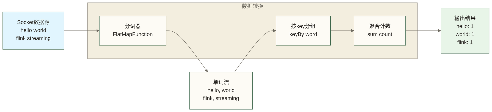
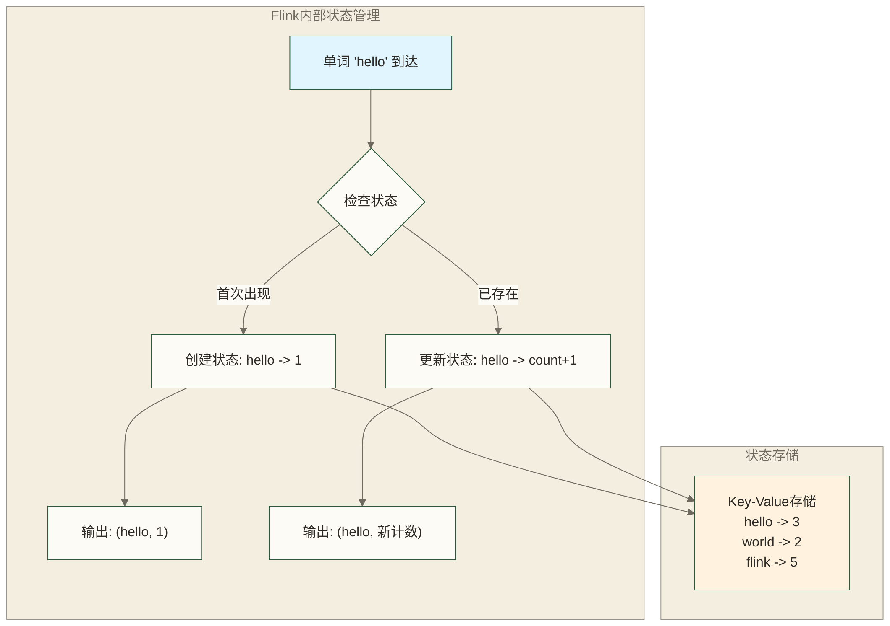

# 🚀 第一个Flink程序 - WordCount词频统计入门

> [!abstract] 📋 本节概览
> - 🎯 **学习目标**：编写并运行人生第一个Flink程序，建立流处理编程思维
> - 📚 **前置知识**：[[【技术与工具】/Flink/05-Flink环境安装|Flink环境安装]]
> - ⏱️ **预计用时**：15分钟
> - 🔧 **核心技能**：Flink程序基本结构、流处理编程模式
> - 💡 **关键收获**：建立Flink编程的信心和基础认知

## 🎯 WordCount程序设计原理

### 📊 程序功能分析

**WordCount就像建立一个智能的书店图书统计系统，能够实时追踪每本书的借阅情况！**

想象你在管理一家现代化的智能书店。每天有很多读者来借书，你想要实时知道哪些书最受欢迎，借阅次数是多少。传统的做法是等一天结束后再统计，但是智能书店的优势就是能够**实时了解借阅热度**，随时调整图书推荐和库存管理。

**我们的WordCount程序就是这样一个智能统计员**：

每当有读者借书（**数据输入**），这个统计员就立即记录下来，就像每当有新的文本行到达，程序就立即接收处理。

接着，统计员会仔细查看借阅记录中的每本书名（**单词分割**），就像程序将文本行拆分成单个的单词，确保每个单词都被准确识别出来。

然后，统计员按照书名进行归类整理（**分组聚合**），同样的书放在一起统计次数。比如《红楼梦》被借了3次，《三国演义》被借了5次，程序也是按照相同的单词进行分组并累加计数。

最重要的是，这个统计员会实时更新大屏幕上的**借阅排行榜**（**结果输出**），让书店老板随时能看到最新的数据，而不需要等到一天结束。

**这就是流处理的精髓** - 数据像源源不断的读者一样持续到来，程序像专业统计员一样实时处理每一个数据，维护着每本书（每个单词）的借阅计数状态。如果需要在故障后恢复统计状态，还必须配置检查点、恢复策略及可重放的数据源；本文的Socket示例不保证故障后数据不丢失。

**技术对应**：WordCount是流处理的Hello World程序，演示了数据流的基本处理模式：数据接收（Source）→数据转换（Transformation）→状态维护（State Management）→结果输出（Sink）。程序能够处理无限的文本流，为每个单词维护累计计数状态，体现了Flink的核心能力。

### 🔄 流处理编程模式

**编写Flink程序就像给智能书店的管理系统写操作手册一样简单直接！**

传统的编程就像详细描述每个服务员应该怎么走、怎么拿书、怎么登记，非常繁琐。Flink的数据流API就像给书店描述服务流程："当读者借书时，记录书名并更新统计"。使用DataStream API时，需要显式选择算子并编写处理逻辑；Flink SQL更偏向声明式表达。Flink负责分布式执行，但不保证自动找到最高效的执行方式。

**智能书店的三个核心组件**：

**数据流（DataStream）就像书店里源源不断的读者流**

想象书店门口永远有读者排队进入，这就是数据流的概念。每个读者代表一条数据，可以持续到来，也可以在有限批次后结束。就像程序中的数据流，记录可以增量处理，不需要等所有数据都到齐；并行处理不保证所有记录的全局到达顺序，实际延迟也受缓冲、背压和计算开销影响。

你可以对这些读者流进行各种操作：筛选VIP会员（filter）、登记每个人的信息（map）、按年龄分组（DataStream中使用keyBy）等，这些操作会应用到每一个经过的读者身上。

**算子（Operator）就像书店里不同岗位的专业服务员**

书店里有**门迎服务员**（源算子）负责迎接读者，**分类服务员**（转换算子）负责帮助读者找书分类，**结账服务员**（汇算子）负责处理最终的借阅手续。

每个服务员都有专门的技能，可以**组合工作**（比如门迎→分类→结账），可以**重复利用**（多个分类服务员做同样的工作），还可以**并行服务**（多个服务员同时为不同读者服务）。程序中的算子也是如此，每个算子专门处理一类数据转换，可以链式组合，也可以并行执行。

**窗口（Window）就像书店的定期盘点制度**

虽然读者流是无限的，但书店需要定期统计销售情况。比如**每小时统计一次热门图书**（时间窗口），或者**每100个读者统计一次借阅偏好**（计数窗口），再或者**为每个读者的连续借阅建立会话记录**（会话窗口）。

窗口的作用就是在**无限的数据流中划出有限的边界**，让我们能够对连续的流数据进行有意义的聚合统计。

**技术对应**：DataStream是Flink的核心抽象之一，可表示有界或无界数据序列，支持丰富的转换操作。算子（Operator）执行特定的处理逻辑，支持链式调用和并行执行。窗口（Window）按时间、计数等规则划分记录以进行聚合，并不使整个无界输入流变成有界流，也不能单凭窗口实现流批一体化处理。

## 💻 Flink程序结构设计

### 📁 项目架构设计

**设计一个Flink程序就像规划一个智能书店的完整组织架构，每个部门都有明确的职责分工！**

就像成功的书店需要清晰的部门划分一样，优秀的Flink程序也采用**模块化设计**，将不同职责分离到独立的模块中。这样做的好处就像书店运营一样：每个部门专精自己的工作，出了问题容易定位，需要升级时只需要改动相关部门，整个系统更稳定更好维护。

**智能书店的组织架构对应Flink程序结构**：

**店长办公室（主程序类）**就像书店的**总指挥中心** - 这里是整个书店运营的大脑，负责协调各部门工作，制定总体策略。在Flink程序中，主程序类包含main方法这个"店长"，负责初始化执行环境、搭建数据处理流水线、协调各个算子的工作。

**采购部（数据源类）**专门负责**"进货"工作** - 从出版社、经销商那里源源不断地获取新书。对应到程序中，数据源类负责从各种地方读取数据：可能是Socket连接、文件系统、数据库，或者消息队列。这个部门的工作质量直接影响整个书店的货源。

**图书分类部（处理逻辑类）**是书店的**"大脑"部门** - 负责对进来的图书进行分类整理、标签贴注、统计分析等核心工作。在程序中，这里实现具体的业务逻辑，比如我们的WordCount程序里的分词、分组、计数等操作都在这里完成。

**客户服务部（输出类）**负责**"交付成果"** - 将处理好的信息展示给读者，或者存储到系统中供后续使用。程序中的输出类可能将结果打印到控制台、写入文件、发送到消息队列，或者存储到数据库。

**IT支持部（工具类）**提供**各种通用服务** - 比如数据格式转换、常用计算函数、配置管理等。就像书店的IT支持提供通用的技术服务，工具类为其他模块提供可复用的功能组件。

**供应商管理（依赖管理）**确保书店有稳定的**"供应链"** - Flink核心API就像书店必需的基础设施，客户端库就像与总部的通讯系统，测试框架就像质量检验工具，日志系统就像运营记录系统。每个依赖都有明确的用途，缺了任何一个都会影响书店正常运营。

**技术对应**：模块化设计遵循单一职责原则，每个类专注特定功能。主程序类是应用入口点，负责StreamExecutionEnvironment初始化和作业提交。数据源类封装Source算子，处理逻辑类实现Transformation算子，输出类封装Sink算子。依赖管理确保运行时环境完整。

### 🎯 程序执行流程

**启动一个Flink程序就像智能书店的开业流程，需要按照特定的顺序来确保一切顺利运行！**

**第一阶段：书店开业筹备（环境初始化）**

就像开书店前需要先搞定营业执照、装修门店、培训员工一样，Flink程序首先要**创建执行环境**。这个StreamExecutionEnvironment就像书店的"营业执照"，它告诉系统："我准备开始处理数据流了！"

接着需要设定书店的**基本运营参数**：比如同时能服务多少读者（并行度）、出现问题时怎么处理（重启策略）、多久备份一次数据（检查点间隔）。这些配置就像书店的运营手册，确保系统按照你的预期方式工作。

**第二阶段：设计服务流程（数据流构建）**

书店筹备好后，需要设计**具体的服务流程**：读者从哪里进入（数据源），经过哪些服务环节（数据转换），最终怎样完成借阅（数据输出）。

这个阶段就像画出书店的服务流程图：读者进门→身份验证→选书→登记→统计更新→完成借阅。在代码中体现为：定义Socket数据源→设置分词处理→配置分组聚合→指定结果输出。整个流程像流水线一样连贯，但此时还只是"设计图纸"，并没有真正运行。

**第三阶段：正式开门营业（作业提交）**

设计完成后，就要**正式开门营业**了！调用`env.execute()`就像按下书店的"开门营业"按钮，Flink会把你的设计图纸提交给集群执行。

这时候系统会做很多"开业前的最后检查"：将你的流程设计转换成详细的执行图，检查每个环节是否可行，分配具体的工作人员（TaskManager），然后正式启动各个服务环节。就像书店开业前的最后准备工作，确保一切就绪后才开始接待读者。

**第四阶段：日常运营管理（监控管理）**

书店开门营业后，店长需要**持续关注运营情况**：今天来了多少读者？哪些书最受欢迎？有没有服务瓶颈？系统运行是否正常？

Flink也提供了完整的监控体系，通过Web UI你可以实时查看作业状态、处理速度、资源使用情况等。如果出现问题，系统会自动记录日志，甚至可以自动重启故障组件，确保书店能够持续稳定地为读者提供服务。

**技术对应**：StreamExecutionEnvironment是程序执行的上下文环境，用于配置作业、构建数据流并触发执行；集群资源管理和作业调度由Flink运行时组件负责。数据流构建阶段创建StreamGraph，描述数据处理的逻辑拓扑。作业提交时StreamGraph被转换为JobGraph，然后分发到集群执行。监控阶段通过Metrics系统收集运行时指标。

## 🔧 核心编程概念

### 🌊 数据流处理模式

**理解流处理就像理解智能书店的实时运营模式，与传统书店的差异非常明显！**

**传统书店 vs 智能书店的运营差异**：

**无界数据就像永不闭店的24小时智能书店**

传统书店有明确的营业时间，晚上关门时可以盘点当天的销售情况。但智能书店是24小时运营的，读者随时可能来借书，**没有明确的"结束时间"**。这就是流处理中的无界数据概念 - 数据像读者一样源源不断地到来，系统需要能够处理这种永不停歇的数据流。

**实时处理就像智能书店的即时服务**

传统书店可能等一批读者都到齐了再统一处理，但智能书店的优势是**随来随服务**。每当一个读者到达，立即完成借阅并更新统计，不需要等其他读者。这就是流处理的核心思想：数据一到达就立即处理，而不是等所有数据收集完毕再批量处理。

**状态管理就像书店的智能记忆系统**

智能书店需要**记住每本书的借阅历史**：《红楼梦》已经被借了多少次？张三读者上次借了什么书？这些都是"状态信息"，需要在读者流动的过程中持续维护和更新。程序中的状态管理也是如此，需要在数据流处理过程中维护各种统计信息和历史状态。

**容错机制就像书店的备份保险**

万一智能书店的系统出现故障，所有的借阅记录和统计数据都不能丢失。系统需要有**自动备份和恢复机制**，确保故障后能够快速恢复到故障前的状态，继续为读者提供服务。Flink的容错机制就像这样的保险系统，但数据处理的一致性和可靠性取决于检查点配置、数据源的重放能力以及输出端的写入语义。

**智能书店的四种运营模式**：

**事件驱动模式**就像"有读者就服务" - 不是定时检查，而是每当有读者借书事件发生时，立即触发相应的处理流程。

**时间窗口模式**就像"每小时统计一次热门图书" - 在连续的读者流中，每隔一个小时对借阅数据进行一次聚合分析。

**状态更新模式**就像"实时更新借阅排行榜" - 每次有新的借阅发生，立即更新图书的借阅计数和排名。

**结果输出模式**就像"持续播报统计结果" - 不断地向大屏幕输出最新的统计信息，让管理者随时了解经营状况。

**技术对应**：流处理的核心是处理无界、连续的数据流。事件驱动架构通过事件触发计算逻辑，时间语义支持基于时间的窗口聚合，状态管理维护计算中间结果，容错机制可通过checkpoint与可重放的数据源实现状态的一致性恢复；端到端Exactly-Once还要求输出端支持事务或其他相应的一致性机制，本文Socket与print示例不具备这些保证。这些特性使得流处理能够提供低延迟、高吞吐的实时数据处理能力。

### 🔄 算子链和并行度

**智能书店的服务优化就像Flink的算子链和并行度优化，目标都是提升整体运营效率！**

**算子链优化就像书店的服务流程整合**

想象智能书店最初的服务流程是这样的：读者进门先到**A柜台**登记身份→走到**B柜台**查询想要的书→再到**C柜台**办理借阅手续→最后到**D柜台**更新统计信息。每个柜台之间读者都要走来走去，效率很低。

**算子链优化就像设置综合服务台**：把多个相关的服务环节**合并到一个地方完成**。一个服务员就能处理身份登记、图书查询、借阅办理、统计更新等所有环节，读者不需要在不同柜台间跑来跑去。

这样做的好处非常明显：**减少了读者在柜台间的"奔波"**（避免网络传输），**提高了服务速度**（减少序列化开销），**更高效地利用了工作人员的时间**（资源优化）。在程序中，算子链将多个相关的数据转换操作合并在同一个任务中执行，避免了数据在不同算子间的网络传输。

**并行度控制就像书店的多窗口服务策略**

当智能书店读者很多时，单个服务窗口显然忙不过来。这时候就需要**开设多个并行的服务窗口**，每个窗口都能提供完整的借阅服务。

**数据并行**就像**多个服务窗口处理不同的读者** - 100个读者可以分配给4个窗口，每个窗口处理25个读者。在程序中，数据流被分割成多个子流，每个并行任务处理一部分数据。

**任务并行**就像**不同类型的服务可以同时进行** - 借阅服务、咨询服务、图书整理可以同时进行，互不干扰。在Flink中，不同的算子任务可以在不同的TaskManager上并行执行。

**资源匹配**就像**根据客流量灵活调整窗口数量** - 客流高峰期开放更多窗口，客流低谷期减少窗口数量。程序运行时也要根据可用的CPU核数、内存大小来设置合理的并行度。

**负载均衡**就像**确保每个窗口的工作量差不多** - 避免有些窗口排长队，有些窗口却很闲。Flink提供分区机制来分配数据，但不保证各并行任务负载均匀；特别是按key分区时，热点key可能造成数据倾斜。

**实际应用中的智能调优**：

比如WordCount程序的并行度设置，就像决定开设多少个"单词统计窗口"。如果将计数算子的并行度设置为4，就相当于有4个统计员同时工作：keyBy根据单词的哈希值将其映射到key group，再把key group分配给并行子任务，而不是按A-F等字母范围分配。每个统计员维护所分配单词的计数，同一单词的记录进入同一个计数子任务，输出端收集各子任务的更新结果。

**技术对应**：算子链通过将多个算子合并为一个Task执行，减少数据序列化和网络传输开销。并行度决定了数据流的分区数量和并发处理能力。可用slot影响作业的资源分配，但不等同于用于key group划分的最大并行度配置，具体资源需求还受slot共享等设置影响。hash分区保证相同key路由到同一子任务，但可能产生倾斜；rebalance轮询分发记录，不能替代keyBy所需的按key聚合语义。

## 💻 完整代码实现

### 🎯 选择你熟悉的编程语言

> [!tip] 💡 **语言选择建议**
> - **Java开发者**：选择Java版本，深入理解DataStream API
> - **Python用户**：选择Python版本，使用PyFlink进行开发  
> - **SQL分析师**：选择SQL版本，用声明式方式处理流数据

#### 📚 Java版本 - 完整WordCount实现

```java
// WordCountStreaming.java
import org.apache.flink.api.common.functions.FlatMapFunction;
import org.apache.flink.api.java.tuple.Tuple2;
import org.apache.flink.streaming.api.datastream.DataStream;
import org.apache.flink.streaming.api.environment.StreamExecutionEnvironment;
import org.apache.flink.util.Collector;

public class WordCountStreaming {
    
    public static void main(String[] args) throws Exception {
        // 1. 创建执行环境
        final StreamExecutionEnvironment env = StreamExecutionEnvironment.getExecutionEnvironment();
        
        // 2. 配置数据源 - 从Socket读取文本数据
        DataStream<String> text = env.socketTextStream("localhost", 9999);
        
        // 3. 数据转换处理
        DataStream<Tuple2<String, Integer>> wordCounts = text
            // 分词：将每行文本拆分为单词
            .flatMap(new Tokenizer())
            // 分组：按单词进行分组
            .keyBy(value -> value.f0)
            // 聚合：计算每个单词出现次数
            .sum(1);
        
        // 4. 输出结果
        wordCounts.print().setParallelism(1);
        
        // 5. 启动执行
        env.execute("Word Count Streaming");
    }
    
    // 自定义分词器
    public static final class Tokenizer implements FlatMapFunction<String, Tuple2<String, Integer>> {
        @Override
        public void flatMap(String value, Collector<Tuple2<String, Integer>> out) {
            // 将输入的文本转换为小写并按正则表达式中的非单词字符分割
            String[] words = value.toLowerCase().split("\\W+");
            
            // 为每个单词输出 (单词, 1) 的元组
            for (String word : words) {
                if (word.length() > 0) {
                    out.collect(new Tuple2<>(word, 1));
                }
            }
        }
    }
}
```

**运行步骤**：
```bash
# 1. 启动Socket服务器（另一个终端）
nc -l 9999

# 2. 编译运行程序
mvn compile exec:java -Dexec.mainClass="WordCountStreaming"

# 3. 在Socket终端输入文本，观察结果
hello world
flink streaming processing
```

#### 🐍 Python版本 - PyFlink实现

```python
# word_count_streaming.py
from pyflink.datastream import StreamExecutionEnvironment
from pyflink.table import TableEnvironment, EnvironmentSettings
from pyflink.datastream.functions import FlatMapFunction
from pyflink.common.typeinfo import Types
from typing import Iterable

class Tokenizer(FlatMapFunction):
    def flat_map(self, value: str) -> Iterable[tuple]:
        # 分词并返回(单词, 1)元组
        words = value.lower().split()
        for word in words:
            if len(word.strip()) > 0:
                yield (word.strip(), 1)

def word_count():
    # 1. 创建执行环境
    env = StreamExecutionEnvironment.get_execution_environment()
    env.set_parallelism(1)
    
    # 2. 从Socket读取数据
    text = env.socket_text_stream("localhost", 9999)
    
    # 3. 数据处理
    word_counts = text \
        .flat_map(Tokenizer(), output_type=Types.TUPLE([Types.STRING(), Types.INT()])) \
        .key_by(lambda x: x[0]) \
        .sum(1)
    
    # 4. 输出结果
    word_counts.print()
    
    # 5. 执行作业
    env.execute("Python WordCount")

if __name__ == '__main__':
    word_count()
```

**安装和运行**：
```bash
# 1. 安装PyFlink
pip install apache-flink

# 2. 运行程序
python word_count_streaming.py
```

#### 📊 SQL版本 - Flink SQL实现

```sql
-- word_count_streaming.sql
-- 1. 创建输入表（从Socket读取）
CREATE TABLE input_table (
    line STRING
) WITH (
    'connector' = 'socket',
    'hostname' = 'localhost',
    'port' = '9999',
    'format' = 'raw'
);

-- 2. 创建输出表（打印到控制台）
CREATE TABLE output_table (
    word STRING,
    word_count BIGINT
) WITH (
    'connector' = 'print'
);

-- 3. 流式WordCount查询
INSERT INTO output_table
SELECT 
    word,
    COUNT(*) as word_count
FROM (
    SELECT 
        REGEXP_EXTRACT(LOWER(TRIM(word)), '[a-z]+', 0) as word
    FROM (
        SELECT 
            value as word
        FROM input_table,
        LATERAL TABLE(SPLIT(REGEXP_REPLACE(LOWER(line), '[^a-zA-Z\\s]', ''), ' ')) as T(value)
    )
    WHERE LENGTH(word) > 0
)
GROUP BY word;
```

**SQL Client运行**：
```bash
# 1. 启动Flink SQL Client
./bin/sql-client.sh

# 2. 执行SQL语句（复制上面的SQL代码）
# 3. 数据会实时更新显示
```

### 🔍 代码详解

**WordCount数据流处理可视化**：


**状态管理可视化**：


**核心处理流程**：
1. **数据接入**：从Socket源连续读取文本行
2. **数据解析**：将文本行拆分为单个单词
3. **数据分组**：按单词内容进行分组
4. **数据聚合**：统计每个单词的出现次数
5. **结果输出**：实时输出统计结果

**关键技术点**：
- **流式处理**：数据持续处理，无需等待所有数据
- **状态管理**：Flink自动维护单词计数状态
- **容错机制**：Flink支持基于检查点的故障恢复；本示例未启用检查点，Socket源也不具备可靠重放能力，不保证故障后的数据一致性
- **并行处理**：支持多并行度处理，提高吞吐量

## 📝 编程最佳实践

### 🎯 代码组织原则

**编写优秀的Flink代码就像设计一个高效运营的智能书店，需要遵循科学的组织原则！**

**模块化设计就像书店的专业化分工**

**单一职责原则**就像书店里**每个岗位只负责一件事** - 收银员专门负责收银，图书管理员专门负责整理图书，统计员专门负责数据分析。在代码中，每个类和方法也应该专精一个功能：WordCountStreaming类专门负责流处理逻辑，Tokenizer类专门负责分词，不要让一个类承担太多责任。

**高内聚低耦合**就像书店的**部门协作模式** - 相关的工作人员聚在一个部门里（高内聚），但各部门之间的依赖关系越简单越好（低耦合）。比如图书整理部门内部协作很紧密，但与收银部门的接口很简单，只需要知道哪些书被借走了就行，不需要了解收银的具体细节。

**可重用性设计**就像书店的**标准化服务流程** - 设计一套通用的服务模板，可以在不同场景下重复使用。比如"读者身份验证"这个功能组件，不管是借书、还书、查询都可以使用，避免重复开发类似功能。

**可测试性保证**就像书店的**质量检查制度** - 每个服务环节都要能够独立检验，确保单独运行时功能正常。代码结构也要便于单元测试，每个方法都能够独立验证正确性。

**命名规范就像书店的标识系统**

良好的命名就像书店清晰的**标识牌系统**，让人一眼就能明白每个区域的功能：

**类名使用大驼峰命名**就像**主要区域的标识** - "图书借阅区"、"儿童阅读区"，在代码中对应WordCountStreaming、DataSourceManager等，清晰表明这是一个重要的功能模块。

**方法名使用小驼峰命名**就像**具体服务的说明** - "办理借阅手续"、"查询图书信息"，在代码中对应processData、validateInput等，明确表示这是一个具体的操作动作。

**变量名要有意义**就像**物品的详细标签** - 不是简单的"东西1"、"东西2"，而是"借阅统计表"、"读者信息卡"，在代码中用wordCounts、readerInfo这样有意义的名称。

**常量名全大写加下划线**就像**重要规则的醒目标示** - "最大借阅数量：5本"、"逾期罚款：每天2元"，在代码中对应MAX_RETRY_COUNT、DEFAULT_PARALLELISM等系统级配置。

**技术对应**：优秀的代码组织遵循SOLID原则，通过模块化设计实现代码的可维护性和可扩展性。合理的命名规范提高代码可读性，降低维护成本。这些实践在大规模分布式系统开发中尤为重要。

### 🔧 性能优化技巧

**优化智能书店的运营效率就像优化Flink程序的性能，都需要精细化的管理策略！**

**内存优化就像书店的空间管理**

**对象复用**就像书店的**可重复使用的设备** - 不要每次借阅都准备新的登记卡，而是准备一批卡片反复使用。在程序中，避免在循环中频繁创建新的对象（如StringBuilder、Tuple2等），而是重复使用已有对象，减少垃圾回收的压力。

**数据结构选择**就像选择**合适的存储设备** - 存储少量常用图书用小书架，存储大量档案用大仓库。不同的数据结构有不同的内存占用特点：ArrayList适合频繁随机访问；LinkedList在已定位节点或操作两端时便于插入删除，但按位置查找需要遍历，且有额外节点开销；HashMap适合按键快速查找。

**垃圾回收优化**就像书店的**定期清理制度** - 设定合理的清理频率和方式，既要保持书店整洁，又不能影响正常营业。JVM的垃圾回收参数就像清理计划，需要根据实际情况调整回收策略和内存分配比例。

**内存监控**就像书店的**空间使用率跟踪** - 实时了解各个区域的使用情况，及时发现空间不足或浪费的问题。通过监控工具跟踪内存使用趋势，提前发现内存泄漏或不合理的内存分配。

**计算优化就像书店的服务流程改进**

**算法选择**就像选择**最高效的服务方式** - 为VIP客户提供专门通道（哈希查找），为普通查询提供分类索引（树形结构），为批量操作提供专门流程（批处理算法）。选择合适的算法能够显著提升处理效率。

**缓存利用**就像书店的**热门图书专柜** - 把最常被借阅的图书放在最显眼的位置，避免每次都到仓库里找。程序中可以缓存频繁访问的计算结果，避免重复的昂贵计算操作。

**并行处理**就像书店的**多窗口服务策略** - 充分利用所有可用的服务窗口（CPU核心），让每个窗口都保持忙碌状态，提升整体服务效率。合理设置并行度，充分利用多核处理能力。

**资源限制**就像书店的**合理容量控制** - 设定合理的最大接待人数，既要保证服务质量，又要避免资源浪费。程序中也要设置合理的内存限制、并发数限制等，确保系统稳定运行。

**实际应用中的优化策略**：

比如在WordCount程序中，可以评估**高效的字符串分割算法**，设置**合适的并行度**并结合CPU、可用slot与数据倾斜情况调整，配置**合理的内存分配**以降低垃圾回收压力。若考虑使用**对象池技术**重用Tuple2对象，必须先确认Flink对象复用配置、对象生命周期及下游是否保留引用，避免修改已发出的记录。这些优化措施就像智能书店的精细化管理，实际性能收益应通过测量验证。

**技术对应**：性能优化需要平衡内存使用、CPU利用率、网络I/O等多个维度。对象复用减少GC压力，合适的数据结构提高访问效率，并行处理提升吞吐量，资源限制保证系统稳定性。这些优化策略需要结合具体业务场景和系统资源情况进行调整。

---

## 📋 本节要点回顾

### ✅ 编程掌握检查
- [ ] 理解WordCount程序的设计原理和功能
- [ ] 掌握Flink流处理编程的基本模式
- [ ] 了解程序结构和执行流程
- [ ] 学会核心编程概念和最佳实践
- [ ] 能够编写简单的Flink流处理程序

### 🎯 实践能力检查
- [ ] 能够独立设计简单的流处理程序
- [ ] 理解算子链和并行度的概念
- [ ] 掌握代码组织和性能优化技巧

### 🔗 学习路径连接
**已完成**：✅ 流处理基本概念 → ✅ Flink核心特性 → ✅ Flink核心组件 → ✅ Flink架构原理 → ✅ Flink环境安装 → ✅ 第一个Flink程序  
**下一步**：07-DataStream API基础|DataStream API基本概念 - 深入学习Flink的DataStream API

记住：第一个程序是编程学习的里程碑，它建立了你对流处理编程的基本认知和信心！ 