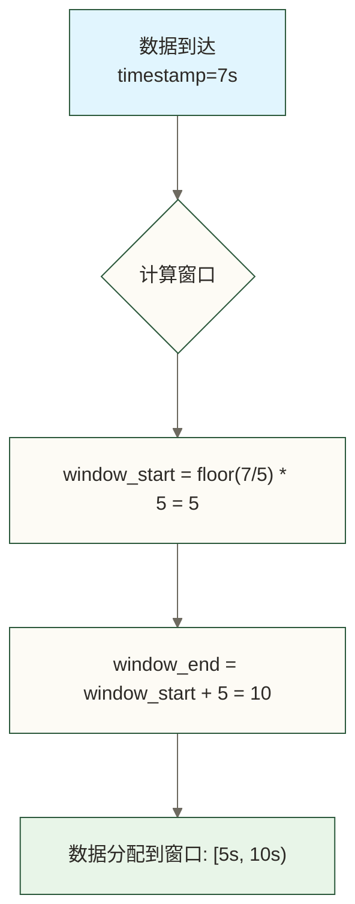
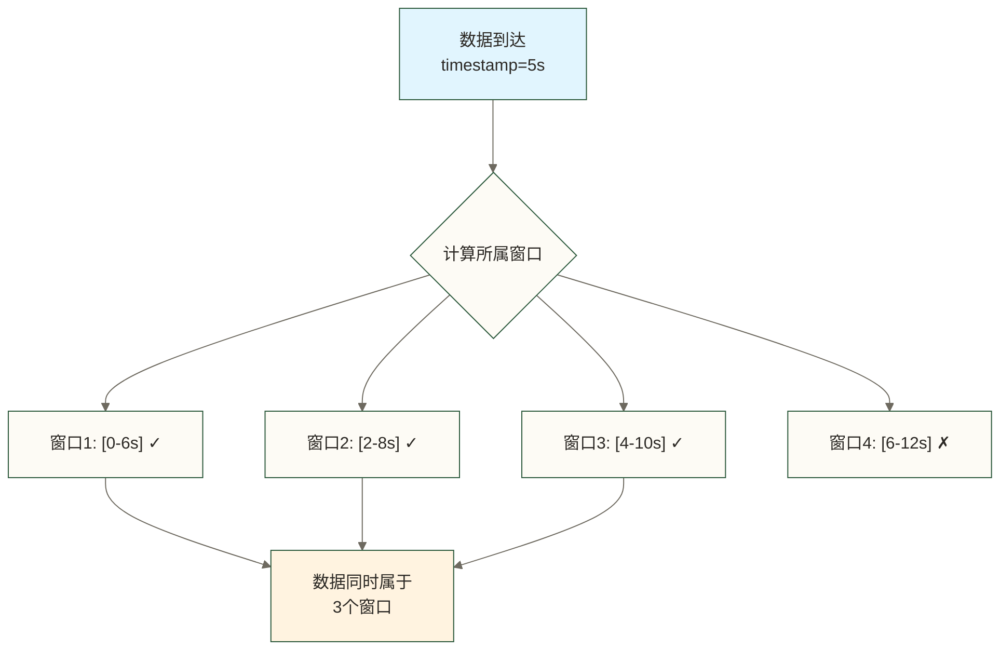
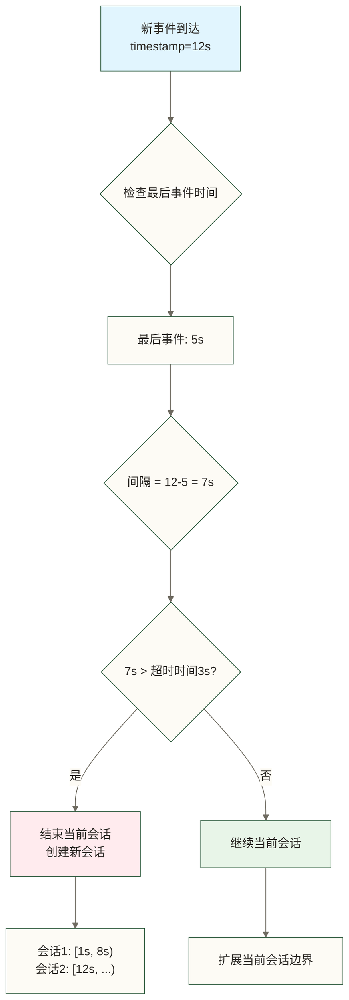

# 🕐 Flink窗口概念 - 给无界数据流加上时间边界

> [!abstract] 📋 本节概览
> - 🎯 **学习目标**：理解窗口概念和基本窗口类型，掌握时间边界处理的核心思想
> - 📚 **前置知识**：[[【技术与工具】/Flink/10-Flink数据输出|Flink数据输出]]
> - ⏱️ **预计用时**：25分钟
> - 🔧 **核心概念**：窗口、时间边界、数据聚合、时间语义
> - 💡 **关键收获**：掌握在无界流中进行有界计算的方法，理解时间在流处理中的核心作用

## 🎯 窗口的核心价值

**Flink的窗口机制就像现代化电影院的智能管理系统，让连续不断的数据流变成有节奏的业务洞察！**

**窗口机制就像电影院的智能场次管理系统**

想象你经营一家现代化的智能电影院，观众不断地从各个地方流入，**就像数据流一样连续不断**。但是，你不可能让观众一直等待，也不可能让他们随时进入放映厅。你需要一个**智能的场次管理系统**，能够：

**将连续的观众流化为有组织的场次服务**

在这个智能电影院中，传统的"想来就来、想走就走"的模式会带来很多问题：

❌ **无法统计观影数据** - 你永远不知道今天有多少人看电影，只能知道"截至目前有多少人"

❌ **资源无法合理分配** - 空调、灯光、清洁工作都无法计划，因为不知道什么时候会有多少观众

❌ **无法发现业务规律** - 不知道哪个时间段观众最多，哪部电影最受欢迎

❌ **系统资源会崩溃** - 如果记录每个观众的所有信息，最终会占满全部存储空间

但是，如果有了**智能场次管理系统**（窗口机制），情况就完全不同了：

✅ **有意义的业务统计** - "上午场有200人，下午场有350人，看来下午场更受欢迎"

✅ **资源优化分配** - 根据各场次的观众数量，合理配置人员和设备

✅ **发现业务规律** - 分析不同时间段的观影偏好，优化场次安排

✅ **系统资源可管理** - 窗口可配合增量聚合和状态清理减少历史数据保留，但重叠窗口、活跃键数量和迟到保留仍会影响资源占用

**技术对应**：Flink的窗口机制就是这样一个智能系统，它将无限的数据流切分为有限的时间窗口，在每个窗口内进行数据聚合和分析，从而将"无穷大的数字"转化为"有用的商业洞察"。
## 📊 窗口基本概念体系

### 🔍 窗口的本质

**专业定义**：窗口是流处理中的数据分组机制，可按时间、计数等规则划分数据。本节主要讨论时间窗口：按所选时间语义分组，并由触发器决定何时计算和输出；会话窗口不一定产生固定周期的统计结果。

**窗口就像电影院的场次管理！**

想象你管理一家电影院，观众不断涌入，但你不能等所有观众都到齐了才开始放电影。你需要设置**固定的播放时段**：比如上午10点场、下午2点场、晚上8点场等等。

每个时段就是一个"窗口"，具有以下特点：
- **🕐 有明确的开始和结束时间**：比如10:00-12:00是上午场
- **🎬 场次内的观众可以一起观影**：同一场次的观众享受相同服务  
- **📊 每场结束后可以统计数据**：比如这一场有200个观众
- **⚰️ 场次结束就是结束了**：观众离场，为下一场做准备

这样的好处是显而易见的：
- **有助于控制状态规模**：可避免长期保留全部历史记录，但内存占用仍取决于聚合方式、窗口重叠、键数量和清理策略
- **统计更有意义**：知道"每场平均200人"比"总共看过10万人"更有参考价值
- **可以发现规律**：比如发现晚场观众特别多，可以考虑增加晚场次数

**生活化理解**：就像现代工厂的生产班次管理
- **生产线**：像数据流，持续不断地生产产品
- **工作班次**：像时间窗口，将生产时间分为不同班次
- **班次统计**：像窗口计算，统计每个班次的生产量
- **生产报告**：像窗口结果，定期产生生产报告

### 📋 为什么需要窗口？看个教学假设例子！

假设你是一个电商平台的运营，老板问你："今天网站访问情况如何？"

**❌ 没有窗口的尴尬回答**：  
"截止到现在，总共有325万人访问过我们网站。"

老板：？？？这个数字对我有什么用？昨天是324万，前天是323万...我想知道的是今天的情况啊！

**✅ 有窗口的专业回答**：  
"今天10点-11点有1200人访问，11点-12点有1800人访问，看起来中午时段访问量在上升。"

老板：👍 这才是我想要的信息！

**窗口的威力在于**：

🧠 **让数据产生智慧**  
无窗口就像一个只会数数的机器人："1, 2, 3, 4..."数到天荒地老也没有任何商业价值。  
有窗口就像一个会分析的助手："上午访问少，下午访问多，建议在下午投放更多广告。"

💾 **帮助管理状态资源，而非保证系统不会崩溃**  
无窗口就像一个永远不清理房间的人，最终会被垃圾淹没。  
有窗口就像定期整理房间，用完的数据及时清理，保持系统轻装上阵。

📊 **让趋势清晰可见**  
仅展示累计访问量容易掩盖短期变化；无窗口也可以输出其他指标，并不意味着图表必然是一条向上的直线。  
有窗口的数据会呈现波浪形，能清楚看到高峰期和低谷期。

**简单来说**：窗口让流数据从"无穷大的数字"变成了"有用的商业洞察"！

## 🕐 时间窗口类型详解

### ⏰ 滚动窗口：严格按班次工作

**滚动窗口就像工厂的严格班次制度！**

想象一个24小时不停工的汽车工厂，工人分为三个班次：
- **早班**：8:00-16:00 
- **中班**：16:00-24:00
- **夜班**：24:00-8:00

每个工人只属于一个班次，**不允许跨班工作**。早班的工人绝对不会出现在中班，每个班次的工作量统计也是独立的。

**滚动窗口就是这样！**每个时间段都有固定的边界，**互不重叠，互不影响**。

比如设置5秒的滚动窗口：
- 0-5秒是第一个窗口
- 5-10秒是第二个窗口  
- 10-15秒是第三个窗口

在零偏移、5秒滚动时间窗口中，所选时间语义下时间戳为7秒的数据被分配到[5秒, 10秒)，不会同时分配到其他窗口；事件时间不一定等于到达时间。

**可视化原理**：


```mermaid
%%{init: {"theme":"base","themeVariables":{"fontFamily":"PingFang SC, -apple-system, Source Han Serif SC, serif","fontSize":"16px","background":"#FDFBF5","primaryColor":"#FDFBF5","primaryTextColor":"#2D2A26","primaryBorderColor":"#6E6A60","secondaryColor":"#E8EFE8","secondaryBorderColor":"#8FA890","secondaryTextColor":"#2D2A26","tertiaryColor":"#FDFBF5","tertiaryBorderColor":"#9A9488","tertiaryTextColor":"#6E6A60","lineColor":"#6E6A60","textColor":"#2D2A26","mainBkg":"#FDFBF5","nodeBorder":"#2D5A3D","clusterBkg":"#F3EEDF","clusterBorder":"#9A9488","edgeLabelBackground":"#FDFBF5"},"flowchart":{"htmlLabels":true,"curve":"basis","padding":20,"nodeSpacing":60,"rankSpacing":70,"useMaxWidth":false},"themeCSS":".node rect, .node polygon, .node circle { stroke-width: 1.5px; } .edgePath .path { stroke-width: 1.5px; } .cluster-label .nodeLabel, .cluster-label foreignObject { color: #2D2A26 !important; } .edgeLabel, .edgeLabel foreignObject { color: #2D2A26 !important; background-color: #FDFBF5; } .edgeLabel rect { fill: #FDFBF5; }"}}%%
gantt
    title 滚动窗口时间轴示例 (窗口大小: 5秒)
    dateFormat X
    axisFormat %L
    
    section 数据流
    数据A    :0, 1
    数据B    :2, 3
    数据C    :4, 5
    数据D    :7, 8
    数据E    :9, 10
    数据F    :12, 13
    
    section 窗口划分
    窗口1[0-5s]   :crit, w1, 0, 5
    窗口2[5-10s]  :crit, w2, 5, 10
    窗口3[10-15s] :crit, w3, 10, 15
```

**窗口分配逻辑**：


**核心特征**：
- **固定大小**：所有窗口大小相同
- **无重叠**：相邻窗口之间没有重叠
- **连续覆盖**：窗口连续覆盖整个时间轴
- **简单高效**：计算逻辑简单，性能高效

**应用场景**：
- **周期性统计**：每小时、每天、每周的统计
- **实时监控**：定期产生监控指标
- **业务报表**：生成定期的业务报表
- **性能分析**：分析系统性能的时间趋势

**生活化理解**：就像现代地铁的运营时刻表
- **固定班次**：像滚动窗口，每5分钟一班地铁
- **无重叠时间**：像窗口无重叠，一班结束后下一班才开始
- **连续服务**：像连续覆盖，全天24小时提供服务
- **准时到达**：像固定大小，每班车运行时间相同

### 🔄 滑动窗口：移动的观察镜头

**滑动窗口就像一台移动摄影机！**

想象你站在繁忙的十字路口，手里拿着一个摄像头，每隔2秒钟就向前移动一下位置，但摄像头始终保持录制最近6秒的画面。

这样的结果是：
- **第一个位置**：拍摄0-6秒的画面
- **第二个位置**：拍摄2-8秒的画面  
- **第三个位置**：拍摄4-10秒的画面
- **第四个位置**：拍摄6-12秒的画面

你会发现，**有些画面被重复拍摄了！**比如5秒钟发生的事情，会同时出现在第一、二、三个视频片段里。

**滑动窗口就是这个道理！**

与滚动窗口的"严格班次制度"不同，滑动窗口更像"流水线工作法"——**允许重叠，更加平滑**。

**关键参数**：
- **窗口大小**：摄像头的录制时长（比如6秒）
- **滑动步长**：移动摄像头的时间间隔（比如每2秒移动一次）

**重叠的好处**：能够提供更密集的观察结果，但能否捕捉重要变化仍取决于窗口参数、指标设计及数据完整性。

**可视化原理**：


```mermaid
%%{init: {"theme":"base","themeVariables":{"fontFamily":"PingFang SC, -apple-system, Source Han Serif SC, serif","fontSize":"16px","background":"#FDFBF5","primaryColor":"#FDFBF5","primaryTextColor":"#2D2A26","primaryBorderColor":"#6E6A60","secondaryColor":"#E8EFE8","secondaryBorderColor":"#8FA890","secondaryTextColor":"#2D2A26","tertiaryColor":"#FDFBF5","tertiaryBorderColor":"#9A9488","tertiaryTextColor":"#6E6A60","lineColor":"#6E6A60","textColor":"#2D2A26","mainBkg":"#FDFBF5","nodeBorder":"#2D5A3D","clusterBkg":"#F3EEDF","clusterBorder":"#9A9488","edgeLabelBackground":"#FDFBF5"},"flowchart":{"htmlLabels":true,"curve":"basis","padding":20,"nodeSpacing":60,"rankSpacing":70,"useMaxWidth":false},"themeCSS":".node rect, .node polygon, .node circle { stroke-width: 1.5px; } .edgePath .path { stroke-width: 1.5px; } .cluster-label .nodeLabel, .cluster-label foreignObject { color: #2D2A26 !important; } .edgeLabel, .edgeLabel foreignObject { color: #2D2A26 !important; background-color: #FDFBF5; } .edgeLabel rect { fill: #FDFBF5; }"}}%%
gantt
    title 滑动窗口时间轴示例 (窗口大小: 6秒, 滑动步长: 2秒)
    dateFormat X
    axisFormat %L
    
    section 数据流
    数据A    :0, 1
    数据B    :2, 3
    数据C    :4, 5
    数据D    :6, 7
    数据E    :8, 9
    数据F    :10, 11
    
    section 窗口重叠
    窗口1[0-6s]   :w1, 0, 6
    窗口2[2-8s]   :w2, 2, 8
    窗口3[4-10s]  :w3, 4, 10
    窗口4[6-12s]  :w4, 6, 12
```

**窗口重叠分析**：


**核心特征**：
- **固定大小**：所有窗口大小相同
- **可重叠**：滑动步长小于窗口大小时相邻窗口重叠；等于窗口大小时不重叠，大于窗口大小时会出现覆盖间隙
- **滑动步长**：控制窗口滑动的距离
- **平滑结果**：产生更平滑的统计结果

**滑动参数**：
- **窗口大小**：每个窗口的时间长度
- **滑动步长**：窗口滑动的距离
- **重叠程度**：相邻窗口的重叠时长为max(窗口大小−滑动步长, 0)；窗口大小与步长的比值可辅助估计窗口重复分配开销

**应用场景**：
- **趋势分析**：分析数据的变化趋势
- **异常检测**：检测数据的异常变化
- **平滑统计**：产生平滑的统计曲线
- **实时预警**：基于滑动窗口进行实时预警

**生活化理解**：就像现代相机的连续拍摄功能
- **拍摄窗口**：像滑动窗口，每次拍摄的时间段
- **连续拍摄**：像窗口滑动，持续不断地拍摄
- **重叠画面**：像窗口重叠，相邻拍摄有重叠部分
- **平滑视频**：像平滑结果，产生连续的影像

### 🎯 会话窗口：智能的聊天记录

**会话窗口就像微信的聊天记录分组！**

你有没有注意过，当你和朋友聊微信时，如果中间停止聊天一段时间，微信会**自动把前后的消息分开显示**？

比如：
- **上午的聊天**：从9点聊到9点30分，然后都去忙了
- **中间静默**：9点30分到下午2点，没有任何消息
- **下午的聊天**：从2点开始又继续聊天

这里借聊天间隔作类比：教学示例把它们视为**两个不同的聊天会话**，并不据此断言微信实际采用了Flink式会话划分。

**会话窗口就是这个原理！**

与前面两种窗口的"死板定时"不同，会话窗口是**"智能感应"**的：
- **有活动就延长**：只要数据持续到达，窗口就保持开放
- **按间隔划分会话**：按所选时间语义，相邻事件间隔超过设定值（比如3分钟）时通常分为不同会话；事件时间窗口的触发和清理还取决于水印与迟到配置
- **大小不固定**：有的会话可能持续10分钟，有的可能持续2小时

**实际应用举例**：

**🛒 用户购物会话**  
用户进入电商网站，浏览了商品A（1分钟后）→ 加入购物车（2分钟后）→ 继续逛其他商品（5分钟后）→ 最终下单（然后离开网站）。这整个过程就是一个购物会话。

**📞 客服对话会话**  
用户开始咨询客服问题，中间可能有几分钟的思考时间，但只要在超时时间内继续对话，就认为是同一个服务会话。

**关键参数**：**会话超时时间**（Session Timeout）
- 设置太短：可能把一次完整的用户行为拆分成多个会话
- 设置太长：可能把多次不相关的行为合并成一个会话

**会话窗口的智慧**：它能**根据用户行为的自然节奏**来划分数据，比死板的时间切分更符合业务逻辑！

**可视化原理**：


```mermaid
%%{init: {"theme":"base","themeVariables":{"fontFamily":"PingFang SC, -apple-system, Source Han Serif SC, serif","fontSize":"16px","background":"#FDFBF5","primaryColor":"#FDFBF5","primaryTextColor":"#2D2A26","primaryBorderColor":"#6E6A60","secondaryColor":"#E8EFE8","secondaryBorderColor":"#8FA890","secondaryTextColor":"#2D2A26","tertiaryColor":"#FDFBF5","tertiaryBorderColor":"#9A9488","tertiaryTextColor":"#6E6A60","lineColor":"#6E6A60","textColor":"#2D2A26","mainBkg":"#FDFBF5","nodeBorder":"#2D5A3D","clusterBkg":"#F3EEDF","clusterBorder":"#9A9488","edgeLabelBackground":"#FDFBF5"},"flowchart":{"htmlLabels":true,"curve":"basis","padding":20,"nodeSpacing":60,"rankSpacing":70,"useMaxWidth":false},"themeCSS":".node rect, .node polygon, .node circle { stroke-width: 1.5px; } .edgePath .path { stroke-width: 1.5px; } .cluster-label .nodeLabel, .cluster-label foreignObject { color: #2D2A26 !important; } .edgeLabel, .edgeLabel foreignObject { color: #2D2A26 !important; background-color: #FDFBF5; } .edgeLabel rect { fill: #FDFBF5; }"}}%%
gantt
    title 会话窗口示例 (超时时间: 3秒)
    dateFormat X
    axisFormat %L
    
    section 用户A数据流
    事件1    :1, 2
    事件2    :3, 4
    事件3    :5, 6
    静默期   :6, 9
    事件4    :12, 13
    事件5    :14, 15
    
    section 会话窗口
    会话1[1-8s)   :crit, s1, 1, 8
    会话2[12-17s) :crit, s2, 12, 17
```

**会话判断逻辑**：


**核心特征**：
- **动态大小**：窗口大小根据数据活动动态调整
- **活动驱动**：基于数据活动定义窗口边界
- **超时机制**：设置超时时间判断会话结束
- **用户行为**：适合分析用户行为模式

**会话参数**：
- **超时时间**：判断会话结束的时间间隔
- **最小大小**：本节标准会话窗口不提供独立的最小长度参数，边界由事件时间戳与会话间隔决定
- **最大大小**：本节标准会话窗口不提供独立的最大长度参数；持续活动可能不断延长会话，业务上限需另行设计

**应用场景**：
- **用户行为分析**：分析用户的访问会话
- **在线游戏**：分析玩家的游戏会话
- **电商购物**：分析用户的购物会话
- **应用使用**：分析用户的应用使用模式

**生活化理解**：就像现代银行的客户服务
- **服务时间**：像会话窗口，根据客户需求提供服务
- **客户活动**：像数据活动，客户有需求时提供服务
- **服务结束**：像会话结束，客户离开后服务结束
- **个性化服务**：像动态大小，根据客户需求调整服务时间

## ⏰ 时间语义详解

### 🕐 处理时间（Processing Time）

**专业定义**：处理时间是数据被处理时系统的时间，即算子处理数据时的当前时间。它是最简单的时间语义，但不考虑数据产生的时间。

**核心特征**：
- **系统时间**：基于处理系统的当前时间
- **简单高效**：计算简单，性能高效
- **无需等待水印**：按系统时钟推进，但仍有窗口等待时间和处理延迟
- **不确定性**：结果可能因处理延迟而变化

**适用场景**：
- **实时监控**：监控系统处理性能
- **开发测试**：快速验证处理逻辑
- **简单统计**：对时间精度要求不高的场景
- **性能优化**：需要最大化处理性能的场景

**生活化理解**：就像现代餐厅的点餐系统
- **点餐时间**：像处理时间，顾客点餐时系统记录的时间
- **实时处理**：像简单高效，立即处理点餐请求
- **系统时间**：像系统时间，基于餐厅系统的时间
- **服务效率**：像性能优化，优先考虑服务效率

### 📅 事件时间（Event Time）

**专业定义**：事件时间是数据实际产生的时间，通常嵌入在数据本身中。它反映了数据在真实世界中产生的时间，是最准确的时间语义。

**核心特征**：
- **数据时间**：基于数据本身的时间戳
- **准确性高**：反映数据真实产生时间
- **乱序处理**：支持处理乱序到达的数据
- **水印机制**：通过水印处理延迟数据

**技术挑战**：
- **乱序数据**：数据可能不按时间顺序到达
- **延迟数据**：某些数据可能延迟很长时间到达
- **水印管理**：需要合理设置水印策略
- **状态管理**：需要保存更多状态信息

**生活化理解**：就像现代物流的包裹追踪
- **发货时间**：像事件时间，包裹实际发货的时间
- **物流追踪**：像乱序处理，包裹可能不按顺序到达
- **延迟处理**：像延迟数据，某些包裹可能延迟到达
- **准确记录**：像准确性高，记录真实的发货时间

### 🔄 摄入时间（Ingestion Time）

**专业定义**：摄入时间是数据进入Flink系统的时间，是处理时间和事件时间的折中方案。它在数据进入系统时分配时间戳。

**核心特征**：
- **系统分配**：由Flink系统分配时间戳
- **不保证顺序**：在入口分配时间戳不等于保证跨分区、跨算子的全局处理顺序
- **延迟可控**：延迟相对可控和可预测
- **折中方案**：在准确性和性能间取得平衡

**适用场景**：
- **系统监控**：监控系统内部的数据流
- **性能分析**：分析系统处理性能
- **入口时间统计**：关注数据进入系统时刻的场景；不能单靠摄入时间保证处理顺序
- **平衡需求**：需要在准确性和性能间平衡的场景

**生活化理解**：就像现代图书馆的图书登记
- **登记时间**：像摄入时间，图书进入图书馆时登记的时间
- **系统管理**：像系统分配，由图书馆系统分配时间
- **入口记录**：像摄入时间，记录登记时刻，但登记时间不保证后续处理顺序
- **管理效率**：像折中方案，在准确性和效率间平衡

## 🔍 窗口底层实现原理

### ⚙️ 窗口数据结构与存储

**窗口状态存储机制**：
- **窗口状态键**：每个窗口有唯一的状态键，格式为 `(key, window)`
- **时间索引**：按时间组织窗口，便于定时器管理
- **内存管理**：使用堆内存或RocksDB存储窗口状态
- **状态清理**：由窗口算子的清理机制管理；事件时间窗口通常需等水印推进到清理时刻，允许迟到会延后清理，触发计算不等于立即清除状态

**窗口分配器(WindowAssigner)原理**：
```java
// 滚动窗口分配算法
public class TumblingTimeWindows extends WindowAssigner<Object, TimeWindow> {
    @Override
    public Collection<TimeWindow> assignWindows(Object element, long timestamp, WindowAssignerContext context) {
        // 计算窗口开始时间
        long start = TimeWindow.getWindowStartWithOffset(timestamp, offset, size);
        // 返回单个窗口
        return Collections.singletonList(new TimeWindow(start, start + size));
    }
}

// 滑动窗口分配算法  
public class SlidingTimeWindows extends WindowAssigner<Object, TimeWindow> {
    @Override
    public Collection<TimeWindow> assignWindows(Object element, long timestamp, WindowAssignerContext context) {
        List<TimeWindow> windows = new ArrayList<>();
        // 计算该元素属于哪些窗口
        long lastStart = TimeWindow.getWindowStartWithOffset(timestamp, offset, slide);
        for (long start = lastStart; start > timestamp - size; start -= slide) {
            windows.add(new TimeWindow(start, start + size));
        }
        return windows;
    }
}
```

**水印驱动的窗口触发**：
```java
// 水印处理流程
1. 数据到达 → 更新窗口状态
2. 水印到达 → 检查可触发的窗口
3. 触发计算 → 输出结果（FIRE本身不代表清除状态）
4. 按清理定时器及允许迟到配置清理过期窗口；清理定时器通常在处理元素时注册
```

### 🎯 窗口触发机制深度解析

#### ⏰ 基于时间的触发机制

**EventTimeTrigger触发原理**：
```java
public class EventTimeTrigger extends Trigger<Object, TimeWindow> {
    @Override
    public TriggerResult onElement(Object element, long timestamp, TimeWindow window, TriggerContext ctx) {
        // 为窗口注册定时器
        if (window.maxTimestamp() <= ctx.getCurrentWatermark()) {
            // 如果水印已经超过窗口结束时间，立即触发
            return TriggerResult.FIRE;
        } else {
            // 否则注册定时器，等待水印
            ctx.registerEventTimeTimer(window.maxTimestamp());
            return TriggerResult.CONTINUE;
        }
    }
    
    @Override
    public TriggerResult onEventTime(long time, TimeWindow window, TriggerContext ctx) {
        // 当水印到达窗口结束时间时触发
        return time == window.maxTimestamp() ? TriggerResult.FIRE : TriggerResult.CONTINUE;
    }
}
```

**ProcessingTimeTrigger触发原理**：
```java
public class ProcessingTimeTrigger extends Trigger<Object, TimeWindow> {
    @Override
    public TriggerResult onElement(Object element, long timestamp, TimeWindow window, TriggerContext ctx) {
        // 注册处理时间定时器
        ctx.registerProcessingTimeTimer(window.maxTimestamp());
        return TriggerResult.CONTINUE;
    }
    
    @Override
    public TriggerResult onProcessingTime(long time, TimeWindow window, TriggerContext ctx) {
        // 处理时间到达时立即触发
        return TriggerResult.FIRE;
    }
}
```

#### 🔢 基于计数的触发机制

**CountTrigger实现原理**：
```java
public class CountTrigger<W extends Window> extends Trigger<Object, W> {
    private final long maxCount;
    private final ReducingStateDescriptor<Long> stateDesc;
    
    @Override
    public TriggerResult onElement(Object element, long timestamp, W window, TriggerContext ctx) {
        ReducingState<Long> count = ctx.getPartitionedState(stateDesc);
        count.add(1L);
        // 当计数达到阈值时触发
        if (count.get() >= maxCount) {
            count.clear();
            return TriggerResult.FIRE;
        }
        return TriggerResult.CONTINUE;
    }
}
```

## 💻 窗口操作代码示例

以下示例保留Java、PyFlink及SQL三种实现方式，但未指定版本和依赖，也未提供运行验证。Java/Python使用快速结束的有界源，处理时间窗口可能尚未触发作业就已结束；观察周期输出应另行使用持续输入。前文底层类和后文优化片段是省略实现的原理示意，不能直接独立编译。

### 🎯 选择适合你的实现方式

#### 📚 Java版本 - 窗口操作详解

```java
// WindowOperationsExample.java
import org.apache.flink.api.common.functions.ReduceFunction;
import org.apache.flink.api.java.tuple.Tuple2;
import org.apache.flink.streaming.api.datastream.DataStream;
import org.apache.flink.streaming.api.environment.StreamExecutionEnvironment;
import org.apache.flink.streaming.api.windowing.assigners.*;
import org.apache.flink.streaming.api.windowing.time.Time;
import org.apache.flink.streaming.api.windowing.windows.TimeWindow;

public class WindowOperationsExample {
    
    public static void main(String[] args) throws Exception {
        StreamExecutionEnvironment env = StreamExecutionEnvironment.getExecutionEnvironment();
        
        // 模拟数据流：(用户ID, 访问次数)
        DataStream<Tuple2<String, Integer>> userEvents = env.fromElements(
            new Tuple2<>("user1", 1),
            new Tuple2<>("user2", 1), 
            new Tuple2<>("user1", 1),
            new Tuple2<>("user3", 1)
        );
        
        // 1. 滚动窗口示例 - 每5秒统计一次用户访问
        DataStream<Tuple2<String, Integer>> tumblingResult = userEvents
            .keyBy(event -> event.f0)  // 按用户ID分组
            .window(TumblingProcessingTimeWindows.of(Time.seconds(5)))  // 5秒滚动窗口
            .reduce(new ReduceFunction<Tuple2<String, Integer>>() {
                @Override
                public Tuple2<String, Integer> reduce(Tuple2<String, Integer> value1, 
                                                     Tuple2<String, Integer> value2) {
                    return new Tuple2<>(value1.f0, value1.f1 + value2.f1);
                }
            });
            
        // 2. 滑动窗口示例 - 每2秒计算最近5秒的访问量
        DataStream<Tuple2<String, Integer>> slidingResult = userEvents  
            .keyBy(event -> event.f0)
            .window(SlidingProcessingTimeWindows.of(Time.seconds(5), Time.seconds(2)))  // 5秒窗口，2秒滑动
            .reduce((value1, value2) -> new Tuple2<>(value1.f0, value1.f1 + value2.f1));
            
        // 3. 会话窗口示例 - 基于用户活跃度的会话统计
        DataStream<Tuple2<String, Integer>> sessionResult = userEvents
            .keyBy(event -> event.f0) 
            .window(ProcessingTimeSessionWindows.withGap(Time.seconds(10)))  // 10秒无活动则结束会话
            .reduce((value1, value2) -> new Tuple2<>(value1.f0, value1.f1 + value2.f1));
        
        // 输出结果
        tumblingResult.print("滚动窗口结果");
        slidingResult.print("滑动窗口结果");  
        sessionResult.print("会话窗口结果");
        
        env.execute("Window Operations Example");
    }
}
```

#### 🐍 Python版本 - PyFlink窗口操作

```python
# window_operations.py
from pyflink.datastream import StreamExecutionEnvironment
from pyflink.datastream.window import TumblingProcessingTimeWindows, SlidingProcessingTimeWindows
from pyflink.common import Time
from pyflink.datastream.functions import ReduceFunction
from pyflink.common.typeinfo import Types

class SumReducer(ReduceFunction):
    def reduce(self, value1, value2):
        return (value1[0], value1[1] + value2[1])

def window_operations():
    env = StreamExecutionEnvironment.get_execution_environment()
    
    # 创建数据源
    user_events = env.from_collection([
        ("user1", 1),
        ("user2", 1), 
        ("user1", 1),
        ("user3", 1)
    ], type_info=Types.TUPLE([Types.STRING(), Types.INT()]))
    
    # 1. 滚动窗口 - 每5秒统计
    tumbling_result = user_events \
        .key_by(lambda event: event[0]) \
        .window(TumblingProcessingTimeWindows.of(Time.seconds(5))) \
        .reduce(SumReducer())
    
    # 2. 滑动窗口 - 每2秒统计最近5秒
    sliding_result = user_events \
        .key_by(lambda event: event[0]) \
        .window(SlidingProcessingTimeWindows.of(Time.seconds(5), Time.seconds(2))) \
        .reduce(SumReducer())
    
    # 输出结果
    tumbling_result.print()
    sliding_result.print()
    
    env.execute("Python Window Operations")

if __name__ == '__main__':
    window_operations()
```

#### 📊 SQL版本 - Flink SQL窗口函数

```sql
-- 创建数据源表
CREATE TABLE user_events (
    user_id STRING,
    event_time TIMESTAMP(3),
    visit_count INT,
    WATERMARK FOR event_time AS event_time - INTERVAL '5' SECOND
) WITH (
    'connector' = 'datagen',
    'rows-per-second' = '10'
);

-- 创建输出表
CREATE TABLE window_results (
    user_id STRING,
    window_start TIMESTAMP(3),
    window_end TIMESTAMP(3),
    total_visits BIGINT
) WITH (
    'connector' = 'print'
);

-- 1. 滚动窗口查询 - 每分钟统计用户访问量
INSERT INTO window_results
SELECT 
    user_id,
    TUMBLE_START(event_time, INTERVAL '1' MINUTE) as window_start,
    TUMBLE_END(event_time, INTERVAL '1' MINUTE) as window_end,
    SUM(visit_count) as total_visits
FROM user_events
GROUP BY 
    user_id,
    TUMBLE(event_time, INTERVAL '1' MINUTE);

-- 2. 滑动窗口查询 - 每30秒计算最近2分钟访问量  
SELECT 
    user_id,
    HOP_START(event_time, INTERVAL '30' SECOND, INTERVAL '2' MINUTE) as window_start,
    HOP_END(event_time, INTERVAL '30' SECOND, INTERVAL '2' MINUTE) as window_end,
    SUM(visit_count) as total_visits
FROM user_events
GROUP BY 
    user_id,
    HOP(event_time, INTERVAL '30' SECOND, INTERVAL '2' MINUTE);

-- 3. 会话窗口查询 - 基于用户活跃度分组
SELECT 
    user_id,
    SESSION_START(event_time, INTERVAL '10' MINUTE) as session_start,
    SESSION_END(event_time, INTERVAL '10' MINUTE) as session_end,
    COUNT(*) as event_count
FROM user_events  
GROUP BY 
    user_id,
    SESSION(event_time, INTERVAL '10' MINUTE);
```

### 🔍 窗口性能优化原理

**内存优化策略**：
```java
// 1. 增量聚合 - 避免存储所有数据
.window(TumblingProcessingTimeWindows.of(Time.seconds(5)))
.aggregate(new AverageAggregate());  // 只存储累加值和计数

// 2. 状态TTL配置示意 - 仅构造配置不会生效；需应用于支持TTL的状态描述符，不能替代窗口生命周期清理
StateTtlConfig ttlConfig = StateTtlConfig
    .newBuilder(Time.hours(1))
    .setUpdateType(StateTtlConfig.UpdateType.OnCreateAndWrite)
    .build();

// 3. 并行度调优 - 合理设置窗口算子并行度
.window(...).reduce(...).setParallelism(4)  // 示意：先应用窗口计算，再对结果算子设置并行度
```

**触发器优化**：

下面的HybridTrigger仅展示元素到达时的条件判断，未提供计数更新、定时器注册、状态清理和合并逻辑。timestamp是元素时间戳，不应直接当作处理时间；没有新元素到达时，这段代码不会主动按时间触发。
```java
// 自定义触发器 - 混合时间和计数触发
public class HybridTrigger extends Trigger<Object, TimeWindow> {
    private final long maxCount;
    private final long maxTime;
    
    @Override
    public TriggerResult onElement(Object element, long timestamp, TimeWindow window, TriggerContext ctx) {
        // 检查计数条件
        if (getCount(ctx) >= maxCount) {
            return TriggerResult.FIRE;
        }
        // 检查时间条件
        if (timestamp >= window.getStart() + maxTime) {
            return TriggerResult.FIRE;
        }
        return TriggerResult.CONTINUE;
    }
}
```

---

## 📋 本节要点回顾

### ✅ 窗口概念掌握检查
- [ ] 理解窗口的核心价值和必要性
- [ ] 掌握滚动窗口、滑动窗口、会话窗口的特点
- [ ] 了解处理时间、事件时间、摄入时间的区别
- [ ] 理解窗口触发机制的工作原理
- [ ] 能够根据业务需求选择合适的窗口类型

### 🎯 实践能力检查
- [ ] 能够设计基于时间的数据分析方案
- [ ] 理解不同时间语义的适用场景
- [ ] 掌握窗口参数配置的基本方法

### 🔗 学习路径连接
**已完成**：✅ 流处理基本概念 → ✅ Flink核心特性 → ✅ Flink核心组件 → ✅ Flink架构原理 → ✅ Flink环境安装 → ✅ 第一个Flink程序 → ✅ DataStream API基础 → ✅ Flink数据源配置 → ✅ 数据转换操作 → ✅ Flink数据输出 → ✅ Flink窗口概念  
**下一步**：12-Flink时间语义 - 深入学习Flink中的时间概念和水印机制

记住：窗口是流处理中时间维度的核心概念，掌握好窗口机制能够构建出强大的实时数据分析应用！ 