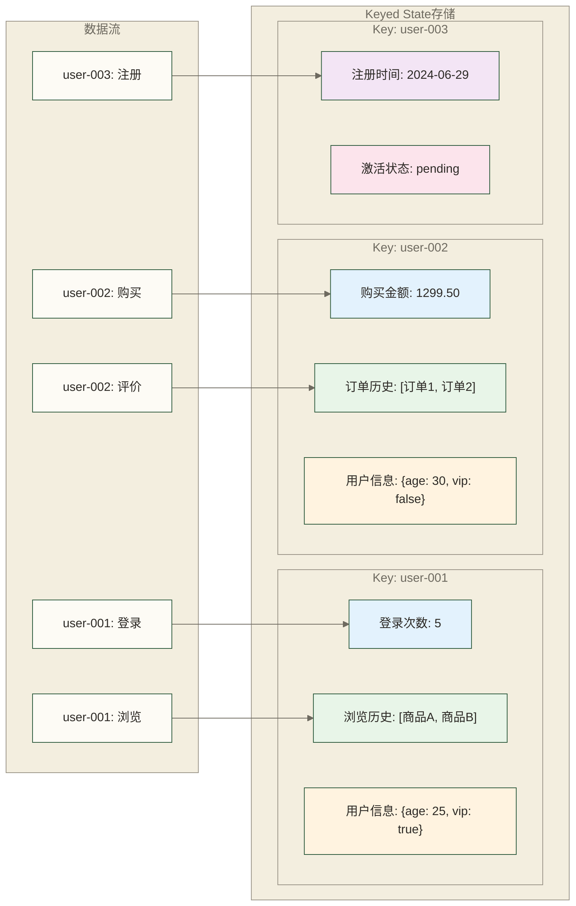
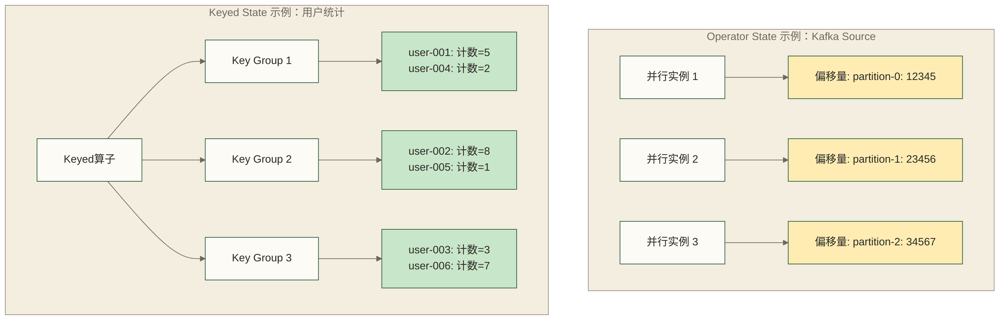
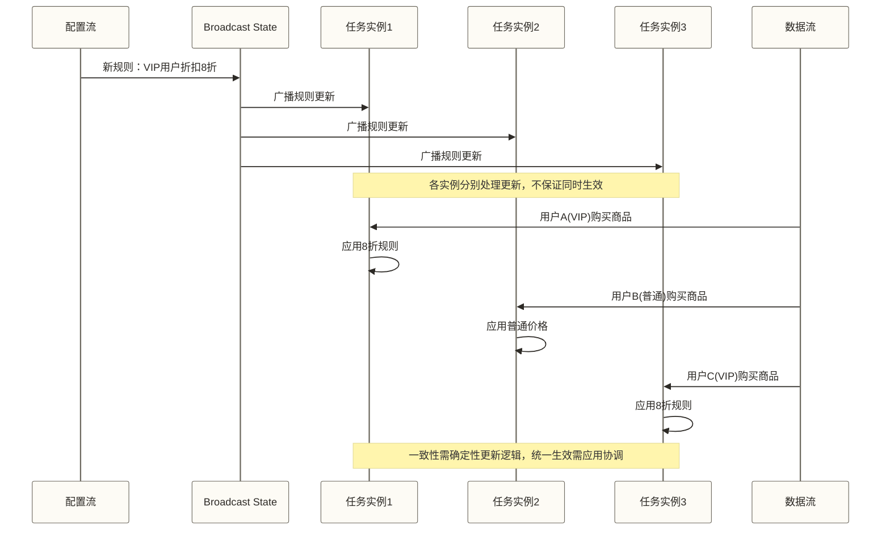
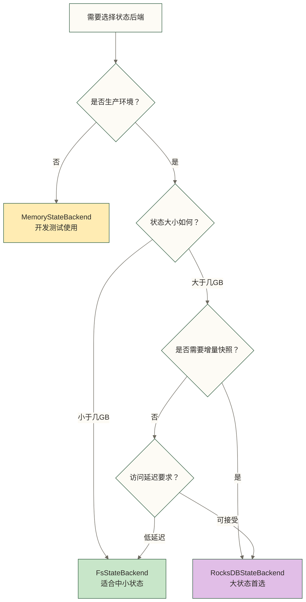
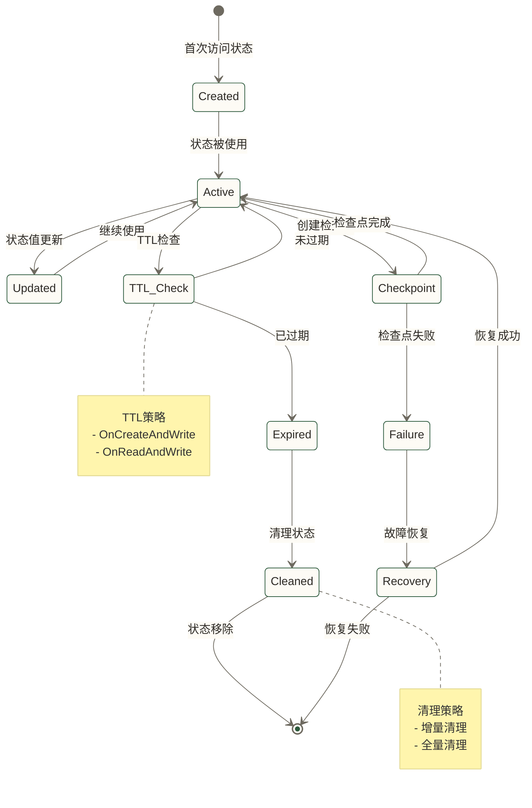
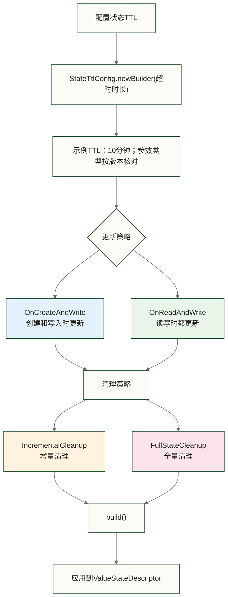

# 🧠 Flink状态管理 - 让流处理程序记住过去

> [!abstract] 📋 本节概览
> - 🎯 **学习目标**：理解Flink状态管理的概念和应用，掌握有状态流处理的核心机制
> - 📚 **前置知识**：[[【技术与工具】/Flink/12-Flink时间语义|Flink时间语义]]
> - ⏱️ **预计用时**：25分钟
> - 🔧 **核心概念**：状态、KeyedState、OperatorState、状态后端、状态生命周期
> - 💡 **关键收获**：掌握在流处理中保存和管理数据状态的能力，理解状态在分布式环境中的管理机制

## 🎯 状态管理的核心价值

### 💾 智能银行系统的"记忆力"挑战

想象一下，你正在经营一家现代化的智能银行。每天有成千上万的客户通过各种渠道进行交易、查询和操作。突然有一天，银行的智能风控系统出现了严重问题：

**银行的风控逻辑**：如果客户5分钟内连续输错密码超过3次，系统应该立即锁定账户保护资金安全。

**诡异的现象**：
- 张三先生连续输错了4次密码，账户竟然没有被锁定，资金面临风险
- 李女士只是输错了2次密码，账户却莫名其妙被锁定了，无法正常使用
- 更糟糕的是，每次银行系统重启后，所有的错误尝试记录都消失了，就像失忆一样

**技术分析**：原来银行的程序员把客户的登录失败次数存储在了系统的临时记忆里（HashMap），就像银行柜员只是用便签纸记录客户信息一样。当系统重启、扩容或出现故障时，这些"便签纸"就丢失了，银行失去了对客户历史行为的记忆。

**智能银行的解决方案**：使用Flink的专业状态管理系统，就像给银行建立一个可靠的客户档案系统。

```scala
// 传统的"便签纸"方式：不可靠
var failedAttempts = new HashMap[String, Int]()

// 智能银行的"档案系统"方式：专业可靠
lazy val failedAttemptsState: ValueState[Int] = getRuntimeContext
  .getState(new ValueStateDescriptor[Int]("failed-attempts", classOf[Int]))
```

**专业技术对应**：Flink的托管状态可结合检查点提供状态快照和故障恢复能力。恢复需要启用并成功完成检查点、配置可用的持久化存储及恢复路径，并依赖数据源的重放能力；仅声明ValueState并不能保证故障或重启后状态不丢失。

这就是为什么流处理系统需要专业的状态管理——银行需要完整的"客户记忆"，而且这种记忆必须是可靠的、持久的、容错的。

### 🔄 状态管理架构总览

```mermaid
%%{init: {"theme":"base","themeVariables":{"fontFamily":"PingFang SC, -apple-system, Source Han Serif SC, serif","fontSize":"16px","background":"#FDFBF5","primaryColor":"#FDFBF5","primaryTextColor":"#2D2A26","primaryBorderColor":"#6E6A60","secondaryColor":"#E8EFE8","secondaryBorderColor":"#8FA890","secondaryTextColor":"#2D2A26","tertiaryColor":"#FDFBF5","tertiaryBorderColor":"#9A9488","tertiaryTextColor":"#6E6A60","lineColor":"#6E6A60","textColor":"#2D2A26","mainBkg":"#FDFBF5","nodeBorder":"#2D5A3D","clusterBkg":"#F3EEDF","clusterBorder":"#9A9488","edgeLabelBackground":"#FDFBF5"},"flowchart":{"htmlLabels":true,"curve":"basis","padding":20,"nodeSpacing":60,"rankSpacing":70,"useMaxWidth":false},"themeCSS":".node rect, .node polygon, .node circle { stroke-width: 1.5px; } .edgePath .path { stroke-width: 1.5px; } .cluster-label .nodeLabel, .cluster-label foreignObject { color: #2D2A26 !important; } .edgeLabel, .edgeLabel foreignObject { color: #2D2A26 !important; background-color: #FDFBF5; } .edgeLabel rect { fill: #FDFBF5; }"}}%%
flowchart TD
    subgraph "Flink状态管理体系"
        A["🧠 Flink状态管理"] --> B["🔑 Keyed State"]
        A --> C["🔧 Operator State"]
        A --> D["🌐 Broadcast State"]
        
        B --> B1["💰 ValueState"]
        B --> B2["📋 ListState"]
        B --> B3["🗺️ MapState"]
        B --> B4["🔢 ReducingState"]
        B --> B5["📊 AggregatingState"]
        
        C --> C1["📝 ListCheckpointed"]
        C --> C2["🔗 UnionListState"]
        
        D --> D1["📡 规则引擎"]
        D --> D2["⚙️ 动态配置"]
        D --> D3["🧪 A/B测试"]
    end
    
    subgraph "状态后端选择"
        E["状态后端"] --> E1["💾 Memory<br/>(开发测试)"]
        E --> E2["💿 FileSystem<br/>(小状态生产)"]
        E --> E3["🗃️ RocksDB<br/>(大状态生产)"]
    end
    
    A --> E
    
    style A fill:#e1f5fe
    style B fill:#f3e5f5
    style C fill:#fff3e0
    style D fill:#e8f5e8
    style E fill:#fce4ec
```



## 🏗️ 状态分类体系详解

### 🔑 Keyed State：每个客户的专属档案柜

在我们的智能银行系统中，每个客户都有一个专属的电子档案柜，就像传统银行为每个客户建立的个人账户档案一样。当张先生来办理业务时，系统会自动打开张先生的专属档案柜；当李女士进行交易时，系统同时打开李女士的档案柜，两者完全独立，绝不会搞混。

**Keyed State就是这样的"客户专属档案柜"系统！**

当银行系统处理每一笔交易或操作时，它会根据客户的身份标识（就像银行卡号或身份证号）来决定应该访问哪个客户的档案柜。这种设计带来了巨大的优势：

**🔒 绝对隔离**：张先生的账户余额、交易记录、信用信息都存在他专属的档案柜里，与李女士的信息完全隔离。即使同时有一万个客户在进行交易，每个人的信息都不会混乱。

**⚡ 智能管理**：Flink会管理Keyed State的分区和当前Key对应的状态访问，就像档案管理员按编号查找档案；这不等于提供客户数据访问授权，安全权限仍需由应用和部署环境配置。

**🚀 高效并行**：多个银行柜员可以同时为不同的客户服务，每个人都能快速访问对应客户的档案信息，服务效率大大提升，客户等待时间显著减少。

**档案柜里有不同类型的资料夹**，每种都有特定的用途：

- **ValueState（重要信息夹）**：存放客户最关键的单一信息，比如"当前账户余额：125,000元"
- **ListState（历史记录夹）**：存放客户的历史数据序列，比如"交易记录：[转账5000元, 存款10000元, 购买理财3000元]"  
- **MapState（详细信息册）**：存放客户的各种属性信息，比如"客户档案：{年龄:35, VIP等级:白金卡, 风险偏好:稳健型, 职业:工程师}"
- **ReducingState（累计统计册）**：存放基于历史数据的累计统计，比如"年度总支出：180,000元"
- **AggregatingState（分析报告册）**：存放复杂的统计分析结果，比如"月均消费水平：15,000元，消费趋势：上升"

这些不同类型的资料夹就像银行档案柜中的不同分隔区域，让客户信息的管理更加有序和高效！

**专业技术对应**：Keyed State在keyBy后的算子中使用，Flink将Key通过哈希映射到Key Group，再将Key Group分配给并行子任务，实现状态分片与并行处理；扩缩容时以Key Group为单位重新分配状态。状态序列化及成功完成的检查点为持久化快照和故障恢复提供基础。

**Keyed State数据分布可视化**：


### 🔧 Operator State：银行系统的运营记忆

如果说Keyed State是每个客户的专属档案柜，那**Operator State就像是银行系统本身的运营记忆和工作状态**！

想象我们智能银行的自动柜员机系统，这些ATM机器需要记住很多与具体客户无关，但对系统运营至关重要的信息：

- **今天已经处理了第几笔交易？**（交易流水号和进度）
- **当前的服务配置参数是什么？**（比如每日取现限额、手续费率等）  
- **这台ATM今天总共服务了多少位客户？**（设备运营统计）
- **系统最后一次与总行同步数据是什么时候？**（同步状态记录）

**这些运营信息不属于任何一个具体的客户，而是属于银行系统本身的运行状态！**

**💡 两种状态的本质区别**：
- **Keyed State（客户档案）**：根据客户身份来分类存储，张先生的信息存在张先生的档案柜里
- **Operator State（系统记忆）**：属于银行系统或设备本身，不管具体服务哪个客户，这些信息都要记录

**银行系统中的实际应用场景**：

**📖 交易数据流的"进度记忆"**
银行系统从核心交易系统读取数据时，就像银行出纳员记账需要记住"我刚才记到第几笔了"一样，系统需要记住"我已经处理到第几条交易记录了"。这个进度信息存储在Operator State中，确保系统重启后能从正确的位置继续处理。

**⚙️ 系统设备的运行配置**
每台ATM或银行服务器都有自己的运行参数，比如每日现金投放限额、交易处理速度设置、安全验证级别等。这些配置信息属于设备本身，存储在各自的Operator State中。

**📊 银行网点的运营统计**
比如"这个网点今天总共处理了多少笔业务"、"系统平均响应时间是多少"，这些统计数据反映的是整个系统或网点的运营情况，不针对具体客户。

**🔧 不同类型的"系统记忆"**：
- **ListCheckpointed（旧版列表状态接口）**：像银行的待办事务清单，用于列表形式的算子状态快照与恢复；它是接口而不是一种独立状态类型，使用前须核对目标版本
- **UnionListState（联合重分配列表状态）**：恢复或扩缩容时，每个并行子任务获得所有原子任务列表元素的并集；它不自动计算多个ATM的业务合并统计
- **BroadcastState（广播通知式）**：像银行总行发给所有分行的政策通知，所有系统实例都需要接收

**专业技术对应**：Operator State属于算子的并行子任务，可通过检查点保存和恢复。Operator State与Keyed State在扩缩容时都涉及状态重新分配；前者依赖列表状态等的重分配方式，后者以Key Group为单位重新分配，应用仍需保证恢复逻辑符合业务语义。

**Operator State vs Keyed State对比**：


### 🌐 Broadcast State：银行总行的政策广播系统

**Broadcast State就像银行总行的政策广播系统！**

想象你是一家大型银行的总行行长，管理着全国成百上千家分支机构。某天，监管部门突然发布新规："从即刻起，所有大额转账都需要额外的安全验证步骤！"面对这种紧急政策变化，你需要确保全国所有分行、ATM、网银系统都能立即同步执行这个新规定。

**这就是Broadcast State在银行系统中的关键作用！**

**📢 总行广播的强大威力**：
就像总行通过内部通讯系统向各分支机构广播重要通知一样，广播流会将配置更新发送给连接该流的下游算子的所有并行子任务。即使有100个或10000个并行服务实例，也不保证它们同时收到更新，多个广播输入分区的消息到达顺序也可能不同。

**🔄 实时政策调整能力**：
最令人印象深刻的是，银行可以在系统正常运营期间随时发布新的业务规则！不需要暂停服务，不需要重启系统，就像总行可以随时通过内部网络发布紧急通知一样，新的业务规则能够实时生效。

**银行业务中的实际应用场景**：

**💳 紧急风控策略调整**  
当银行监测到新型欺诈手段时，风控部门可以立即更新反欺诈规则："单日转账超过5万元且收款方为新开户1个月内的账户，需要人工审核"。这个教学规则可通过广播流传达给连接该流的转账处理算子，并写入Broadcast State；传播和处理存在延迟，不保证所有实例瞬间生效。

**🏦 优惠政策实时更新**  
银行营销部门决定推出限时优惠："今天下午2点到6点，理财产品购买享受额外0.5%年化收益"。通过广播流与Broadcast State，这个教学优惠策略可分发给连接该广播流的下游算子；网点、ATM、手机银行等服务渠道仍需另行集成，不能据此保证各渠道同时生效。

**⚠️ 监管合规规则变更**  
监管部门发布新的反洗钱要求，银行必须立即调整交易监控阈值和报告规则。Broadcast State可用于向连接广播流的下游算子分发规则，但不保证所有系统实例同时使用最新标准，也不能单独消除监管风险。

**🔧 系统参数动态调优**  
银行技术部门发现某些交易处理参数需要调整以提升性能，可以实时更新所有系统实例的配置参数，优化整体服务质量。

**一致性设计的重要性**：
Broadcast State用于在各并行子任务中维护广播规则，但不保证规则在同一时刻切换。更新逻辑应具有确定性，并避免依赖消息到达顺序；如业务要求统一生效时点，还需设计规则版本、生效时间和业务协调机制，不能仅凭广播消除合规风险和客户体验差异。

**专业技术对应**：Broadcast State是一种特殊的Operator State，通常以Map结构保存广播规则；广播流向相关下游算子的各并行子任务发送更新，并不通过共识协议实现同步切换。规则版本管理和业务回滚需要应用自行实现；广播状态可随检查点保存和恢复，但恢复检查点不等于规则版本回滚。

**Broadcast State工作流程**：


## 🏛️ 状态后端详解

### 💾 状态存储：银行的资料保管方案

前面我们详细了解了银行系统中的各种状态类型，那么这些重要的客户档案和系统运营数据到底应该存储在哪里呢？就像银行需要选择**把客户资料和重要文档存放在什么地方**一样，Flink也需要为状态数据选择合适的"保险库"。

**以下用三种旧版状态后端作保管方案类比，并非当前版本的完整选型清单**：

**📱 MemoryStateBackend：网点临时保险箱**
就像银行网点的临时保险箱，把客户资料暂时存放在柜台工作人员的办公桌抽屉里。这种方式**查阅极其迅速**，银行员工可以秒速找到任何资料，但存在明显的风险：
- ✅ **查阅飞快**：毫秒级访问，服务效率极高，客户等待时间最短  
- ❌ **容量有限**：就像办公桌抽屉空间有限，只能存储少量重要文件
- ❌ **恢复限制**：旧版MemoryStateBackend的工作状态位于堆内存，检查点使用JobManager内存；恢复能力取决于检查点是否可用及故障范围，不能作为可靠持久化存储的替代

**💾 FsStateBackend：分行标准档案室**  
就像银行分行的标准档案室，将客户资料存放在专门的防火档案柜中。这种方案平衡了安全性和便利性：
- ✅ **相对安全**：即使局部系统故障，档案室里的资料仍然安全保存
- ✅ **检查点可外置**：可将检查点写入文件系统，但运行中的状态仍位于JVM堆内存，容量仍受TaskManager堆内存限制
- ✅ **堆内状态访问**：与MemoryStateBackend一样访问堆内状态，不能仅因检查点写入文件系统就判定其访问更慢

**🗄️ RocksDBStateBackend：总行地下金库**
就像银行总行的地下专业金库，配备最高级别的安全设施和海量存储空间：
- ✅ **大状态潜力**：原稿以TB级状态说明大容量场景，这不是已核实的容量承诺；实际能力取决于磁盘、并行度、状态结构和检查点吞吐
- ✅ **可结合持久化检查点恢复**：本地RocksDB本身不提供多地备份或灾害下不丢失的保证，仍需可靠的远端检查点存储与恢复配置
- ⚠️ **访问成本**：序列化、数据库访问和磁盘I/O可能增加开销，并非因为多重安全验证；实际延迟需通过负载测试评估

**🤔 银行该如何选择保管方案？**

这完全取决于银行的业务规模和安全要求：
- **小型社区银行或测试分支的教学类比**：旧版MemoryStateBackend可用于开发测试，不能据此推导银行生产系统的安全适用性
- **中型商业银行的教学类比**：旧版FsStateBackend将堆内工作状态与文件系统检查点组合，是否适用需评估内存和恢复要求
- **大型国有银行或跨国金融集团的教学类比**：RocksDB类后端是大状态场景的候选，并非按机构规模强制选择；需结合版本、状态规模、访问延迟、检查点及恢复成本测试

简单的选择原则：**从小到大，从快到稳，安全第一！**

**专业技术对应**：旧版MemoryStateBackend与FsStateBackend都将运行中的状态保存在JVM堆内存，区别主要在检查点存储；旧版RocksDBStateBackend将工作状态保存在本地嵌入式数据库，并可配置增量检查点。在采用后端与检查点存储分离的版本中，应分别考虑HashMapStateBackend或EmbeddedRocksDBStateBackend等工作状态后端，以及CheckpointStorage；可用接口和配置须按目标版本核对。

**状态后端架构对比**：

```mermaid
%%{init: {"theme":"base","themeVariables":{"fontFamily":"PingFang SC, -apple-system, Source Han Serif SC, serif","fontSize":"16px","background":"#FDFBF5","primaryColor":"#FDFBF5","primaryTextColor":"#2D2A26","primaryBorderColor":"#6E6A60","secondaryColor":"#E8EFE8","secondaryBorderColor":"#8FA890","secondaryTextColor":"#2D2A26","tertiaryColor":"#FDFBF5","tertiaryBorderColor":"#9A9488","tertiaryTextColor":"#6E6A60","lineColor":"#6E6A60","textColor":"#2D2A26","mainBkg":"#FDFBF5","nodeBorder":"#2D5A3D","clusterBkg":"#F3EEDF","clusterBorder":"#9A9488","edgeLabelBackground":"#FDFBF5"},"flowchart":{"htmlLabels":true,"curve":"basis","padding":20,"nodeSpacing":60,"rankSpacing":70,"useMaxWidth":false},"themeCSS":".node rect, .node polygon, .node circle { stroke-width: 1.5px; } .edgePath .path { stroke-width: 1.5px; } .cluster-label .nodeLabel, .cluster-label foreignObject { color: #2D2A26 !important; } .edgeLabel, .edgeLabel foreignObject { color: #2D2A26 !important; background-color: #FDFBF5; } .edgeLabel rect { fill: #FDFBF5; }"}}%%
flowchart TD
    subgraph "MemoryStateBackend"
        M1["JVM 堆内存"]
        M1 --> M2["状态存储"]
        M1 --> M3["检查点到JobManager"]
        M3 --> M4["✅ 快速访问<br/>❌ 容量限制<br/>❌ 易丢失"]
    end
    
    subgraph "FsStateBackend"
        F1["JVM 堆内存"]
        F2["文件系统(HDFS/S3)"]
        F1 --> F3["状态存储"]
        F2 --> F4["检查点存储"]
        F4 --> F5["✅ 较快访问<br/>✅ 容量适中<br/>✅ 持久化"]
    end
    
    subgraph "RocksDBStateBackend"
        R1["RocksDB (磁盘)"]
        R2["文件系统(HDFS/S3)"]
        R1 --> R3["状态存储"]
        R2 --> R4["检查点存储"]
        R4 --> R5["✅ 超大容量<br/>✅ 持久化<br/>❌ 访问稍慢"]
    end
    
    style M4 fill:#ffcdd2
    style F5 fill:#c8e6c9
    style R5 fill:#e1bee7
```


**状态后端选择决策树**：


### 🔄 状态生命周期管理：银行客户档案的全生命周期管理

在我们的智能银行系统中，每个客户的档案都有完整的生命周期管理流程，就像银行对客户档案从建立到归档的全过程管理一样。

**银行客户档案的生命周期阶段**：
- **开户建档阶段**：客户首次开户时，银行为其建立完整的电子档案，包括身份信息、联系方式、初始资金等基础信息
- **活跃使用阶段**：客户日常银行业务中，档案被频繁读取和更新，记录每一笔交易、每一次信用变化
- **档案清理阶段**：根据监管要求和银行政策，长期不活跃的客户档案需要按照规定进行归档或清理
- **灾难恢复阶段**：系统故障或数据中心灾难时，银行必须能够从备份中完整恢复客户档案信息

**银行档案管理的核心策略**：
- **TTL管理（客户活跃度管理）**：银行会设置客户档案的"活跃期限"，比如连续2年无任何交易的账户可能被标记为"休眠账户"
- **清理策略（合规归档管理）**：根据金融监管要求，某些类型的客户数据需要在特定时间后进行安全清理或转入长期存储
- **恢复策略（业务连续性保障）**：制定灾难恢复方案，明确可恢复的故障范围、恢复点目标和恢复时间目标，并通过演练验证客户核心账户信息的恢复能力
- **监控告警（风险预警机制）**：实时监控客户档案的状态变化，对异常情况及时报警

**专业技术对应**：常用DataStream托管Keyed State的StateTtlConfig提供基于处理时间的TTL，不应将其当作事件时间过期机制；事件时间业务期限可结合事件时间定时器另行实现。过期状态的可见性与物理清理是不同问题，清理可涉及访问时清理、全量快照清理、堆后端增量清理或RocksDB压缩过滤，具体支持须核对版本。检查点负责状态快照与恢复，不等于到期即完成物理删除。

**状态生命周期管理流程**：


**状态TTL配置示例**：


## ⚡ 状态管理最佳实践：银行运营的专业化管理

### 🚀 银行系统性能优化策略

作为一家现代化银行的技术总监，我们需要确保客户档案管理系统能够高效、稳定地运行。这需要我们在多个维度上进行专业化的优化管理。

**客户档案系统设计优化**：
- **合理的客户分群管理**：根据客户的地理位置、业务类型、资产规模等维度，将客户档案合理分配到不同的管理系统中，避免单一系统承载过重
- **档案大小控制**：每个客户的电子档案应该包含核心业务信息，避免存储过多冗余数据，确保档案调取的高效性
- **智能访问模式**：分析客户业务办理的规律，将经常访问的档案信息缓存在快速存储区域，提升服务响应速度
- **数据传输优化**：采用高效的数据压缩和传输协议，确保客户档案在不同系统间的快速同步

**银行存储系统优化**：
- **存储方案选择**：根据不同类型客户档案的访问频率和重要程度，选择最适合的存储方案（临时保险箱、标准档案室、地下金库）
- **内存资源管理**：合理分配银行系统的内存资源，确保高频访问的客户信息能够快速调取
- **存储设备优化**：优化档案存储设备的读写性能，减少客户等待时间
- **网络传输优化**：优化银行内部网络架构，确保客户档案在不同网点间的高效传输

**专业技术对应**：通过合理的Key分布策略避免数据倾斜，使用高效的序列化框架减少状态存储开销，实施状态访问模式优化和异步I/O操作来提升整体系统性能。

### 🛡️ 银行容错处理策略：确保客户资产安全

银行最重要的职责就是确保客户资产和信息的绝对安全。我们的状态管理系统必须具备完善的容错机制。

**银行备份检查点机制**：
- **定时安全备份**：银行系统每隔一定时间就会自动创建所有客户档案的完整快照，就像银行每天都要进行账务核对一样
- **智能增量备份**：只备份发生变化的客户信息，大大减少备份时间和存储空间，提升系统效率
- **异步备份操作**：异步快照可降低对正常处理的阻塞，但检查点仍可能消耗CPU、网络和存储资源，需要监控其业务影响
- **多地备份存储**：多地备份需由存储与灾备方案另行配置，并通过演练验证；Flink状态后端本身不保证跨数据中心灾害下的数据安全

**银行故障恢复体系**：
- **自动故障恢复**：配置适当的重启策略且存在可用检查点时，可从成功完成的检查点恢复；灾难恢复仍可能需要人工选择恢复点或修复外部依赖
- **数据一致性条件**：首先恢复检查点时刻的状态，再依赖源端重放推进处理；不能保证恢复瞬间就与故障前状态完全一致，外部输出还需匹配相应的一致性机制
- **信息完整性验证**：通过多重校验机制确保恢复的客户数据完整无损
- **快速恢复能力**：最小化系统恢复时间，减少对客户服务的影响

**专业技术对应**：Checkpoint机制用于形成一致的算子状态快照；内部状态的Exactly-Once恢复依赖检查点及可重放数据源，不要求通用地使用两阶段提交。端到端Exactly-Once还取决于Sink的事务、幂等或其他提交机制，两阶段提交是部分事务型Sink的实现方式，并不保证业务数据本身完整、准确。

### 📊 银行系统监控和问题诊断

作为银行的风险管理部门，我们必须实时监控整个客户档案管理系统的运行状态，及时发现并解决潜在问题。

**客户档案系统监控**：
- **档案存储量监控**：实时监控各个存储系统的使用情况，预防存储空间不足的问题
- **客户访问频率分析**：分析客户档案的访问模式，优化系统资源配置
- **系统内存使用监控**：监控银行系统的内存使用情况，防止内存不足影响服务质量
- **关键业务指标跟踪**：监控档案查询响应时间、系统并发处理能力等核心性能指标

**银行问题诊断工具**：
- **客户档案查询界面**：为银行管理人员提供便捷的客户档案查询和检视功能
- **系统状态可视化**：通过图表和仪表盘直观展示银行系统的运行状态
- **性能瓶颈分析**：深入分析系统性能瓶颈的根本原因，制定针对性的优化方案
- **故障诊断系统**：快速定位和诊断系统故障，缩短问题解决时间

**专业技术对应**：通过Flink的Metrics系统实现状态监控，使用JProfiler等工具进行性能分析，集成Prometheus和Grafana实现系统可视化监控，建立完善的日志和告警机制进行故障诊断。

---

## 📋 本节要点回顾

### ✅ 状态管理掌握检查
- [ ] 理解状态管理的核心价值和必要性
- [ ] 掌握KeyedState、OperatorState、BroadcastState的特点
- [ ] 了解状态后端的选择和配置
- [ ] 理解状态生命周期管理机制
- [ ] 能够设计合理的状态管理策略

### 🎯 实践能力检查
- [ ] 能够根据业务需求选择合适的状态类型
- [ ] 理解状态性能优化的原理和方法
- [ ] 掌握状态容错处理的最佳实践

### 🔗 学习路径连接
**已完成**：✅ 流处理基本概念 → ✅ Flink核心特性 → ✅ Flink核心组件 → ✅ Flink架构原理 → ✅ Flink环境安装 → ✅ 第一个Flink程序 → ✅ DataStream API基础 → ✅ Flink数据源配置 → ✅ 数据转换操作 → ✅ Flink数据输出 → ✅ Flink窗口概念 → ✅ Flink时间语义 → ✅ Flink状态管理  
**下一步**：14-Flink水印机制|Flink水印机制 - 学习水印机制和延迟数据处理

记住：状态管理是流处理中的核心机制，掌握好状态管理能够构建出强大而有状态的实时数据处理应用！ 