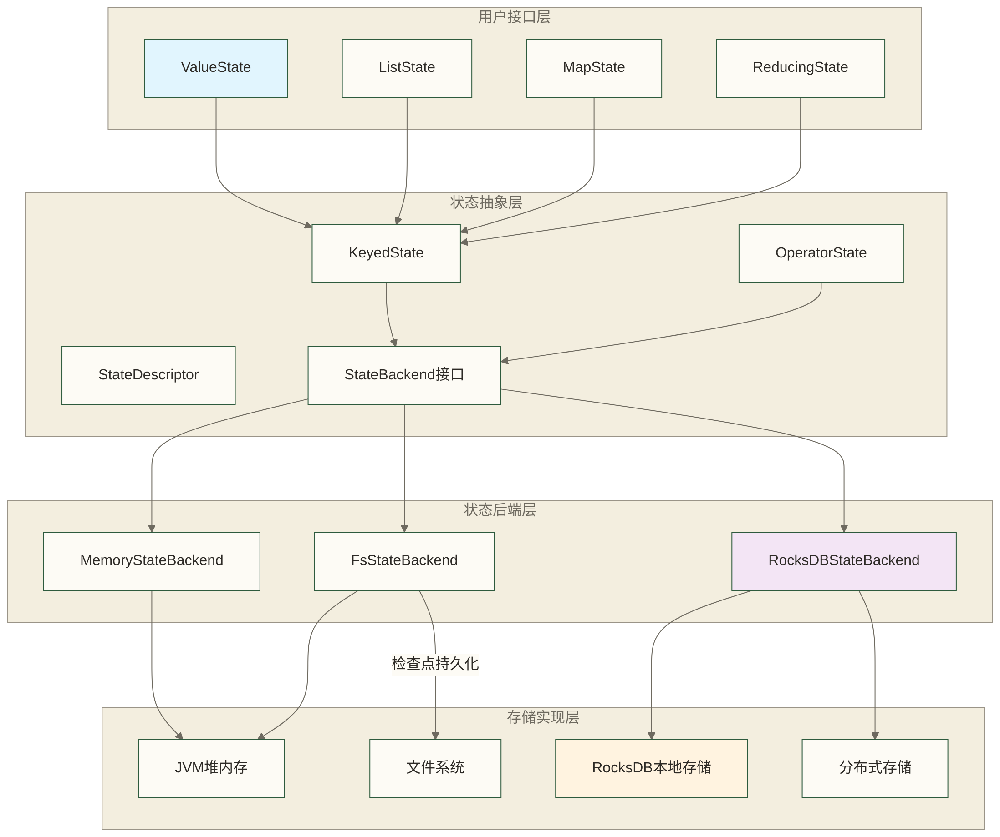

# 🗃️ 状态管理底层实现原理 - Flink状态存储与一致性保证机制

> [!abstract] 📋 本节概览
> - 🎯 **学习目标**：深入理解Flink状态管理的底层实现，掌握状态存储、快照、恢复的核心机制
> - 📚 **前置知识**：13-Flink状态管理|Flink状态管理
> - ⏱️ **预计用时**：35分钟
> - 🔧 **核心概念**：状态后端、状态序列化、增量快照、状态分片、RocksDB优化
> - 💡 **关键收获**：理解状态管理的性能瓶颈和优化策略，掌握大规模状态的处理方法

## 🎯 银行系统面临的核心技术挑战

为便于教学，假设一个智能银行系统管理着全国1000万客户的账户信息，客户档案、交易历史和风险评估数据合计100TB；这些数字是原稿未核实的示例设定，不代表真实银行数据。银行的技术总监李工程师在监控大屏前发现了一个严重问题：

每当银行系统需要进行全国范围的数据备份时（相当于Flink的检查点），备份时间越来越长，有时甚至需要几个小时才能完成，严重影响了银行的正常营业。更糟糕的是，有些备份甚至因为时间过长而失败，这对于一个需要24小时不间断服务的银行来说是无法接受的。

"我们怎么能在保证所有客户资料绝对安全的同时，还要确保银行服务不被中断？这些海量的客户档案到底是如何管理的？为什么备份会这么慢？"

**银行档案管理系统面临的核心技术冲突**：
- **服务速度 vs 数据安全**：客户希望瞬间查询到账户信息，但安全的数据存储往往需要更多时间
- **数据一致性 vs 业务吞吐量**：确保全国所有网点数据完全同步需要时间，但这会影响客户服务效率
- **容灾备份 vs 运营成本**：完整的数据备份可降低数据丢失风险，但不能确保绝对安全，且存储和传输成本较高

**专业技术对应**：这正是分布式状态管理的核心挑战——在保证数据持久化、一致性和容错性的同时，还要维持高性能的实时访问能力。Flink通过分层架构、异步快照、增量备份等机制来平衡这些冲突的需求。

## 🏗️ Flink状态管理架构全景

### 📊 状态管理分层架构



### 🔍 状态生命周期管理

**状态创建与初始化**：
```java
// 状态创建过程
public class StatefulMapFunction extends RichMapFunction<String, String> {
    private ValueState<String> state;
    
    @Override
    public void open(Configuration parameters) throws Exception {
        // 1. 创建状态描述符
        ValueStateDescriptor<String> descriptor = 
            new ValueStateDescriptor<>("my-state", String.class);
            
        // 2. 配置状态TTL（生命周期管理）
        StateTtlConfig ttlConfig = StateTtlConfig
            .newBuilder(Time.hours(1))                    // TTL时间
            .setUpdateType(UpdateType.OnCreateAndWrite)   // 更新策略
            .setStateVisibility(StateVisibility.NeverReturnExpired)  // 过期策略
            .build();
        descriptor.enableTimeToLive(ttlConfig);
        
        // 3. 获取状态句柄
        state = getRuntimeContext().getState(descriptor);
    }
    
    @Override
    public String map(String value) throws Exception {
        // 4. 状态访问和更新
        String currentState = state.value();           // 读取状态
        String newState = processValue(value, currentState);
        state.update(newState);                        // 更新状态
        return newState;
    }
}
```

**状态key管理机制**：
```java
// Flink内部的状态key管理
public class KeyedStateBackend<K> {
    private K currentKey;                    // 当前处理的key
    private TypeSerializer<K> keySerializer; // key序列化器
    
    // 设置当前key上下文
    public void setCurrentKey(K key) {
        this.currentKey = key;
    }
    
    // 状态访问时的key组合
    public <S extends State> S getPartitionedState(StateDescriptor<S, ?> stateDescriptor) {
        // 状态的完整key = (operatorId, stateDescriptor.name, currentKey)
        StateKey stateKey = new StateKey(
            getOperatorIdentifier(),
            stateDescriptor.getName(), 
            currentKey
        );
        return stateBackend.getState(stateKey, stateDescriptor);
    }
}
```

## 🏬 状态后端深度解析

### 💾 银行网点临时保险箱系统（MemoryStateBackend原理）

想象一下银行网点柜台工作人员的办公桌上有一个临时保险箱，这就像MemoryStateBackend的工作方式。当客户来办理业务时，柜员会把客户的重要资料暂时放在这个桌面保险箱里，方便随时查阅和更新。

**银行柜员桌面保险箱的结构设计**：
```java
public class BankCounterSafeBox implements StateBackend {
    // 客户资料存储在柜员的桌面保险箱中（JVM堆内存）
    private final Map<CustomerKey, CustomerFile> customerFiles = new ConcurrentHashMap<>();
    private final int maxSafeBoxCapacity;  // 保险箱最大容量限制
    
    @Override
    public <K, V> ValueState<V> createValueState(StateDescriptor<ValueState<V>, V> stateDesc) {
        return new CounterSafeValueState<>(customerFiles, stateDesc);
    }
}

// 桌面保险箱中的客户资料管理
class CounterSafeValueState<V> implements ValueState<V> {
    private final Map<CustomerKey, CustomerFile> customerFiles;
    private final StateDescriptor<?, V> stateDescriptor;
    
    @Override
    public V value() throws IOException {
        // 柜员从桌面保险箱中快速取出客户资料
        CustomerKey key = getCurrentCustomerKey();
        return (V) customerFiles.get(key);
    }
    
    @Override  
    public void update(V value) throws IOException {
        CustomerKey key = getCurrentCustomerKey();
        if (value == null) {
            // 客户销户，从保险箱中移除资料
            customerFiles.remove(key);
        } else {
            // 更新客户资料并放回保险箱
            customerFiles.put(key, (CustomerFile) value);
        }
    }
}
```

**银行网点的临时资料备份流程**：
```java
// 网点营业结束时的同步备份 - 需要暂停所有业务
public CompletableFuture<SnapshotResult<KeyedStateHandle>> createDailyBackup(
    long backupId, long timestamp) {
    
    // 1. 柜员需要停止所有业务，将桌面保险箱中的所有客户资料进行备份
    Map<CustomerKey, byte[]> serializedCustomerFiles = new HashMap<>();
    for (Map.Entry<CustomerKey, CustomerFile> entry : customerFiles.entrySet()) {
        // 将客户资料复印成电子版本（序列化）
        byte[] serializedFile = customerFileSerializer.serialize(entry.getValue());
        serializedCustomerFiles.put(entry.getKey(), serializedFile);
    }
    
    // 2. 创建备份档案袋，标记备份编号和内容
    KeyedStateHandle backupHandle = new ElectronicArchiveBag(
        "counter-safe-backup-" + backupId,
        serializedCustomerFiles
    );
    
    return CompletableFuture.completedFuture(
        SnapshotResult.of(backupHandle)
    );
}
```

**桌面保险箱的特点分析**：
这种银行柜员桌面保险箱的方式有明显的优劣势：
- ✅ **查阅速度极快**：柜员可以瞬间从桌面保险箱中取出任何客户的资料，服务效率最高
- ✅ **操作简单**：无需复杂的档案管理程序，柜员可以直接操作
- ❌ **容量严重受限**：桌面保险箱空间有限，只能存放少量客户的核心资料
- ❌ **安全风险极高**：一旦停电、柜员下班或系统故障，桌面保险箱中的资料就可能丢失

**专业技术对应**：旧版MemoryStateBackend将运行时状态保存在JVM堆内存中，访问开销通常较低，但受堆内存限制。任务重启后能否恢复取决于是否存在可用的检查点或保存点，不能断言状态必然丢失。堆状态快照涉及同步准备与可异步执行的序列化、持久化阶段，具体行为需按Flink版本和配置核对；上面的同步备份代码仅为教学示意。

### 📁 银行分行标准档案室系统（FsStateBackend原理）

现在让我们看看银行分行的标准档案室是如何工作的，这就像FsStateBackend的实现方式。与桌面保险箱不同，银行分行设立了一个专门的档案室，配备了防火安全设备和专业的档案管理系统。

**银行分行档案室的管理系统**：
```java
public class BranchArchiveRoomSystem implements StateBackend {
    private final Path archiveRoomPath;           // 档案室基础路径
    private final ArchiveFileSystem fileSystem;  // 档案室文件管理系统
    private final int singleFileMaxSize;         // 单个档案袋的最大容量
    
    @Override
    public CompletableFuture<SnapshotResult<KeyedStateHandle>> createPeriodicBackup(
        long backupId, long timestamp) {
        
        // 银行分行的异步备份流程 - 不影响正常营业
        return CompletableFuture.supplyAsync(() -> {
            try {
                // 1. 在档案室中创建专门的备份区域
                Path backupZonePath = new Path(archiveRoomPath, "backup-zone-" + backupId);
                fileSystem.createSecureDirectory(backupZonePath);
                
                // 2. 安排专门的档案管理员异步整理客户资料
                Path customerFilesPath = new Path(backupZonePath, "customer-archive");
                try (SecureArchiveOutputStream archiveStream = fileSystem.createSecureStream(customerFilesPath)) {
                    // 将所有客户资料有序地存档到防火档案柜中
                    organizeAndStoreCustomerFiles(archiveStream);
                }
                
                // 3. 为档案管理员提供备份档案的索引卡片
                return SnapshotResult.of(new ArchiveRoomHandle(customerFilesPath, calculateArchiveSize()));
                
            } catch (Exception e) {
                throw new RuntimeException("Archive backup failed", e);
            }
        });
    }
    
    private void organizeAndStoreCustomerFiles(SecureArchiveOutputStream stream) {
        // 档案管理员将客户资料按照标准格式整理并存储
        for (CustomerKey key : getAllCustomerKeys()) {
            CustomerFile file = getCustomerFile(key);
            byte[] organizedFile = customerFileOrganizer.organize(file);
            stream.writeOrganizedFile(key, organizedFile);
        }
    }
}
```

**分行档案室系统的优势分析**：
与桌面保险箱相比，银行分行档案室系统有显著改进：

- ✅ **安全性大幅提升**：档案室配备防火、防潮、防盗设施，即使分行出现局部故障，客户资料依然安全
- ✅ **容量显著增加**：专业档案室能存储比桌面保险箱多得多的客户资料
- ✅ **异步备份不影响营业**：专门的档案管理员可以在银行正常营业时进行备份工作，不需要暂停客户服务
- ✅ **标准化管理**：统一的档案整理和存储标准，确保资料的有序管理

- ⚠️ **查阅速度稍慢**：柜员需要派档案管理员到档案室查找资料，比直接从桌面保险箱取用稍慢一些
- ⚠️ **需要专业人员**：需要配备专门的档案管理员和档案室管理设备

**专业技术对应**：FsStateBackend在运行时将状态保存在内存中以确保快速访问，但定期将状态异步持久化到分布式文件系统（如HDFS、S3等）。这种方式平衡了性能和安全性，支持故障恢复，适合中等规模的状态管理场景。

### 🗃️ 银行总行地下金库系统（RocksDBStateBackend深度原理）

现在让我们深入了解银行业界最高级别的客户档案管理系统——银行总行的地下金库系统。这就像RocksDBStateBackend的实现方式，它不仅能够安全地存储海量的客户资料，还具备智能的增量备份能力。

**银行总行地下金库的档案管理系统**：
```java
public class HeadquarterUndergroundVaultSystem implements StateBackend {
    private UndergroundVaultDB vaultDB;                    // 地下金库数据库实例
    private List<SecureCompartment> secureCompartments;   // 安全分隔间句柄列表
    private VaultWriteProtocol writeProtocol;             // 金库写入安全协议
    private VaultReadProtocol readProtocol;               // 金库读取安全协议
    
    // 客户档案存储结构：超安全的键值对存储
    // 存储键格式：[客户分组ID][业务命名空间][客户唯一标识]  
    // 存储值格式：经过加密序列化的客户档案数据
}
```

**地下金库的客户档案操作系统**：
```java
public class UndergroundVaultCustomerState<V> implements ValueState<V> {
    private final SecureCompartment compartment;          // 安全分隔间
    private final CustomerFileSerializer<V> serializer;  // 客户档案序列化器
    private final UndergroundVaultDB vaultDB;            // 地下金库数据库
    
    @Override
    public V value() throws IOException {
        try {
            // 1. 银行安全员构造完整的客户档案索引密钥
            byte[] secureKey = generateSecureCustomerKey();
            
            // 2. 从地下金库的安全分隔间中读取客户档案
            byte[] encryptedArchive = vaultDB.getFromSecureCompartment(compartment, secureKey);
            
            // 3. 解密并还原客户档案
            if (encryptedArchive == null) {
                return null; // 客户档案不存在
            }
            return serializer.decryptAndDeserialize(
                new SecureDataInputReader(encryptedArchive)
            );
        } catch (VaultAccessException e) {
            throw new IOException("Failed to access underground vault", e);
        }
    }
    
    @Override
    public void update(V customerFile) throws IOException {
        try {
            byte[] secureKey = generateSecureCustomerKey();
            
            if (customerFile == null) {
                // 客户销户，从地下金库中安全删除档案
                vaultDB.secureDeleteFromCompartment(compartment, secureKey);
            } else {
                // 加密客户档案并存入地下金库
                SecureDataOutputWriter outputWriter = new SecureDataOutputWriter(256);
                serializer.serializeAndEncrypt(customerFile, outputWriter);
                byte[] encryptedArchive = outputWriter.getEncryptedBuffer();
                
                vaultDB.putIntoSecureCompartment(compartment, writeProtocol, secureKey, encryptedArchive);
            }
        } catch (VaultAccessException e) {
            throw new IOException("Failed to update underground vault", e);  
        }
    }
}
```

**银行总行的智能增量备份系统**：
```java
public class IntelligentIncrementalBackupSystem {
    private long lastNationalBackupId = -1;
    private Set<String> alreadyBackedupVaultFiles = new HashSet<>();  // 已备份的金库文件
    
    public SnapshotResult<KeyedStateHandle> performIntelligentIncremental(long currentBackupId) {
        VaultSnapshot secureSnapshot = null;
        try {
            // 1. 创建地下金库快照（教学示意，不保证对业务零影响）
            secureSnapshot = undergroundVaultDB.createSecureSnapshot();
            
            // 2. 智能识别自上次备份以来新增或修改的客户档案文件
            Set<String> currentVaultFiles = getCurrentVaultFileList();
            Set<String> newOrModifiedFiles = Sets.difference(currentVaultFiles, alreadyBackedupVaultFiles);
            
            // 3. 只将变化的文件传输到异地灾备中心（显著节省传输成本和时间）
            List<RemoteBackupHandle> uploadedIncrementalFiles = new ArrayList<>();
            for (String vaultFile : newOrModifiedFiles) {
                RemoteBackupHandle handle = transferToDisasterRecoverySite(vaultFile, currentBackupId);
                uploadedIncrementalFiles.add(handle);
            }
            
            // 4. 更新银行的备份档案清单
            alreadyBackedupVaultFiles.addAll(newOrModifiedFiles);
            lastNationalBackupId = currentBackupId;
            
            // 5. 创建智能增量备份的索引档案
            IntelligentIncrementalBackupHandle backupHandle = 
                new IntelligentIncrementalBackupHandle(
                    lastNationalBackupId,           // 基础备份批次ID
                    uploadedIncrementalFiles,        // 本次增量备份的文件
                    generateBackupMetadata()         // 备份元数据信息
                );
            
            return SnapshotResult.of(backupHandle);
            
        } finally {
            if (secureSnapshot != null) {
                undergroundVaultDB.releaseSecureSnapshot(secureSnapshot);
            }
        }
    }
}
```

**银行总行地下金库系统的卓越特性**：
这套银行业界最先进的客户档案管理系统具有无与伦比的优势：

- ✅ **超大存储容量**：在本教学类比中假设地下金库存储PB级客户档案；该规模为原稿未核实的示例，不是单个RocksDB实例或Flink作业的容量保证
- ✅ **安全保障设计**：教学场景假设另行配置多重加密、物理隔离和灾难冗余以降低风险；这些不是RocksDBStateBackend默认提供的保证，也不能确保资料绝对安全
- ✅ **智能增量备份**：只备份变化的部分，大幅节省备份时间和存储成本
- ✅ **高效检索能力**：通过优化的索引系统，即使是海量数据也能快速定位客户档案
- ✅ **专业级运维**：支持在线压缩整理、自动过期清理、性能自优化等高级功能

- ⚠️ **访问开销较高**：对应到RocksDB状态访问，序列化、反序列化及本地存储访问通常比直接访问堆对象开销更高；不能将其归因于后端默认执行安全验证或加密解密
- ⚠️ **系统复杂度高**：需要专业的金库管理系统和高技能的安全运维团队

**专业技术对应**：RocksDBStateBackend使用嵌入式的RocksDB数据库作为本地状态存储，支持高效的磁盘存储和压缩。通过LSM树结构实现高性能写入，支持增量检查点大幅减少备份时间，适合大规模生产环境中的海量状态管理。

## 🔄 状态一致性与恢复机制

### 📸 银行全国同步备份协议（分布式快照算法）

想象一下，我们的银行系统遍布全国各地，有数千个分支机构同时处理客户业务。为了确保所有分支机构的客户档案能够在同一时间点进行一致性备份，银行设计了一套精密的"全国同步备份协议"。

**银行备份同步信号系统**：
```java
public class BankNationalBackupSignal {
    private final long backupSessionId;        // 备份批次ID
    private final long backupTimestamp;        // 备份时间戳
    private final BackupProtocolOptions options; // 备份协议选项
}

// 全国分支机构备份信号协调系统
public class NationalBackupCoordinator {
    private final Map<BranchOffice, BankNationalBackupSignal> receivedBackupSignals;
    private boolean allBranchesReadyForBackup = false;
    
    public boolean processBranchBackupSignal(BankNationalBackupSignal signal, BranchOffice branch) {
        // 记录各分支机构发送的备份就绪信号
        receivedBackupSignals.put(branch, signal);
        
        // 检查是否所有分支机构都已就绪进行同一批次的备份
        if (receivedBackupSignals.size() == getTotalNumberOfBranches()) {
            long backupSessionId = signal.getBackupSessionId();
            boolean allSameSession = receivedBackupSignals.values().stream()
                .allMatch(s -> s.getBackupSessionId() == backupSessionId);
                
            if (allSameSession) {
                allBranchesReadyForBackup = true;
                // 触发全国范围的同步备份操作
                triggerNationalSynchronizedBackup(backupSessionId);
                return true;
            }
        }
        return false;
    }
    
    private void triggerNationalSynchronizedBackup(long sessionId) {
        // 向所有分支机构发出正式备份指令
        // 确保全国所有银行网点在同一时刻进行客户档案备份
        for (BranchOffice branch : getAllBranches()) {
            branch.executeBackupAtExactMoment(sessionId);
        }
    }
}
```

**银行全国同步备份的工作原理**：
这套"全国同步备份协议"的工作方式就像银行的重要业务流程一样严格和精确：

1. **备份信号广播阶段**：银行总行向全国所有分支机构广播"准备进行第X批次备份"的信号
2. **分支就绪确认阶段**：每个分支机构在处理完当前客户后，向总行发送"我们已准备好进行第X批次备份"的确认信号
3. **全国协调等待阶段**：总行等待所有分支机构都发送相同批次的就绪信号
4. **同步备份执行阶段**：只有当全国所有分支都就绪时，总行才发出正式的"立即执行备份"指令
5. **一致性保证阶段**：所有分支机构在同一时刻对客户档案进行快照备份，确保全国数据的一致性

**专业技术对应**：Flink检查点机制基于分布式快照思想，CheckpointBarrier随数据流传播，形成一致的逻辑切面，而不是让所有算子在同一物理时刻拍照。对齐检查点在多输入算子处进行相应barrier对齐；非对齐检查点还会保存相关在途数据。上面的全国就绪后统一执行代码和流程仅是粗略类比，不是Flink算法实现。端到端一致性还取决于源的可重放能力及接收端的一致性支持。

**异步快照实现**：
```java
public class AsyncCheckpointRunnable implements Runnable {
    private final Map<StateKey, Object> stateSnapshot;  // 状态快照
    private final long checkpointId;
    private final StreamStateHandle targetLocation;     // 目标存储位置
    
    @Override
    public void run() {
        try {
            // 1. 序列化状态数据
            ByteArrayOutputStream byteStream = new ByteArrayOutputStream();
            DataOutputStream dataStream = new DataOutputStream(byteStream);
            
            for (Map.Entry<StateKey, Object> entry : stateSnapshot.entrySet()) {
                // 序列化key
                keySerializer.serialize(entry.getKey(), dataStream);
                // 序列化value  
                valueSerializer.serialize(entry.getValue(), dataStream);
            }
            
            // 2. 上传到分布式存储
            byte[] serializedData = byteStream.toByteArray();
            uploadToStorage(targetLocation, serializedData);
            
            // 3. 通知检查点协调器完成
            checkpointCoordinator.receiveAcknowledgeMessage(
                new AcknowledgeCheckpoint(checkpointId, targetLocation)
            );
            
        } catch (Exception e) {
            // 4. 快照失败，通知协调器
            checkpointCoordinator.receiveDeclineMessage(
                new DeclineCheckpoint(checkpointId, e)
            );
        }
    }
}
```

### 🔧 状态恢复机制

**状态恢复流程**：
```java
public class StateRecoveryManager {
    
    public void restoreState(SavepointMetadata savepointMetadata) throws Exception {
        // 1. 解析保存点元数据
        Map<OperatorID, OperatorState> operatorStates = 
            parseSavepointMetadata(savepointMetadata);
            
        // 2. 为每个算子恢复状态
        for (Map.Entry<OperatorID, OperatorState> entry : operatorStates.entrySet()) {
            OperatorID operatorId = entry.getKey();
            OperatorState operatorState = entry.getValue();
            
            // 3. 恢复Keyed State
            for (KeyedStateHandle keyedStateHandle : operatorState.getKeyedStateHandles()) {
                restoreKeyedState(operatorId, keyedStateHandle);
            }
            
            // 4. 恢复Operator State  
            for (OperatorStateHandle operatorStateHandle : operatorState.getOperatorStateHandles()) {
                restoreOperatorState(operatorId, operatorStateHandle);
            }
        }
    }
    
    private void restoreKeyedState(OperatorID operatorId, KeyedStateHandle stateHandle) {
        try (FSDataInputStream inputStream = stateHandle.openInputStream()) {
            // 1. 读取状态数据
            DataInputView inputView = new DataInputViewStreamWrapper(inputStream);
            
            // 2. 反序列化状态
            while (inputStream.available() > 0) {
                StateKey key = keySerializer.deserialize(inputView);
                Object value = valueSerializer.deserialize(inputView);
                
                // 3. 恢复到状态后端
                stateBackend.putState(key, value);
            }
        }
    }
}
```

### 🔄 状态重分布算法

**状态重分布场景**：
```java
// 并行度变更时的状态重分布
// 原并行度：4 → 新并行度：6

public class StateRedistributor {
    
    public List<KeyedStateHandle> redistributeState(
        List<KeyedStateHandle> oldStateHandles, 
        int newParallelism,
        int maxParallelism) {
        if (newParallelism <= 0 || newParallelism > maxParallelism) {
            throw new IllegalArgumentException("Invalid parallelism");
        }
        
        // 1. 收集所有状态数据
        Map<Object, Object> allStates = new HashMap<>();
        for (KeyedStateHandle handle : oldStateHandles) {
            Map<Object, Object> states = readStateFromHandle(handle);
            allStates.putAll(states);
        }
        
        // 2. 按新的并行度重新分区
        List<Map<Object, Object>> newPartitions = new ArrayList<>();
        for (int i = 0; i < newParallelism; i++) {
            newPartitions.add(new HashMap<>());
        }
            
        for (Map.Entry<Object, Object> entry : allStates.entrySet()) {
            Object key = entry.getKey();
            // maxParallelism沿用原作业的键组总数，再将键组映射到新子任务
            int newPartition = KeyGroupRangeAssignment.assignKeyToParallelOperator(
                key, maxParallelism, newParallelism);
            newPartitions.get(newPartition).put(key, entry.getValue());
        }
        
        // 3. 创建新的状态句柄
        List<KeyedStateHandle> newHandles = new ArrayList<>();
        for (int i = 0; i < newParallelism; i++) {
            KeyedStateHandle handle = createStateHandle(newPartitions.get(i), i);
            newHandles.add(handle);
        }
        
        return newHandles;
    }
}
```

## 🚀 状态管理性能优化

### 📊 状态大小监控与控制

**状态大小监控**：
```java
public class StateMonitor {
    private final Gauge<Long> stateSizeGauge;
    private final Counter stateAccessCounter;
    
    public void reportStateMetrics() {
        // 1. 监控状态大小
        long currentStateSize = calculateStateSize();
        stateSizeGauge.update(currentStateSize);
        
        // 2. 监控状态访问频率
        stateAccessCounter.inc();
        
        // 3. 检查状态大小告警
        if (currentStateSize > STATE_SIZE_THRESHOLD) {
            LOG.warn("State size {} exceeds threshold {}", 
                     currentStateSize, STATE_SIZE_THRESHOLD);
                     
            // 触发状态清理
            triggerStateCleaning();
        }
    }
    
    private void triggerStateCleaning() {
        // TTL清理
        stateBackend.cleanupExpiredState();
        
        // 手动清理不需要的状态
        cleanupUnusedStates();
    }
}
```

### ⚡ RocksDB优化配置

**RocksDB参数调优**：
```java
public class OptimizedRocksDBConfig {
    
    public RocksDBStateBackend createOptimizedBackend() {
        RocksDBStateBackend backend = new RocksDBStateBackend("hdfs://path/to/checkpoints");
        
        // 1. 内存配置优化
        RocksDBOptionsFactory optionsFactory = new RocksDBOptionsFactory() {
            @Override
            public DBOptions createDBOptions() {
                return new DBOptions()
                    .setMaxBackgroundJobs(4)                    // 后台任务数
                    .setMaxOpenFiles(-1)                        // 最大打开文件数
                    .setCreateIfMissing(true)
                    .setStatistics(new Statistics())
                    .setDbWriteBufferSize(128 * 1024 * 1024);   // 写缓冲大小
            }
            
            @Override  
            public ColumnFamilyOptions createColumnOptions() {
                return new ColumnFamilyOptions()
                    .setWriteBufferSize(64 * 1024 * 1024)       // 写缓冲大小
                    .setMaxWriteBufferNumber(3)                 // 最大写缓冲数
                    .setMinWriteBufferNumberToMerge(2)          // 合并阈值
                    .setTableFormatConfig(
                        new BlockBasedTableConfig()
                            .setBlockSize(128 * 1024)           // 块大小
                            .setBlockCacheSize(256 * 1024 * 1024) // 块缓存大小
                            .setCacheIndexAndFilterBlocks(true)
                            .setPinL0FilterAndIndexBlocksInCache(true)
                    )
                    .setCompressionType(CompressionType.SNAPPY_COMPRESSION) // 压缩算法
                    .setCompactionStyle(CompactionStyle.LEVEL);  // 压缩样式
            }
        };
        
        backend.setRocksDBOptions(optionsFactory);
        return backend;
    }
}
```

**状态访问模式优化**：
```java
public class OptimizedStateAccess {
    
    // 1. 批量状态操作
    public void batchStateUpdate(Map<String, String> updates) {
        try (WriteBatch batch = new WriteBatch()) {
            for (Map.Entry<String, String> entry : updates.entrySet()) {
                byte[] key = keySerializer.serialize(entry.getKey());
                byte[] value = valueSerializer.serialize(entry.getValue());
                batch.put(columnFamily, key, value);
            }
            rocksDB.write(writeOptions, batch);
        } catch (RocksDBException e) {
            throw new RuntimeException("Batch update failed", e);
        }
    }
    
    // 2. 状态预取优化
    public Map<String, String> prefetchStates(List<String> keys) {
        List<ColumnFamilyHandle> cfList = Collections.nCopies(keys.size(), columnFamily);
        List<byte[]> keyList = keys.stream()
            .map(keySerializer::serialize)
            .collect(Collectors.toList());
            
        try {
            List<byte[]> values = rocksDB.multiGetAsList(cfList, keyList);
            Map<String, String> result = new HashMap<>();
            
            for (int i = 0; i < keys.size(); i++) {
                if (values.get(i) != null) {
                    String value = valueSerializer.deserialize(values.get(i));
                    result.put(keys.get(i), value);
                }
            }
            return result;
        } catch (RocksDBException e) {
            throw new RuntimeException("Multi-get failed", e);
        }
    }
    
    // 3. 状态迭代器优化
    public void scanStateRange(String startKey, String endKey, 
                              Consumer<Map.Entry<String, String>> processor) {
        try (RocksIterator iterator = rocksDB.newIterator(columnFamily)) {
            byte[] start = keySerializer.serialize(startKey);
            byte[] end = keySerializer.serialize(endKey);
            
            iterator.seek(start);
            while (iterator.isValid()) {
                byte[] currentKey = iterator.key();
                if (bytesComparator.compare(currentKey, end) > 0) {
                    break;
                }
                
                String key = keySerializer.deserialize(currentKey);
                String value = valueSerializer.deserialize(iterator.value());
                processor.accept(new AbstractMap.SimpleEntry<>(key, value));
                
                iterator.next();
            }
        }
    }
}
```

---

## 📋 本节要点回顾

### ✅ 状态管理底层原理掌握检查
- [ ] 理解三种状态后端的实现原理和适用场景
- [ ] 掌握分布式快照算法的工作机制  
- [ ] 了解RocksDB集成的技术细节
- [ ] 理解状态恢复和重分布的实现方式
- [ ] 掌握状态性能监控和优化方法

### 🎯 实践能力检查
- [ ] 能够根据场景选择合适的状态后端
- [ ] 理解状态大小对性能的影响
- [ ] 掌握RocksDB参数调优方法
- [ ] 能够诊断和解决状态相关的性能问题

### 🔗 学习路径连接
**已完成**：✅ 流处理基本概念 → ✅ Flink核心特性 → ✅ Flink核心组件 → ✅ Flink架构原理 → ✅ Flink环境安装 → ✅ 第一个Flink程序 → ✅ DataStream API基础 → ✅ Flink数据源配置 → ✅ 数据转换操作 → ✅ Flink数据输出 → ✅ Flink窗口概念 → ✅ Flink时间语义 → ✅ Flink状态管理 → ✅ 状态管理底层实现原理
**下一步**：14-Flink水印机制|Flink水印机制 - 学习水印的生成和传播机制

记住：状态管理是流处理的核心，理解其底层原理对于构建高性能、可靠的流处理应用至关重要！

---

**创建时间**：2024-12-27  
**最后更新**：2024-12-27  
**学习时长**：35分钟  
**难度等级**：⭐⭐⭐（进阶）

#Flink #状态管理 #RocksDB #检查点 #容错机制 #性能优化