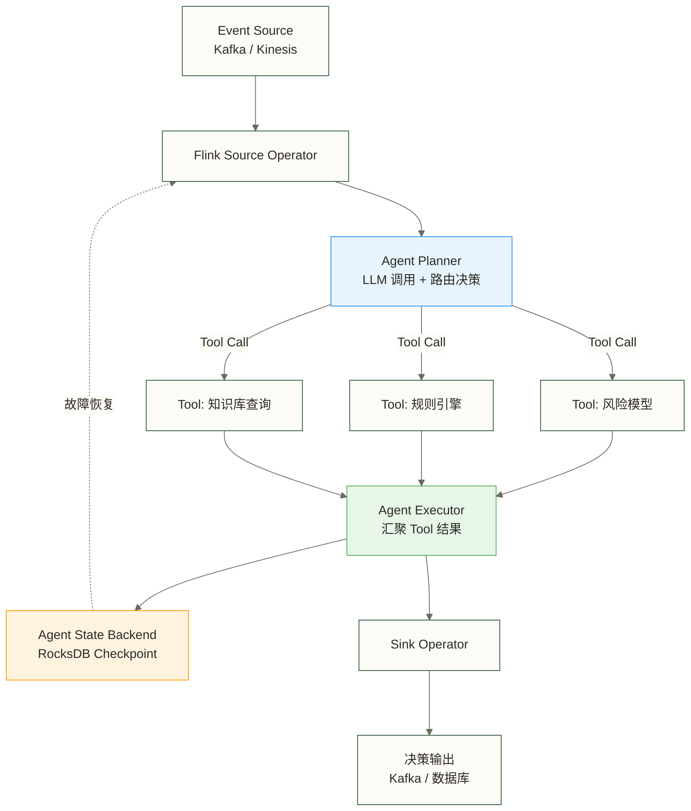
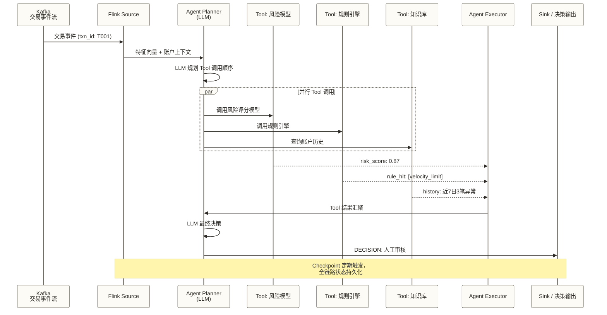
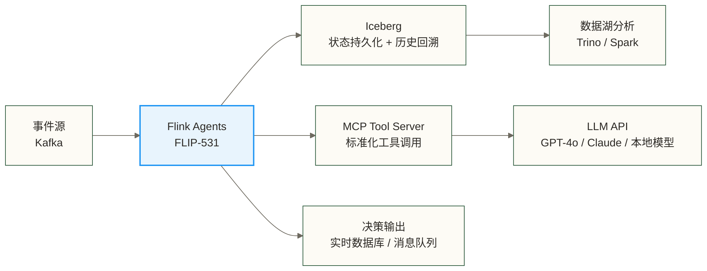

# Flink Agents 与事件驱动 AI：FLIP-531 深度解析

> [!info] 前置知识
> 阅读本文前，建议先掌握以下基础：
> - [[【技术与工具】/Flink/00-Flink学习路线图|Flink 整体学习路径]] — 了解 Flink 生态全貌
> - [[【技术与工具】/Flink/04-Flink架构原理|Flink 架构原理]] — JobManager / TaskManager / Checkpoint 机制
> - [[【技术与工具】/Flink/15-Flink检查点机制|Flink 检查点机制]] — exactly-once 语义的底层保证
> - [[【技术与工具】/Flink/13-Flink状态管理|Flink 状态管理]] — State Backend 和 RocksDB
> - [[【AI 与大数据】/03-AI-Agent/02-AI-Agent开发框架实战|AI Agent 开发框架实战]] — LangGraph / CrewAI 等主流框架认知

LangGraph 的 demo 写起来真的很顺手。一个 `StateGraph`，几个节点，几条边，十分钟上手。然后你把它推上生产，第一周就开始出问题：消息重复处理了、Agent 崩溃后状态全丢了、高峰期延迟飙升……你开始意识到，你当初被一个写 demo 的工具骗了。

这不是 LangGraph 的错。它本来就不是为生产级事件驱动场景设计的。

Flink 2.2 在 2025 年底发布，附带 FLIP-531 提案（Flink Agents 子项目）。这件事的意义不是"Flink 加了个 LLM 插件"，而是 Flink 团队在 AI 时代做了一个清醒的判断：**当 Agent 成为主流应用形态，Flink 十年积累的流处理基础设施，恰好是生产级 Agent 最稀缺的能力**。

---

## Flink 2.2 的 AI 野心

Flink 2.2 是 Flink 1.0 以来变化最大的版本，三件事值得单独说。

**第一，DataSet API 已在 Flink 2.0 中移除，并非 2.2 首次移除。** DataSet API 曾用于批处理；升级到 2.x 的遗留 DataSet 作业需要迁移到 DataStream 或 Table API，并验证批执行模式、算子支持和结果语义。

**第二，SQL 中原生调用模型推理。** 这个功能看起来平平无奇，实际上打开了一个很大的口子：

```sql
SELECT
  user_id,
  event_time,
  ml_predict('risk-scoring-model-v2', feature_vector) AS risk_score
FROM
  transaction_stream
WHERE
  amount > 1000;
```

上面的 `ml_predict` 用于示意 SQL 调用模型推理的目标，本文未提供依据确认它是 Flink 2.2 的内置函数，也未核实 ONNX、TensorFlow Serving 和自定义 REST 端点的支持方式。实际实现需核对所用版本的模型调用语法或注册自定义函数；异步 I/O 可减少等待对处理线程的阻塞，但仍受并发容量、超时、外部限流和背压影响。

**第三，Flink Agents（FLIP-531）作为独立子项目正式启动。** 这是本文的重点。

Process Table Functions（PTF）是 FLIP-531 的技术基础之一。PTF 允许开发者用 DataStream 的全部能力（状态、定时器、side output）去实现一个 SQL 可调用的 Table Function。这等于在 SQL 声明式语法和 DataStream 命令式控制之间搭了一座桥——Agent 的复杂行为逻辑跑在 DataStream 层，而 Agent 的输入输出可以是纯 SQL 流。

---

## 主流 Agent 框架在哪里会崩溃

在理解 Flink Agents 解决什么问题之前，先说清楚现有框架的边界在哪里。

LangGraph、CrewAI、AutoGen 这类框架常用于请求-响应式 Agent 编排：一个用户输入进来，Agent 规划、调用工具、生成回答。后续请求是否延续状态取决于框架版本、持久化后端和会话标识等配置，不能概括为每次请求都是全新的开始；持续事件流的消费、背压和外部副作用一致性仍需单独评估。

这个模型在对话场景下工作得很好。但它在以下场景会系统性地失效：

**场景一：持续事件流处理。** 每秒涌入几千笔交易，每笔交易都需要 Agent 做实时风险评估。LangGraph 没有流处理 runtime，你只能在外面包一层消费者循环，用队列模拟"流"。这个架构下，吞吐量上不去，背压也处理不了，高峰期会积压。

**场景二：长期运行的多步骤工作流。** Agent 执行一个需要几小时才能完成的工作流（比如监控某个数据集的变化并持续分析），中途如果进程崩溃，从头再来还是从断点继续？LangGraph 依赖外置的 Checkpoint 存储（Redis、PostgreSQL），配置麻烦，一致性保证也是你自己负责的。

**场景三：Agent 状态的大规模并发。** 同时跑一万个用户的个性化推荐 Agent，每个 Agent 维护自己的对话上下文和工作记忆。这是一个分布式状态管理问题，不是 Python 框架的擅长领域。

Flink 处理这三类问题已经十年了。

---

## Flink Agents 的三个独有优势

### 1. 事件驱动 + exactly-once：状态一致性与外部副作用边界

Flink 的 exactly-once 语义是通过分布式快照（Chandy-Lamport 算法变体）实现的。简单说：每隔一段时间，Flink 给整个数据流打一个快照，记录每个算子的状态和消费到的 offset。如果任务崩溃，从最近一次快照恢复，Kafka offset 也回退到那个位置，重新处理。

对 Agent 来说，恢复时可能重新执行检查点之后的事件；在可重放 Source 和正确配置的检查点机制下，Flink 可以保证受管理状态的 exactly-once 一致性，而不是保证处理函数只执行一次。端到端输出还取决于 Sink 的事务或幂等能力；LLM 请求、外部 API 和通知等副作用需要单独设计去重与恢复协议，不能据此断言其他编排框架无法实现可靠恢复。

> [!tip] 为什么 exactly-once 对 Agent 如此关键
> Agent 通常会触发副作用：写数据库、调 API、发通知。如果同一个事件被处理两次，副作用就会发生两次——风控误封一个账户两次，或者给用户发了两条通知。at-least-once 在对话场景可以接受，在事件驱动场景是生产事故的来源。

### 2. 原生状态管理：Agent 记忆可持久化可恢复

Flink 的 State Backend（RocksDB）支持 TB 级别的状态存储，所有状态都被 Checkpoint 机制托管。在 Flink Agents 里，这意味着：

- **工作记忆（Working Memory）**：Agent 当前任务的上下文，存在 ValueState 里
- **长期记忆（Long-term Memory）**：历史交互摘要，存在 MapState 里，按 user_id 分片
- **工作流状态（Workflow State）**：多步骤任务的当前阶段，存在 ValueState 里

这些状态会随 Checkpoint 自动持久化到远端存储（S3 / HDFS）。Agent 重启后，从上次的快照恢复，上下文不丢失。

对比其他框架：LangGraph 的 Memory 需要你自己配 Redis 或 PostgreSQL，一致性靠你自己保证；Flink 的状态管理是框架内置的，你声明状态描述符，框架处理持久化和恢复。

### 3. 动态拓扑：Agent 运行时改变 DAG

这是最有意思的特性，也是 FLIP-531 里技术含量最高的部分。

传统 Flink 作业的 DAG 是静态的：你提交任务时就确定了算子图，运行中不能改变。但 Agent 的行为是动态的——Planner 根据当前情况决定下一步调用哪个 Tool，Tool 的选择会改变数据流向。

FLIP-531 通过引入"动态路由算子"解决这个问题：Agent 的 Planner 输出一个路由决策，Flink 根据决策把数据路由到不同的下游算子（不同的 Tool 实现）。这不是真正意义上的 DAG 变更，而是在静态 DAG 上实现了动态路由语义，对 Agent 场景来说效果相同。

---

## 架构解析



MCP（Model Context Protocol）集成是 FLIP-531 的一个重要设计决策。Flink Agents 原生支持把 MCP Tool Server 注册为 Flink 算子，Agent Planner 通过标准 MCP 协议调用外部工具，Tool 结果经过 Flink 的异步 I/O 算子返回。这意味着你已有的 MCP 工具生态（参考 [[【技术与工具】/MCP/04-MCP-Gateway与生产部署|MCP Gateway 与生产部署]]）可以直接接入 Flink Agents，不需要改造。

---

## 实时风控 Agent：一个完整场景

选风控场景是因为它把 Flink Agents 三个优势全部激活了：高频事件流、强一致性要求、复杂的多步骤判断逻辑。

### 场景描述

教学假设：目标负载设为每秒 5 万笔交易事件，这是原稿未核实的场景数字，不代表 Flink Agents 或 LLM 的实测吞吐；每笔交易拟由 Agent 完成：
1. 提取特征，调用实时风险评分模型
2. 查询账户历史行为（知识库/图数据库）
3. 运行规则引擎（黑名单、速率限制）
4. 综合三个 Tool 的结果，由 LLM 做最终决策
5. 输出"放行 / 人工审核 / 拒绝"三种决策

### 批处理、微服务与流处理的能力边界

| 维度 | 批处理方案 | 微服务方案 | Flink Agents |
|------|-----------|-----------|--------------|
| 延迟 | 受批次间隔与任务耗时影响 | 受服务和外部调用耗时影响，可维护状态 | 支持低延迟流处理；端到端 Agent 延迟仍受 LLM 和 Tool 调用影响 |
| 一致性 | 取决于重试和提交协议 | 取决于消息、事务及幂等设计 | 受管理状态可 exactly-once；端到端效果取决于连接器和外部副作用设计 |
| 状态管理 | 可依赖文件、数据库或计算框架 | 常依赖外置存储 | 受管理状态由 Checkpoint 托管 |
| 吞吐 | 取决于并行度与推理成本 | 可水平扩展，需设计队列和限流 | 支持水平扩展与背压，仍受模型容量和推理成本限制 |
| 故障恢复 | 可重跑或按框架恢复 | 可通过持久队列、重试和工作流存储恢复 | 从 Checkpoint 恢复受管理状态；外部副作用需协调 |

### 时序图



---

## 最小代码示例

下面是事件驱动 Agent 的 Java 架构伪代码，不是已核验的 Flink Agents API 示例。`FlinkAgents`、`AgentInput`、`AgentResult`、业务类型和连接器均未提供依赖或实现；需按实际 SDK 补齐，并将外部调用接入受控异步机制后才能运行。

```java
// Flink Agents: 事件驱动风控 Agent（简化版）
public class RiskAgent extends KeyedProcessFunction<String, Transaction, Decision> {

    // 声明状态：账户历史行为窗口
    private ValueState<AccountContext> accountState;

    @Override
    public void open(OpenContext openContext) throws Exception {
        ValueStateDescriptor<AccountContext> descriptor =
            new ValueStateDescriptor<>("account-context", AccountContext.class);
        accountState = getRuntimeContext().getState(descriptor);
    }

    @Override
    public void processElement(
        Transaction txn,
        Context ctx,
        Collector<Decision> out
    ) throws Exception {
        // 1. 从状态中读取账户上下文（跨事件持久化）
        AccountContext context = accountState.value();
        if (context == null) context = new AccountContext();

        // 2. 构造 Agent Planner 输入
        AgentInput input = AgentInput.builder()
            .event(txn)
            .context(context)
            .tools(List.of("risk_model", "rule_engine", "knowledge_base"))
            .build();

        // 3. 调用 Agent（内部异步并行 Tool 调用）
        AgentResult result = FlinkAgents.plan(input)
            .withMcpServer("mcp://localhost:8080")
            .withModel("gpt-4o-mini")
            .execute();

        // 4. 更新状态（下一个事件可以读到）
        context.update(txn, result);
        accountState.update(context);

        // 5. 输出决策
        out.collect(result.toDecision());
    }
}

// 作业图构建
StreamExecutionEnvironment env = StreamExecutionEnvironment.getExecutionEnvironment();

// 配置 Checkpoint（受管理状态的 exactly-once；外部输出需另行保证）
env.enableCheckpointing(30_000); // 每 30 秒一次
env.getCheckpointConfig().setCheckpointingMode(CheckpointingMode.EXACTLY_ONCE);

// 此处假设 Transaction::getAccountId 返回 String
KeyedStream<Transaction, String> stream = env
    .fromSource(kafkaSource, WatermarkStrategy.noWatermarks(), "transactions")
    .keyBy(Transaction::getAccountId); // 按账户分区以使用 keyed state；不自动保证跨分区事件时间有序

stream
    .process(new RiskAgent())
    .sinkTo(decisionSink);

env.execute("Risk Agent Job");
```

对比 LangGraph 实现同等逻辑，核心差异如下：

```python
# LangGraph 版本（仅展示差异部分，不可直接运行生产）
# 边界1：本片段未展示消息确认、幂等和端到端一致性设计
# 边界2：此处使用内存 checkpointer，进程重启后状态无法恢复；可改用持久化后端
# 边界3：本片段未展示队列容量、限流和背压设计，不能据此推断框架必然 OOM

graph = StateGraph(AgentState)
graph.add_node("planner", planner_node)
graph.add_node("risk_model", risk_model_node)
# ... graph 可复用；跨请求状态恢复需配置 checkpointer 和稳定的 thread_id
app = graph.compile(checkpointer=MemorySaver())  # MemorySaver 只在内存，进程重启即丢
```

这两个片段只展示架构差异，不能用于比较真实代码量或生产可靠性；需补齐 Flink 连接器和外部副作用协议，以及 LangGraph 持久化、消息消费和限流配置后再评估。

---

## Agent 框架横向对比

| 框架 | 擅长场景 | 状态管理 | 吞吐 | 一致性保证 | 运维成熟度 | 学习曲线 |
|------|---------|---------|------|-----------|-----------|---------|
| LangGraph | 对话、低频决策流 | 可配置持久化 checkpointer | 吞吐需按配置实测 | 取决于持久化、消息确认及外部副作用协议 | 需按版本和部署方案评估 | 低，Python 友好 |
| CrewAI | 多角色协作（研究型） | 无持久化 | 极低 | 无保证 | 低 | 低 |
| AutoGen | 多 Agent 对话编排 | 无持久化 | 低 | 无保证 | 低 | 中等 |
| Dify | 低代码构建对话流 | 平台托管 | 低 | 平台依赖 | 高（SaaS） | 极低 |
| **Flink Agents** | **高频事件流、生产 Agent** | **原生 Checkpoint** | **极高** | **exactly-once** | **高，十年积累** | **高，需 Flink 基础** |

更多框架对比参见 [[【AI 与大数据】/03-AI-Agent/03-AI多Agent协作系统|AI 多 Agent 协作系统]]。

---

## 生产落地的三个坑

Flink Agents 不是银弹。在真实落地中，有三个坑会让你吃苦头。

### 坑一：Flink 运维复杂度对 AI 工程师不友好

Flink 的运维体系对数据工程师来说很成熟，但对 AI 工程师来说是另一套语言：JobManager HA 配置、TaskManager 内存调优、RocksDB compaction 参数……这些知识在 LangGraph 社区里根本不存在。

如果你的团队是 AI 工程师为主、数据工程师为辅，引入 Flink Agents 的第一个成本是人才组合。建议初期找一个熟悉 Flink 运维的工程师专门负责基础设施，AI 工程师聚焦 Agent 逻辑本身。

### 坑二：LLM 调用延迟抖动破坏 Checkpoint 节奏

Flink 的 Checkpoint 依赖于 Barrier（屏障）在整个 DAG 中同步传播。如果某个算子处理速度很慢，Barrier 就会堵在那里，Checkpoint 耗时飙升，甚至超时失败。

教学假设中的 LLM 延迟为 P50 200ms、P99 8s，这些是原稿未核实的示例数字，不是特定模型的实测结果。外部调用即使采用异步 I/O，极端延迟抖动仍可能通过在途请求、背压及屏障传播影响 Checkpoint；Flink Agents 的具体封装方式需核对实际版本。

实际解法：
- 给 LLM 调用设置超时（比如 3s），超时走降级路径（规则兜底）
- 调大 Checkpoint 超时配置，接受更长的容错窗口
- 用小模型（如 gpt-4o-mini）做规划，减少平均延迟

### 坑三：Agent 状态的 Schema 演化困难

Flink 的状态一旦写入 RocksDB，Schema 变更就很麻烦。你上线了一个 Agent，State 里存的是 `AccountContext v1`；三个月后你要给 `AccountContext` 加一个字段，Flink 的 State Migration 机制需要你显式定义演化策略，否则从旧 Checkpoint 恢复时会反序列化报错。

这个问题在传统数据管道里也存在，但在 Agent 场景下更突出——Agent 的"思维"比数据 Schema 变化更频繁。

建议：从一开始就把 State 设计成宽松 Schema（用 JSON 字符串存储结构化数据），牺牲一点类型安全，换来更灵活的演化空间。

---

## 什么时候该选 Flink Agents

### 选它的三个场景

**1. 高吞吐事件流 + Agent 推理。** 每秒处理超过千级事件，每个事件都需要 Agent 做复杂决策。这是 Flink 的主场，其他框架没有竞争力。

**2. 强一致性要求。** 业务上不允许消息丢失或重复处理（金融、医疗、电商核心链路）。exactly-once 是这里的硬门槛。

**3. 已有 Flink 生态。** 你的公司已经在用 Flink 做实时数仓，Kafka 和 Flink 都在跑。引入 Flink Agents 的边际成本很低，不需要引入新的基础设施。

### 不选它的三个场景

**1. 离线批处理 + AI 推理。** 你要对历史数据做批量 AI 分析？SparkML 或直接调 OpenAI Batch API 更合适，Flink 的流处理能力在这里是多余的。

**2. 低频查询场景。** 每小时处理不超过几百个 Agent 任务？LangGraph + Celery 就够了，不需要承担 Flink 的运维复杂度。

**3. 纯对话场景。** 用户直接和 Agent 对话，没有事件流输入。这是 LangGraph / Dify 的主场，Flink 在这里引入的是无效复杂度。

> [!warning] 判断的核心问题
> 在选型之前问自己一个问题：你的 Agent 是在"响应用户请求"还是在"处理事件流"？前者可优先评估 LangGraph，后者可评估 Flink 与 Agent 编排的组合。这个区分只是选型起点，还需比较持久化、外部副作用、吞吐、延迟、模型费用与运维能力，不能据此直接确定框架。

关于 Agentic Data Engineering 的整体方法论，参见 [[【数据开发与数据架构】/17-技术趋势/10-Agentic-Data-Engineering方法论|Agentic Data Engineering 方法论]]。

---

## 2026 技术栈展望



Flink + Iceberg 可用于实时湖仓（参见 [[【技术与工具】/Iceberg/01-Iceberg-V3深度解析|Iceberg V3 深度解析]]）。作为架构设想，可以将 Agent 决策历史和显式导出的状态记录写入 Iceberg 表，供离线分析及 Time Travel 查询；这不等于恢复 Flink 的运行状态。Iceberg 的 Schema Evolution 作用于表结构，不能自动解决 Flink keyed state 的序列化兼容问题，运行状态恢复与迁移仍需 Checkpoint、Savepoint 和序列化兼容性设计。

MCP 在这个架构里充当标准化胶水层（参见 [[【技术与工具】/MCP/04-MCP-Gateway与生产部署|MCP Gateway 与生产部署]]）：各种 Tool（数据库、API、模型服务）都通过 MCP 协议暴露给 Agent，Flink Agents 只需要一套统一的 Tool 调用接口。

这个技术栈的收敛趋势很清晰：**数据基础设施（Flink + Iceberg）+ 标准化工具接口（MCP）+ 推理模型（LLM）= 生产级 AI 应用的技术底座**。和几年前微服务 + 容器 + API Gateway 的组合如出一辙——各司其职，接口标准化，整体可运维。

---

## 掌握检查

- [ ] 能说清楚 Flink 2.2 中 SQL 调用模型推理的机制，以及 Process Table Functions 的作用
- [ ] 能从延迟、一致性、状态管理三个维度解释为什么 LangGraph 不适合高频事件流场景
- [ ] 理解 Flink Agents 的 exactly-once 保证是如何通过 Checkpoint 机制实现的
- [ ] 能根据"响应用户请求 vs 处理事件流"的区分，在具体业务场景中做出框架选型
- [ ] 了解生产落地中 LLM 延迟抖动和 State Schema 演化这两个坑的应对策略

---

## 实践练习

**基础题：** 参考本文的风控 Agent 代码示例，描述以下场景应该用哪种 Flink State 类型来存储数据：用户近 1 小时的交易次数（需要过期清除）、黑名单账户 ID 集合（全局共享）、当前 Agent 处理任务的进度（按账户分区）。

**进阶题：** 假设你已有一个基于 LangGraph 的客服 Agent，每天处理约 10 万工单，现在业务要求接入实时投诉事件流（Kafka），响应时间从分钟级降到秒级。请设计迁移方案：哪些部分保留 LangGraph，哪些部分迁移到 Flink Agents，两者如何协作？

**思考题：** Flink 的状态 exactly-once 在 Agent 调用外部 API（如发送短信）时为什么不足以保证副作用只发生一次？原稿关于 FLIP-531 提到 idempotency key 的说法尚未核实；请分析外部服务支持幂等键时，键的生成、保留期限、重试和故障恢复是否能完全解决这个问题。

---

## 下一步

- [[【技术与工具】/Flink/22-企业级Flink应用|企业级 Flink 应用实践]] — Flink 在金融、电商等行业的真实落地案例
- [[【AI 与大数据】/03-AI-Agent/02-AI-Agent开发框架实战|AI Agent 开发框架实战]] — LangGraph / CrewAI 等框架的详细使用
- [[【AI 与大数据】/03-AI-Agent/03-AI多Agent协作系统|AI 多 Agent 协作系统]] — 多 Agent 编排架构设计
- [[【数据开发与数据架构】/17-技术趋势/10-Agentic-Data-Engineering方法论|Agentic Data Engineering 方法论]] — 数据工程 AI 化的方法论体系

#Flink #AI-Agent #事件驱动 #FLIP-531 #流处理 #生产实践
