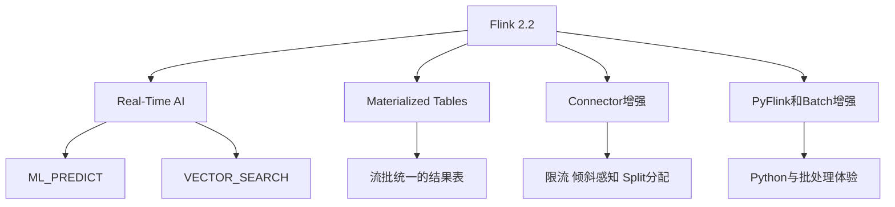
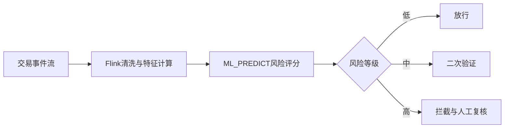

# Flink 2.2实时Data-AI架构

> [!abstract] 一句话结论
> Flink 2.2 的信号很明确：实时计算不再只是“实时数仓”和“实时大屏”，而是开始进入 **Real-Time Data + AI** 阶段。`ML_PREDICT`、`VECTOR_SEARCH`、Materialized Tables、Delta Join 这些能力，正在把 Flink 推向实时 AI 数据基础设施。

截至 2026-05-18，Apache Flink 官网显示 Flink 2.2 为 stable 文档版本，并在 2026-05-15 发布了 2.2.1 bugfix 版本。Flink 2.2.0 release note 明确提到其方向是“Advancing Real-Time Data + AI”。

这篇文章要回答：Flink 2.2 对数据工程师、实时数仓工程师、AI 数据平台工程师意味着什么？

前置阅读：[[【技术与工具】/Flink/00-Flink学习路线图|Flink学习路线图]]、[[【技术与工具】/Flink/21-Flink-Agents事件驱动AI|Flink Agents与事件驱动AI]]、[[【数据开发与数据架构】/09-实时数据架构/00-实时数据架构导览|实时数据架构导览]]。

---

## 1. Flink 2.2的四个关键词

### 1.1 ML_PREDICT：实时推理进入SQL层

Flink 2.2 引入 `ML_PREDICT`，意味着实时流中的模型推理可以更自然地进入 SQL 查询表达。它不是要替代专业模型服务，而是让实时数据处理链路能更直接地调用模型结果。

典型场景：

- 实时风控评分
- 实时异常检测
- 实时推荐特征打分
- 用户行为流中的意图识别
- 工业传感器流中的故障预测

### 1.2 VECTOR_SEARCH：实时向量检索

`VECTOR_SEARCH` 的意义在于，向量检索不再只属于离线 RAG 或向量数据库查询，也可以进入实时流处理链路。

想象一个客服场景：用户实时输入一句话，系统需要在毫秒到秒级内匹配历史案例、知识片段或风险模式。Flink 负责流式上下文，向量检索负责语义匹配，两者结合就是实时语义计算。

相关：[[【技术与工具】/向量数据库/00-向量数据库选型指南|向量数据库选型指南]]、[[【AI 与大数据】/04-AI工程化/07-向量数据库与语义搜索|向量数据库与语义搜索]]。

### 1.3 Materialized Tables：实时结果更产品化

Materialized Tables 的价值，是把持续更新的计算结果变成更稳定的可消费对象。对智能 BI、Agentic Analytics、实时指标服务来说，它是非常关键的一层。

过去实时计算常常是“任务跑着，但结果消费不友好”。Materialized Tables 让实时计算更接近数据产品。

### 1.4 Connector增强：生产环境不只看API

Flink 2.2 对连接器框架、限流、倾斜感知 split 分配等能力做增强。这些看起来不如 AI 关键词耀眼，但是真正生产环境中很重要。

实时链路失败往往不是 SQL 写错，而是：

- 上游速率不稳定
- 某些分区数据倾斜
- 外部系统写入变慢
- checkpoint 时间变长
- backpressure 扩散

Connector 的稳健性决定实时 AI 链路能不能长期跑。

---

## 2. Flink在AI时代的位置

Flink 与 Spark 的分工会更清晰：

| 维度 | Spark | Flink |
|---|---|---|
| 核心优势 | 大规模批处理、湖仓维护、离线特征 | 低延迟流处理、事件驱动、状态计算 |
| AI数据场景 | 离线样本、批量特征、Eval汇总 | 实时特征、实时推理、实时监控 |
| 适合延迟 | 分钟到小时 | 毫秒到秒 |
| 典型输出 | 表、离线数据集、湖仓结果 | 实时指标、告警、在线特征、动作 |

> [!tip] 判断
> Spark 是 AI 数据工厂，Flink 是 AI 数据神经系统。一个负责大规模加工，一个负责实时反应。

---

## 3. 三个实时AI架构模板

### 3.1 实时风控评分

关键点：特征要有状态，模型要可版本化，策略要可审计。

### 3.2 实时RAG触发

用户行为流进入 Flink 后，系统识别出某类意图，再通过向量检索补充上下文，触发 Agent 或消息推送。

这不是传统 RAG，而是事件驱动 RAG。

### 3.3 实时Agent观测

Agent 的 tool call、token、latency、error、guardrail 事件持续进入 Flink，形成实时可观测链路：

- 实时成本告警
- 工具异常检测
- Prompt 注入风险识别
- Agent 输出质量监控

相关：[[【AI 与大数据】/03-AI-Agent/06-Agent可观测性三件套|Agent可观测性三件套]]。

---

## 4. 学习Flink 2.2应该补什么

### 4.1 先补流处理基本功

- [[【技术与工具】/Flink/11-Flink窗口概念|Flink窗口概念]]
- [[【技术与工具】/Flink/12-Flink时间语义|Flink时间语义]]
- [[【技术与工具】/Flink/13-Flink状态管理|Flink状态管理]]
- [[【技术与工具】/Flink/15-Flink检查点机制|Flink检查点机制]]

没有这些基础，直接学实时 AI 会很危险。因为实时 AI 的难点不是“调模型”，而是状态、时间、乱序、故障恢复。

### 4.2 再补Flink SQL

- [[【技术与工具】/Flink/17-Flink SQL基础|Flink SQL基础]]
- 动态表
- 窗口 TVF
- Temporal Join
- Materialized Tables
- SQL Gateway

### 4.3 最后进入实时AI

重点关注：

- `ML_PREDICT`
- `VECTOR_SEARCH`
- Flink Agents
- 实时特征工程
- 实时 Agent Observability

---

## 5. 生产落地注意事项

1. **模型推理要考虑超时和降级**：模型服务不可用时，实时链路不能全崩。
2. **向量检索要考虑更新延迟**：实时事件和向量索引之间存在一致性问题。
3. **状态大小要可控**：实时 AI 很容易把上下文越攒越大。
4. **checkpoint 要监控**：AI 工具调用和外部 IO 会放大 checkpoint 风险。
5. **输出要可审计**：实时动作尤其要记录模型版本、特征版本、策略版本。

---

## 6. 外部参考

- [Apache Flink 2.2.0 Release Announcement](https://flink.apache.org/2025/12/04/apache-flink-2.2.0-advancing-real-time-data--ai-and-empowering-stream-processing-for-the-ai-era/)
- [Apache Flink 2.2.1 Release Announcement](https://flink.apache.org/2026/05/15/apache-flink-2.2.1-release-announcement/)
- [Apache Flink Documentation 2.2 stable](https://nightlies.apache.org/flink/flink-docs-stable/)
- [Apache Flink Homepage](https://flink.apache.org/)

---

## 7. 相关学习入口

- [[【技术与工具】/Flink/00-Flink学习路线图|Flink学习路线图]]
- [[【技术与工具】/Flink/21-Flink-Agents事件驱动AI|Flink Agents与事件驱动AI]]
- [[【技术与工具】/Spark/25-Spark-4与AI时代数据处理|Spark 4与AI时代数据处理]]
- [[【数据开发与数据架构】/09-实时数据架构/00-实时数据架构导览|实时数据架构导览]]
- [[【AI 与大数据】/03-AI-Agent/06-Agent可观测性三件套|Agent可观测性三件套]]
