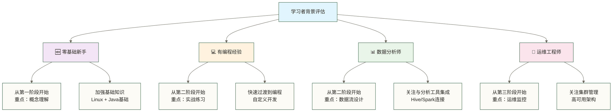
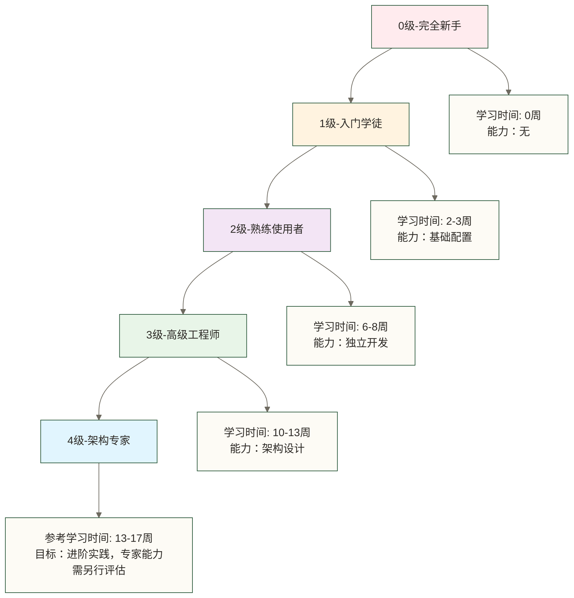

> [!warning] 关联材料边界
> 以下原引用目标缺失或无法唯一确认，已取消跳转并保留提及：10-性能调优实战。相关素材/延伸说明暂不可用，不能据此声称已经提供配套材料。

# 🌊 Flume学习路线图 - 构建企业级数据采集系统的完整指南

> [!tip] 给数据采集新手的温暖指导
> 
> 🤗 **学习Apache Flume就像学会建设现代化的数据供水系统！**
> 
> 如果你现在对数据采集感到困惑：
> - "这么多数据源，怎么统一收集管理？"
> - "如何保证数据传输的可靠性和实时性？"
> - "Flume到底能为我的数据工程带来什么价值？"
> 
> **别担心！** 每个数据工程师都是从理解第一个数据流开始的 ✨
> 
> 🚰 **想象Flume就像智能供水系统**
> 
> 智能供水系统的核心功能：
> - 🌊 **多源采集** = Source组件（从各种水源收集）
> - 🚰 **管道传输** = Channel组件（安全可靠的管道网络）
> - 🎯 **精准分发** = Sink组件（按需分配到目标地点）
> - 🔧 **智能控制** = Agent代理（自动化管理整个系统）
> - 📊 **质量监控** = 监控告警（确保供水质量和连续性）
> 
> **掌握了Flume，你就成为了数据世界的水利工程师！** 🌟

## 🎯 学习目标与价值

### 💼 职业发展价值

以下薪资数字与市场需求星级为原稿未核实示例，缺少地区、币种、统计周期和来源，仅供讨论岗位技能方向，不代表实际招聘行情或学习后的收入承诺。

| 职业方向 | 薪资水平 | 技能要求 | 市场需求 |
|---|---|---|---|
| **数据工程师** | 20-40万 | Flume + 与Hadoop生态集成 | ⭐⭐⭐⭐⭐ |
| **大数据架构师** | 40-80万 | 企业级数据采集设计 | ⭐⭐⭐⭐⭐ |
| **ETL开发工程师** | 18-35万 | 数据采集与处理 | ⭐⭐⭐⭐ |
| **实时数据工程师** | 25-50万 | 流式数据处理 | ⭐⭐⭐⭐⭐ |

### 🚀 技术能力提升

```mermaid
%%{init: {"theme":"base","themeVariables":{"fontFamily":"PingFang SC, -apple-system, Source Han Serif SC, serif","fontSize":"16px","background":"#FDFBF5","primaryColor":"#FDFBF5","primaryTextColor":"#2D2A26","primaryBorderColor":"#6E6A60","secondaryColor":"#E8EFE8","secondaryBorderColor":"#8FA890","secondaryTextColor":"#2D2A26","tertiaryColor":"#FDFBF5","tertiaryBorderColor":"#9A9488","tertiaryTextColor":"#6E6A60","lineColor":"#6E6A60","textColor":"#2D2A26","mainBkg":"#FDFBF5","nodeBorder":"#2D5A3D","clusterBkg":"#F3EEDF","clusterBorder":"#9A9488","edgeLabelBackground":"#FDFBF5"},"flowchart":{"htmlLabels":true,"curve":"basis","padding":20,"nodeSpacing":60,"rankSpacing":70,"useMaxWidth":false},"themeCSS":".node rect, .node polygon, .node circle { stroke-width: 1.5px; } .edgePath .path { stroke-width: 1.5px; } .cluster-label .nodeLabel, .cluster-label foreignObject { color: #2D2A26 !important; } .edgeLabel, .edgeLabel foreignObject { color: #2D2A26 !important; background-color: #FDFBF5; } .edgeLabel rect { fill: #FDFBF5; }"}}%%
flowchart TD
    A[Flume技能体系]
    B[🔧 基础技能]
    C[⚡ 核心技能]
    D[🎯 高级技能]
    E[🏆 专家技能]
    B1[数据采集概念<br/>Agent架构理解]
    B2[基本配置能力<br/>Source/Channel/Sink]
    B3[环境搭建<br/>单机到集群部署]
    C1[多种数据源集成<br/>Spooling/Kafka/HTTP]
    C2[容错与可靠性<br/>事务机制理解]
    C3[性能调优<br/>内存和并发优化]
    D1[企业级架构设计<br/>多级Agent拓扑]
    D2[自定义开发<br/>Source/Sink扩展]
    D3[监控运维<br/>生产环境管理]
    E1[大规模集群管理<br/>高可用架构]
    E2[性能极致优化<br/>吞吐量最大化]
    E3[技术选型决策<br/>架构演进规划]
    
    A --> B
    A --> C
    A --> D
    A --> E
    B --> B1
    B --> B2
    B --> B3
    C --> C1
    C --> C2
    C --> C3
    D --> D1
    D --> D2
    D --> D3
    E --> E1
    E --> E2
    E --> E3
    
    style A fill:#e1f5fe
    style B fill:#f3e5f5
    style C fill:#fff3e0
    style D fill:#e8f5e8
    style E fill:#fce4ec
```

## 📚 完整学习路径

### 🌟 第一阶段：基础入门（预计2-3周）

**学习目标：** 建立数据采集基本概念，掌握Flume核心架构

| 序号 | 文档标题 | 核心内容 | 实践项目 | 预计时间 |
|---|---|---|---|---|
| 01 | [[【技术与工具】/Flume/01-Flume概述与特性|Flume概述与特性|]] | 数据采集基础概念、Flume优势特点 | 技术对比分析 | 0.5天 |
| 02 | [[【技术与工具】/Flume/02-Flume核心架构|Flume核心架构|]] | Agent架构、Source/Channel/Sink详解 | 架构图绘制 | 1天 |
| 03 | [[【技术与工具】/Flume/03-Flume环境搭建|Flume环境搭建|]] | 单机安装、集群部署、环境验证 | 完整环境搭建 | 1天 |
| 04 | [[【技术与工具】/Flume/04-第一个Flume应用|第一个Flume应用|]] | 简单日志采集、基础配置实战 | Hello World项目 | 0.5天 |

**阶段成果：** 
- ✅ 理解数据采集的核心价值
- ✅ 掌握Flume基本架构原理
- ✅ 完成开发环境搭建
- ✅ 运行第一个数据采集任务

### ⚡ 第二阶段：核心技能（预计4-5周）

**学习目标：** 掌握各种数据源采集、可靠性保障、性能优化

| 序号 | 文档标题 | 核心内容 | 实践项目 | 预计时间 |
|---|---|---|---|---|
| 05 | [[【技术与工具】/Flume/05-Source数据源详解|Source数据源详解|]] | Spooling、Taildir、Kafka等源配置 | 多源数据采集 | 2天 |
| 06 | [[【技术与工具】/Flume/06-Channel通道机制|Channel通道机制|]] | Memory、File、Kafka Channel配置 | 可靠性对比测试 | 1.5天 |
| 07 | [[【技术与工具】/Flume/07-Sink输出详解|Sink输出详解|]] | HDFS、HBase、Kafka等目标配置 | 多目标数据分发 | 2天 |
| 08 | [[【技术与工具】/Flume/08-拦截器与序列化|拦截器与序列化|]] | 事务机制、故障恢复、数据一致性 | 容错测试项目 | 1.5天 |

**阶段成果：**
- ✅ 熟练配置各种数据源和目标
- ✅ 理解Flume可靠性机制
- ✅ 掌握配置文件编写技巧
- ✅ 完成中等复杂度采集任务

### 🎯 第三阶段：高级应用（预计4-5周）

**学习目标：** 掌握企业级部署、性能调优、监控运维

| 序号 | 文档标题 | 核心内容 | 实践项目 | 预计时间 |
|---|---|---|---|---|
| 09 | [[【技术与工具】/Flume/09-多级Agent架构|多级Agent架构|]] | Fan-out、Fan-in、Load balancing | 企业级拓扑设计 | 2天 |
| 10 | 性能调优实战（原引用“10-性能调优实战”未能确定有效目标，暂不可跳转） | 内存调优、并发优化、吞吐量提升 | 性能测试项目 | 2天 |
| 11 | [[【技术与工具】/Flume/11-监控与运维|监控与运维|]] | JMX监控、日志分析、告警配置 | 监控系统搭建 | 2天 |
| 12 | [[【技术与工具】/Flume/12-与Hadoop生态集成|与Hadoop生态集成|]] | HDFS、HBase、Hive等深度集成 | 大数据平台集成 | 2天 |
| 13 | [[【技术与工具】/Flume/13-故障处理与调试|故障处理与调试|]] | 常见问题诊断、调试技巧 | 故障排查实战 | 1天 |

**阶段成果：**
- ✅ 设计企业级数据采集架构
- ✅ 实现高性能数据传输
- ✅ 建立完善监控体系
- ✅ 解决生产环境问题

### 🏆 第四阶段：企业实战（预计3-4周）

**学习目标：** 承担企业级项目、架构设计、团队协作

| 序号 | 文档标题 | 核心内容 | 实践项目 | 预计时间 |
|---|---|---|---|---|
| 14 | [[【技术与工具】/Flume/14-Flume源码与插件开发|Flume源码与插件开发|]] | Custom Source/Sink开发 | 自定义组件项目 | 3天 |

**阶段成果：**
- ✅ 独立开发自定义组件
- ✅ 设计高可用数据采集系统
- ✅ 管理大规模Flume集群
- ✅ 完成企业级项目交付

## 🛣️ 个性化学习路径

### 👤 根据背景选择起点

### 🎯 按职业目标定制

| 目标职位 | 重点学习内容 | 跳过内容 | 额外补充 |
|---|---|---|---|
| **数据工程师** | 全部内容均衡学习 | 无 | Kafka、Spark集成 |
| **运维工程师** | 监控运维、故障处理 | 自定义开发 | 自动化部署 |
| **架构师** | 架构设计、性能调优 | 基础操作 | 技术选型、容量规划 |
| **ETL开发** | 数据源集成、转换 | 集群管理 | 数据质量、血缘追踪 |

## 📊 学习效果评估

### 🎯 阶段性测试

**第一阶段测试：**
- [ ] 能够解释Flume的核心价值和应用场景
- [ ] 独立搭建Flume开发环境
- [ ] 理解Source、Channel、Sink的作用
- [ ] 完成简单的日志采集任务

**第二阶段测试：**
- [ ] 配置多种类型的数据源和目标
- [ ] 理解并配置事务机制
- [ ] 解决常见的配置问题
- [ ] 设计中等复杂度的数据流

**第三阶段测试：**
- [ ] 设计多级Agent拓扑结构
- [ ] 进行性能调优并达到目标吞吐量
- [ ] 建立监控告警体系
- [ ] 解决生产环境故障

**第四阶段测试：**
- [ ] 开发自定义Source或Sink
- [ ] 设计高可用架构方案
- [ ] 管理大规模Flume集群
- [ ] 交付完整的企业级项目

### 📈 能力成长曲线

下图是学习规划示意，不是经验证的能力成长规律。各级能力是学习目标，需以实际项目与测试结果评估，不能由学习周数直接推定。

## 💡 学习方法建议

### 🎯 高效学习策略

**理论与实践结合（3:7比例）：**
- 30% 时间：阅读文档、理解概念
- 70% 时间：动手实践、项目实战

**循序渐进学习法：**
1. **预习**：快速浏览将要学习的内容
2. **精读**：仔细学习核心概念和技术细节
3. **实践**：完成配套的实验和项目
4. **复习**：总结知识点，查漏补缺
5. **应用**：在实际项目中运用所学知识

### 🛠️ 实践环境准备

**硬件要求：**
- CPU：4核心以上
- 内存：8GB以上（推荐16GB）
- 硬盘：100GB以上可用空间
- 网络：稳定的互联网连接

**软件环境：**
- 操作系统：Linux（CentOS 7/Ubuntu 18.04+）
- Java：JDK 1.8+
- Hadoop：2.7.0+（可选）
- Docker：用于快速环境部署

### 📚 推荐学习资源

**官方资源：**
- Apache Flume官方文档
- Flume GitHub仓库
- Apache邮件列表

**实践平台：**
- 本地虚拟机环境
- 云平台（阿里云、腾讯云等）
- Docker容器环境

## 🌟 学习成功案例

本节所有案例均按教学假设阅读：原稿未提供可核查的真人经历、企业项目材料或测试报告，不能确认这些成果真实发生。下列周期、涨薪与性能数字保留为原稿未核实示例，不是就业、收入或系统性能保证。

### 💼 职业转型成功案例（教学假设，非已证实真人成果）

**案例1：从业务分析师到数据工程师**
- 学习周期：4个月
- 学习重点：Flume + 与Hadoop生态集成
- 成果：成功转入某互联网公司数据团队
- 薪资提升：40%

**案例2：从运维到大数据架构师**
- 学习周期：6个月  
- 学习重点：架构设计 + 性能调优
- 成果：设计公司级数据采集平台
- 薪资提升：80%

### 🎯 项目成功案例（教学假设，非已验证企业指标）

**电商实时数据采集平台**
- 技术栈：Flume + Kafka + Spark
- 数据量：日处理100TB+
- 延迟：平均延迟 < 100ms
- 可用性：99.9%

**金融风控数据管道**
- 技术栈：Flume + HBase + Flink
- 数据源：50+个业务系统
- 实时性：秒级数据同步
- 准确性：99.99%

## 🚀 开始你的Flume学习之旅

### 🎯 立即行动计划

1. **Week 1-2：基础入门**
   - 完成环境搭建
   - 理解核心概念  
   - 运行第一个示例

2. **Week 3-6：核心技能**
   - 掌握各种组件配置
   - 理解可靠性机制
   - 完成中级项目

3. **Week 7-11：高级应用**
   - 设计企业级架构
   - 进行性能调优
   - 建立监控体系

4. **Week 12-16：企业实战**
   - 开发自定义组件
   - 完成大型项目
   - 以项目验收评估进阶能力，不以学习周数认定专家水平

### 💪 给自己的承诺

> **🌟 我承诺：**
> - 每天投入至少2小时学习时间
> - 完成每个阶段的实践项目
> - 遇到问题主动寻求帮助和解决
> - 与同学和社区积极交流分享
> - 持续学习，不断提升技术能力

**现在，让我们一起开始这段激动人心的Flume学习之旅吧！** 🚀✨

---

## 📋 快速导航

- [[【技术与工具】/Flume/01-Flume概述与特性|Flume概述与特性]] - 了解数据采集的价值
- [[【技术与工具】/Flume/02-Flume核心架构|Flume核心]] - 掌握Agent架构设计
- [[【技术与工具】/Flume/03-Flume环境搭建|Flume环境搭建]] - 建立学习实践环境
- [[【技术与工具】/Flume/04-第一个Flume应用|第一个Flume]] - 体验数据采集魅力