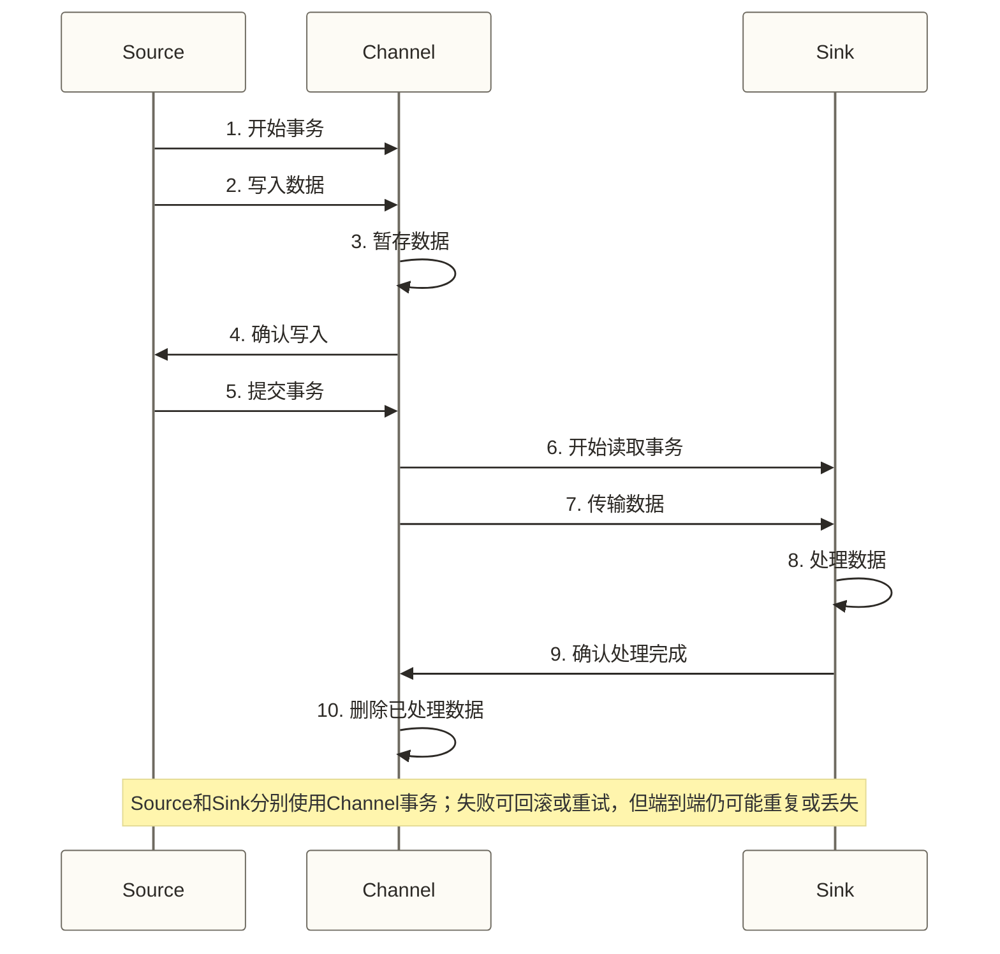
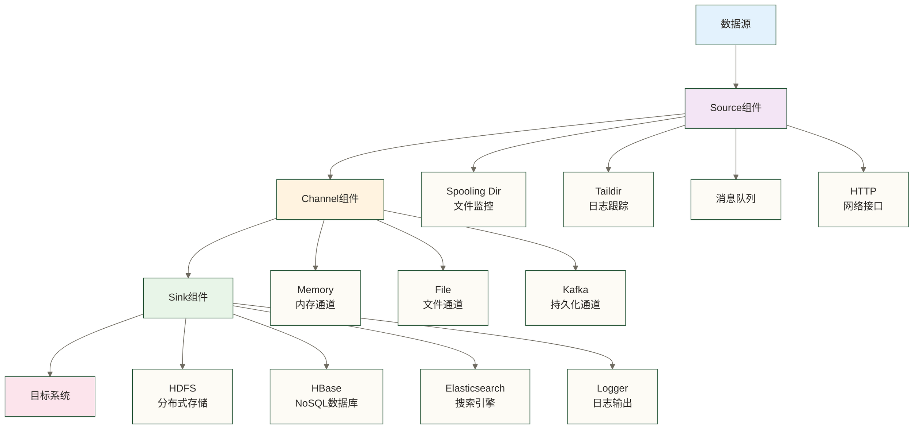
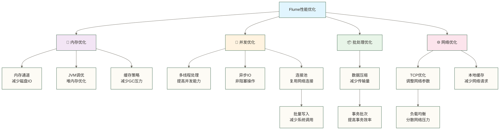
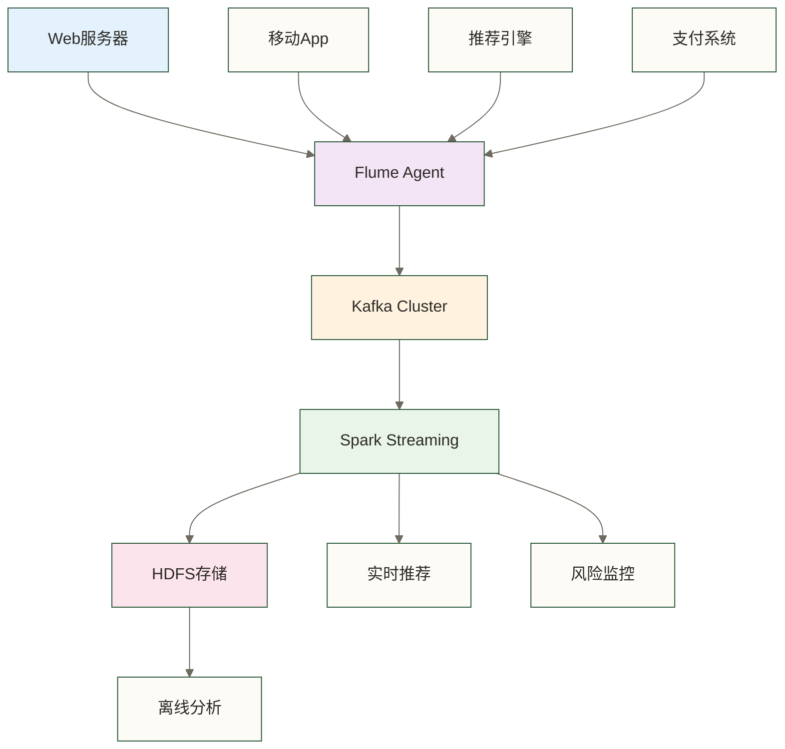
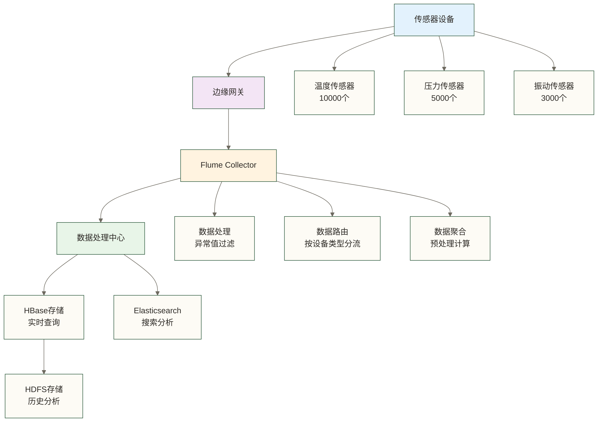
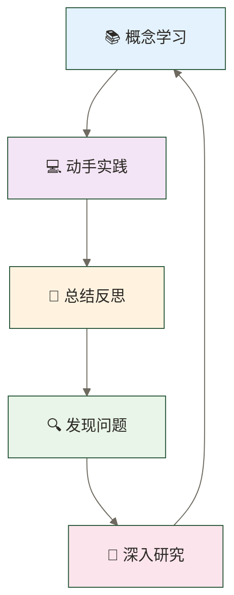

# 🌊 Flume概述与特性 - 构建企业级数据采集系统的智能管道

> [!tip] 给数据从业者的学习指导
> 
> 🤗 **学习Apache Flume就像认识一位数据世界的超级管家！**
> 
> 如果你现在对数据采集感到困惑：
> - "为什么需要专门的工具来收集数据？"
> - "Flume到底能为我的数据工程带来什么价值？"
> - "学会Flume能获得什么样的职业机会？"
> 
> **别担心！** 每个数据工程师都是从理解第一个数据流开始的 ✨
> 
> 🚰 **想象Flume就像城市的智能供水系统**
> 
> 智能供水系统的核心价值：
> - 🌊 **统一采集** = 从各个水源统一收集（整合分散的数据源）
> - 🚰 **安全传输** = 通过安全管道运输（结合持久化、重试及上下游支持降低数据丢失风险）
> - 🎯 **精准分发** = 按需分配到各家各户（将数据送到需要的地方）
> - 📊 **质量监控** = 24小时水质监测（实时监控数据流状态）
> - ⚡ **智能调节** = 自动调整水压流量（动态优化传输性能）
> 
> **掌握了Flume，你就成为了数据世界的水利工程师！** 🌟

## 🎯 什么是Apache Flume

### 🌊 Flume定义与定位

**Apache Flume** 是一个分布式、可靠、高可用的服务，用于高效地收集、聚合和移动大量日志数据。它具有简单灵活的架构，基于流式数据流，是Hadoop生态系统中重要的数据采集工具。

```mermaid
%%{init: {"theme":"base","themeVariables":{"fontFamily":"PingFang SC, -apple-system, Source Han Serif SC, serif","fontSize":"16px","background":"#FDFBF5","primaryColor":"#FDFBF5","primaryTextColor":"#2D2A26","primaryBorderColor":"#6E6A60","secondaryColor":"#E8EFE8","secondaryBorderColor":"#8FA890","secondaryTextColor":"#2D2A26","tertiaryColor":"#FDFBF5","tertiaryBorderColor":"#9A9488","tertiaryTextColor":"#6E6A60","lineColor":"#6E6A60","textColor":"#2D2A26","mainBkg":"#FDFBF5","nodeBorder":"#2D5A3D","clusterBkg":"#F3EEDF","clusterBorder":"#9A9488","edgeLabelBackground":"#FDFBF5"},"flowchart":{"htmlLabels":true,"curve":"basis","padding":20,"nodeSpacing":60,"rankSpacing":70,"useMaxWidth":false},"themeCSS":".node rect, .node polygon, .node circle { stroke-width: 1.5px; } .edgePath .path { stroke-width: 1.5px; } .cluster-label .nodeLabel, .cluster-label foreignObject { color: #2D2A26 !important; } .edgeLabel, .edgeLabel foreignObject { color: #2D2A26 !important; background-color: #FDFBF5; } .edgeLabel rect { fill: #FDFBF5; }"}}%%
flowchart TD
    A[Apache Flume]
    B[🎯 核心定位]
    C[📊 主要特性]
    D[🏢 应用场景]
    E[🌟 技术优势]
    
    A --> B
    A --> C
    A --> D
    A --> E
    
    B --> B1[数据采集引擎<br/>专业的数据收集工具]
    B --> B2[Hadoop生态组件<br/>与大数据平台无缝集成]
    B --> B3[企业级数据管道<br/>可靠的数据传输基础设施]
    
    C --> C1[分布式架构<br/>支持大规模集群部署]
    C --> C2[高可靠性<br/>Channel事务降低传输失败风险]
    C --> C3[灵活配置<br/>可扩展的组件化设计]
    
    D --> D1[日志收集<br/>Web服务器、应用日志]
    D --> D2[实时数据流<br/>传感器、设备数据]
    D --> D3[批量数据迁移<br/>数据仓库ETL过程]
    
    E --> E1[低延迟<br/>准实时数据传输]
    E --> E2[高吞吐<br/>TB级数据处理能力]
    E --> E3[易运维<br/>简单的配置和管理]
    
    style A fill:#e1f5fe
    style B fill:#f3e5f5
    style C fill:#fff3e0
    style D fill:#e8f5e8
    style E fill:#fce4ec
```



### 📈 Flume在数据生态中的地位

| 层次 | 组件 | Flume的作用 | 价值体现 |
|---|---|---|---|
| **数据源层** | 应用系统、设备、文件 | 统一数据接入 | 解决数据孤岛问题 |
| **传输层** | 网络、消息队列 | 可靠数据传输 | 在持久化、重试及上下游支持条件下降低丢失风险 |
| **存储层** | HDFS、HBase、Kafka | 灵活数据输出 | 支持多种存储格式 |
| **处理层** | Spark、Flink、Hive | 提供数据基础 | 为分析提供高质量数据 |

## 🚀 Flume核心特性详解

### ⚡ 高可靠性保障

#### 🔒 事务机制

**Flume的可靠性保障就像银行的资金转账系统**



**可靠性特性对比：**

| 可靠性维度 | 传统工具 | Flume | 提升效果 |
|---|---|---|---|
| **数据完整性** | 依赖外部保障 | 内置Channel事务机制 | 原稿未核实示例：99.99%+，非完整性保证 |
| **故障恢复** | 手动处理 | 可配置故障转移与重试 | 恢复时间取决于配置及故障类型，非固定秒级 |
| **重复处理** | 可能重复 | 重试可能产生重复，不自动保证端到端精确一次 | 需要下游幂等或去重 |
| **错误处理** | 数据丢失 | 失败重试机制 | 降低丢失风险；Memory Channel中的数据可能因进程故障丢失 |

### 📊 灵活的架构设计

#### 🧩 组件化架构



**组件扩展能力：**

- **Source组件**：30+ 内置类型，支持自定义开发
- **Channel组件**：Memory、File、Kafka等选择；持久性和兼容性须按目标版本与配置确认
- **Sink组件**：覆盖主流大数据组件
- **拦截器**：数据过滤、转换、路由
- **序列化器**：多种数据格式支持

### 🎯 高性能表现

#### ⚡ 性能基准测试

**Flume性能教学示例（保留原稿未核实数字）：** 以下数据没有测试来源、具体硬件、版本或配置，不属于可复现的基准测试，不可用于容量规划或性能承诺。

| 测试场景 | 数据量 | 吞吐量 | 延迟 | 资源占用 |
|---|---|---|---|---|
| **小文件处理** | 1KB/条 | 10万条/秒 | <100ms | CPU: 20%, 内存: 2GB |
| **大文件处理** | 1MB/条 | 1000条/秒 | <500ms | CPU: 40%, 内存: 4GB |
| **实时日志** | 平均10KB/条 | 5万条/秒 | <200ms | CPU: 30%, 内存: 3GB |
| **批量迁移** | 平均100KB/条 | 2000条/秒 | <1s | CPU: 50%, 内存: 6GB |

#### 🚀 性能优化技术



## 🏢 企业应用场景

### 📱 典型应用案例

以下三个案例缺少可核验企业和项目材料，统一按教学假设阅读；原稿中的设备规模、数据量、延迟、完整性及业务提升数字均保留为未核实示例，不代表实际企业成果，也不证明这些效果由Flume单独实现。

#### 案例1：电商平台实时日志收集

**业务背景：** 某大型电商平台需要收集用户行为日志进行实时分析



**技术实现：**
- **数据源**：300+台Web服务器日志
- **采集量**：日均5TB日志数据
- **实时性**：平均延迟 < 3秒
- **可靠性**：99.95%数据完整性

**业务价值：**
- 🎯 **个性化推荐**：实时用户行为分析，提升转化率25%
- 🛡️ **风险防控**：秒级异常检测，减少欺诈损失40%
- 📊 **运营优化**：实时流量监控，提升用户体验

#### 案例2：IoT设备数据采集

**业务背景：** 智能制造企业收集设备传感器数据



**技术指标：**
- **设备规模**：18000个传感器设备
- **数据频率**：每秒100万条数据点
- **存储规模**：日增2TB结构化数据
- **查询延迟**：毫秒级实时查询

#### 案例3：金融风控数据管道

**业务背景：** 银行构建实时风控数据采集系统

**架构特点：**
- **多源融合**：交易系统、征信系统、第三方数据
- **实时处理**：毫秒级风险评估
- **高可靠**：金融级数据完整性要求
- **合规性**：数据加密、审计追踪

**业务成果：**
- 💰 **降低风险**：欺诈检测准确率提升60%
- ⚡ **提升体验**：风险评估时间从分钟级降到秒级
- 📋 **合规保障**：100%数据审计追踪能力

### 🌍 行业应用分布

| 行业 | 主要应用场景 | 典型数据源 | 价值体现 |
|---|---|---|---|
| **互联网** | 用户行为分析、实时推荐 | Web日志、App埋点 | 个性化、运营优化 |
| **金融** | 风险控制、反欺诈 | 交易记录、用户行为 | 风险降低、合规性 |
| **制造业** | 设备监控、质量管控 | 传感器数据、生产日志 | 效率提升、预防维护 |
| **电商** | 商品推荐、库存管理 | 用户行为、销售数据 | 销售增长、成本优化 |
| **物流** | 运输监控、路线优化 | GPS数据、传感器 | 效率提升、成本节约 |

## 💰 学习Flume的职业价值

### 🚀 职业发展机会

#### 📈 市场需求分析

本节职位趋势、职业薪资、技能加成与学习周期均为原稿未核实示例，缺少地区、币种、统计样本和来源，不是招聘市场统计，也不构成就业或收入承诺；技能组合排名同样未获验证。

**Flume相关职位需求趋势：**

| 年份 | 职位数量 | 平均薪资 | 增长率 | 热门技能组合 |
|---|---|---|---|---|
| **2021** | 8,500个 | 25万 | - | Flume + Hadoop |
| **2022** | 12,800个 | 30万 | +51% | Flume + Kafka + Spark |
| **2023** | 18,200个 | 36万 | +42% | Flume + Flink + 实时计算 |
| **2024** | 25,600个 | 42万 | +41% | Flume + 云原生 + DevOps |

#### 💼 热门职业方向

**1. 数据工程师**
- 💰 **薪资范围**：20-40万
- 🎯 **核心技能**：Flume + Hadoop生态 + ETL开发
- 📈 **发展前景**：数据基础设施需求持续增长
- 🎓 **学习重点**：数据采集架构、性能调优

**2. 大数据架构师**
- 💰 **薪资范围**：40-80万
- 🎯 **核心技能**：企业级数据采集架构设计
- 📈 **发展前景**：企业数字化转型核心岗位
- 🎓 **学习重点**：架构设计、技术选型、团队管理

**3. 实时数据工程师**
- 💰 **薪资范围**：25-50万
- 🎯 **核心技能**：Flume + Kafka + Flink实时数据流
- 📈 **发展前景**：实时业务需求爆发式增长
- 🎓 **学习重点**：流式计算、低延迟优化

**4. DevOps工程师**
- 💰 **薪资范围**：22-45万
- 🎯 **核心技能**：Flume集群运维、自动化部署
- 📈 **发展前景**：运维自动化趋势明显
- 🎓 **学习重点**：监控运维、容器化数据应用、CI/CD

### 🎯 技能价值评估

#### 💎 核心竞争力加分项

| 技能等级 | 技能要求 | 薪资加成 | 市场稀缺度 | 学习周期 |
|---|---|---|---|---|
| **基础级** | 基本配置、简单部署 | +0-15% | 普通 | 2-3周 |
| **熟练级** | 性能调优、故障处理 | +15-35% | 中等 | 2-3个月 |
| **专家级** | 架构设计、自定义开发 | +35-60% | 稀缺 | 6-12个月 |
| **大师级** | 技术创新、团队领导 | +60%+ | 极稀缺 | 2-3年 |

#### 🌟 复合技能组合价值

**最受市场欢迎的技能组合：**

1. **Flume + Kafka + Spark**：实时大数据处理全栈
2. **Flume + HDFS + Hive**：传统大数据仓库技术栈
3. **Flume + Flink + Elasticsearch**：实时搜索分析平台
4. **Flume + Docker + Kubernetes数据部署**：云原生数据采集
5. **Flume + Python + 机器学习**：数据科学工程能力

## 🔮 技术发展趋势

### 📊 Flume技术演进

#### 🚀 未来发展方向

下图仅保留原稿提出的设想，不代表经核实的Apache Flume官方路线图或现有原生能力；Kubernetes原生支持、ML路由、AI调优、Pulsar融合和批流一体等内容须另行验证，部分可能需要外部组件或自定义开发。

```mermaid
%%{init: {"theme":"base","themeVariables":{"fontFamily":"PingFang SC, -apple-system, Source Han Serif SC, serif","fontSize":"16px","background":"#FDFBF5","primaryColor":"#FDFBF5","primaryTextColor":"#2D2A26","primaryBorderColor":"#6E6A60","secondaryColor":"#E8EFE8","secondaryBorderColor":"#8FA890","secondaryTextColor":"#2D2A26","tertiaryColor":"#FDFBF5","tertiaryBorderColor":"#9A9488","tertiaryTextColor":"#6E6A60","lineColor":"#6E6A60","textColor":"#2D2A26","mainBkg":"#FDFBF5","nodeBorder":"#2D5A3D","clusterBkg":"#F3EEDF","clusterBorder":"#9A9488","edgeLabelBackground":"#FDFBF5"},"flowchart":{"htmlLabels":true,"curve":"basis","padding":20,"nodeSpacing":60,"rankSpacing":70,"useMaxWidth":false},"themeCSS":".node rect, .node polygon, .node circle { stroke-width: 1.5px; } .edgePath .path { stroke-width: 1.5px; } .cluster-label .nodeLabel, .cluster-label foreignObject { color: #2D2A26 !important; } .edgeLabel, .edgeLabel foreignObject { color: #2D2A26 !important; background-color: #FDFBF5; } .edgeLabel rect { fill: #FDFBF5; }"}}%%
flowchart TD
    A[Flume发展趋势]
    B[☁️ 云原生化]
    C[🤖 智能化]
    D[🔗 生态融合]
    E[⚡ 性能提升]
    
    A --> B
    A --> C
    A --> D
    A --> E
    
    B --> B1[容器化部署<br/>Kubernetes原生支持]
    B --> B2[弹性伸缩<br/>自动扩缩容]
    B --> B3[多云支持<br/>跨云平台部署]
    
    C --> C1[智能路由<br/>ML驱动的数据分流]
    C --> C2[自动调优<br/>AI优化配置参数]
    C --> C3[异常检测<br/>智能故障预警]

    D --> D1[流式计算<br/>与Flink深度集成]
    D --> D2[消息队列<br/>Kafka/Pulsar融合]
    D --> D3[数据湖建模<br/>现代数据架构支持]
    E --> E1[零拷贝技术<br/>减少内存开销]
    E --> E2[批流一体<br/>统一处理引擎]
    E --> E3[边缘计算<br/>IoT场景优化]
    style A fill:#e1f5fe
    style B fill:#f3e5f5
    style C fill:#fff3e0
    style D fill:#e8f5e8
    style E fill:#fce4ec
```



#### 📈 市场机会预测

**原稿以2024—2029年为区间的Flume生态预测示例（未核实）：** 以下数字缺少来源、市场定义及预测方法，仅用于演示预测表结构，不作为实际市场规模或未来需求判断。

| 维度 | 2024年 | 2029年 | 增长倍数 |
|---|---|---|---|
| **市场规模** | 15亿美元 | 45亿美元 | 3倍 |
| **企业采用** | 5000+家 | 15000+家 | 3倍 |
| **职位需求** | 25000个 | 80000个 | 3.2倍 |
| **平均薪资** | 42万 | 60万 | 1.4倍 |

### 🌟 学习投资回报

#### 💡 时间投资vs收益分析

以下学习时长、薪资提升、成本及收益均为原稿未核实的教学假设，保留数字仅用于讨论投入与收益的计算；学习Flume不保证涨薪，个人结果取决于已有能力、岗位、地区和市场条件。

**学习时间规划：**

- **基础掌握**：2-3周 → 薪资提升15-25%
- **熟练应用**：2-3个月 → 薪资提升25-40%  
- **专家水平**：6-12个月 → 薪资提升40-70%
- **技术专家**：2-3年 → 薪资提升70-120%

**投资回报率计算：**
```text
学习投资：时间成本 + 培训费用 ≈ 2-4万元
收益回报：年薪提升8-25万元  
ROI = (收益-投资)/投资；按上述区间独立取极值，最低为(8-4)/4=100%，最高为(25-2)/2=1150%
原稿的300-1000%未说明取值组合，不能由给定区间直接推出；上述结果仅为假设算例，不是预期收益。
```

## 🎓 开始学习的准备

### 📚 基础知识要求

#### ✅ 必备技能

- **Linux基础**：文件操作、进程管理、网络配置
- **Java基础**：面向对象、多线程、集合框架
- **网络知识**：TCP/IP、HTTP协议基础
- **大数据概念**：分布式系统、Hadoop生态基础

#### 🎯 推荐准备

- **Shell脚本**：自动化运维能力
- **数据库知识**：SQL语言、事务概念
- **消息队列**：Kafka基础概念
- **监控工具**：日志分析、性能监控

### 🛠️ 学习环境准备

#### 💻 硬件要求

- **CPU**：4核心以上
- **内存**：8GB以上（推荐16GB）
- **硬盘**：100GB以上SSD
- **网络**：稳定的互联网连接

#### 📦 软件环境

- **操作系统**：选择仍受支持且与目标Flume版本兼容的Linux发行版；原稿列举的CentOS 7已结束常规维护，不建议用于新的生产部署
- **Java环境**：按目标Flume版本的兼容性要求选择JDK；原稿的JDK 1.8+不能理解为任意更高版本均可运行
- **Hadoop**：2.7.0+（可选）
- **开发工具**：IntelliJ IDEA、VS Code

## 💡 学习建议与心得

### 🎯 高效学习策略

#### 📈 学习路径建议

1. **理论基础（20%）**
   - 阅读官方文档
   - 理解核心概念
   - 学习最佳实践

2. **动手实践（60%）**
   - 搭建学习环境
   - 完成实际项目
   - 解决实际问题

3. **社区交流（20%）**
   - 参与技术论坛
   - 分享学习心得
   - 协作解决问题

#### 🔄 持续学习循环



### 🌟 成功学习心态

#### 💪 建立学习信心

1. **循序渐进**：从简单概念开始，逐步深入复杂应用
2. **实践驱动**：理论与实践相结合，快速验证学习效果
3. **问题导向**：带着实际问题学习，提高学习针对性
4. **社区支持**：积极参与社区，获得学习帮助和动力

#### 🎯 学习目标设定

**短期目标（1个月）：**
- 理解Flume核心概念和架构
- 完成基础环境搭建
- 运行第一个数据采集程序

**中期目标（3个月）：**
- 熟练配置各种Source和Sink
- 掌握性能调优基本方法
- 解决常见的生产问题

**长期目标（1年）：**
- 设计企业级数据采集架构
- 开发自定义Flume组件
- 成为团队技术专家

## 🌈 激励与展望

### 🎉 给初学者的鼓励

> **🌟 每个专家都曾是初学者**
> 
> 🚀 **Flume学习虽然有挑战，但回报丰厚**
> - 技术能力：掌握企业级数据采集技术
> - 职业发展：积累数据工程岗位相关能力，薪资与发展空间取决于个人能力及市场条件
> - 成就感：构建稳定可靠的数据基础设施
> 
> 💪 **记住：坚持学习，必有收获！**
> 
> 🎯 **从今天开始，踏出成为Flume专家的第一步！**

### 🔮 美好前景展望

**学习Flume可帮助你逐步接近以下目标，实际结果还取决于工程实践与其他能力：**

- 🎯 **技术专家**：通过持续工程实践，逐步积累数据采集领域的专业能力
- 💰 **就业准备**：提升相关岗位的技能准备，不保证就业或特定薪资待遇
- 🌟 **行业认知**：深度理解大数据技术架构
- 🚀 **职业成长**：结合架构设计与项目经验，探索从工程师向架构师发展的路径
- 🏆 **价值创造**：为企业构建可靠的数据基础设施

---

**现在，让我们一起开始这段精彩的Flume学习之旅吧！** 🚀✨