# 🏗️ Flume核心架构 - 深度解析智能数据管道的设计哲学

> [!tip] 给架构学习新手的温暖指导
> 
> 🤗 **学习Flume架构就像理解一座现代化水处理厂的工作原理！**
> 
> 如果你现在面对复杂的架构图时想：
> - "这么多组件，它们是怎么协调工作的？"
> - "为什么要设计成这样的架构？"
> - "如何理解Source、Channel、Sink的核心作用？"
> 
> **别担心！** 每个架构师都是从理解第一个组件开始的 ✨
> 
> 🏭 **想象Flume架构就像现代化水处理工厂**
> 
> 水处理工厂的核心系统：
> - 🚰 **进水口** = Source组件（从各种水源收集原水）
> - 🏊 **储水池** = Channel组件（安全存储和缓冲处理）
> - 🎯 **出水口** = Sink组件（按需分配到目标用户）
> - 🔧 **控制中心** = Agent代理（智能协调整个系统）
> - 📊 **监控系统** = 事务机制（确保处理过程可靠）
> 
> **理解了架构设计，你就掌握了Flume的精髓！** 🌟

## 🎯 Flume架构总览

### 🏗️ 核心架构设计

**Flume采用基于Agent的分布式架构**，每个Agent都是一个独立的JVM进程，包含Source、Channel和Sink三个核心组件。

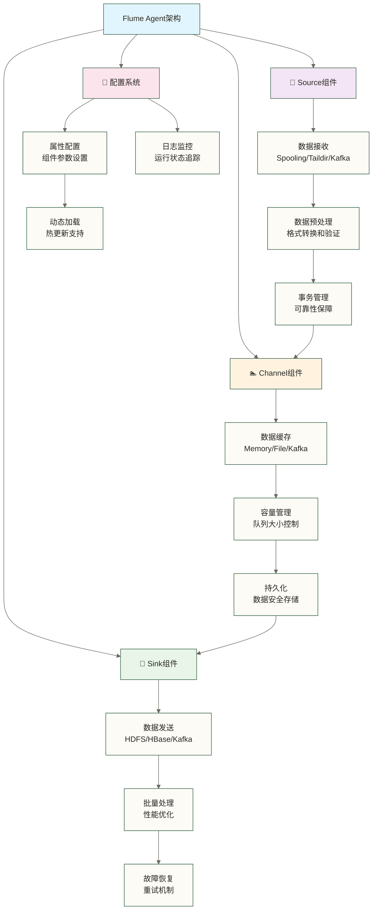

### 📊 架构设计原则

| 设计原则 | 具体体现 | 技术优势 | 业务价值 |
|---|---|---|---|
| **松耦合** | 组件独立，接口标准 | 易扩展、易维护 | 降低开发成本 |
| **高可靠** | 事务机制、故障恢复 | 在适当持久化与确认配置下降低丢失风险，仍须处理重复投递 | 提升业务连续性 |
| **可扩展** | 分布式部署、水平扩展 | 支持大规模 | 满足业务增长 |
| **灵活性** | 插件化架构、配置驱动 | 适应多场景 | 快速响应需求 |

## 📡 Source组件深度解析

### 🌊 Source核心职责

**Source组件就像水厂的智能进水系统**，负责从各种数据源收集数据并将其写入Channel。

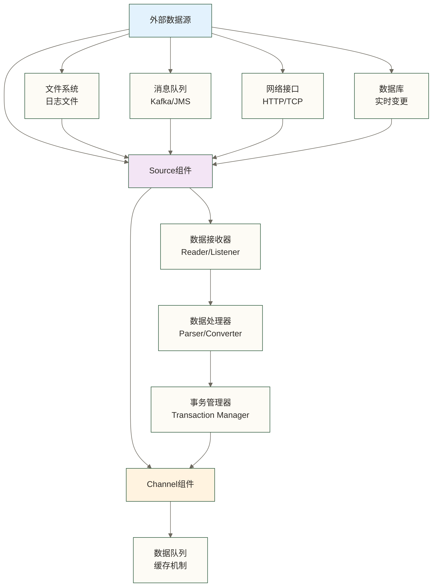

### 🔧 主要Source类型详解

#### 1. 📁 Spooling Directory Source

**适合批量文件处理的目录监控Source；文件投递后不得继续修改，且文件名不可复用**

```properties
# Spooling Directory配置示例
agent.sources.r1.type = spooldir
agent.sources.r1.spoolDir = /data/spool
agent.sources.r1.channels = c1

# 核心参数说明
agent.sources.r1.deserializer = org.apache.flume.serialization.LineDeserializer$Builder
agent.sources.r1.deserializer.outputCharset = UTF-8
agent.sources.r1.basenameHeader = true
agent.sources.r1.basenameHeaderKey = filename
```

**工作机制：**
- 📂 监控指定目录下的新文件
- 📖 按行读取文件内容
- ✅ 处理完成后重命名文件（添加.COMPLETED后缀）
- 🚫 自动跳过隐藏文件和子目录

**适用场景：**
- 日志文件定期投递
- 批量数据文件处理
- ETL数据导入场景

#### 2. 📊 Taildir Source

**高性能的文件尾部追踪Source，支持实时日志处理**

```properties
# Taildir配置示例
agent.sources.r1.type = TAILDIR
agent.sources.r1.channels = c1
agent.sources.r1.positionFile = /var/log/flume/taildir_position.json

# 文件组配置
agent.sources.r1.filegroups = f1 f2
agent.sources.r1.filegroups.f1 = /var/log/app1/.*\.log
agent.sources.r1.filegroups.f2 = /var/log/app2/.*\.log

# 高级配置
agent.sources.r1.headers.f1.headerKey1 = value1
agent.sources.r1.byteOffsetHeader = true
agent.sources.r1.skipToEnd = false
agent.sources.r1.idleTimeout = 120000
agent.sources.r1.writePosInterval = 3000
```

**核心特性：**
- 🎯 支持文件模式匹配
- 💾 断点续传（position记录）
- 🔄 文件轮转自动处理
- 📈 实时性能监控

#### 3. 🚀 Kafka Source

**高吞吐量的消息队列Source，支持大规模实时数据流**

> 
> **Kafka Source配置示例**
agent.sources.r1.type = org.apache.flume.source.kafka.KafkaSource
agent.sources.r1.channels = c1
agent.sources.r1.kafka.bootstrap.servers = localhost:9092
agent.sources.r1.kafka.topics = topic1,topic2
agent.sources.r1.kafka.consumer.group.id = flume-consumer-group
> 
>**性能优化配置**
agent.sources.r1.batchSize = 1000
agent.sources.r1.batchDurationMillis = 1000
agent.sources.r1.kafka.consumer.max.poll.records = 1000
agent.sources.r1.kafka.consumer.session.timeout.ms = 30000

**架构集成优势：**

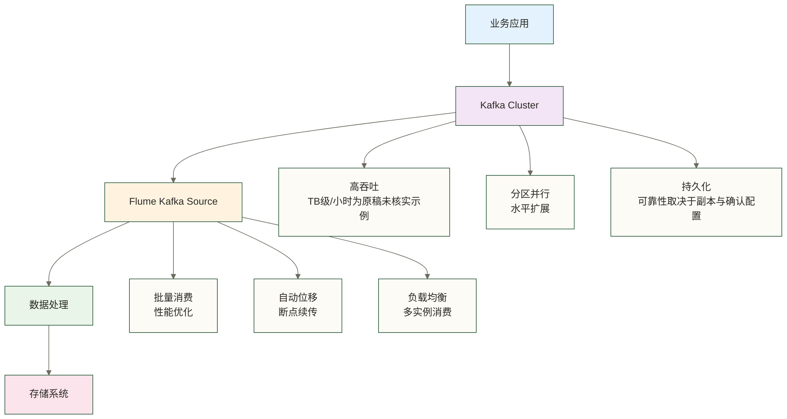

### ⚡ Source性能优化

#### 📊 性能对比示例

以下数字保留自原稿，未提供测试记录、软硬件版本、事件大小或负载条件，不能认定为实测结果，也不能据此判断Source性能排名或规划生产容量。

| Source类型 | 吞吐量(条/秒) | 延迟(ms) | CPU占用 | 内存占用 | 推荐场景 |
|---|---|---|---|---|---|
| **Spooldir** | 50,000 | 100-500 | 20% | 1GB | 批量文件处理 |
| **Taildir** | 80,000 | 50-200 | 30% | 1.5GB | 实时日志收集 |
| **Kafka** | 200,000 | 10-50 | 40% | 2GB | 高并发流处理 |
| **HTTP** | 30,000 | 20-100 | 25% | 1.2GB | RESTful接口 |

## 🏊 Channel组件深度解析

### 💾 Channel核心机制

**Channel组件就像智能储水池系统**，提供可靠的数据缓存和事务保障。

```mermaid
%%{init: {"theme":"base","themeVariables":{"fontFamily":"PingFang SC, -apple-system, Source Han Serif SC, serif","fontSize":"16px","background":"#FDFBF5","primaryColor":"#FDFBF5","primaryTextColor":"#2D2A26","primaryBorderColor":"#6E6A60","secondaryColor":"#E8EFE8","secondaryBorderColor":"#8FA890","secondaryTextColor":"#2D2A26","tertiaryColor":"#FDFBF5","tertiaryBorderColor":"#9A9488","tertiaryTextColor":"#6E6A60","lineColor":"#6E6A60","textColor":"#2D2A26","mainBkg":"#FDFBF5","nodeBorder":"#2D5A3D","clusterBkg":"#F3EEDF","clusterBorder":"#9A9488","edgeLabelBackground":"#FDFBF5"},"flowchart":{"htmlLabels":true,"curve":"basis","padding":20,"nodeSpacing":60,"rankSpacing":70,"useMaxWidth":false},"themeCSS":".node rect, .node polygon, .node circle { stroke-width: 1.5px; } .edgePath .path { stroke-width: 1.5px; } .cluster-label .nodeLabel, .cluster-label foreignObject { color: #2D2A26 !important; } .edgeLabel, .edgeLabel foreignObject { color: #2D2A26 !important; background-color: #FDFBF5; } .edgeLabel rect { fill: #FDFBF5; }"}}%%
flowchart TD
    A[Channel核心机制]
    B[📦 数据存储]
    C[🔒 事务管理]
    D[⚡ 性能控制]
    E[🛡️ 可靠性保障]
    B1[内存存储<br/>高性能访问]
    B2[文件存储<br/>持久化保障]
    B3[混合存储<br/>平衡性能与可靠性]
    C1[读写事务<br/>提交与回滚，持久性依Channel类型而定]
    C2[事务隔离<br/>并发控制]
    C3[回滚机制<br/>故障恢复]
    D1[容量控制<br/>防止内存溢出]
    D2[流量控制<br/>背压机制]
    D3[批量操作<br/>提升效率]
    E1[数据校验<br/>完整性检查]
    E2[重复投递风险<br/>需下游幂等或去重]
    E3[故障转移<br/>高可用保障]
    
    A --> B
    A --> C
    A --> D
    A --> E
    B --> B1
    B --> B2
    B --> B3
    C --> C1
    C --> C2
    C --> C3
    D --> D1
    D --> D2
    D --> D3
    E --> E1
    E --> E2
    E --> E3
    
    style A fill:#e1f5fe
    style B fill:#f3e5f5
    style C fill:#fff3e0
    style D fill:#e8f5e8
    style E fill:#fce4ec
```

### 🎯 主要Channel类型详解

#### 1. ⚡ Memory Channel

**高性能内存通道，适合低延迟场景**

```properties
# Memory Channel配置示例
agent.channels.c1.type = memory
agent.channels.c1.capacity = 100000
agent.channels.c1.transactionCapacity = 1000

# 性能优化配置
agent.channels.c1.keep-alive = 3
agent.channels.c1.byteCapacityBufferPercentage = 20
agent.channels.c1.byteCapacity = 80000000
```

**性能特点：**
- 🚀 **超低延迟**：毫秒级数据访问
- 📈 **高吞吐**：原稿给出10万+TPS，未提供测试依据，仅作未核实示例，不作为能力保证
- ⚠️ **数据风险**：进程重启数据丢失
- 💾 **内存限制**：受JVM堆内存约束

#### 2. 💾 File Channel

**可靠性优先的文件通道，通过磁盘日志与检查点支持恢复；可靠性仍依赖磁盘、配置及故障条件**

```properties
# File Channel配置示例
agent.channels.c1.type = file
agent.channels.c1.checkpointDir = /var/lib/flume/checkpoint
agent.channels.c1.dataDirs = /var/lib/flume/data

# 性能调优配置
agent.channels.c1.maxFileSize = 2146435071
agent.channels.c1.minimumRequiredSpace = 524288000
agent.channels.c1.capacity = 1000000
agent.channels.c1.transactionCapacity = 10000

# 可靠性配置
agent.channels.c1.checkpointInterval = 30000
agent.channels.c1.useDualCheckpoints = false
agent.channels.c1.backupCheckpointDir = /var/lib/flume/backup
```

**可靠性机制：**

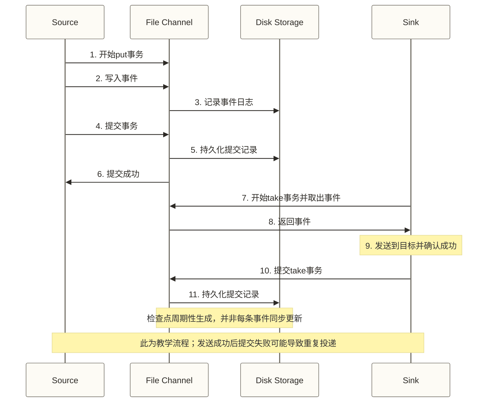

#### 3. 🔄 Kafka Channel

**以Kafka作为事件存储的通道，性能与可靠性取决于Kafka集群及客户端配置，并非内存与文件混合存储通道**

```properties

# Kafka Channel配置示例
agent.channels.c1.type = org.apache.flume.channel.kafka.KafkaChannel
agent.channels.c1.kafka.bootstrap.servers = localhost:9092
agent.channels.c1.kafka.topic = flume-channel
agent.channels.c1.kafka.consumer.group.id = flume-channel-consumer

# 性能优化
agent.channels.c1.capacity = 100000
agent.channels.c1.transactionCapacity = 1000
agent.channels.c1.brokerList = localhost:9092
agent.channels.c1.topic = flume-channel
agent.channels.c1.parseAsFlumeEvent = true

# 可靠性配置
agent.channels.c1.kafka.producer.acks = all
agent.channels.c1.kafka.producer.retries = 3
agent.channels.c1.kafka.consumer.auto.offset.reset = earliest
```

**架构优势：**
- 🔄 **解耦Source和Sink**：异步处理提升性能
- 📊 **分布式存储**：支持集群级别的数据共享
- 🛡️ **高可用性**：Kafka集群保障服务连续性
- 📈 **水平扩展**：支持多个Agent共享Channel

### 📊 Channel性能对比

| Channel类型 | 吞吐量 | 延迟 | 可靠性 | 资源占用 | 适用场景 |
|---|---|---|---|---|---|
| **Memory** | ⭐⭐⭐⭐⭐ | ⭐⭐⭐⭐⭐ | ⭐⭐ | 低 | 实时性要求高 |
| **File** | ⭐⭐⭐ | ⭐⭐⭐ | ⭐⭐⭐⭐⭐ | 中 | 需要持久化与故障恢复，仍须评估丢失及重复风险 |
| **Kafka** | ⭐⭐⭐⭐ | ⭐⭐⭐⭐ | ⭐⭐⭐⭐ | 高 | 大规模分布式 |

## 🎯 Sink组件深度解析

### 🚀 Sink核心职责

**Sink组件就像智能配送系统**，负责从Channel读取数据并发送到目标存储系统。

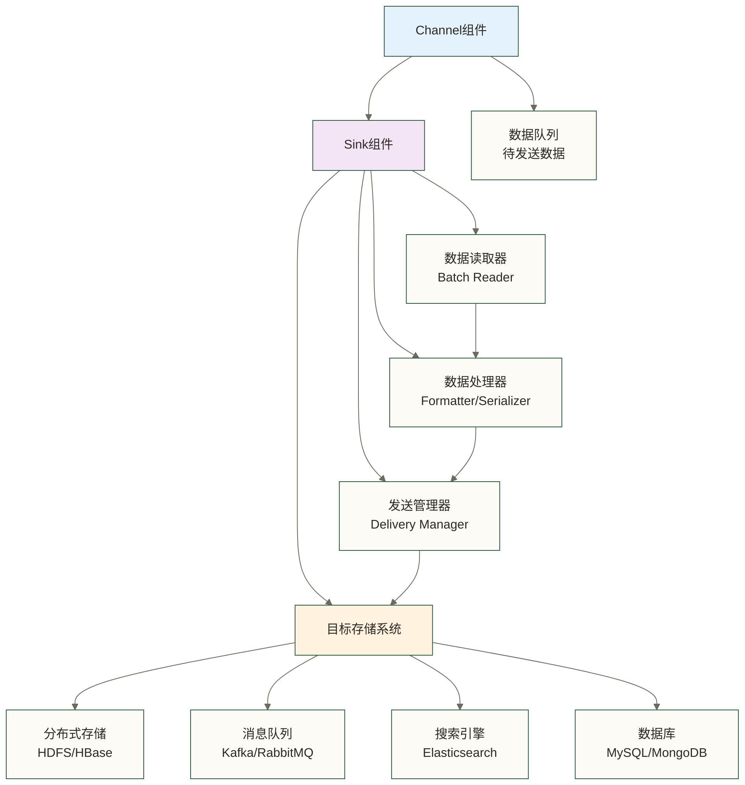

### 🏗️ 主要Sink类型详解

#### 1. 📁 HDFS Sink

**大数据存储的首选Sink，支持文件滚动和压缩**

```properties

# HDFS Sink配置示例
agent.sinks.k1.type = hdfs
agent.sinks.k1.hdfs.path = /flume/events/%Y-%m-%d/%H
agent.sinks.k1.hdfs.filePrefix = events-
agent.sinks.k1.channel = c1

# 文件滚动配置
agent.sinks.k1.hdfs.rollInterval = 3600
agent.sinks.k1.hdfs.rollSize = 134217700
agent.sinks.k1.hdfs.rollCount = 0

# 文件格式配置
agent.sinks.k1.hdfs.fileType = DataStream
agent.sinks.k1.hdfs.writeFormat = Text
agent.sinks.k1.hdfs.useLocalTimeStamp = true

# 性能优化配置
agent.sinks.k1.hdfs.batchSize = 1000
agent.sinks.k1.hdfs.threadsPoolSize = 10
agent.sinks.k1.hdfs.callTimeout = 10000
```

**文件管理机制：**

```mermaid
%%{init: {"theme":"base","themeVariables":{"fontFamily":"PingFang SC, -apple-system, Source Han Serif SC, serif","fontSize":"16px","background":"#FDFBF5","primaryColor":"#FDFBF5","primaryTextColor":"#2D2A26","primaryBorderColor":"#6E6A60","secondaryColor":"#E8EFE8","secondaryBorderColor":"#8FA890","secondaryTextColor":"#2D2A26","tertiaryColor":"#FDFBF5","tertiaryBorderColor":"#9A9488","tertiaryTextColor":"#6E6A60","lineColor":"#6E6A60","textColor":"#2D2A26","mainBkg":"#FDFBF5","nodeBorder":"#2D5A3D","clusterBkg":"#F3EEDF","clusterBorder":"#9A9488","edgeLabelBackground":"#FDFBF5"},"flowchart":{"htmlLabels":true,"curve":"basis","padding":20,"nodeSpacing":60,"rankSpacing":70,"useMaxWidth":false},"themeCSS":".node rect, .node polygon, .node circle { stroke-width: 1.5px; } .edgePath .path { stroke-width: 1.5px; } .cluster-label .nodeLabel, .cluster-label foreignObject { color: #2D2A26 !important; } .edgeLabel, .edgeLabel foreignObject { color: #2D2A26 !important; background-color: #FDFBF5; } .edgeLabel rect { fill: #FDFBF5; }"}}%%
flowchart TD
    A[HDFS Sink文件管理]
    B[🕐 时间滚动]
    C[📏 大小滚动]
    D[📊 数量滚动]
    E[📂 目录组织]
    B1[小时级分区<br/>/year/month/day/hour]
    B2[天级分区<br/>/year/month/day]
    B3[自定义周期<br/>灵活时间窗口]
    C1[文件大小控制<br/>128MB滚动大小示例，与HDFS块大小配置独立]
    C2[压缩优化<br/>gzip/lzo/snappy]
    C3[存储效率<br/>减少小文件问题]
    D1[记录数控制<br/>避免超大文件]
    D2[事务边界<br/>确保数据完整性]
    E1[时间分区<br/>便于数据查询]
    E2[业务分区<br/>按业务逻辑组织]
    E3[自动创建<br/>动态目录生成]
    
    A --> B
    A --> C
    A --> D
    A --> E
    B --> B1
    B --> B2
    B --> B3
    C --> C1
    C --> C2
    C --> C3
    D --> D1
    D --> D2
    E --> E1
    E --> E2
    E --> E3
    
    style A fill:#e1f5fe
    style B fill:#f3e5f5
    style C fill:#fff3e0
    style D fill:#e8f5e8
    style E fill:#fce4ec
```

#### 2. 🗄️ HBase Sink

**NoSQL数据库写入，支持高并发随机访问**

```properties

# HBase Sink配置示例
agent.sinks.k1.type = hbase
agent.sinks.k1.table = flume_events
agent.sinks.k1.columnFamily = cf1
agent.sinks.k1.channel = c1

# Zookeeper配置
agent.sinks.k1.zookeeperQuorum = localhost
agent.sinks.k1.znodeParent = /hbase

# 序列化配置
agent.sinks.k1.serializer = org.apache.flume.sink.hbase.RegexHbaseEventSerializer
agent.sinks.k1.serializer.regex = ([^,]*),([^,]*),([^,]*)
agent.sinks.k1.serializer.colNames = col1,col2,col3

# 性能优化
agent.sinks.k1.batchSize = 100
agent.sinks.k1.coalesceIncrements = true
agent.sinks.k1.timeout = 60000
```

**HBase写入优化策略：**

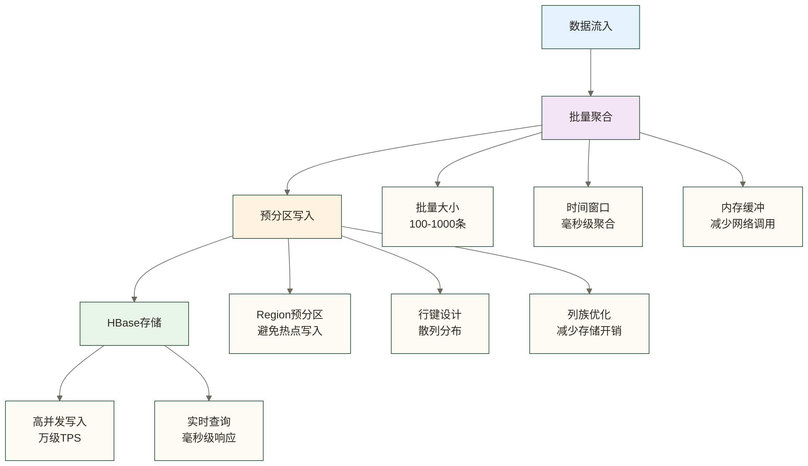

#### 3. 📤 Kafka Sink

**消息队列输出，构建实时数据流水线**

```properties

# Kafka Sink配置示例
agent.sinks.k1.type = org.apache.flume.sink.kafka.KafkaSink
agent.sinks.k1.kafka.topic = flume-output
agent.sinks.k1.kafka.bootstrap.servers = localhost:9092
agent.sinks.k1.channel = c1

# 性能优化配置
agent.sinks.k1.kafka.flumeBatchSize = 100
agent.sinks.k1.kafka.producer.acks = 1
agent.sinks.k1.kafka.producer.linger.ms = 1
agent.sinks.k1.kafka.producer.compression.type = snappy

# 可靠性配置
agent.sinks.k1.kafka.producer.retries = 3
agent.sinks.k1.kafka.producer.max.in.flight.requests.per.connection = 1
```

## 🔧 Agent配置与管理

### 📝 完整Agent配置示例

```properties

# ================================
# Flume Agent完整配置示例
# ================================

# Agent组件定义
agent.sources = r1
agent.sinks = k1 k2
agent.channels = c1 c2

# ================================
# Source配置：Taildir Source
# ================================
agent.sources.r1.type = TAILDIR
agent.sources.r1.channels = c1 c2
agent.sources.r1.positionFile = /var/log/flume/taildir_position.json

# 文件组配置
agent.sources.r1.filegroups = f1
agent.sources.r1.filegroups.f1 = /var/log/app/.*\.log

# Source选择器配置（分流）
agent.sources.r1.selector.type = multiplexing
agent.sources.r1.selector.header = log_type
agent.sources.r1.selector.mapping.error = c1
agent.sources.r1.selector.mapping.info = c2
agent.sources.r1.selector.default = c1

# ================================
# Channel配置：内存和文件通道
# ================================

# 错误日志通道（高可靠性）
agent.channels.c1.type = file
agent.channels.c1.checkpointDir = /var/lib/flume/checkpoint
agent.channels.c1.dataDirs = /var/lib/flume/data
agent.channels.c1.capacity = 100000
agent.channels.c1.transactionCapacity = 1000

# 信息日志通道（高性能）
agent.channels.c2.type = memory
agent.channels.c2.capacity = 50000
agent.channels.c2.transactionCapacity = 500

# ================================
# Sink配置：HDFS和Kafka输出
# ================================

# 错误日志到HDFS
agent.sinks.k1.type = hdfs
agent.sinks.k1.hdfs.path = /flume/logs/error/%Y-%m-%d
# 使用Agent本地时间展开日期路径，无需事件timestamp header
agent.sinks.k1.hdfs.useLocalTimeStamp = true
agent.sinks.k1.hdfs.filePrefix = error-
agent.sinks.k1.hdfs.rollInterval = 3600
agent.sinks.k1.hdfs.rollSize = 134217700
agent.sinks.k1.hdfs.fileType = DataStream
agent.sinks.k1.channel = c1

# 信息日志到Kafka
agent.sinks.k2.type = org.apache.flume.sink.kafka.KafkaSink
agent.sinks.k2.kafka.topic = app-logs
agent.sinks.k2.kafka.bootstrap.servers = localhost:9092
agent.sinks.k2.kafka.flumeBatchSize = 100
agent.sinks.k2.channel = c2
```

### 🎯 高级配置技巧

#### 1. 🔀 数据路由与分流

```properties
# 内容过滤后复制输出：仅保留匹配ERROR或FATAL的事件，添加固定log_level头，再由replicating选择器复制；不是按日志级别分流
agent.sources.r1.interceptors = i1 i2
agent.sources.r1.interceptors.i1.type = regex_filter
agent.sources.r1.interceptors.i1.regex = ERROR|FATAL
agent.sources.r1.interceptors.i1.excludeEvents = false

agent.sources.r1.interceptors.i2.type = static
agent.sources.r1.interceptors.i2.key = log_level
agent.sources.r1.interceptors.i2.value = error

# 复制选择器：多路输出
agent.sources.r1.selector.type = replicating
agent.sources.r1.selector.optional = c2
```

#### 2. 📊 性能监控配置

```properties
# JMX监控配置：以下-D项是JVM启动参数，不是Agent properties配置
# 仅用于网络隔离的本地实验；生产环境须配置认证、TLS及访问控制
# 不要为启用JMX而更改现有Source类型
-Dcom.sun.management.jmxremote
-Dcom.sun.management.jmxremote.port=9999
-Dcom.sun.management.jmxremote.authenticate=false
-Dcom.sun.management.jmxremote.ssl=false

# 时间戳拦截器：为事件添加timestamp header，不是自定义监控指标
agent.sources.r1.interceptors = i1
agent.sources.r1.interceptors.i1.type = org.apache.flume.interceptor.TimestampInterceptor$Builder
```

## 📊 架构性能优化

### ⚡ 整体性能调优策略

```mermaid
%%{init: {"theme":"base","themeVariables":{"fontFamily":"PingFang SC, -apple-system, Source Han Serif SC, serif","fontSize":"16px","background":"#FDFBF5","primaryColor":"#FDFBF5","primaryTextColor":"#2D2A26","primaryBorderColor":"#6E6A60","secondaryColor":"#E8EFE8","secondaryBorderColor":"#8FA890","secondaryTextColor":"#2D2A26","tertiaryColor":"#FDFBF5","tertiaryBorderColor":"#9A9488","tertiaryTextColor":"#6E6A60","lineColor":"#6E6A60","textColor":"#2D2A26","mainBkg":"#FDFBF5","nodeBorder":"#2D5A3D","clusterBkg":"#F3EEDF","clusterBorder":"#9A9488","edgeLabelBackground":"#FDFBF5"},"flowchart":{"htmlLabels":true,"curve":"basis","padding":20,"nodeSpacing":60,"rankSpacing":70,"useMaxWidth":false},"themeCSS":".node rect, .node polygon, .node circle { stroke-width: 1.5px; } .edgePath .path { stroke-width: 1.5px; } .cluster-label .nodeLabel, .cluster-label foreignObject { color: #2D2A26 !important; } .edgeLabel, .edgeLabel foreignObject { color: #2D2A26 !important; background-color: #FDFBF5; } .edgeLabel rect { fill: #FDFBF5; }"}}%%
flowchart TD
    A[Flume性能优化策略]
    B[🧠 JVM优化]
    C[📦 批处理优化]
    D[🔄 并发优化]
    E[💾 存储优化]
    B1[堆内存设置<br/>-Xmx8g -Xms8g]
    B2[GC优化<br/>按JDK版本选择；CMS已在JDK 14移除]
    B3[直接内存<br/>-XX:MaxDirectMemorySize]
    C1[批量大小<br/>1000-10000条]
    C2[批量时间<br/>100-1000ms]
    C3[事务批次<br/>减少提交频率]
    D1[Source线程池<br/>多线程读取]
    D2[Sink线程池<br/>并行写入]
    D3[Channel并发<br/>读写分离]
    E1[Channel选择<br/>性能vs可靠性]
    E2[压缩算法<br/>CPU vs 网络]
    E3[序列化<br/>Avro/Thrift选择]
    
    A --> B
    A --> C
    A --> D
    A --> E
    B --> B1
    B --> B2
    B --> B3
    C --> C1
    C --> C2
    C --> C3
    D --> D1
    D --> D2
    D --> D3
    E --> E1
    E --> E2
    E --> E3
    
    style A fill:#e1f5fe
    style B fill:#f3e5f5
    style C fill:#fff3e0
    style D fill:#e8f5e8
    style E fill:#fce4ec
```

### 📈 性能基准与监控

下表的速率、容量比例与阈值，以及前文HBase图中的万级TPS和毫秒级响应，均为原稿未核实示例；实际基线和告警规则须根据事件大小、端到端延迟目标及压力测试确定。

| 组件 | 关键指标 | 正常范围 | 告警阈值 | 优化建议 |
|---|---|---|---|---|
| **Source** | 接收速率 | 10K-100K/s | >90%容量 | 增加Source实例 |
| **Channel** | 队列深度 | <80%容量 | >90%容量 | 增加Channel容量 |
| **Sink** | 发送速率 | 与Source匹配 | <50%Source | 优化Sink配置 |
| **JVM** | 堆内存使用 | <70% | >85% | 调整JVM参数 |

## 💡 架构设计最佳实践

### 🎯 设计原则

1. **🔄 松耦合设计**
   - Source和Sink独立演进
   - 通过Channel解耦组件依赖
   - 支持动态配置更新

2. **🛡️ 可靠性优先**
   - 选择合适的Channel类型
   - 配置事务机制
   - 实现故障恢复策略

3. **📈 可扩展架构**
   - 支持水平扩展
   - 预留性能容量
   - 模块化组件设计

4. **📊 可观测性**
   - 完善的监控指标
   - 详细的日志记录
   - 性能追踪能力

### 🌟 常见架构模式

#### 1. 🌟 单Agent模式

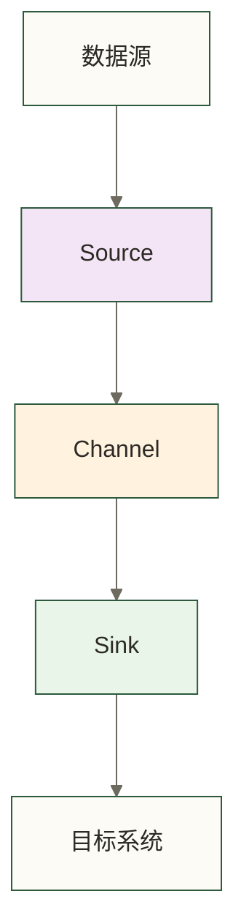

**适用场景：** 简单数据收集、单机部署、低并发需求

#### 2. 🔀 多级Agent模式

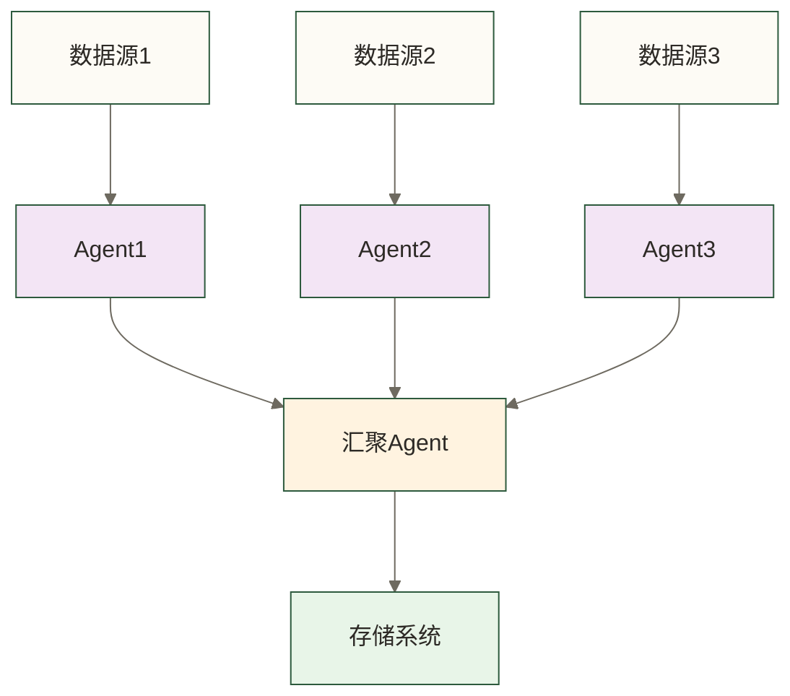

**适用场景：** 大规模分布式收集、数据汇聚、负载均衡

#### 3. 🌐 扇出模式

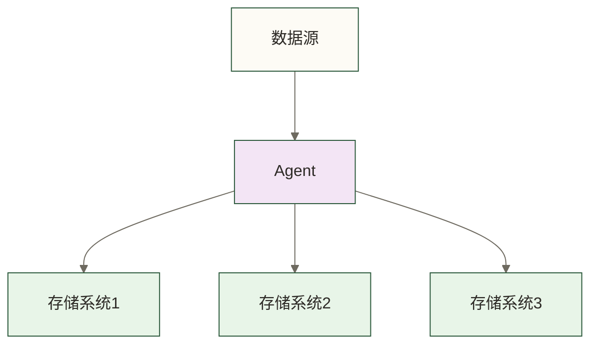

**适用场景：** 数据多份拷贝、实时+批处理项目实战、数据分发

---

**理解了Flume核心架构，你就掌握了构建可靠数据管道的关键技能！下一步，我们将学习如何搭建Flume环境，把理论转化为实践。** 🚀✨