> [!warning] 关联材料边界
> 以下原引用目标缺失或无法唯一确认，已取消跳转并保留提及：01-Flume概述与核心概念；06-Channel通道详解。相关素材/延伸说明暂不可用，不能据此声称已经提供配套材料。

# 第一个 Flume 应用

> [!info] 前置知识
> - [[【技术与工具】/Flume/03-Flume环境搭建|Flume 环境搭建]]：FLUME_HOME 已配置，`flume-ng version` 能正常输出
> - Flume 概述与核心概念（原引用“01-Flume概述与核心概念”未能确定有效目标，暂不可跳转）：理解 Source、Channel、Sink 三者的关系

本文用最经典的 **netcat → memory → logger** 示例，带你走完一次完整的 Flume 数据流：从写配置文件，到启动 Agent，到用 nc 命令发数据，到在日志里看到数据输出。整个过程大约 15 分钟，不需要 HDFS、Kafka 等任何额外依赖。

---

## 示例架构

```mermaid
%%{init: {"theme":"base","themeVariables":{"fontFamily":"PingFang SC, -apple-system, Source Han Serif SC, serif","fontSize":"16px","background":"#FDFBF5","primaryColor":"#FDFBF5","primaryTextColor":"#2D2A26","primaryBorderColor":"#6E6A60","secondaryColor":"#E8EFE8","secondaryBorderColor":"#8FA890","secondaryTextColor":"#2D2A26","tertiaryColor":"#FDFBF5","tertiaryBorderColor":"#9A9488","tertiaryTextColor":"#6E6A60","lineColor":"#6E6A60","textColor":"#2D2A26","mainBkg":"#FDFBF5","nodeBorder":"#2D5A3D","clusterBkg":"#F3EEDF","clusterBorder":"#9A9488","edgeLabelBackground":"#FDFBF5"},"flowchart":{"htmlLabels":true,"curve":"basis","padding":20,"nodeSpacing":60,"rankSpacing":70,"useMaxWidth":false},"themeCSS":".node rect, .node polygon, .node circle { stroke-width: 1.5px; } .edgePath .path { stroke-width: 1.5px; } .cluster-label .nodeLabel, .cluster-label foreignObject { color: #2D2A26 !important; } .edgeLabel, .edgeLabel foreignObject { color: #2D2A26 !important; background-color: #FDFBF5; } .edgeLabel rect { fill: #FDFBF5; }"}}%%
flowchart LR
    classDef default fill:#FDFBF5,stroke:#6E6A60,color:#2D2A26,stroke-width:1.5px
    classDef startend fill:#2D2A26,stroke:#2D2A26,color:#FDFBF5,font-weight:bold
    classDef decision fill:#F6EAD8,stroke:#C08A1A,color:#2D2A26,font-weight:bold
    classDef hub fill:#3B5A80,stroke:#3B5A80,color:#FDFBF5,font-weight:bold
    classDef io fill:#E5EAF0,stroke:#3B5A80,color:#2D2A26
    classDef accent fill:#A6432C,stroke:#A6432C,color:#FDFBF5,font-weight:bold
    classDef storage fill:#F3EEDF,stroke:#9A9488,color:#2D2A26
    A[nc 命令\n发送文本] -->|TCP:44444| B[Netcat Source\n监听端口]
    B --> C[Memory Channel\n内存缓冲]
    C --> D[Logger Sink\n输出到控制台日志]
    class A,B,C,D default
```



三个组件的分工：

- **Netcat Source**：监听 TCP 端口，每收到一行文本就生成一个 Event
- **Memory Channel**：把 Event 暂存在 JVM 堆内存中，起到解耦和缓冲的作用
- **Logger Sink**：从 Channel 取出 Event，打印到控制台（通过 log4j）

---

## 第一步：编写配置文件

Flume 配置文件是标准的 Java Properties 格式，命名惯例是 `<用途>.conf`。

```bash
# 创建配置目录
mkdir -p ~/flume-demo

# 编写配置文件
cat > ~/flume-demo/netcat-logger.conf << 'EOF'
# ============================================================
# Agent 组件声明
# 语法：<agentName>.<组件类型> = <组件名1> <组件名2> ...
# ============================================================
agent.sources  = r1
agent.channels = c1
agent.sinks    = k1

# ============================================================
# Source 配置：Netcat Source
# ============================================================
agent.sources.r1.type    = netcat
agent.sources.r1.bind    = localhost
agent.sources.r1.port    = 44444
# 声明该 Source 将数据写入哪个 Channel
agent.sources.r1.channels = c1

# ============================================================
# Channel 配置：Memory Channel
# ============================================================
agent.channels.c1.type                = memory
# capacity：Channel 最多能存多少条 Event
agent.channels.c1.capacity            = 1000
# transactionCapacity：每次事务最多处理多少条 Event
agent.channels.c1.transactionCapacity = 100

# ============================================================
# Sink 配置：Logger Sink
# ============================================================
agent.sinks.k1.type    = logger
# 声明该 Sink 从哪个 Channel 取数据
agent.sinks.k1.channel = c1
EOF

echo "配置文件创建完毕"
```

> [!note] 配置文件的命名规则
> 配置文件中 `agent` 是 Agent 的名字，可以任意取（如 `myagent`、`collector`），但启动命令里的 `--name` 参数必须和配置文件里的名字保持一致。同一个配置文件里可以定义多个 Agent，用不同的名字区分，启动时通过 `--name` 指定运行哪个。

---

## 第二步：启动 Agent

```bash
flume-ng agent \
  --conf $FLUME_HOME/conf \
  --conf-file ~/flume-demo/netcat-logger.conf \
  --name agent \
  -Dflume.root.logger=INFO,console
```

参数说明：

| 参数 | 含义 |
|------|------|
| `--conf` | 指定 Flume 系统配置目录（放置 `flume-env.sh` 和 `log4j` 配置）|
| `--conf-file` | 指定业务配置文件路径（即我们刚写的 .conf 文件）|
| `--name` | 指定要运行的 Agent 名称，必须与配置文件中的前缀一致 |
| `-Dflume.root.logger` | 覆盖日志级别和输出目标，`INFO,console` 表示打印到控制台 |

启动成功后，终端会持续输出日志，关键行如下：

```text
INFO  [conf-file-poller-0] (org.apache.flume.node.Application.startAllComponents:182) - Starting Sink k1
INFO  [conf-file-poller-0] (org.apache.flume.node.Application.startAllComponents:196) - Starting Source r1
INFO  [lifecycleSupervisor-1-0] (org.apache.flume.source.NetcatSource.start:155) - Source starting
INFO  [lifecycleSupervisor-1-0] (org.apache.flume.source.NetcatSource.start:169) - Created serverSocket:sun.nio.ch.ServerSocketChannelImpl[/127.0.0.1:44444]
```

看到 `Created serverSocket` 这行，说明 Netcat Source 已经在 44444 端口监听了。

---

## 第三步：发送测试数据

**另开一个终端窗口**，用 `nc`（netcat）命令连接到 Flume 的监听端口，然后输入文本：

```bash
# 连接到 Flume Netcat Source
nc localhost 44444
```

连接成功后，终端会进入交互模式。输入任意文本并按回车，例如：

```text
Hello Flume
This is a test message
2024-01-15 user_id=1001 action=login
```

每按一次回车，Flume 会回复 `OK`，表示这条 Event 已被 Source 接收并放入 Channel。

---

## 第四步：验证数据输出

切换回运行 Flume 的终端，可以看到 Logger Sink 的输出：

```text
INFO  [SinkRunner-PollingRunner-DefaultSinkProcessor] (org.apache.flume.sink.LoggerSink.process:95) - Event: { headers:{} body: 48 65 6C 6C 6F 20 46 6C 75 6D 65                Hello Flume }
INFO  [SinkRunner-PollingRunner-DefaultSinkProcessor] (org.apache.flume.sink.LoggerSink.process:95) - Event: { headers:{} body: 54 68 69 73 20 69 73 20 61 20 74 65 73 74 20 6D This is a test m }
```

输出格式解读：

- `headers:{}`：Event 的 Header 是空 Map（Netcat Source 默认不添加 Header）
- `body: 48 65 6C ...`：Event Body 的十六进制表示，后面跟着可读文本预览
- Logger Sink 默认只显示 Body 的前 16 字节，完整内容需要调整 `maxBytesToLog` 参数

> [!tip] 查看完整 Event Body
> Logger Sink 有一个参数 `maxBytesToLog`，默认 16 字节。如果你的消息超过 16 字节且想完整显示，在配置文件里加上：
> ```properties
> agent.sinks.k1.maxBytesToLog = 512
> ```

---

## 配置文件结构总结

通过这个例子，Flume 配置文件的结构规律很清晰：

```markdown
# 第一部分：声明（声明有哪些组件）
<agentName>.sources  = <sourceName1> [sourceName2 ...]
<agentName>.channels = <channelName1> [channelName2 ...]
<agentName>.sinks    = <sinkName1> [sinkName2 ...]

# 第二部分：配置（为每个组件设置参数）
<agentName>.sources.<sourceName>.type = <类型>
<agentName>.sources.<sourceName>.<参数> = <值>
...

# 第三部分：绑定（声明组件之间的连接关系）
<agentName>.sources.<sourceName>.channels = <channelName>
<agentName>.sinks.<sinkName>.channel = <channelName>
```

Source 写 `channels`（复数，可写入多个 Channel），Sink 写 `channel`（单数，只从一个 Channel 读取）。

---

## 停止 Agent

在 Flume 运行的终端按 `Ctrl+C`，Agent 会触发组件关闭，但不保证等待 Channel 中的数据被 Sink 全部处理完。Memory Channel 不持久化，停止后尚未处理的 Event 可能丢失；本练习应先观察测试消息的 Logger Sink 输出，再停止 Agent。

---

## 掌握检查

- [ ] 能解释配置文件中 `agent.sources.r1.channels = c1` 这行的含义
- [ ] 知道 `--name` 参数和配置文件前缀名不一致会发生什么（Agent 找不到配置，启动失败）
- [ ] 能解读 Logger Sink 输出中 `headers` 和 `body` 字段的含义
- [ ] 知道如何让 Logger Sink 显示超过 16 字节的 Event 内容

## 实践练习

**基础题**：将 Agent 名称从 `agent` 改为 `demo`，修改配置文件和启动命令，确认仍能正常运行。

**进阶题**：在配置文件中为 Source 加上 timestamp 拦截器（`agent.sources.r1.interceptors = ts`，`agent.sources.r1.interceptors.ts.type = timestamp`），重启后观察 Logger Sink 输出的 `headers` 字段有何变化。

## 下一步

- [[【技术与工具】/Flume/05-Source数据源详解|Source 数据源详解]]：从 Netcat Source 进阶到 Taildir Source，学会采集真实日志文件
- Channel 通道详解（原引用“06-Channel通道详解”未能确定有效目标，暂不可跳转）：了解 File Channel 和 Memory Channel 的可靠性差异
- [[【技术与工具】/Flume/07-Sink输出详解|Sink 输出详解]]：把数据写到 HDFS 或 Kafka，而不只是打印到日志
