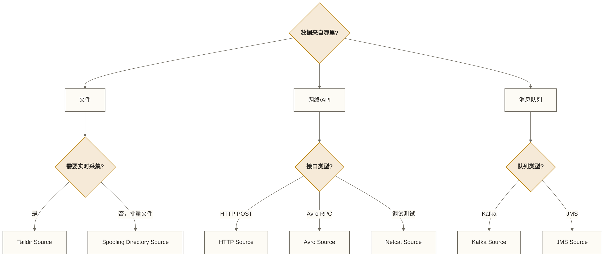

> [!warning] 关联材料边界
> 以下原引用目标缺失或无法唯一确认，已取消跳转并保留提及：01-Flume概述与核心概念；06-Channel通道详解；08-Flume拦截器详解。相关素材/延伸说明暂不可用，不能据此声称已经提供配套材料。

# Source 数据源详解

> [!info] 前置知识
> - [[【技术与工具】/Flume/04-第一个Flume应用|第一个 Flume 应用]]：已经跑通 Netcat Source 的基础示例
> - Flume 概述与核心概念（原引用“01-Flume概述与核心概念”未能确定有效目标，暂不可跳转）：理解 Event 的 Header 和 Body 结构

Source 是 Flume 管道的入口，负责从外部系统接收数据并转换为 Event 写入 Channel。选择合适的 Source 类型是配置 Flume 的第一步决策。

不同 Source 的核心差异在于两点：**数据从哪里来**（文件、网络端口、消息队列），以及**可靠性保障机制**（是否支持断点续传、是否会丢数据）。

---

## Source 类型总览

| Source 类型 | 数据来源 | 断点续传 | 适用场景 |
|-------------|----------|----------|----------|
| Taildir Source | 文件系统（实时跟踪） | 支持 | 生产环境日志采集首选 |
| Spooling Directory | 文件系统（批量处理） | 文件级 | 定时批量文件导入 |
| Exec Source | Shell 命令输出 | 不支持 | 临时脚本输出，不推荐生产 |
| Netcat Source | TCP 端口 | 不支持 | 开发调试 |
| Kafka Source | Kafka Topic | 依赖 Consumer Offset | 消费 Kafka 数据再分发 |
| HTTP Source | HTTP POST | 不支持 | RESTful 接口数据接收 |
| Avro Source | Avro RPC | 不支持（依赖上游）| 多级 Agent 级联汇聚 |

---

## Taildir Source（推荐）

Taildir Source 是生产环境日志采集的首选，它同时具备：
- **实时跟踪**：监控一组文件（支持正则通配），文件有新内容就立刻采集
- **断点续传**：把每个文件的读取位置（offset）保存到一个 JSON 格式的 position 文件，Agent 重启后可根据已保存的位置恢复读取；异常退出、位置保存时机、Channel 持久性和文件轮转方式都会影响恢复结果，不能保证零重复或零丢失
- **多文件支持**：一个 Taildir Source 可以同时监控多组文件规则（filegroups）

### 核心配置

```properties
agent.sources.taildir_src.type = TAILDIR
agent.sources.taildir_src.channels = c1

# --------------------------------------------------------
# positionFile：断点续传的关键配置
# 记录每个被监控文件的 inode 号和当前读取 offset
# 重启后 Flume 根据此文件恢复读取位置
# --------------------------------------------------------
agent.sources.taildir_src.positionFile = /var/lib/flume/taildir_position.json

# --------------------------------------------------------
# filegroups：定义要监控的文件组，可以配置多组
# 每个 filegroup 对应一个正则路径表达式
# --------------------------------------------------------
agent.sources.taildir_src.filegroups = nginx_access app_error

# 第一组：Nginx 访问日志（正则匹配所有 access.log* 文件）
agent.sources.taildir_src.filegroups.nginx_access = /var/log/nginx/access\\.log.*

# 第二组：应用错误日志
agent.sources.taildir_src.filegroups.app_error = /var/log/app/error\\.log.*

# --------------------------------------------------------
# 为每组文件添加自定义 Header（可选）
# 方便下游 Sink 做路由判断
# --------------------------------------------------------
agent.sources.taildir_src.headers.nginx_access.logType = nginx-access
agent.sources.taildir_src.headers.app_error.logType    = app-error

# 性能参数
agent.sources.taildir_src.batchSize        = 1000
agent.sources.taildir_src.maxBatchCount    = 1000
```

> [!warning] positionFile 的位置很重要
> 生产环境的 positionFile 应存放在持久化存储路径，避免放在 `/tmp` 下（可能在重启或定期清理时被删除）；临时练习使用 `/tmp` 时，不应将其作为持久恢复保障。建议放在 `/var/lib/flume/` 或 `$FLUME_HOME/positions/` 这类不会被系统清理的目录。目录需要提前创建，且 Flume 进程用户有写权限。

### 断点续传的工作原理

position 文件是一个 JSON 数组，每个元素描述一个被监控文件的当前状态：

```json
[
  {
    "inode": 12345678,
    "pos": 204800,
    "file": "/var/log/nginx/access.log"
  },
  {
    "inode": 12345679,
    "pos": 0,
    "file": "/var/log/nginx/access.log.1"
  }
]
```

Taildir Source 在读取位置记录中使用 `inode` 和文件路径等信息识别文件；对于保留 inode 的重命名轮转（`access.log` → `access.log.1`），若轮转后的文件仍能被发现且未被提前删除，可利用保存的位置继续读取。复制后截断、inode 复用或异常退出等情况仍需验证，不能据此保证不漏采、不重复。

---

## Spooling Directory Source

Spooling Directory Source 适合批量文件导入场景：监控一个目录，每当有新文件出现就完整读取，读完后把文件改名为 `.COMPLETED` 标记已处理。

```properties
agent.sources.spooldir_src.type = spooldir
agent.sources.spooldir_src.channels = c1

# 监控的目录路径（Flume 只处理直接在此目录中的文件，不递归子目录）
agent.sources.spooldir_src.spoolDir = /data/flume/spool

# 文件处理完成后的处理方式：
# never（默认）：重命名加 .COMPLETED 后缀
# immediate：立刻删除文件
agent.sources.spooldir_src.deletePolicy = never
agent.sources.spooldir_src.fileSuffix   = .COMPLETED

# 只处理匹配此正则的文件，忽略其他文件
agent.sources.spooldir_src.includePattern = .*\\.log$

# 忽略以点开头的隐藏文件（避免处理临时文件）
agent.sources.spooldir_src.ignorePattern = ^\\..*$

# 每个 Event 包含来源文件名（方便追踪数据来源）
agent.sources.spooldir_src.basenameHeader    = true
agent.sources.spooldir_src.basenameHeaderKey = filename

# 性能参数
agent.sources.spooldir_src.batchSize = 1000
```

**与 Taildir Source 的关键区别**：Spooling Directory 用于已完整写入且内容不再变化的文件，要求投递文件名不复用；它会记录处理进度，中途重启并非必然从头读取，但故障恢复仍可能重复投递部分 Event。Taildir Source 用于持续追加的日志文件，记录字节偏移以支持恢复；两者的端到端可靠性都还取决于 Channel、Sink 和故障条件。

---

## Exec Source 及其局限性

Exec Source 执行一个 Shell 命令，把命令的标准输出转换为 Event。看起来很灵活，实际上有严重的可靠性问题，**不推荐在生产环境使用**。

```properties
agent.sources.exec_src.type = exec
agent.sources.exec_src.channels = c1

# 执行的命令（以 tail -F 为例）
agent.sources.exec_src.command = tail -F /var/log/app/app.log

# 每隔多少毫秒重启失败的命令
agent.sources.exec_src.restartThrottle = 10000
agent.sources.exec_src.restart = true
```

**Exec Source 的致命弱点**：

| 问题 | 说明 |
|------|------|
| 无断点续传 | Agent 重启后，`tail -F` 命令重新执行，不会从 Flume 上次读取位置恢复；默认重新输出文件末尾若干行可能造成重复，停机期间的数据也可能漏采 |
| 命令崩溃丢数据 | 子进程意外退出时，还在管道缓冲区中未交给 Source 的数据直接丢失 |
| 多文件管理受限 | 一个 Exec Source 执行一条命令，但命令本身可以读取多个文件；文件边界和来源标识需额外处理，也可配置多个 Exec Source |
| 依赖外部命令 | 依赖 `tail`、`cat` 等系统命令，可移植性差 |

> [!warning] 生产环境替代方案
> 如果你现在用的是 `exec tail -F` 采集追加式日志，可评估迁移到 Taildir Source，以获得读取位置记录和多文件组管理能力。Taildir 不能替代任意 Shell 命令输出，迁移时仍需验证文件轮转、Channel 持久性和故障恢复行为。

---

## HTTP Source

HTTP Source 启动一个嵌入式 HTTP 服务器，接收 HTTP POST 请求，将请求 Body 转换为 Event。适合需要把数据 POST 到 Flume 的场景，例如移动端埋点数据上报、Webhook 数据接收。

```properties
agent.sources.http_src.type = http
agent.sources.http_src.channels = c1

# 监听端口
agent.sources.http_src.port = 8080

# 绑定地址（默认 0.0.0.0，监听所有网卡）
agent.sources.http_src.bind = 0.0.0.0

# Handler 类：决定如何解析 HTTP 请求
# 内置 JSONHandler：解析 JSON 格式的 Event 数组
# 内置 BlobHandler：把整个请求 Body 作为一个 Event 的 Body
agent.sources.http_src.handler = org.apache.flume.source.http.JSONHandler

# enableDecoding 不是请求 Body 大小限制参数
# 以下配置的支持情况与解码语义须按所用 Flume 版本确认
# 请求大小限制需另行配置并验证
agent.sources.http_src.enableDecoding = false
```

**发送数据的方式（JSONHandler 格式）**：

```bash
# JSONHandler 期望的请求格式：JSON 数组，每个元素是一个 Event
curl -X POST \
  -H "Content-Type: application/json" \
  -d '[{"headers":{"source":"mobile","user_id":"1001"},"body":"user clicked button_A"}]' \
  http://localhost:8080
```

> [!note] HTTP Source 的可靠性
> HTTP Source 本身不能独立保证端到端 at-least-once；这还依赖客户端重试、Channel 持久性和下游处理。若写入 Channel 成功后客户端因网络抖动未收到成功响应而重试，可能产生重复；重复并不违反 at-least-once，但意味着并非 exactly-once。生产环境接收关键数据时，建议在业务层做幂等处理，或在 Event Header 加唯一 ID 供下游去重。

---

## Kafka Source

Kafka Source 作为 Kafka 消费者，从指定 Topic 拉取消息并转换为 Flume Event。常见于已有 Kafka 的架构中，用 Flume 把 Kafka 数据再路由到 HDFS 或其他存储。

```properties
agent.sources.kafka_src.type = org.apache.flume.source.kafka.KafkaSource
agent.sources.kafka_src.channels = c1

# Kafka 集群地址
agent.sources.kafka_src.kafka.bootstrap.servers = kafka01:9092,kafka02:9092

# 订阅的 Topic
agent.sources.kafka_src.kafka.topics = app-logs,nginx-access

# 消费者组 ID（同一 group.id 的多个 Flume Agent 会负载均衡消费）
agent.sources.kafka_src.kafka.consumer.group.id = flume-consumer-group

# 批量大小
agent.sources.kafka_src.batchSize = 1000

# 批量超时（毫秒）：等待凑够一批的最长时间
agent.sources.kafka_src.batchDurationMillis = 1000
```

---

## 选型决策指南



---

## 掌握检查

- [ ] 能解释 Taildir Source 的 `positionFile` 中 inode、文件路径和读取位置的作用，以及文件轮转时恢复读取的条件
- [ ] 知道 Exec Source 在 Agent 重启后会出现什么问题，以及如何替代
- [ ] 能写出 Taildir Source 同时监控两组文件（nginx 日志和应用日志）的配置
- [ ] 理解 HTTP Source 接收 JSON 格式 Event 时的请求格式

## 实践练习

**基础题**：配置一个 Taildir Source 监控 `/tmp/test-logs/` 目录下的所有 `.log` 文件，positionFile 存放在 `/tmp/flume-pos/taildir.json`，数据输出到 Logger Sink，启动后向目录写入文件验证采集效果。

**进阶题**：将上题中的 Taildir Source 改为两个 filegroups（`access` 监控 `access*.log`，`error` 监控 `error*.log`），并分别给两组文件打上不同的 Header（`type=access` 和 `type=error`），观察 Logger Sink 的输出。

## 下一步

- Channel 通道详解（原引用“06-Channel通道详解”未能确定有效目标，暂不可跳转）：了解 Memory Channel 与 File Channel 的可靠性差异
- [[【技术与工具】/Flume/07-Sink输出详解|Sink 输出详解]]：配置 HDFS Sink 将采集到的日志写入数据仓库
- 拦截器详解（原引用“08-Flume拦截器详解”未能确定有效目标，暂不可跳转）：在 Source 读完数据后、进入 Channel 前对 Event 做过滤和标注
