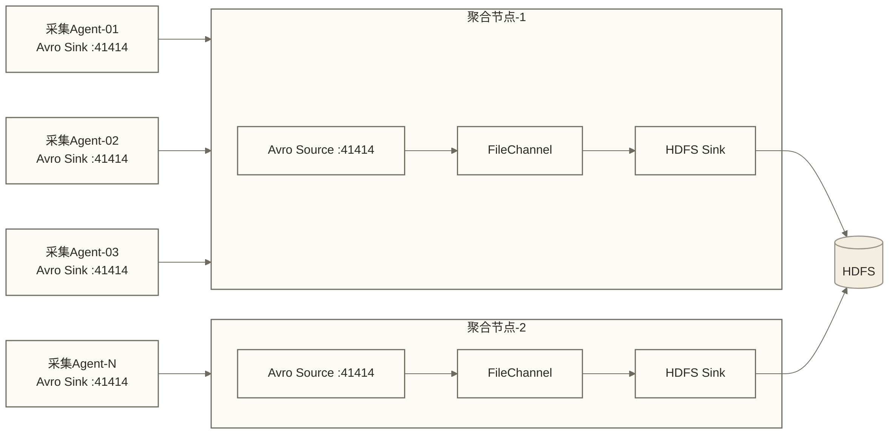
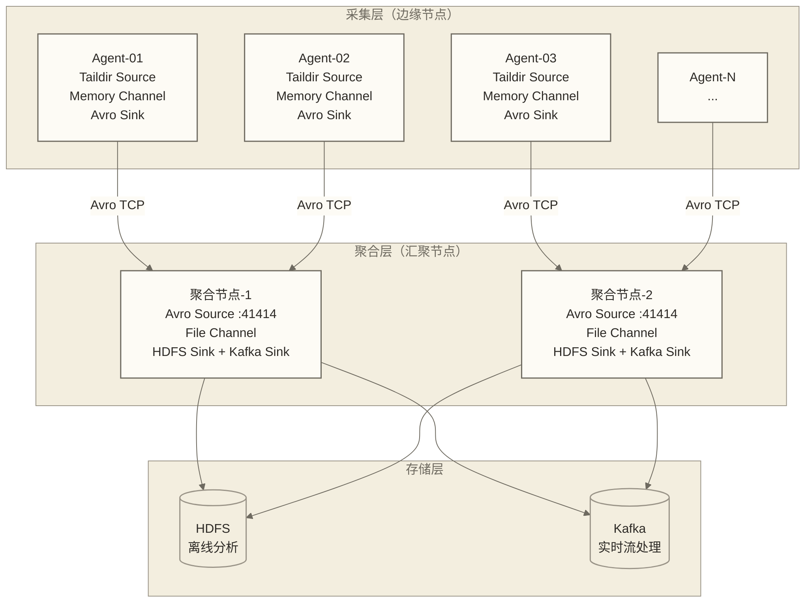

> [!warning] 关联材料边界
> 以下原引用目标缺失或无法唯一确认，已取消跳转并保留提及：05-Sink输出组件；01-Flume概述与架构。相关素材/延伸说明暂不可用，不能据此声称已经提供配套材料。

# 多级 Agent 架构

## 为什么需要多级架构

单级 Flume Agent（Source → Channel → Sink 直连存储）能满足单机采集，但在实际生产环境中存在以下问题：

**规模问题**：数百台业务服务器各自运行 Flume Agent 直连 HDFS，会产生数百个 HDFS Writer 并发写同一目录，造成大量小文件和 NameNode 压力。

**网络问题**：边缘节点通常在 IDC 内网，HDFS/Kafka 在数据中心。让每台边缘机器都建立到数据中心的长连接，网络拓扑复杂，防火墙规则难以管理。

**可靠性问题**：单级 Agent 直连存储，HDFS 故障会立即影响所有采集端，数据堆积在各机器的本地 Channel，风险分散难以监控。

**解决方案**是引入层次化架构：

```text
采集层（边缘节点，N 台）
    ↓ Avro over TCP
聚合层（汇聚节点，2-3 台）
    ↓
存储层（HDFS + Kafka）
```

- **采集层**：每台业务机器运行轻量级 Agent，负责本地日志采集和简单拦截，用 Avro Sink 发往聚合层
- **聚合层**：少量专用节点，Avro Source 接收采集端数据，汇聚后由 Sink 批量写入存储；跨来源排序需要额外处理逻辑，不能由 Avro Source 自动完成
- **存储层**：HDFS（离线分析）、Kafka（实时流处理）

---

## Avro Source / Avro Sink：多级连接的标准协议

Avro 是 Flume 多级 Agent 之间通信的**常用协议**，需要显式配置 Avro Source 和 Avro Sink。采集端用 Avro Sink 发送，聚合端用 Avro Source 接收，底层是 Netty over TCP 的长连接。

### 采集端配置（Avro Sink）

```properties
# ── 采集端 Agent（部署在每台业务机器）──────────────────────────
collector.sources = taildir_src
collector.channels = mem_ch
collector.sinks = avro_sink

# Source：监听本机日志文件
collector.sources.taildir_src.type = TAILDIR
collector.sources.taildir_src.channels = mem_ch
collector.sources.taildir_src.positionFile = /var/flume/position.json
collector.sources.taildir_src.filegroups = f1
collector.sources.taildir_src.filegroups.f1 = /var/log/app/.*\.log

# 拦截器：打时间戳和主机名，供聚合端溯源
collector.sources.taildir_src.interceptors = ts hi
collector.sources.taildir_src.interceptors.ts.type = timestamp
collector.sources.taildir_src.interceptors.hi.type = host
collector.sources.taildir_src.interceptors.hi.useIP = true

# Channel：内存缓冲（低延迟，但进程崩溃可能丢失尚未发送的数据；容量需按内存预算设置）
collector.channels.mem_ch.type = memory
collector.channels.mem_ch.capacity = 50000
collector.channels.mem_ch.transactionCapacity = 1000

# Avro Sink：将数据推送到聚合层
collector.sinks.avro_sink.type = avro
collector.sinks.avro_sink.channel = mem_ch
collector.sinks.avro_sink.hostname = aggregator.internal.example.com
collector.sinks.avro_sink.port = 41414
collector.sinks.avro_sink.batch-size = 500
collector.sinks.avro_sink.connect-timeout = 20000
collector.sinks.avro_sink.request-timeout = 20000
```

### 聚合端配置（Avro Source）

```properties
# ── 聚合端 Agent（部署在专用汇聚节点）──────────────────────────
aggregator.sources = avro_src
aggregator.channels = file_ch
aggregator.sinks = hdfs_sink

# Avro Source：监听采集端推送
aggregator.sources.avro_src.type = avro
# 监听所有网卡；生产环境需限制可访问来源
aggregator.sources.avro_src.bind = 0.0.0.0
aggregator.sources.avro_src.port = 41414
aggregator.sources.avro_src.channels = file_ch

# 并发线程数（原稿未核实示例：采集端数量 / 10，至多 16；不是通用容量规则，需按目标版本与负载压测）
aggregator.sources.avro_src.threads = 8

# Channel：文件持久化（提高进程故障后的恢复能力，但不保证整条链路在所有故障下不丢数据）
aggregator.channels.file_ch.type = file
aggregator.channels.file_ch.checkpointDir = /data/flume/agg-checkpoint
aggregator.channels.file_ch.dataDirs = /data1/flume,/data2/flume
aggregator.channels.file_ch.capacity = 5000000
aggregator.channels.file_ch.transactionCapacity = 50000
aggregator.channels.file_ch.minimumRequiredSpace = 1073741824

# HDFS Sink：批量写入
aggregator.sinks.hdfs_sink.type = hdfs
aggregator.sinks.hdfs_sink.channel = file_ch
aggregator.sinks.hdfs_sink.hdfs.path = /logs/%{host}/%Y-%m-%d/%H
aggregator.sinks.hdfs_sink.hdfs.fileType = DataStream
aggregator.sinks.hdfs_sink.hdfs.rollInterval = 3600
aggregator.sinks.hdfs_sink.hdfs.rollSize = 134217728
aggregator.sinks.hdfs_sink.hdfs.rollCount = 0
aggregator.sinks.hdfs_sink.hdfs.batchSize = 1000
aggregator.sinks.hdfs_sink.hdfs.useLocalTimeStamp = true
```

> [!note] `%{host}` Header 替换
> HDFS Sink 的 `path` 支持从 Event Header 读取变量，语法是 `%{header_key}`。采集端 Host 拦截器写入的 `host` Header，在聚合端的 HDFS 路径中用 `%{host}` 引用，实现按来源机器分目录存储，便于排查问题。

---

## Fan-in 聚合：多对一

**场景**：100 台 Web 服务器各自运行采集 Agent，汇聚到 2 台聚合节点，再写入 HDFS。

Fan-in 是最常见的多级架构模式。核心设计要点：

**端口不冲突**：同一台聚合服务器可以运行多个 Avro Source，但必须绑定不同端口（如分环境：`41414` 收 prod，`41415` 收 staging）。

**聚合节点冗余**：生产环境至少部署 2 台聚合节点，采集端配合 Failover Sink Processor 实现主备切换（详见[[【技术与工具】/Flume/09-多级Agent架构#Failover Sink Processor|#Failover Sink Processor]]）。



---

## Fan-out 分发：同时写 HDFS 和 Kafka

**场景**：采集端收到日志后，需要同时写入 HDFS（用于离线分析）和 Kafka（用于实时流处理）。

Fan-out 通过 **Replicating Channel Selector**（默认）将每条 Event 复制分发到多个 Channel，每个 Channel 对应一个 Sink 目标。

```properties
# ── Fan-out：单 Source 同时写 HDFS 和 Kafka ────────────────────
fanout.sources = app_src
fanout.channels = hdfs_ch kafka_ch
fanout.sinks = hdfs_sink kafka_sink

fanout.sources.app_src.type = TAILDIR
fanout.sources.app_src.filegroups = f1
fanout.sources.app_src.filegroups.f1 = /var/log/app/.*[.]log
fanout.sources.app_src.positionFile = /var/flume/pos.json

# Replicating Selector（默认），复制到所有 Channel
fanout.sources.app_src.channels = hdfs_ch kafka_ch
fanout.sources.app_src.selector.type = replicating

# HDFS Channel（FileChannel 提供持久化缓冲，仍需考虑磁盘故障、容量耗尽及恢复条件）
fanout.channels.hdfs_ch.type = file
fanout.channels.hdfs_ch.checkpointDir = /data/flume/hdfs-checkpoint
fanout.channels.hdfs_ch.dataDirs = /data/flume/hdfs-data
fanout.channels.hdfs_ch.capacity = 1000000
fanout.channels.hdfs_ch.transactionCapacity = 10000

# Kafka Channel（直接用 KafkaChannel，消除中间存储）
fanout.channels.kafka_ch.type = org.apache.flume.channel.kafka.KafkaChannel
fanout.channels.kafka_ch.kafka.bootstrap.servers = kafka1:9092,kafka2:9092
fanout.channels.kafka_ch.kafka.topic = app-events
fanout.channels.kafka_ch.kafka.consumer.group.id = flume-fanout-group
fanout.channels.kafka_ch.transactionCapacity = 500

# HDFS Sink
fanout.sinks.hdfs_sink.type = hdfs
fanout.sinks.hdfs_sink.channel = hdfs_ch
fanout.sinks.hdfs_sink.hdfs.path = /data/app/%Y-%m-%d/%H
fanout.sinks.hdfs_sink.hdfs.fileType = DataStream
fanout.sinks.hdfs_sink.hdfs.rollInterval = 3600

# Kafka Sink（从 KafkaChannel 读出再写 Kafka，如果上面用了 KafkaChannel 则不需要此 Sink）
# 注：若 kafka_ch 使用的是 KafkaChannel，Kafka 已经是存储层，kafka_sink 可省略
fanout.sinks.kafka_sink.type = org.apache.flume.sink.kafka.KafkaSink
fanout.sinks.kafka_sink.channel = kafka_ch
fanout.sinks.kafka_sink.kafka.bootstrap.servers = kafka1:9092,kafka2:9092
fanout.sinks.kafka_sink.kafka.topic = app-events-processed
```

---

## 动态分发：Multiplexing 路由

**场景**：同一采集端收到多种日志（Nginx 访问日志、应用 ERROR 日志、审计日志），需要按类型路由到不同下游。

先用 Static 拦截器或 Regex Extractor 拦截器给 Event 打标签，再用 Multiplexing Selector 按 Header 路由：

```properties
mux.sources = r1
mux.channels = c_nginx c_error c_audit
mux.sinks = k_nginx k_error k_audit

mux.sources.r1.type = TAILDIR
mux.sources.r1.channels = c_nginx c_error c_audit
mux.sources.r1.positionFile = /var/flume/mux_pos.json
mux.sources.r1.filegroups = f_nginx f_app
mux.sources.r1.filegroups.f_nginx = /var/log/nginx/.*\.log
mux.sources.r1.filegroups.f_app   = /var/log/app/.*\.log

# 拦截器：从文件路径提取日志类型
mux.sources.r1.interceptors = ts re
mux.sources.r1.interceptors.ts.type = timestamp
mux.sources.r1.interceptors.re.type = REGEX_EXTRACTOR
mux.sources.r1.interceptors.re.regex = /var/log/(nginx|app)/.*
mux.sources.r1.interceptors.re.serializers = s1
mux.sources.r1.interceptors.re.serializers.s1.name = log_source

# Multiplexing Selector 按 log_source Header 路由
mux.sources.r1.selector.type = multiplexing
mux.sources.r1.selector.header = log_source
mux.sources.r1.selector.mapping.nginx = c_nginx
mux.sources.r1.selector.mapping.app   = c_error
mux.sources.r1.selector.default       = c_audit

# 三个 Channel（略，按需选择 Memory/File）
# 三个 Sink 分别写不同 HDFS 路径（略）
```

---

## Load Balance Sink Processor

当下游有多台聚合节点可用时，Load Balance Sink Processor 在多个 Avro Sink 之间**均衡分发**数据，提升吞吐量。

```properties
lb_agent.sources = r1
lb_agent.channels = c1
lb_agent.sinks = k1 k2 k3
lb_agent.sinkgroups = sg1

lb_agent.sources.r1.type = TAILDIR
lb_agent.sources.r1.channels = c1
lb_agent.sources.r1.filegroups = f1
lb_agent.sources.r1.filegroups.f1 = /var/log/app/.*[.]log

lb_agent.channels.c1.type = memory
lb_agent.channels.c1.capacity = 100000
lb_agent.channels.c1.transactionCapacity = 1000

# 三个 Avro Sink 指向不同聚合节点
lb_agent.sinks.k1.type = avro
lb_agent.sinks.k1.channel = c1
lb_agent.sinks.k1.hostname = aggregator1.internal
lb_agent.sinks.k1.port = 41414

lb_agent.sinks.k2.type = avro
lb_agent.sinks.k2.channel = c1
lb_agent.sinks.k2.hostname = aggregator2.internal
lb_agent.sinks.k2.port = 41414

lb_agent.sinks.k3.type = avro
lb_agent.sinks.k3.channel = c1
lb_agent.sinks.k3.hostname = aggregator3.internal
lb_agent.sinks.k3.port = 41414

# Sink Group + Load Balance Processor
lb_agent.sinkgroups.sg1.sinks = k1 k2 k3
lb_agent.sinkgroups.sg1.processor.type = load_balance

# 负载策略：round_robin（轮询，默认）或 random（随机）
lb_agent.sinkgroups.sg1.processor.selector = round_robin

# 启用 backoff 时的最大退避时间（毫秒）；此处显式设置为 10000，默认值需按目标版本核对
lb_agent.sinkgroups.sg1.processor.selector.maxTimeOut = 10000

# 是否回退：某节点失败后是否暂时从轮询列表移除
lb_agent.sinkgroups.sg1.processor.backoff = true
```

`round_robin` 策略按轮询顺序选择 Sink；`random` 策略随机选择，但不会按节点处理能力自动加权。两种策略均可在某个 Sink 处理失败后尝试其他 Sink；启用 `backoff = true` 时，失败 Sink 会暂时退出候选列表，退避到期后再尝试。轮询不保证各节点获得相同字节量或处理负载。

---

## Failover Sink Processor

Failover Sink Processor 实现**主备切换**：正常情况下始终使用优先级最高的 Sink（主节点），主节点故障后自动切换到次优先级的 Sink（备节点），主节点恢复并通过重试后，恢复使用主节点。

```properties
fo_agent.sources = r1
fo_agent.channels = c1
fo_agent.sinks = k_primary k_secondary
fo_agent.sinkgroups = sg1

# Source 和 Channel 配置略

# 主 Sink（高优先级）
fo_agent.sinks.k_primary.type = avro
fo_agent.sinks.k_primary.channel = c1
fo_agent.sinks.k_primary.hostname = aggregator-primary.internal
fo_agent.sinks.k_primary.port = 41414

# 备 Sink（低优先级）
fo_agent.sinks.k_secondary.type = avro
fo_agent.sinks.k_secondary.channel = c1
fo_agent.sinks.k_secondary.hostname = aggregator-secondary.internal
fo_agent.sinks.k_secondary.port = 41414

# Failover Processor
fo_agent.sinkgroups.sg1.sinks = k_primary k_secondary
fo_agent.sinkgroups.sg1.processor.type = failover

# 优先级：数值越大，优先级越高
fo_agent.sinkgroups.sg1.processor.priority.k_primary   = 100
fo_agent.sinkgroups.sg1.processor.priority.k_secondary = 50

# 故障节点最长退避时间（毫秒）
fo_agent.sinkgroups.sg1.processor.maxpenalty = 30000
```

**自动降级和恢复机制**：

1. `k_primary` 发送失败时，被标记为 "failed"，退避时间从 1 秒开始，每次失败翻倍，最大 `maxpenalty`（默认 30 秒）
2. 在退避期间，所有请求自动切换到 `k_secondary`
3. 退避时间到期后，Processor 重新尝试 `k_primary`；如果成功，恢复主节点，`k_secondary` 回到备用状态

> [!tip] 选择 Load Balance 还是 Failover
> - 追求**高吞吐**、希望利用所有聚合节点的算力：用 Load Balance
> - 追求**稳定性**、有明确的主备架构、需要故障后自动切换：用 Failover；切换期间仍可能出现延迟和重试
> - 两者可以组合：主聚合集群用 Load Balance，跨机房备份用 Failover

---

## 完整两级架构示意图



**数据流说明**：
- 采集层 Agent 使用 Failover Sink Processor，主路指向聚合节点-1，备路指向聚合节点-2
- 聚合层使用 FileChannel 提供持久化缓冲；它不能补回采集层已经丢失的数据，也不能替代磁盘可靠性、容量监控和恢复验证
- 聚合层每个 Agent 同时写 HDFS（离线）和 Kafka（实时），对应 Fan-out 模式

---

## 多级架构的事务可靠性

多级 Flume 架构中，**每一跳都有独立的 Channel 事务保障**，但并不存在跨所有 Agent 的统一事务。只有在各跳持久化、源数据保留及故障恢复条件满足时，才能讨论端到端的 at-least-once 交付；下述采集层 MemoryChannel 示例不能无条件保证该语义，重试还可能导致重复。

```text
采集Agent: [TaildirSource] → [Memory Channel] → [Avro Sink]
                                  ↑                    ↓
                              事务保障-1         如果发送失败，
                                                 回滚到 Channel
                                                 下次重试

聚合Agent: [Avro Source] → [File Channel] → [HDFS Sink]
                                 ↑                ↓
                             事务保障-2      如果 HDFS 写失败，
                                             回滚到 Channel
                                             下次重试
```

每一跳的保障：

| 跳数 | Source | Channel | Sink | 失败行为 |
|------|--------|---------|------|----------|
| 第一跳 | TaildirSource（记录 positionFile） | MemoryChannel | Avro Sink → 聚合端 | Avro 连接失败 → Avro Sink 回滚 Channel 的取出事务，后续从 Channel 重试；不会因此回退 Taildir 已提交的读取位置 |
| 第二跳 | Avro Source（Netty 接收）| FileChannel（WAL） | HDFS Sink | HDFS 写失败 → 回滚 FileChannel，数据留在 Channel，下次重试 |

> [!warning] 采集层 MemoryChannel 的数据丢失风险
> 采集端通常使用 MemoryChannel 换取低延迟，但 Agent 进程崩溃时 Channel 中未发出的数据会丢失。TaildirSource 的 `positionFile` 记录读取位置，但它与下游成功写入不是同一个事务：已进入 MemoryChannel 的数据可能已推进读取位置，进程崩溃后不能依靠该文件保证重读；位置文件落盘滞后也可能造成重复读取。原始日志若被轮转删除或截断，也可能无法补读。对数据完整性要求极高的场景（如审计日志），采集层也应使用 FileChannel。

---

## 掌握检查

- [ ] 能解释为什么要用多级架构，以及采集层和聚合层各自承担什么职责
- [ ] 能写出采集端 Avro Sink 和聚合端 Avro Source 的完整配置
- [ ] 理解 Fan-in、Fan-out、Multiplexing 三种路由模式的区别
- [ ] 能区分 Load Balance Sink Processor 和 Failover Sink Processor 的使用场景
- [ ] 能解释多级架构中每一跳的事务保障机制

## 练习题

1. 你有 200 台采集机器，采集层 Agent 使用 Failover Sink Processor，主备各一台聚合节点。请问聚合节点需要启动几个 Avro Source？各监听什么端口？写出聚合节点的 Source 配置。

2. 采集层 Agent 使用 `round_robin` Load Balance 向 3 台聚合节点发送数据，其中聚合节点-2 突然宕机，此时数据流向如何变化？`backoff = true` 和 `backoff = false` 两种情况下行为有何不同？

3. 设计一个三层架构：200 台 Web 服务器（采集层）→ 4 台汇聚节点（聚合层）→ HDFS + Kafka（存储层）。要求：ERROR 级别日志进 FileChannel，以提高持久化与故障恢复能力；其他日志进 MemoryChannel，以低延迟为目标并接受进程崩溃时的数据丢失风险。说明全链路可靠性前提，并通过压测验证吞吐。写出聚合层 Agent 的完整配置骨架。

---

> 相关文档：[[【技术与工具】/Flume/06-Channel通道机制|Channel 通道机制]] | [[【技术与工具】/Flume/08-拦截器与序列化|拦截器与序列化]] | Sink 输出组件（原引用“05-Sink输出组件”未能确定有效目标，暂不可跳转） | Flume 架构概述（原引用“01-Flume概述与架构”未能确定有效目标，暂不可跳转）
