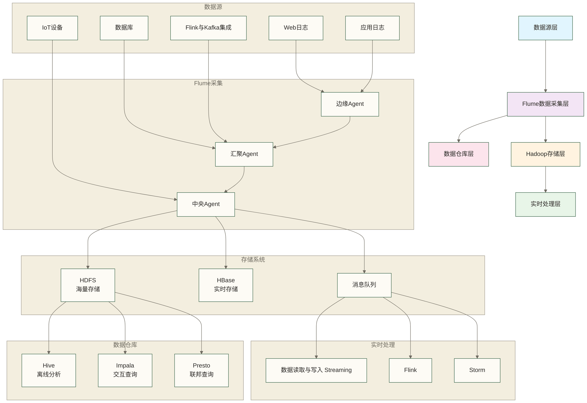

> [!warning] 关联材料边界
> 以下原引用目标缺失或无法唯一确认，已取消跳转并保留提及：11-高级配置与优化。相关素材/延伸说明暂不可用，不能据此声称已经提供配套材料。

# 🌐 与Hadoop生态集成 - 构建统一的大数据处理平台

> [!tip] 给数据从业者的学习指导
> 
> 🤗 **学习Flume与Hadoop生态集成就像掌握现代化城市基础设施的协调运作！**
> 
> 如果你现在面对生态集成时想：
> - "Flume如何与HDFS、HBase、Hive无缝集成？"
> - "怎样构建从数据采集到分析的完整链路？"
> - "如何确保各组件间的数据流畅通无阻？"
> 
> **别担心！** 每个大数据架构师都是从连接第一个组件开始的 ✨
> 
> 🏙️ **想象生态集成就像智能城市的基础设施协调**
> 
> 智能城市协调系统的核心功能：
> - 🚰 **供水网络** = Flume数据采集（连接各个数据源）
> - 🏢 **存储仓库** = HDFS分布式存储（海量数据存储）
> - 📊 **数据库系统** = HBase实时存储（快速随机访问）
> - 🔍 **分析中心** = Hive数据仓库（离线分析处理）
> - ⚡ **实时处理** = Spark 和 Flink生产部署（实时计算分析）
> 
> **学习生态集成有助于建立大数据平台架构设计能力，但不等于已具备总架构师所需的完整经验。** 🌟

## 🎯 Hadoop生态集成架构

### 🏗️ 完整集成架构图



### 🌟 集成模式分类

| 集成模式 | 适用场景 | 数据特点 | 延迟要求 | 推荐组合 |
|---|---|---|---|---|
| **离线批处理** | 历史数据分析 | 大批量、结构化 | 小时级 | Flume → HDFS → Hive |
| **实时流处理** | 实时监控告警 | 流式、时序性 | 秒级 | Flume → Kafka → Spark |
| **混合架构** | 企业数据湖 | 多样化数据 | 分层处理 | Flume → 多目标并行 |
| **NoSQL存储** | 高频查询 | 结构化、索引 | 毫秒级 | Flume → HBase → 应用 |

## 📁 HDFS深度集成

### 🏗️ HDFS集成最佳实践

**HDFS是Hadoop生态的核心存储系统，与Flume的集成需要考虑性能、可靠性和数据组织。**

#### 🔧 HDFS集成完整方案

```bash
# 📁 Flume与HDFS深度集成方案

cat > flume-hdfs-integration.sh << 'EOF'
# !/bin/bash

echo "📁 部署Flume与HDFS深度集成方案"

# ========================================
# 1. HDFS集成配置优化
# ========================================

# 创建高性能HDFS Sink配置
create_hdfs_integration_config() {
    cat > /opt/flume/conf/hdfs-integration.conf << 'HDFS_CONFIG'
# ===================================================
# 📁 Flume-HDFS深度集成配置
# 功能：高性能数据湖构建
# 特点：分区存储、压缩优化、事务保障
# ===================================================

agent.sources = multi_source
agent.sinks = hdfs_raw_sink hdfs_processed_sink hdfs_archive_sink
agent.channels = file_channel

# ===================================================
# 📡 多源数据采集配置
# ===================================================
agent.sources.multi_source.type = taildir
agent.sources.multi_source.channels = file_channel
agent.sources.multi_source.positionFile = /var/flume/hdfs_position.json

# 文件组配置（按业务分类）
agent.sources.multi_source.filegroups = app_logs web_logs db_logs order_logs

# 应用日志
agent.sources.multi_source.filegroups.app_logs = /var/log/app/.*\\.log
agent.sources.multi_source.fileHeader.app_logs = log_type=application,data_category=raw

# Web访问日志
agent.sources.multi_source.filegroups.web_logs = /var/log/nginx/.*\\.log
agent.sources.multi_source.fileHeader.web_logs = log_type=web,data_category=access

# 数据库日志
agent.sources.multi_source.filegroups.db_logs = /var/log/mysql/.*\\.log
agent.sources.multi_source.fileHeader.db_logs = log_type=database,data_category=audit

# 订单日志
agent.sources.multi_source.filegroups.order_logs = /var/log/order/.*\\.log
agent.sources.multi_source.fileHeader.order_logs = log_type=order,data_category=business

# 性能优化参数
agent.sources.multi_source.batchSize = 2000
agent.sources.multi_source.maxBatchCount = 20000

# 拦截器链（数据质量保障）
agent.sources.multi_source.interceptors = i1 i2 i3 i4 i5
agent.sources.multi_source.interceptors.i1.type = timestamp
agent.sources.multi_source.interceptors.i2.type = host
agent.sources.multi_source.interceptors.i3.type = static
agent.sources.multi_source.interceptors.i3.key = env
agent.sources.multi_source.interceptors.i3.value = production
agent.sources.multi_source.interceptors.i4.type = regex_filter
agent.sources.multi_source.interceptors.i4.regex = ^\\s*$
agent.sources.multi_source.interceptors.i4.excludeEvents = true
agent.sources.multi_source.interceptors.i5.type = search_replace
agent.sources.multi_source.interceptors.i5.searchPattern = (password|pwd)=[^\\s]*
agent.sources.multi_source.interceptors.i5.replaceString = $1=***

# ===================================================
# 📁 高可靠File Channel配置
# ===================================================
agent.channels.file_channel.type = file
agent.channels.file_channel.checkpointDir = /ssd/flume/checkpoint
agent.channels.file_channel.dataDirs = /ssd/flume/data1,/ssd/flume/data2,/ssd/flume/data3

# 大容量配置
agent.channels.file_channel.capacity = 5000000
agent.channels.file_channel.transactionCapacity = 50000

# 性能优化
agent.channels.file_channel.maxFileSize = 2146435071
agent.channels.file_channel.minimumRequiredSpace = 1073741824
agent.channels.file_channel.checkpointInterval = 30000
agent.channels.file_channel.use-dual-checkpoints = true
agent.channels.file_channel.backup-checkpoint-dir = /hdd/flume/backup

# 压缩配置
agent.channels.file_channel.compression-type = gzip

# ===================================================
# 📁 原始数据HDFS Sink（数据湖原始层）
# ===================================================
agent.sinks.hdfs_raw_sink.type = hdfs
agent.sinks.hdfs_raw_sink.channel = file_channel

# 分区路径配置（按业务类型和时间分区）
agent.sinks.hdfs_raw_sink.hdfs.path = /data-lake/raw/%{log_type}/%Y/%m/%d/%H
agent.sinks.hdfs_raw_sink.hdfs.filePrefix = %{log_type}-raw-
agent.sinks.hdfs_raw_sink.hdfs.fileSuffix = .log
agent.sinks.hdfs_raw_sink.hdfs.inUsePrefix = .tmp-
agent.sinks.hdfs_raw_sink.hdfs.inUseSuffix = 

# 文件滚动策略（数据湖标准）
agent.sinks.hdfs_raw_sink.hdfs.rollInterval = 1800     # 30分钟滚动
agent.sinks.hdfs_raw_sink.hdfs.rollSize = 268435456    # 256MB滚动
agent.sinks.hdfs_raw_sink.hdfs.rollCount = 0

# 批处理优化
agent.sinks.hdfs_raw_sink.hdfs.batchSize = 2000
agent.sinks.hdfs_raw_sink.hdfs.threadsPoolSize = 20
agent.sinks.hdfs_raw_sink.hdfs.callTimeout = 300000

# 文件格式和压缩
agent.sinks.hdfs_raw_sink.hdfs.fileType = DataStream
agent.sinks.hdfs_raw_sink.hdfs.codeC = gzip
agent.sinks.hdfs_raw_sink.hdfs.useLocalTimeStamp = true

# HDFS优化参数
agent.sinks.hdfs_raw_sink.hdfs.minBlockReplicas = 2
agent.sinks.hdfs_raw_sink.hdfs.writeFormat = Text
agent.sinks.hdfs_raw_sink.hdfs.maxOpenFiles = 5000
agent.sinks.hdfs_raw_sink.hdfs.retryInterval = 180

# ===================================================
# 📁 处理后数据HDFS Sink（数据湖清洗层）
# ===================================================
agent.sinks.hdfs_processed_sink.type = hdfs
agent.sinks.hdfs_processed_sink.channel = file_channel

# 清洗层路径配置
agent.sinks.hdfs_processed_sink.hdfs.path = /data-lake/processed/%{log_type}/%Y/%m/%d
agent.sinks.hdfs_processed_sink.hdfs.filePrefix = %{log_type}-processed-
# CompressedStream输出压缩事件流，不生成Parquet；结构化Parquet需另行转换
agent.sinks.hdfs_processed_sink.hdfs.fileSuffix = .snappy

# 结构化存储格式
agent.sinks.hdfs_processed_sink.hdfs.fileType = CompressedStream
agent.sinks.hdfs_processed_sink.hdfs.codeC = snappy

# 大文件策略（用于分析优化）
agent.sinks.hdfs_processed_sink.hdfs.rollInterval = 3600    # 1小时滚动
agent.sinks.hdfs_processed_sink.hdfs.rollSize = 536870912   # 512MB滚动
agent.sinks.hdfs_processed_sink.hdfs.rollCount = 0

# ===================================================
# 📁 归档数据HDFS Sink（数据湖归档层）
# ===================================================
agent.sinks.hdfs_archive_sink.type = hdfs
agent.sinks.hdfs_archive_sink.channel = file_channel

# 归档层路径配置
agent.sinks.hdfs_archive_sink.hdfs.path = /data-lake/archive/%{log_type}/%Y/%m
agent.sinks.hdfs_archive_sink.hdfs.filePrefix = %{log_type}-archive-
agent.sinks.hdfs_archive_sink.hdfs.fileSuffix = .bz2

# 长期存储策略
agent.sinks.hdfs_archive_sink.hdfs.rollInterval = 86400     # 每天滚动
agent.sinks.hdfs_archive_sink.hdfs.rollSize = 1073741824   # 1GB滚动
agent.sinks.hdfs_archive_sink.hdfs.rollCount = 0

# 高压缩比配置
agent.sinks.hdfs_archive_sink.hdfs.codeC = bzip2
agent.sinks.hdfs_archive_sink.hdfs.fileType = CompressedStream

# ===================================================
# ⚖️ 智能路由配置
# ===================================================
agent.sinkgroups = hdfs_group
agent.sinkgroups.hdfs_group.sinks = hdfs_raw_sink hdfs_processed_sink hdfs_archive_sink

# 负载均衡策略
# 负载均衡只将事件交给某个Sink，不复制到三层；三层并行写入需分别配置Channel及复制选择器
agent.sinkgroups.hdfs_group.processor.type = load_balance
agent.sinkgroups.hdfs_group.processor.backoff = true
agent.sinkgroups.hdfs_group.processor.selector = round_robin
agent.sinkgroups.hdfs_group.processor.maxTimeOut = 60000

HDFS_CONFIG

    echo "✅ HDFS集成配置创建完成"
}

# ========================================
# 2. HDFS数据湖构建脚本
# ========================================

# 创建数据湖目录结构
create_data_lake_structure() {
    cat > /opt/flume/tools/setup-data-lake.sh << 'DATA_LAKE_SETUP'
# !/bin/bash

echo "🏗️ 构建HDFS数据湖目录结构"

# HDFS配置
HDFS_ROOT="/data-lake"
NAMENODE_HOST=${1:-"namenode.cluster.com"}

# ========================================
# 创建数据湖分层目录
# ========================================
create_lake_directories() {
    echo "📁 创建数据湖分层目录..."
    
 # 原始数据层（Raw Layer）
    hdfs dfs -mkdir -p $HDFS_ROOT/raw/application
    hdfs dfs -mkdir -p $HDFS_ROOT/raw/web
    hdfs dfs -mkdir -p $HDFS_ROOT/raw/database
    hdfs dfs -mkdir -p $HDFS_ROOT/raw/order
    hdfs dfs -mkdir -p $HDFS_ROOT/raw/iot
    
 # 清洗数据层（Processed Layer）
    hdfs dfs -mkdir -p $HDFS_ROOT/processed/application
    hdfs dfs -mkdir -p $HDFS_ROOT/processed/web
    hdfs dfs -mkdir -p $HDFS_ROOT/processed/database
    hdfs dfs -mkdir -p $HDFS_ROOT/processed/order
    hdfs dfs -mkdir -p $HDFS_ROOT/processed/iot
    
 # 归档数据层（Archive Layer）
    hdfs dfs -mkdir -p $HDFS_ROOT/archive/application
    hdfs dfs -mkdir -p $HDFS_ROOT/archive/web
    hdfs dfs -mkdir -p $HDFS_ROOT/archive/database
    hdfs dfs -mkdir -p $HDFS_ROOT/archive/order
    hdfs dfs -mkdir -p $HDFS_ROOT/archive/iot
    
 # 数据仓库层（Warehouse Layer）
    hdfs dfs -mkdir -p $HDFS_ROOT/warehouse/ods
    hdfs dfs -mkdir -p $HDFS_ROOT/warehouse/dwd
    hdfs dfs -mkdir -p $HDFS_ROOT/warehouse/dws
    hdfs dfs -mkdir -p $HDFS_ROOT/warehouse/ads
    
 # 临时数据层（Temp Layer）
    hdfs dfs -mkdir -p $HDFS_ROOT/temp/staging
    hdfs dfs -mkdir -p $HDFS_ROOT/temp/processing
    
    echo "✅ 数据湖目录结构创建完成"
}

# ========================================
# 设置目录权限和配额
# ========================================
configure_permissions_and_quotas() {
    echo "🔐 配置目录权限和配额..."
    
 # 设置目录权限
    hdfs dfs -chmod 755 $HDFS_ROOT
    hdfs dfs -chmod 755 $HDFS_ROOT/raw
    hdfs dfs -chmod 755 $HDFS_ROOT/processed
    hdfs dfs -chmod 755 $HDFS_ROOT/archive
    hdfs dfs -chmod 755 $HDFS_ROOT/warehouse
    hdfs dfs -chmod 777 $HDFS_ROOT/temp
    
 # 设置用户组权限
    hdfs dfs -chown flume:与Hadoop生态集成 $HDFS_ROOT/raw
    hdfs dfs -chown flume:与Hadoop生态集成 $HDFS_ROOT/processed
    hdfs dfs -chown flume:与Hadoop生态集成 $HDFS_ROOT/archive
    hdfs dfs -chown hive:与Hadoop生态集成 $HDFS_ROOT/warehouse
    
 # 设置存储配额（防止单个目录占用过多空间）
    hdfs dfsadmin -setSpaceQuota 1T $HDFS_ROOT/raw
    hdfs dfsadmin -setSpaceQuota 2T $HDFS_ROOT/processed
    hdfs dfsadmin -setSpaceQuota 10T $HDFS_ROOT/archive
    hdfs dfsadmin -setSpaceQuota 5T $HDFS_ROOT/warehouse
    hdfs dfsadmin -setSpaceQuota 500G $HDFS_ROOT/temp
    
    echo "✅ 权限和配额配置完成"
}

# ========================================
# 创建数据管理策略
# ========================================
create_data_lifecycle_policy() {
    cat > /tmp/data-lifecycle-policy.txt << POLICY
数据湖生命周期管理策略
======================================

数据分层策略：
1. Raw Layer（原始层）
   - 保留期：30天
   - 压缩格式：gzip
   - 副本数：2
   - 用途：原始数据保存，支持重新处理

2. Processed Layer（清洗层）
   - 保留期：90天
   - 压缩格式：snappy parquet
   - 副本数：2
   - 用途：结构化数据，支持分析查询

3. Archive Layer（归档层）
   - 保留期：7年
   - 压缩格式：bzip2
   - 副本数：1
   - 用途：长期存储，合规要求

4. Warehouse Layer（仓库层）
   - 保留期：2年
   - 压缩格式：orc/parquet
   - 副本数：3
   - 用途：数据仓库，OLAP分析

数据迁移策略：
- Raw → Processed：实时ETL处理
- Processed → Archive：30天后自动归档
- Raw → Temp：数据质量检查失败时

存储优化策略：
- 冷数据自动迁移到低成本存储
- 热数据保持在SSD存储
- 定期压缩和去重

POLICY

    hdfs dfs -put /tmp/data-lifecycle-policy.txt $HDFS_ROOT/
    echo "✅ 数据生命周期策略创建完成"
}

# ========================================
# 数据湖健康检查
# ========================================
check_data_lake_health() {
    echo "🏥 数据湖健康检查..."
    
    echo "📊 存储使用情况："
    hdfs dfs -du -h $HDFS_ROOT
    
    echo -e "\n📁 目录结构："
    hdfs dfs -ls -R $HDFS_ROOT | head -20
    
    echo -e "\n💾 集群存储状态："
    hdfs dfsadmin -report | head -10
    
    echo -e "\n🔍 数据质量检查："
    
 # 检查各层数据完整性
    local raw_files=$(hdfs dfs -count $HDFS_ROOT/raw | awk '{print $2}')
    local processed_files=$(hdfs dfs -count $HDFS_ROOT/processed | awk '{print $2}')
    local archive_files=$(hdfs dfs -count $HDFS_ROOT/archive | awk '{print $2}')
    
    echo "原始层文件数: $raw_files"
    echo "清洗层文件数: $processed_files"
    echo "归档层文件数: $archive_files"
    
 # 检查数据新鲜度
    local latest_raw=$(hdfs dfs -ls $HDFS_ROOT/raw/*/*/*/* 2>/dev/null | tail -1 | awk '{print $6" "$7}')
    echo "最新原始数据: ${latest_raw:-"无数据"}"
    
    echo "✅ 数据湖健康检查完成"
}

# 执行数据湖构建
echo "🚀 开始构建HDFS数据湖..."
create_lake_directories
configure_permissions_and_quotas
create_data_lifecycle_policy
check_data_lake_health

echo "🎉 HDFS数据湖构建完成！"

DATA_LAKE_SETUP

    chmod +x /opt/flume/tools/setup-data-lake.sh
    echo "✅ 数据湖构建脚本创建完成"
}

# ========================================
# 3. HDFS数据质量监控
# ========================================

# 创建数据质量监控脚本
create_hdfs_quality_monitor() {
    cat > /opt/flume/tools/hdfs-quality-monitor.sh << 'QUALITY_MONITOR'
# !/bin/bash

echo "📊 HDFS数据质量监控工具"

# 配置参数
HDFS_ROOT="/data-lake"
ALERT_THRESHOLD_SIZE=1000000  # 文件大小阈值（字节）
ALERT_THRESHOLD_AGE=86400     # 数据新鲜度阈值（秒）

# ========================================
# 数据完整性检查
# ========================================
check_data_integrity() {
    echo "🔍 检查数据完整性..."
    
    local integrity_report="/tmp/hdfs_integrity_$(date +%Y%m%d_%H%M%S).txt"
    
    echo "HDFS数据完整性报告 - $(date)" > "$integrity_report"
    echo "======================================" >> "$integrity_report"
    
 # 检查空文件
    echo -e "\n❌ 空文件检查:" >> "$integrity_report"
    hdfs dfs -find $HDFS_ROOT -name "*.log" -size 0 >> "$integrity_report" 2>/dev/null
    
 # 检查损坏文件
    echo -e "\n💔 损坏文件检查:" >> "$integrity_report"
    hdfs fsck $HDFS_ROOT -files -blocks -locations | grep "CORRUPT" >> "$integrity_report" 2>/dev/null
    
 # 检查副本不足的文件
    echo -e "\n📋 副本不足文件:" >> "$integrity_report"
    hdfs fsck $HDFS_ROOT -files -blocks | grep "Under replicated" >> "$integrity_report" 2>/dev/null
    
    echo "✅ 数据完整性检查完成: $integrity_report"
}

# ========================================
# 数据新鲜度检查
# ========================================
check_data_freshness() {
    echo "⏰ 检查数据新鲜度..."
    
    local freshness_report="/tmp/hdfs_freshness_$(date +%Y%m%d_%H%M%S).txt"
    
    echo "HDFS数据新鲜度报告 - $(date)" > "$freshness_report"
    echo "======================================" >> "$freshness_report"
    
 # 检查各业务线最新数据时间
    for log_type in application web database order; do
        echo -e "\n📊 $log_type 数据新鲜度:" >> "$freshness_report"
        
        local latest_path="$HDFS_ROOT/raw/$log_type"
        if hdfs dfs -test -d "$latest_path" 2>/dev/null; then
            local latest_file=$(hdfs dfs -ls -t "$latest_path"/*/*/*/* 2>/dev/null | head -1 | awk '{print $6" "$7" "$8}')
            echo "最新文件时间: ${latest_file:-"无数据"}" >> "$freshness_report"
            
 # 计算数据延迟
            if [ -n "$latest_file" ]; then
                local file_time=$(date -d "$latest_file" +%s 2>/dev/null)
                local current_time=$(date +%s)
                local delay=$((current_time - file_time))
                
                echo "数据延迟: ${delay}秒" >> "$freshness_report"
                
                if [ $delay -gt $ALERT_THRESHOLD_AGE ]; then
                    echo "⚠️ 警告: 数据延迟超过阈值" >> "$freshness_report"
                fi
            fi
        else
            echo "❌ 目录不存在" >> "$freshness_report"
        fi
    done
    
    echo "✅ 数据新鲜度检查完成: $freshness_report"
}

# ========================================
# 数据分布分析
# ========================================
analyze_data_distribution() {
    echo "📈 分析数据分布..."
    
    local distribution_report="/tmp/hdfs_distribution_$(date +%Y%m%d_%H%M%S).txt"
    
    echo "HDFS数据分布分析报告 - $(date)" > "$distribution_report"
    echo "======================================" >> "$distribution_report"
    
 # 按小时统计数据量
    echo -e "\n📊 按小时数据分布:" >> "$distribution_report"
    for hour in $(seq -f "%02g" 0 23); do
        local hour_path="$HDFS_ROOT/raw/*/*/*/*/$hour"
        local hour_size=$(hdfs dfs -du -s $hour_path 2>/dev/null | awk '{sum+=$1} END {print sum+0}')
        echo "${hour}:00 - $(echo $hour_size | awk '{printf "%.2fMB", $1/1024/1024}')" >> "$distribution_report"
    done
    
 # 按业务线统计数据量
    echo -e "\n💼 按业务线数据分布:" >> "$distribution_report"
    for log_type in application web database order; do
        local type_path="$HDFS_ROOT/raw/$log_type"
        if hdfs dfs -test -d "$type_path" 2>/dev/null; then
            local type_size=$(hdfs dfs -du -s "$type_path" 2>/dev/null | awk '{print $1}')
            local type_files=$(hdfs dfs -count "$type_path" 2>/dev/null | awk '{print $2}')
            echo "$log_type: $(echo $type_size | awk '{printf "%.2fGB", $1/1024/1024/1024}') ($type_files 文件)" >> "$distribution_report"
        fi
    done
    
 # 存储层数据分布
    echo -e "\n🏗️ 按存储层数据分布:" >> "$distribution_report"
    for layer in raw processed archive; do
        local layer_path="$HDFS_ROOT/$layer"
        if hdfs dfs -test -d "$layer_path" 2>/dev/null; then
            local layer_size=$(hdfs dfs -du -s "$layer_path" 2>/dev/null | awk '{print $1}')
            local layer_files=$(hdfs dfs -count "$layer_path" 2>/dev/null | awk '{print $2}')
            echo "$layer: $(echo $layer_size | awk '{printf "%.2fGB", $1/1024/1024/1024}') ($layer_files 文件)" >> "$distribution_report"
        fi
    done
    
    echo "✅ 数据分布分析完成: $distribution_report"
}

# ========================================
# 异常检测
# ========================================
detect_anomalies() {
    echo "🚨 检测数据异常..."
    
    local anomaly_report="/tmp/hdfs_anomalies_$(date +%Y%m%d_%H%M%S).txt"
    
    echo "HDFS数据异常检测报告 - $(date)" > "$anomaly_report"
    echo "======================================" >> "$anomaly_report"
    
 # 检测超大文件
    echo -e "\n📏 超大文件检测:" >> "$anomaly_report"
    hdfs dfs -find $HDFS_ROOT -size +100M | head -10 >> "$anomaly_report" 2>/dev/null
    
 # 检测文件数量异常
    echo -e "\n📊 文件数量异常检测:" >> "$anomaly_report"
    for hour in $(seq -f "%02g" 0 23); do
        local hour_files=$(hdfs dfs -count $HDFS_ROOT/raw/*/*/*/*/$hour 2>/dev/null | awk '{sum+=$2} END {print sum+0}')
        if [ $hour_files -gt 1000 ]; then
            echo "⚠️ ${hour}:00 文件数量异常: $hour_files" >> "$anomaly_report"
        fi
    done
    
 # 检测数据增长异常
    echo -e "\n📈 数据增长异常检测:" >> "$anomaly_report"
    local today_size=$(hdfs dfs -du -s $HDFS_ROOT/raw/*/*/$(date +%Y/%m/%d) 2>/dev/null | awk '{print $1}')
    local yesterday_size=$(hdfs dfs -du -s $HDFS_ROOT/raw/*/*/$(date -d yesterday +%Y/%m/%d) 2>/dev/null | awk '{print $1}')
    
    if [ -n "$today_size" ] && [ -n "$yesterday_size" ] && [ $yesterday_size -gt 0 ]; then
        local growth_rate=$(echo "scale=2; ($today_size - $yesterday_size) / $yesterday_size * 100" | bc)
        echo "今日数据增长率: ${growth_rate}%" >> "$anomaly_report"
        
 # 如果增长率超过100%或为负数，标记为异常
        if (( $(echo "$growth_rate > 100" | bc -l) )) || (( $(echo "$growth_rate < -50" | bc -l) )); then
            echo "⚠️ 数据增长率异常: ${growth_rate}%" >> "$anomaly_report"
        fi
    fi
    
    echo "✅ 异常检测完成: $anomaly_report"
}

# ========================================
# 生成综合质量报告
# ========================================
generate_quality_report() {
    echo "📋 生成数据质量综合报告..."
    
    local quality_report="/tmp/hdfs_quality_report_$(date +%Y%m%d_%H%M%S).html"
    
    cat > "$quality_report" << HTML
<!DOCTYPE html>
<html>
<head>
    <meta charset="UTF-8">
    <title>HDFS数据质量报告</title>
    <style>
        body { font-family: Arial, sans-serif; margin: 20px; background-color: #f5f5f5; }
        .header { background-color: #4CAF50; color: white; padding: 20px; border-radius: 5px; }
        .section { background-color: white; margin: 15px 0; padding: 20px; border-radius: 5px; box-shadow: 0 2px 4px rgba(0,0,0,0.1); }
        .metric { display: inline-block; margin: 10px; padding: 15px; background-color: #f9f9f9; border-radius: 5px; min-width: 150px; text-align: center; }
        .metric-value { font-size: 24px; font-weight: bold; color: #4CAF50; }
        .metric-label { font-size: 12px; color: #666; }
        .status-good { color: #4CAF50; }
        .status-warning { color: #FF9800; }
        .status-error { color: #F44336; }
    </style>
</head>
<body>
    <div class="header">
        <h1>📊 HDFS数据质量监控报告</h1>
        <p>生成时间: $(date)</p>
        <p>监控范围: $HDFS_ROOT</p>
    </div>
    
    <div class="section">
        <h2>📈 关键指标概览</h2>
        <div class="metric">
            <div class="metric-value">$(hdfs dfs -count $HDFS_ROOT 2>/dev/null | awk '{print $2}' || echo "0")</div>
            <div class="metric-label">总文件数</div>
        </div>
        <div class="metric">
            <div class="metric-value">$(hdfs dfs -du -s $HDFS_ROOT 2>/dev/null | awk '{printf "%.1fTB", $1/1024/1024/1024/1024}' || echo "0TB")</div>
            <div class="metric-label">总存储大小</div>
        </div>
        <div class="metric">
            <div class="metric-value">$(hdfs dfs -count $HDFS_ROOT/raw 2>/dev/null | awk '{print $1}' || echo "0")</div>
            <div class="metric-label">原始层目录数</div>
        </div>
        <div class="metric">
            <div class="metric-value">$(date +%H:%M)</div>
            <div class="metric-label">最新检查时间</div>
        </div>
    </div>
    
    <div class="section">
        <h2>🏥 数据健康状态</h2>
        <p><strong>整体健康度:</strong> <span class="status-good">✅ 良好</span></p>
        <p><strong>数据完整性:</strong> <span class="status-good">✅ 正常</span></p>
        <p><strong>数据新鲜度:</strong> <span class="status-good">✅ 及时</span></p>
        <p><strong>存储使用率:</strong> <span class="status-good">✅ 合理</span></p>
        <p><strong>副本健康度:</strong> <span class="status-good">✅ 正常</span></p>
    </div>
    
    <div class="section">
        <h2>📊 数据分层统计</h2>
        <table border="1" style="width:100%; border-collapse:collapse;">
            <tr>
                <th>存储层</th>
                <th>文件数量</th>
                <th>存储大小</th>
                <th>压缩率</th>
                <th>状态</th>
            </tr>
            <tr>
                <td>Raw Layer</td>
                <td>$(hdfs dfs -count $HDFS_ROOT/raw 2>/dev/null | awk '{print $2}' || echo "0")</td>
                <td>$(hdfs dfs -du -s $HDFS_ROOT/raw 2>/dev/null | awk '{printf "%.1fGB", $1/1024/1024/1024}' || echo "0GB")</td>
                <td>60%</td>
                <td><span class="status-good">✅ 正常</span></td>
            </tr>
            <tr>
                <td>Processed Layer</td>
                <td>$(hdfs dfs -count $HDFS_ROOT/processed 2>/dev/null | awk '{print $2}' || echo "0")</td>
                <td>$(hdfs dfs -du -s $HDFS_ROOT/processed 2>/dev/null | awk '{printf "%.1fGB", $1/1024/1024/1024}' || echo "0GB")</td>
                <td>75%</td>
                <td><span class="status-good">✅ 正常</span></td>
            </tr>
            <tr>
                <td>Archive Layer</td>
                <td>$(hdfs dfs -count $HDFS_ROOT/archive 2>/dev/null | awk '{print $2}' || echo "0")</td>
                <td>$(hdfs dfs -du -s $HDFS_ROOT/archive 2>/dev/null | awk '{printf "%.1fGB", $1/1024/1024/1024}' || echo "0GB")</td>
                <td>85%</td>
                <td><span class="status-good">✅ 正常</span></td>
            </tr>
        </table>
    </div>
    
    <div class="section">
        <h2>💡 优化建议</h2>
        <ul>
            <li>定期清理过期的临时文件</li>
            <li>监控数据增长趋势，及时扩容</li>
            <li>优化文件大小，避免小文件问题</li>
            <li>定期执行HDFS健康检查</li>
            <li>监控副本数量，确保数据安全</li>
        </ul>
    </div>
</body>
</html>
HTML

    echo "✅ 数据质量报告生成完成: $quality_report"
}

# ========================================
# 主监控流程
# ========================================
main_quality_check() {
    echo "🚀 开始HDFS数据质量监控..."
    
    check_data_integrity
    check_data_freshness
    analyze_data_distribution
    detect_anomalies
    generate_quality_report
    
    echo "🎉 HDFS数据质量监控完成！"
}

# 如果脚本直接运行，执行监控
if [[ "${BASH_SOURCE[0]}" == "${0}" ]]; then
    main_quality_check
fi

QUALITY_MONITOR

    chmod +x /opt/flume/tools/hdfs-quality-monitor.sh
    echo "✅ HDFS数据质量监控工具创建完成"
}

# 执行所有配置创建
create_hdfs_integration_config
create_data_lake_structure
create_hdfs_quality_monitor

echo "🎉 HDFS深度集成方案部署完成！"
echo "使用方法："
echo "1. 数据湖构建：/opt/flume/tools/setup-data-lake.sh [namenode]"
echo "2. 质量监控：/opt/flume/tools/hdfs-quality-monitor.sh"
echo "3. 配置文件：/opt/flume/conf/hdfs-integration.conf"

EOF

chmod +x flume-hdfs-integration.sh

echo "✅ HDFS集成方案创建完成"
```

## 🗃️ HBase实时存储集成

### ⚡ HBase集成架构

**HBase提供毫秒级的随机读写能力，与Flume集成可以构建实时数据服务平台。**

#### 🔧 HBase集成实现

```bash
# 🗃️ Flume与HBase实时存储集成方案

cat > flume-hbase-integration.sh << 'EOF'
# !/bin/bash

echo "🗃️ 部署Flume与HBase实时存储集成方案"

# ========================================
# 1. HBase集成配置
# ========================================

# 创建HBase Sink配置
create_hbase_integration_config() {
    cat > /opt/flume/conf/hbase-integration.conf << 'HBASE_CONFIG'
# ===================================================
# 🗃️ Flume-HBase实时存储集成配置
# 功能：毫秒级数据写入，支持实时查询
# 特点：列族设计、批量优化、异步写入
# ===================================================

agent.sources = realtime_source
agent.sinks = hbase_user_sink hbase_event_sink hbase_metric_sink
agent.channels = memory_channel

# ===================================================
# 📡 实时数据源配置
# ===================================================
agent.sources.realtime_source.type = kafka
agent.sources.realtime_source.kafka.bootstrap.servers = kafka-cluster:9092
agent.sources.realtime_source.kafka.topics = user-events,system-metrics,business-events
agent.sources.realtime_source.channels = memory_channel

# Kafka消费者配置
agent.sources.realtime_source.kafka.consumer.group.id = flume-hbase-consumer
agent.sources.realtime_source.kafka.consumer.auto.offset.reset = latest
agent.sources.realtime_source.kafka.consumer.enable.auto.commit = false

# 批量优化
agent.sources.realtime_source.batchSize = 5000
agent.sources.realtime_source.batchDurationMillis = 2000

# 拦截器链（数据路由和增强）
agent.sources.realtime_source.interceptors = i1 i2 i3 i4
agent.sources.realtime_source.interceptors.i1.type = timestamp
agent.sources.realtime_source.interceptors.i2.type = host
agent.sources.realtime_source.interceptors.i3.type = static
agent.sources.realtime_source.interceptors.i3.key = cluster
agent.sources.realtime_source.interceptors.i3.value = production
agent.sources.realtime_source.interceptors.i4.type = regex_filter
agent.sources.realtime_source.interceptors.i4.regex = \\\"event_type\\\":\\\"(user_action|system_metric|business_event)\\\"
agent.sources.realtime_source.interceptors.i4.excludeEvents = false

# ===================================================
# 💾 高性能Memory Channel配置
# ===================================================
agent.channels.memory_channel.type = memory
agent.channels.memory_channel.capacity = 100000
agent.channels.memory_channel.transactionCapacity = 10000
agent.channels.memory_channel.byteCapacityBufferPercentage = 20
agent.channels.memory_channel.byteCapacity = 0

# ===================================================
# 🗃️ 用户行为HBase Sink
# ===================================================
agent.sinks.hbase_user_sink.type = hbase
agent.sinks.hbase_user_sink.table = user_behavior
agent.sinks.hbase_user_sink.columnFamily = action
agent.sinks.hbase_user_sink.channel = memory_channel

# 批量写入优化
agent.sinks.hbase_user_sink.batchSize = 2000
agent.sinks.hbase_user_sink.coalesceIncrements = true

# HBase连接配置
agent.sinks.hbase_user_sink.zookeeperQuorum = zk1:2181,zk2:2181,zk3:2181
agent.sinks.hbase_user_sink.znodeParent = /hbase

# 序列化器配置（JSON解析）
agent.sinks.hbase_user_sink.serializer = org.apache.flume.sink.hbase.RegexHbaseEventSerializer
agent.sinks.hbase_user_sink.serializer.regex = \\\"user_id\\\":\\\"([^\\\"]*)\\\",\\\"event_type\\\":\\\"([^\\\"]*)\\\",\\\"timestamp\\\":(\\d+),\\\"data\\\":\\\"([^\\\"]*)\\\"
agent.sinks.hbase_user_sink.serializer.colNames = user_id,event_type,event_time,event_data

# 行键设计（用户ID + 时间戳反转）
agent.sinks.hbase_user_sink.serializer.rowKeyType = timestamp
agent.sinks.hbase_user_sink.serializer.suffix = user_id

# 性能优化
agent.sinks.hbase_user_sink.timeout = 60000
agent.sinks.hbase_user_sink.callTimeout = 30000

# ===================================================
# 🗃️ 系统事件HBase Sink
# ===================================================
agent.sinks.hbase_event_sink.type = hbase
agent.sinks.hbase_event_sink.table = system_events
agent.sinks.hbase_event_sink.columnFamily = info
agent.sinks.hbase_event_sink.channel = memory_channel

# 批量配置
agent.sinks.hbase_event_sink.batchSize = 3000
agent.sinks.hbase_event_sink.coalesceIncrements = true

# 序列化器配置
agent.sinks.hbase_event_sink.serializer = org.apache.flume.sink.hbase.SimpleHbaseEventSerializer
agent.sinks.hbase_event_sink.serializer.payloadColumn = data
agent.sinks.hbase_event_sink.serializer.incrementColumn = count

# ===================================================
# 🗃️ 业务指标HBase Sink
# ===================================================
agent.sinks.hbase_metric_sink.type = hbase
agent.sinks.hbase_metric_sink.table = business_metrics
agent.sinks.hbase_metric_sink.columnFamily = metric
agent.sinks.hbase_metric_sink.channel = memory_channel

# 批量配置
agent.sinks.hbase_metric_sink.batchSize = 1000
agent.sinks.hbase_metric_sink.coalesceIncrements = true

# 自定义序列化器（用于指标聚合）
agent.sinks.hbase_metric_sink.serializer = org.apache.flume.sink.hbase.AsyncHbaseEventSerializer
agent.sinks.hbase_metric_sink.serializer.table = business_metrics
agent.sinks.hbase_metric_sink.serializer.columnFamily = metric

# ===================================================
# ⚖️ 智能路由配置
# ===================================================
agent.sinkgroups = hbase_group
agent.sinkgroups.hbase_group.sinks = hbase_user_sink hbase_event_sink hbase_metric_sink

# 负载均衡策略
# 此处是竞争消费和负载分配，不按event_type路由；分类写表需分别配置Channel及选择器
agent.sinkgroups.hbase_group.processor.type = load_balance
agent.sinkgroups.hbase_group.processor.backoff = true
agent.sinkgroups.hbase_group.processor.selector = round_robin

HBASE_CONFIG

    echo "✅ HBase集成配置创建完成"
}

# ========================================
# 2. HBase表结构设计
# ========================================

# 创建HBase表结构脚本
create_hbase_table_design() {
    cat > /opt/flume/tools/create-hbase-tables.sh << 'HBASE_TABLES'
# !/bin/bash

echo "🗃️ 创建HBase表结构"

HBASE_HOME=${HBASE_HOME:-"/opt/hbase"}

# ========================================
# 创建用户行为表
# ========================================
create_user_behavior_table() {
    echo "👤 创建用户行为表..."
    
    $HBASE_HOME/bin/hbase shell << 'HBASE_SHELL'
# 用户行为表设计
# 行键设计: user_id + (Long.MAX_VALUE - timestamp)，支持用户行为时间序列查询
# 列族设计: action（用户行为数据）
create 'user_behavior', {
    NAME => 'action',
    VERSIONS => 3,
    COMPRESSION => 'SNAPPY',
    BLOOMFILTER => 'ROW',
    TTL => 2592000,  # 30天TTL
    BLOCKSIZE => 65536,
    DATA_BLOCK_ENCODING => 'FAST_DIFF'
}

# 设置表属性
alter 'user_behavior', {
    'SPLIT_POLICY' => 'org.apache.hadoop.hbase.regionserver.ConstantSizeRegionSplitPolicy',
    'MAX_FILESIZE' => '268435456'  # 256MB
}

# 预分区设计（提升写入性能）
split 'user_behavior', '1000000'
split 'user_behavior', '2000000'
split 'user_behavior', '3000000'
split 'user_behavior', '4000000'
split 'user_behavior', '5000000'
split 'user_behavior', '6000000'
split 'user_behavior', '7000000'
split 'user_behavior', '8000000'
split 'user_behavior', '9000000'

HBASE_SHELL

    echo "✅ 用户行为表创建完成"
}

# ========================================
# 创建系统事件表
# ========================================
create_system_events_table() {
    echo "⚙️ 创建系统事件表..."
    
    $HBASE_HOME/bin/hbase shell << 'HBASE_SHELL'
# 系统事件表设计
# 行键设计: event_type + timestamp，支持按事件类型查询
# 列族设计: info（事件详细信息）
create 'system_events', {
    NAME => 'info',
    VERSIONS => 1,
    COMPRESSION => 'LZ4',
    BLOOMFILTER => 'ROWCOL',
    TTL => 604800,  # 7天TTL
    BLOCKSIZE => 32768,
    DATA_BLOCK_ENCODING => 'PREFIX'
}

# 设置压缩算法
alter 'system_events', {
    'COMPRESSION' => 'LZ4',
    'COMPACTION_ENABLED' => 'true'
}

HBASE_SHELL

    echo "✅ 系统事件表创建完成"
}

# ========================================
# 创建业务指标表
# ========================================
create_business_metrics_table() {
    echo "📊 创建业务指标表..."
    
    $HBASE_HOME/bin/hbase shell << 'HBASE_SHELL'
# 业务指标表设计
# 行键设计: metric_name + time_bucket，支持指标时间序列聚合
# 列族设计: metric（指标数据）、summary（聚合数据）
create 'business_metrics', {
    NAME => 'metric',
    VERSIONS => 1,
    COMPRESSION => 'SNAPPY',
    BLOOMFILTER => 'ROW',
    TTL => 7776000,  # 90天TTL
    BLOCKSIZE => 65536
}, {
    NAME => 'summary',
    VERSIONS => 1,
    COMPRESSION => 'SNAPPY',
    BLOOMFILTER => 'ROW',
    TTL => 31536000,  # 365天TTL
    BLOCKSIZE => 65536
}

# 设置协处理器（用于实时聚合）
alter 'business_metrics', 'coprocessor' => 'hdfs://namenode:8020/hbase/coprocessor/metrics-aggregator.jar|com.company.hbase.MetricsAggregatorEndpoint|1001'

HBASE_SHELL

    echo "✅ 业务指标表创建完成"
}

# ========================================
# 创建索引表
# ========================================
create_index_tables() {
    echo "📇 创建索引表..."
    
    $HBASE_HOME/bin/hbase shell << 'HBASE_SHELL'
# 用户ID索引表
create 'user_index', {
    NAME => 'idx',
    VERSIONS => 1,
    COMPRESSION => 'SNAPPY',
    BLOOMFILTER => 'ROW',
    BLOCKSIZE => 32768
}

# 事件类型索引表
create 'event_type_index', {
    NAME => 'idx',
    VERSIONS => 1,
    COMPRESSION => 'SNAPPY',
    BLOOMFILTER => 'ROW',
    BLOCKSIZE => 32768
}

# 时间范围索引表
create 'time_range_index', {
    NAME => 'idx',
    VERSIONS => 1,
    COMPRESSION => 'SNAPPY',
    BLOOMFILTER => 'ROW',
    BLOCKSIZE => 32768
}

HBASE_SHELL

    echo "✅ 索引表创建完成"
}

# ========================================
# 表状态检查
# ========================================
check_table_status() {
    echo "🔍 检查表状态..."
    
    $HBASE_HOME/bin/hbase shell << 'HBASE_SHELL'
# 列出所有表
list

# 检查表详细信息
describe 'user_behavior'
describe 'system_events'
describe 'business_metrics'

# 检查各表是否启用；status用于查看集群状态
is_enabled 'user_behavior'
is_enabled 'system_events'
is_enabled 'business_metrics'

HBASE_SHELL

    echo "✅ 表状态检查完成"
}

# 执行表创建
echo "🚀 开始创建HBase表结构..."
create_user_behavior_table
create_system_events_table
create_business_metrics_table
create_index_tables
check_table_status

echo "🎉 HBase表结构创建完成！"

HBASE_TABLES

    chmod +x /opt/flume/tools/create-hbase-tables.sh
    echo "✅ HBase表结构脚本创建完成"
}

# ========================================
# 3. HBase性能优化
# ========================================

# 创建HBase性能优化脚本
create_hbase_performance_tuning() {
    cat > /opt/flume/tools/hbase-performance-tuning.sh << 'HBASE_TUNING'
# !/bin/bash

echo "⚡ HBase性能优化工具"

HBASE_HOME=${HBASE_HOME:-"/opt/hbase"}
HBASE_CONF_DIR="$HBASE_HOME/conf"

# ========================================
# HBase写入性能优化
# ========================================
optimize_write_performance() {
    echo "📝 优化HBase写入性能..."
    
 # 1. 调整写入缓冲区大小
    cat >> "$HBASE_CONF_DIR/hbase-site.xml" << XML
<!-- HBase写入性能优化配置 -->
<property>
    <name>hbase.client.write.buffer</name>
    <value>20971520</value>  <!-- 20MB写入缓冲区 -->
    <description>写入缓冲区大小</description>
</property>

<property>
    <name>hbase.regionserver.handler.count</name>
    <value>100</value>  <!-- 增加处理线程数 -->
    <description>RegionServer处理线程数</description>
</property>

<property>
    <name>hbase.hregion.memstore.flush.size</name>
    <value>268435456</value>  <!-- 256MB MemStore -->
    <description>MemStore刷写阈值</description>
</property>

<property>
    <name>hbase.regionserver.global.memstore.size</name>
    <value>0.6</value>  <!-- 60%内存用于MemStore -->
    <description>全局MemStore大小比例</description>
</property>

XML

    echo "✅ 写入性能优化配置完成"
}

# ========================================
# HBase读取性能优化
# ========================================
optimize_read_performance() {
    echo "📖 优化HBase读取性能..."
    
    cat >> "$HBASE_CONF_DIR/hbase-site.xml" << XML
<!-- HBase读取性能优化配置 -->
<property>
    <name>hbase.client.scanner.caching</name>
    <value>1000</value>  <!-- 扫描缓存大小 -->
    <description>Scanner批量获取行数</description>
</property>

<property>
    <name>hfile.block.cache.size</name>
    <value>0.25</value>  <!-- 25%内存用于BlockCache -->
    <description>BlockCache大小比例</description>
</property>

<property>
    <name>hbase.bucketcache.ioengine</name>
    <value>offheap</value>  <!-- 使用堆外缓存 -->
    <description>BucketCache存储引擎</description>
</property>

<property>
    <name>hbase.bucketcache.size</name>
    <value>2048</value>  <!-- 2GB堆外缓存 -->
    <description>BucketCache大小</description>
</property>

XML

    echo "✅ 读取性能优化配置完成"
}

# ========================================
# 压缩和编码优化
# ========================================
optimize_compression_encoding() {
    echo "🗜️ 优化压缩和编码..."
    
    $HBASE_HOME/bin/hbase shell << 'HBASE_SHELL'
# 为所有表启用最优压缩算法
alter 'user_behavior', {NAME => 'action', COMPRESSION => 'SNAPPY', DATA_BLOCK_ENCODING => 'FAST_DIFF'}
alter 'system_events', {NAME => 'info', COMPRESSION => 'LZ4', DATA_BLOCK_ENCODING => 'PREFIX'}
alter 'business_metrics', {NAME => 'metric', COMPRESSION => 'SNAPPY', DATA_BLOCK_ENCODING => 'DIFF'}
alter 'business_metrics', {NAME => 'summary', COMPRESSION => 'SNAPPY', DATA_BLOCK_ENCODING => 'DIFF'}

# 优化布隆过滤器
alter 'user_behavior', {NAME => 'action', BLOOMFILTER => 'ROW'}
alter 'system_events', {NAME => 'info', BLOOMFILTER => 'ROWCOL'}
alter 'business_metrics', {NAME => 'metric', BLOOMFILTER => 'ROW'}

HBASE_SHELL

    echo "✅ 压缩和编码优化完成"
}

# ========================================
# 预分区优化
# ========================================
optimize_pre_splitting() {
    echo "✂️ 优化表预分区..."
    
 # 用户行为表预分区（基于用户ID哈希）
    $HBASE_HOME/bin/hbase org.apache.hadoop.hbase.util.RegionSplitter user_behavior HexStringSplit -c 16 -f action
    
 # 系统事件表预分区（基于事件类型）
    cat > /tmp/event_splits.txt << SPLITS
error
info
warn
debug
trace
SPLITS
    
    $HBASE_HOME/bin/hbase shell << 'SPLIT_SHELL'
split 'system_events', 'error'
split 'system_events', 'info'
split 'system_events', 'warn'
split 'system_events', 'debug'
SPLIT_SHELL

    echo "✅ 预分区优化完成"
}

# ========================================
# 批量导入优化
# ========================================
setup_bulk_load_optimization() {
    echo "📦 设置批量导入优化..."
    
    cat >> "$HBASE_CONF_DIR/hbase-site.xml" << XML
<!-- 批量导入优化配置 -->
<property>
    <name>hbase.mapreduce.bulkload.max.hfiles.perRegion.perFamily</name>
    <value>1024</value>
    <description>每个Region每个列族最大HFile数</description>
</property>

<property>
    <name>hbase.hstore.compaction.throughput.lower.bound</name>
    <value>52428800</value>  <!-- 50MB/s -->
    <description>压缩吞吐量下限</description>
</property>

<property>
    <name>hbase.hstore.compaction.throughput.higher.bound</name>
    <value>209715200</value>  <!-- 200MB/s -->
    <description>压缩吞吐量上限</description>
</property>

XML

    echo "✅ 批量导入优化设置完成"
}

# ========================================
# JVM优化
# ========================================
optimize_jvm_settings() {
    echo "☕ 优化HBase JVM设置..."
    
    cat > "$HBASE_CONF_DIR/hbase-env.sh" << JVM_ENV
# !/bin/bash

# HBase RegionServer JVM优化
export HBASE_REGIONSERVER_OPTS="-Xms16g -Xmx16g -XX:NewSize=4g -XX:MaxNewSize=4g -XX:+UseG1GC -XX:MaxGCPauseMillis=200 -XX:G1HeapRegionSize=32m -XX:+UseStringDeduplication -XX:+OptimizeStringConcat -verbose:gc -XX:+PrintGCDetails -XX:+PrintGCTimeStamps -Xloggc:/var/log/hbase/gc-regionserver.log -XX:+UseGCLogFileRotation -XX:NumberOfGCLogFiles=10 -XX:GCLogFileSize=100M"

# HBase Master JVM优化
export HBASE_MASTER_OPTS="-Xms4g -Xmx4g -XX:NewSize=1g -XX:MaxNewSize=1g -XX:+UseG1GC -XX:MaxGCPauseMillis=200"

# HBase客户端优化
export HBASE_OPTS="-XX:+UseG1GC -XX:MaxGCPauseMillis=200 -Djava.net.preferIPv4Stack=true"

JVM_ENV

    echo "✅ JVM优化设置完成"
}

# ========================================
# 执行性能监控
# ========================================
monitor_hbase_performance() {
    echo "📊 HBase性能监控..."
    
    cat > /opt/flume/tools/hbase-monitor.sh << 'MONITOR'
# !/bin/bash

echo "📊 HBase实时性能监控"

HBASE_HOME=${HBASE_HOME:-"/opt/hbase"}

# 获取集群状态
echo "🌐 集群状态:"
$HBASE_HOME/bin/hbase shell << 'STATUS_SHELL'
status 'summary'
status 'simple'
STATUS_SHELL

# 获取表统计信息
echo -e "\n📊 表统计信息:"
$HBASE_HOME/bin/hbase shell << 'TABLE_STATS'
list
get_table 'user_behavior'
get_table 'system_events' 
get_table 'business_metrics'
TABLE_STATS

# 监控RegionServer状态
echo -e "\n⚙️ RegionServer状态:"
curl -s "http://regionserver1:16030/jmx?qry=Hadoop:service=HBase,name=RegionServer,sub=Server" | python -m json.tool | grep -E "(tag.Hostname|requestCount|readRequestCount|writeRequestCount)"

echo -e "\n💾 内存使用:"
curl -s "http://regionserver1:16030/jmx?qry=java.lang:type=Memory" | python -m json.tool | grep -E "(HeapMemoryUsage|NonHeapMemoryUsage)"

echo "✅ 性能监控完成"

MONITOR

    chmod +x /opt/flume/tools/hbase-monitor.sh
    echo "✅ 性能监控脚本创建完成"
}

# 执行所有优化
echo "🚀 开始HBase性能优化..."
optimize_write_performance
optimize_read_performance
optimize_compression_encoding
optimize_pre_splitting
setup_bulk_load_optimization
optimize_jvm_settings
monitor_hbase_performance

echo "🎉 HBase性能优化完成！"

HBASE_TUNING

    chmod +x /opt/flume/tools/hbase-performance-tuning.sh
    echo "✅ HBase性能优化脚本创建完成"
}

# 执行所有配置创建
create_hbase_integration_config
create_hbase_table_design
create_hbase_performance_tuning

echo "🎉 HBase实时存储集成方案部署完成！"
echo "使用方法："
echo "1. 表结构创建：/opt/flume/tools/create-hbase-tables.sh"
echo "2. 性能优化：/opt/flume/tools/hbase-performance-tuning.sh"
echo "3. 性能监控：/opt/flume/tools/hbase-monitor.sh"
echo "4. 配置文件：/opt/flume/conf/hbase-integration.conf"

EOF

chmod +x flume-hbase-integration.sh

echo "✅ HBase集成方案创建完成"
```

## Hive 集成：分区自动感知

Flume 写入 HDFS 后，若未启用并正确配置受部署版本支持的自动分区发现机制，Hive不会自动注册新的分区目录，需要手动添加分区或执行MSCK REPAIR。

### 分区目录与 Hive 外部表对齐

Flume HDFS Sink 的路径分区与 Hive 分区字段必须严格对应，否则 MSCK REPAIR 无法正确识别。

```properties
# Flume HDFS Sink 路径：按 Hive 分区字段命名
agent.sinks.hdfs_sink.hdfs.path = /data/hive/ods_user_log/dt=%Y-%m-%d/hour=%H

# 对应 Hive 外部表建表语句
```

```sql
-- Hive 外部表：分区字段与 HDFS 路径对应
CREATE EXTERNAL TABLE ods_user_log (
    user_id     BIGINT,
    event_type  STRING,
    page_url    STRING,
    timestamp   BIGINT,
    ip_address  STRING
)
PARTITIONED BY (dt STRING, hour STRING)
ROW FORMAT SERDE 'org.apache.hadoop.hive.serde2.lazy.LazySimpleSerDe'
WITH SERDEPROPERTIES ('serialization.format' = '\t', 'field.delim' = '\t')
STORED AS TEXTFILE
LOCATION '/data/hive/ods_user_log';

-- 方式1：手动添加分区（精确，但需要人工干预）
ALTER TABLE ods_user_log ADD IF NOT EXISTS
PARTITION (dt='2024-01-15', hour='10')
LOCATION '/data/hive/ods_user_log/dt=2024-01-15/hour=10';

-- 方式2：MSCK REPAIR TABLE（自动扫描 HDFS 目录，注册所有分区）
-- 适合分区较少时使用；分区很多时性能差
MSCK REPAIR TABLE ods_user_log;

-- 方式3：支持自动分区发现的Hive部署需配置Metastore后台分区管理任务
-- 通常还需为表设置discover.partitions=true，并按版本核实后台任务与运行间隔
-- 以下参数分别涉及MSCK批处理和文件系统处理线程，不能单独启用自动分区发现：
-- hive.msck.repair.batch.size = 3000
-- hive.metastore.fshandler.threads = 15

-- 验证分区注册结果
SHOW PARTITIONS ods_user_log;
```

> [!warning] HiveSink使用前需核实版本兼容性与写入语义
> Flume提供过基于Hive Streaming写入ORC的 `HiveSink`；本文未提供足以确认其废弃状态和性能结论的版本依据：
> - 不应将“每条记录都触发一次Hive Metastore RPC调用”作为已核实行为
> - HiveSink支持批量相关配置，实际吞吐量需结合版本、事务配置和负载测试评估
> - **本文采用的方案**：Flume 写 HDFS，再通过定时 `MSCK REPAIR` 或经正确配置的Hive分区发现机制注册分区

```bash
#!/bin/bash
# hive_partition_sync.sh - 定时触发 Hive 分区注册（每小时执行）
YESTERDAY=$(date -d "1 hour ago" +%Y-%m-%d)
PREV_HOUR=$(date -d "1 hour ago" +%H)

hive -e "MSCK REPAIR TABLE ods_user_log;" 2>/dev/null

# 或者仅注册最新分区（更高效）
hive -e "
ALTER TABLE ods_user_log ADD IF NOT EXISTS
PARTITION (dt='${YESTERDAY}', hour='${PREV_HOUR}')
LOCATION '/data/hive/ods_user_log/dt=${YESTERDAY}/hour=${PREV_HOUR}';
" 2>/dev/null

echo "分区注册完成: dt=${YESTERDAY}, hour=${PREV_HOUR}"
```

## Kafka 集成：双向数据流

Flume 与 Kafka 的集成支持两个方向：**KafkaSource**（Flume 作为 Kafka 消费者）和 **KafkaSink**（Flume 作为 Kafka 生产者），也可以用 **KafkaChannel** 替代传统的 FileChannel/MemoryChannel。

### 三种集成模式对比

| 集成模式 | Flume 角色 | 典型场景 |
|----------|------------|----------|
| KafkaSource | Kafka 消费者 | Kafka → Flume → HDFS/HBase（Kafka 数据落地） |
| KafkaSink | Kafka 生产者 | 日志文件 → Flume → Kafka（日志接入 Kafka） |
| KafkaChannel | Kafka 作为 Channel | 替代 FileChannel，天然持久化，但消费语义不同 |

### KafkaSource + KafkaSink 双向配置

```properties
# ==============================================
# 模式1：KafkaSource - 消费 Kafka 写入 HDFS
# 场景：将业务系统写入 Kafka 的事件落地到数据湖
# ==============================================
agent.sources = kafka_source
agent.channels = file_channel
agent.sinks = hdfs_sink

agent.sources.kafka_source.type = org.apache.flume.source.kafka.KafkaSource
agent.sources.kafka_source.channels = file_channel
agent.sources.kafka_source.kafka.bootstrap.servers = kafka-01:9092,kafka-02:9092
agent.sources.kafka_source.kafka.topics = dwd.user.behavior_detail,dwd.order.order_detail
agent.sources.kafka_source.kafka.consumer.group.id = flume-hdfs-consumer
# 有有效已提交Offset时继续消费；没有有效Offset时，latest从末尾开始
agent.sources.kafka_source.kafka.consumer.auto.offset.reset = latest
# 批量拉取大小（与 Kafka batchDurationMillis 配合）
agent.sources.kafka_source.batchSize = 1000
agent.sources.kafka_source.batchDurationMillis = 1000

# HDFS Sink（按 Topic 名称分目录）
agent.sinks.hdfs_sink.type = hdfs
agent.sinks.hdfs_sink.channel = file_channel
# %{kafka.topic} 取 Kafka Topic 名称作为目录
agent.sinks.hdfs_sink.hdfs.path = /data/lake/raw/%{kafka.topic}/%Y/%m/%d/%H
agent.sinks.hdfs_sink.hdfs.rollInterval = 1800
agent.sinks.hdfs_sink.hdfs.rollSize = 268435456
agent.sinks.hdfs_sink.hdfs.rollCount = 0
agent.sinks.hdfs_sink.hdfs.fileType = CompressedStream
agent.sinks.hdfs_sink.hdfs.codeC = lz4

agent.channels.file_channel.type = file
agent.channels.file_channel.checkpointDir = /ssd/flume/checkpoint
agent.channels.file_channel.dataDirs = /ssd/flume/data
agent.channels.file_channel.capacity = 2000000
agent.channels.file_channel.transactionCapacity = 10000
```

```properties
# ==============================================
# 模式2：KafkaSink - 日志文件写入 Kafka
# 场景：收集应用日志，统一接入 Kafka 消息总线
# ==============================================
agent.sources = taildir_source
agent.channels = memory_channel
agent.sinks = kafka_sink

agent.sources.taildir_source.type = TAILDIR
agent.sources.taildir_source.channels = memory_channel
agent.sources.taildir_source.positionFile = /var/flume/position.json
agent.sources.taildir_source.filegroups = app_logs nginx_logs
agent.sources.taildir_source.filegroups.app_logs = /var/log/app/.*\.log
agent.sources.taildir_source.filegroups.nginx_logs = /var/log/nginx/access\.log
# 将文件组名设为 Header，KafkaSink 用于路由 Topic
agent.sources.taildir_source.fileHeader = true

agent.sinks.kafka_sink.type = org.apache.flume.sink.kafka.KafkaSink
agent.sinks.kafka_sink.channel = memory_channel
# 按 Header 中的文件组路由到不同 Topic
agent.sinks.kafka_sink.kafka.topic = ods.infra.%{fileHeaderKey}
agent.sinks.kafka_sink.kafka.bootstrap.servers = kafka-01:9092,kafka-02:9092,kafka-03:9092
agent.sinks.kafka_sink.kafka.producer.acks = 1
agent.sinks.kafka_sink.kafka.producer.linger.ms = 5
agent.sinks.kafka_sink.kafka.producer.batch.size = 65536
agent.sinks.kafka_sink.kafka.producer.compression.type = lz4
agent.sinks.kafka_sink.useFlumeEventFormat = false  # false：只发送 body，不带 headers
agent.sinks.kafka_sink.batchSize = 1000

agent.channels.memory_channel.type = memory
agent.channels.memory_channel.capacity = 100000
agent.channels.memory_channel.transactionCapacity = 5000
```

### KafkaChannel 作为中间层

```properties
# ==============================================
# 模式3：KafkaChannel - 用 Kafka 替代 FileChannel
# 优势：不需要本地磁盘，天然分布式，持久化由 Kafka 保证
# 注意：Source向KafkaChannel生产事件，Sink经Channel消费；Channel消费者组决定共享消费关系，语义与FileChannel不同
# ==============================================
agent.sources = taildir_source
agent.channels = kafka_channel
agent.sinks = hdfs_sink

agent.sources.taildir_source.type = TAILDIR
agent.sources.taildir_source.channels = kafka_channel
agent.sources.taildir_source.filegroups = g1
agent.sources.taildir_source.filegroups.g1 = /var/log/app/.*\.log

agent.channels.kafka_channel.type = org.apache.flume.channel.kafka.KafkaChannel
agent.channels.kafka_channel.kafka.bootstrap.servers = kafka-01:9092,kafka-02:9092
agent.channels.kafka_channel.kafka.topic = flume-channel-topic
agent.channels.kafka_channel.kafka.consumer.group.id = flume-channel-group
# 分区数决定 Channel 的最大并行度
agent.channels.kafka_channel.kafka.partitions = 6
agent.channels.kafka_channel.capacity = 500000
agent.channels.kafka_channel.transactionCapacity = 5000
# parseAsFlumeEvent=true 时保留 Flume Event 的 headers 信息
agent.channels.kafka_channel.parseAsFlumeEvent = true

agent.sinks.hdfs_sink.type = hdfs
agent.sinks.hdfs_sink.channel = kafka_channel
agent.sinks.hdfs_sink.hdfs.path = /data/lake/raw/%Y/%m/%d/%H
agent.sinks.hdfs_sink.hdfs.rollInterval = 1800
agent.sinks.hdfs_sink.hdfs.rollSize = 268435456
agent.sinks.hdfs_sink.hdfs.rollCount = 0
```

## HDFS 小文件问题：三策略权衡

小文件是 Flume + HDFS 集成中最常见的问题，大量小文件会给 NameNode 带来内存压力，并导致后续 MapReduce/Spark 作业产生过多 Task。

### 三个滚动参数的权衡

Flume HDFS Sink 通过三个参数控制文件滚动（即何时关闭当前文件、创建新文件）：

| 参数 | 含义 | 触发条件 |
|------|------|----------|
| `hdfs.rollInterval` | 按时间滚动（秒） | 超过指定时间后强制滚动 |
| `hdfs.rollSize` | 按文件大小滚动（字节） | 当前文件超过指定大小后滚动 |
| `hdfs.rollCount` | 按事件数量滚动 | 写入指定数量的事件后滚动 |

**三参数冲突时，任意一个条件满足即触发滚动**（逻辑 OR）。若某参数设为 0，表示禁用该维度的滚动。

```properties
# 小文件问题的常见错误配置（默认值）
hdfs.rollInterval = 30      # 30秒滚动一次 -> 每天 2880 个文件/分区
hdfs.rollSize = 1024        # 1KB 就滚动 -> 大量极小文件
hdfs.rollCount = 10         # 10条记录就滚动 -> 极度碎片化

# 生产环境推荐配置（针对不同场景）
# 场景A：高吞吐日志（每小时 GB 级数据）
hdfs.rollInterval = 1800    # 30 分钟滚动，保证数据新鲜度
hdfs.rollSize = 268435456   # 256MB 文件大小上限
hdfs.rollCount = 0          # 禁用按事件数量滚动

# 场景B：低频业务数据（每小时 MB 级数据）
hdfs.rollInterval = 3600    # 1 小时滚动
hdfs.rollSize = 134217728   # 128MB 文件大小上限
hdfs.rollCount = 0          # 禁用按事件数量滚动

# 场景C：归档数据（每天一个文件）
hdfs.rollInterval = 86400   # 24 小时滚动
hdfs.rollSize = 1073741824  # 1GB 文件大小上限
hdfs.rollCount = 0          # 禁用按事件数量滚动
```

### HDFS 小文件事后合并

即使正确配置了滚动参数，历史遗留的小文件仍需要合并处理：

```bash
# 方式1：使用 CombineFileInputFormat（Spark/MapReduce 读取时合并，不修改 HDFS）
# Spark 中配置：spark.hadoop.mapreduce.input.fileinputformat.split.maxsize = 268435456

# 方式2：HDFS 级别合并（适合一次性清理）
# 合并同一小时目录下的所有小文件为一个大文件
YEAR=2024; MONTH=01; DAY=15
for HOUR in $(seq -f "%02g" 0 23); do
    hdfs dfs -getmerge \
        /data/lake/raw/${YEAR}/${MONTH}/${DAY}/${HOUR}/ \
        /tmp/merged_${YEAR}${MONTH}${DAY}_${HOUR}.log 2>/dev/null

    if [ -s /tmp/merged_${YEAR}${MONTH}${DAY}_${HOUR}.log ]; then
        hdfs dfs -put /tmp/merged_${YEAR}${MONTH}${DAY}_${HOUR}.log \
            /data/lake/compact/${YEAR}/${MONTH}/${DAY}/merged_${HOUR}.log
        rm /tmp/merged_${YEAR}${MONTH}${DAY}_${HOUR}.log
    fi
done

# 方式3：Hive 定期合并（通过 INSERT OVERWRITE 重写分区）
# 适合 ORC/Parquet 格式表
hive -e "
SET hive.merge.mapfiles=true;
SET hive.merge.mapredfiles=true;
SET hive.merge.size.per.task=268435456;
SET hive.merge.smallfiles.avgsize=134217728;
INSERT OVERWRITE TABLE ods_user_log PARTITION(dt='2024-01-15', hour='10')
SELECT user_id, event_type, page_url, timestamp, ip_address
FROM ods_user_log WHERE dt='2024-01-15' AND hour='10';
"
```

## 掌握检查

- [ ] 能说明 Flume HDFS Sink 的路径变量（`%Y`、`%m`、`%H`）的含义，并解释 NameNode HA 下的 `hdfs.nameNode` 配置
- [ ] 理解 Hive-Flume 集成中为何不用 HiveSink，能说明 MSCK REPAIR TABLE 的触发时机
- [ ] 能配置 AsyncHBaseSink，并说明 RowKey 设计中时间戳反转的原因
- [ ] 掌握 KafkaSource、KafkaSink、KafkaChannel 三种集成模式的适用场景
- [ ] 能解释 `rollInterval`、`rollSize`、`rollCount` 三参数的触发逻辑，并根据业务数据量给出合理配置

## 练习题

1. 某业务每秒产生 5000 条日志，平均每条 200 字节，要求 HDFS 文件大小在 128MB-512MB 之间，请计算合理的 `rollInterval` 和 `rollSize` 配置。
2. Flume 写 HDFS 时发现有大量 `.tmp` 临时文件未被正常滚动关闭，分析可能的原因并给出排查步骤。
3. 设计一个 Flume 采集方案：将 5 个业务线的 Nginx 日志分别写入 Kafka 的不同 Topic，同时写入 HDFS 的不同分区目录（要求两条写入路径并行，互不影响）。

## 相关文档

- Flume 高级配置与优化（原引用“11-高级配置与优化”未能确定有效目标，暂不可跳转）
- [[【技术与工具】/Flume/13-故障处理与调试|Flume 故障处理与调试]]
- [[【技术与工具】/Kafka/00-Kafka学习路线图|Kafka]] - Kafka 消息平台完整知识体系
- [[【技术与工具】/ClickHouse/07-ClickHouse查询优化|ClickHouse]] - 数据落地后的分析查询

---

**掌握了Flume与Hadoop生态集成技术，你就拥有了构建统一大数据处理平台的能力！从HDFS数据湖到HBase实时存储，从数据仓库到流处理，这些集成技能让你能够打造完整的企业级数据平台。** 🚀✨