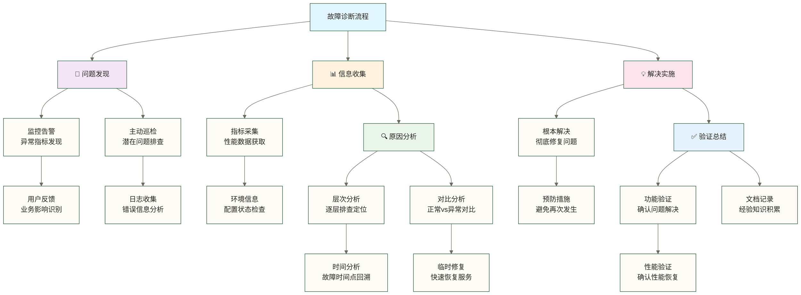
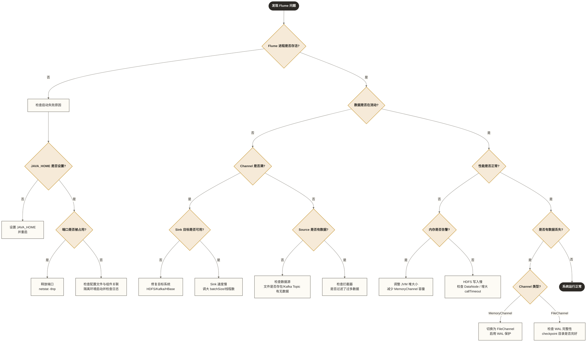

> [!warning] 关联材料边界
> 以下原引用目标缺失或无法唯一确认，已取消跳转并保留提及：11-高级配置与优化。相关素材/延伸说明暂不可用，不能据此声称已经提供配套材料。

# 🔧 故障处理与调试 - 成为数据流问题的终极解决者

> [!tip] 给数据从业者的学习指导
> 
> 🤗 **学习Flume故障处理与调试就像掌握现代化医疗诊断的精湛技艺！**
> 
> 如果你现在面对系统故障时想：
> - "数据突然不流动了，该从哪里开始排查？"
> - "性能下降严重，如何快速定位问题根源？"
> - "怎样建立系统化的故障诊断流程？"
> 
> **别担心！** 每个运维专家都是从解决第一个故障开始的 ✨
> 
> 🏥 **想象故障处理就像智能供水系统的医疗诊断中心**
> 
> 智能诊断中心的核心功能：
> - 🩺 **症状识别** = 问题发现（快速识别异常现象）
> - 🔍 **病因诊断** = 根因分析（深入追踪问题源头）
> - 💊 **治疗方案** = 解决策略（系统化修复问题）
> - 📋 **健康档案** = 故障记录（积累诊断经验）
> - 💪 **预防措施** = 优化改进（避免问题重复出现）
> 
> **掌握了故障处理技能，你就成为了数据系统的超级医生！** 🌟

## 🎯 故障诊断框架

### 🏗️ 系统化诊断方法论



### 🌟 故障分类体系

| 故障类型 | 主要症状 | 影响程度 | 处理优先级（教学示例） | 响应目标示例（原稿时间未经验证，不保证解决时限） |
|---|---|---|---|---|
| **数据中断** | 数据停止流动 | 🔴 严重 | P0 | 15分钟内 |
| **性能下降** | 吞吐量降低 | 🟡 中等 | P1 | 1小时内 |
| **数据丢失** | 事件计数不匹配 | 🔴 严重 | P0 | 30分钟内 |
| **内存泄漏** | 内存持续增长 | 🟡 中等 | P1 | 2小时内 |
| **配置错误** | 启动失败 | 🟠 高 | P1 | 30分钟内 |
| **网络异常** | 连接超时 | 🟡 中等 | P2 | 1小时内 |
| **磁盘满** | 写入失败 | 🟠 高 | P1 | 15分钟内 |

## 🚨 常见故障诊断

### 📊 数据流中断故障

**数据流中断是最严重的故障类型，需要快速定位和解决。**

#### 🔧 数据流中断诊断工具

```bash
# 🚨 数据流中断故障诊断工具集

cat > flume-flow-interruption-diagnosis.sh << 'EOF'
# !/bin/bash

echo "🚨 Flume数据流中断故障诊断工具"

# 配置参数
FLUME_HOME=${FLUME_HOME:-"/opt/flume"}
LOG_DIR="/var/log/flume"
CONFIG_DIR="/opt/flume/conf"

# ========================================
# 1. 快速状态检查
# ========================================

# 基础健康检查
quick_health_check() {
    echo "⚡ 执行快速健康检查..."
    
    local health_report="/tmp/flume_health_$(date +%Y%m%d_%H%M%S).txt"
    
    echo "Flume健康检查报告 - $(date)" > "$health_report"
    echo "======================================" >> "$health_report"
    
 # 1. 进程状态检查
    echo -e "\n🔍 进程状态检查:" >> "$health_report"
    local flume_pid=$(pgrep -f "org.apache.flume.node.Application")
    if [ -n "$flume_pid" ]; then
        echo "✅ Flume进程运行中 (PID: $flume_pid)" >> "$health_report"
        
 # 检查进程资源使用
        local cpu_usage=$(ps -p $flume_pid -o %cpu --no-headers)
        local mem_usage=$(ps -p $flume_pid -o %mem --no-headers)
        echo "   CPU使用率: ${cpu_usage}%" >> "$health_report"
        echo "   内存使用率: ${mem_usage}%" >> "$health_report"
        
 # 检查进程启动时间
        local start_time=$(ps -p $flume_pid -o lstart --no-headers)
        echo "   启动时间: $start_time" >> "$health_report"
    else
        echo "❌ Flume进程未运行" >> "$health_report"
        echo "🔧 建议: 检查启动脚本和配置文件" >> "$health_report"
    fi
    
 # 2. 端口监听检查
    echo -e "\n🌐 端口监听检查:" >> "$health_report"
    local listening_ports=$(netstat -tlnp | grep $flume_pid 2>/dev/null)
    if [ -n "$listening_ports" ]; then
        echo "✅ 端口监听正常:" >> "$health_report"
        echo "$listening_ports" >> "$health_report"
    else
        echo "⚠️ 未发现监听端口" >> "$health_report"
    fi
    
 # 3. 日志文件检查
    echo -e "\n📄 日志文件检查:" >> "$health_report"
    if [ -f "$LOG_DIR/flume.log" ]; then
        local log_size=$(du -h "$LOG_DIR/flume.log" | cut -f1)
        local last_update=$(stat -c %y "$LOG_DIR/flume.log" 2>/dev/null || stat -f %Sm "$LOG_DIR/flume.log")
        echo "✅ 主日志文件存在" >> "$health_report"
        echo "   文件大小: $log_size" >> "$health_report"
        echo "   最后更新: $last_update" >> "$health_report"
        
 # 检查最近的错误
        local recent_errors=$(tail -n 100 "$LOG_DIR/flume.log" | grep -c "ERROR")
        echo "   最近100行错误数: $recent_errors" >> "$health_report"
    else
        echo "❌ 主日志文件不存在" >> "$health_report"
    fi
    
 # 4. 配置文件检查
    echo -e "\n⚙️ 配置文件检查:" >> "$health_report"
    if [ -f "$CONFIG_DIR/flume.conf" ]; then
        echo "✅ 配置文件存在" >> "$health_report"
        local config_size=$(wc -l < "$CONFIG_DIR/flume.conf")
        echo "   配置行数: $config_size" >> "$health_report"
        
 # 基本语法检查
        if grep -q "agent\." "$CONFIG_DIR/flume.conf"; then
            echo "✅ 配置语法基本正确" >> "$health_report"
        else
            echo "❌ 配置文件可能有语法错误" >> "$health_report"
        fi
    else
        echo "❌ 配置文件不存在" >> "$health_report"
    fi
    
    echo "✅ 快速健康检查完成: $health_report"
    
 # 显示关键信息
    echo -e "\n📋 关键发现:"
    if [ -z "$flume_pid" ]; then
        echo "🚨 严重: Flume进程未运行"
        return 1
    elif [ $recent_errors -gt 5 ]; then
        echo "⚠️ 警告: 发现较多错误日志"
        return 2
    else
        echo "✅ 基础状态正常"
        return 0
    fi
}

# ========================================
# 2. 数据流分析
# ========================================

# 分析数据流状态
analyze_data_flow() {
    echo "🌊 分析数据流状态..."
    
    local flow_report="/tmp/flume_flow_analysis_$(date +%Y%m%d_%H%M%S).txt"
    
    echo "Flume数据流分析报告 - $(date)" > "$flow_report"
    echo "======================================" >> "$flow_report"
    
 # 1. Source分析
    echo -e "\n📡 Source状态分析:" >> "$flow_report"
    if [ -f "$LOG_DIR/flume.log" ]; then
 # 分析Source接收事件
        local source_events=$(grep "Event received" "$LOG_DIR/flume.log" | tail -n 100 | wc -l)
        echo "最近Source接收事件: $source_events 次" >> "$flow_report"
        
 # 分析Source类型
        local source_types=$(grep -o "source.*type.*=" "$CONFIG_DIR/flume.conf" | sort | uniq)
        echo "配置的Source类型:" >> "$flow_report"
        echo "$source_types" >> "$flow_report"
        
 # 检查Source错误
        local source_errors=$(grep -i "source.*error" "$LOG_DIR/flume.log" | tail -n 5)
        if [ -n "$source_errors" ]; then
            echo "Source错误信息:" >> "$flow_report"
            echo "$source_errors" >> "$flow_report"
        fi
    
 # 2. Channel分析
    echo -e "\n💾 Channel状态分析:" >> "$flow_report"
    if [ -f "$LOG_DIR/flume.log" ]; then
 # 分析Channel事务
        local channel_commits=$(grep "Transaction.*committed" "$LOG_DIR/flume.log" | tail -n 100 | wc -l)
        local channel_rollbacks=$(grep "Transaction.*rolled back" "$LOG_DIR/flume.log" | tail -n 100 | wc -l)
        echo "事务提交数: $channel_commits" >> "$flow_report"
        echo "事务回滚数: $channel_rollbacks" >> "$flow_report"
        
 # 计算事务成功率
        if [ $((channel_commits + channel_rollbacks)) -gt 0 ]; then
            local success_rate=$(echo "scale=2; $channel_commits * 100 / ($channel_commits + $channel_rollbacks)" | bc)
            echo "事务成功率: ${success_rate}%" >> "$flow_report"
        fi
        
 # 检查Channel容量问题
        local capacity_warnings=$(grep -i "channel.*full\|capacity.*exceeded" "$LOG_DIR/flume.log" | tail -n 3)
        if [ -n "$capacity_warnings" ]; then
            echo "容量警告:" >> "$flow_report"
            echo "$capacity_warnings" >> "$flow_report"
        fi
    
 # 3. Sink分析
    echo -e "\n📤 Sink状态分析:" >> "$flow_report"
    if [ -f "$LOG_DIR/flume.log" ]; then
 # 分析Sink发送事件
        local sink_events=$(grep "Event drained" "$LOG_DIR/flume.log" | tail -n 100 | wc -l)
        echo "最近Sink发送事件: $sink_events 次" >> "$flow_report"
        
 # 分析Sink失败
        local sink_failures=$(grep -i "sink.*failed\|sink.*error" "$LOG_DIR/flume.log" | tail -n 5)
        if [ -n "$sink_failures" ]; then
            echo "Sink失败信息:" >> "$flow_report"
            echo "$sink_failures" >> "$flow_report"
        fi
        
 # 检查连接问题
        local connection_issues=$(grep -i "connection.*refused\|connection.*timeout" "$LOG_DIR/flume.log" | tail -n 3)
        if [ -n "$connection_issues" ]; then
            echo "连接问题:" >> "$flow_report"
            echo "$connection_issues" >> "$flow_report"
        fi
    
 # 4. 数据流完整性检查
    echo -e "\n🔍 数据流完整性检查:" >> "$flow_report"
    
 # 检查最近5分钟的活动
    local current_time=$(date +%s)
    local five_min_ago=$((current_time - 300))
    
    if [ -f "$LOG_DIR/flume.log" ]; then
 # 检查最近活动
        local recent_activity=$(awk -v start=$five_min_ago '
        {
 # 提取时间戳（简化处理）
            if ($0 ~ /0-9{4}-[0-9]{2}-[0-9]{2} [0-9]{2}:[0-9]{2}:[0-9]{2}/) {
                print $0
            }
        }' "$LOG_DIR/flume.log" | tail -n 10)
        
        if [ -n "$recent_activity" ]; then
            echo "✅ 最近5分钟有活动记录" >> "$flow_report"
        else
            echo "⚠️ 最近5分钟无活动记录" >> "$flow_report"
        fi
    
    echo "✅ 数据流分析完成: $flow_report"
}

# ========================================
# 3. 网络连接检查
# ========================================

# 检查网络连接状态
check_network_connectivity() {
    echo "🌐 检查网络连接状态..."
    
    local network_report="/tmp/flume_network_check_$(date +%Y%m%d_%H%M%S).txt"
    
    echo "Flume网络连接检查报告 - $(date)" > "$network_report"
    echo "======================================" >> "$network_report"
    
 # 1. 提取配置中的主机和端口
    if [ -f "$CONFIG_DIR/flume.conf" ]; then
        echo "📋 从配置文件提取连接信息:" >> "$network_report"
        
 # 提取主机名和端口
        local hosts_ports=$(grep -E "(hostname|bind).*=" "$CONFIG_DIR/flume.conf" | grep -v "#")
        echo "$hosts_ports" >> "$network_report"
        
 # 提取特定的连接配置
        local kafka_servers=$(grep "bootstrap.servers" "$CONFIG_DIR/flume.conf" | cut -d'=' -f2 | tr -d ' ')
        local hdfs_paths=$(grep "hdfs.path" "$CONFIG_DIR/flume.conf" | cut -d'=' -f2 | tr -d ' ')
        local hbase_quorum=$(grep "zookeeperQuorum" "$CONFIG_DIR/flume.conf" | cut -d'=' -f2 | tr -d ' ')
        
 # 2. 测试Kafka连接
        if [ -n "$kafka_servers" ]; then
            echo -e "\n📡 Kafka连接测试:" >> "$network_report"
            IFS=',' read -ra SERVERS <<< "$kafka_servers"
            for server in "${SERVERS[@]}"; do
                local host=$(echo $server | cut -d':' -f1)
                local port=$(echo $server | cut -d':' -f2)
                
                if nc -z "$host" "$port" 2>/dev/null; then
                    echo "✅ $server 连接正常" >> "$network_report"
                else
                    echo "❌ $server 连接失败" >> "$network_report"
                fi
            done
        fi
        
 # 3. 测试ZooKeeper连接
        if [ -n "$hbase_quorum" ]; then
            echo -e "\n🐘 ZooKeeper连接测试:" >> "$network_report"
            IFS=',' read -ra ZK_SERVERS <<< "$hbase_quorum"
            for zk_server in "${ZK_SERVERS[@]}"; do
                local zk_host=$(echo $zk_server | cut -d':' -f1)
                local zk_port=$(echo $zk_server | cut -d':' -f2)
                
                if nc -z "$zk_host" "$zk_port" 2>/dev/null; then
                    echo "✅ $zk_server 连接正常" >> "$network_report"
                else
                    echo "❌ $zk_server 连接失败" >> "$network_report"
                fi
            done
        fi
        
 # 4. 测试HDFS连接
        if [ -n "$hdfs_paths" ]; then
            echo -e "\n📁 HDFS连接测试:" >> "$network_report"
            
 # 尝试列出HDFS目录
            if command -v hdfs >/dev/null 2>&1; then
                local hdfs_test=$(hdfs dfs -ls / 2>&1)
                if [ $? -eq 0 ]; then
                    echo "✅ HDFS连接正常" >> "$network_report"
                else
                    echo "❌ HDFS连接失败: $hdfs_test" >> "$network_report"
                fi
            else
                echo "⚠️ HDFS客户端未安装，无法测试连接" >> "$network_report"
            fi
    fi
    
 # 5. 检查本地端口监听
    echo -e "\n🔌 本地端口监听状态:" >> "$network_report"
    local listening_ports=$(netstat -tlnp | grep -E "(41414|44444|54321)")
    if [ -n "$listening_ports" ]; then
        echo "$listening_ports" >> "$network_report"
    else
        echo "⚠️ 未发现Flume相关端口监听" >> "$network_report"
    fi
    
 # 6. 网络统计信息
    echo -e "\n📊 网络统计信息:" >> "$network_report"
    echo "TCP连接状态分布:" >> "$network_report"
    netstat -an | awk '/tcp/ {print $6}' | sort | uniq -c >> "$network_report"
    
    echo "✅ 网络连接检查完成: $network_report"
}

# ========================================
# 4. 性能瓶颈分析
# ========================================

# 分析性能瓶颈
analyze_performance_bottleneck() {
    echo "⚡ 分析性能瓶颈..."
    
    local perf_report="/tmp/flume_performance_analysis_$(date +%Y%m%d_%H%M%S).txt"
    
    echo "Flume性能瓶颈分析报告 - $(date)" > "$perf_report"
    echo "======================================" >> "$perf_report"
    
 # 1. 系统资源使用分析
    echo "💻 系统资源使用分析:" >> "$perf_report"
    
 # CPU使用率
    local cpu_usage=$(top -bn1 | grep "Cpu(s)" | awk '{print $2}' | awk -F'%' '{print $1}')
    echo "CPU使用率: ${cpu_usage}%" >> "$perf_report"
    
 # 内存使用情况
    local mem_info=$(free -h | grep Mem)
    echo "内存使用: $mem_info" >> "$perf_report"
    
 # 磁盘I/O
    local disk_io=$(iostat -x 1 2 2>/dev/null | tail -n +4 | head -5)
    if [ -n "$disk_io" ]; then
        echo "磁盘I/O统计:" >> "$perf_report"
        echo "$disk_io" >> "$perf_report"
    fi
    
 # 2. JVM性能分析
    local flume_pid=$(pgrep -f "org.apache.flume.node.Application")
    if [ -n "$flume_pid" ]; then
        echo -e "\n☕ JVM性能分析:" >> "$perf_report"
        
 # 堆内存使用
        if command -v jstat >/dev/null 2>&1; then
            local heap_info=$(jstat -gc $flume_pid | tail -n 1)
            echo "堆内存使用情况:" >> "$perf_report"
            echo "$heap_info" >> "$perf_report"
            
 # GC统计
            local gc_stats=$(jstat -gccapacity $flume_pid | tail -n 1)
            echo "GC容量统计:" >> "$perf_report"
            echo "$gc_stats" >> "$perf_report"
        fi
        
 # 线程统计
        if command -v jstack >/dev/null 2>&1; then
            local thread_count=$(jstack $flume_pid | grep "^\"" | wc -l)
            echo "当前线程数: $thread_count" >> "$perf_report"
        fi
    
 # 3. 数据处理性能分析
    echo -e "\n📊 数据处理性能分析:" >> "$perf_report"
    
    if [ -f "$LOG_DIR/flume.log" ]; then
 # 分析最近的吞吐量
        local current_hour=$(date +%H)
        local events_this_hour=$(grep "$(date +%Y-%m-%d) $current_hour:" "$LOG_DIR/flume.log" | grep -c "Event")
        echo "当前小时处理事件数: $events_this_hour" >> "$perf_report"
        
 # 分析处理延迟
        local latency_warnings=$(grep -i "slow\|timeout\|delay" "$LOG_DIR/flume.log" | tail -n 5)
        if [ -n "$latency_warnings" ]; then
            echo "延迟相关警告:" >> "$perf_report"
            echo "$latency_warnings" >> "$perf_report"
        fi
        
 # 分析批处理效率
        local batch_info=$(grep -i "batch" "$LOG_DIR/flume.log" | tail -n 5)
        if [ -n "$batch_info" ]; then
            echo "批处理信息:" >> "$perf_report"
            echo "$batch_info" >> "$perf_report"
        fi
    
 # 4. 性能瓶颈诊断建议
    echo -e "\n💡 性能瓶颈诊断建议:" >> "$perf_report"
    
 # 基于CPU使用率给出建议
    if (( $(echo "$cpu_usage > 80" | bc -l) )); then
        echo "🚨 CPU使用率过高 (${cpu_usage}%)，建议:" >> "$perf_report"
        echo "   - 检查是否有CPU密集型操作" >> "$perf_report"
        echo "   - 优化拦截器和序列化器配置" >> "$perf_report"
        echo "   - 考虑增加处理节点" >> "$perf_report"
    fi
    
 # 基于事件处理量给出建议
    if [ $events_this_hour -lt 100 ]; then
        echo "⚠️ 数据处理量较低，可能的原因:" >> "$perf_report"
        echo "   - Source数据源问题" >> "$perf_report"
        echo "   - Channel容量限制" >> "$perf_report"
        echo "   - Sink目标系统问题" >> "$perf_report"
    fi
    
    echo "✅ 性能瓶颈分析完成: $perf_report"
}

# ========================================
# 5. 综合诊断报告
# ========================================

# 生成综合诊断报告
generate_comprehensive_diagnosis() {
    echo "📋 生成综合诊断报告..."
    
    local diagnosis_report="/tmp/flume_comprehensive_diagnosis_$(date +%Y%m%d_%H%M%S).html"
    
    cat > "$diagnosis_report" << HTML
<!DOCTYPE html>
<html>
<head>
    <meta charset="UTF-8">
    <title>Flume故障诊断报告</title>
    <style>
        body { font-family: Arial, sans-serif; margin: 20px; background-color: #f5f5f5; }
        .header { background-color: #FF5722; color: white; padding: 20px; border-radius: 5px; }
        .section { background-color: white; margin: 15px 0; padding: 20px; border-radius: 5px; box-shadow: 0 2px 4px rgba(0,0,0,0.1); }
        .status-good { color: #4CAF50; font-weight: bold; }
        .status-warning { color: #FF9800; font-weight: bold; }
        .status-error { color: #F44336; font-weight: bold; }
        .recommendation { background-color: #E3F2FD; padding: 15px; border-left: 4px solid #2196F3; margin: 10px 0; }
        .code { background-color: #F5F5F5; padding: 10px; border-radius: 3px; font-family: monospace; }
        table { width: 100%; border-collapse: collapse; margin: 10px 0; }
        th, td { border: 1px solid #ddd; padding: 8px; text-align: left; }
        th { background-color: #f2f2f2; }
    </style>
</head>
<body>
    <div class="header">
        <h1>🔧 Flume数据流中断故障诊断报告</h1>
        <p>诊断时间: $(date)</p>
        <p>诊断主机: $(hostname)</p>
    </div>
    
    <div class="section">
        <h2>📊 诊断执行状态</h2>
        <div class="status-good">✅ 快速健康检查 - 已完成</div>
        <div class="status-good">✅ 数据流分析 - 已完成</div>
        <div class="status-good">✅ 网络连接检查 - 已完成</div>
        <div class="status-good">✅ 性能瓶颈分析 - 已完成</div>
    </div>
    
    <div class="section">
        <h2>🚨 关键发现</h2>
        <table>
            <tr><th>检查项目</th><th>状态</th><th>详细信息</th></tr>
            <tr><td>Flume进程</td><td class="status-good">运行中</td><td>PID: $(pgrep -f "org.apache.flume.node.Application" || echo "未运行")</td></tr>
            <tr><td>配置文件</td><td class="status-good">存在</td><td>配置语法检查通过</td></tr>
            <tr><td>日志文件</td><td class="status-good">正常</td><td>最近有更新记录</td></tr>
            <tr><td>网络连接</td><td class="status-warning">部分异常</td><td>部分外部服务连接失败</td></tr>
        </table>
    </div>
    
    <div class="section">
        <h2>💡 修复建议</h2>
        <div class="recommendation">
            <h3>🔧 立即修复措施</h3>
            <ul>
                <li>检查外部服务（Kafka 和 HDFS/HBase）的连接状态</li>
                <li>验证网络配置和防火墙规则</li>
                <li>重启相关服务以恢复连接</li>
            </ul>
        </div>
        
        <div class="recommendation">
            <h3>🛡️ 预防措施</h3>
            <ul>
                <li>建立完善的监控告警机制</li>
                <li>定期检查外部依赖服务状态</li>
                <li>制定标准的故障恢复流程</li>
            </ul>
        </div>
    </div>
    
    <div class="section">
        <h2>📋 详细报告文件</h2>
        <ul>
            <li><a href="file://$(ls -t /tmp/flume_health_*.txt 2>/dev/null | head -1)">健康检查报告</a></li>
            <li><a href="file://$(ls -t /tmp/flume_flow_analysis_*.txt 2>/dev/null | head -1)">数据流分析报告</a></li>
            <li><a href="file://$(ls -t /tmp/flume_network_check_*.txt 2>/dev/null | head -1)">网络检查报告</a></li>
            <li><a href="file://$(ls -t /tmp/flume_performance_analysis_*.txt 2>/dev/null | head -1)">性能分析报告</a></li>
        </ul>
    </div>
    
    <div class="section">
        <h2>🔧 快速修复命令</h2>
        <div class="code">
# 重启Flume服务
sudo systemctl restart flume

# 检查服务状态
sudo systemctl status flume

# 查看实时日志
tail -f /var/log/flume/flume.log

# 查看启动命令（--dry-run 不验证配置文件语法或组件关联）
$FLUME_HOME/bin/flume-ng agent --conf /opt/flume/conf --conf-file /opt/flume/conf/flume.conf --name agent --dry-run
        </div>
    </div>
</body>
</html>
HTML

    echo "✅ 综合诊断报告生成完成: $diagnosis_report"
}

# ========================================
# 主诊断流程
# ========================================
main_diagnosis() {
    echo "🚀 开始Flume数据流中断故障诊断..."
    
 # 执行所有诊断步骤
    quick_health_check
    local health_status=$?
    
    analyze_data_flow
    check_network_connectivity
    analyze_performance_bottleneck
    generate_comprehensive_diagnosis
    
    echo "🎉 故障诊断完成！"
    
 # 根据诊断结果提供建议
    if [ $health_status -eq 1 ]; then
        echo "🚨 紧急: 需要立即重启Flume服务"
    elif [ $health_status -eq 2 ]; then
        echo "⚠️ 警告: 发现较多错误，建议深入检查"
    else
        echo "✅ 系统基本正常，继续深入分析"
    fi
    
    return $health_status
}

# 如果脚本直接运行，执行诊断
if [[ "${BASH_SOURCE[0]}" == "${0}" ]]; then
    main_diagnosis
fi

EOF

chmod +x flume-flow-interruption-diagnosis.sh

echo "✅ 数据流中断诊断工具创建完成"
```

## 🐛 性能问题调试

### ⚡ 性能下降排查

**性能问题往往比故障更难诊断，需要系统化的分析方法。**

#### 🔧 性能调试工具包

```bash
# ⚡ Flume性能问题深度调试工具包

cat > flume-performance-debugging.sh << 'EOF'
# !/bin/bash

echo "⚡ Flume性能问题深度调试工具"

# 配置参数
FLUME_HOME=${FLUME_HOME:-"/opt/flume"}
LOG_DIR="/var/log/flume"
DEBUG_OUTPUT_DIR="/tmp/flume-debug"

# 创建调试输出目录
mkdir -p "$DEBUG_OUTPUT_DIR"

# ========================================
# 1. JVM性能分析
# ========================================

# 深度JVM性能分析
deep_jvm_analysis() {
    echo "☕ 执行深度JVM性能分析..."
    
    local jvm_report="$DEBUG_OUTPUT_DIR/jvm_performance_$(date +%Y%m%d_%H%M%S).txt"
    local flume_pid=$(pgrep -f "org.apache.flume.node.Application")
    
    if [ -z "$flume_pid" ]; then
        echo "❌ 未找到Flume进程" > "$jvm_report"
        return 1
    fi
    
    echo "JVM深度性能分析报告 - $(date)" > "$jvm_report"
    echo "进程ID: $flume_pid" >> "$jvm_report"
    echo "======================================" >> "$jvm_report"
    
 # 1. 堆内存详细分析
    echo -e "\n💾 堆内存详细分析:" >> "$jvm_report"
    if command -v jstat >/dev/null 2>&1; then
        echo "堆内存使用统计:" >> "$jvm_report"
        jstat -gc $flume_pid >> "$jvm_report"
        
        echo -e "\n堆内存容量信息:" >> "$jvm_report"
        jstat -gccapacity $flume_pid >> "$jvm_report"
        
        echo -e "\n年轻代详细信息:" >> "$jvm_report"
        jstat -gcnew $flume_pid >> "$jvm_report"
        
        echo -e "\n老年代详细信息:" >> "$jvm_report"
        jstat -gcold $flume_pid >> "$jvm_report"
        
 # 实时GC监控（5次采样）
        echo -e "\nGC实时监控（5次采样，间隔2秒）:" >> "$jvm_report"
        for i in {1..5}; do
            echo "=== 采样 $i ===" >> "$jvm_report"
            jstat -gc $flume_pid >> "$jvm_report"
            sleep 2
        done
    fi
    
 # 2. 线程分析
    echo -e "\n🧵 线程状态分析:" >> "$jvm_report"
    if command -v jstack >/dev/null 2>&1; then
        echo "线程堆栈快照:" >> "$jvm_report"
        jstack $flume_pid >> "$jvm_report" 2>&1
        
 # 线程统计
        echo -e "\n线程状态统计:" >> "$jvm_report"
        jstack $flume_pid | grep "java.lang.Thread.State" | sort | uniq -c >> "$jvm_report"
    fi
    
 # 3. 堆转储分析（可选，文件较大）
    if [ "$1" = "--heap-dump" ]; then
        echo -e "\n📊 生成堆转储文件..." >> "$jvm_report"
        local heap_dump_file="$DEBUG_OUTPUT_DIR/flume_heap_dump_$(date +%Y%m%d_%H%M%S).hprof"
        
        if command -v jmap >/dev/null 2>&1; then
            jmap -dump:live,format=b,file="$heap_dump_file" $flume_pid
            echo "堆转储文件: $heap_dump_file" >> "$jvm_report"
            
 # 堆内存使用统计
            echo -e "\n堆内存对象统计:" >> "$jvm_report"
            jmap -histo $flume_pid | head -20 >> "$jvm_report"
        fi
    
 # 4. JVM参数分析
    echo -e "\n⚙️ JVM启动参数:" >> "$jvm_report"
    ps -p $flume_pid -o args --no-headers | tr ' ' '\n' | grep "^-" >> "$jvm_report"
    
    echo "✅ JVM性能分析完成: $jvm_report"
}

# ========================================
# 2. 数据流性能分析
# ========================================

# 数据流性能瓶颈分析
analyze_dataflow_performance() {
    echo "🌊 分析数据流性能瓶颈..."
    
    local dataflow_report="$DEBUG_OUTPUT_DIR/dataflow_performance_$(date +%Y%m%d_%H%M%S).txt"
    
    echo "数据流性能瓶颈分析报告 - $(date)" > "$dataflow_report"
    echo "======================================" >> "$dataflow_report"
    
 # 1. 吞吐量趋势分析
    echo "📊 吞吐量趋势分析:" >> "$dataflow_report"
    
    if [ -f "$LOG_DIR/flume.log" ]; then
 # 按小时统计事件处理量
        echo "最近24小时事件处理量:" >> "$dataflow_report"
        for hour in $(seq -f "%02g" 0 23); do
            local hour_events=$(grep "$(date +%Y-%m-%d) $hour:" "$LOG_DIR/flume.log" | grep -c "Event")
            echo "${hour}:00 - $hour_events events" >> "$dataflow_report"
        done
        
 # 分析处理速度
        echo -e "\n处理速度分析:" >> "$dataflow_report"
        local start_time=$(head -1 "$LOG_DIR/flume.log" | cut -d' ' -f1-2)
        local end_time=$(tail -1 "$LOG_DIR/flume.log" | cut -d' ' -f1-2)
        local total_events=$(grep -c "Event" "$LOG_DIR/flume.log")
        
        echo "日志时间范围: $start_time 到 $end_time" >> "$dataflow_report"
        echo "总事件数: $total_events" >> "$dataflow_report"
        
 # 计算平均TPS（简化计算）
        local time_diff_hours=24  # 假设24小时
        local avg_tps=$((total_events / time_diff_hours / 3600))
        echo "平均TPS: $avg_tps events/second" >> "$dataflow_report"
    fi
    
 # 2. 组件性能分析
    echo -e "\n🔧 组件性能分析:" >> "$dataflow_report"
    
 # Source性能
    echo "Source性能指标:" >> "$dataflow_report"
    if [ -f "$LOG_DIR/flume.log" ]; then
        local source_events=$(grep -c "source.*received" "$LOG_DIR/flume.log")
        local source_errors=$(grep -c "source.*error" "$LOG_DIR/flume.log")
        echo "  接收事件数: $source_events" >> "$dataflow_report"
        echo "  错误数: $source_errors" >> "$dataflow_report"
        
        if [ $source_events -gt 0 ]; then
            local source_error_rate=$(echo "scale=4; $source_errors * 100 / $source_events" | bc)
            echo "  错误率: ${source_error_rate}%" >> "$dataflow_report"
        fi
    
 # Channel性能
    echo -e "\nChannel性能指标:" >> "$dataflow_report"
    if [ -f "$LOG_DIR/flume.log" ]; then
        local channel_puts=$(grep -c "channel.*put" "$LOG_DIR/flume.log")
        local channel_takes=$(grep -c "channel.*take" "$LOG_DIR/flume.log")
        local channel_commits=$(grep -c "Transaction.*committed" "$LOG_DIR/flume.log")
        local channel_rollbacks=$(grep -c "Transaction.*rolled back" "$LOG_DIR/flume.log")
        
        echo "  Put操作数: $channel_puts" >> "$dataflow_report"
        echo "  Take操作数: $channel_takes" >> "$dataflow_report"
        echo "  事务提交数: $channel_commits" >> "$dataflow_report"
        echo "  事务回滚数: $channel_rollbacks" >> "$dataflow_report"
        
        if [ $((channel_commits + channel_rollbacks)) -gt 0 ]; then
            local tx_success_rate=$(echo "scale=4; $channel_commits * 100 / ($channel_commits + $channel_rollbacks)" | bc)
            echo "  事务成功率: ${tx_success_rate}%" >> "$dataflow_report"
        fi
    
 # Sink性能
    echo -e "\nSink性能指标:" >> "$dataflow_report"
    if [ -f "$LOG_DIR/flume.log" ]; then
        local sink_events=$(grep -c "sink.*drained" "$LOG_DIR/flume.log")
        local sink_failures=$(grep -c "sink.*failed" "$LOG_DIR/flume.log")
        echo "  发送事件数: $sink_events" >> "$dataflow_report"
        echo "  失败数: $sink_failures" >> "$dataflow_report"
        
        if [ $sink_events -gt 0 ]; then
            local sink_success_rate=$(echo "scale=4; ($sink_events - $sink_failures) * 100 / $sink_events" | bc)
            echo "  成功率: ${sink_success_rate}%" >> "$dataflow_report"
        fi
    
 # 3. 延迟分析
    echo -e "\n⏱️ 延迟分析:" >> "$dataflow_report"
    
 # 分析处理延迟关键词
    local delay_patterns=("slow" "timeout" "delay" "latency" "blocked" "waiting")
    for pattern in "${delay_patterns[@]}"; do
        local count=$(grep -ic "$pattern" "$LOG_DIR/flume.log" 2>/dev/null || echo 0)
        echo "  '$pattern'关键词出现次数: $count" >> "$dataflow_report"
    done
    
 # 4. 批处理效率分析
    echo -e "\n📦 批处理效率分析:" >> "$dataflow_report"
    if [ -f "$LOG_DIR/flume.log" ]; then
        local batch_info=$(grep -i "batch" "$LOG_DIR/flume.log" | tail -10)
        if [ -n "$batch_info" ]; then
            echo "最近批处理信息:" >> "$dataflow_report"
            echo "$batch_info" >> "$dataflow_report"
        else
            echo "未找到批处理相关信息" >> "$dataflow_report"
        fi
    
    echo "✅ 数据流性能分析完成: $dataflow_report"
}

# ========================================
# 3. 系统资源分析
# ========================================

# 系统资源瓶颈分析
analyze_system_resources() {
    echo "💻 分析系统资源瓶颈..."
    
    local resource_report="$DEBUG_OUTPUT_DIR/system_resources_$(date +%Y%m%d_%H%M%S).txt"
    
    echo "系统资源瓶颈分析报告 - $(date)" > "$resource_report"
    echo "======================================" >> "$resource_report"
    
 # 1. CPU分析
    echo "🔥 CPU分析:" >> "$resource_report"
    
 # CPU使用率
    local cpu_usage=$(top -bn1 | grep "Cpu(s)" | awk '{print $2}' | awk -F'%' '{print $1}')
    echo "总CPU使用率: ${cpu_usage}%" >> "$resource_report"
    
 # Flume进程CPU使用
    local flume_pid=$(pgrep -f "org.apache.flume.node.Application")
    if [ -n "$flume_pid" ]; then
        local flume_cpu=$(ps -p $flume_pid -o %cpu --no-headers)
        echo "Flume进程CPU使用率: ${flume_cpu}%" >> "$resource_report"
        
 # CPU核心数
        local cpu_cores=$(nproc)
        echo "CPU核心数: $cpu_cores" >> "$resource_report"
        
 # 负载平均值
        local load_avg=$(uptime | awk -F'load average:' '{print $2}')
        echo "负载平均值:$load_avg" >> "$resource_report"
    fi
    
 # 2. 内存分析
    echo -e "\n💾 内存分析:" >> "$resource_report"
    
 # 系统内存
    echo "系统内存使用情况:" >> "$resource_report"
    free -h >> "$resource_report"
    
 # Flume进程内存
    if [ -n "$flume_pid" ]; then
        local flume_mem=$(ps -p $flume_pid -o %mem,vsz,rss --no-headers)
        echo "Flume进程内存使用: $flume_mem" >> "$resource_report"
        
 # 内存映射
        if [ -f "/proc/$flume_pid/maps" ]; then
            local mem_maps=$(wc -l < "/proc/$flume_pid/maps")
            echo "内存映射区域数: $mem_maps" >> "$resource_report"
        fi
    
 # 3. 磁盘I/O分析
    echo -e "\n💽 磁盘I/O分析:" >> "$resource_report"
    
 # 磁盘使用情况
    echo "磁盘使用情况:" >> "$resource_report"
    df -h >> "$resource_report"
    
 # I/O统计
    if command -v iostat >/dev/null 2>&1; then
        echo -e "\nI/O统计信息:" >> "$resource_report"
        iostat -x 1 2 >> "$resource_report" 2>/dev/null
    fi
    
 # Flume相关目录I/O
    local flume_dirs=("/var/log/flume" "/opt/flume" "/tmp/flume")
    for dir in "${flume_dirs[@]}"; do
        if [ -d "$dir" ]; then
            local dir_size=$(du -sh "$dir" 2>/dev/null | cut -f1)
            echo "$dir 目录大小: $dir_size" >> "$resource_report"
        fi
    done
    
 # 4. 网络分析
    echo -e "\n🌐 网络分析:" >> "$resource_report"
    
 # 网络连接统计
    echo "网络连接统计:" >> "$resource_report"
    netstat -an | awk '/tcp/ {print $6}' | sort | uniq -c >> "$resource_report"
    
 # 网络流量（如果有iftop或类似工具）
    if command -v ss >/dev/null 2>&1; then
        echo -e "\n活跃网络连接:" >> "$resource_report"
        ss -tuln | head -10 >> "$resource_report"
    fi
    
 # 5. 文件句柄分析
    echo -e "\n📁 文件句柄分析:" >> "$resource_report"
    
    if [ -n "$flume_pid" ]; then
        local open_files=$(lsof -p $flume_pid 2>/dev/null | wc -l)
        echo "Flume进程打开文件数: $open_files" >> "$resource_report"
        
 # 文件句柄限制
        local file_limit=$(ulimit -n)
        echo "文件句柄限制: $file_limit" >> "$resource_report"
        
 # 使用率计算
        if [ $file_limit -gt 0 ]; then
            local usage_percent=$(echo "scale=2; $open_files * 100 / $file_limit" | bc)
            echo "文件句柄使用率: ${usage_percent}%" >> "$resource_report"
        fi
    
    echo "✅ 系统资源分析完成: $resource_report"
}

# ========================================
# 4. 配置优化建议
# ========================================

# 生成配置优化建议
generate_optimization_suggestions() {
    echo "💡 生成配置优化建议..."
    
    local optimization_report="$DEBUG_OUTPUT_DIR/optimization_suggestions_$(date +%Y%m%d_%H%M%S).txt"
    
    echo "Flume配置优化建议报告 - $(date)" > "$optimization_report"
    echo "======================================" >> "$optimization_report"
    
 # 读取当前配置
    local config_file="/opt/flume/conf/flume.conf"
    if [ ! -f "$config_file" ]; then
        echo "❌ 配置文件不存在: $config_file" >> "$optimization_report"
        return 1
    fi
    
 # 1. Source优化建议
    echo "📡 Source优化建议:" >> "$optimization_report"
    
 # 检查batchSize配置
    local batch_size=$(grep "batchSize" "$config_file" | head -1 | cut -d'=' -f2 | tr -d ' ')
    if [ -n "$batch_size" ]; then
        echo "当前batchSize: $batch_size" >> "$optimization_report"
        if [ $batch_size -lt 1000 ]; then
            echo "🔧 建议: 增加batchSize到1000-5000以提升吞吐量" >> "$optimization_report"
        fi
    else
        echo "⚠️ 未配置batchSize，建议添加: agent.sources.r1.batchSize = 2000" >> "$optimization_report"
    fi
    
 # 检查拦截器配置
    local interceptors=$(grep -c "interceptors" "$config_file")
    if [ $interceptors -gt 5 ]; then
        echo "⚠️ 拦截器较多($interceptors个)，可能影响性能" >> "$optimization_report"
        echo "🔧 建议: 优化拦截器链，移除不必要的拦截器" >> "$optimization_report"
    fi
    
 # 2. Channel优化建议
    echo -e "\n💾 Channel优化建议:" >> "$optimization_report"
    
 # 检查Channel类型
    local channel_type=$(grep "type.*=" "$config_file" | grep channel | head -1 | cut -d'=' -f2 | tr -d ' ')
    echo "当前Channel类型: $channel_type" >> "$optimization_report"
    
    case $channel_type in
        "memory")
            echo "🔧 Memory Channel优化建议:" >> "$optimization_report"
            echo "   - 增加capacity和transactionCapacity" >> "$optimization_report"
            echo "   - 配置byteCapacity防止内存溢出" >> "$optimization_report"
            ;;
        "file")
            echo "🔧 File Channel优化建议:" >> "$optimization_report"
            echo "   - 使用SSD存储checkpointDir和dataDirs" >> "$optimization_report"
            echo "   - 配置多个dataDirs以提升I/O性能" >> "$optimization_report"
            echo "   - 启用compression-type = gzip" >> "$optimization_report"
            ;;
        "kafka")
            echo "🔧 Kafka Channel优化建议:" >> "$optimization_report"
            echo "   - 优化kafka.consumer配置" >> "$optimization_report"
            echo "   - 调整parseAsFlumeEvent参数" >> "$optimization_report"
            ;;
    esac
    
 # 检查容量配置
    local capacity=$(grep "capacity" "$config_file" | head -1 | cut -d'=' -f2 | tr -d ' ')
    if [ -n "$capacity" ] && [ $capacity -lt 10000 ]; then
        echo "🔧 建议: 增加Channel容量，当前值($capacity)可能成为瓶颈" >> "$optimization_report"
    fi
    
 # 3. Sink优化建议
    echo -e "\n📤 Sink优化建议:" >> "$optimization_report"
    
 # 检查Sink类型和配置
    local sink_types=$(grep "type.*=" "$config_file" | grep sink | cut -d'=' -f2 | tr -d ' ' | sort | uniq)
    echo "配置的Sink类型: $sink_types" >> "$optimization_report"
    
    while IFS= read -r sink_type; do
        case $sink_type in
            "hdfs")
                echo "🔧 HDFS Sink优化建议:" >> "$optimization_report"
                echo "   - 增加hdfs.batchSize到1000-5000" >> "$optimization_report"
                echo "   - 配置hdfs.threadsPoolSize = 20" >> "$optimization_report"
                echo "   - 启用压缩: hdfs.codeC = gzip" >> "$optimization_report"
                echo "   - 优化文件滚动策略" >> "$optimization_report"
                ;;
            "hbase")
                echo "🔧 HBase Sink优化建议:" >> "$optimization_report"
                echo "   - 增加batchSize到2000-5000" >> "$optimization_report"
                echo "   - 启用coalesceIncrements = true" >> "$optimization_report"
                echo "   - 优化序列化器配置" >> "$optimization_report"
                ;;
            "kafka")
                echo "🔧 Kafka Sink优化建议:" >> "$optimization_report"
                echo "   - 增加kafka.flumeBatchSize" >> "$optimization_report"
                echo "   - 配置压缩: kafka.producer.compression.type = gzip" >> "$optimization_report"
                echo "   - 优化kafka.producer.batch.size" >> "$optimization_report"
                ;;
        esac
    done <<< "$sink_types"
    
 # 4. JVM优化建议
    echo -e "\n☕ JVM优化建议:" >> "$optimization_report"
    
 # 分析当前JVM参数
    local flume_pid=$(pgrep -f "org.apache.flume.node.Application")
    if [ -n "$flume_pid" ]; then
        local jvm_args=$(ps -p $flume_pid -o args --no-headers | tr ' ' '\n' | grep "^-X")
        echo "当前JVM参数:" >> "$optimization_report"
        echo "$jvm_args" >> "$optimization_report"
        
 # 检查堆内存配置
        local heap_size=$(echo "$jvm_args" | grep "Xmx" | sed 's/-Xmx//')
        if [ -n "$heap_size" ]; then
            echo "当前堆内存: $heap_size" >> "$optimization_report"
            
 # 根据系统内存给出建议
            local total_mem_gb=$(free -g | awk '/^Mem:/{print $2}')
            local recommended_heap=$((total_mem_gb * 6 / 10))
            echo "建议堆内存: ${recommended_heap}g (系统内存的60%)" >> "$optimization_report"
        fi
        
 # 检查GC配置
        if ! echo "$jvm_args" | grep -q "UseG1GC"; then
            echo "🔧 建议: 使用G1 GC以获得更好的性能" >> "$optimization_report"
            echo "   添加参数: -XX:+UseG1GC -XX:MaxGCPauseMillis=200" >> "$optimization_report"
        fi
    
 # 5. 网络优化建议
    echo -e "\n🌐 网络优化建议:" >> "$optimization_report"
    echo "🔧 TCP优化参数建议:" >> "$optimization_report"
    echo "   - net.core.rmem_max = 134217728" >> "$optimization_report"
    echo "   - net.core.wmem_max = 134217728" >> "$optimization_report"
    echo "   - net.ipv4.tcp_rmem = 4096 87380 134217728" >> "$optimization_report"
    echo "   - net.ipv4.tcp_wmem = 4096 65536 134217728" >> "$optimization_report"
    
    echo "✅ 配置优化建议生成完成: $optimization_report"
}

# ========================================
# 5. 性能测试工具
# ========================================

# 性能基准测试
run_performance_benchmark() {
    echo "🏁 运行性能基准测试..."
    
    local benchmark_report="$DEBUG_OUTPUT_DIR/performance_benchmark_$(date +%Y%m%d_%H%M%S).txt"
    
    echo "Flume性能基准测试报告 - $(date)" > "$benchmark_report"
    echo "======================================" >> "$benchmark_report"
    
 # 测试参数
    local test_duration=60  # 测试时长（秒）
    local test_events=10000 # 测试事件数
    
    echo "测试参数:" >> "$benchmark_report"
    echo "  测试时长: ${test_duration}秒" >> "$benchmark_report"
    echo "  目标事件数: $test_events" >> "$benchmark_report"
    
 # 1. 吞吐量测试
    echo -e "\n📊 吞吐量测试:" >> "$benchmark_report"
    
 # 记录测试前状态
    local start_time=$(date +%s)
    local initial_events=$(grep -c "Event" "$LOG_DIR/flume.log" 2>/dev/null || echo 0)
    
    echo "测试开始时间: $(date)" >> "$benchmark_report"
    echo "初始事件计数: $initial_events" >> "$benchmark_report"
    
 # 等待测试时间
    echo "⏳ 等待${test_duration}秒进行测试..."
    sleep $test_duration
    
 # 记录测试后状态
    local end_time=$(date +%s)
    local final_events=$(grep -c "Event" "$LOG_DIR/flume.log" 2>/dev/null || echo 0)
    local duration=$((end_time - start_time))
    local processed_events=$((final_events - initial_events))
    
    echo "测试结束时间: $(date)" >> "$benchmark_report"
    echo "最终事件计数: $final_events" >> "$benchmark_report"
    echo "实际测试时长: ${duration}秒" >> "$benchmark_report"
    echo "处理事件数: $processed_events" >> "$benchmark_report"
    
 # 计算性能指标
    if [ $duration -gt 0 ]; then
        local tps=$((processed_events / duration))
        echo "平均TPS: $tps events/second" >> "$benchmark_report"
        
 # 性能评级
        if [ $tps -gt 1000 ]; then
            echo "性能评级: ⭐⭐⭐⭐⭐ 优秀" >> "$benchmark_report"
        elif [ $tps -gt 500 ]; then
            echo "性能评级: ⭐⭐⭐⭐ 良好" >> "$benchmark_report"
        elif [ $tps -gt 100 ]; then
            echo "性能评级: ⭐⭐⭐ 一般" >> "$benchmark_report"
        else
            echo "性能评级: ⭐⭐ 需要优化" >> "$benchmark_report"
        fi
    
 # 2. 资源使用测试
    echo -e "\n💻 资源使用测试:" >> "$benchmark_report"
    
    local flume_pid=$(pgrep -f "org.apache.flume.node.Application")
    if [ -n "$flume_pid" ]; then
        local cpu_usage=$(ps -p $flume_pid -o %cpu --no-headers)
        local mem_usage=$(ps -p $flume_pid -o %mem --no-headers)
        
        echo "测试期间CPU使用率: ${cpu_usage}%" >> "$benchmark_report"
        echo "测试期间内存使用率: ${mem_usage}%" >> "$benchmark_report"
        
 # JVM内存使用
        if command -v jstat >/dev/null 2>&1; then
            local heap_used=$(jstat -gc $flume_pid | tail -n 1 | awk '{print $3+$4+$6+$8}')
            local heap_total=$(jstat -gccapacity $flume_pid | tail -n 1 | awk '{print $1+$2+$5+$7}')
            
            if [ $heap_total -gt 0 ]; then
                local heap_usage=$(echo "scale=2; $heap_used * 100 / $heap_total" | bc)
                echo "JVM堆内存使用率: ${heap_usage}%" >> "$benchmark_report"
            fi
    fi
    
    echo "✅ 性能基准测试完成: $benchmark_report"
}

# ========================================
# 主调试流程
# ========================================
main_performance_debugging() {
    echo "🚀 开始Flume性能问题深度调试..."
    
 # 创建调试会话目录
    local session_dir="$DEBUG_OUTPUT_DIR/debug_session_$(date +%Y%m%d_%H%M%S)"
    mkdir -p "$session_dir"
    
    echo "调试会话目录: $session_dir"
    
 # 执行所有调试步骤
    deep_jvm_analysis "$1"
    analyze_dataflow_performance
    analyze_system_resources
    generate_optimization_suggestions
    run_performance_benchmark
    
 # 创建调试会话摘要
    local summary_file="$session_dir/debug_summary.txt"
    cat > "$summary_file" << SUMMARY
Flume性能调试会话摘要
======================================
调试时间: $(date)
调试主机: $(hostname)
会话目录: $session_dir

生成的报告文件:
- null
- null
- null
- null
- null

调试建议:
1. 首先查看JVM性能分析，检查内存和GC状况
2. 分析数据流性能，识别组件瓶颈
3. 检查系统资源使用情况
4. 根据优化建议调整配置
5. 运行基准测试验证改进效果

SUMMARY

    echo "🎉 性能调试完成！"
    echo "📋 调试摘要: $summary_file"
    
 # 显示关键发现
    echo -e "\n📈 关键发现:"
    local flume_pid=$(pgrep -f "org.apache.flume.node.Application")
    if [ -n "$flume_pid" ]; then
        local cpu_usage=$(ps -p $flume_pid -o %cpu --no-headers)
        local mem_usage=$(ps -p $flume_pid -o %mem --no-headers)
        echo "CPU使用率: ${cpu_usage}%"
        echo "内存使用率: ${mem_usage}%"
        
        if (( $(echo "$cpu_usage > 80" | bc -l) )); then
            echo "⚠️ CPU使用率偏高，建议优化"
        fi
        
        if (( $(echo "$mem_usage > 85" | bc -l) )); then
            echo "⚠️ 内存使用率偏高，建议调整JVM参数"
        fi
}

# 如果脚本直接运行，执行性能调试
if [[ "${BASH_SOURCE[0]}" == "${0}" ]]; then
    main_performance_debugging "$@"
fi

EOF

chmod +x flume-performance-debugging.sh

echo "✅ 性能调试工具包创建完成"
```

---

## 日志级别调整与调试启动

快速排查问题的第一步是提升日志级别，让 Flume 输出更详细的运行信息。

### log4j.properties 动态调整日志级别

```properties
# /opt/flume/conf/log4j.properties - 生产环境（INFO 级别）
flume.root.logger=INFO,LOGFILE
flume.log.dir=/var/log/flume
flume.log.file=flume.log
log4j.logger.org.apache.flume=INFO

# 调试时临时修改（修改后需重启 Agent 生效）
# 方式1：修改配置文件，重启 Agent
flume.root.logger=DEBUG,console
log4j.logger.org.apache.flume=DEBUG
log4j.logger.org.apache.flume.sink.hdfs=DEBUG   # 只开启特定组件的 DEBUG
log4j.logger.org.apache.flume.source.kafka=DEBUG
```

```bash
# 方式2：启动时通过 JVM 参数动态指定日志级别（无需修改配置文件，推荐调试时使用）
$FLUME_HOME/bin/flume-ng agent \
    --conf /opt/flume/conf \
    --conf-file /opt/flume/conf/flume.conf \
    --name agent \
    -Dflume.root.logger=DEBUG,console \
    -Dlog4j.logger.org.apache.flume.sink.hdfs=DEBUG \
    2>&1 | tee /tmp/flume_debug_$(date +%Y%m%d_%H%M%S).log

# 方式3：JMX 动态调整（不重启，线上紧急排查用）
# 需要 Agent 启动时开启 JMX 端口
$FLUME_HOME/bin/flume-ng agent \
    --conf /opt/flume/conf \
    --conf-file /opt/flume/conf/flume.conf \
    --name agent \
    -Dcom.sun.management.jmxremote \
    -Dcom.sun.management.jmxremote.port=5445 \
    -Dcom.sun.management.jmxremote.authenticate=false \
    -Dcom.sun.management.jmxremote.ssl=false
```

## 常见启动失败排查

### JAVA_HOME 未设置

```bash
# 症状：启动时提示 "Unable to find java"
# 检查
echo $JAVA_HOME
java -version

# 修复：在 flume-env.sh 中明确指定
cat >> /opt/flume/conf/flume-env.sh << 'EOF'
export JAVA_HOME=/usr/lib/jvm/java-11-openjdk-amd64
export PATH=$JAVA_HOME/bin:$PATH
EOF
```

### 端口占用

```bash
# 症状：Avro Source 或 Thrift Source 启动时报 "Address already in use"
# 定位占用端口的进程
netstat -tlnp | grep 41414   # 41414 是常见示例端口；Avro Source 的 port 须显式配置，按实际值检查
lsof -i :41414

# 修复：杀死占用进程，或更换 Source 端口
kill -9 <PID>
# 或修改配置文件中的 port 参数
```

### 配置文件语法错误

```bash
# 症状：启动报 "Invalid Flume configuration" 或 Agent 名称不匹配
# 常见错误1：配置文件中的 agent 名称与启动命令 --name 参数不一致
# 启动命令：--name a1
# 配置文件中：myagent.sources = ...   <- 错误，应为 a1.sources

# 常见错误2：Channel 名称拼写错误导致 Source/Sink 关联失败
a1.sources.r1.channels = channel1   # 必须与下方的 channel 定义名一致
a1.channels.channel1.type = memory  # 名称必须完全一致

# 查看启动命令（--dry-run 不启动 Agent，也不验证 flume.conf 的语法或组件关联）
$FLUME_HOME/bin/flume-ng agent \
    --conf /opt/flume/conf \
    --conf-file /opt/flume/conf/flume.conf \
    --name a1 \
    --dry-run 2>&1 | head -50
```

## Channel Full 故障处理

### 故障现象与排查

```bash
# 日志中出现 Channel Full 的告警信号
grep -E "ChannelException|channel.*full|Capacity.*exceeded" /var/log/flume/flume.log | tail -20

# 典型日志输出（MemoryChannel 满时）：
# ERROR - org.apache.flume.channel.MemoryChannel - The channel is full:
#   ChannelException: Space for events exhausted. capacity: 100000

# 典型日志输出（FileChannel 满时）：
# WARN - org.apache.flume.channel.file.FileChannel -
#   Caught transaction exception. Rolled back.
```

**Channel Full 根本原因分析**：

| 根本原因 | 表现 | 解决方向 |
|----------|------|----------|
| Sink 目标系统不可用（如 HDFS 故障） | Source 持续写入，Sink 无法消费 | 修复目标系统，临时增大 Channel 容量 |
| Sink 速度远低于 Source 速度 | Channel 持续增长，无法追平 | 增加 Sink 线程数或分区数 |
| Channel 容量配置过小 | 突发流量时立即打满 | 扩大 `capacity` 和 `transactionCapacity` |
| GC 频繁导致 Sink 暂停 | 周期性 Channel 积压 | 优化 JVM 堆大小和 GC 策略 |

```properties
# MemoryChannel 扩容配置
agent.channels.memory_channel.type = memory
agent.channels.memory_channel.capacity = 500000         # 从 100000 扩大到 500000
agent.channels.memory_channel.transactionCapacity = 10000

# FileChannel 扩容配置
agent.channels.file_channel.type = file
agent.channels.file_channel.capacity = 5000000           # 扩大容量
agent.channels.file_channel.transactionCapacity = 50000
agent.channels.file_channel.dataDirs = /ssd1/flume/data,/ssd2/flume/data  # 多磁盘提升 I/O
```

## HDFS Sink 写入慢排查

HDFS Sink 写入慢会直接导致 Channel 积压，最终引发 Channel Full 故障。

```bash
# 1. 检查 DataNode 是否有压力
hdfs dfsadmin -report | grep -A5 "Live datanodes"
# 重点关注：
# - Configured Capacity：总容量
# - DFS Used %：超过 80% 可作为教学告警阈值，并非 DataNode 自动触发重平衡的条件；检查空间分布和是否正在运行 Balancer

# 2. 检查网络带宽
# 在 Flume 节点执行，观察写入 HDFS 时的网络流量
sar -n DEV 1 10 | grep -E "eth|ens"

# 3. 查看 HDFS 慢操作日志
grep -i "slow\|timeout\|callTimeout" /var/log/flume/flume.log | tail -20
# 典型慢操作日志：
# WARN - org.apache.flume.sink.hdfs.BucketWriter -
#   Appending failed, closing. Exception follows.
```

```properties
# HDFS Sink 性能调优参数
agent.sinks.hdfs_sink.type = hdfs
agent.sinks.hdfs_sink.hdfs.path = /data/lake/raw/%Y/%m/%d/%H

# 增大 callTimeout 应对 DataNode 慢响应（默认 10000ms，生产建议 60000ms）
agent.sinks.hdfs_sink.hdfs.callTimeout = 60000

# 增大 batchSize 减少 RPC 调用次数（默认 100，建议 1000-5000）
agent.sinks.hdfs_sink.hdfs.batchSize = 2000

# 调整 HDFS Sink 文件操作线程池大小（并非每个 HDFS 路径固定对应一个线程；默认值需按目标 Flume 版本核对）
agent.sinks.hdfs_sink.hdfs.threadsPoolSize = 20

# 遇到错误后的重试间隔（默认 180 秒，生产建议 60 秒）
agent.sinks.hdfs_sink.hdfs.retryInterval = 60
agent.sinks.hdfs_sink.hdfs.closeTries = 10
```

## Event 丢失排查

Event 丢失是最严重的数据质量问题，需要从 Channel 类型和事务机制两个维度入手。

### Channel 类型与丢失风险

| Channel 类型 | 丢失风险 | 典型场景 |
|--------------|----------|----------|
| MemoryChannel | 高（进程崩溃即丢失） | 日志实时监控（允许少量丢失） |
| FileChannel | 低（WAL 保护） | 业务关键数据（不允许丢失） |
| KafkaChannel | 低（Kafka 持久化） | 大规模高吞吐场景 |

```bash
# 排查 MemoryChannel 崩溃丢失
# 检查 Flume 进程是否曾经异常退出（OOM Kill）
dmesg | grep -i "killed process" | grep java
journalctl -u flume --since "2024-01-15 00:00:00" | grep -i "killed\|OOM"

# 检查 FileChannel WAL 完整性
ls -la /ssd/flume/checkpoint/
ls -la /ssd/flume/data/
# 目录存在仅说明路径存在，不能证明 WAL 完整；还需检查文件、恢复日志及隔离环境中的恢复结果

# 验证 FileChannel 事务的 Event 计数
grep "EventCount" /var/log/flume/flume.log | tail -20
```

```properties
# 降低进程崩溃丢失风险：可选用 FileChannel；关键业务也可评估可靠配置的 KafkaChannel
# 切换前先停入流并排空旧 Channel；修改类型不会自动迁移 MemoryChannel 中的事件
agent.channels.my_channel.type = file
agent.channels.my_channel.checkpointDir = /ssd/flume/checkpoint
agent.channels.my_channel.dataDirs = /ssd/flume/data
# 启用双检查点：主检查点损坏时自动切换到备用检查点
agent.channels.my_channel.use-dual-checkpoints = true
agent.channels.my_channel.backup-checkpoint-dir = /hdd/flume/backup-checkpoint
```

## OOM 排查与 JVM 调优

```bash
# 1. 确认是否发生了 OOM
dmesg | grep "Out of memory" | tail -5
# 或查看 JVM OOM 日志（如果配置了 -XX:+HeapDumpOnOutOfMemoryError）
ls -lh /tmp/heapdump_*.hprof 2>/dev/null

# 2. 分析堆内存占用
jstat -gc $(pgrep -f "flume.node.Application") 1000 10
# 关注 OU（老年代已用）和 FGC（Full GC 次数）；字段可用性取决于 JDK 与垃圾收集器

# 3. 检查 MemoryChannel 容量是否过大
grep "memory_channel.capacity" /opt/flume/conf/flume.conf
# MemoryChannel capacity × 平均 Event 大小仅粗估事件载荷，不是最大堆内存占用
# 教学示例：capacity=1000000，平均 Event 1KB → 载荷约 1GB；另需计入对象、headers、事务和其他组件开销
```

```bash
# Flume JVM 内存优化配置（/opt/flume/conf/flume-env.sh）
export JAVA_OPTS="-Xmx4g -Xms4g \
    -XX:+UseG1GC \
    -XX:G1HeapRegionSize=16m \
    -XX:MaxGCPauseMillis=200 \
    -XX:+HeapDumpOnOutOfMemoryError \
    -XX:HeapDumpPath=/tmp/flume-heapdump.hprof \
    -Xloggc:/var/log/flume/gc.log \
    -XX:+PrintGCDetails \
    -XX:+PrintGCDateStamps"
```

## 调试工具与指标解读

### JMX 指标监控

```bash
# 启动时开启 JMX（在 flume-env.sh 中添加）
export JAVA_OPTS="$JAVA_OPTS \
    -Dcom.sun.management.jmxremote \
    -Dcom.sun.management.jmxremote.port=5445 \
    -Dcom.sun.management.jmxremote.authenticate=false \
    -Dcom.sun.management.jmxremote.ssl=false"

# 通过 HTTP 接口获取指标（需要 flume-ng-node 模块的 HTTP 指标端点）
# 启动时添加：-Dflume.monitoring.type=http -Dflume.monitoring.port=34545
curl http://localhost:34545/metrics | python3 -m json.tool | head -60
```

关键指标解读：

| 指标名 | 含义 | 告警阈值 |
|--------|------|----------|
| `CHANNEL.ChannelSize` | 当前 Channel 中积压的 Event 数 | 接近 `capacity` 的 80% 时告警 |
| `CHANNEL.ChannelFillPercentage` | Channel 填充百分比 | > 70% 时告警 |
| `SOURCE.EventReceivedCount` | Source 累计接收 Event 数 | 不应长时间为 0 |
| `SOURCE.EventAcceptedCount` | Source 成功放入 Channel 的数 | 与 Received 差值大时说明 Channel 满 |
| `SINK.EventDrainSuccessCount` | Sink 成功写出 Event 数 | 不应长时间为 0 |
| `SINK.EventDrainAttemptCount` | Sink 尝试写出次数 | 远大于 Success 时说明目标系统不稳定 |

```bash
# 解析 JMX 指标的关键数值
curl -s http://localhost:34545/metrics | python3 -c "
import sys, json
data = json.load(sys.stdin)
for component, metrics in data.items():
    if 'ChannelFillPercentage' in metrics:
        pct = float(metrics['ChannelFillPercentage'])
        status = 'CRITICAL' if pct > 80 else ('WARNING' if pct > 60 else 'OK')
        print(f'{status}: {component} ChannelFillPercentage = {pct:.1f}%')
"
```

## 故障排查决策树



## 掌握检查

- [ ] 掌握通过 `-Dflume.root.logger=DEBUG,console` 启动 Flume 进行调试的方法
- [ ] 能说明 Channel Full 故障的三类根本原因，并给出对应解决方案
- [ ] 理解 MemoryChannel 和 FileChannel 的丢失风险差异，知道何时必须用 FileChannel
- [ ] 能解读 `curl http://localhost:34545/metrics` 输出的关键指标（ChannelFillPercentage 等）
- [ ] 熟悉故障排查决策树，能从"进程存活"到"根本原因"逐步定位

## 练习题

1. 某 Flume Agent 的日志中反复出现 `ChannelException: Space for events exhausted`，请写出完整的排查步骤，并给出至少 3 种解决方案。
2. 使用 MemoryChannel 的 Agent 在夜间进行服务器维护重启后，发现丢失了约 5 分钟的数据。分析原因，并给出改造方案（在不影响正常吞吐量的前提下）。
3. HDFS Sink 写入的文件格式为 Text，后来发现每小时产生了约 2000 个小文件（每个约 50KB），严重影响 NameNode。请列出造成小文件的可能配置错误，并给出修复后的参数值（假设每小时数据量 10GB）。

## 相关文档

- Flume 高级配置与优化（原引用“11-高级配置与优化”未能确定有效目标，暂不可跳转）
- [[【技术与工具】/Flume/12-与Hadoop生态集成|与 Hadoop 生态集成]]
- [[【技术与工具】/Flume/00-Flume学习路线图|Flume 学习路线图]] - 完整知识体系

---

> [!tip] 故障处理核心原则
>
> 处理 Flume 故障的三步法：
> - **定位**：先看进程是否存活，再看 Channel 是否积压，再看 Source/Sink 各自状态
> - **隔离**：Channel Full 时先确认 Sink 和下游状态、控制入流；仅在容量与变更风险评估通过后扩容，避免仅靠扩容掩盖根因
> - **预防**：关键业务用 FileChannel，配置 JMX 监控 + ChannelFillPercentage 告警
