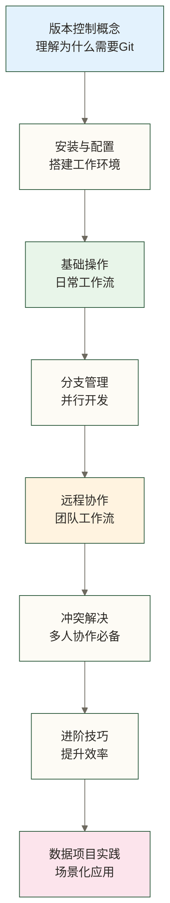
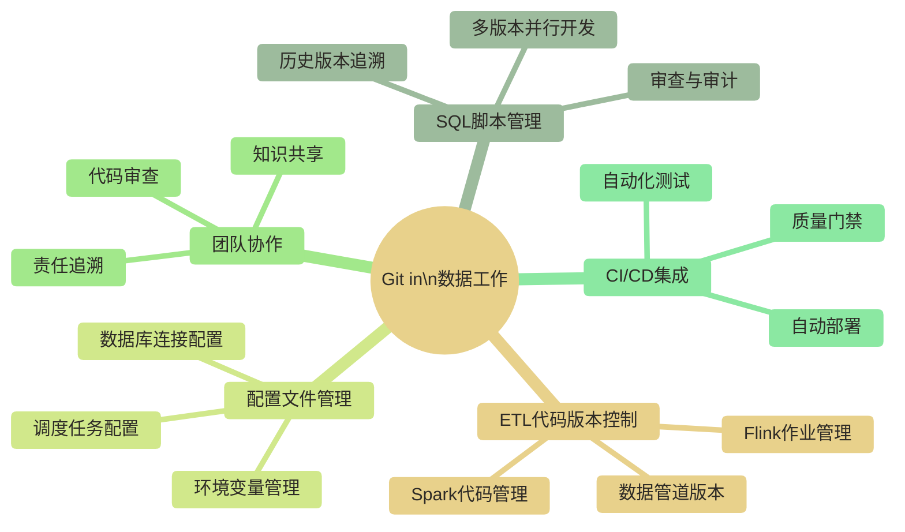

> [!warning] 关联材料边界
> 以下原引用目标缺失或无法唯一确认，已取消跳转并保留提及：Linux基础概念；数据开发规范；SQL。相关素材/延伸说明暂不可用，不能据此声称已经提供配套材料。

# Git 学习路线图 - 数据从业者版本控制入门到实战

> [!abstract] 路线图概览
> - **适用人群**：数据分析师、数据开发工程师、数据科学家
> - **学习目标**：掌握日常数据工作中必须用到的 Git 技能
> - **参考周期**：可按 2-3 周学习核心内容、1 个月持续练习来安排；实际进度与习惯形成取决于已有基础、投入时间和实践机会
> - **前置要求**：会用命令行基础操作（参考 Linux基础概念（原引用“Linux基础概念”未能确定有效目标，暂不可跳转））

---

## 为什么数据从业者必须学 Git

你有没有遇到过这些情况：

- SQL 脚本改着改着，上线出了 bug，但找不到"改之前"的版本了
- ETL 代码在本地跑得好好的，同事拿去用发现和你的版本不一样
- 做了半天的数据清洗脚本，手抖删掉了一段关键逻辑，Ctrl+Z 不够用
- 团队里每人维护一份"最终版\_v3\_修改\_确认.py"，不知道哪个才是真正的最终版

这些痛点，Git 可以通过版本记录和协作流程帮助缓解；但未被记录的改动不保证可恢复，运行环境差异也需要依赖与配置管理配合解决。

对数据从业者来说，Git 不是"可选的加分项"，而是**专业工作的基础设施**。它是你和团队协作的通用语言，是代码安全的保障网，是工作历史的时光机。

---

## 学习路径总览

---

## 文档目录

### 基础入门（必学）

| 文档 | 核心内容 | 预计学习时间 |
|------|---------|------------|
| [[【技术与工具】/Git/01-版本控制概念|01-版本控制概念]] | 为什么用Git、Git vs SVN、数据项目痛点 | 30 分钟 |
| [[【技术与工具】/Git/02-Git安装与配置|02-Git安装与配置]] | 安装、git config、SSH密钥、连接GitHub | 1 小时 |
| [[【技术与工具】/Git/03-Git基础操作|03-Git基础操作]] | init/clone/add/commit/log/diff，日常工作流 | 2-3 小时 |

### 团队协作（核心）

| 文档 | 核心内容 | 预计学习时间 |
|------|---------|------------|
| [[【技术与工具】/Git/04-分支管理|04-分支管理]] | branch/merge、Git Flow、数据项目分支策略 | 1-2 小时 |
| [[【技术与工具】/Git/05-远程仓库协作|05-远程仓库协作]] | push/pull/fetch、PR 工作流、代码审查 | 1-2 小时 |
| [[【技术与工具】/Git/06-冲突解决|06-冲突解决]] | 合并冲突处理、预防最佳实践 | 1 小时 |

### 进阶提升（强烈推荐）

| 文档 | 核心内容 | 预计学习时间 |
|------|---------|------------|
| [[【技术与工具】/Git/07-Git进阶技巧|07-Git进阶技巧]] | stash、rebase、tag、.gitignore | 2 小时 |
| [[【技术与工具】/Git/08-数据项目Git实践|08-数据项目Git实践]] | SQL管理、ETL代码、大文件处理、目录规范 | 2 小时 |

### 参考手册（随时查阅）

| 文档 | 核心内容 |
|------|---------|
| [[【技术与工具】/Git/09-Git常用命令速查|09-Git常用命令速查]] | 按场景分类的命令速查表 |
| [[【技术与工具】/Git/10-GitHub与GitLab使用|10-GitHub与GitLab使用]] | Issue、CI/CD、GitHub Actions 简介 |

---

## 阶段性学习目标

### 第一周：能独立使用 Git 管理自己的项目

完成后你应该能：
- [ ] 在本地初始化一个 Git 仓库
- [ ] 正确理解暂存区的概念，能用 `git add` 和 `git commit`
- [ ] 用 `git log` 查看历史，用 `git diff` 对比变化
- [ ] 连接到 GitHub/GitLab 并推送代码

### 第二周：能参与团队协作项目

完成后你应该能：
- [ ] 创建和切换分支
- [ ] 提交 Pull Request 并处理代码审查意见
- [ ] 解决合并冲突
- [ ] 理解 Git Flow 的基本流程

### 第三周：形成良好的 Git 工作习惯

完成后你应该能：
- [ ] 用 .gitignore 正确排除不需要版本管理的文件
- [ ] 用 stash 处理临时中断的工作
- [ ] 为数据项目设计合理的分支策略
- [ ] 能起草团队的 Git 协作规范，并结合项目实际经团队评审后试行

---

## 数据工作中的 Git 应用场景

---

## 学习建议

> [!tip] 最有效的学习方式
> **边学边用**。不要只看教程——把你正在做的某个 SQL 脚本项目或 Python 分析项目用 Git 管起来，在真实工作流中练习每一个命令。理论学完立刻上手实操，有助于把概念与实际操作联系起来；原稿“记忆留存率高 5 倍”仅保留为未核实的效果数字示例，不作为学习效果依据或承诺。

> [!note] 配套工具推荐
> - **命令行**：所有操作优先用命令行，理解原理后再用 GUI 工具
> - **VS Code**：内置 Git 支持，可以直观看到文件变更状态
> - **GitHub Desktop**：如果确实不习惯命令行，这是可考虑的 GUI 选项之一
> - **GitLens（VS Code 插件）**：查看代码历史、blame 信息的神器

> [!warning] 常见误区
> 很多人学 Git 卡在这里：以为记住所有命令才算会用。实际上你只需要熟练掌握 10 个左右的核心命令，其他的用到时查 [[【技术与工具】/Git/09-Git常用命令速查|09-Git常用命令速查]] 就够了。

---

## 相关知识关联

学习 Git 时，以下知识会帮助你更好地理解：

- Linux基础概念（原引用“Linux基础概念”未能确定有效目标，暂不可跳转） - Git 命令行操作依赖基本的 Shell 知识
- [[【数据分析与数据运营】/98-专业术语词典/08-技能方法类/Python|Python]] - Python 项目是 Git 最常见的应用场景之一
- 数据开发规范（原引用“数据开发规范”未能确定有效目标，暂不可跳转） - 代码规范与版本控制密切相关
- SQL（原引用“SQL”未能确定有效目标，暂不可跳转） - SQL 脚本的版本管理是数据工程师的核心场景

---

## 快速导航

- 从零开始 → [[【技术与工具】/Git/01-版本控制概念|01-版本控制概念]]
- 已有基础，想提升 → [[【技术与工具】/Git/07-Git进阶技巧|07-Git进阶技巧]]
- 数据项目实战 → [[【技术与工具】/Git/08-数据项目Git实践|08-数据项目Git实践]]
- 忘记命令了 → [[【技术与工具】/Git/09-Git常用命令速查|09-Git常用命令速查]]
