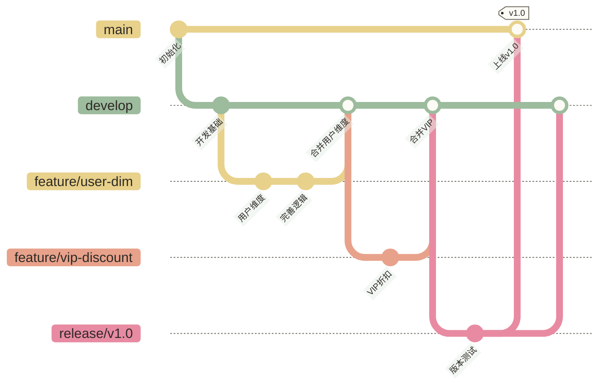

# Git 分支管理 - 并行开发与数据项目分支策略

> [!abstract] 本章概要
> - 理解分支的本质和价值
> - 掌握 branch/checkout/switch/merge 核心命令
> - 了解 Git Flow 分支策略
> - 学习数据项目的分支实践方案

---

## 分支解决的问题

想象一下没有分支的世界：

- 你在修复生产 bug，同事突然说需要开发一个新功能
- 你的实验性代码改动影响了别人的工作
- 必须等 A 功能上线了才能开始 B 功能的开发

分支能缓解这些并行开发问题。**分支让不同任务的提交历史分开推进，但合并时仍可能发生冲突；未提交改动和共享运行环境也不会自动隔离**。

---

## 分支的本质

很多人一开始觉得分支很神秘，其实非常简单。

分支就是一个**指向某次提交的可移动指针**。

```text
main 分支的历史：
  ●──────●──────●──────●
  A      B      C      D (HEAD → main)

从 D 创建 feature 分支并在其上新增提交 E 后：
  ●──────●──────●──────●  (main)
                        ↑
                        ● (HEAD → feature)
                        E
```

创建分支不复制代码，只是新增一个指针，所以 Git 的分支创建几乎是**瞬间完成**的，不管仓库有多大。

---

## 核心命令

### 查看分支

```bash
# 查看本地分支（* 标记当前分支）
git branch

# 查看所有分支（包括远程）
git branch -a

# 查看远程分支
git branch -r

# 查看每个分支的最新提交
git branch -v
```

### 创建分支

```bash
# 创建分支（但不切换过去）
git branch feature/vip-discount

# 创建并立即切换到新分支（推荐写法）
git checkout -b feature/vip-discount

# Git 2.23+ 推荐的新写法
git switch -c feature/vip-discount

# 从指定提交创建分支
git checkout -b hotfix/fix-null-check 9e1d234
```

### 切换分支

```bash
# 切换到已有分支
git checkout main
# 或用新命令
git switch main

# 切换到上一个分支（类似 cd - 返回上一个目录）
git switch -
git checkout -
```

> [!warning] 切换分支前确认工作区干净
> 如果工作区有未提交的修改，切换分支时可能会遇到冲突。切换前先 `git status` 检查，有修改就先 commit 或者 `git stash`。

### 合并分支：git merge

```bash
# 把 feature 分支合并到 main
git switch main           # 先切换到目标分支
git merge feature/vip-discount

# 如果不想要 fast-forward（保留分支合并记录）
git merge --no-ff feature/vip-discount

# 合并并写提交信息
git merge --no-ff -m "Merge: 合并VIP折扣功能分支" feature/vip-discount
```

### 删除分支

```bash
# 删除已合并的本地分支（安全删除）
git branch -d feature/vip-discount

# 强制删除（未合并也删，慎用）
git branch -D feature/vip-discount

# 删除远程分支
git push origin --delete feature/vip-discount
```

### 重命名分支

```bash
# 重命名当前分支
git branch -m new-name

# 重命名指定分支
git branch -m old-name new-name
```

---

## 合并策略详解

### Fast-forward 合并

当 main 分支在 feature 分支分叉后没有新提交，Git 会直接移动指针，不产生额外的 merge commit：

```text
合并前：
  ●──────●──────●  (main)
                └─────●──────●  (feature)

Fast-forward 合并后：
  ●──────●──────●──────●──────●  (main = feature)
```

### No-fast-forward 合并

加上 `--no-ff` 后，强制创建一个 merge commit，即使可以 fast-forward：

```text
合并前：
  ●──────●──────●  (main)
                └─────●──────●  (feature)

--no-ff 合并后：
  ●──────●──────●──────────────●  (main，多了一个 merge commit)
                └─────●──────●┘
```

> [!tip] 什么时候用 --no-ff？
> 团队项目推荐用 `--no-ff`，因为它保留了"这些提交来自一个特性分支"的历史信息。看 `git log --graph` 时能清晰看到功能开发的完整轨迹。

### Squash 合并

把 feature 分支的所有提交压缩成一个提交，然后合并：

```bash
git merge --squash feature/vip-discount
git commit -m "feat: 新增VIP折扣功能（合并feature分支）"
```

适合功能分支上有很多"WIP"类型的零碎提交，合并到主干时想保持干净历史。

---

## Git Flow：团队协作的分支策略

Git Flow 是 2010 年 Vincent Driessen 提出的一套分支管理策略，可用于具有明确版本发布、测试稳定期和维护需求的项目（如按周/月发布版本的数据仓库）；是否采用还需结合发布频率与协作成本判断。

### 核心分支



| 分支 | 用途 | 来源 | 合并目标 |
|------|------|------|---------|
| `main` | 生产环境代码，只有上线版本 | - | - |
| `develop` | 开发集成分支，最新的开发代码 | main | main（通过 release） |
| `feature/*` | 功能开发分支 | develop | develop |
| `release/*` | 版本发布分支，只做 bug fix | develop | main + develop |
| `hotfix/*` | 紧急修复分支 | main | main + develop |

### Feature 分支工作流

```bash
# 1. 从 develop 创建功能分支
git switch develop
git pull origin develop
git switch -c feature/new-user-metric

# 2. 开发、提交
# ... 写代码 ...
git add .
git commit -m "feat: 新增用户活跃度指标"

# 3. 功能完成后，合并回 develop
git switch develop
git pull origin develop                          # 先更新
git merge --no-ff feature/new-user-metric        # 合并
git push origin develop

# 4. 删除功能分支（远程删除仅适用于已推送且确认不再使用的分支）
git branch -d feature/new-user-metric
git push origin --delete feature/new-user-metric
```

### Hotfix 分支工作流

```bash
# 生产出 bug，紧急修复
git switch main
git pull origin main
git switch -c hotfix/fix-order-amount

# 修复 bug
git add sql/orders_etl.sql
git commit -m "fix: 修复VIP用户订单金额计算错误"

# 合并到 main（发布代码；实际上线还需执行团队部署流程）
git switch main
git merge --no-ff hotfix/fix-order-amount
git tag -a v1.0.1 -m "紧急修复：VIP订单金额计算"
git push origin main --tags

# 同时合并到 develop（避免下次发版时又出现这个 bug）
git switch develop
git merge --no-ff hotfix/fix-order-amount
git push origin develop

# 删除 hotfix 分支
git branch -d hotfix/fix-order-amount
```

---

## 数据项目的分支实践

数据项目和软件项目有些不同，我们来讨论几个常见场景的分支策略。

### 场景一：数据仓库按版本迭代

本场景假设数据仓库按周或双周发布一个版本，可考虑简化版 Git Flow；实际发布节奏和分支策略应按项目需求确定：

```text
main        ──────────────●─────────────────●──
                          ↑ v1.0            ↑ v2.0
develop     ──●──────────●──────●──────────●──
              ↑          ↑     ↑           ↑
feature/A ──●─┘          │  feature/B ──●──┘
                          │
release/1.0 ──●──────────┘（测试、修复）
```

**分支命名规范（数据仓库版）**：

```text
feature/dim-user-v2           # 维度表迭代
feature/fact-order-refactor   # 事实表重构
feature/metric-gmv-weekly     # 新增指标
hotfix/null-handling-order    # 紧急修复
release/2024-q1               # 季度发版
```

### 场景二：小团队简化版（Trunk-Based Development）

如果团队只有 2-3 人，Git Flow 可能过于复杂。可以用主干开发模式：

```text
main ──●──────●──────●──────●──────●──
        ↑      ↑      ↑      ↑      ↑
    feature  feature  fix  feature  fix
   （短命分支，功能完成立即合并）
```

规则：
- 所有分支从 main 分出，完成后立即合并回 main
- 分支生命周期不超过 2 天
- 每天至少 push 一次

### 场景三：单人项目

如果只有你一个人，最简单的策略：

```bash
# main 分支：稳定可上线的代码
# dev 分支：日常开发

# 开发新功能时
git switch dev
# ... 开发 ...
git switch main
git merge dev
git push origin main
```

或者更简单：只用一个 main 分支，通过 `git tag` 标记重要版本。

---

## 常见分支操作场景

### 查看哪些分支已经合并了

```bash
# 已经合并到当前分支的分支（可以安全删除）
git branch --merged

# 还没有合并的分支
git branch --no-merged
```

### 查看分支之间的差异

```bash
# 查看 feature 分支比 develop 多了哪些提交
git log develop..feature/vip-discount --oneline

# 查看共同祖先到 feature 分支的文件差异，而非两个分支尖端的直接差异
git diff develop...feature/vip-discount

# 检查 feature 分支相对 main 的提交：+ 表示 main 中无等价补丁，- 表示已有等价补丁
git cherry main feature/vip-discount
```

### 比较两个分支的某个文件

```bash
# 比较 main 和 feature 分支中某个文件的差异
git diff main..feature/new-metric -- sql/fact_orders.sql
```

---

## 分支操作最佳实践

> [!tip] 分支命名规范
> 采用统一的命名规范让团队协作更顺畅：
> - `feature/描述` - 新功能
> - `fix/描述` 或 `bugfix/描述` - bug 修复
> - `hotfix/描述` - 紧急修复（直接从 main 分出）
> - `release/版本号` - 发布分支
> - `docs/描述` - 文档更新
> - `refactor/描述` - 代码重构

> [!tip] 分支生命周期管理
> 合并后及时删除特性分支，避免分支"坟场"。可以定期清理：
> ```bash
> # 删除所有已合并到 main 的本地分支
> git branch --merged main | grep -v "^\*\|main\|develop" | xargs git branch -d
> ```

> [!warning] 不要在 main/master 直接开发
> 团队共享仓库应按保护分支规则管理 main，通常通过分支 + Pull Request、审核和必要的测试后合入，避免未经检查的修改影响其他成员。单人项目或明确允许主干提交的团队可采用不同流程，但仍须遵守测试和发布要求。

---

## 小结

| 操作 | 命令 |
|------|------|
| 查看分支 | `git branch` / `git branch -a` |
| 创建并切换 | `git switch -c feature/xxx` |
| 切换分支 | `git switch main` |
| 合并分支 | `git merge --no-ff feature/xxx` |
| 删除本地分支 | `git branch -d feature/xxx` |
| 删除远程分支 | `git push origin --delete feature/xxx` |

---

---

> [!info] 前置知识
> - [[【技术与工具】/Git/03-Git基础操作|Git基础操作]] - 掌握 commit、add、log、status 等核心操作，分支是在这些基础上的进阶

---

## 掌握检查

- [ ] 能说出分支的本质：它只是一个指向某个 commit 的可移动指针，创建分支几乎没有成本
- [ ] 能用 `git switch -c feature/xxx` 创建并切换到新分支，用 `git switch main` 切回主干
- [ ] 理解 `--no-ff` 合并（保留合并节点）和快进合并的区别，知道数据项目为什么推荐用 `--no-ff`
- [ ] 合并后知道用 `git branch -d feature/xxx` 清理已合并的本地分支，保持仓库整洁
- [ ] 知道什么情况下绝对不能在 main 分支直接 push（团队协作的高压线）

---

## 实践练习

**基础题**：在本地仓库创建 `feature/add-vip-discount` 分支，修改某个 SQL 文件并提交，然后切回 main 分支，用 `--no-ff` 方式合并，最后用 `git log --oneline --graph` 查看合并节点是否出现。

**进阶题**：模拟团队中同时开发两个特性的场景：创建两个分支 `feature/a` 和 `feature/b`，分别提交不同的变更，然后把两个分支都合并到 main，查看最终的 git 历史图，说明两个分支的提交是如何收敛的。

---

下一步：[[【技术与工具】/Git/05-远程仓库协作|远程仓库协作]] - 学习如何和团队成员通过远程仓库协作，掌握 Pull Request 工作流。

上一步：[[【技术与工具】/Git/03-Git基础操作|Git基础操作]] | 返回：[[【技术与工具】/Git/00-Git学习路线图|Git学习路线图]]
