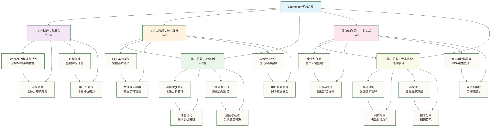

# 🌟 Greenplum学习路线图 - 企业级数据仓库专家成长指南

> [!tip] 💝 给数据仓库新手的温暖指导
> 
> 🤗 **学习Greenplum就像建造一座现代化智能工厂！**
> 
> 如果你现在对Greenplum感到困惑：
> - "Greenplum和普通数据库有什么不同？"
> - "怎么从零开始掌握大规模数据处理？"
> - "如何成为企业数据仓库专家？"
> 
> **别担心！** 每个数据仓库专家都是从第一个查询开始的 ✨
> 
> 🏭 **想象Greenplum学习就像建造智能工厂**
> 
> 智能工厂建设的完整历程：
> - 📋 **规划设计** = 理解MPP架构（了解工厂整体布局）
> - 🏗️ **基础建设** = 环境搭建（搭建工厂基础设施）
> - ⚙️ **设备调试** = 基础操作（学会操作各种设备）
> - 🔧 **生产优化** = 性能调优（提升工厂生产效率）
> - 🏆 **智能管理** = 企业应用（实现智能化管理）
> 
> **完成Greenplum学习可为数据平台管理打下基础；管理不同规模的系统仍需相应的项目经验、容量评估和运维验证。** 🌟

## 🎯 学习阶段规划

### 📊 完整学习路径概览

### 🎯 技能发展轨迹

以下职业方向仅作学习规划参考，不代表学习阶段与职位的一一对应；薪资数字为原稿未核实示例，缺少地区、币种、薪资周期及统计口径，不构成市场行情或收入承诺。

| 学习阶段 | 核心能力 | 职业方向 | 薪资水平 |
|---|---|---|---|
| **基础入门** | 理解MPP概念，基本操作 | 数据分析师助理 | 8-15K |
| **核心技能** | 熟练SQL，数据建模 | 数据分析师 | 15-25K |
| **高级特性** | 性能调优，ETL设计 | 高级数据工程师 | 25-40K |
| **企业实战** | 架构设计，项目管理 | 数据架构师 | 40-60K |
| **专家进阶** | 深度优化，技术领导 | 首席数据官 | 60K+ |

## 🌱 第一阶段：基础入门（2-3周）

### 📚 学习目标
**建立Greenplum基础认知，完成环境搭建，体验分布式数据库的强大能力**

### 📖 学习内容

#### 第1周：理论基础
- [[【技术与工具】/Greenplum/01-Greenplum概述与特性|Greenplum概述与特性]] 🌟
  - 什么是MPP大规模并行处理
  - Greenplum vs 传统数据库
  - 应用场景和企业案例
  - 职业发展前景分析

- [[【技术与工具】/Greenplum/02-Greenplum架构原理|Greenplum架构]] 🏗️
  - Master-Segment分布式架构
  - 数据分布和并行处理机制
  - 高可用和容错设计
  - Segment本地存储与计算协同（传统Greenplum架构并非存算分离；具体部署形态需按版本确认）

#### 第2周：环境准备
- [[【技术与工具】/Greenplum/03-Greenplum环境搭建|Greenplum环境搭建]] 🛠️
  - 单机开发环境搭建
  - 集群环境规划和部署
  - 常见问题解决
  - 开发工具配置

- [[【技术与工具】/Greenplum/04-第一个Greenplum查询|第一个Greenplum查询]] 🚀
  - 连接Greenplum数据库
  - 基础查询语法体验
  - 理解并行执行计划
  - 性能对比验证

### 🎯 阶段目标
- [ ] 理解MPP架构的核心优势
- [ ] 成功搭建Greenplum环境
- [ ] 完成第一个分析查询
- [ ] 体验分布式计算的威力

### 💡 学习心得
> **第一阶段就像参观现代化工厂** 🏭
> 
> 你会看到：
> - 🔍 **整体布局** = MPP架构设计
> - ⚙️ **生产线** = 并行处理机制  
> - 🏗️ **基础设施** = 集群环境搭建
> - 🎯 **第一件产品** = 完成第一个查询

## 🚀 第二阶段：核心技能（3-4周）

### 📚 学习目标
**掌握Greenplum核心操作技能，能够进行日常数据分析和管理工作**

### 📖 学习内容

#### 第3-4周：SQL操作
- [[【技术与工具】/Greenplum/05-SQL基础操作|SQL基础操作]] 📝
  - Greenplum SQL语法特性
  - 分布式查询最佳实践
  - 函数和表达式使用
  - 窗口函数和分析函数

- [[【技术与工具】/ClickHouse/06-ClickHouse数据导入导出|ClickHouse数据导入导出]] 🔄
  - 外部表使用技巧
  - 大批量数据导入优化
  - 数据格式转换
  - 并行导入导出

#### 第5-6周：设计管理
- [[【技术与工具】/Greenplum/07-表设计与分区|表设计与分区]] 🎨
  - 分布键选择策略
  - 分区表设计原则
  - 索引使用建议
  - 压缩策略选择

- [[【技术与工具】/Oracle/07-Oracle用户权限管理|Oracle用户权限]] 🔐
  - 用户和角色管理
  - 资源队列配置
  - 数据安全策略
  - 访问控制实现

### 🎯 阶段目标
- [ ] 熟练使用Greenplum SQL
- [ ] 掌握数据导入导出技巧
- [ ] 理解表设计最佳实践
- [ ] 能够管理用户和权限

### 💡 学习心得
> **第二阶段就像学会操作工厂设备** ⚙️
> 
> 你会掌握：
> - 📊 **操作面板** = SQL查询技能
> - 🔄 **物流系统** = 数据导入导出
> - 🎨 **生产设计** = 表结构设计
> - 🔐 **安全管理** = 权限控制

## ⚡ 第三阶段：高级特性（4-5周）

### 📚 学习目标
**掌握Greenplum高级特性，能够进行复杂数据分析和性能优化**

### 📖 学习内容

#### 第7-8周：高级查询
- **高级SQL查询技术** 🎯
  - 复杂分析查询设计
  - CTE和递归查询应用
  - 数组和JSON数据处理
  - 地理空间数据分析

- **性能优化实战** ⚡
  - 查询执行计划分析
  - 索引优化策略制定
  - 统计信息维护管理
  - 查询重写优化技巧

#### 第9-10周：数据处理
- **ETL流程设计** 🔄
  - 数据抽取转换加载
  - 批处理作业调度
  - 数据质量监控
  - 错误处理机制

- **系统监控与运维** 📊
  - 系统监控指标设置
  - 性能诊断工具使用
  - 故障排查方法论
  - 预防性维护策略

### 🎯 阶段目标
- [ ] 编写复杂分析查询
- [ ] 进行查询性能优化
- [ ] 设计ETL数据流程
- [ ] 监控系统健康状态

### 💡 学习心得
> **第三阶段就像成为生产主管** 👨‍🔧
> 
> 你会精通：
> - 🎯 **精细操作** = 高级SQL技能
> - ⚡ **效率优化** = 性能调优
> - 🔧 **流程设计** = ETL管道
> - 📊 **质量监控** = 系统运维

## 🏆 第四阶段：企业实战（3-4周）

### 📚 学习目标
**具备企业级Greenplum部署和管理能力，能够解决生产环境复杂问题**

### 📖 学习内容

#### 第11-12周：企业部署
- **企业级部署架构** 🏗️
  - 生产环境规划设计
  - 高可用架构方案
  - 容量规划评估方法
  - 自动化部署流程

- **灾备与恢复体系** 🛡️
  - 备份策略制定
  - 灾难恢复预案
  - 数据一致性保障
  - 业务连续性规划

#### 第13-14周：大规模应用
- **大规模数据处理** 📈
  - PB级数据管理策略
  - 数据分层存储架构
  - 冷热数据分离机制
  - 成本优化最佳实践

- **生态系统集成** 🔗
  - BI工具无缝集成
  - 大数据平台对接
  - API接口设计开发
  - 云原生部署方案

### 🎯 阶段目标
- [ ] 设计企业级部署方案
- [ ] 制定完整灾备策略
- [ ] 处理PB级数据挑战
- [ ] 整合企业数据生态

### 💡 学习心得
> **第四阶段就像成为工厂总经理** 👔
> 
> 你会统筹：
> - 🏗️ **战略规划** = 企业架构设计
> - 🛡️ **风险管控** = 灾备方案
> - 📈 **规模扩张** = 大数据处理
> - 🔗 **生态合作** = 系统集成

## 🌟 第五阶段：专家进阶（持续学习）

### 📚 学习目标
**成为Greenplum技术专家，具备深度技术研究和团队领导能力**

### 📖 学习内容

#### 持续深化
- **源码深度分析** 🔬
  - Greenplum核心源码研究
  - 查询执行引擎原理
  - 存储层实现机制
  - 网络通信协议分析

- **调优专家进阶** 🎯
  - 极致性能优化技术
  - 硬件配置精细调优
  - 系统参数深度调整
  - 性能瓶颈根因分析

- **企业架构设计** 🏛️
  - 企业级解决方案设计
  - 技术选型指导原则
  - 架构评审标准制定
  - 创新技术前瞻研究

- **技术影响力建设** 🎓
  - 团队技术培训体系
  - 开源社区积极贡献
  - 技术文章深度撰写
  - 行业会议演讲分享

### 🎯 阶段目标
- [ ] 深度理解技术原理
- [ ] 成为调优专家
- [ ] 设计企业架构
- [ ] 推动技术发展

### 💡 学习心得
> **第五阶段就像成为行业专家** 🌟
> 
> 你会引领：
> - 🔬 **技术创新** = 深度研究
> - 🎯 **极致优化** = 性能专家
> - 🏛️ **方案设计** = 架构师
> - 🎓 **知识传承** = 技术领袖

## 📚 推荐学习资源

### 📖 官方文档
- **Greenplum官方文档**：完整的技术手册
- **PostgreSQL文档**：SQL基础参考
- **MPP架构论文**：理论基础

### 🎥 在线课程
- **Pivotal官方培训**：专业认证课程
- **云厂商培训**：实战案例分享
- **开源社区课程**：免费学习资源

### 🛠️ 实践环境
- **虚拟机环境**：本地开发测试
- **云平台试用**：弹性资源
- **开源版本**：社区支持

### 🤝 社区资源
- **Greenplum社区**：官方交流平台
- **技术论坛**：问题讨论
- **GitHub项目**：源码学习
- **技术博客**：经验分享

## 🎯 职业发展建议

### 🚀 初级阶段（0-2年）
**目标**：掌握基础技能，能够独立完成日常分析任务
- 重点学习SQL和数据建模
- 积累项目实战经验
- 了解行业应用场景

### 🌟 中级阶段（2-5年）
**目标**：成为技术骨干，能够解决复杂技术问题
- 深入学习性能优化
- 参与架构设计讨论
- 培养项目管理能力

### 🏆 高级阶段（5年以上）
**目标**：成为技术专家，具备团队领导能力
- 研究前沿技术趋势
- 制定技术发展规划
- 培养和指导团队成员

## 💰 薪资发展预期

### 📊 薪资示例（原稿数字未核实）

下表保留原稿数字供讨论，未提供调查来源、地区、币种及薪资周期，不代表实际市场水平；经验年限与职位也不是必然对应关系。

| 经验年限 | 职位层级 | 薪资范围 | 核心技能要求 |
|---|---|---|---|
| **0-1年** | 数据分析师助理 | 8-15K | SQL基础，数据导入导出 |
| **1-3年** | 数据分析师 | 15-25K | 复杂查询，性能优化基础 |
| **3-5年** | 高级数据工程师 | 25-40K | ETL设计，系统调优 |
| **5-8年** | 数据架构师 | 40-60K | 架构设计，团队管理 |
| **8年以上** | 首席数据官 | 60K+ | 战略规划，技术领导 |

### 🌟 技能与加薪示例（原稿比例未核实）

以下百分比为原稿未核实示例，没有统计依据，不能解释为掌握某项技能即可获得的加薪幅度。
1. **SQL优化专家**：+20-30%薪资
2. **架构设计能力**：+30-50%薪资
3. **大数据平台整合**：+25-40%薪资
4. **团队管理经验**：+20-35%薪资
5. **云原生部署**：+15-25%薪资

## 🎯 学习成功秘诀

### 💪 坚持原则
1. **每日坚持**：每天至少学习1小时
2. **实践为主**：理论结合实际项目
3. **总结反思**：定期整理学习笔记
4. **交流分享**：积极参与技术讨论

### 🔄 学习方法
1. **项目驱动**：通过实际项目学习
2. **问题导向**：遇到问题深入研究
3. **对比学习**：与其他技术对比
4. **持续更新**：跟进技术发展

### 🤝 成长建议
1. **找到mentor**：寻找经验丰富的导师
2. **加入社区**：参与开源项目贡献
3. **建立品牌**：分享技术文章和经验
4. **持续学习**：保持技术敏感度

## 🌈 激励寄语

> **🎯 给未来Greenplum专家的话**
> 
> 📈 **Greenplum是企业级数据分析的王者工具**
> - 原稿称“全球500强企业广泛使用”，但未提供企业名单或采用证据，不能据此判断实际普及程度
> - PB级数据处理可作为规模化学习目标，实际能力需结合集群资源、数据分布、负载与测试结果评估
> - 开源生态持续发展
> 
> 💼 **掌握Greenplum可作为职业发展的技能积累，但不保证以下结果**
> - 成为稀缺的数据专家
> - 获得丰厚的薪资回报
> - 拥有广阔的职业前景
> 
> 🌟 **记住：每个Greenplum专家都是从第一个查询开始的！**
> 
> **现在就开始你的Greenplum学习之旅，通过持续实践逐步向数据仓库专家的目标迈进！** ✨

---

> [!note] 📋 学习进度追踪
> 
> 建议使用以下方式追踪学习进度：
> - [ ] 每周制定具体学习计划
> - [ ] 完成每个阶段的实践项目
> - [ ] 记录学习心得和问题
> - [ ] 定期评估技能掌握程度
> - [ ] 寻找实际项目应用机会

通过系统性的学习和实践，你可以逐步积累企业级数据仓库所需技能；是否达到专家水平仍需结合实际项目经验与能力评估。🚀