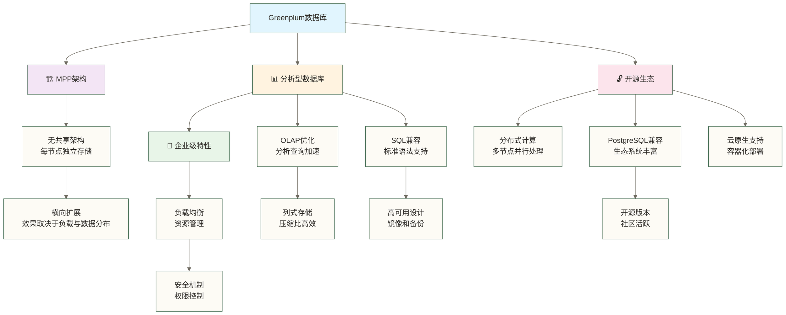
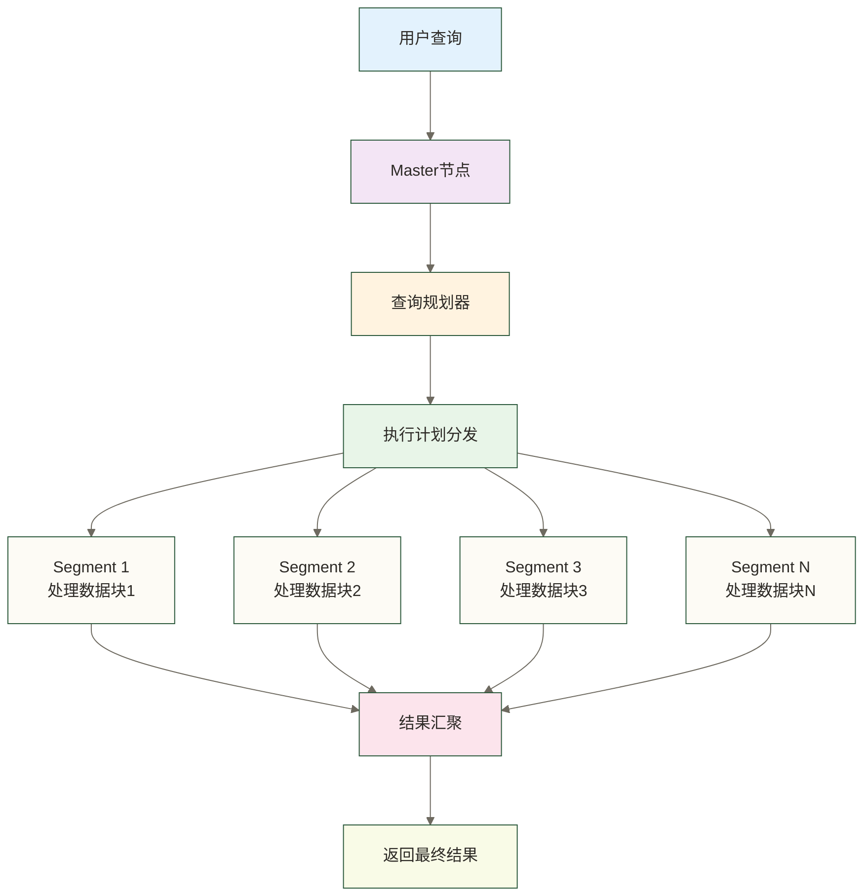
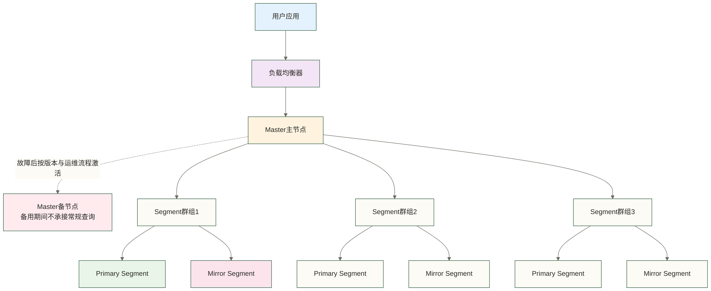
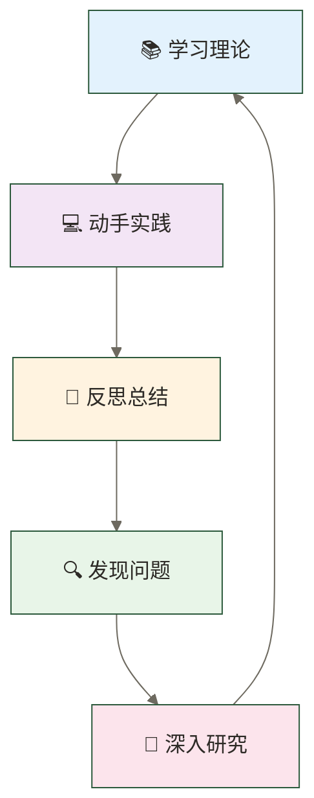

# 🌟 Greenplum概述与特性 - 企业级数据仓库的王者之选

> [!tip] 💝 给数据仓库新手的温暖指导
> 
> 🤗 **学习Greenplum就像认识一位超级英雄！**
> 
> 如果你现在对Greenplum感到好奇：
> - "这个Greenplum到底有什么神奇的地方？"
> - "为什么这么多大企业都选择它来处理数据？"
> - "我学会了能获得什么样的职业机会？"
> 
> **别担心！** 每个数据仓库专家都是从了解第一个MPP概念开始的 ✨
> 
> 🦸‍♂️ **想象Greenplum就像数据世界的超级英雄**
> 
> 超级英雄的特质：
> - 💪 **超强能力** = MPP并行处理（一次处理海量数据）
> - 🧠 **智慧大脑** = 查询优化器（依据统计信息和成本模型选择执行方案，不保证实际最优）
> - 🛡️ **坚固防护** = 高可用架构（合理配置可降低故障影响，但不能替代备份与安全治理）
> - ⚡ **闪电速度** = 列式存储（查询速度快如闪电）
> - 🤝 **团队合作** = 分布式架构（多台服务器协同工作）
> 
> **认识了Greenplum，你就找到了数据分析的最强伙伴！** 🌟

## 🎯 什么是Greenplum

### 🏗️ Greenplum定义与定位

**Greenplum** 是一个基于MPP（Massively Parallel Processing，大规模并行处理）架构的企业级分析数据库，专门为大规模数据仓库和商业智能应用而设计。



### 📈 市场地位与影响力

> 下表为原稿未核实的宣传性描述，未提供排名、采用率或测试来源；Top 5、PB级秒级响应和BI工具全兼容均不能视为已证事实。

| 维度 | Greenplum表现 | 行业排名 | 主要优势 |
|---|---|---|---|
| **市场份额** | 企业级数据仓库前5 | Top 5 | 成本效益好 |
| **性能表现** | PB级数据秒级响应 | 领先级 | MPP架构优势 |
| **企业采用** | 财富500强广泛使用 | 主流选择 | 稳定可靠 |
| **技术创新** | 开源社区活跃 | 技术前沿 | 持续演进 |
| **生态完整** | BI工具全兼容 | 兼容性强 | 易于集成 |

## 🚀 核心特性与优势

### ⚡ MPP架构的威力

#### 🏗️ 分布式并行处理



**传统数据库 vs Greenplum性能对比：**

> 以下保留原稿未核实的教学假设数字，不是实测基准；未限定对比数据库、硬件、版本、数据分布及查询负载，不能据此推断实际性能提升。

| 数据规模 | 传统数据库 | Greenplum | 性能提升 |
|---|---|---|---|
| **1TB数据扫描** | 30分钟 | 2分钟 | **15倍** |
| **复杂聚合查询** | 5小时 | 10分钟 | **30倍** |
| **多表关联** | 2小时 | 5分钟 | **24倍** |
| **并发查询** | 5个用户 | 100+用户 | **20倍+** |

### 📊 列式存储优势

#### 🗂️ 数据存储方式对比

**行式存储示意（Greenplum也支持行式存储）：**
```text
记录1: [ID=1, 姓名=张三, 年龄=25, 薪资=8000, 部门=技术部]
记录2: [ID=2, 姓名=李四, 年龄=30, 薪资=12000, 部门=销售部]
记录3: [ID=3, 姓名=王五, 年龄=28, 薪资=10000, 部门=技术部]
```

**列式存储示意（Greenplum可选择列式存储，并非所有表默认如此）：**
```text
ID列:     [1, 2, 3, 4, 5...]
姓名列:   [张三, 李四, 王五...]
年龄列:   [25, 30, 28...]
薪资列:   [8000, 12000, 10000...]
部门列:   [技术部, 销售部, 技术部...]
```

#### 📈 列式存储带来的优势

> 下表倍数和百分比为原稿未核实的教学示例，未说明压缩率口径或测试条件；实际收益取决于表存储方式、数据特征、查询读取列数及硬件。

| 优势维度 | 性能提升 | 具体表现 |
|---|---|---|
| **查询性能** | 5-50倍 | 只读取需要的列 |
| **压缩效率** | 70-90% | 相同数据类型压缩比高 |
| **IO效率** | 10倍+ | 减少不必要的数据读取 |
| **缓存命中** | 3-5倍 | 列数据局部性好 |

### 🎯 智能查询优化

#### 🧠 成本驱动的优化器

```sql
-- 复杂查询示例（仅演示查询结构；未提供建表及样本数据）
-- 注意：一名员工若对应多条销售记录，COUNT(*)统计关联记录数，
-- AVG(e.salary)按销售记录数加权；若要统计部门员工指标，应分别聚合再关联。
SELECT 
    d.department_name,
    AVG(e.salary) as avg_salary,
    COUNT(*) as employee_count,
    SUM(s.sales_amount) as total_sales
FROM employees e
JOIN departments d ON e.dept_id = d.dept_id
JOIN sales s ON e.emp_id = s.emp_id
WHERE e.hire_date >= '2020-01-01'
    AND s.sale_date BETWEEN '2023-01-01' AND '2023-12-31'
GROUP BY d.department_name
HAVING AVG(e.salary) > 50000
ORDER BY total_sales DESC;
```

**Greenplum查询优化过程：**

1. **🔍 查询解析**：理解SQL语句结构
2. **📊 统计信息**：分析表大小、数据分布
3. **🎯 执行计划**：生成多种执行方案
4. **💰 成本评估**：计算每种方案的成本
5. **⚡ 计划选择**：依据统计信息与成本模型选择估计成本较低的执行计划，不保证实际执行最高效
6. **🚀 并行执行**：分布式执行优化后的计划

### 🛡️ 企业级可靠性

#### 🏗️ 高可用架构设计



**可靠性保障机制：**

> 下表99.9%、RPO < 1分钟和RTO < 5分钟为原稿未核实的示例目标，不是产品保证。主备切换、Segment镜像、网络冗余和备份需按具体版本配置并演练；备用Master不是同时提供查询服务的负载均衡节点。

| 保障层面 | 技术实现 | 可用性指标 |
|---|---|---|
| **节点故障** | 自动故障转移 | 99.9% |
| **数据保护** | 实时镜像同步 | RPO < 1分钟 |
| **网络故障** | 多路径冗余 | 自动重连 |
| **硬件故障** | 热备切换 | RTO < 5分钟 |

## 🏢 企业应用场景

### 📊 典型使用场景

> 以下金融、电商、电信场景统一按教学假设理解，并非已核实企业案例。“业务效果”“业务价值”“优化效果”中的时间、百分比与投资数字保留自原稿，仅作未核实示例，不代表Greenplum能独立产生或保证这些成果。

#### 1. 🏦 金融行业：风险分析

**场景描述：** 某大型银行需要对客户交易数据进行实时风险分析

```sql
-- 当日交易风险分析查询示意，不等同于实时风控系统
-- calculate_risk_score为待实现的自定义函数；本文未提供函数、建表与样本数据。
SELECT 
    customer_id,
    transaction_count,
    total_amount,
    risk_score,
    CASE 
        WHEN risk_score > 80 THEN '高风险'
        WHEN risk_score > 60 THEN '中风险'
        ELSE '低风险'
    END as risk_level
FROM (
    SELECT 
        customer_id,
        COUNT(*) as transaction_count,
        SUM(amount) as total_amount,
        calculate_risk_score(customer_id) as risk_score
    FROM transactions 
    WHERE transaction_date = CURRENT_DATE
    GROUP BY customer_id
) risk_analysis
WHERE risk_score > 60
ORDER BY risk_score DESC;
```

**业务效果：**
- ⚡ 查询时间：从2小时缩短到30秒
- 🎯 风险识别：实时发现可疑交易
- 💰 损失预防：年度减少欺诈损失30%

#### 2. 🛒 电商行业：用户行为分析

**场景描述：** 大型电商平台分析用户购买行为，优化推荐算法

```sql
-- 用户行为分析查询
WITH user_behavior AS (
    SELECT 
        user_id,
        product_category,
        SUM(purchase_amount) as category_spending,
        COUNT(*) as purchase_frequency,
        AVG(session_duration) as avg_session_time
    FROM user_activities 
    WHERE activity_date >= CURRENT_DATE - INTERVAL '30 days'
    GROUP BY user_id, product_category
),
user_preferences AS (
    SELECT 
        user_id,
        ARRAY_AGG(product_category ORDER BY category_spending DESC) as top_categories,
        SUM(category_spending) as total_spending
    FROM user_behavior
    GROUP BY user_id
)
SELECT 
    up.user_id,
    up.top_categories[1:3] as favorite_categories,
    up.total_spending,
    CASE 
        WHEN up.total_spending > 10000 THEN 'VIP客户'
        WHEN up.total_spending > 5000 THEN '金牌客户'
        WHEN up.total_spending > 1000 THEN '银牌客户'
        ELSE '普通客户'
    END as customer_level
FROM user_preferences up
WHERE up.total_spending > 500;
```

**业务价值：**
- 📈 转化率提升：个性化推荐提升25%转化率
- 🎯 精准营销：客户分群精准度提升40%
- 💡 产品优化：基于数据调整产品策略

#### 3. 📱 电信行业：网络优化

**场景描述：** 电信运营商分析网络质量，优化基站部署

```sql
-- 网络质量分析查询
SELECT 
    base_station_id,
    region,
    AVG(signal_strength) as avg_signal,
    COUNT(CASE WHEN call_dropped = 'Y' THEN 1 END) as dropped_calls,
    COUNT(*) as total_calls,
    ROUND(
        COUNT(CASE WHEN call_dropped = 'Y' THEN 1 END) * 100.0 / COUNT(*), 
        2
    ) as drop_rate_percent,
    PERCENTILE_CONT(0.95) WITHIN GROUP (ORDER BY data_speed) as speed_95th
FROM network_performance 
WHERE measurement_date >= CURRENT_DATE - INTERVAL '7 days'
GROUP BY base_station_id, region
HAVING COUNT(*) > 1000  -- 只分析有足够样本的基站
ORDER BY drop_rate_percent DESC, avg_signal ASC;
```

**优化效果：**
- 📶 网络质量：掉话率降低50%
- ⚡ 响应速度：网络问题定位时间缩短80%
- 💰 成本节约：优化基站部署节省20%投资

### 🏆 成功案例分享

> 以下三个案例没有可核验的企业身份或出处，统一限定为教学假设，不作为真实成功案例引用；10TB、300节点、8小时、15分钟、1天、10分钟及3倍等数字均为原稿未核实示例。

#### 案例1：某跨国零售集团
- **挑战**：每日处理10TB销售数据，报表生成需要8小时
- **解决方案**：部署300节点Greenplum集群
- **效果**：报表生成时间缩短到15分钟，支持实时业务决策

#### 案例2：某保险公司
- **挑战**：客户风险评估计算复杂，影响业务响应速度
- **解决方案**：使用Greenplum重构风险计算引擎
- **效果**：风险评估时间从1天缩短到10分钟，客户满意度大幅提升

#### 案例3：某政府部门
- **挑战**：多部门数据孤岛，决策缺乏数据支撑
- **解决方案**：建设基于Greenplum的统一数据平台
- **效果**：实现跨部门数据共享，决策效率提升3倍

## 💰 学习Greenplum的职业价值

### 🚀 职业发展机会

#### 📈 市场需求分析

**职位需求增长趋势：**

> 下表职位数量、薪资与增长率均为原稿未核实示例；没有地区、币种、统计来源和样本口径，不代表招聘市场事实。

| 年份 | 相关职位数量 | 平均薪资 | 增长率 |
|---|---|---|---|
| **2021** | 5,200个 | 28万 | - |
| **2022** | 7,800个 | 32万 | +50% |
| **2023** | 11,500个 | 38万 | +47% |
| **2024** | 16,000个 | 45万 | +39% |

#### 💼 热门职业方向

> 以下职业方向可作为技能规划参考，但20-40万、40-80万、25-50万、30-60万等薪资范围未核实，且缺少地区、币种与经验口径，不构成待遇预测。

1. **数据仓库工程师**
   - 薪资范围：20-40万
   - 核心技能：Greenplum部署、优化、维护
   - 发展前景：数据基础设施需求旺盛

2. **数据架构师**
   - 薪资范围：40-80万
   - 核心技能：企业级数据架构设计
   - 发展前景：企业数字化转型推动

3. **BI工程师**
   - 薪资范围：25-50万
   - 核心技能：商业智能系统开发
   - 发展前景：数据驱动决策普及

4. **数据科学家**
   - 薪资范围：30-60万
   - 核心技能：大数据分析和挖掘
   - 发展前景：AI和机器学习应用

### 🎯 技能价值评估

#### 💎 核心技能加分项

> 下表薪资加成与市场稀缺度为原稿未核实的教学假设，不能据此认定某项技能会带来对应涨薪。

| 技能等级 | 技能要求 | 薪资加成 | 市场稀缺度 |
|---|---|---|---|
| **入门级** | 基础SQL，数据导入导出 | +0-20% | 普通 |
| **熟练级** | 性能调优，复杂查询 | +20-40% | 中等 |
| **专家级** | 架构设计，集群管理 | +40-80% | 稀缺 |
| **大师级** | 源码优化，创新方案 | +80%+ | 极稀缺 |

#### 🌟 复合技能组合

**最受欢迎的技能组合：**

1. **Greenplum + Python**：数据工程全栈能力
2. **Greenplum + Spark**：大数据处理专家
3. **Greenplum + Tableau**：数据可视化专家
4. **Greenplum + Kubernetes**：云原生数据专家

## 🔮 技术发展趋势

### 📊 Greenplum未来发展

#### 🚀 技术演进方向

> 本图仅列出原稿设想的演进方向，不是已核实产品路线图，也不代表当前发行版已支持Kubernetes、自然语言SQL、向量化执行或RDMA；需按具体版本核实。

```mermaid
%%{init: {"theme":"base","themeVariables":{"fontFamily":"PingFang SC, -apple-system, Source Han Serif SC, serif","fontSize":"16px","background":"#FDFBF5","primaryColor":"#FDFBF5","primaryTextColor":"#2D2A26","primaryBorderColor":"#6E6A60","secondaryColor":"#E8EFE8","secondaryBorderColor":"#8FA890","secondaryTextColor":"#2D2A26","tertiaryColor":"#FDFBF5","tertiaryBorderColor":"#9A9488","tertiaryTextColor":"#6E6A60","lineColor":"#6E6A60","textColor":"#2D2A26","mainBkg":"#FDFBF5","nodeBorder":"#2D5A3D","clusterBkg":"#F3EEDF","clusterBorder":"#9A9488","edgeLabelBackground":"#FDFBF5"},"flowchart":{"htmlLabels":true,"curve":"basis","padding":20,"nodeSpacing":60,"rankSpacing":70,"useMaxWidth":false}}%%
flowchart TD
    A[Greenplum发展趋势]
    A --> B[☁️ 云原生化]
    A --> C[🤖 AI智能化]
    A --> D[🔗 生态融合]
    A --> E[⚡ 性能提升]
    B --> B1[容器化部署<br/>Kubernetes支持]
    B --> B2[弹性扩展<br/>按需分配资源]
    B --> B3[多云支持<br/>跨云平台部署]
    C --> C1[智能调优<br/>自动参数优化]
    C --> C2[ML集成<br/>机器学习算法]
    C --> C3[自然语言<br/>SQL生成]
    D --> D1[与Hadoop生态集成<br/>无缝集成]
    D --> D2[流计算融合<br/>实时+批处理]
    D --> D3[BI工具增强<br/>更好的兼容性]
    E --> E1[查询加速<br/>向量化执行]
    E --> E2[存储优化<br/>新压缩算法]
    E --> E3[网络优化<br/>RDMA支持]
    style A fill:#e1f5fe
    style B fill:#f3e5f5
    style C fill:#fff3e0
    style D fill:#e8f5e8
    style E fill:#fce4ec
```



#### 📈 市场机会预测

**2024—2029年Greenplum市场预期（原稿未核实假设）：**

> 下表没有预测来源、市场边界、币种与方法，不能当作实际市场规模或职业需求预测；“未来5年”仅指表内2024—2029年的区间，不是从阅读时点起算。

| 维度 | 2024年 | 2029年 | 增长倍数 |
|---|---|---|---|
| **市场规模** | 50亿美元 | 120亿美元 | 2.4倍 |
| **企业采用** | 3000家 | 8000家 | 2.7倍 |
| **职位需求** | 16000个 | 45000个 | 2.8倍 |
| **平均薪资** | 45万 | 65万 | 1.4倍 |

### 🌟 学习投资回报

#### 💡 时间投资 vs 收益对比

**学习时间规划：**

> 以下学习时长及薪资提升数字均为原稿未核实的教学假设，不表示学习时长与涨薪存在确定对应关系，也不保证达到专家水平或获得相应收入。

- **基础掌握**：2-3个月 → 薪资提升20-30%
- **熟练应用**：6-8个月 → 薪资提升40-60%
- **专家水平**：1-2年 → 薪资提升80-120%
- **行业专家**：3-5年 → 薪资提升150%+

**投资回报率计算：**
```text
学习投资：时间成本 + 培训费用 ≈ 3-5万元
收益回报：年薪提升10-30万元
ROI = (收益-投资)/投资
原稿未核实示例：ROI ≈ 300-800%，不能由上述区间直接推出。
若将成本3-5万元与年薪增量10-30万元视为可独立组合的假设区间，ROI约为100-900%；不代表实际学习回报。
```

## 🎓 开始学习的准备

### 📚 基础知识要求

#### ✅ 必备技能
- **SQL基础**：SELECT、JOIN、GROUP BY等基本语法
- **数据库概念**：表、索引、事务等基础概念
- **Linux基础**：文件操作、权限管理
- **网络知识**：TCP/IP、端口等基础概念

#### 🎯 推荐准备
- **Python基础**：数据处理脚本开发
- **统计学知识**：数据分析理论基础
- **业务理解**：了解数据仓库应用场景

### 🛠️ 学习环境准备

#### 💻 硬件要求
- **CPU**：4核心以上
- **内存**：16GB以上（推荐32GB）
- **硬盘**：500GB以上SSD
- **网络**：稳定的互联网连接

#### 📦 软件环境

> 以下只是原稿环境候选，不是已验证兼容清单；须先确定Greenplum版本与发行版，再核实操作系统支持和维护状态。不要将“CentOS 7+ 或 Ubuntu 18+”理解为所有更高版本均兼容；硬件建议也不是生产容量规划。
- **虚拟化软件**：VMware或VirtualBox
- **Linux系统**：CentOS 7+ 或 Ubuntu 18+
- **开发工具**：DBeaver、pgAdmin等
- **文档工具**：Markdown编辑器

## 💡 学习建议与心得

### 🎯 高效学习策略

#### 📈 学习路径建议

1. **理论学习（20%）**
   - 阅读官方文档
   - 观看技术讲座
   - 参考技术博客

2. **实践操作（60%）**
   - 搭建测试环境
   - 完成实际项目
   - 解决实际问题

3. **交流分享（20%）**
   - 参与技术社区
   - 分享学习心得
   - 协作解决问题

#### 🔄 持续学习循环



### 🌟 成功学习心态

#### 💪 保持积极心态

1. **接受挑战**：Greenplum虽然复杂，但每个概念都有其深刻的设计理念
2. **持续练习**：通过大量实践加深理解
3. **寻求帮助**：遇到问题主动向社区和同事请教
4. **分享交流**：教学相长，分享中加深理解

#### 🎯 设定学习目标

**短期目标（1-3个月）：**
- 理解MPP架构原理
- 完成环境搭建
- 掌握基础SQL操作

**中期目标（3-12个月）：**
- 熟练进行性能调优
- 设计合理的表结构
- 处理生产环境问题

**长期目标（1-3年）：**
- 成为技术专家
- 设计企业级解决方案
- 指导团队技术发展

## 🌈 激励与展望

### 🎉 给初学者的鼓励

> **🌟 每个专家都曾是初学者**
> 
> 🚀 **Greenplum学习虽然有挑战，但回报丰厚**
> - 技术能力：掌握企业级数据处理技术
> - 职业发展：积累相关岗位所需技能；薪资与前景取决于经验、地区和岗位需求
> - 成就感：解决复杂业务问题的满足感
> 
> 💪 **记住：坚持学习，必有收获！**
> 
> 🎯 **从今天开始，踏出成为Greenplum专家的第一步！**

### 🔮 美好前景展望

**学习Greenplum可支持以下长期发展目标，但不保证仅凭学习即可达成：**

- 🎯 **技术专家**：成为数据仓库领域的专家
- 💰 **职业机会**：提升相关岗位的技能准备，是否就业及薪资待遇仍取决于多种因素
- 🌟 **行业认知**：深度理解大数据技术趋势
- 🚀 **职业跃升**：从技术人员成长为架构师
- 🏆 **价值创造**：为企业创造巨大的数据价值

---

**现在，让我们一起开始这段精彩的Greenplum学习之旅吧！** 🚀✨