# 🏗️ Greenplum架构原理 - MPP分布式数据库的设计哲学

> [!tip] 💝 给分布式架构新手的温暖指导
> 
> 🤗 **学习Greenplum架构就像理解一座现代化智能工厂的运作原理！**
> 
> 如果你现在面对复杂的架构图时想：
> - "这么多组件，它们是怎么协调工作的？"
> - "为什么要设计成这样的架构？"
> - "如何理解MPP和传统数据库的本质区别？"
> 
> **别担心！** 每个架构师都是从理解第一个组件开始的 ✨
> 
> 🏭 **想象Greenplum架构就像现代化智能工厂**
> 
> 智能工厂的组织架构：
> - 🎯 **总调度中心** = Master节点（统一指挥和调度）
> - 🏗️ **生产车间** = Segment节点（实际数据处理）
> - 📡 **通信网络** = Interconnect（高速数据传输）
> - 🗄️ **仓储系统** = 分布式存储（数据分片存储）
> - 🔄 **质量保障** = 镜像备份（数据安全保护）
> 
> **理解了架构设计，你就掌握了Greenplum的精髓！** 🌟

## 🎯 MPP架构核心概念

### 📊 什么是MPP架构

**MPP（Massively Parallel Processing）大规模并行处理** 是一种将计算任务分散到多个独立处理单元上同时执行的计算架构。

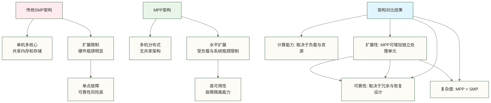

### 🏗️ 无共享架构设计

#### 📋 三种主流并行架构对比

| 架构类型 | 共享模式 | 扩展性 | 故障影响 | 典型应用 |
|---|---|---|---|---|
| **SMP** | 多处理器共享内存，内存访问时间近似一致 | 受硬件与软件实现限制，无固定8-16核上限 | 取决于系统冗余设计 | 共享内存多处理器系统 |
| **NUMA** | 共享地址空间，各处理器访问本地与远端内存的代价不同 | 依硬件互连与内存布局而定 | 取决于系统冗余设计 | 多路服务器 |
| **MPP** | 处理单元独立使用计算与存储资源 | 可水平扩展，规模依具体实现而定 | 故障可能影响分布式查询，恢复依赖冗余机制 | 分析数据库 |

注：SMP与NUMA侧重多处理器内存访问组织，MPP侧重大规模并行处理组织，并非完全互斥的同一维度分类；MPP集群中的服务器也可以采用NUMA硬件。

**MPP无共享架构的优势：**

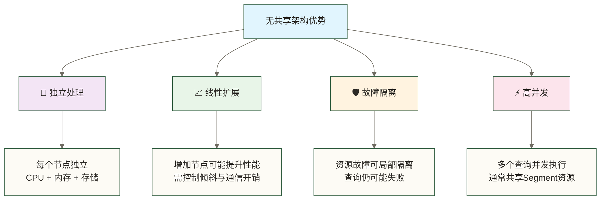

## 🏛️ Greenplum整体架构

### 📊 系统架构总览

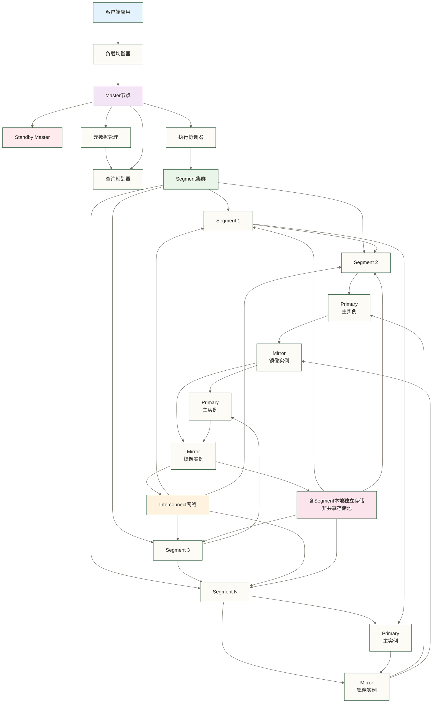

### 🎯 核心组件详解

#### 1. 🧠 Master节点：智能大脑

**Master节点职责：**

| 功能模块 | 核心职责 | 类比说明 |
|---|---|---|
| **连接管理** | 处理客户端连接请求 | 工厂前台接待 |
| **SQL解析** | 解析和验证SQL语句 | 订单需求分析 |
| **查询规划** | 生成最优执行计划 | 生产计划制定 |
| **任务分发** | 将任务分配给Segment | 工作指令下达 |
| **结果汇总** | 收集并返回最终结果 | 产品质检包装 |
| **元数据管理** | 维护系统元数据信息 | 工厂档案管理 |
| **事务协调** | 全局事务一致性控制 | 质量标准监督 |

**Master节点架构细节：**

```mermaid
%%{init: {"theme":"base","themeVariables":{"fontFamily":"PingFang SC, -apple-system, Source Han Serif SC, serif","fontSize":"16px","background":"#FDFBF5","primaryColor":"#FDFBF5","primaryTextColor":"#2D2A26","primaryBorderColor":"#6E6A60","secondaryColor":"#E8EFE8","secondaryBorderColor":"#8FA890","secondaryTextColor":"#2D2A26","tertiaryColor":"#FDFBF5","tertiaryBorderColor":"#9A9488","tertiaryTextColor":"#6E6A60","lineColor":"#6E6A60","textColor":"#2D2A26","mainBkg":"#FDFBF5","nodeBorder":"#2D5A3D","clusterBkg":"#F3EEDF","clusterBorder":"#9A9488","edgeLabelBackground":"#FDFBF5"},"flowchart":{"htmlLabels":true,"curve":"basis","padding":20,"nodeSpacing":60,"rankSpacing":70,"useMaxWidth":false},"themeCSS":".node rect, .node polygon, .node circle { stroke-width: 1.5px; } .edgePath .path { stroke-width: 1.5px; } .cluster-label .nodeLabel, .cluster-label foreignObject { color: #2D2A26 !important; } .edgeLabel, .edgeLabel foreignObject { color: #2D2A26 !important; background-color: #FDFBF5; } .edgeLabel rect { fill: #FDFBF5; }"}}%%
flowchart TD
    A[Master节点内部架构]
    B[📡 连接层]
    C[🧠 解析层]
    D[🎯 优化层]
    E[📋 调度层]
    F[🗄️ 元数据层]
    B1[连接池管理<br/>客户端会话管理]
    B2[负载均衡<br/>连接分发策略]
    C1[SQL解析器<br/>语法分析]
    C2[语义分析器<br/>权限验证]
    D1[查询优化器<br/>基于成本的优化]
    D2[执行计划生成<br/>并行策略制定]
    E1[任务调度器<br/>Segment任务分发]
    E2[资源管理器<br/>系统资源监控]
    F1[系统目录<br/>表结构元数据]
    F2[统计信息<br/>数据分布统计]
    
    A --> B
    A --> C
    A --> D
    A --> E
    A --> F
    B --> B1
    B --> B2
    C --> C1
    C --> C2
    D --> D1
    D --> D2
    E --> E1
    E --> E2
    F --> F1
    F --> F2
    
    style A fill:#e1f5fe
    style B fill:#f3e5f5
    style C fill:#fff3e0
    style D fill:#e8f5e8
    style E fill:#fce4ec
    style F fill:#f9fbe7
```

#### 2. 🏗️ Segment节点：工作马力

**Segment节点特性：**

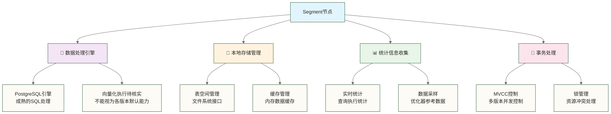

**Segment数据分布策略：**

| 分布策略 | 适用场景 | 优势 | 劣势 |
|---|---|---|---|
| **Hash分布** | 大表均匀分布 | 查询性能好 | 数据倾斜风险 |
| **随机分布** | 小表或临时表 | 插入性能好 | 连接性能差 |
| **复制分布** | 较小维度表，需确认版本支持 | 可减少相关连接的数据移动，依执行计划而定 | 存储空间大 |

#### 3. 📡 Interconnect：高速网络

**网络架构设计：**

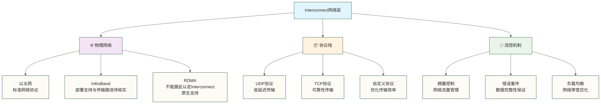

## ⚡ 查询执行流程

### 🔄 完整查询生命周期

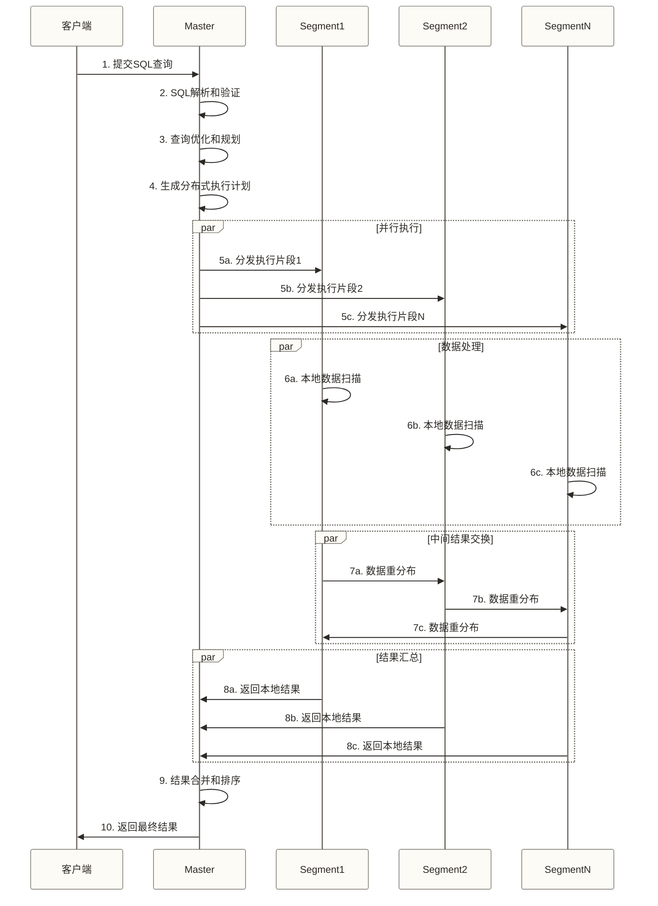

### 📊 查询执行详细分析

#### 阶段1：查询解析与优化

```sql
-- 复杂查询示例
SELECT 
    r.region_name,
    c.customer_segment,
    DATE_TRUNC('month', o.order_date) as order_month,
    COUNT(*) as order_count,
    SUM(o.total_amount) as revenue,
    AVG(o.total_amount) as avg_order_value
FROM orders o
JOIN customers c ON o.customer_id = c.customer_id
JOIN regions r ON c.region_id = r.region_id
WHERE o.order_date >= '2023-01-01'
    AND o.order_date < '2024-01-01'
    AND o.status = 'completed'
GROUP BY r.region_name, c.customer_segment, DATE_TRUNC('month', o.order_date)
HAVING SUM(o.total_amount) > 100000
ORDER BY order_month DESC, revenue DESC;
```

**优化器处理步骤：**

1. **🔍 语法解析**：构建查询语法树
2. **📊 统计分析**：评估表大小和数据分布
3. **🎯 连接优化**：选择最优连接顺序和算法
4. **📈 成本估算**：计算不同执行方案的成本
5. **⚡ 并行规划**：设计并行执行策略

#### 阶段2：分布式执行计划

```mermaid
%%{init: {"theme":"base","themeVariables":{"fontFamily":"PingFang SC, -apple-system, Source Han Serif SC, serif","fontSize":"16px","background":"#FDFBF5","primaryColor":"#FDFBF5","primaryTextColor":"#2D2A26","primaryBorderColor":"#6E6A60","secondaryColor":"#E8EFE8","secondaryBorderColor":"#8FA890","secondaryTextColor":"#2D2A26","tertiaryColor":"#FDFBF5","tertiaryBorderColor":"#9A9488","tertiaryTextColor":"#6E6A60","lineColor":"#6E6A60","textColor":"#2D2A26","mainBkg":"#FDFBF5","nodeBorder":"#2D5A3D","clusterBkg":"#F3EEDF","clusterBorder":"#9A9488","edgeLabelBackground":"#FDFBF5"},"flowchart":{"htmlLabels":true,"curve":"basis","padding":20,"nodeSpacing":60,"rankSpacing":70,"useMaxWidth":false},"themeCSS":".node rect, .node polygon, .node circle { stroke-width: 1.5px; } .edgePath .path { stroke-width: 1.5px; } .cluster-label .nodeLabel, .cluster-label foreignObject { color: #2D2A26 !important; } .edgeLabel, .edgeLabel foreignObject { color: #2D2A26 !important; background-color: #FDFBF5; } .edgeLabel rect { fill: #FDFBF5; }"}}%%
flowchart TD
    A[分布式执行计划]
    B[📊 数据扫描层]
    C[🔗 数据连接层]
    D[📈 数据聚合层]
    E[🎯 结果汇总层]
    B1[并行表扫描<br/>每个Segment扫描本地数据]
    B2[过滤条件应用<br/>WHERE子句并行执行]
    C1[数据重分布<br/>按连接键重新分布数据]
    C2[本地连接操作<br/>Hash Join或Merge Join]
    D1[预聚合处理<br/>本地GROUP BY操作]
    D2[数据再分布<br/>按聚合键重新分布]
    D3[最终聚合<br/>合并本地聚合结果]
    E1[结果排序<br/>ORDER BY并行处理]
    E2[数据收集<br/>Master汇总最终结果]
    
    A --> B
    A --> C
    A --> D
    A --> E
    B --> B1
    B --> B2
    C --> C1
    C --> C2
    D --> D1
    D --> D2
    D --> D3
    E --> E1
    E --> E2
    
    style A fill:#e1f5fe
    style B fill:#f3e5f5
    style C fill:#fff3e0
    style D fill:#e8f5e8
    style E fill:#fce4ec
```

## 🛡️ 高可用架构设计

### 🔄 镜像备份机制

#### 📋 Master高可用

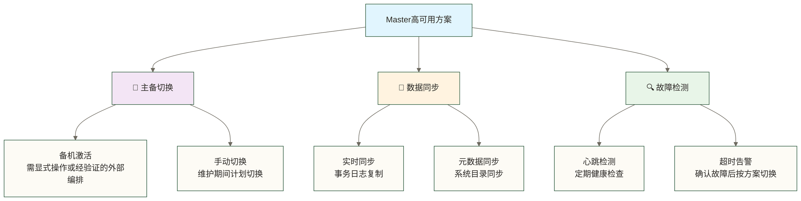

**Master故障转移流程（原稿未核实的教学示例）：**

以下时间没有实测依据，不是Greenplum默认恢复时限或SLA；Master故障发生后，检测和确认阶段也可能已影响服务。备机激活须先确认原主节点被隔离，防止双主，客户端还需按配置重连；实际步骤与时长应按目标版本及现场演练确定。

| 步骤 | 操作内容 | 预计时间 | 影响范围 |
|---|---|---|---|
| **1. 故障检测** | 心跳超时检测 | 10-30秒 | 服务可能已中断 |
| **2. 确认故障** | 多路径验证故障 | 5-10秒 | 服务可能持续中断 |
| **3. 激活备机** | Standby升级为Primary | 15-30秒 | 服务暂停 |
| **4. 重定向连接** | 客户端连接重定向 | 5-15秒 | 逐步恢复 |
| **5. 服务恢复** | 全面恢复正常服务 | 总计1-2分钟 | 完全恢复 |

#### 🏗️ Segment镜像机制

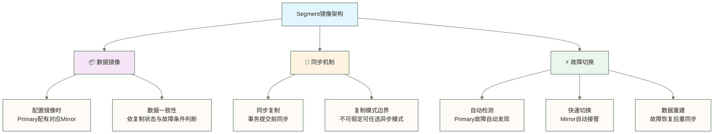

### 📊 数据一致性保障

#### 🔒 事务一致性机制

**分布式事务处理：**

下图仅示意协调节点、参与Segment与镜像的交互，不是目标版本的精确协议时序；分布式事务提交与镜像复制是不同机制，不能据图推导所有事务都使用同一流程或在任何故障下均保证镜像同步。

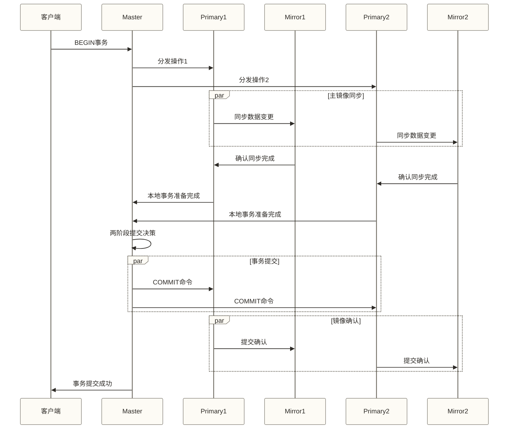

## 🚀 性能优化设计

### ⚡ 并行处理优化

#### 📊 数据分布优化

**最优分布键选择原则：**

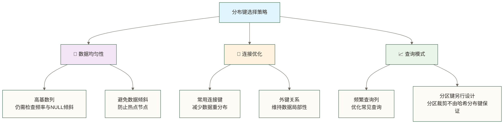

**分布键性能对比（教学性定性示意）：**

星级不是实测结论，不能仅凭列名判断均匀性或连接性能；需结合值频率、NULL比例、连接条件及两表分布策略验证。

| 分布键类型 | 数据均匀性 | 连接性能 | 维护复杂度 | 推荐场景 |
|---|---|---|---|---|
| **主键ID** | ⭐⭐⭐⭐⭐ | ⭐⭐ | ⭐ | 事实表 |
| **时间戳** | ⭐⭐ | ⭐⭐⭐ | ⭐⭐ | 时序数据 |
| **地理区域** | ⭐⭐⭐ | ⭐⭐⭐⭐ | ⭐⭐⭐ | 区域分析 |
| **客户ID** | ⭐⭐⭐⭐ | ⭐⭐⭐⭐⭐ | ⭐⭐ | 客户分析 |

#### 🔧 查询优化技术

**向量化执行引擎：**

以下介绍通用向量化思想，不能据此认定本文未指定版本的Greenplum具备该执行引擎；图中5-10倍、2-5倍、3-8倍为原稿未核实示例，没有基准数据，不构成性能承诺，列式存储也不自动等同于向量化执行。

```mermaid
%%{init: {"theme":"base","themeVariables":{"fontFamily":"PingFang SC, -apple-system, Source Han Serif SC, serif","fontSize":"16px","background":"#FDFBF5","primaryColor":"#FDFBF5","primaryTextColor":"#2D2A26","primaryBorderColor":"#6E6A60","secondaryColor":"#E8EFE8","secondaryBorderColor":"#8FA890","secondaryTextColor":"#2D2A26","tertiaryColor":"#FDFBF5","tertiaryBorderColor":"#9A9488","tertiaryTextColor":"#6E6A60","lineColor":"#6E6A60","textColor":"#2D2A26","mainBkg":"#FDFBF5","nodeBorder":"#2D5A3D","clusterBkg":"#F3EEDF","clusterBorder":"#9A9488","edgeLabelBackground":"#FDFBF5"},"flowchart":{"htmlLabels":true,"curve":"basis","padding":20,"nodeSpacing":60,"rankSpacing":70,"useMaxWidth":false},"themeCSS":".node rect, .node polygon, .node circle { stroke-width: 1.5px; } .edgePath .path { stroke-width: 1.5px; } .cluster-label .nodeLabel, .cluster-label foreignObject { color: #2D2A26 !important; } .edgeLabel, .edgeLabel foreignObject { color: #2D2A26 !important; background-color: #FDFBF5; } .edgeLabel rect { fill: #FDFBF5; }"}}%%
flowchart TD
    A[传统行执行]
    A1[逐行处理<br/>函数调用开销大]
    A2[分支预测失败<br/>CPU流水线中断]
    A3[缓存命中率低<br/>内存访问随机]
    B[向量化执行]
    B1[批量处理<br/>减少函数调用]
    B2[SIMD指令<br/>单指令多数据]
    B3[缓存友好<br/>顺序内存访问]
    C[性能提升]
    C1[计算密集型: 5-10倍]
    C2[IO密集型: 2-5倍]
    C3[复杂查询: 3-8倍]
    
    A --> A1
    A --> A2
    A --> A3
    B --> B1
    B --> B2
    B --> B3
    C --> C1
    C --> C2
    C --> C3
    
    style A fill:#ffebee
    style B fill:#e8f5e8
    style C fill:#e1f5fe
```

### 💾 存储层优化

#### 📚 列式存储引擎

**列存储vs行存储对比：**

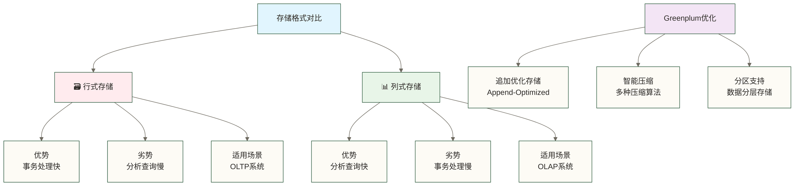

**压缩算法选择：**

下表压缩比与速度星级是原稿未核实示例，并非固定性能；实际结果取决于数据分布和压缩参数。quicklz、zstd及RLE的可用名称、适用存储格式与限制须按具体Greenplum版本确认，不能直接将表中名称作为配置值。

| 压缩算法 | 压缩比 | 压缩速度 | 解压速度 | 适用数据类型 |
|---|---|---|---|---|
| **无压缩** | 1:1 | ⭐⭐⭐⭐⭐ | ⭐⭐⭐⭐⭐ | 临时数据 |
| **RLE** | 3:1 | ⭐⭐⭐⭐ | ⭐⭐⭐⭐⭐ | 重复值多 |
| **zlib** | 5:1 | ⭐⭐⭐ | ⭐⭐⭐⭐ | 通用数据 |
| **quicklz** | 3:1 | ⭐⭐⭐⭐⭐ | ⭐⭐⭐⭐⭐ | 实时查询 |
| **zstd** | 6:1 | ⭐⭐⭐⭐ | ⭐⭐⭐⭐ | 新一代算法 |

## 🔧 架构扩展性设计

### 📈 水平扩展能力

#### 🏗️ 动态扩容机制

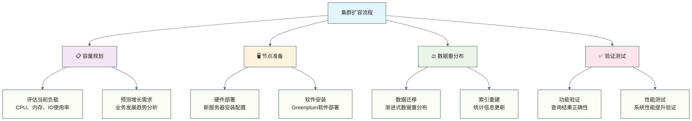

**扩容性能影响评估（原稿未核实的教学示例）：**

下表保留原稿数字，但没有数据规模、硬件、查询负载和迁移方法依据，不代表实际扩容时长、性能收益或业务影响；扩容初始化与数据重分布应分阶段评估，所需锁、维护窗口与回滚措施须按目标版本验证。

| 集群规模 | 扩容时间 | 性能提升 | 业务影响 |
|---|---|---|---|
| **10→20节点** | 2-4小时 | 90%+ | 查询稍慢 |
| **50→100节点** | 6-12小时 | 85%+ | 维护窗口 |
| **100→200节点** | 12-24小时 | 80%+ | 分批扩容 |

### 🌐 多数据中心部署

#### 🏢 跨地域架构

此图是多集群部署设想，不表示Greenplum原生提供跨地域实时复制或自动弹性调度；数据同步、切换、访问路由及一致性边界需要另行选型并验证，不能将本地Segment镜像等同于异地灾备。

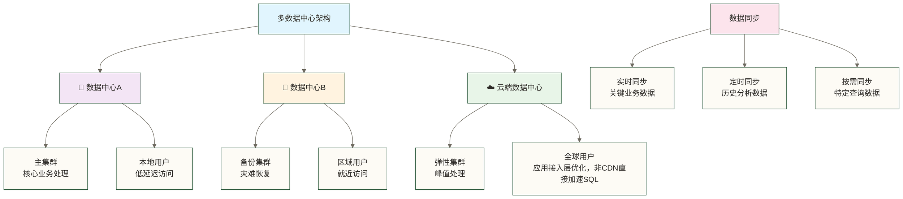

## 💡 架构设计最佳实践

### 🎯 设计原则

#### 📋 架构设计黄金法则

1. **🎯 业务驱动设计**
   - 根据实际业务需求设计架构
   - 避免过度工程化
   - 保持架构简洁高效

2. **📈 可扩展性优先**
   - 设计时考虑未来扩展需求
   - 模块化和组件化设计
   - 支持水平和垂直扩展

3. **🛡️ 高可用保障**
   - 消除单点故障
   - 实现故障快速恢复
   - 数据安全保护机制

4. **⚡ 性能优化**
   - 减少网络传输开销
   - 优化数据访问模式
   - 充分利用并行处理

### 🔧 常见架构陷阱

#### ⚠️ 设计误区与解决方案

| 常见问题 | 问题表现 | 解决方案 | 预防措施 |
|---|---|---|---|
| **数据倾斜** | 某些节点负载过高 | 重新选择分布键 | 分布键基数分析 |
| **网络瓶颈** | 跨节点查询慢 | 网络硬件升级 | 架构设计时考虑网络 |
| **存储不均** | 节点存储使用不均 | 数据重新平衡 | 定期监控存储使用 |
| **查询倾斜** | 部分查询占用大量资源 | 查询优化和限制 | 资源队列管理 |

### 🌟 架构演进策略

#### 📊 分阶段架构发展

图中10-50TB、50-500TB、500TB-5PB与5PB+为教学分档，不是产品容量边界；是否采用多集群或云原生部署，应由并发、可用性、数据治理与运维约束决定，不能只由数据量决定。

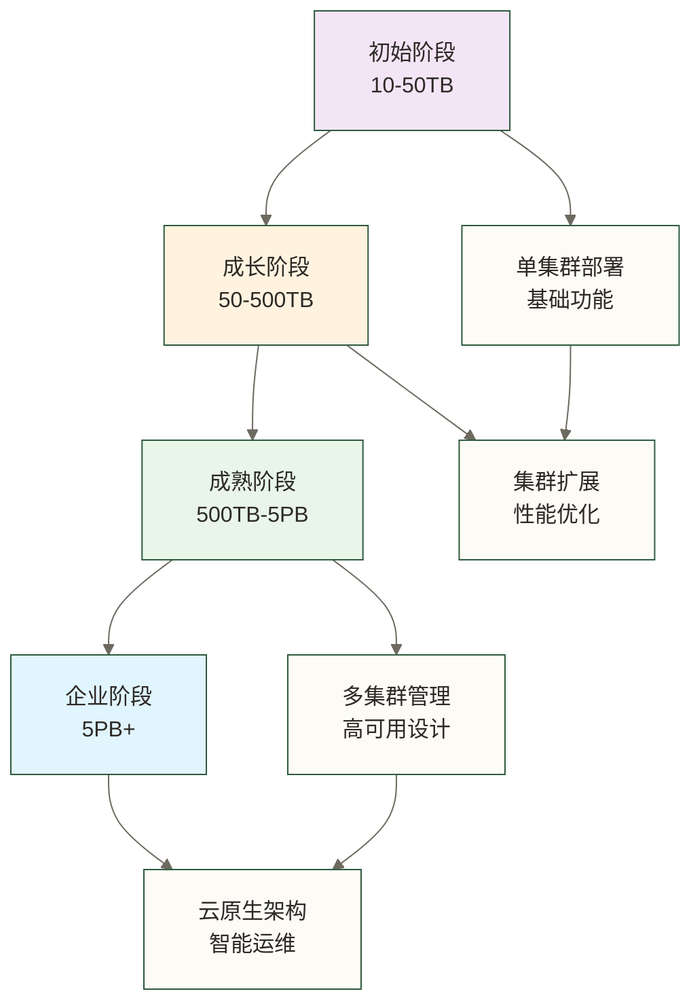

## 🎓 学习建议

### 📚 深入理解架构

#### 🔍 学习重点

1. **理论基础（30%）**
   - MPP架构原理
   - 分布式系统理论
   - 数据库系统原理

2. **实践操作（50%）**
   - 集群部署实践
   - 性能调优实验
   - 故障模拟演练

3. **案例分析（20%）**
   - 企业架构案例
   - 性能优化案例
   - 故障处理案例

#### 🎯 进阶路径

**从理解到精通的学习路径：**

1. **架构认知**：理解整体架构设计思路
2. **组件深入**：掌握每个组件的工作原理
3. **优化实践**：进行性能调优和故障处理
4. **方案设计**：能够设计企业级解决方案

### 💪 实践建议

#### 🛠️ 动手实验

1. **搭建测试环境**
   - 虚拟机集群搭建
   - 不同配置对比测试
   - 故障恢复演练

2. **性能测试**
   - 基准性能测试
   - 扩容效果验证
   - 瓶颈识别分析

3. **架构优化**
   - 参数调优实验
   - 查询优化实践
   - 存储优化测试

---

**理解Greenplum架构原理，有助于建立构建企业级数据仓库的技术基础，但仍需结合具体版本、部署实践、性能测试与故障演练验证。下一步，我们将学习如何搭建Greenplum环境，把理论转化为实践。** 🚀✨