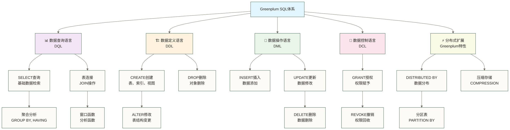

# 📝 SQL基础操作 - 掌握Greenplum分布式查询的核心技能

> [!tip] 💝 给SQL学习新手的温暖指导
> 
> 🤗 **学习Greenplum SQL就像学会使用专业工具箱！**
> 
> 如果你现在面对SQL语法时想：
> - "Greenplum的SQL和我之前学的有什么不同？"
> - "分布式查询有哪些特殊的语法和技巧？"
> - "如何写出高效的分析查询语句？"
> 
> **别担心！** 每个数据分析师都是从第一个SELECT开始的 ✨
> 
> 🧰 **想象SQL技能就像使用专业工具箱**
> 
> 专业工具箱的使用过程：
> - 🔧 **基础工具** = DDL语句（创建和管理数据结构）
> - 📊 **测量工具** = DQL语句（查询和分析数据）
> - ⚙️ **加工工具** = DML语句（操作和变换数据）
> - 🎯 **精密工具** = 高级函数（复杂分析处理）
> - 🚀 **电动工具** = 分布式特性（MPP并行处理）
> 
> **熟练掌握SQL工具箱，有助于解决常见的数据查询与分析问题；复杂问题仍需结合业务口径、数据质量和执行环境判断。** 🌟

## 🎯 Greenplum SQL概览

### 📊 SQL语言体系



### 🌟 Greenplum SQL特色

> 下表性能倍数保留为原稿未核实示例，未提供可复现基准，不代表实际提升或性能保证。传统数据库也可使用Hash连接、并行查询等机制；实际效果取决于版本、硬件、数据规模、分布策略和执行计划。

| SQL类型 | 传统数据库 | Greenplum增强 | 性能提升 |
|---|---|---|---|
| **基础查询** | 单机执行 | 分布式并行 | 10-100倍 |
| **聚合分析** | 内存限制 | 分段聚合 | 5-50倍 |
| **表连接** | 嵌套循环 | 分布式Hash连接 | 20-200倍 |
| **窗口函数** | 排序瓶颈 | 并行窗口处理 | 10-100倍 |

## 🏗️ 数据定义语言(DDL)

### 📊 创建数据库和表

#### 🗂️ 数据库管理

```sql
-- 🏗️ 数据库管理基础操作

-- 1. 创建数据库
CREATE DATABASE sales_analytics
    WITH OWNER = gpadmin
    ENCODING = 'UTF8'
    TABLESPACE = pg_default
    CONNECTION LIMIT = 100;

-- 2. 连接到数据库
\c sales_analytics

-- 3. 查看数据库列表
\l

-- 4. 查看当前数据库信息
SELECT 
    current_database() as 当前数据库,
    current_user as 当前用户,
    version() as 数据库版本;

-- 5. 查看数据库大小
SELECT 
    datname as 数据库名,
    pg_size_pretty(pg_database_size(datname)) as 数据库大小
FROM pg_database
WHERE datname NOT IN ('template0', 'template1', 'postgres')
ORDER BY pg_database_size(datname) DESC;
```

#### 📋 表结构设计

```sql
-- 📊 创建分布式表

-- 1. 创建销售事实表
CREATE TABLE sales_fact (
    sale_id BIGSERIAL,                    -- 销售ID（自增）
    product_id INTEGER NOT NULL,          -- 产品ID
    customer_id INTEGER NOT NULL,         -- 客户ID  
    store_id INTEGER NOT NULL,            -- 门店ID
    sale_date DATE NOT NULL,              -- 销售日期
    sale_time TIME,                       -- 销售时间
    quantity INTEGER NOT NULL CHECK (quantity > 0),  -- 销售数量
    unit_price DECIMAL(10,2) NOT NULL,    -- 单价
    total_amount DECIMAL(12,2) NOT NULL,  -- 总金额
    discount_rate DECIMAL(5,4) DEFAULT 0, -- 折扣率
    sales_person VARCHAR(50),             -- 销售人员
    created_at TIMESTAMP DEFAULT NOW(),   -- 创建时间
    updated_at TIMESTAMP DEFAULT NOW()    -- 更新时间
)
WITH (appendonly=true, compresstype=zstd, compresslevel=1)
DISTRIBUTED BY (customer_id)              -- 按客户ID分布
PARTITION BY RANGE (sale_date)            -- 按日期分区
(
    PARTITION p202301 START ('2023-01-01') END ('2023-02-01'),
    PARTITION p202302 START ('2023-02-01') END ('2023-03-01'),
    PARTITION p202303 START ('2023-03-01') END ('2023-04-01'),
    DEFAULT PARTITION p_default
);

-- 2. 创建产品维度表
CREATE TABLE product_dim (
    product_id SERIAL PRIMARY KEY,
    product_code VARCHAR(20) UNIQUE NOT NULL,
    product_name VARCHAR(100) NOT NULL,
    category VARCHAR(50) NOT NULL,
    brand VARCHAR(50),
    unit VARCHAR(20),
    cost_price DECIMAL(10,2),
    list_price DECIMAL(10,2),
    status VARCHAR(20) DEFAULT 'active',
    created_date DATE DEFAULT CURRENT_DATE
) 
DISTRIBUTED REPLICATED;  -- 小表复制分布

-- 3. 创建客户维度表  
CREATE TABLE customer_dim (
    customer_id SERIAL PRIMARY KEY,
    customer_code VARCHAR(20) UNIQUE NOT NULL,
    customer_name VARCHAR(100) NOT NULL,
    customer_type VARCHAR(20),
    gender CHAR(1) CHECK (gender IN ('M', 'F')),
    birth_date DATE,
    email VARCHAR(100),
    phone VARCHAR(20),
    address TEXT,
    city VARCHAR(50),
    province VARCHAR(50),
    registration_date DATE DEFAULT CURRENT_DATE,
    vip_level INTEGER DEFAULT 1 CHECK (vip_level BETWEEN 1 AND 5)
)
DISTRIBUTED BY (customer_id);

-- 4. 创建门店维度表
CREATE TABLE store_dim (
    store_id SERIAL PRIMARY KEY,
    store_code VARCHAR(20) UNIQUE NOT NULL,
    store_name VARCHAR(100) NOT NULL,
    store_type VARCHAR(30),
    manager_name VARCHAR(50),
    address TEXT,
    city VARCHAR(50),
    province VARCHAR(50),
    phone VARCHAR(20),
    opening_date DATE,
    area_size DECIMAL(8,2),  -- 面积
    status VARCHAR(20) DEFAULT 'open'
)
DISTRIBUTED REPLICATED;  -- 小表复制分布

-- 5. 添加表注释
COMMENT ON TABLE sales_fact IS '销售事实表，存储所有销售交易记录';
COMMENT ON COLUMN sales_fact.sale_id IS '销售记录唯一标识';
COMMENT ON COLUMN sales_fact.total_amount IS '销售总金额，含税';

COMMENT ON TABLE product_dim IS '产品维度表，存储产品基础信息';
COMMENT ON TABLE customer_dim IS '客户维度表，存储客户详细信息';
COMMENT ON TABLE store_dim IS '门店维度表，存储门店基础信息';
```

#### 🔧 表结构修改

```sql
-- 🔧 表结构维护操作

-- 1. 添加列
ALTER TABLE sales_fact 
ADD COLUMN payment_method VARCHAR(20) DEFAULT 'cash',
ADD COLUMN invoice_number VARCHAR(30);

-- 2. 修改列
ALTER TABLE customer_dim 
ALTER COLUMN email TYPE VARCHAR(150),
ALTER COLUMN phone TYPE VARCHAR(30);

-- 3. 删除列
ALTER TABLE sales_fact 
DROP COLUMN IF EXISTS temp_column;

-- 4. 添加约束
ALTER TABLE sales_fact 
ADD CONSTRAINT fk_product 
FOREIGN KEY (product_id) REFERENCES product_dim(product_id);

ALTER TABLE sales_fact 
ADD CONSTRAINT fk_customer 
FOREIGN KEY (customer_id) REFERENCES customer_dim(customer_id);

-- 5. 重命名表和列
ALTER TABLE sales_fact RENAME TO sales_transactions;
ALTER TABLE sales_transactions RENAME COLUMN sale_id TO transaction_id;

-- 恢复原始表名用于后续示例
ALTER TABLE sales_transactions RENAME TO sales_fact;
ALTER TABLE sales_fact RENAME COLUMN transaction_id TO sale_id;

-- 6. 查看表结构
\d sales_fact
\d+ product_dim

-- 7. 查看表的分布策略
SELECT
    n.nspname AS schemaname,
    c.relname AS tablename,
    p.*
FROM gp_distribution_policy p
JOIN pg_class c ON c.oid = p.localoid
JOIN pg_namespace n ON n.oid = c.relnamespace
WHERE n.nspname = 'public'
AND c.relname IN ('sales_fact', 'product_dim', 'customer_dim');
-- 分布策略字段名称随版本可能变化，请结合目标版本目录定义解读。
```

### 📊 索引和约束

#### 🎯 索引创建和管理

```sql
-- 🎯 索引优化策略

-- 注意：Greenplum中索引使用较少，主要依靠分布式扫描
-- 但在特定场景下仍然有用

-- 1. 创建B-tree索引（用于点查询）
CREATE INDEX idx_sales_fact_date 
ON sales_fact (sale_date)
WHERE sale_date >= '2023-01-01';

-- 2. 创建复合索引
CREATE INDEX idx_customer_name_city 
ON customer_dim (customer_name, city);

-- 3. 创建部分索引
CREATE INDEX idx_high_value_sales 
ON sales_fact (total_amount)
WHERE total_amount > 10000;

-- 4. 创建表达式索引
CREATE INDEX idx_customer_upper_name 
ON customer_dim (UPPER(customer_name));

-- 5. 查看索引定义（此查询不提供实际使用次数）
SELECT 
    schemaname,
    tablename,
    indexname,
    indexdef
FROM pg_indexes 
WHERE tablename LIKE '%dim' OR tablename LIKE '%fact'
ORDER BY tablename, indexname;

-- 6. 分析索引效果
EXPLAIN (ANALYZE, BUFFERS) 
SELECT * FROM customer_dim 
WHERE customer_name = '张三';

-- 7. 删除不必要的索引
DROP INDEX IF EXISTS idx_temp_index;

-- 8. 重建索引
REINDEX INDEX idx_sales_fact_date;
REINDEX TABLE customer_dim;
```

#### 🔐 约束管理

```sql
-- 🔐 数据完整性约束

-- 1. 检查约束
ALTER TABLE sales_fact 
ADD CONSTRAINT chk_positive_amount 
CHECK (total_amount > 0);

ALTER TABLE sales_fact 
ADD CONSTRAINT chk_valid_discount 
CHECK (discount_rate >= 0 AND discount_rate <= 1);

-- 2. 唯一约束
ALTER TABLE product_dim 
ADD CONSTRAINT uk_product_code 
UNIQUE (product_code);

-- 3. 非空约束
ALTER TABLE customer_dim 
ALTER COLUMN customer_name SET NOT NULL;

-- 4. 默认值约束
ALTER TABLE sales_fact 
ALTER COLUMN created_at SET DEFAULT NOW();

-- 5. 查看表约束
SELECT 
    tc.table_name,
    tc.constraint_name,
    tc.constraint_type,
    cc.check_clause
FROM information_schema.table_constraints tc
LEFT JOIN information_schema.check_constraints cc 
    ON tc.constraint_name = cc.constraint_name
WHERE tc.table_schema = 'public'
AND tc.table_name IN ('sales_fact', 'product_dim', 'customer_dim')
ORDER BY tc.table_name, tc.constraint_type;

-- 6. 验证约束
-- 这些语句会失败，验证约束有效
-- INSERT INTO sales_fact (product_id, customer_id, store_id, sale_date, quantity, unit_price, total_amount) 
-- VALUES (1, 1, 1, '2023-01-01', 1, 100, -50);  -- 违反金额约束

-- INSERT INTO sales_fact (product_id, customer_id, store_id, sale_date, quantity, unit_price, total_amount, discount_rate) 
-- VALUES (1, 1, 1, '2023-01-01', 1, 100, 50, 1.5);  -- 违反折扣约束
```

## 📊 数据查询语言(DQL)

### 🔍 基础查询操作

#### 📋 SELECT语句基础

```sql
-- 📋 基础查询技能训练

-- 创建示例数据用于练习
INSERT INTO product_dim (product_code, product_name, category, brand, cost_price, list_price) VALUES
('P001', 'iPhone 14 Pro', '手机', 'Apple', 7000, 8999),
('P002', 'Samsung Galaxy S23', '手机', 'Samsung', 5500, 6999),
('P003', 'MacBook Pro M2', '电脑', 'Apple', 12000, 15999),
('P004', 'Dell XPS 13', '电脑', 'Dell', 8000, 10999),
('P005', 'iPad Air', '平板', 'Apple', 3500, 4599),
('P006', 'Surface Pro', '平板', 'Microsoft', 4000, 5299),
('P007', 'AirPods Pro', '耳机', 'Apple', 1200, 1999),
('P008', 'Sony WH-1000XM4', '耳机', 'Sony', 1500, 2299);

INSERT INTO customer_dim (customer_code, customer_name, customer_type, gender, city, province, vip_level) VALUES
('C001', '张三', 'VIP客户', 'M', '北京', '北京', 5),
('C002', '李四', '普通客户', 'F', '上海', '上海', 2),
('C003', '王五', 'VIP客户', 'M', '深圳', '广东', 4),
('C004', '赵六', '普通客户', 'F', '杭州', '浙江', 1),
('C005', '钱七', 'VIP客户', 'M', '南京', '江苏', 3);

INSERT INTO store_dim (store_code, store_name, store_type, city, province, area_size) VALUES
('S001', '北京旗舰店', '旗舰店', '北京', '北京', 500.0),
('S002', '上海体验店', '体验店', '上海', '上海', 300.0),
('S003', '深圳专卖店', '专卖店', '深圳', '广东', 200.0),
('S004', '杭州门店', '标准店', '杭州', '浙江', 150.0);

-- 1. 基础SELECT查询
SELECT * FROM product_dim LIMIT 5;

-- 2. 指定列查询
SELECT 
    product_name as 产品名称,
    category as 产品类别,
    brand as 品牌,
    list_price as 售价
FROM product_dim;

-- 3. 条件查询
SELECT 
    product_name,
    list_price
FROM product_dim 
WHERE category = '手机' 
AND list_price > 7000;

-- 4. 模糊查询
SELECT 
    customer_name,
    city,
    vip_level
FROM customer_dim 
WHERE customer_name LIKE '%三%'
OR city LIKE '北%';

-- 5. 范围查询
SELECT 
    product_name,
    list_price
FROM product_dim 
WHERE list_price BETWEEN 5000 AND 10000;

-- 6. 集合查询
SELECT 
    customer_name,
    city
FROM customer_dim 
WHERE city IN ('北京', '上海', '深圳');

-- 7. 空值查询
SELECT 
    customer_name,
    email
FROM customer_dim 
WHERE email IS NULL;

-- 8. 排序查询
SELECT 
    product_name,
    category,
    list_price
FROM product_dim 
ORDER BY category ASC, list_price DESC;

-- 9. 去重查询
SELECT DISTINCT 
    category,
    brand
FROM product_dim 
ORDER BY category, brand;

-- 10. 限制结果数量
SELECT 
    product_name,
    list_price
FROM product_dim 
ORDER BY list_price DESC
LIMIT 3 OFFSET 1;  -- 跳过第1条，取3条
```

#### 🔢 数值和字符串函数

```sql
-- 🔢 常用函数实战演练

-- 1. 数值函数
SELECT 
    product_name,
    cost_price,
    list_price,
    -- 基础数学运算
    list_price - cost_price as 毛利润,
    ROUND((list_price - cost_price) * 100.0 / NULLIF(list_price, 0), 2) as 毛利率,
    -- 数值函数
    ABS(cost_price - list_price) as 价格差绝对值,
    CEIL(list_price / 1000.0) as 向上取整千,
    FLOOR(list_price / 1000.0) as 向下取整千,
    POWER(list_price / 1000, 2) as 价格平方,
    SQRT(list_price) as 价格平方根,
    -- 格式化
    TO_CHAR(list_price, 'FM999,999.00') as 格式化价格
FROM product_dim
WHERE cost_price IS NOT NULL;

-- 2. 字符串函数
SELECT 
    customer_name,
    -- 长度和截取
    LENGTH(customer_name) as 姓名长度,
    SUBSTRING(customer_name, 1, 1) as 姓氏,
    LEFT(customer_code, 1) as 客户类型前缀,
    RIGHT(customer_code, 3) as 客户编号,
    -- 大小写转换
    UPPER(customer_name) as 大写姓名,
    LOWER(city) as 小写城市,
    INITCAP(customer_type) as 首字母大写类型,
    -- 填充和修剪
    LPAD(customer_code, 10, '0') as 左填充编码,
    RPAD(customer_name, 10, '-') as 右填充姓名,
    TRIM('  ' FROM '  ' || customer_name || '  ') as 去空格姓名,
    -- 替换和连接
    REPLACE(customer_type, '客户', 'Customer') as 替换类型,
    CONCAT(customer_name, '(', city, ')') as 姓名城市,
    customer_name || '-' || customer_code as 连接字符串
FROM customer_dim;

-- 3. 日期时间函数
SELECT 
    -- 当前时间
    NOW() as 当前时间戳,
    CURRENT_DATE as 当前日期,
    CURRENT_TIME as 当前时间,
    -- 日期提取
    EXTRACT(YEAR FROM NOW()) as 当前年份,
    EXTRACT(MONTH FROM NOW()) as 当前月份,
    EXTRACT(DAY FROM NOW()) as 当前日期,
    EXTRACT(DOW FROM NOW()) as 星期几,
    -- 日期格式化
    TO_CHAR(NOW(), 'YYYY-MM-DD HH24:MI:SS') as 格式化时间戳,
    TO_CHAR(NOW(), 'YYYY年MM月DD日') as 中文日期,
    -- 日期运算
    NOW() + INTERVAL '7 days' as 七天后,
    NOW() - INTERVAL '1 month' as 一个月前,
    -- 日期截断
    DATE_TRUNC('month', NOW()) as 当月第一天,
    DATE_TRUNC('year', NOW()) as 当年第一天;

-- 4. 条件判断函数
SELECT 
    product_name,
    list_price,
    -- CASE表达式
    CASE 
        WHEN list_price > 10000 THEN '高端产品'
        WHEN list_price > 5000 THEN '中端产品'
        ELSE '入门产品'
    END as 产品定位,
    -- 简单CASE
    CASE category
        WHEN '手机' THEN '通讯设备'
        WHEN '电脑' THEN '计算设备'
        WHEN '平板' THEN '移动设备'
        ELSE '其他设备'
    END as 设备类型,
    -- 空值处理
    COALESCE(cost_price, 0) as 成本价格,
    NULLIF(cost_price, 0) as 非零成本,
    -- 最大最小值
    GREATEST(cost_price, list_price * 0.5) as 最低成本,
    LEAST(list_price, cost_price * 2) as 最高售价
FROM product_dim;
```

### 📊 聚合分析查询

#### 📈 GROUP BY聚合分析

```sql
-- 📈 聚合分析实战演练

-- 先插入一些销售数据用于分析
INSERT INTO sales_fact (product_id, customer_id, store_id, sale_date, quantity, unit_price, total_amount, sales_person) VALUES
(1, 1, 1, '2023-01-15', 2, 8999, 17998, '张销售'),
(2, 2, 2, '2023-01-16', 1, 6999, 6999, '李销售'),
(3, 3, 1, '2023-01-17', 1, 15999, 15999, '张销售'),
(5, 4, 3, '2023-01-18', 3, 4599, 13797, '王销售'),
(7, 5, 2, '2023-01-19', 2, 1999, 3998, '李销售'),
(1, 2, 4, '2023-01-20', 1, 8999, 8999, '赵销售'),
(4, 1, 3, '2023-01-21', 1, 10999, 10999, '王销售'),
(6, 3, 2, '2023-01-22', 2, 5299, 10598, '李销售'),
(8, 4, 1, '2023-01-23', 1, 2299, 2299, '张销售'),
(2, 5, 4, '2023-01-24', 1, 6999, 6999, '赵销售');

-- 1. 基础聚合统计
SELECT 
    COUNT(*) as 总订单数,
    COUNT(DISTINCT customer_id) as 客户数量,
    COUNT(DISTINCT product_id) as 产品数量,
    SUM(quantity) as 总销量,
    SUM(total_amount) as 总销售额,
    AVG(total_amount) as 平均订单金额,
    MIN(total_amount) as 最小订单金额,
    MAX(total_amount) as 最大订单金额,
    STDDEV(total_amount) as 订单金额标准差
FROM sales_fact;

-- 2. 按产品分组分析
SELECT 
    p.product_name as 产品名称,
    p.category as 产品类别,
    COUNT(s.sale_id) as 销售次数,
    SUM(s.quantity) as 总销量,
    SUM(s.total_amount) as 总销售额,
    AVG(s.total_amount) as 平均订单金额,
    ROUND(AVG(s.unit_price), 2) as 平均售价,
    -- 计算排名
    RANK() OVER (ORDER BY SUM(s.total_amount) DESC) as 销售额排名
FROM sales_fact s
JOIN product_dim p ON s.product_id = p.product_id
GROUP BY p.product_id, p.product_name, p.category
ORDER BY 总销售额 DESC;

-- 3. 按客户类型分组分析
SELECT 
    c.customer_type as 客户类型,
    c.vip_level as VIP等级,
    COUNT(s.sale_id) as 订单数量,
    COUNT(DISTINCT s.customer_id) as 客户数量,
    SUM(s.total_amount) as 总消费金额,
    AVG(s.total_amount) as 平均订单金额,
    -- 计算客户价值指标
    SUM(s.total_amount) / COUNT(DISTINCT s.customer_id) as 客户平均价值,
    COUNT(s.sale_id) * 1.0 / COUNT(DISTINCT s.customer_id) as 客户平均订单数
FROM sales_fact s
JOIN customer_dim c ON s.customer_id = c.customer_id
GROUP BY c.customer_type, c.vip_level
ORDER BY 总消费金额 DESC;

-- 4. 按门店和日期分组分析
SELECT 
    st.store_name as 门店名称,
    st.city as 城市,
    DATE_TRUNC('month', s.sale_date) as 销售月份,
    COUNT(s.sale_id) as 月度订单数,
    SUM(s.total_amount) as 月度销售额,
    AVG(s.total_amount) as 月度平均订单,
    -- 环比增长计算
    LAG(SUM(s.total_amount)) OVER (
        PARTITION BY st.store_id 
        ORDER BY DATE_TRUNC('month', s.sale_date)
    ) as 上月销售额,
    ROUND(
        (SUM(s.total_amount) - LAG(SUM(s.total_amount)) OVER (
            PARTITION BY st.store_id 
            ORDER BY DATE_TRUNC('month', s.sale_date)
        )) * 100.0 / NULLIF(LAG(SUM(s.total_amount)) OVER (
            PARTITION BY st.store_id 
            ORDER BY DATE_TRUNC('month', s.sale_date)
        ), 0), 2
    ) as 环比增长率
FROM sales_fact s
JOIN store_dim st ON s.store_id = st.store_id
GROUP BY st.store_id, st.store_name, st.city, DATE_TRUNC('month', s.sale_date)
ORDER BY st.store_name, 销售月份;

-- 5. 复杂聚合分析 - 销售人员业绩
SELECT 
    s.sales_person as 销售人员,
    COUNT(DISTINCT s.customer_id) as 服务客户数,
    COUNT(s.sale_id) as 完成订单数,
    SUM(s.total_amount) as 总业绩,
    AVG(s.total_amount) as 平均订单,
    -- 分类统计
    COUNT(CASE WHEN s.total_amount > 10000 THEN 1 END) as 大额订单数,
    COUNT(CASE WHEN s.total_amount BETWEEN 5000 AND 10000 THEN 1 END) as 中额订单数,
    COUNT(CASE WHEN s.total_amount < 5000 THEN 1 END) as 小额订单数,
    -- 业绩占比
    ROUND(
        SUM(s.total_amount) * 100.0 / SUM(SUM(s.total_amount)) OVER (), 
        2
    ) as 业绩占比,
    -- 客户平均订单数；复购率需另按购买次数达到复购标准的客户占比计算
    ROUND(
        COUNT(s.sale_id) * 1.0 / COUNT(DISTINCT s.customer_id), 
        2
    ) as 客户平均订单数
FROM sales_fact s
GROUP BY s.sales_person
HAVING SUM(s.total_amount) > 5000  -- 只看业绩超过5000的
ORDER BY 总业绩 DESC;
```

#### 🔍 HAVING子句过滤

```sql
-- 🔍 HAVING子句高级过滤

-- 1. 基础HAVING过滤
SELECT 
    p.category as 产品类别,
    COUNT(*) as 产品数量,
    AVG(p.list_price) as 平均价格,
    MIN(p.list_price) as 最低价格,
    MAX(p.list_price) as 最高价格
FROM product_dim p
GROUP BY p.category
HAVING COUNT(*) >= 2  -- 只显示产品数量大于等于2的类别
AND AVG(p.list_price) > 5000  -- 且平均价格超过5000
ORDER BY 平均价格 DESC;

-- 2. 复杂HAVING条件
SELECT 
    c.city as 城市,
    c.province as 省份,
    COUNT(s.sale_id) as 订单总数,
    COUNT(DISTINCT s.customer_id) as 客户数量,
    SUM(s.total_amount) as 城市销售额,
    AVG(s.total_amount) as 平均订单金额
FROM sales_fact s
JOIN customer_dim c ON s.customer_id = c.customer_id
GROUP BY c.city, c.province
HAVING COUNT(s.sale_id) >= 2  -- 订单数至少2个
AND SUM(s.total_amount) > 10000  -- 销售额超过1万
AND COUNT(DISTINCT s.customer_id) >= 2  -- 客户数至少2个
ORDER BY 城市销售额 DESC;

-- 3. HAVING中使用子查询
SELECT 
    s.sales_person as 销售人员,
    COUNT(s.sale_id) as 订单数量,
    SUM(s.total_amount) as 总业绩,
    AVG(s.total_amount) as 平均订单金额
FROM sales_fact s
GROUP BY s.sales_person
HAVING SUM(s.total_amount) > (
    SELECT AVG(total_performance) 
    FROM (
        SELECT SUM(total_amount) as total_performance
        FROM sales_fact 
        GROUP BY sales_person
    ) avg_performance
)  -- 业绩超过平均水平的销售人员
ORDER BY 总业绩 DESC;

-- 4. 多表联合的HAVING分析
SELECT 
    p.brand as 品牌,
    p.category as 类别,
    COUNT(DISTINCT p.product_id) as 产品型号数,
    COUNT(s.sale_id) as 销售次数,
    SUM(s.total_amount) as 品牌销售额,
    AVG(s.total_amount) as 平均订单
FROM product_dim p
LEFT JOIN sales_fact s ON p.product_id = s.product_id
GROUP BY p.brand, p.category
HAVING COUNT(s.sale_id) > 0  -- 有销售记录的品牌
AND SUM(s.total_amount) >= 5000  -- 销售额至少5000
ORDER BY 品牌销售额 DESC, 产品型号数 DESC;
```

### 🔗 表连接查询

#### 🤝 JOIN连接类型

```sql
-- 🤝 表连接查询实战

-- 1. INNER JOIN - 内连接（只返回匹配的记录）
SELECT 
    s.sale_id as 销售ID,
    p.product_name as 产品名称,
    c.customer_name as 客户姓名,
    st.store_name as 门店名称,
    s.sale_date as 销售日期,
    s.quantity as 数量,
    s.total_amount as 金额
FROM sales_fact s
INNER JOIN product_dim p ON s.product_id = p.product_id
INNER JOIN customer_dim c ON s.customer_id = c.customer_id  
INNER JOIN store_dim st ON s.store_id = st.store_id
ORDER BY s.sale_date DESC;

-- 2. LEFT JOIN - 左连接（返回左表所有记录）
SELECT 
    p.product_name as 产品名称,
    p.category as 类别,
    p.list_price as 标价,
    COALESCE(sales_summary.销售次数, 0) as 销售次数,
    COALESCE(sales_summary.总销售额, 0) as 总销售额
FROM product_dim p
LEFT JOIN (
    SELECT 
        product_id,
        COUNT(*) as 销售次数,
        SUM(total_amount) as 总销售额
    FROM sales_fact
    GROUP BY product_id
) sales_summary ON p.product_id = sales_summary.product_id
ORDER BY sales_summary.总销售额 DESC NULLS LAST;

-- 3. RIGHT JOIN - 右连接
SELECT 
    c.customer_name as 客户姓名,
    c.customer_type as 客户类型,
    c.vip_level as VIP等级,
    COALESCE(purchase_summary.订单数量, 0) as 订单数量,
    COALESCE(purchase_summary.消费总额, 0) as 消费总额
FROM (
    SELECT 
        customer_id,
        COUNT(*) as 订单数量,
        SUM(total_amount) as 消费总额
    FROM sales_fact
    GROUP BY customer_id
) purchase_summary
RIGHT JOIN customer_dim c ON purchase_summary.customer_id = c.customer_id
ORDER BY purchase_summary.消费总额 DESC NULLS LAST;

-- 4. FULL OUTER JOIN - 全外连接
SELECT 
    COALESCE(p.product_name, '无产品信息') as 产品名称,
    COALESCE(c.customer_name, '无客户信息') as 客户姓名,
    s.sale_date as 销售日期,
    s.total_amount as 销售金额
FROM sales_fact s
FULL OUTER JOIN product_dim p ON s.product_id = p.product_id
FULL OUTER JOIN customer_dim c ON s.customer_id = c.customer_id
WHERE s.sale_id IS NULL OR p.product_id IS NULL OR c.customer_id IS NULL;

-- 5. CROSS JOIN - 交叉连接（笛卡尔积）
-- 示例：生成所有产品类别和城市的组合
SELECT 
    p.category as 产品类别,
    c.city as 城市,
    COUNT(*) as 类别城市组合行数
FROM (SELECT DISTINCT category FROM product_dim) p
CROSS JOIN (SELECT DISTINCT city FROM customer_dim) c
GROUP BY p.category, c.city
ORDER BY p.category, c.city;

-- 6. 自连接 - 同表连接
-- 示例：找出同城市的客户对
SELECT 
    c1.customer_name as 客户A,
    c2.customer_name as 客户B,
    c1.city as 共同城市,
    c1.vip_level as 客户A等级,
    c2.vip_level as 客户B等级
FROM customer_dim c1
JOIN customer_dim c2 ON c1.city = c2.city
WHERE c1.customer_id < c2.customer_id  -- 避免重复和自己与自己配对
ORDER BY c1.city, c1.customer_name;
```

#### 🔄 复杂连接查询

```sql
-- 🔄 高级连接查询技巧

-- 1. 多条件连接
SELECT 
    s.sale_id,
    p.product_name,
    c.customer_name,
    st.store_name,
    s.total_amount
FROM sales_fact s
JOIN product_dim p ON s.product_id = p.product_id 
    AND p.status = 'active'  -- 连接条件中添加过滤
JOIN customer_dim c ON s.customer_id = c.customer_id 
    AND c.vip_level >= 3     -- 只连接VIP客户
JOIN store_dim st ON s.store_id = st.store_id 
    AND st.city = c.city     -- 同城购买
ORDER BY s.total_amount DESC;

-- 2. 使用子查询的连接
SELECT 
    high_value_customers.customer_name,
    high_value_customers.总消费,
    recent_orders.最近订单日期,
    recent_orders.最近订单金额
FROM (
    SELECT 
        c.customer_id,
        c.customer_name,
        SUM(s.total_amount) as 总消费
    FROM customer_dim c
    JOIN sales_fact s ON c.customer_id = s.customer_id
    GROUP BY c.customer_id, c.customer_name
    HAVING SUM(s.total_amount) > 10000
) high_value_customers
JOIN (
    SELECT 
        customer_id,
        sale_date as 最近订单日期,
        total_amount as 最近订单金额
    FROM sales_fact s1
    WHERE s1.sale_date = (
        SELECT MAX(s2.sale_date) 
        FROM sales_fact s2 
        WHERE s2.customer_id = s1.customer_id
    )
) recent_orders ON high_value_customers.customer_id = recent_orders.customer_id;

-- 3. 窗口函数与连接结合
SELECT 
    s.sale_id,
    p.product_name,
    c.customer_name,
    s.total_amount,
    s.sale_date,
    -- 计算客户累计消费
    SUM(s.total_amount) OVER (
        PARTITION BY s.customer_id 
        ORDER BY s.sale_date
    ) as 累计消费,
    -- 计算产品销售排名
    RANK() OVER (
        PARTITION BY s.product_id 
        ORDER BY s.total_amount DESC
    ) as 产品内销售排名,
    -- 计算月度门店排名
    DENSE_RANK() OVER (
        PARTITION BY DATE_TRUNC('month', s.sale_date)
        ORDER BY s.store_month_amount DESC
    ) as 月度门店排名
FROM (
    SELECT sf.*,
        SUM(sf.total_amount) OVER (
            PARTITION BY sf.store_id, DATE_TRUNC('month', sf.sale_date)
        ) AS store_month_amount
    FROM sales_fact sf
) s
JOIN product_dim p ON s.product_id = p.product_id
JOIN customer_dim c ON s.customer_id = c.customer_id
ORDER BY s.sale_date DESC;

-- 4. CTE（公用表表达式）与连接
WITH monthly_sales AS (
    SELECT 
        DATE_TRUNC('month', sale_date) as 月份,
        store_id,
        SUM(total_amount) as 月度销售额,
        COUNT(*) as 月度订单数
    FROM sales_fact
    GROUP BY DATE_TRUNC('month', sale_date), store_id
),
store_performance AS (
    SELECT 
        ms.月份,
        st.store_name,
        st.city,
        ms.月度销售额,
        ms.月度订单数,
        AVG(ms.月度销售额) OVER (PARTITION BY ms.月份) as 平均门店销售额,
        RANK() OVER (PARTITION BY ms.月份 ORDER BY ms.月度销售额 DESC) as 月度排名
    FROM monthly_sales ms
    JOIN store_dim st ON ms.store_id = st.store_id
)
SELECT 
    月份,
    store_name as 门店名称,
    city as 城市,
    月度销售额,
    月度订单数,
    ROUND(月度销售额 / 月度订单数, 2) as 平均订单金额,
    CASE 
        WHEN 月度销售额 > 平均门店销售额 THEN '超额完成'
        ELSE '需要改进'
    END as 业绩评价,
    月度排名
FROM store_performance
ORDER BY 月份, 月度排名;
```

## 🔧 数据操作语言(DML)

### ➕ 插入数据操作

#### 📥 INSERT语句详解

```sql
-- 📥 数据插入操作实战

-- 1. 基础插入操作
INSERT INTO product_dim (product_code, product_name, category, brand, cost_price, list_price)
VALUES ('P009', 'iPhone 15', '手机', 'Apple', 7500, 9999);

-- 2. 批量插入
INSERT INTO product_dim (product_code, product_name, category, brand, cost_price, list_price) VALUES
('P010', 'Xiaomi 14', '手机', 'Xiaomi', 3000, 3999),
('P011', 'Huawei Mate 60', '手机', 'Huawei', 4500, 5999),
('P012', 'OPPO Find X6', '手机', 'OPPO', 3500, 4799);

-- 3. 从查询结果插入
INSERT INTO customer_dim (customer_code, customer_name, customer_type, city, province, vip_level)
SELECT 
    'C' || LPAD((MAX(CAST(SUBSTRING(customer_code, 2) AS INTEGER)) + 1)::TEXT, 3, '0'),
    '测试客户' || (MAX(CAST(SUBSTRING(customer_code, 2) AS INTEGER)) + 1)::TEXT,
    '普通客户',
    '成都',
    '四川',
    1
FROM customer_dim;

-- 4. 带冲突处理的插入（PostgreSQL语法，须先确认目标Greenplum版本支持）
-- 先添加后续插入及更新操作使用的updated_at列
ALTER TABLE product_dim ADD COLUMN IF NOT EXISTS updated_at TIMESTAMP DEFAULT NOW();

INSERT INTO product_dim (product_code, product_name, category, brand, cost_price, list_price)
VALUES ('P009', 'iPhone 15 Pro', '手机', 'Apple', 8000, 10999)
ON CONFLICT (product_code) 
DO UPDATE SET 
    product_name = EXCLUDED.product_name,
    cost_price = EXCLUDED.cost_price,
    list_price = EXCLUDED.list_price,
    updated_at = NOW();

-- 5. 条件插入
INSERT INTO sales_fact (product_id, customer_id, store_id, sale_date, quantity, unit_price, total_amount, sales_person)
SELECT 
    p.product_id,
    c.customer_id,
    s.store_id,
    CURRENT_DATE,
    1,
    p.list_price,
    p.list_price,
    '系统销售'
FROM product_dim p
CROSS JOIN customer_dim c
CROSS JOIN store_dim s
WHERE p.product_code = 'P009'
AND c.customer_code = 'C001'
AND s.store_code = 'S001'
AND NOT EXISTS (
    SELECT 1 FROM sales_fact sf
    WHERE sf.product_id = p.product_id
    AND sf.customer_id = c.customer_id
    AND sf.store_id = s.store_id
    AND sf.sale_date = CURRENT_DATE
);

-- 6. 返回插入的数据
INSERT INTO customer_dim (customer_code, customer_name, customer_type, city, province, vip_level)
VALUES ('C999', '新增客户', 'VIP客户', '武汉', '湖北', 3)
RETURNING customer_id, customer_code, customer_name;
```

### ✏️ 更新数据操作

#### 🔄 UPDATE语句应用

```sql
-- 🔄 数据更新操作实战

-- 1. 基础更新操作
UPDATE product_dim 
SET list_price = 9499,
    updated_at = NOW()
WHERE product_code = 'P009';

-- 2. 批量更新
UPDATE product_dim 
SET cost_price = cost_price * 1.1,  -- 成本上涨10%
    updated_at = NOW()
WHERE category = '手机'
AND brand IN ('Apple', 'Samsung');

-- 3. 基于子查询的更新
UPDATE customer_dim 
SET vip_level = CASE 
    WHEN total_spent.消费总额 > 50000 THEN 5
    WHEN total_spent.消费总额 > 30000 THEN 4
    WHEN total_spent.消费总额 > 20000 THEN 3
    WHEN total_spent.消费总额 > 10000 THEN 2
    ELSE 1
END
FROM (
    SELECT 
        customer_id,
        SUM(total_amount) as 消费总额
    FROM sales_fact
    GROUP BY customer_id
) total_spent
WHERE customer_dim.customer_id = total_spent.customer_id;

-- 4. 多表关联更新
UPDATE sales_fact
SET unit_price = p.list_price,
    total_amount = quantity * p.list_price
FROM product_dim p
WHERE sales_fact.product_id = p.product_id
AND sales_fact.sale_date >= '2023-01-01';

-- 5. 条件复杂的更新
UPDATE product_dim 
SET status = CASE 
    WHEN NOT EXISTS (
        SELECT 1 FROM sales_fact 
        WHERE sales_fact.product_id = product_dim.product_id
        AND sale_date >= CURRENT_DATE - INTERVAL '90 days'
    ) THEN 'inactive'
    ELSE 'active'
END,
updated_at = NOW()
WHERE status != 'discontinued';

-- 6. 返回更新的数据
UPDATE customer_dim 
SET email = customer_code || '@company.com'
WHERE email IS NULL
RETURNING customer_id, customer_name, email;
```

### 🗑️ 删除数据操作

#### ❌ DELETE语句使用

```sql
-- ❌ 数据删除操作实战

-- 1. 基础删除操作
DELETE FROM sales_fact 
WHERE sale_date < '2023-01-01';

-- 2. 基于条件的删除
DELETE FROM customer_dim 
WHERE customer_type = '测试客户'
AND NOT EXISTS (
    SELECT 1 FROM sales_fact 
    WHERE sales_fact.customer_id = customer_dim.customer_id
);

-- 3. 基于子查询的删除
DELETE FROM product_dim 
WHERE product_id IN (
    SELECT p.product_id
    FROM product_dim p
    LEFT JOIN sales_fact s ON p.product_id = s.product_id
    GROUP BY p.product_id
    HAVING COUNT(s.sale_id) = 0
    AND p.created_date < CURRENT_DATE - INTERVAL '1 year'
);

-- 4. 多表关联删除（使用USING）
DELETE FROM sales_fact 
USING customer_dim c
WHERE sales_fact.customer_id = c.customer_id
AND c.customer_type = '无效客户';

-- 5. 返回删除的数据
DELETE FROM customer_dim 
WHERE customer_code LIKE 'TEST%'
RETURNING customer_id, customer_name, customer_code;

-- 6. 清空表数据（保留结构）
-- TRUNCATE TABLE temp_table;  -- 通常比逐行DELETE开销小；在显式事务提交前可回滚，执行前确认影响范围

-- 7. 关联数据手动删除说明（不是数据库自动级联删除）
-- 注意：Greenplum中外键约束仅用于文档化，不强制执行
-- DELETE FROM customer_dim WHERE customer_id = 999;
-- 相关的sales_fact记录需要手动删除
```

## 🚀 Greenplum分布式特性

### 📊 分布式查询优化

#### ⚡ 利用分布式特性

```sql
-- ⚡ Greenplum分布式查询优化

-- 1. 查看数据分布情况
SELECT 
    gp_segment_id as 节点ID,
    COUNT(*) as 数据行数,
    ROUND(COUNT(*) * 100.0 / SUM(COUNT(*)) OVER (), 2) as 数据占比
FROM sales_fact
GROUP BY gp_segment_id
ORDER BY gp_segment_id;

-- 2. 利用分布键过滤；此操作本身不会消除存储层的数据倾斜
-- 分布键等值条件可能减少访问的Segment，需查看实际计划
EXPLAIN (ANALYZE, BUFFERS)
SELECT * FROM sales_fact 
WHERE customer_id = 1;  -- customer_id是分布键

-- 对照示例：非分布键条件可能需要扫描更多Segment，是否适合取决于业务条件与实际计划
-- EXPLAIN (ANALYZE, BUFFERS)
-- SELECT * FROM sales_fact 
-- WHERE sales_person = '张销售';  -- 会导致全节点扫描

-- 3. 利用分区裁剪
EXPLAIN (ANALYZE, BUFFERS)
SELECT 
    COUNT(*),
    SUM(total_amount)
FROM sales_fact 
WHERE sale_date BETWEEN '2023-01-01' AND '2023-01-31';  -- 只扫描相关分区

-- 4. 分布式聚合优化
SELECT 
    DATE_TRUNC('month', sale_date) as 月份,
    COUNT(*) as 订单数,
    SUM(total_amount) as 销售额,
    AVG(total_amount) as 平均订单
FROM sales_fact
WHERE sale_date >= '2023-01-01'
GROUP BY DATE_TRUNC('month', sale_date)
ORDER BY 月份;

-- 5. 大表JOIN小表优化
-- 小表设置为DISTRIBUTED REPLICATED
SELECT 
    s.sale_id,
    p.product_name,  -- product_dim是REPLICATED表
    st.store_name,   -- store_dim是REPLICATED表
    s.total_amount
FROM sales_fact s
JOIN product_dim p ON s.product_id = p.product_id
JOIN store_dim st ON s.store_id = st.store_id
WHERE s.sale_date >= '2023-01-01';

-- 6. 避免笛卡尔积
-- 好的做法：明确的JOIN条件
SELECT 
    p.category,
    AVG(s.total_amount) as 平均销售额
FROM product_dim p
JOIN sales_fact s ON p.product_id = s.product_id
GROUP BY p.category;

-- 7. 使用EXISTS表达存在性判断；不保证比IN更快，应比较实际执行计划
SELECT 
    customer_name,
    vip_level
FROM customer_dim c
WHERE EXISTS (
    SELECT 1 FROM sales_fact s
    WHERE s.customer_id = c.customer_id
    AND s.total_amount > 10000
);

-- 8. 并行窗口函数
SELECT 
    sale_id,
    customer_id,
    total_amount,
    sale_date,
    -- 计算客户内排名（并行处理）
    ROW_NUMBER() OVER (
        PARTITION BY customer_id 
        ORDER BY total_amount DESC
    ) as 客户内消费排名,
    -- 计算移动平均（并行处理）
    AVG(total_amount) OVER (
        PARTITION BY customer_id 
        ORDER BY sale_date 
        ROWS BETWEEN 2 PRECEDING AND CURRENT ROW
    ) as 三笔订单移动平均
FROM sales_fact
ORDER BY customer_id, sale_date;
```

#### 📊 性能监控和分析

```sql
-- 📊 查询性能监控

-- 1. 查看当前活跃查询
SELECT 
    pid as 进程ID,
    usename as 用户,
    datname as 数据库,
    state as 状态,
    now() - query_start as 运行时长,
    substring(query, 1, 100) as 查询内容
FROM pg_stat_activity
WHERE state = 'active'
AND query NOT LIKE '%pg_stat_activity%'
ORDER BY query_start;

-- 2. 查看表的统计信息
SELECT 
    schemaname as 模式,
    tablename as 表名,
    n_live_tup as 活跃行数,
    n_dead_tup as 死亡行数,
    last_vacuum as 最后清理,
    last_analyze as 最后分析
FROM pg_stat_user_tables
ORDER BY n_live_tup DESC;

-- 3. 分析查询执行计划
EXPLAIN (ANALYZE, BUFFERS, VERBOSE, COSTS)
SELECT 
    p.category,
    COUNT(*) as 销售次数,
    SUM(s.total_amount) as 总销售额,
    AVG(s.total_amount) as 平均订单
FROM sales_fact s
JOIN product_dim p ON s.product_id = p.product_id
WHERE s.sale_date >= '2023-01-01'
GROUP BY p.category
HAVING SUM(s.total_amount) > 5000
ORDER BY 总销售额 DESC;

-- 4. 查看表大小和分布
SELECT 
    schemaname,
    tablename,
    pg_size_pretty(pg_total_relation_size(schemaname||'.'||tablename)) as 表总大小,
    pg_size_pretty(pg_relation_size(schemaname||'.'||tablename)) as 数据大小
FROM pg_tables 
WHERE schemaname = 'public'
ORDER BY pg_total_relation_size(schemaname||'.'||tablename) DESC;
```

## 🎓 SQL最佳实践

### ✅ 编写高质量SQL

#### 📝 SQL编码规范

```sql
-- 📝 SQL编码规范示例

-- ✅ 好的SQL写法
SELECT 
    -- 字段注释和别名
    s.sale_id AS 销售ID,
    p.product_name AS 产品名称,
    c.customer_name AS 客户姓名,
    s.sale_date AS 销售日期,
    s.total_amount AS 销售金额,
    
    -- 计算字段
    CASE 
        WHEN s.total_amount > 10000 THEN '大额订单'
        WHEN s.total_amount > 5000 THEN '中额订单'
        ELSE '小额订单'
    END AS 订单级别,
    
    -- 聚合计算
    SUM(s.total_amount) OVER (
        PARTITION BY s.customer_id 
        ORDER BY s.sale_date
    ) AS 客户累计消费

FROM sales_fact s
    INNER JOIN product_dim p ON s.product_id = p.product_id
    INNER JOIN customer_dim c ON s.customer_id = c.customer_id

WHERE s.sale_date >= '2023-01-01'
    AND s.sale_date < '2024-01-01'
    AND p.status = 'active'
    AND c.vip_level >= 3

ORDER BY s.sale_date DESC, s.total_amount DESC

LIMIT 100;

-- ❌ 避免的SQL写法
-- select * from sales_fact s,product_dim p,customer_dim c where s.product_id=p.product_id and s.customer_id=c.customer_id and s.sale_date>'2023-01-01';
```

#### 🎯 性能优化技巧

```sql
-- 🎯 SQL性能优化技巧

-- 1. 比较EXISTS与IN的存在性查询计划，数据集大小不能单独决定优劣
-- EXISTS写法
SELECT customer_name, vip_level
FROM customer_dim c
WHERE EXISTS (
    SELECT 1 
    FROM sales_fact s 
    WHERE s.customer_id = c.customer_id
    AND s.total_amount > 10000
);

-- IN对照写法（可能被优化为相近计划，不应仅因数据量大而排除）
-- SELECT customer_name, vip_level
-- FROM customer_dim 
-- WHERE customer_id IN (
--     SELECT customer_id 
--     FROM sales_fact 
--     WHERE total_amount > 10000
-- );

-- 2. 避免SELECT *
-- ✅ 明确指定需要的列
SELECT 
    customer_name,
    customer_type,
    vip_level
FROM customer_dim
WHERE city = '北京';

-- 3. 合理使用索引（虽然Greenplum中较少使用）
-- 在WHERE、JOIN、ORDER BY的列上考虑索引

-- 4. 按批次循环更新；本DO块在同一事务内运行，不等于分批提交
-- 补充本示例使用的列，保留NULL作为待处理标记
ALTER TABLE customer_dim ADD COLUMN IF NOT EXISTS updated_at TIMESTAMP;
-- 大数据量生产操作应由客户端或适配版本的过程控制每批事务
DO $$
DECLARE
    batch_size INTEGER := 1000;
    processed INTEGER := 0;
BEGIN
    LOOP
        UPDATE customer_dim 
        SET updated_at = NOW()
        WHERE customer_id IN (
            SELECT customer_id 
            FROM customer_dim 
            WHERE updated_at IS NULL
            LIMIT batch_size
        );
        
        GET DIAGNOSTICS processed = ROW_COUNT;
        EXIT WHEN processed = 0;
        
        -- 此处不执行事务提交；事务边界由调用方控制。
    END LOOP;
END $$;

-- 5. 使用CTE提高可读性
WITH high_value_customers AS (
    SELECT 
        customer_id,
        SUM(total_amount) as total_spent
    FROM sales_fact
    WHERE sale_date >= '2023-01-01'
    GROUP BY customer_id
    HAVING SUM(total_amount) > 20000
),
recent_purchases AS (
    SELECT 
        customer_id,
        MAX(sale_date) as last_purchase_date,
        COUNT(*) as recent_orders
    FROM sales_fact
    WHERE sale_date >= CURRENT_DATE - INTERVAL '30 days'
    GROUP BY customer_id
)
SELECT 
    c.customer_name,
    hvc.total_spent,
    rp.last_purchase_date,
    rp.recent_orders
FROM customer_dim c
JOIN high_value_customers hvc ON c.customer_id = hvc.customer_id
LEFT JOIN recent_purchases rp ON c.customer_id = rp.customer_id
ORDER BY hvc.total_spent DESC;
```

### 🛠️ 常见问题解决

#### ❗ SQL常见错误

| 错误类型 | 症状描述 | 解决方案 | 预防措施 |
|---|---|---|---|
| **语法错误** | SQL执行报错 | 检查语法，参考文档 | 使用SQL格式化工具 |
| **逻辑错误** | 结果不符合预期 | 分步测试，验证逻辑 | 编写测试用例 |
| **性能问题** | 查询执行缓慢 | 查看执行计划，优化查询 | 定期性能测试 |
| **数据倾斜** | 某些节点负载高 | 检查分布键，重新分布 | 选择合适分布策略 |

#### 🔧 调试技巧

```sql
-- 🔧 SQL调试和测试技巧

-- 1. 分步验证复杂查询
-- 第一步：验证基础数据
SELECT COUNT(*) FROM sales_fact WHERE sale_date >= '2023-01-01';

-- 第二步：验证JOIN结果
SELECT COUNT(*) 
FROM sales_fact s
JOIN product_dim p ON s.product_id = p.product_id
WHERE s.sale_date >= '2023-01-01';

-- 第三步：验证最终结果
SELECT 
    p.category,
    COUNT(*) as 订单数,
    SUM(s.total_amount) as 销售额
FROM sales_fact s
JOIN product_dim p ON s.product_id = p.product_id
WHERE s.sale_date >= '2023-01-01'
GROUP BY p.category;

-- 2. 使用EXPLAIN分析性能
EXPLAIN (ANALYZE, BUFFERS) 
SELECT * FROM sales_fact WHERE customer_id = 1;

-- 3. 数据质量检查
SELECT 
    '总记录数' as 检查项,
    COUNT(*) as 数值
FROM sales_fact
UNION ALL
SELECT 
    '空值检查-customer_id',
    COUNT(*) 
FROM sales_fact WHERE customer_id IS NULL
UNION ALL
SELECT 
    '负值检查-total_amount',
    COUNT(*) 
FROM sales_fact WHERE total_amount < 0
UNION ALL
SELECT 
    '重复检查-sale_id',
    COUNT(*) - COUNT(DISTINCT sale_id)
FROM sales_fact;

-- 4. 测试数据边界条件
-- 测试空结果
SELECT * FROM sales_fact WHERE sale_date = '1900-01-01';

-- 测试大数据量
SELECT COUNT(*) FROM sales_fact;

-- 测试极值
SELECT MIN(total_amount), MAX(total_amount) FROM sales_fact;
```

## 🎯 学习总结与提升

### ✅ 技能检查清单

**请检查你是否掌握了以下技能：**

- [ ] **基础DDL操作**：能创建和修改表结构
- [ ] **SQL基本概念**：熟练使用SELECT进行各种查询
- [ ] **聚合分析**：掌握GROUP BY和聚合函数
- [ ] **表连接**：理解各种JOIN类型和应用场景
- [ ] **数据操作**：会使用INSERT、UPDATE、DELETE
- [ ] **分布式特性**：了解Greenplum的分布式查询优化
- [ ] **性能优化**：能分析和优化SQL性能
- [ ] **最佳实践**：遵循SQL编码规范

### 🚀 进阶学习建议

1. **深入窗口函数**
   - 掌握各种窗口函数的应用
   - 理解窗口函数的性能特点
   - 练习复杂的分析场景

2. **高级SQL技巧**
   - 递归查询（CTE）
   - 动态SQL构建
   - 存储过程和函数

3. **性能调优专题**
   - 执行计划深度分析
   - 统计信息管理
   - 查询重写技巧

---

**🎉 你已完成Greenplum SQL核心操作的示例阅读；请结合技能检查清单与实际练习验证掌握程度。接下来我们将学习数据导入导出，继续练习数据源集成工作。** 🚀✨