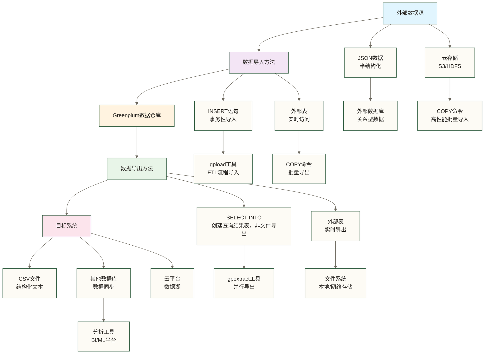

# 📥 数据导入导出 - 掌握Greenplum数据流转的专业技能

> [!tip] 💝 给数据流转新手的温暖指导
> 
> 🤗 **学习Greenplum数据导入导出就像掌握物流管理技巧！**
> 
> 如果你现在面对数据迁移时想：
> - "这么大的数据量，要怎么快速导入到Greenplum？"
> - "如何保证数据传输过程中的完整性和安全性？"
> - "有什么高效的方法来处理不同格式的数据？"
> 
> **别担心！** 每个数据工程师都是从第一个数据文件导入开始的 ✨
> 
> 🚛 **想象数据导入导出就像专业的物流配送系统**
> 
> 物流配送的完整流程：
> - 📦 **货物准备** = 数据格式化（确保数据符合要求）
> - 🚛 **运输工具** = 导入方法选择（选择最佳传输方式）
> - 📍 **路线规划** = 分布策略（优化数据分布）
> - 🔍 **质量检查** = 数据验证（确保数据完整性）
> - 📋 **签收确认** = 导入验证（确认导入成功）
> 
> **熟练掌握数据流转，你就成为了数据世界的物流专家！** 🌟

## 🎯 数据导入导出概览

### 📊 Greenplum数据流转生态



### 🌟 导入导出方法对比

| 方法类型 | 性能表现 | 适用场景 | 复杂度 | 推荐指数 |
|---|---|---|---|---|
| **COPY命令** | ⭐⭐⭐⭐⭐ | 大批量数据导入 | ⭐⭐ | ⭐⭐⭐⭐⭐ |
| **INSERT语句** | ⭐⭐ | 小量数据事务导入 | ⭐ | ⭐⭐⭐ |
| **gpload工具** | ⭐⭐⭐⭐ | ETL流程自动化 | ⭐⭐⭐ | ⭐⭐⭐⭐ |
| **外部表** | ⭐⭐⭐ | 实时数据访问 | ⭐⭐⭐⭐ | ⭐⭐⭐⭐ |
| **数据库链接** | ⭐⭐⭐ | 跨数据库同步 | ⭐⭐⭐⭐ | ⭐⭐⭐ |

## 📥 数据导入方法详解

### ⚡ COPY命令：高性能批量导入

#### 🚀 基础语法与用法

**COPY命令的基本语法：**

```sql
-- 🏗️ COPY命令基础语法

-- 1. 从文件导入数据
COPY table_name 
FROM 'file_path' 
WITH (
    FORMAT 'csv',
    DELIMITER ',',
    HEADER true,
    QUOTE '"',
    ESCAPE '\',
    NULL 'NULL'
);

-- 2. 从标准输入导入
COPY table_name 
FROM STDIN 
WITH (FORMAT 'csv', DELIMITER ',');

-- 3. 从程序输出导入
COPY table_name 
FROM PROGRAM 'command' 
WITH (FORMAT 'csv');
```

#### 📊 实际导入案例演示

**案例1：导入销售数据CSV文件**

```sql
-- 🏗️ 创建销售数据表
CREATE TABLE sales_data (
    order_id INT,
    customer_id INT,
    product_name VARCHAR(100),
    quantity INT,
    unit_price DECIMAL(10,2),
    order_date DATE,
    sales_amount DECIMAL(12,2)
) DISTRIBUTED BY (customer_id);

-- 📥 导入CSV数据文件
COPY sales_data 
FROM '/data/sales/sales_2024.csv' 
WITH (
    FORMAT 'csv',
    DELIMITER ',',
    HEADER true,                    -- 第一行是标题
    QUOTE '"',                      -- 字符串引号
    NULL 'NULL',                    -- 空值表示
    FORCE_NULL (product_name),      -- 将该列中带引号且匹配NULL标记的值也转换为NULL；需确认版本支持
    ENCODING 'UTF8'                 -- 文件编码
);

-- ✅ 验证导入结果
SELECT 
    COUNT(*) as total_records,
    MIN(order_date) as earliest_date,
    MAX(order_date) as latest_date,
    SUM(sales_amount) as total_sales
FROM sales_data;
```

**案例2：导入包含JSON字段的制表符分隔数据（文件须按user_id、session_id、event_data、created_at四列组织，event_data列为合法JSON；不是直接导入任意JSON文件）**

```sql
-- 🏗️ 创建用户行为数据表
CREATE TABLE user_behavior (
    user_id INT,
    session_id VARCHAR(50),
    event_data JSONB,
    created_at TIMESTAMP
) DISTRIBUTED BY (user_id);

-- 📥 导入JSON数据
COPY user_behavior (user_id, session_id, event_data, created_at)
FROM '/data/behavior/user_events.json' 
WITH (
    FORMAT 'csv',
    DELIMITER E'\t',
    QUOTE E'\b',                    -- 避免JSON中的引号冲突
    ESCAPE E'\b'
);

-- 🔍 查询JSON数据示例
SELECT 
    user_id,
    event_data->>'action' as action_type,
    event_data->>'page' as page_url,
    (event_data->>'duration')::int as duration_seconds
FROM user_behavior
WHERE event_data->>'action' = 'page_view'
LIMIT 10;
```

#### 🎯 高级导入选项

**性能优化配置：**

```sql
-- 🚀 高性能导入配置
COPY large_table 
FROM '/data/big_file.csv' 
WITH (
    FORMAT 'csv',
    DELIMITER ',',
    HEADER true,
    FREEZE true,                    -- 请求冻结装载元组，并非跳过WAL；需确认目标版本及使用条件
    OIDS false,                     -- 不导入OID
    ENCODING 'UTF8'
);

-- ⚡ 循环串行导入多个文件
DO $$
DECLARE
    file_path TEXT;
BEGIN
    FOR file_path IN 
        SELECT '/data/split_files/part_' || generate_series(1,10) || '.csv'
    LOOP
        EXECUTE format('
            COPY target_table 
            FROM %L 
            WITH (FORMAT ''csv'', HEADER true)',
            file_path
        );
    END LOOP;
END $$;
```

### 🔄 gpload工具：ETL流程自动化

#### 📋 gpload配置文件

**创建gpload配置文件（gpload.yml）：**

```yaml
# 📝 gpload配置文件示例
VERSION: 1.0.0.1

DATABASE: sales_db
USER: gpadmin
HOST: greenplum-master
PORT: 5432

GPLOAD:
   INPUT:
    - SOURCE:
         LOCAL_HOSTNAME:
           - greenplum-master
         PORT: 8080
         FILE: 
           - /data/sales/*.csv
    - COLUMNS:
           - order_id: INTEGER
           - customer_id: INTEGER  
           - product_name: TEXT
           - quantity: INTEGER
           - unit_price: DECIMAL
           - order_date: DATE
           - sales_amount: DECIMAL
    - FORMAT: csv
    - DELIMITER: ','
    - QUOTE: '"'
    - HEADER: true
    - ERROR_LIMIT: 100
    - ERROR_TABLE: sales_errors
    
   OUTPUT:
    - TABLE: sales_data
    - MODE: INSERT
    
   PRELOAD:
    - TRUNCATE: true
    - REUSE_TABLES: true

SQL:
   BEFORE: "SET statement_timeout = '30min';"
   AFTER: "ANALYZE sales_data;"
```

**执行gpload导入：**

```bash
# !/bin/bash
# 🚀 gpload批量导入脚本

echo "🔄 开始执行gpload数据导入..."

# 设置环境变量
export PGPASSWORD=your_password
export MASTER_DATA_DIRECTORY=/data/master/gpseg-1

# 执行gpload
gpload -f /config/gpload_sales.yml -v

# 检查导入结果
if [ $? -eq 0 ]; then
    echo "✅ 数据导入成功完成"
    
 # 连接数据库验证结果
    psql -h greenplum-master -U gpadmin -d sales_db -c "
        SELECT 
            'sales_data' as table_name,
            COUNT(*) as record_count,
            MIN(order_date) as min_date,
            MAX(order_date) as max_date
        FROM sales_data;
    "
else
    echo "❌ 数据导入失败，请检查错误日志"
    exit 1
fi
```

#### 🔍 错误处理与监控

**错误表分析：**

```sql
-- 🔍 分析导入错误
SELECT 
    error_table,
    error_count,
    error_message,
    COUNT(*) as occurrence_count
FROM (
    SELECT 
        'sales_errors' as error_table,
        1 as error_count,
        gp_read_error_log('sales_data') as error_message
) error_analysis
GROUP BY error_table, error_count, error_message
ORDER BY occurrence_count DESC;

-- 📊 错误统计报告
WITH error_summary AS (
    SELECT 
        DATE_TRUNC('hour', cmdtime) as error_hour,
        COUNT(*) as error_count,
        COUNT(DISTINCT filename) as affected_files
    FROM gp_read_error_log('sales_data')
    WHERE cmdtime >= CURRENT_DATE
    GROUP BY DATE_TRUNC('hour', cmdtime)
)
SELECT 
    error_hour,
    error_count,
    affected_files,
    ROUND(error_count * 100.0 / SUM(error_count) OVER(), 2) as error_percentage
FROM error_summary
ORDER BY error_hour;
```

### 🌐 外部表：实时数据访问

#### 📡 创建外部表

**外部表基础配置：**

```sql
-- 🌐 创建外部CSV文件表
CREATE READABLE EXTERNAL TABLE ext_customer_data (
    customer_id INT,
    customer_name TEXT,
    email TEXT,
    phone TEXT,
    address TEXT,
    registration_date DATE
) 
LOCATION ('file://greenplum-master:8080/data/customers/*.csv')
FORMAT 'csv' (
    HEADER,
    DELIMITER ',',
    QUOTE '"'
)
ENCODING 'UTF8'
LOG ERRORS SEGMENT REJECT LIMIT 100 ROWS;

-- 🔗 创建外部数据库表
CREATE READABLE EXTERNAL TABLE ext_orders (
    order_id INT,
    customer_id INT,
    order_amount DECIMAL(10,2),
    order_status TEXT,
    created_at TIMESTAMP
)
LOCATION ('pxf://orders_table?PROFILE=JDBC&SERVER=postgres')
FORMAT 'CUSTOM' (FORMATTER='pxfwritable_import');

-- 📊 使用外部表进行查询
SELECT 
    c.customer_name,
    c.email,
    COUNT(o.order_id) as order_count,
    SUM(o.order_amount) as total_spent
FROM ext_customer_data c
LEFT JOIN ext_orders o ON c.customer_id = o.customer_id
WHERE c.registration_date >= '2024-01-01'
GROUP BY c.customer_id, c.customer_name, c.email
HAVING SUM(o.order_amount) > 1000
ORDER BY total_spent DESC;
```

#### 🔄 可写外部表

**数据导出外部表：**

```sql
-- 📤 创建可写外部表用于导出
CREATE WRITABLE EXTERNAL TABLE export_sales_summary (
    region TEXT,
    quarter TEXT,
    total_sales DECIMAL(15,2),
    order_count INT,
    avg_order_value DECIMAL(10,2)
)
LOCATION ('file://greenplum-master:8080/export/sales_summary.csv')
FORMAT 'csv' (
    HEADER,
    DELIMITER ',',
    QUOTE '"'
)
ENCODING 'UTF8'
DISTRIBUTED RANDOMLY;

-- 📊 导出汇总数据
INSERT INTO export_sales_summary
SELECT 
    r.region_name as region,
    EXTRACT(YEAR FROM s.order_date) || '-Q' || EXTRACT(QUARTER FROM s.order_date) as quarter,
    SUM(s.sales_amount) as total_sales,
    COUNT(*) as order_count,
    AVG(s.sales_amount) as avg_order_value
FROM sales_data s
JOIN customer_regions r ON s.customer_id = r.customer_id
WHERE s.order_date >= '2024-01-01'
GROUP BY r.region_name, EXTRACT(YEAR FROM s.order_date), EXTRACT(QUARTER FROM s.order_date)
ORDER BY region, quarter;
```

## 📤 数据导出方法详解

### 🚀 COPY导出：高效数据提取

#### 📊 基础导出操作

```sql
-- 📤 基础COPY导出示例

-- 1. 导出整个表
COPY sales_data 
TO '/export/sales_backup.csv' 
WITH (
    FORMAT 'csv',
    HEADER true,
    DELIMITER ',',
    QUOTE '"',
    ENCODING 'UTF8'
);

-- 2. 导出查询结果
COPY (
    SELECT 
        customer_id,
        customer_name,
        SUM(order_amount) as total_spent,
        COUNT(*) as order_count
    FROM customer_orders
    WHERE order_date >= '2024-01-01'
    GROUP BY customer_id, customer_name
    ORDER BY total_spent DESC
    LIMIT 1000
) TO '/export/top_customers.csv' 
WITH (FORMAT 'csv', HEADER true);

-- 3. 导出到标准输出
COPY customer_summary 
TO STDOUT 
WITH (FORMAT 'csv', HEADER true);
```

#### 🎯 高级导出技巧

**分批导出大数据：**

```sql
-- 🔄 分批导出脚本
DO $$
DECLARE
    batch_size INT := 100000;
    offset_val INT := 0;
    total_rows INT;
    batch_num INT := 1;
BEGIN
    -- 获取总行数
    SELECT COUNT(*) INTO total_rows FROM large_table;
    
    WHILE offset_val < total_rows LOOP
        -- 导出当前批次
        EXECUTE format('
            COPY (
                SELECT * FROM large_table 
                ORDER BY id 
                LIMIT %s OFFSET %s
            ) TO ''/export/large_table_batch_%s.csv'' 
            WITH (FORMAT ''csv'', HEADER true)',
            batch_size, offset_val, batch_num
        );
        
        offset_val := offset_val + batch_size;
        batch_num := batch_num + 1;
        
        RAISE NOTICE '已导出批次 %，完成度：% %%', 
            batch_num - 1, 
            ROUND((LEAST(offset_val, total_rows)::NUMERIC / total_rows) * 100, 2);
    END LOOP;
END $$;
```

**压缩导出：**

```sql
-- 📦 压缩导出数据
COPY (
    SELECT * FROM sales_data 
    WHERE order_date BETWEEN '2024-01-01' AND '2024-12-31'
) TO PROGRAM 'gzip > /export/sales_2024.csv.gz' 
WITH (FORMAT 'csv', HEADER true);

-- 🗂️ 分区导出
DO $$
DECLARE
    partition_name TEXT;
BEGIN
    FOR partition_name IN 
        SELECT schemaname||'.'||tablename 
        FROM pg_tables 
        WHERE tablename LIKE 'sales_data_%'
    LOOP
        EXECUTE format('
            COPY %s 
            TO ''/export/%s.csv'' 
            WITH (FORMAT ''csv'', HEADER true)',
            partition_name, 
            replace(partition_name, '.', '_')
        );
    END LOOP;
END $$;
```

### 🔧 gpextract工具：并行导出

#### ⚡ 并行导出配置

**gpextract命令示例：**

```bash
# !/bin/bash
# 🚀 gpextract并行导出脚本

# 设置基本参数
DB_NAME="sales_db"
TABLE_NAME="sales_data"
EXPORT_DIR="/export/parallel"
DATE_FILTER="2024-01-01"

# 创建导出目录
mkdir -p ${EXPORT_DIR}

# 🔄 执行并行导出
gpextract \
    --dbname ${DB_NAME} \
    --table ${TABLE_NAME} \
    --file ${EXPORT_DIR}/sales_data \
    --format csv \
    --delimiter ',' \
    --quote '"' \
    --header \
    --where "order_date >= '${DATE_FILTER}'" \
    --segment-file-prefix sales \
    --compress gzip

# ✅ 验证导出结果
echo "📊 导出文件统计："
ls -lh ${EXPORT_DIR}/sales_data*

echo "📈 记录数量验证："
for file in ${EXPORT_DIR}/sales_data*.csv.gz; do
    record_count=$(zcat "$file" | wc -l)
    echo "$file: $((record_count - 1)) 条记录"  # 减去标题行
done
```

## 🔄 数据同步策略

### ⏰ 增量同步机制

#### 📅 基于时间戳的增量同步

```sql
-- 🕐 增量同步表设计
CREATE TABLE sync_log (
    sync_id SERIAL PRIMARY KEY,
    table_name VARCHAR(100),
    last_sync_time TIMESTAMP,
    sync_status VARCHAR(20),
    record_count INT,
    created_at TIMESTAMP DEFAULT CURRENT_TIMESTAMP
) DISTRIBUTED BY (sync_id);

-- 📊 增量导入存储过程
CREATE OR REPLACE FUNCTION incremental_sync_sales()
RETURNS TABLE(
    sync_status TEXT,
    new_records INT,
    updated_records INT
) AS $$
DECLARE
    last_sync TIMESTAMP;
    new_count INT := 0;
    update_count INT := 0;
BEGIN
    -- 获取上次同步时间
    SELECT COALESCE(MAX(last_sync_time), '1900-01-01'::TIMESTAMP)
    INTO last_sync
    FROM sync_log 
    WHERE table_name = 'sales_data' 
      AND sync_status = 'SUCCESS';
    
    -- 创建临时表存储新数据
    CREATE TEMP TABLE temp_new_sales AS
    SELECT * FROM ext_source_sales 
    WHERE last_modified > last_sync;
    
    GET DIAGNOSTICS new_count = ROW_COUNT;
    
    -- 执行UPSERT操作
    WITH upsert AS (
        INSERT INTO sales_data 
        SELECT * FROM temp_new_sales
        ON CONFLICT (order_id) 
        DO UPDATE SET
            customer_id = EXCLUDED.customer_id,
            product_name = EXCLUDED.product_name,
            quantity = EXCLUDED.quantity,
            unit_price = EXCLUDED.unit_price,
            order_date = EXCLUDED.order_date,
            sales_amount = EXCLUDED.sales_amount,
            last_modified = EXCLUDED.last_modified
        RETURNING (CASE WHEN xmax = 0 THEN 1 ELSE 0 END) as is_insert
    )
    SELECT 
        SUM(is_insert) as inserts,
        SUM(1 - is_insert) as updates
    INTO new_count, update_count
    FROM upsert;
    
    -- 记录同步日志
    INSERT INTO sync_log (table_name, last_sync_time, sync_status, record_count)
    VALUES ('sales_data', CURRENT_TIMESTAMP, 'SUCCESS', new_count + update_count);
    
    -- 返回结果
    RETURN QUERY SELECT 
        'SUCCESS'::TEXT as sync_status,
        new_count as new_records,
        update_count as updated_records;
        
EXCEPTION WHEN OTHERS THEN
    INSERT INTO sync_log (table_name, last_sync_time, sync_status, record_count)
    VALUES ('sales_data', CURRENT_TIMESTAMP, 'FAILED', 0);
    
    RETURN QUERY SELECT 
        'FAILED: ' || SQLERRM as sync_status,
        0 as new_records,
        0 as updated_records;
END;
$$ LANGUAGE plpgsql;

-- 🔄 执行增量同步
SELECT * FROM incremental_sync_sales();
```

#### 🔄 CDC（变更数据捕获）集成

```sql
-- 📡 CDC触发器设置
CREATE TABLE sales_changes (
    change_id SERIAL PRIMARY KEY,
    table_name VARCHAR(100),
    operation_type VARCHAR(10),  -- INSERT, UPDATE, DELETE
    old_data JSONB,
    new_data JSONB,
    change_time TIMESTAMP DEFAULT CURRENT_TIMESTAMP,
    user_name VARCHAR(100)
) DISTRIBUTED BY (change_id);

-- 🔔 创建变更捕获触发器
CREATE OR REPLACE FUNCTION capture_sales_changes()
RETURNS TRIGGER AS $$
BEGIN
    IF TG_OP = 'INSERT' THEN
        INSERT INTO sales_changes (table_name, operation_type, new_data, user_name)
        VALUES (TG_TABLE_NAME, TG_OP, row_to_json(NEW), current_user);
        RETURN NEW;
    ELSIF TG_OP = 'UPDATE' THEN
        INSERT INTO sales_changes (table_name, operation_type, old_data, new_data, user_name)
        VALUES (TG_TABLE_NAME, TG_OP, row_to_json(OLD), row_to_json(NEW), current_user);
        RETURN NEW;
    ELSIF TG_OP = 'DELETE' THEN
        INSERT INTO sales_changes (table_name, operation_type, old_data, user_name)
        VALUES (TG_TABLE_NAME, TG_OP, row_to_json(OLD), current_user);
        RETURN OLD;
    END IF;
    RETURN NULL;
END;
$$ LANGUAGE plpgsql;

-- 应用触发器到表
CREATE TRIGGER sales_data_changes
    AFTER INSERT OR UPDATE OR DELETE ON sales_data
    FOR EACH ROW EXECUTE FUNCTION capture_sales_changes();
```

## 🔒 数据安全与验证

### 🛡️ 导入数据验证

#### ✅ 数据质量检查

```sql
-- 🔍 数据质量验证函数
CREATE OR REPLACE FUNCTION validate_sales_data()
RETURNS TABLE(
    check_name TEXT,
    check_result TEXT,
    affected_rows INT,
    check_status TEXT
) AS $$
BEGIN
    -- 1. 检查空值
    RETURN QUERY
    SELECT 
        '空值检查'::TEXT as check_name,
        '关键字段存在空值'::TEXT as check_result,
        COUNT(*)::INT as affected_rows,
        CASE WHEN COUNT(*) > 0 THEN 'FAILED' ELSE 'PASSED' END as check_status
    FROM sales_data 
    WHERE customer_id IS NULL 
       OR order_date IS NULL 
       OR sales_amount IS NULL;
    
    -- 2. 检查数据范围
    RETURN QUERY
    SELECT 
        '数据范围检查'::TEXT as check_name,
        '销售金额异常'::TEXT as check_result,
        COUNT(*)::INT as affected_rows,
        CASE WHEN COUNT(*) > 0 THEN 'FAILED' ELSE 'PASSED' END as check_status
    FROM sales_data 
    WHERE sales_amount < 0 OR sales_amount > 1000000;
    
    -- 3. 检查日期合理性
    RETURN QUERY
    SELECT 
        '日期合理性检查'::TEXT as check_name,
        '订单日期不合理'::TEXT as check_result,
        COUNT(*)::INT as affected_rows,
        CASE WHEN COUNT(*) > 0 THEN 'FAILED' ELSE 'PASSED' END as check_status
    FROM sales_data 
    WHERE order_date > CURRENT_DATE 
       OR order_date < '2020-01-01'::DATE;
    
    -- 4. 检查重复数据
    RETURN QUERY
    SELECT 
        '重复数据检查'::TEXT as check_name,
        '存在重复订单'::TEXT as check_result,
        (COUNT(*) - COUNT(DISTINCT order_id))::INT as affected_rows,
        CASE WHEN COUNT(*) != COUNT(DISTINCT order_id) THEN 'FAILED' ELSE 'PASSED' END as check_status
    FROM sales_data;
    
END;
$$ LANGUAGE plpgsql;

-- 🎯 执行数据验证
SELECT * FROM validate_sales_data();
```

#### 🔐 字段加密导入导出示例（不替代传输加密）

```sql
-- 🔒 加密导出敏感数据
CREATE OR REPLACE FUNCTION export_encrypted_customer_data()
RETURNS VOID AS $$
BEGIN
    -- 导出加密后的客户数据
    COPY (
        SELECT 
            customer_id,
            pgp_sym_encrypt(customer_name, 'encryption_key') as encrypted_name,
            pgp_sym_encrypt(email, 'encryption_key') as encrypted_email,
            pgp_sym_encrypt(phone, 'encryption_key') as encrypted_phone,
            registration_date
        FROM customer_data
        WHERE created_at >= CURRENT_DATE - INTERVAL '30 days'
    ) TO '/secure_export/encrypted_customers.csv'
    WITH (FORMAT 'csv', HEADER true);
    
    RAISE NOTICE '已完成加密客户数据导出';
END;
$$ LANGUAGE plpgsql;

-- 🔓 解密导入数据
CREATE OR REPLACE FUNCTION import_encrypted_customer_data()
RETURNS VOID AS $$
BEGIN
    -- 创建临时表
    CREATE TEMP TABLE temp_encrypted_customers (
        customer_id INT,
        encrypted_name TEXT,
        encrypted_email TEXT,
        encrypted_phone TEXT,
        registration_date DATE
    );
    
    -- 导入加密数据
    COPY temp_encrypted_customers 
    FROM '/secure_import/encrypted_customers.csv'
    WITH (FORMAT 'csv', HEADER true);
    
    -- 解密并插入到目标表
    INSERT INTO customer_data (customer_id, customer_name, email, phone, registration_date)
    SELECT 
        customer_id,
        pgp_sym_decrypt(encrypted_name::BYTEA, 'encryption_key') as customer_name,
        pgp_sym_decrypt(encrypted_email::BYTEA, 'encryption_key') as email,
        pgp_sym_decrypt(encrypted_phone::BYTEA, 'encryption_key') as phone,
        registration_date
    FROM temp_encrypted_customers;
    
    RAISE NOTICE '已完成加密客户数据导入并解密';
END;
$$ LANGUAGE plpgsql;
```

## 🚀 性能优化技巧

### ⚡ 导入性能优化

#### 🎯 批量导入最佳实践

```sql
-- 🏗️ 优化导入性能的表结构
CREATE TABLE optimized_sales_data (
    order_id BIGINT,
    customer_id INT,
    product_id INT,
    quantity INT,
    unit_price DECIMAL(10,2),
    order_date DATE,
    sales_amount DECIMAL(12,2)
) 
WITH (
    appendonly=true,           -- 使用AO存储
    compresstype=zstd,         -- 启用压缩
    compresslevel=3,           -- 压缩级别
    orientation=column         -- 列式存储
)
DISTRIBUTED BY (customer_id)
PARTITION BY RANGE (order_date) (
    PARTITION p2024q1 START ('2024-01-01') END ('2024-04-01'),
    PARTITION p2024q2 START ('2024-04-01') END ('2024-07-01'),
    PARTITION p2024q3 START ('2024-07-01') END ('2024-10-01'),
    PARTITION p2024q4 START ('2024-10-01') END ('2025-01-01')
);

-- ⚡ 高性能导入配置
SET gp_autostats_mode = 'none';           -- 关闭自动统计信息收集
SET statement_timeout = '60min';          -- 设置语句超时
SET gp_enable_fast_sri = on;              -- 启用快速单行插入

-- 📥 批量导入大文件
COPY optimized_sales_data 
FROM '/data/large_sales_file.csv'
WITH (
    FORMAT 'csv',
    HEADER true,
    DELIMITER ',',
    FREEZE true,               -- 请求冻结装载元组，并非跳过WAL；需确认版本、表类型及使用条件
    OIDS false
);

-- 📊 导入后优化
ANALYZE optimized_sales_data;              -- 收集统计信息
VACUUM optimized_sales_data;               -- 清理空间
```

#### 🔄 并行导入策略

```python
# !/usr/bin/env python3
# 🚀 Python并行导入脚本

import psycopg2
import pandas as pd
from concurrent.futures import ThreadPoolExecutor
import os
from datetime import datetime

class GreenplumParallelImporter:
    def __init__(self, host, database, user, password, port=5432):
        self.connection_params = {
            'host': host,
            'database': database, 
            'user': user,
            'password': password,
            'port': port
        }
    
    def import_file_chunk(self, file_path, table_name):
        """导入单个文件块"""
        try:
            conn = psycopg2.connect(**self.connection_params)
            cursor = conn.cursor()
            
 # 使用COPY命令导入
            with open(file_path, 'r', encoding='utf-8') as f:
                cursor.copy_expert(
                    f"""COPY {table_name} 
                        FROM STDIN 
                        WITH (FORMAT 'csv', HEADER true, DELIMITER ',')""",
                    f
                )
            
            conn.commit()
            cursor.close()
            conn.close()
            
            return {'file': file_path, 'status': 'success', 'time': datetime.now()}
            
        except Exception as e:
            return {'file': file_path, 'status': 'failed', 'error': str(e), 'time': datetime.now()}
    
    def parallel_import(self, file_pattern, table_name, max_workers=4):
        """并行导入多个文件"""
        import glob
        
        files = glob.glob(file_pattern)
        results = []
        
        print(f"🚀 开始并行导入 {len(files)} 个文件到表 {table_name}")
        
        with ThreadPoolExecutor(max_workers=max_workers) as executor:
            futures = [
                executor.submit(self.import_file_chunk, file_path, table_name)
                for file_path in files
            ]
            
            for future in futures:
                result = future.result()
                results.append(result)
                
                if result['status'] == 'success':
                    print(f"✅ {result['file']} 导入成功")
                else:
                    print(f"❌ {result['file']} 导入失败: {result['error']}")
        
        return results

# 使用示例
if __name__ == "__main__":
    importer = GreenplumParallelImporter(
        host='greenplum-master',
        database='sales_db',
        user='gpadmin',
        password='your_password'
    )
    
 # 并行导入所有CSV文件
    results = importer.parallel_import(
        file_pattern='/data/sales/split_files/*.csv',
        table_name='sales_data',
        max_workers=8
    )
    
 # 统计结果
    success_count = sum(1 for r in results if r['status'] == 'success')
    print(f"📊 导入完成: {success_count}/{len(results)} 个文件成功")
```

## 🔧 实用工具与脚本

### 📝 数据导入导出监控

#### 📊 实时监控脚本

```sql
-- 📈 导入导出监控视图
CREATE VIEW data_transfer_monitor AS
SELECT 
    schemaname,
    tablename,
    n_tup_ins as inserted_rows,
    n_tup_upd as updated_rows,
    n_tup_del as deleted_rows,
    n_live_tup as current_rows,
    n_dead_tup as dead_rows,
    last_vacuum,
    last_autovacuum,
    last_analyze,
    last_autoanalyze
FROM pg_stat_user_tables
WHERE schemaname NOT IN ('information_schema', 'pg_catalog')
ORDER BY n_tup_ins DESC;

-- 🔍 查看当前导入导出活动
SELECT 
    pid,
    usename,
    application_name,
    client_addr,
    state,
    query_start,
    state_change,
    CASE 
        WHEN query LIKE '%COPY%FROM%' THEN 'DATA_IMPORT'
        WHEN query LIKE '%COPY%TO%' THEN 'DATA_EXPORT'
        ELSE 'OTHER'
    END as operation_type,
    LEFT(query, 100) as query_snippet
FROM pg_stat_activity 
WHERE state = 'active'
  AND query LIKE '%COPY%'
ORDER BY query_start;
```

#### 🚨 错误监控与告警

```bash
# !/bin/bash
# 📡 数据传输监控脚本

MONITOR_LOG="/var/log/greenplum_monitor.log"
ERROR_THRESHOLD=10
EMAIL_ALERT="admin@company.com"

monitor_data_transfer() {
    echo "$(date): 开始监控数据传输状态..." >> $MONITOR_LOG
    
 # 检查gpfdist进程
    gpfdist_count=$(ps aux | grep gpfdist | grep -v grep | wc -l)
    echo "当前gpfdist进程数: $gpfdist_count" >> $MONITOR_LOG
    
 # 检查导入错误
    error_count=$(psql -t -A -c "
        SELECT COUNT(*) 
        FROM gp_read_error_log('sales_data') 
        WHERE cmdtime >= CURRENT_TIMESTAMP - INTERVAL '1 hour'
    " 2>/dev/null || echo "0")
    
    echo "过去1小时错误数: $error_count" >> $MONITOR_LOG
    
 # 错误告警
    if [ "$error_count" -gt "$ERROR_THRESHOLD" ]; then
        echo "⚠️ 警告: 数据导入错误数超过阈值($ERROR_THRESHOLD)" | \
        mail -s "Greenplum数据导入告警" $EMAIL_ALERT
    fi
    
 # 检查磁盘空间
    disk_usage=$(df /data | tail -1 | awk '{print $5}' | sed 's/%//')
    if [ "$disk_usage" -gt 85 ]; then
        echo "🔴 严重警告: 数据目录磁盘使用率${disk_usage}%，接近满载" | \
        mail -s "Greenplum磁盘空间告警" $EMAIL_ALERT
    fi
}

# 每5分钟检查一次
while true; do
    monitor_data_transfer
    sleep 300
done
```

## 💡 最佳实践总结

### 🎯 导入导出最佳实践

#### 📋 性能优化清单

1. **📥 导入优化**
   - 使用COPY命令而非INSERT语句
   - 导入前删除不必要的索引
   - 使用并行导入分割大文件
   - 选择合适的分布键避免数据倾斜

2. **📤 导出优化**
   - 使用分区导出减少锁定时间
   - 利用压缩减少存储空间
   - 并行导出提升速度
   - 合理设置批次大小

3. **🔒 安全考虑**
   - 敏感数据加密传输
   - 设置适当的文件权限
   - 记录操作审计日志
   - 验证数据完整性

4. **🔧 运维管理**
   - 建立完善的监控机制
   - 制定数据恢复计划
   - 定期清理临时文件
   - 优化网络配置

### 🌟 故障排除指南

#### ⚠️ 常见问题解决

| 问题类型 | 症状表现 | 解决方案 | 预防措施 |
|---|---|---|---|
| **内存不足** | 导入过程中断 | 增加内存或分批导入 | 监控内存使用率 |
| **磁盘空间满** | 写入失败 | 清理空间或扩容 | 设置磁盘告警 |
| **网络超时** | 连接中断 | 优化网络或增加超时 | 网络稳定性监控 |
| **权限问题** | 访问拒绝 | 检查文件和数据库权限 | 标准化权限管理 |
| **数据格式错误** | 解析失败 | 数据清洗和格式化 | 导入前数据验证 |

---

**掌握了Greenplum数据导入导出技能，你就拥有了高效管理企业数据流转的核心能力！下一步，我们将学习表设计与分区策略，进一步提升数据处理效率。** 🚀✨