# 🏗️ 表设计与分区 - 构建高效Greenplum数据架构的核心技能

> [!tip] 💝 给数据架构新手的温暖指导
> 
> 🤗 **学习Greenplum表设计就像学会建筑设计的艺术！**
> 
> 如果你现在面对表设计时想：
> - "如何设计出既高效又易维护的表结构？"
> - "分区策略这么多，到底应该选择哪一种？"
> - "怎样避免数据倾斜，让查询性能最大化？"
> 
> **别担心！** 每个数据架构师都是从设计第一张表开始的 ✨
> 
> 🏛️ **想象表设计就像精心设计一座现代化建筑**
> 
> 建筑设计的核心要素：
> - 📐 **结构规划** = 表结构设计（合理的字段类型和关系）
> - 🏗️ **分层设计** = 分区策略（数据的科学分层存储）
> - 🎯 **功能分区** = 分布键选择（优化数据访问模式）
> - 🔧 **管道布局** = 索引设计（提升查询效率）
> - 🌟 **美观实用** = 性能优化（兼顾效率与维护性）
> 
> **掌握了表设计艺术，你就成为了数据世界的建筑大师！** 🌟

## 🎯 表设计基础理论

### 📊 Greenplum表设计原则

```mermaid
%%{init: {"theme":"base","themeVariables":{"fontFamily":"PingFang SC, -apple-system, Source Han Serif SC, serif","fontSize":"16px","background":"#FDFBF5","primaryColor":"#FDFBF5","primaryTextColor":"#2D2A26","primaryBorderColor":"#6E6A60","secondaryColor":"#E8EFE8","secondaryBorderColor":"#8FA890","secondaryTextColor":"#2D2A26","tertiaryColor":"#FDFBF5","tertiaryBorderColor":"#9A9488","tertiaryTextColor":"#6E6A60","lineColor":"#6E6A60","textColor":"#2D2A26","mainBkg":"#FDFBF5","nodeBorder":"#2D5A3D","clusterBkg":"#F3EEDF","clusterBorder":"#9A9488","edgeLabelBackground":"#FDFBF5"},"flowchart":{"htmlLabels":true,"curve":"basis","padding":20,"nodeSpacing":60,"rankSpacing":70,"useMaxWidth":false},"themeCSS":".node rect, .node polygon, .node circle { stroke-width: 1.5px; } .edgePath .path { stroke-width: 1.5px; } .cluster-label .nodeLabel, .cluster-label foreignObject { color: #2D2A26 !important; } .edgeLabel, .edgeLabel foreignObject { color: #2D2A26 !important; background-color: #FDFBF5; } .edgeLabel rect { fill: #FDFBF5; }"}}%%
flowchart TD
    A[Greenplum表设计核心原则]
    A --> B[🎯 业务驱动设计]
    A --> C[⚡ 性能优先考虑]
    A --> D[🔧 可维护性保证]
    A --> E[📈 扩展性规划]

    B --> B1[业务模型分析<br/>理解数据使用模式]
    B --> B2[查询场景识别<br/>优化常用查询路径]
    B --> B3[数据生命周期<br/>规划数据增长模式]

    C --> C1[分布键优化<br/>避免数据倾斜]
    C --> C2[分区策略<br/>提升查询性能]
    C --> C3[索引设计<br/>加速数据访问]

    D --> D1[命名规范<br/>清晰的对象命名]
    D --> D2[注释文档<br/>完整的元数据信息]
    D --> D3[版本管理<br/>DDL变更可追溯]

    E --> E1[容量规划<br/>预估未来数据增长]
    E --> E2[架构弹性<br/>支持水平扩展]
    E --> E3[兼容性考虑<br/>与现有系统集成]
    style A fill:#e1f5fe
    style B fill:#f3e5f5
    style C fill:#fff3e0
    style D fill:#e8f5e8
    style E fill:#fce4ec
```



### 🌟 表类型选择指南

| 表类型 | 适用场景 | 性能特点 | 存储特点 | 推荐指数 |
|---|---|---|---|---|
| **堆表(Heap)** | OLTP场景，频繁更新 | 更新快 | 行式存储 | ⭐⭐⭐ |
| **AO表(Append Only)** | OLAP场景，批量导入 | 查询快 | 列式存储可选 | ⭐⭐⭐⭐⭐ |
| **列存储表** | 分析查询，聚合计算 | 分析查询极快 | 高压缩比 | ⭐⭐⭐⭐⭐ |
| **外部表** | 数据湖访问，实时查询 | 灵活访问 | 无本地存储 | ⭐⭐⭐⭐ |
| **临时表** | 中间计算，会话数据 | 使用临时关系存储，不保证仅在内存操作 | 通常会话结束删除，可配置事务结束行为 | ⭐⭐⭐ |

## 🏗️ 表结构设计实战

### 📊 数据类型选择策略

#### 🎯 数据类型优化原则

```sql
-- 🏗️ 智能数据类型选择示例

-- ❌ 低效的数据类型选择
CREATE TABLE inefficient_sales (
    order_id VARCHAR(100),        -- 浪费空间，应该用BIGINT
    customer_id VARCHAR(50),      -- 字符串比较慢，应该用INT
    product_name TEXT,            -- 无长度限制，可能浪费
    quantity DECIMAL(20,5),       -- 精度过高，应该用INT
    unit_price DECIMAL(20,10),    -- 精度过高，增加存储成本
    order_date TIMESTAMP,         -- 包含时间，如果只需要日期用DATE
    is_active VARCHAR(10),        -- 应该用BOOLEAN
    metadata TEXT                 -- 应该用JSONB
) DISTRIBUTED BY (order_id);

-- ✅ 优化后的数据类型选择
CREATE TABLE optimized_sales (
    order_id BIGINT,              -- 数字主键，查询快
    customer_id INT,              -- 整数外键，连接效率高
    product_name VARCHAR(200),    -- 合理长度限制
    quantity SMALLINT,            -- 数量通常很小
    unit_price DECIMAL(10,2),     -- 货币精度适中
    order_date DATE,              -- 只需要日期部分
    is_active BOOLEAN,            -- 布尔值最高效
    metadata JSONB,               -- 结构化JSON数据
    created_at TIMESTAMP DEFAULT CURRENT_TIMESTAMP,
    updated_at TIMESTAMP
) 
WITH (
    appendonly=true,              -- AO存储优化
    compresstype=zstd,           -- 启用压缩
    compresslevel=3,             -- 压缩级别
    orientation=column           -- 列式存储
)
DISTRIBUTED BY (customer_id);   -- 选择合适的分布键
```

#### 📈 字段设计最佳实践

```sql
-- 🎯 综合案例：电商订单表设计

CREATE TABLE ecommerce_orders (
    -- 🔑 主键设计
    order_id BIGINT NOT NULL,                    -- 订单ID，数值型主键
    order_uuid UUID DEFAULT gen_random_uuid(),   -- 全局唯一标识符
    
    -- 👥 客户信息
    customer_id INT NOT NULL,                    -- 客户ID，外键
    customer_type VARCHAR(20) DEFAULT 'regular', -- 客户类型
    
    -- 📦 订单基础信息
    order_number VARCHAR(32) NOT NULL UNIQUE,   -- 订单编号，业务主键
    order_status VARCHAR(20) NOT NULL,          -- 订单状态
    order_source VARCHAR(50),                   -- 订单来源
    
    -- 💰 金额信息（使用DECIMAL确保精度）
    subtotal DECIMAL(12,2) NOT NULL CHECK (subtotal >= 0),
    tax_amount DECIMAL(8,2) DEFAULT 0,
    shipping_cost DECIMAL(8,2) DEFAULT 0,
    discount_amount DECIMAL(8,2) DEFAULT 0,
    total_amount DECIMAL(12,2) NOT NULL CHECK (total_amount >= 0),
    
    -- 📍 地理信息
    shipping_country_code CHAR(2),              -- 国家代码，固定长度
    shipping_region VARCHAR(100),               -- 州/省/地区
    shipping_city VARCHAR(100),                 -- 城市
    shipping_postal_code VARCHAR(20),           -- 邮政编码
    
    -- 📅 时间信息（使用适当的时间类型）
    order_date DATE NOT NULL,                   -- 订单日期
    created_at TIMESTAMP NOT NULL DEFAULT CURRENT_TIMESTAMP,
    updated_at TIMESTAMP NOT NULL DEFAULT CURRENT_TIMESTAMP,
    shipped_at TIMESTAMP,                       -- 发货时间
    delivered_at TIMESTAMP,                     -- 送达时间
    
    -- 📊 分析字段
    order_season VARCHAR(10) GENERATED ALWAYS AS (
        CASE 
            WHEN EXTRACT(MONTH FROM order_date) IN (12,1,2) THEN 'Winter'
            WHEN EXTRACT(MONTH FROM order_date) IN (3,4,5) THEN 'Spring'
            WHEN EXTRACT(MONTH FROM order_date) IN (6,7,8) THEN 'Summer'
            ELSE 'Autumn'
        END
    ) STORED,                                   -- 计算列：季节
    
    order_year SMALLINT GENERATED ALWAYS AS (
        EXTRACT(YEAR FROM order_date)
    ) STORED,                                   -- 计算列：年份
    
    -- 🔍 扩展信息
    tags TEXT[],                                -- 标签数组
    attributes JSONB,                           -- 灵活属性存储
    
    -- 🛡️ 约束和索引提示
    CONSTRAINT pk_orders PRIMARY KEY (order_id),
    CONSTRAINT chk_valid_status CHECK (order_status IN ('pending', 'processing', 'shipped', 'delivered', 'cancelled')),
    CONSTRAINT chk_date_logic CHECK (created_at <= COALESCE(shipped_at, created_at))
)
WITH (
    appendonly=true,
    compresstype=zstd,
    compresslevel=3,
    orientation=column
)
DISTRIBUTED BY (customer_id)                   -- 按客户分布，优化客户相关查询
PARTITION BY RANGE (order_date) (
    PARTITION p2024q1 START ('2024-01-01') END ('2024-04-01'),
    PARTITION p2024q2 START ('2024-04-01') END ('2024-07-01'),
    PARTITION p2024q3 START ('2024-07-01') END ('2024-10-01'),
    PARTITION p2024q4 START ('2024-10-01') END ('2025-01-01')
);

-- 📝 表注释和文档
COMMENT ON TABLE ecommerce_orders IS '电商订单主表，存储订单核心信息和状态';
COMMENT ON COLUMN ecommerce_orders.order_id IS '订单主键ID，系统生成';
COMMENT ON COLUMN ecommerce_orders.customer_id IS '客户ID，关联客户表';
COMMENT ON COLUMN ecommerce_orders.total_amount IS '订单总金额，包含税费和运费';
COMMENT ON COLUMN ecommerce_orders.attributes IS 'JSON格式的订单扩展属性';
```

### 🔧 约束与验证设计

#### 🛡️ 数据完整性保障

```sql
-- 🔒 数据完整性约束示例

-- 1. 主键和唯一约束
ALTER TABLE ecommerce_orders 
ADD CONSTRAINT uk_order_number UNIQUE (order_number);

-- 2. 外键约束（跨表引用完整性）
ALTER TABLE ecommerce_orders 
ADD CONSTRAINT fk_customer 
FOREIGN KEY (customer_id) REFERENCES customers(customer_id);

-- 3. 检查约束（业务规则验证）
ALTER TABLE ecommerce_orders 
ADD CONSTRAINT chk_amount_consistency 
CHECK (total_amount = subtotal + tax_amount + shipping_cost - discount_amount);

-- 4. 自定义域和类型
CREATE DOMAIN email_address AS VARCHAR(320) 
CHECK (VALUE ~ '^[A-Za-z0-9._%+-]+@[A-Za-z0-9.-]+\.[A-Za-z]{2,}$');

CREATE DOMAIN phone_number AS VARCHAR(20)
CHECK (VALUE ~ '^\+?[1-9]\d{1,14}$');

-- 使用自定义域
CREATE TABLE customers (
    customer_id SERIAL PRIMARY KEY,
    email email_address NOT NULL,
    phone phone_number,
    registration_date DATE DEFAULT CURRENT_DATE
) DISTRIBUTED BY (customer_id);

-- 5. 触发器验证（复杂业务逻辑）
CREATE OR REPLACE FUNCTION validate_order_transition()
RETURNS TRIGGER AS $$
BEGIN
    -- 验证订单状态转换的合理性
    IF OLD.order_status = 'delivered' AND NEW.order_status != 'delivered' THEN
        RAISE EXCEPTION '已送达的订单不能更改状态';
    END IF;
    
    -- 验证送达时间的逻辑性
    IF NEW.delivered_at IS NOT NULL AND NEW.shipped_at IS NULL THEN
        RAISE EXCEPTION '订单必须先发货才能标记为送达';
    END IF;
    
    -- 自动更新修改时间
    NEW.updated_at = CURRENT_TIMESTAMP;
    
    RETURN NEW;
END;
$$ LANGUAGE plpgsql;

CREATE TRIGGER trg_validate_order 
    BEFORE UPDATE ON ecommerce_orders
    FOR EACH ROW EXECUTE FUNCTION validate_order_transition();
```

## 📊 分区策略设计

### 🗓️ 时间分区：最常用的分区策略

#### 📅 按日期范围分区

```sql
-- 🗓️ 时间分区表设计

-- 1. 按年分区（适合历史数据分析）
CREATE TABLE sales_yearly (
    sale_id BIGINT,
    customer_id INT,
    product_id INT,
    sale_amount DECIMAL(10,2),
    sale_date DATE NOT NULL,
    created_at TIMESTAMP DEFAULT CURRENT_TIMESTAMP
)
DISTRIBUTED BY (customer_id)
PARTITION BY RANGE (sale_date) (
    PARTITION y2022 START ('2022-01-01') END ('2023-01-01'),
    PARTITION y2023 START ('2023-01-01') END ('2024-01-01'),
    PARTITION y2024 START ('2024-01-01') END ('2025-01-01'),
    DEFAULT PARTITION other_years
);

-- 2. 按月分区（适合近期数据分析）
CREATE TABLE user_activities_monthly (
    activity_id BIGINT,
    user_id INT,
    activity_type VARCHAR(50),
    activity_data JSONB,
    activity_date DATE NOT NULL,
    created_at TIMESTAMP DEFAULT CURRENT_TIMESTAMP
)
WITH (
    appendonly=true,
    compresstype=zstd,
    orientation=column
)
DISTRIBUTED BY (user_id)
PARTITION BY RANGE (activity_date) (
    PARTITION m202401 START ('2024-01-01') END ('2024-02-01'),
    PARTITION m202402 START ('2024-02-01') END ('2024-03-01'),
    PARTITION m202403 START ('2024-03-01') END ('2024-04-01'),
    PARTITION m202404 START ('2024-04-01') END ('2024-05-01'),
    PARTITION m202405 START ('2024-05-01') END ('2024-06-01'),
    PARTITION m202406 START ('2024-06-01') END ('2024-07-01'),
    PARTITION m202407 START ('2024-07-01') END ('2024-08-01'),
    PARTITION m202408 START ('2024-08-01') END ('2024-09-01'),
    PARTITION m202409 START ('2024-09-01') END ('2024-10-01'),
    PARTITION m202410 START ('2024-10-01') END ('2024-11-01'),
    PARTITION m202411 START ('2024-11-01') END ('2024-12-01'),
    PARTITION m202412 START ('2024-12-01') END ('2025-01-01')
);

-- 3. 动态分区管理脚本
CREATE OR REPLACE FUNCTION manage_monthly_partitions(
    table_name TEXT,
    months_ahead INT DEFAULT 6
) RETURNS TEXT AS $$
DECLARE
    start_date DATE;
    end_date DATE;
    partition_name TEXT;
    sql_command TEXT;
    result_message TEXT := '';
BEGIN
    -- 创建未来几个月的分区
    FOR i IN 1..months_ahead LOOP
        start_date := DATE_TRUNC('month', CURRENT_DATE + INTERVAL '1 month' * i);
        end_date := start_date + INTERVAL '1 month';
        partition_name := 'm' || TO_CHAR(start_date, 'YYYYMM');
        
        -- 检查分区是否已存在
        IF NOT EXISTS (
            SELECT 1 FROM pg_partitions 
            WHERE tablename = table_name 
            AND partitionname = partition_name
        ) THEN
            sql_command := format(
                'ALTER TABLE %I ADD PARTITION %I START (%L) END (%L)',
                table_name, partition_name, start_date, end_date
            );
            
            EXECUTE sql_command;
            result_message := result_message || '创建分区: ' || partition_name || E'\n';
        END IF;
    END LOOP;
    
    RETURN COALESCE(result_message, '无需创建新分区');
END;
$$ LANGUAGE plpgsql;

-- 执行分区管理
SELECT manage_monthly_partitions('user_activities_monthly', 12);
```

#### 🔄 自动分区维护

```sql
-- 📅 分区自动维护系统

-- 1. 分区统计信息表
CREATE TABLE partition_maintenance_log (
    log_id SERIAL PRIMARY KEY,
    table_name VARCHAR(100),
    partition_name VARCHAR(100),
    operation_type VARCHAR(20), -- CREATE, DROP, ANALYZE
    operation_time TIMESTAMP DEFAULT CURRENT_TIMESTAMP,
    status VARCHAR(20), -- SUCCESS, FAILED
    message TEXT
) DISTRIBUTED BY (log_id);

-- 2. 自动分区清理函数
CREATE OR REPLACE FUNCTION cleanup_old_partitions(
    table_name TEXT,
    retention_months INT DEFAULT 24
) RETURNS TEXT AS $$
DECLARE
    partition_record RECORD;
    sql_command TEXT;
    result_message TEXT := '';
    cutoff_date DATE;
BEGIN
    cutoff_date := CURRENT_DATE - INTERVAL '1 month' * retention_months;
    
    -- 查找需要删除的旧分区
    FOR partition_record IN
        SELECT partitionname, partitionrangestart
        FROM pg_partitions
        WHERE schemaname = 'public'
          AND tablename = table_name
          AND partitionrangestart::DATE < cutoff_date
    LOOP
        sql_command := format(
            'ALTER TABLE %I DROP PARTITION %I',
            table_name, partition_record.partitionname
        );
        
        EXECUTE sql_command;
        
        -- 记录操作日志
        INSERT INTO partition_maintenance_log 
        (table_name, partition_name, operation_type, status, message)
        VALUES (table_name, partition_record.partitionname, 'DROP', 'SUCCESS', 
                '删除过期分区，数据起始日期: ' || partition_record.partitionrangestart);
        
        result_message := result_message || '删除分区: ' || partition_record.partitionname || E'\n';
    END LOOP;
    
    RETURN COALESCE(result_message, '无过期分区需要清理');
END;
$$ LANGUAGE plpgsql;

-- 3. 分区性能统计更新
CREATE OR REPLACE FUNCTION refresh_partition_stats(
    table_name TEXT
) RETURNS TEXT AS $$
DECLARE
    partition_record RECORD;
    sql_command TEXT;
    result_count INT := 0;
BEGIN
    FOR partition_record IN
        SELECT schemaname, tablename, partitionname, partitiontablename
        FROM pg_partitions
        WHERE tablename = table_name
          AND schemaname = 'public'
    LOOP
        sql_command := format(
            'ANALYZE %I.%I',
            partition_record.schemaname,
            partition_record.partitiontablename
        );
        
        EXECUTE sql_command;
        result_count := result_count + 1;
        
        -- 记录操作日志
        INSERT INTO partition_maintenance_log 
        (table_name, partition_name, operation_type, status, message)
        VALUES (table_name, partition_record.partitionname, 'ANALYZE', 'SUCCESS', 
                '更新分区统计信息');
    END LOOP;
    
    RETURN '已更新 ' || result_count || ' 个分区的统计信息';
END;
$$ LANGUAGE plpgsql;
```

### 📊 列表分区：按类别分区

#### 🌍 地理/类别分区策略

```sql
-- 🌍 按地理区域分区

CREATE TABLE regional_sales (
    sale_id BIGINT,
    customer_id INT,
    product_id INT,
    sale_amount DECIMAL(10,2),
    region VARCHAR(20) NOT NULL,
    country_code CHAR(2),
    sale_date DATE,
    created_at TIMESTAMP DEFAULT CURRENT_TIMESTAMP
)
DISTRIBUTED BY (customer_id)
PARTITION BY LIST (region) (
    PARTITION asia VALUES ('CN', 'JP', 'KR', 'SG', 'HK', 'TW'),
    PARTITION europe VALUES ('DE', 'FR', 'GB', 'IT', 'ES', 'NL'),
    PARTITION americas VALUES ('US', 'CA', 'MX', 'BR', 'AR'),
    PARTITION others VALUES ('AU', 'NZ', 'ZA', 'IN', 'RU'),
    DEFAULT PARTITION unknown_region
);

-- 🏢 按业务部门分区
CREATE TABLE departmental_expenses (
    expense_id BIGINT,
    department VARCHAR(50) NOT NULL,
    category VARCHAR(100),
    amount DECIMAL(12,2),
    expense_date DATE,
    description TEXT,
    approved_by INT
)
DISTRIBUTED BY (department)
PARTITION BY LIST (department) (
    PARTITION tech VALUES ('Engineering', 'Data Science', 'DevOps', 'QA'),
    PARTITION business VALUES ('Sales', 'Marketing', 'Business Development'),
    PARTITION operations VALUES ('HR', 'Finance', 'Legal', 'Admin'),
    PARTITION product VALUES ('Product Management', 'Design', 'Research'),
    DEFAULT PARTITION other_departments
);

-- 🎯 复合分区：先按类别，再按时间
CREATE TABLE multi_level_orders (
    order_id BIGINT,
    customer_id INT,
    order_type VARCHAR(20) NOT NULL,  -- B2B, B2C, Internal
    order_date DATE NOT NULL,
    amount DECIMAL(12,2),
    status VARCHAR(20)
)
DISTRIBUTED BY (customer_id)
PARTITION BY LIST (order_type)
SUBPARTITION BY RANGE (order_date) (
    PARTITION b2b VALUES ('B2B', 'Enterprise', 'Wholesale') (
        SUBPARTITION b2b_2024q1 START ('2024-01-01') END ('2024-04-01'),
        SUBPARTITION b2b_2024q2 START ('2024-04-01') END ('2024-07-01'),
        SUBPARTITION b2b_2024q3 START ('2024-07-01') END ('2024-10-01'),
        SUBPARTITION b2b_2024q4 START ('2024-10-01') END ('2025-01-01')
    ),
    PARTITION b2c VALUES ('B2C', 'Retail', 'Online') (
        SUBPARTITION b2c_2024q1 START ('2024-01-01') END ('2024-04-01'),
        SUBPARTITION b2c_2024q2 START ('2024-04-01') END ('2024-07-01'),
        SUBPARTITION b2c_2024q3 START ('2024-07-01') END ('2024-10-01'),
        SUBPARTITION b2c_2024q4 START ('2024-10-01') END ('2025-01-01')
    ),
    DEFAULT PARTITION other_types (
        DEFAULT SUBPARTITION other_dates
    )
);
```

## 🎯 分布键设计策略

### ⚖️ 数据分布优化

#### 📊 分布键选择原则

```sql
-- 🎯 分布键选择最佳实践

-- ❌ 不良分布键示例
CREATE TABLE bad_distribution_examples (
    id SERIAL,                    -- 自增ID不必然导致倾斜，需检查哈希分布及实际数据
    timestamp_field TIMESTAMP,   -- 时间戳分布不均匀
    boolean_flag BOOLEAN,         -- 布尔值只有两个值
    status VARCHAR(10),           -- 状态值种类有限
    constant_value VARCHAR(10) DEFAULT 'ACTIVE'  -- 常量值
) DISTRIBUTED BY (id);           -- 是否合适取决于数据分布及连接模式，不能仅因自增而否定

-- ✅ 优化的分布键设计
CREATE TABLE good_distribution_examples (
    order_id BIGINT,
    customer_id INT,              -- ✅ 高基数，分布均匀
    product_id INT,
    order_date DATE,
    region_id SMALLINT,
    amount DECIMAL(10,2)
) DISTRIBUTED BY (customer_id);  -- ✅ 基于业务逻辑的好选择

-- 📊 分布键效果分析
CREATE OR REPLACE FUNCTION analyze_distribution_skew(
    table_name TEXT,
    distribution_column TEXT
) RETURNS TABLE(
    segment_id INT,
    row_count BIGINT,
    percentage DECIMAL(5,2),
    skew_ratio DECIMAL(10,2)
) AS $$
BEGIN
    RETURN QUERY EXECUTE format('
        WITH segment_stats AS (
            SELECT 
                gp_segment_id as segment_id,
                COUNT(*) as row_count
            FROM %I
            GROUP BY gp_segment_id
        ),
        distribution_stats AS (
            SELECT 
                AVG(row_count) as avg_rows,
                MAX(row_count) as max_rows,
                MIN(row_count) as min_rows
            FROM segment_stats
        )
        SELECT 
            s.segment_id,
            s.row_count,
            ROUND((s.row_count * 100.0 / SUM(s.row_count) OVER()), 2) as percentage,
            ROUND(s.row_count::DECIMAL / d.avg_rows, 2) as skew_ratio
        FROM segment_stats s
        CROSS JOIN distribution_stats d
        ORDER BY s.row_count DESC',
        table_name
    );
END;
$$ LANGUAGE plpgsql;

-- 使用示例
SELECT * FROM analyze_distribution_skew('ecommerce_orders', 'customer_id');
```

#### 🔧 分布键优化实践

```sql
-- 🎯 针对不同查询模式的分布键策略

-- 1. 频繁JOIN的表：使用连接键作为分布键
CREATE TABLE customers (
    customer_id INT PRIMARY KEY,
    customer_name VARCHAR(200),
    email VARCHAR(320),
    registration_date DATE
) DISTRIBUTED BY (customer_id);

CREATE TABLE orders (
    order_id BIGINT PRIMARY KEY,
    customer_id INT,              -- 与customers表的连接键
    order_date DATE,
    total_amount DECIMAL(12,2)
) DISTRIBUTED BY (customer_id);  -- 与customers表使用相同分布键

-- 分布策略及连接键类型兼容时，该连接可具备本地JOIN条件；是否发生数据重分布仍需检查执行计划
SELECT 
    c.customer_name,
    o.order_date,
    o.total_amount
FROM customers c
JOIN orders o ON c.customer_id = o.customer_id  -- 本地JOIN
WHERE c.registration_date >= '2024-01-01';

-- 2. 范围查询优化：考虑查询条件的分布
CREATE TABLE time_series_data (
    sensor_id INT,
    measurement_time TIMESTAMP,
    temperature DECIMAL(5,2),
    humidity DECIMAL(5,2),
    location_id INT
) DISTRIBUTED BY (sensor_id)     -- 按传感器分布，而非时间
PARTITION BY RANGE (measurement_time) (
    -- 时间分区用于快速过滤
    PARTITION h00 START ('2024-01-01 00:00:00') END ('2024-01-01 01:00:00'),
    PARTITION h01 START ('2024-01-01 01:00:00') END ('2024-01-01 02:00:00')
    -- ... 更多小时分区
);

-- 3. 复合分布键：处理多维度查询
CREATE TABLE sales_facts (
    sale_id BIGINT,
    product_id INT,
    customer_id INT,
    region_id INT,
    sale_date DATE,
    quantity INT,
    amount DECIMAL(12,2)
) DISTRIBUTED BY (product_id, region_id);  -- 复合分布键

-- 4. 随机分布：当无法确定最佳分布键时
CREATE TABLE lookup_tables (
    code VARCHAR(20),
    description TEXT,
    category VARCHAR(50),
    is_active BOOLEAN
) DISTRIBUTED RANDOMLY;          -- 小表使用随机分布
```

### 📈 分布键性能测试

#### 🔍 性能对比测试

```sql
-- 📊 分布键性能测试框架

-- 创建测试表（不同分布策略）
CREATE TABLE test_orders_by_customer (
    order_id BIGINT,
    customer_id INT,
    product_id INT,
    order_date DATE,
    amount DECIMAL(10,2)
) DISTRIBUTED BY (customer_id);

CREATE TABLE test_orders_by_product (
    order_id BIGINT,
    customer_id INT,
    product_id INT,
    order_date DATE,
    amount DECIMAL(10,2)
) DISTRIBUTED BY (product_id);

CREATE TABLE test_orders_random (
    order_id BIGINT,
    customer_id INT,
    product_id INT,
    order_date DATE,
    amount DECIMAL(10,2)
) DISTRIBUTED RANDOMLY;

-- 性能测试函数
CREATE OR REPLACE FUNCTION test_query_performance(
    p_table_name TEXT,
    query_text TEXT,
    iterations INT DEFAULT 5
) RETURNS TABLE(
    table_name TEXT,
    avg_execution_time DECIMAL(10,3),
    min_execution_time DECIMAL(10,3),
    max_execution_time DECIMAL(10,3)
) AS $$
DECLARE
    start_time TIMESTAMP;
    end_time TIMESTAMP;
    execution_time DECIMAL(10,3);
    total_time DECIMAL(10,3) := 0;
    min_time DECIMAL(10,3) := 999999;
    max_time DECIMAL(10,3) := 0;
    i INT;
BEGIN
    FOR i IN 1..iterations LOOP
        start_time := clock_timestamp();
        
        EXECUTE replace(query_text, '{table_name}', p_table_name);
        
        end_time := clock_timestamp();
        execution_time := EXTRACT(EPOCH FROM (end_time - start_time)) * 1000;
        
        total_time := total_time + execution_time;
        min_time := LEAST(min_time, execution_time);
        max_time := GREATEST(max_time, execution_time);
    END LOOP;
    
    RETURN QUERY SELECT 
        test_query_performance.p_table_name,
        ROUND(total_time / iterations, 3),
        ROUND(min_time, 3),
        ROUND(max_time, 3);
END;
$$ LANGUAGE plpgsql;

-- 执行性能测试
SELECT * FROM test_query_performance(
    'test_orders_by_customer',
    'SELECT customer_id, SUM(amount) FROM {table_name} WHERE order_date >= ''2024-01-01'' GROUP BY customer_id',
    10
);
```

## 🔍 索引设计策略

### ⚡ 索引类型选择

#### 📊 索引设计决策树

```sql
-- 🎯 索引设计最佳实践

-- 1. B-tree索引：最常用的索引类型
CREATE TABLE product_catalog (
    product_id INT PRIMARY KEY,
    product_name VARCHAR(200),
    description TEXT,
    category_id INT,
    price DECIMAL(10,2),
    created_date DATE,
    is_active BOOLEAN
) DISTRIBUTED BY (product_id);

-- 主要查询字段的B-tree索引
CREATE INDEX idx_product_category ON product_catalog (category_id);
CREATE INDEX idx_product_price ON product_catalog (price);
CREATE INDEX idx_product_date ON product_catalog (created_date);

-- 2. 复合索引：多字段查询优化
CREATE INDEX idx_product_category_price ON product_catalog (category_id, price);
CREATE INDEX idx_product_active_date ON product_catalog (is_active, created_date) 
WHERE is_active = true;  -- 部分索引

-- 3. 表达式索引：计算字段索引
CREATE INDEX idx_product_name_lower ON product_catalog (LOWER(product_name));
CREATE INDEX idx_product_year ON product_catalog (EXTRACT(YEAR FROM created_date));

-- 4. GIN索引：全文搜索和数组查询
CREATE TABLE product_search (
    product_id INT,
    search_vector TSVECTOR,
    tags TEXT[],
    attributes JSONB
) DISTRIBUTED BY (product_id);

CREATE INDEX idx_search_vector ON product_search USING gin(search_vector);
CREATE INDEX idx_tags ON product_search USING gin(tags);
CREATE INDEX idx_attributes ON product_search USING gin(attributes);

-- 5. 函数索引示例
CREATE OR REPLACE FUNCTION get_product_search_vector(name TEXT, description TEXT)
RETURNS TSVECTOR AS $$
BEGIN
    RETURN to_tsvector('english', COALESCE(name, '') || ' ' || COALESCE(description, ''));
END;
$$ LANGUAGE plpgsql IMMUTABLE;

CREATE INDEX idx_product_search_func ON product_catalog 
USING gin(get_product_search_vector(product_name, description));
```

#### 🎯 索引维护与优化

```sql
-- 📈 索引性能监控

-- 1. 索引使用情况统计
CREATE VIEW index_usage_stats AS
SELECT 
    schemaname,
    tablename,
    indexname,
    idx_scan as index_scans,
    idx_tup_read as tuples_read,
    idx_tup_fetch as tuples_fetched,
    CASE 
        WHEN idx_scan = 0 THEN 'UNUSED'
        WHEN idx_scan < 100 THEN 'LOW_USAGE'
        WHEN idx_scan < 1000 THEN 'MEDIUM_USAGE'
        ELSE 'HIGH_USAGE'
    END as usage_category
FROM pg_stat_user_indexes
ORDER BY idx_scan DESC;

-- 2. 索引大小分析
CREATE VIEW index_size_analysis AS
SELECT 
    schemaname,
    tablename,
    indexname,
    pg_size_pretty(pg_relation_size(indexrelid)) as index_size,
    pg_size_pretty(pg_relation_size(indrelid)) as table_size,
    ROUND(
        pg_relation_size(indexrelid) * 100.0 / pg_relation_size(indrelid), 
        2
    ) as size_percentage
FROM pg_stat_user_indexes
JOIN pg_index ON pg_stat_user_indexes.indexrelid = pg_index.indexrelid
ORDER BY pg_relation_size(indexrelid) DESC;

-- 3. 冗余索引检测
CREATE OR REPLACE FUNCTION find_redundant_indexes()
RETURNS TABLE(
    schema_name TEXT,
    table_name TEXT,
    redundant_index TEXT,
    covering_index TEXT,
    recommendation TEXT
) AS $$
BEGIN
    RETURN QUERY
    WITH index_columns AS (
        SELECT 
            n.nspname as schema_name,
            t.relname as table_name,
            i.relname as index_name,
            array_agg(a.attname ORDER BY ic.attnum) as columns
        FROM pg_index ix
        JOIN pg_class i ON ix.indexrelid = i.oid
        JOIN pg_class t ON ix.indrelid = t.oid
        JOIN pg_namespace n ON t.relnamespace = n.oid
        JOIN pg_attribute a ON a.attrelid = t.oid
        JOIN unnest(ix.indkey) WITH ORDINALITY AS ic(attnum, ord) ON a.attnum = ic.attnum
        WHERE n.nspname NOT IN ('information_schema', 'pg_catalog')
        GROUP BY n.nspname, t.relname, i.relname
    ),
    redundant_pairs AS (
        SELECT 
            i1.schema_name,
            i1.table_name,
            i1.index_name as redundant_index,
            i2.index_name as covering_index
        FROM index_columns i1
        JOIN index_columns i2 ON i1.schema_name = i2.schema_name 
                               AND i1.table_name = i2.table_name
                               AND i1.index_name != i2.index_name
        WHERE i1.columns <@ i2.columns  -- i1的列是i2列的子集
    )
    SELECT 
        rp.schema_name::TEXT,
        rp.table_name::TEXT,
        rp.redundant_index::TEXT,
        rp.covering_index::TEXT,
        ('索引列集合存在包含关系：' || rp.redundant_index || ' 与 ' || rp.covering_index || '；须核对列顺序、谓词、表达式、唯一性及操作符类，不能据此直接删除')::TEXT
    FROM redundant_pairs rp;
END;
$$ LANGUAGE plpgsql;

-- 4. 索引重建建议
CREATE OR REPLACE FUNCTION suggest_index_maintenance()
RETURNS TABLE(
    schema_name TEXT,
    table_name TEXT,
    index_name TEXT,
    action TEXT,
    reason TEXT
) AS $$
BEGIN
    RETURN QUERY
    -- 未使用的索引
    SELECT 
        schemaname::TEXT,
        tablename::TEXT,
        indexname::TEXT,
        'DROP'::TEXT,
        '当前统计窗口内idx_scan为0；须核对统计重置时间、业务周期和约束依赖，不能据此直接删除'::TEXT
    FROM pg_stat_user_indexes
    WHERE idx_scan = 0
      AND indexname NOT LIKE '%_pkey'  -- 保留主键
    
    UNION ALL
    
    -- 大小异常的索引
    SELECT 
        schemaname::TEXT,
        tablename::TEXT,
        indexname::TEXT,
        'REINDEX'::TEXT,
        '索引大小超过表大小的50%，可能需要重建'::TEXT
    FROM index_size_analysis
    WHERE size_percentage > 50;
END;
$$ LANGUAGE plpgsql;

-- 执行索引分析
SELECT * FROM find_redundant_indexes();
SELECT * FROM suggest_index_maintenance();
```

## 🔧 表维护与优化

### 🧹 定期维护任务

#### 📊 自动化维护脚本

```sql
-- 🔄 表维护自动化系统

-- 1. 维护任务配置表
CREATE TABLE table_maintenance_config (
    config_id SERIAL PRIMARY KEY,
    schema_name VARCHAR(100),
    table_name VARCHAR(100),
    maintenance_type VARCHAR(50), -- VACUUM, ANALYZE, REINDEX
    frequency_days INT,
    last_maintenance TIMESTAMP,
    is_active BOOLEAN DEFAULT true,
    created_at TIMESTAMP DEFAULT CURRENT_TIMESTAMP
) DISTRIBUTED BY (config_id);

-- 插入维护配置
INSERT INTO table_maintenance_config 
(schema_name, table_name, maintenance_type, frequency_days) VALUES
('public', 'ecommerce_orders', 'ANALYZE', 1),
('public', 'ecommerce_orders', 'VACUUM', 7),
('public', 'user_activities_monthly', 'ANALYZE', 1),
('public', 'product_catalog', 'REINDEX', 30);

-- 2. 维护执行日志
CREATE TABLE maintenance_execution_log (
    log_id SERIAL PRIMARY KEY,
    schema_name VARCHAR(100),
    table_name VARCHAR(100),
    maintenance_type VARCHAR(50),
    start_time TIMESTAMP,
    end_time TIMESTAMP,
    status VARCHAR(20), -- SUCCESS, FAILED, RUNNING
    error_message TEXT,
    execution_stats JSONB
) DISTRIBUTED BY (log_id);

-- 3. 智能维护执行器
CREATE OR REPLACE FUNCTION execute_table_maintenance()
RETURNS TEXT AS $$
DECLARE
    config_record RECORD;
    start_time TIMESTAMP;
    end_time TIMESTAMP;
    sql_command TEXT;
    result_message TEXT := '';
    execution_stats JSONB;
BEGIN
    FOR config_record IN
        SELECT *
        FROM table_maintenance_config
        WHERE is_active = true
          AND (last_maintenance IS NULL 
               OR last_maintenance < CURRENT_TIMESTAMP - INTERVAL '1 day' * frequency_days)
    LOOP
        start_time := CURRENT_TIMESTAMP;
        
        -- 记录开始执行
        INSERT INTO maintenance_execution_log 
        (schema_name, table_name, maintenance_type, start_time, status)
        VALUES (config_record.schema_name, config_record.table_name, 
                config_record.maintenance_type, start_time, 'RUNNING');
        
        BEGIN
            -- 构建执行命令
            CASE config_record.maintenance_type
                WHEN 'VACUUM' THEN
                    sql_command := format('VACUUM %I.%I', 
                                        config_record.schema_name, 
                                        config_record.table_name);
                WHEN 'ANALYZE' THEN
                    sql_command := format('ANALYZE %I.%I', 
                                        config_record.schema_name, 
                                        config_record.table_name);
                WHEN 'REINDEX' THEN
                    sql_command := format('REINDEX TABLE %I.%I', 
                                        config_record.schema_name, 
                                        config_record.table_name);
                ELSE
                    RAISE EXCEPTION '不支持的维护类型: %', config_record.maintenance_type;
            END CASE;
            
            -- 执行维护命令
            EXECUTE sql_command;
            end_time := CURRENT_TIMESTAMP;
            
            -- 构建执行统计信息
            execution_stats := jsonb_build_object(
                'duration_seconds', EXTRACT(EPOCH FROM (end_time - start_time)),
                'command', sql_command
            );
            
            -- 更新执行日志
            UPDATE maintenance_execution_log 
            SET end_time = end_time,
                status = 'SUCCESS',
                execution_stats = execution_stats
            WHERE schema_name = config_record.schema_name
              AND table_name = config_record.table_name
              AND maintenance_type = config_record.maintenance_type
              AND start_time = start_time;
            
            -- 更新配置表的最后维护时间
            UPDATE table_maintenance_config
            SET last_maintenance = end_time
            WHERE config_id = config_record.config_id;
            
            result_message := result_message || format('✅ %s.%s %s 完成\n',
                config_record.schema_name,
                config_record.table_name,
                config_record.maintenance_type);
                
        EXCEPTION WHEN OTHERS THEN
            -- 记录错误
            UPDATE maintenance_execution_log 
            SET end_time = CURRENT_TIMESTAMP,
                status = 'FAILED',
                error_message = SQLERRM
            WHERE schema_name = config_record.schema_name
              AND table_name = config_record.table_name
              AND maintenance_type = config_record.maintenance_type
              AND start_time = start_time;
            
            result_message := result_message || format('❌ %s.%s %s 失败: %s\n',
                config_record.schema_name,
                config_record.table_name,
                config_record.maintenance_type,
                SQLERRM);
        END;
    END LOOP;
    
    RETURN COALESCE(result_message, '无需执行的维护任务');
END;
$$ LANGUAGE plpgsql;

-- 4. 表健康状态监控
CREATE OR REPLACE FUNCTION check_table_health()
RETURNS TABLE(
    schema_name TEXT,
    table_name TEXT,
    total_size TEXT,
    dead_tuples BIGINT,
    live_tuples BIGINT,
    health_score DECIMAL(5,2),
    recommendations TEXT[]
) AS $$
BEGIN
    RETURN QUERY
    WITH table_stats AS (
        SELECT 
            schemaname,
            tablename,
            pg_size_pretty(pg_total_relation_size(schemaname||'.'||tablename)) as size,
            n_dead_tup,
            n_live_tup,
            CASE 
                WHEN n_live_tup = 0 THEN 0
                ELSE ROUND((n_live_tup::DECIMAL / (n_live_tup + n_dead_tup)) * 100, 2)
            END as health_score
        FROM pg_stat_user_tables
        WHERE schemaname NOT IN ('information_schema', 'pg_catalog')
    )
    SELECT 
        ts.schemaname::TEXT,
        ts.tablename::TEXT,
        ts.size::TEXT,
        ts.n_dead_tup,
        ts.n_live_tup,
        ts.health_score,
        CASE 
            WHEN ts.health_score < 70 THEN ARRAY['需要VACUUM清理死元组']
            WHEN ts.health_score < 85 THEN ARRAY['建议定期VACUUM']
            ELSE ARRAY['表状态良好']
        END || 
        CASE 
            WHEN ts.n_dead_tup > 10000 THEN ARRAY['死元组数量过多，影响性能']
            ELSE ARRAY[]::TEXT[]
        END as recommendations
    FROM table_stats ts
    ORDER BY ts.health_score ASC;
END;
$$ LANGUAGE plpgsql;

-- 执行维护和健康检查
SELECT execute_table_maintenance();
SELECT * FROM check_table_health();
```

## 💡 设计最佳实践总结

### 🎯 表设计检查清单

#### 📋 设计验证标准

```sql
-- 🔍 表设计质量评估框架

CREATE OR REPLACE FUNCTION evaluate_table_design(
    target_schema TEXT DEFAULT 'public',
    target_table TEXT DEFAULT NULL
) RETURNS TABLE(
    schema_name TEXT,
    table_name TEXT,
    design_aspect TEXT,
    score INT,
    max_score INT,
    recommendations TEXT
) AS $$
DECLARE
    table_record RECORD;
    aspect_score INT;
    recommendations_text TEXT;
BEGIN
    FOR table_record IN
        SELECT schemaname, tablename
        FROM pg_tables
        WHERE schemaname = target_schema
          AND (target_table IS NULL OR tablename = target_table)
    LOOP
        -- 1. 数据类型优化评估
        SELECT 
            CASE 
                WHEN COUNT(*) = 0 THEN 10
                WHEN COUNT(*) <= 2 THEN 8
                WHEN COUNT(*) <= 5 THEN 6
                ELSE 4
            END,
            CASE 
                WHEN COUNT(*) = 0 THEN '数据类型选择合理'
                ELSE '发现 ' || COUNT(*) || ' 个可优化的数据类型'
            END
        INTO aspect_score, recommendations_text
        FROM information_schema.columns
        WHERE table_schema = table_record.schemaname
          AND table_name = table_record.tablename
          AND (
              (data_type = 'text' AND character_maximum_length IS NULL) OR
              (data_type = 'character varying' AND character_maximum_length > 1000) OR
              (data_type = 'numeric' AND numeric_precision > 15)
          );
        
        RETURN QUERY SELECT 
            table_record.schemaname::TEXT,
            table_record.tablename::TEXT,
            '数据类型优化'::TEXT,
            aspect_score,
            10,
            recommendations_text::TEXT;
        
        -- 2. 分布键设计评估
        SELECT 
            CASE 
                WHEN attname IS NOT NULL THEN 8
                ELSE 5
            END,
            CASE 
                WHEN attname IS NOT NULL THEN '已设置分布键: ' || attname
                ELSE '使用随机分布，考虑设置合适的分布键'
            END
        INTO aspect_score, recommendations_text
        FROM pg_attribute a
        JOIN gp_distribution_policy p ON a.attrelid = p.localoid
        WHERE a.attrelid = (table_record.schemaname || '.' || table_record.tablename)::regclass
          AND a.attnum = ANY(p.attrnums)
        LIMIT 1;
        
        RETURN QUERY SELECT 
            table_record.schemaname::TEXT,
            table_record.tablename::TEXT,
            '分布键设计'::TEXT,
            COALESCE(aspect_score, 5),
            10,
            COALESCE(recommendations_text, '未找到分布键信息')::TEXT;
        
        -- 3. 索引设计评估
        SELECT 
            LEAST(COUNT(*) * 2, 10),
            CASE 
                WHEN COUNT(*) = 0 THEN '无索引，考虑为常用查询字段创建索引'
                WHEN COUNT(*) <= 3 THEN '索引数量合理'
                WHEN COUNT(*) <= 6 THEN '索引较多，检查是否都有必要'
                ELSE '索引过多，可能影响写入性能'
            END
        INTO aspect_score, recommendations_text
        FROM pg_indexes
        WHERE schemaname = table_record.schemaname
          AND tablename = table_record.tablename;
        
        RETURN QUERY SELECT 
            table_record.schemaname::TEXT,
            table_record.tablename::TEXT,
            '索引设计'::TEXT,
            aspect_score,
            10,
            recommendations_text::TEXT;
        
        -- 4. 约束完整性评估
        SELECT 
            LEAST(COUNT(*) * 3, 10),
            CASE 
                WHEN COUNT(*) = 0 THEN '缺少约束，考虑添加主键和检查约束'
                WHEN COUNT(*) <= 2 THEN '约束较少，可以考虑增加'
                ELSE '约束配置良好'
            END
        INTO aspect_score, recommendations_text
        FROM information_schema.table_constraints
        WHERE table_schema = table_record.schemaname
          AND table_name = table_record.tablename;
        
        RETURN QUERY SELECT 
            table_record.schemaname::TEXT,
            table_record.tablename::TEXT,
            '约束完整性'::TEXT,
            aspect_score,
            10,
            recommendations_text::TEXT;
    END LOOP;
END;
$$ LANGUAGE plpgsql;

-- 使用示例
SELECT 
    schema_name,
    table_name,
    design_aspect,
    score || '/' || max_score as score_ratio,
    ROUND(score * 100.0 / max_score, 1) as percentage,
    recommendations
FROM evaluate_table_design('public')
ORDER BY schema_name, table_name, score;
```

### 🌟 性能优化建议

#### 🚀 高性能表设计模式

```sql
-- 🏆 高性能表设计模板

-- 1. 大数据量OLAP表模板
CREATE TABLE olap_fact_template (
    -- 主键使用BIGINT
    fact_id BIGINT NOT NULL,
    
    -- 外键使用合适的数字类型
    dimension_id_1 INT NOT NULL,
    dimension_id_2 SMALLINT NOT NULL,
    
    -- 时间字段优化
    fact_date DATE NOT NULL,
    fact_timestamp TIMESTAMP,
    
    -- 度量值使用精确类型
    quantity SMALLINT,
    amount DECIMAL(12,2),
    
    -- 高基数字符串字段限制长度
    transaction_id VARCHAR(50),
    
    -- 使用枚举代替长字符串
    status_code SMALLINT, -- 而非VARCHAR
    
    -- JSON字段用于灵活属性
    metadata JSONB,
    
    -- 审计字段
    created_at TIMESTAMP NOT NULL DEFAULT CURRENT_TIMESTAMP,
    updated_at TIMESTAMP
)
WITH (
    appendonly=true,           -- AO存储
    compresstype=zstd,        -- 高效压缩
    compresslevel=3,          -- 平衡压缩比和速度
    orientation=column        -- 列式存储
)
DISTRIBUTED BY (dimension_id_1)  -- 高基数分布键
PARTITION BY RANGE (fact_date) (
    -- 按月分区，便于数据生命周期管理
    PARTITION p202401 START ('2024-01-01') END ('2024-02-01'),
    PARTITION p202402 START ('2024-02-01') END ('2024-03-01')
);

-- 2. 高并发OLTP表模板
CREATE TABLE oltp_transactional_template (
    -- 自增主键
    id SERIAL PRIMARY KEY,
    
    -- 业务主键
    business_key VARCHAR(50) NOT NULL UNIQUE,
    
    -- 必要的业务字段
    user_id INT NOT NULL,
    entity_type VARCHAR(20) NOT NULL,
    
    -- 状态字段使用枚举
    status VARCHAR(20) NOT NULL DEFAULT 'active',
    
    -- 版本控制
    version INT NOT NULL DEFAULT 1,
    
    -- 审计字段
    created_at TIMESTAMP NOT NULL DEFAULT CURRENT_TIMESTAMP,
    created_by INT NOT NULL,
    updated_at TIMESTAMP NOT NULL DEFAULT CURRENT_TIMESTAMP,
    updated_by INT,
    
    -- 约束
    CONSTRAINT chk_valid_status CHECK (status IN ('active', 'inactive', 'deleted')),
    CONSTRAINT chk_positive_version CHECK (version > 0)
)
DISTRIBUTED BY (user_id)  -- 用户相关操作的分布键
-- OLTP表通常不分区，除非数据量特别大
;

-- 创建必要的索引
CREATE INDEX idx_oltp_business_key ON oltp_transactional_template (business_key);
CREATE INDEX idx_oltp_user_status ON oltp_transactional_template (user_id, status);
CREATE INDEX idx_oltp_created_at ON oltp_transactional_template (created_at);

-- 3. 维度表模板
CREATE TABLE dimension_template (
    -- 代理键（数字主键）
    dim_id SERIAL PRIMARY KEY,
    
    -- 业务键
    business_key VARCHAR(50) NOT NULL UNIQUE,
    
    -- 维度属性
    name VARCHAR(200) NOT NULL,
    description TEXT,
    category VARCHAR(100),
    
    -- SCD Type 2 支持
    effective_date DATE NOT NULL,
    expiration_date DATE,
    is_current BOOLEAN NOT NULL DEFAULT true,
    
    -- 层次结构支持
    parent_id INT REFERENCES dimension_template(dim_id),
    level_number SMALLINT,
    hierarchy_path VARCHAR(500),
    
    -- 审计字段
    created_at TIMESTAMP NOT NULL DEFAULT CURRENT_TIMESTAMP,
    updated_at TIMESTAMP NOT NULL DEFAULT CURRENT_TIMESTAMP
)
DISTRIBUTED RANDOMLY  -- 维度表通常较小，随机分布
;

-- 维度表索引
CREATE INDEX idx_dim_business_key ON dimension_template (business_key);
CREATE INDEX idx_dim_current ON dimension_template (is_current) WHERE is_current = true;
CREATE INDEX idx_dim_effective_date ON dimension_template (effective_date);
CREATE INDEX idx_dim_parent ON dimension_template (parent_id);
```

---

**精通了Greenplum表设计与分区艺术，你就具备了构建高性能数据仓库的核心技能！下一步，我们将学习用户权限管理，确保数据安全与访问控制。** 🚀✨