# 🔐 用户权限管理 - 构建安全可控的Greenplum数据访问体系

> [!tip] 💝 给数据安全新手的温暖指导
> 
> 🤗 **学习Greenplum权限管理就像学会管理一座现代化智能银行！**
> 
> 如果你现在面对权限管理时想：
> - "如何为不同角色的用户设置合适的权限？"
> - "怎样确保数据安全的同时不影响工作效率？"
> - "如何建立一套既安全又易维护的权限体系？"
> 
> **别担心！** 每个数据安全专家都是从设置第一个用户权限开始的 ✨
> 
> 🏦 **想象权限管理就像设计银行的安全体系**
> 
> 银行安全管理的核心要素：
> - 🆔 **身份验证** = 用户登录认证（确认用户身份）
> - 🏷️ **角色分配** = 权限角色设计（不同岗位不同权限）
> - 🔒 **访问控制** = 数据访问权限（控制数据访问范围）
> - 🛡️ **安全审计** = 操作日志记录（追踪所有安全操作）
> - 🔄 **权限流转** = 动态权限管理（灵活调整权限配置）
> 
> **掌握了权限管理艺术，你就成为了数据世界的安全守护者！** 🌟

## 🎯 Greenplum权限体系概览

### 🏗️ 权限管理架构

```mermaid
%%{init: {"theme":"base","themeVariables":{"fontFamily":"PingFang SC, -apple-system, Source Han Serif SC, serif","fontSize":"16px","background":"#FDFBF5","primaryColor":"#FDFBF5","primaryTextColor":"#2D2A26","primaryBorderColor":"#6E6A60","secondaryColor":"#E8EFE8","secondaryBorderColor":"#8FA890","secondaryTextColor":"#2D2A26","tertiaryColor":"#FDFBF5","tertiaryBorderColor":"#9A9488","tertiaryTextColor":"#6E6A60","lineColor":"#6E6A60","textColor":"#2D2A26","mainBkg":"#FDFBF5","nodeBorder":"#2D5A3D","clusterBkg":"#F3EEDF","clusterBorder":"#9A9488","edgeLabelBackground":"#FDFBF5"},"flowchart":{"htmlLabels":true,"curve":"basis","padding":20,"nodeSpacing":60,"rankSpacing":70,"useMaxWidth":false},"themeCSS":".node rect, .node polygon, .node circle { stroke-width: 1.5px; } .edgePath .path { stroke-width: 1.5px; } .cluster-label .nodeLabel, .cluster-label foreignObject { color: #2D2A26 !important; } .edgeLabel, .edgeLabel foreignObject { color: #2D2A26 !important; background-color: #FDFBF5; } .edgeLabel rect { fill: #FDFBF5; }"}}%%
flowchart TD
    A[Greenplum权限管理体系]
    A --> B[🆔 身份认证层]
    A --> C[👥 角色管理层]
    A --> D[🔐 权限控制层]
    A --> E[🛡️ 安全审计层]
    B --> B1[用户账户管理<br/>CREATE/ALTER/DROP USER]
    B --> B2[认证方式配置<br/>密码/LDAP/Kerberos]
    B --> B3[连接限制控制<br/>并发/IP限制]
    C --> C1[角色定义<br/>CREATE/ALTER/DROP ROLE]
    C --> C2[角色继承<br/>INHERIT属性]
    C --> C3[角色成员管理<br/>GRANT/REVOKE ROLE]
    D --> D1[对象权限<br/>TABLE/SCHEMA/DATABASE]
    D --> D2[执行权限<br/>SELECT/INSERT/UPDATE/DELETE]
    D --> D3[管理权限<br/>CREATEDB/CREATEROLE]
    E --> E1[操作审计<br/>pg_audit扩展]
    E --> E2[权限变更日志<br/>DDL操作记录]
    E --> E3[访问监控<br/>登录/查询日志]
    style A fill:#e1f5fe
    style B fill:#f3e5f5
    style C fill:#fff3e0
    style D fill:#e8f5e8
    style E fill:#fce4ec
```



### 🌟 权限管理最佳实践原则

| 原则 | 说明 | 实施方法 | 安全等级 |
|---|---|---|---|
| **最小权限原则** | 用户只获得工作必需的最小权限 | 精细化角色设计 | ⭐⭐⭐⭐⭐ |
| **职责分离原则** | 管理权限与操作权限分离 | 多角色组合 | ⭐⭐⭐⭐⭐ |
| **权限继承原则** | 通过角色继承简化管理 | 层次化角色设计 | ⭐⭐⭐⭐ |
| **定期审查原则** | 定期检查和更新权限 | 自动化审计 | ⭐⭐⭐⭐ |
| **审计可追溯** | 所有权限变更可追溯 | 完整日志记录 | ⭐⭐⭐⭐⭐ |

## 👤 用户与角色管理

### 🔧 用户账户管理

#### 👥 用户创建与配置

```sql
-- 🔐 用户管理基础操作

-- 1. 创建基础用户
CREATE USER data_analyst 
WITH PASSWORD 'secure_password_123'
NOSUPERUSER 
NOCREATEDB 
NOCREATEROLE 
NOREPLICATION
CONNECTION LIMIT 10;

-- 2. 创建具有特殊属性的用户
CREATE USER etl_user 
WITH PASSWORD 'etl_strong_password'
NOSUPERUSER 
CREATEDB              -- 允许创建数据库
NOCREATEROLE 
VALID UNTIL '2025-12-31'  -- 示例密码认证截止时间；运行前按实验需要设置，不代表账户或角色授权自动到期
CONNECTION LIMIT 5;

-- 3. 创建应用程序用户
CREATE USER app_readonly_user 
WITH PASSWORD 'app_readonly_pwd'
NOSUPERUSER 
NOCREATEDB 
NOCREATEROLE 
LOGIN                 -- 允许登录
CONNECTION LIMIT 50;  -- 支持更多并发连接

-- 4. 用户密码策略和安全配置
-- 密码复杂度检查函数（独立教学函数，不会自动拦截CREATE/ALTER USER；需另行接入验证流程）
CREATE OR REPLACE FUNCTION validate_password_strength(password TEXT)
RETURNS BOOLEAN AS $$
BEGIN
    -- 检查密码长度
    IF password IS NULL OR LENGTH(password) < 12 THEN
        RAISE EXCEPTION '密码长度必须至少12个字符';
    END IF;
    
    -- 检查是否包含大写字母
    IF password !~ '[A-Z]' THEN
        RAISE EXCEPTION '密码必须包含至少一个大写字母';
    END IF;
    
    -- 检查是否包含小写字母
    IF password !~ '[a-z]' THEN
        RAISE EXCEPTION '密码必须包含至少一个小写字母';
    END IF;
    
    -- 检查是否包含数字
    IF password !~ '[0-9]' THEN
        RAISE EXCEPTION '密码必须包含至少一个数字';
    END IF;
    
    -- 检查是否包含特殊字符
    IF password !~ '[!@#$%^&*()_+={}\[\]|\\:";''<>?,./]' THEN
        RAISE EXCEPTION '密码必须包含至少一个特殊字符';
    END IF;
    
    RETURN TRUE;
END;
$$ LANGUAGE plpgsql;

-- 5. 用户信息查询和管理
-- 查看所有用户信息
SELECT 
    rolname as username,
    rolsuper as is_superuser,
    rolinherit as can_inherit,
    rolcreaterole as can_create_role,
    rolcreatedb as can_create_db,
    rolcanlogin as can_login,
    rolreplication as is_replication,
    rolconnlimit as connection_limit,
    rolvaliduntil as valid_until,
    oid as user_id
FROM pg_authid
WHERE rolcanlogin = true
ORDER BY rolname;

-- 查看用户权限总览
CREATE VIEW user_permissions_overview AS
SELECT 
    r.rolname as username,
    r.rolsuper as is_superuser,
    r.rolcanlogin as can_login,
    r.rolconnlimit as connection_limit,
    ARRAY_AGG(DISTINCT m.rolname) as member_of_roles,
    COUNT(DISTINCT t.relname) as accessible_tables
FROM pg_authid r
LEFT JOIN pg_auth_members am ON r.oid = am.member
LEFT JOIN pg_authid m ON am.roleid = m.oid
LEFT JOIN information_schema.table_privileges tp ON r.rolname = tp.grantee
LEFT JOIN pg_class t ON tp.table_name = t.relname
WHERE r.rolcanlogin = true
GROUP BY r.rolname, r.rolsuper, r.rolcanlogin, r.rolconnlimit
ORDER BY r.rolname;
```

#### 🏷️ 角色设计与实现

```sql
-- 🎯 企业级角色体系设计

-- 1. 基础功能角色
-- 只读用户角色
CREATE ROLE readonly_role 
NOSUPERUSER 
NOCREATEDB 
NOCREATEROLE 
NOINHERIT;

-- 数据分析师角色
CREATE ROLE analyst_role 
NOSUPERUSER 
NOCREATEDB 
NOCREATEROLE 
INHERIT;

-- 数据工程师角色
CREATE ROLE engineer_role 
NOSUPERUSER 
CREATEDB 
NOCREATEROLE 
INHERIT;

-- 数据库管理员角色
CREATE ROLE dba_role 
NOSUPERUSER 
CREATEDB 
CREATEROLE 
INHERIT;

-- 2. 业务部门角色
-- 销售部门角色
CREATE ROLE sales_dept_role 
NOSUPERUSER 
NOCREATEDB 
NOCREATEROLE 
INHERIT;

-- 市场部门角色
CREATE ROLE marketing_dept_role 
NOSUPERUSER 
NOCREATEDB 
NOCREATEROLE 
INHERIT;

-- 财务部门角色
CREATE ROLE finance_dept_role 
NOSUPERUSER 
NOCREATEDB 
NOCREATEROLE 
INHERIT;

-- 3. 应用系统角色
-- Web应用角色
CREATE ROLE webapp_role 
NOSUPERUSER 
NOCREATEDB 
NOCREATEROLE 
INHERIT
CONNECTION LIMIT 100;

-- ETL处理角色
CREATE ROLE etl_role 
NOSUPERUSER 
CREATEDB 
NOCREATEROLE 
INHERIT
CONNECTION LIMIT 20;

-- 报表服务角色
CREATE ROLE reporting_role 
NOSUPERUSER 
NOCREATEDB 
NOCREATEROLE 
INHERIT
CONNECTION LIMIT 50;

-- 4. 角色层次结构设计
-- 部门经理角色（继承部门基础角色）
CREATE ROLE sales_manager_role 
NOSUPERUSER 
NOCREATEDB 
NOCREATEROLE 
INHERIT;

-- 将部门角色赋给部门经理角色
GRANT sales_dept_role TO sales_manager_role;

-- 高级分析师角色（继承分析师基础角色）
CREATE ROLE senior_analyst_role 
NOSUPERUSER 
NOCREATEDB 
NOCREATEROLE 
INHERIT;

GRANT analyst_role TO senior_analyst_role;

-- 5. 角色权限分配管理
-- 为只读角色分配基础查询权限
GRANT CONNECT ON DATABASE sales_dwh TO readonly_role;
GRANT USAGE ON SCHEMA public TO readonly_role;
GRANT SELECT ON ALL TABLES IN SCHEMA public TO readonly_role;

-- 为分析师角色分配扩展权限
GRANT readonly_role TO analyst_role;
GRANT CREATE ON SCHEMA public TO analyst_role;
GRANT TEMPORARY ON DATABASE sales_dwh TO analyst_role;

-- 为工程师角色分配开发权限
GRANT analyst_role TO engineer_role;
GRANT CREATE ON DATABASE sales_dwh TO engineer_role;

-- 6. 用户角色分配
-- 创建具体用户并分配角色
CREATE USER zhang_san WITH PASSWORD 'zhang_password_123';
CREATE USER li_si WITH PASSWORD 'li_password_456';
CREATE USER wang_wu WITH PASSWORD 'wang_password_789';

-- 分配角色给用户
GRANT sales_dept_role TO zhang_san;
GRANT analyst_role TO li_si;
GRANT engineer_role TO wang_wu;

-- 手动权限提升示例（例如，给分析师授予DBA角色；此GRANT不会自动到期，需审批并另行回收；角色属性不等同于可继承的对象权限）
GRANT dba_role TO li_si GRANTED BY current_user;
```

### 🔐 权限精细化控制

#### 📊 数据库级权限管理

```sql
-- 🗄️ 数据库级权限精细化控制

-- 1. 数据库权限分配
-- 创建不同用途的数据库
CREATE DATABASE production_dwh;
CREATE DATABASE development_db;
CREATE DATABASE testing_db;
CREATE DATABASE archive_db;

-- 生产环境权限控制
GRANT CONNECT ON DATABASE production_dwh TO readonly_role;
GRANT CONNECT ON DATABASE production_dwh TO analyst_role;
REVOKE ALL ON DATABASE production_dwh FROM PUBLIC;

-- 开发环境权限控制
GRANT ALL ON DATABASE development_db TO engineer_role;
GRANT CONNECT, TEMPORARY ON DATABASE development_db TO analyst_role;

-- 测试环境权限控制
GRANT ALL ON DATABASE testing_db TO engineer_role;
GRANT ALL ON DATABASE testing_db TO analyst_role;

-- 2. Schema级权限管理
\c production_dwh

-- 创建业务Schema
CREATE SCHEMA sales_data;
CREATE SCHEMA customer_data;
CREATE SCHEMA financial_data;
CREATE SCHEMA operational_data;

-- Schema权限分配
-- 销售部门只能访问销售和客户数据
GRANT USAGE ON SCHEMA sales_data TO sales_dept_role;
GRANT USAGE ON SCHEMA customer_data TO sales_dept_role;
GRANT SELECT ON ALL TABLES IN SCHEMA sales_data TO sales_dept_role;
GRANT SELECT ON ALL TABLES IN SCHEMA customer_data TO sales_dept_role;

-- 财务部门可以访问所有数据
GRANT USAGE ON SCHEMA sales_data, customer_data, financial_data, operational_data TO finance_dept_role;
GRANT SELECT ON ALL TABLES IN SCHEMA sales_data, customer_data, financial_data, operational_data TO finance_dept_role;
-- 仅覆盖当前数据库中以上Schema的现有表；其他Schema及未来新表需另行授权。

-- 3. 表级精细权限控制
-- 敏感表权限控制
CREATE TABLE customer_data.customer_pii (
    customer_id INT,
    full_name VARCHAR(200),
    email VARCHAR(320),
    phone VARCHAR(20),
    ssn VARCHAR(11),
    address TEXT,
    created_at TIMESTAMP
);

-- 只允许特定角色访问PII数据
CREATE ROLE pii_access_role;
GRANT SELECT ON customer_data.customer_pii TO pii_access_role;

-- 创建脱敏视图供普通用户使用
CREATE VIEW customer_data.customer_masked AS
SELECT 
    customer_id,
    REGEXP_REPLACE(full_name, '^(.)(.*)(.)$', '\1***\3') as masked_name,
    REGEXP_REPLACE(email, '^(.{2})(.*?)(@.*)$', '\1***\3') as masked_email,
    REGEXP_REPLACE(phone, '^(.{3})(.*?)(.{4})$', '\1***\3') as masked_phone,
    '***-**-' || RIGHT(ssn, 4) as masked_ssn,
    'Address Hidden' as address,
    created_at
FROM customer_data.customer_pii;

GRANT SELECT ON customer_data.customer_masked TO sales_dept_role;

-- 4. 列级权限控制（PostgreSQL并非从12版才支持列级授权；目标Greenplum版本支持情况需另行核验）
-- 创建薪资表
CREATE TABLE hr_data.employee_salary (
    employee_id INT,
    employee_name VARCHAR(100),
    department VARCHAR(50),
    position VARCHAR(100),
    salary DECIMAL(10,2),
    bonus DECIMAL(10,2),
    hire_date DATE
);

-- 创建列级权限控制
-- HR角色可以看到所有列
GRANT SELECT ON hr_data.employee_salary TO hr_role;

-- 部门经理只能看到基础信息，不能看到具体薪资
GRANT SELECT (employee_id, employee_name, department, position, hire_date) 
ON hr_data.employee_salary TO manager_role;

-- 普通员工只能看到非敏感信息
GRANT SELECT (employee_id, employee_name, department, hire_date) 
ON hr_data.employee_salary TO employee_role;
```

#### 🛡️ 行级安全控制

```sql
-- 🔒 行级安全(RLS)实施

-- 1. 启用行级安全
-- 创建多租户订单表
CREATE TABLE orders.customer_orders (
    order_id BIGINT,
    customer_id INT,
    sales_rep_id INT,
    region_id INT,
    order_amount DECIMAL(12,2),
    order_date DATE,
    created_at TIMESTAMP DEFAULT CURRENT_TIMESTAMP
);

-- 启用行级安全
ALTER TABLE orders.customer_orders ENABLE ROW LEVEL SECURITY;

-- 2. 创建安全策略
-- 销售代表只能看到自己的客户订单
CREATE POLICY sales_rep_orders ON orders.customer_orders
    FOR ALL TO sales_rep_role
    USING (sales_rep_id = current_setting('app.current_sales_rep_id')::INT);

-- 区域经理可以看到自己区域的所有订单
CREATE POLICY regional_manager_orders ON orders.customer_orders
    FOR ALL TO regional_manager_role
    USING (region_id = current_setting('app.current_region_id')::INT);

-- 财务部门可以看到所有订单
CREATE POLICY finance_all_orders ON orders.customer_orders
    FOR ALL TO finance_dept_role
    USING (true);

-- 3. 动态安全上下文设置
-- 创建用户上下文设置函数
CREATE OR REPLACE FUNCTION set_user_context(
    user_type TEXT,
    user_id INT,
    region_id INT DEFAULT NULL
) RETURNS VOID AS $$
BEGIN
    CASE user_type
        WHEN 'sales_rep' THEN
            PERFORM set_config('app.current_sales_rep_id', user_id::TEXT, true);
        WHEN 'regional_manager' THEN
            PERFORM set_config('app.current_region_id', region_id::TEXT, true);
        WHEN 'finance' THEN
            PERFORM set_config('app.user_type', 'finance', true);
        ELSE
            RAISE EXCEPTION '不支持的用户类型: %', user_type;
    END CASE;
END;
$$ LANGUAGE plpgsql;

-- 使用示例（仅演示事务内上下文，不构成可信身份验证或角色切换）
-- 销售代表上下文
BEGIN;
SELECT set_user_context('sales_rep', 123);
SELECT * FROM orders.customer_orders; -- 预期筛选销售代表123的订单，须在对应角色与有效RLS下验证
COMMIT;

-- 区域经理上下文
BEGIN;
SELECT set_user_context('regional_manager', 456, 5);
SELECT * FROM orders.customer_orders; -- 预期筛选区域5的订单，须在对应角色与有效RLS下验证
COMMIT;

-- 4. 复杂的多条件安全策略
-- 基于时间的数据访问控制
CREATE POLICY time_based_access ON orders.customer_orders
    FOR SELECT TO analyst_role
    USING (
        order_date >= CURRENT_DATE - INTERVAL '2 years' OR
        current_setting('app.user_level', true) = 'senior'
    );

-- 基于数据敏感度的访问控制
ALTER TABLE orders.customer_orders ADD COLUMN sensitivity_level VARCHAR(20) DEFAULT 'normal';

CREATE POLICY sensitivity_based_access ON orders.customer_orders
    FOR ALL TO data_viewer_role
    USING (
        sensitivity_level = 'normal' OR
        (sensitivity_level = 'sensitive' AND current_setting('app.clearance_level', true) = 'high') OR
        (sensitivity_level = 'confidential' AND current_setting('app.clearance_level', true) = 'top_secret')
    );
```

## 🔄 权限自动化管理

### 📋 权限模板与批量管理

#### 🏭 权限模板系统

```sql
-- 🔧 权限管理自动化系统

-- 1. 权限模板定义表
CREATE TABLE permission_templates (
    template_id SERIAL PRIMARY KEY,
    template_name VARCHAR(100) UNIQUE NOT NULL,
    description TEXT,
    role_grants TEXT[],        -- 要授予的角色列表
    database_grants JSONB,     -- 数据库级权限
    schema_grants JSONB,       -- Schema级权限
    table_grants JSONB,        -- 表级权限
    is_active BOOLEAN DEFAULT true,
    created_at TIMESTAMP DEFAULT CURRENT_TIMESTAMP,
    created_by VARCHAR(100),
    updated_at TIMESTAMP DEFAULT CURRENT_TIMESTAMP
) DISTRIBUTED BY (template_id);

-- 2. 插入常用权限模板
INSERT INTO permission_templates (
    template_name, 
    description, 
    role_grants,
    database_grants,
    schema_grants,
    table_grants,
    created_by
) VALUES (
    'data_analyst_standard',
    '标准数据分析师权限模板',
    ARRAY['readonly_role', 'analyst_role'],
    '{"sales_dwh": ["CONNECT", "TEMPORARY"], "development_db": ["CONNECT"]}',
    '{"public": ["USAGE"], "sales_data": ["USAGE"], "customer_data": ["USAGE"]}',
    '{"public.*": ["SELECT"], "sales_data.*": ["SELECT"], "customer_data.customer_masked": ["SELECT"]}',
    'admin'
), (
    'sales_team_member',
    '销售团队成员权限模板',
    ARRAY['readonly_role', 'sales_dept_role'],
    '{"sales_dwh": ["CONNECT"]}',
    '{"sales_data": ["USAGE"], "customer_data": ["USAGE"]}',
    '{"sales_data.*": ["SELECT"], "customer_data.customer_masked": ["SELECT"]}',
    'admin'
), (
    'etl_developer',
    'ETL开发人员权限模板',
    ARRAY['engineer_role', 'etl_role'],
    '{"sales_dwh": ["CONNECT", "TEMPORARY"], "development_db": ["ALL"], "testing_db": ["ALL"]}',
    '{"public": ["ALL"], "staging": ["ALL"], "etl_metadata": ["ALL"]}',
    '{"staging.*": ["ALL"], "etl_metadata.*": ["ALL"]}',
    'admin'
);

-- 3. 权限应用函数
CREATE OR REPLACE FUNCTION apply_permission_template(
    username VARCHAR(100),
    template_name VARCHAR(100)
) RETURNS TEXT AS $$
DECLARE
    template_record RECORD;
    role_name TEXT;
    db_name TEXT;
    db_perms TEXT[];
    schema_name TEXT;
    schema_perms TEXT[];
    table_pattern TEXT;
    table_perms TEXT[];
    sql_command TEXT;
    result_message TEXT := '';
BEGIN
    -- 获取模板信息
    SELECT * INTO template_record
    FROM permission_templates
    WHERE template_name = apply_permission_template.template_name
      AND is_active = true;
    
    IF NOT FOUND THEN
        RAISE EXCEPTION '权限模板不存在或已禁用: %', template_name;
    END IF;
    
    -- 检查用户是否存在
    IF NOT EXISTS (SELECT 1 FROM pg_authid WHERE rolname = username) THEN
        RAISE EXCEPTION '用户不存在: %', username;
    END IF;
    
    -- 应用角色权限
    FOREACH role_name IN ARRAY template_record.role_grants
    LOOP
        sql_command := format('GRANT %I TO %I', role_name, username);
        EXECUTE sql_command;
        result_message := result_message || '✅ 已授予角色: ' || role_name || E'\n';
    END LOOP;
    
    -- 应用数据库权限
    FOR db_name IN SELECT key FROM jsonb_each(template_record.database_grants)
    LOOP
        SELECT ARRAY(SELECT jsonb_array_elements_text(template_record.database_grants->db_name))
        INTO db_perms;
        
        FOREACH sql_command IN ARRAY db_perms
        LOOP
            EXECUTE format('GRANT %s ON DATABASE %I TO %I', sql_command, db_name, username);
        END LOOP;
        
        result_message := result_message || '✅ 已授予数据库权限: ' || db_name || E'\n';
    END LOOP;
    
    -- 记录权限分配日志
    INSERT INTO permission_assignment_log (
        username, template_name, assigned_at, assigned_by, status
    ) VALUES (
        username, template_name, CURRENT_TIMESTAMP, current_user, 'SUCCESS'
    );
    
    RETURN result_message;
    
EXCEPTION WHEN OTHERS THEN
    -- 尝试记录失败日志；随后RAISE会使该记录随事务或外层异常块回滚，持久失败日志需另行实现
    INSERT INTO permission_assignment_log (
        username, template_name, assigned_at, assigned_by, status, error_message
    ) VALUES (
        username, template_name, CURRENT_TIMESTAMP, current_user, 'FAILED', SQLERRM
    );
    
    RAISE;
END;
$$ LANGUAGE plpgsql;

-- 4. 权限分配日志表
CREATE TABLE permission_assignment_log (
    log_id SERIAL PRIMARY KEY,
    username VARCHAR(100),
    template_name VARCHAR(100),
    assigned_at TIMESTAMP,
    assigned_by VARCHAR(100),
    status VARCHAR(20),
    error_message TEXT
) DISTRIBUTED BY (log_id);

-- 5. 批量用户权限管理
CREATE OR REPLACE FUNCTION batch_apply_permissions(
    usernames TEXT[],
    template_name VARCHAR(100)
) RETURNS TABLE(
    username TEXT,
    status TEXT,
    message TEXT
) AS $$
DECLARE
    user_name TEXT;
    result_msg TEXT;
BEGIN
    FOREACH user_name IN ARRAY usernames
    LOOP
        BEGIN
            SELECT apply_permission_template(user_name, template_name) INTO result_msg;
            RETURN QUERY SELECT user_name, 'SUCCESS'::TEXT, result_msg;
        EXCEPTION WHEN OTHERS THEN
            RETURN QUERY SELECT user_name, 'FAILED'::TEXT, SQLERRM;
        END;
    END LOOP;
END;
$$ LANGUAGE plpgsql;

-- 使用示例
SELECT * FROM batch_apply_permissions(
    ARRAY['zhang_san', 'li_si', 'wang_wu'],
    'data_analyst_standard'
);
```

#### 🔄 权限生命周期管理

```sql
-- ⏰ 权限生命周期自动化管理

-- 1. 权限生命周期配置表
CREATE TABLE permission_lifecycle (
    lifecycle_id SERIAL PRIMARY KEY,
    username VARCHAR(100),
    role_name VARCHAR(100),
    granted_at TIMESTAMP DEFAULT CURRENT_TIMESTAMP,
    expires_at TIMESTAMP,
    auto_revoke BOOLEAN DEFAULT true,
    reminder_days INT DEFAULT 7,
    last_reminder_sent TIMESTAMP,
    status VARCHAR(20) DEFAULT 'active', -- active, expired, revoked
    granted_by VARCHAR(100),
    revoked_at TIMESTAMP,
    revoked_by VARCHAR(100)
) DISTRIBUTED BY (lifecycle_id);

-- 2. 临时权限授予函数
CREATE OR REPLACE FUNCTION grant_temporary_permission(
    username VARCHAR(100),
    role_name VARCHAR(100),
    duration_days INT DEFAULT 30,
    granted_by VARCHAR(100) DEFAULT current_user
) RETURNS TEXT AS $$
DECLARE
    expires_at TIMESTAMP;
    result_message TEXT;
BEGIN
    expires_at := CURRENT_TIMESTAMP + INTERVAL '1 day' * duration_days;
    
    -- 授予权限
    EXECUTE format('GRANT %I TO %I', role_name, username);
    
    -- 记录生命周期
    INSERT INTO permission_lifecycle (
        username, role_name, expires_at, granted_by
    ) VALUES (
        username, role_name, expires_at, granted_by
    );
    
    result_message := format(
        '已为用户 %s 授予临时角色 %s，有效期至 %s',
        username, role_name, expires_at::DATE
    );
    
    RETURN result_message;
END;
$$ LANGUAGE plpgsql;

-- 3. 过期权限检查和自动回收
CREATE OR REPLACE FUNCTION revoke_expired_permissions()
RETURNS TABLE(
    username TEXT,
    role_name TEXT,
    expired_at TIMESTAMP,
    action TEXT
) AS $$
DECLARE
    expired_record RECORD;
    sql_command TEXT;
BEGIN
    FOR expired_record IN
        SELECT pl.username, pl.role_name, pl.expires_at
        FROM permission_lifecycle pl
        WHERE pl.status = 'active'
          AND pl.expires_at < CURRENT_TIMESTAMP
          AND pl.auto_revoke = true
    LOOP
        -- 撤销权限
        sql_command := format('REVOKE %I FROM %I', expired_record.role_name, expired_record.username);
        EXECUTE sql_command;
        
        -- 更新状态
        UPDATE permission_lifecycle
        SET status = 'expired',
            revoked_at = CURRENT_TIMESTAMP,
            revoked_by = 'auto_system'
        WHERE username = expired_record.username
          AND role_name = expired_record.role_name
          AND status = 'active';
        
        RETURN QUERY SELECT 
            expired_record.username::TEXT,
            expired_record.role_name::TEXT,
            expired_record.expires_at,
            'REVOKED'::TEXT;
    END LOOP;
END;
$$ LANGUAGE plpgsql;

-- 4. 权限到期提醒
CREATE OR REPLACE FUNCTION send_permission_expiry_reminders()
RETURNS TABLE(
    username TEXT,
    role_name TEXT,
    expires_at TIMESTAMP,
    days_until_expiry INT
) AS $$
DECLARE
    reminder_record RECORD;
    days_until_expiry INT;
BEGIN
    FOR reminder_record IN
        SELECT pl.username, pl.role_name, pl.expires_at, pl.reminder_days
        FROM permission_lifecycle pl
        WHERE pl.status = 'active'
          AND pl.expires_at > CURRENT_TIMESTAMP
          AND (
              pl.last_reminder_sent IS NULL OR
              pl.last_reminder_sent < CURRENT_TIMESTAMP - INTERVAL '1 day'
          )
    LOOP
        days_until_expiry := EXTRACT(
            DAY FROM (reminder_record.expires_at - CURRENT_TIMESTAMP)
        );
        
        -- 如果在提醒期内
        IF days_until_expiry <= reminder_record.reminder_days THEN
            -- 这里可以集成邮件发送系统
            -- send_email(username, expiry_notification)
            
            -- 更新最后提醒时间
            UPDATE permission_lifecycle
            SET last_reminder_sent = CURRENT_TIMESTAMP
            WHERE username = reminder_record.username
              AND role_name = reminder_record.role_name;
            
            RETURN QUERY SELECT 
                reminder_record.username::TEXT,
                reminder_record.role_name::TEXT,
                reminder_record.expires_at,
                days_until_expiry;
        END IF;
    END LOOP;
END;
$$ LANGUAGE plpgsql;

-- 5. 定期维护作业
-- 创建维护计划任务（需要配合外部调度系统）
CREATE OR REPLACE FUNCTION daily_permission_maintenance()
RETURNS TEXT AS $$
DECLARE
    revoked_count INT;
    reminder_count INT;
    maintenance_report TEXT;
BEGIN
    -- 执行过期权限回收
    SELECT COUNT(*) INTO revoked_count
    FROM revoke_expired_permissions();
    
    -- 发送到期提醒
    SELECT COUNT(*) INTO reminder_count
    FROM send_permission_expiry_reminders();
    
    -- 生成维护报告
    maintenance_report := format(
        '权限维护完成:\n- 回收过期权限: %s 个\n- 发送到期提醒: %s 个\n执行时间: %s',
        revoked_count,
        reminder_count,
        CURRENT_TIMESTAMP
    );
    
    -- 记录维护日志
    INSERT INTO maintenance_log (operation_type, details, executed_at)
    VALUES ('permission_maintenance', maintenance_report, CURRENT_TIMESTAMP);
    
    RETURN maintenance_report;
END;
$$ LANGUAGE plpgsql;
```

## 🛡️ 安全审计与监控

### 📊 审计系统配置

#### 🔍 pg_audit扩展配置

```sql
-- 📋 PostgreSQL审计系统配置

-- 1. 启用pg_audit扩展
CREATE EXTENSION IF NOT EXISTS pgaudit;

-- 2. 审计配置参数
-- 在postgresql.conf中配置或通过ALTER SYSTEM设置

-- 设置审计日志级别
ALTER SYSTEM SET pgaudit.log = 'all';  -- 审计所有操作

-- 或者选择性审计
-- ALTER SYSTEM SET pgaudit.log = 'read,write,ddl,role';

-- 设置审计日志格式
ALTER SYSTEM SET pgaudit.log_catalog = on;    -- 审计系统目录访问
ALTER SYSTEM SET pgaudit.log_client = on;     -- 发送审计日志到客户端
ALTER SYSTEM SET pgaudit.log_level = 'log';   -- 审计日志级别
ALTER SYSTEM SET pgaudit.log_parameter = on;  -- 记录语句参数
ALTER SYSTEM SET pgaudit.log_relation = on;   -- 记录关系信息
ALTER SYSTEM SET pgaudit.log_statement_once = on; -- 每个语句只记录一次

-- 重新加载配置
SELECT pg_reload_conf();

-- 3. 自定义审计规则
-- 创建审计规则表
CREATE TABLE audit_rules (
    rule_id SERIAL PRIMARY KEY,
    rule_name VARCHAR(100) UNIQUE,
    object_type VARCHAR(50), -- TABLE, SCHEMA, DATABASE, ROLE
    object_name VARCHAR(200),
    operation_types TEXT[], -- SELECT, INSERT, UPDATE, DELETE, DDL
    users_to_audit TEXT[], -- 要审计的用户列表，NULL表示所有用户
    is_active BOOLEAN DEFAULT true,
    created_at TIMESTAMP DEFAULT CURRENT_TIMESTAMP
) DISTRIBUTED BY (rule_id);

-- 插入审计规则示例
INSERT INTO audit_rules (rule_name, object_type, object_name, operation_types, users_to_audit) VALUES
('sensitive_table_access', 'TABLE', 'customer_data.customer_pii', ARRAY['SELECT', 'UPDATE', 'DELETE'], NULL),
('financial_data_changes', 'SCHEMA', 'financial_data', ARRAY['INSERT', 'UPDATE', 'DELETE'], NULL),
('admin_operations', 'DATABASE', 'production_dwh', ARRAY['DDL'], ARRAY['dba_role']),
('user_management', 'ROLE', 'ALL', ARRAY['CREATE', 'ALTER', 'DROP'], NULL);

-- 4. 审计日志查询视图
-- 以下pgaudit.audit_log是假定由外部日志解析、采集入库流程建立的关系，不是安装pgaudit自动生成的表；须先定义字段并接入数据。
CREATE VIEW audit_log_summary AS
SELECT 
    audit_time,
    session_user as user_name,
    database_name,
    process_id,
    session_id,
    session_line_num,
    command_tag,
    object_type,
    object_name,
    statement,
    parameter
FROM pgaudit.audit_log
WHERE audit_time >= CURRENT_DATE - INTERVAL '30 days'
ORDER BY audit_time DESC;

-- 5. 敏感操作监控
CREATE VIEW sensitive_operations_log AS
SELECT 
    audit_time,
    session_user,
    database_name,
    command_tag,
    object_name,
    statement
FROM pgaudit.audit_log
WHERE (
    -- DDL操作
    command_tag IN ('CREATE ROLE', 'ALTER ROLE', 'DROP ROLE', 'GRANT', 'REVOKE') OR
    -- 敏感表访问
    object_name LIKE '%pii%' OR
    object_name LIKE '%sensitive%' OR
    object_name LIKE '%confidential%' OR
    -- 系统表访问
    object_name LIKE 'pg_%' OR
    -- 大量数据操作
    (command_tag IN ('DELETE', 'UPDATE') AND statement NOT LIKE '%WHERE%')
)
AND audit_time >= CURRENT_DATE - INTERVAL '7 days'
ORDER BY audit_time DESC;
```

#### 📈 安全监控仪表板

```sql
-- 📊 安全监控和告警系统

-- 1. 创建安全事件表
CREATE TABLE security_events (
    event_id SERIAL PRIMARY KEY,
    event_type VARCHAR(50), -- LOGIN_FAILURE, PRIVILEGE_ESCALATION, SUSPICIOUS_QUERY
    severity VARCHAR(20),   -- LOW, MEDIUM, HIGH, CRITICAL
    username VARCHAR(100),
    session_id TEXT,
    source_ip INET,
    event_time TIMESTAMP DEFAULT CURRENT_TIMESTAMP,
    description TEXT,
    raw_data JSONB,
    is_resolved BOOLEAN DEFAULT false,
    resolved_at TIMESTAMP,
    resolved_by VARCHAR(100)
) DISTRIBUTED BY (event_id);

-- 2. 安全监控函数
CREATE OR REPLACE FUNCTION detect_security_anomalies()
RETURNS TABLE(
    event_type TEXT,
    severity TEXT,
    username TEXT,
    description TEXT,
    event_count BIGINT
) AS $$
BEGIN
    -- 检测多次登录失败
    RETURN QUERY
    WITH login_failures AS (
        SELECT 
            session_user,
            COUNT(*) as failure_count
        FROM pgaudit.audit_log
        WHERE command_tag = 'authentication'
          AND statement LIKE '%FATAL%'
          AND audit_time >= CURRENT_TIMESTAMP - INTERVAL '1 hour'
        GROUP BY session_user
        HAVING COUNT(*) >= 5
    )
    SELECT 
        'LOGIN_FAILURE'::TEXT,
        'HIGH'::TEXT,
        lf.session_user::TEXT,
        format('用户 %s 在1小时内登录失败 %s 次', lf.session_user, lf.failure_count)::TEXT,
        lf.failure_count
    FROM login_failures lf;
    
    -- 检测异常权限提升
    RETURN QUERY
    WITH privilege_changes AS (
        SELECT 
            session_user,
            COUNT(*) as grant_count
        FROM pgaudit.audit_log
        WHERE command_tag IN ('GRANT', 'ALTER ROLE')
          AND audit_time >= CURRENT_TIMESTAMP - INTERVAL '1 hour'
        GROUP BY session_user
        HAVING COUNT(*) >= 10
    )
    SELECT 
        'PRIVILEGE_ESCALATION'::TEXT,
        'CRITICAL'::TEXT,
        pc.session_user::TEXT,
        format('用户 %s 在1小时内执行了 %s 次权限操作', pc.session_user, pc.grant_count)::TEXT,
        pc.grant_count
    FROM privilege_changes pc;
    
    -- 检测可疑查询模式
    RETURN QUERY
    WITH suspicious_queries AS (
        SELECT 
            session_user,
            COUNT(*) as query_count
        FROM pgaudit.audit_log
        WHERE (
            -- 大量SELECT查询
            (command_tag = 'SELECT' AND statement LIKE '%SELECT%*%FROM%') OR
            -- 尝试访问系统表
            (object_name LIKE 'pg_%' AND command_tag = 'SELECT') OR
            -- 无WHERE条件的UPDATE/DELETE
            (command_tag IN ('UPDATE', 'DELETE') AND statement NOT LIKE '%WHERE%')
        )
        AND audit_time >= CURRENT_TIMESTAMP - INTERVAL '1 hour'
        GROUP BY session_user
        HAVING COUNT(*) >= 50
    )
    SELECT 
        'SUSPICIOUS_QUERY'::TEXT,
        'MEDIUM'::TEXT,
        sq.session_user::TEXT,
        format('用户 %s 执行了 %s 个可疑查询', sq.session_user, sq.query_count)::TEXT,
        sq.query_count
    FROM suspicious_queries sq;
END;
$$ LANGUAGE plpgsql;

-- 3. 自动安全告警
CREATE OR REPLACE FUNCTION process_security_alerts()
RETURNS TEXT AS $$
DECLARE
    anomaly_record RECORD;
    alert_count INT := 0;
    alert_summary TEXT := '';
BEGIN
    FOR anomaly_record IN
        SELECT * FROM detect_security_anomalies()
    LOOP
        -- 插入安全事件
        INSERT INTO security_events (
            event_type, severity, username, description
        ) VALUES (
            anomaly_record.event_type,
            anomaly_record.severity,
            anomaly_record.username,
            anomaly_record.description
        );
        
        alert_count := alert_count + 1;
        alert_summary := alert_summary || anomaly_record.description || E'\n';
        
        -- 高危事件立即通知（这里可以集成邮件或短信系统）
        IF anomaly_record.severity = 'CRITICAL' THEN
            -- send_immediate_alert(anomaly_record);
            RAISE NOTICE '严重安全事件: %', anomaly_record.description;
        END IF;
    END LOOP;
    
    IF alert_count > 0 THEN
        RETURN format('检测到 %s 个安全异常:\n%s', alert_count, alert_summary);
    ELSE
        RETURN '未检测到安全异常';
    END IF;
END;
$$ LANGUAGE plpgsql;

-- 4. 安全报告生成
CREATE OR REPLACE FUNCTION generate_security_report(
    start_date DATE DEFAULT CURRENT_DATE - INTERVAL '7 days',
    end_date DATE DEFAULT CURRENT_DATE
) RETURNS TABLE(
    report_section TEXT,
    metric_name TEXT,
    metric_value TEXT,
    trend TEXT
) AS $$
BEGIN
    -- 登录统计
    RETURN QUERY
    SELECT 
        '登录活动'::TEXT,
        '总登录次数'::TEXT,
        COUNT(*)::TEXT,
        '↗'::TEXT
    FROM pgaudit.audit_log
    WHERE command_tag = 'authentication'
      AND audit_time::DATE BETWEEN start_date AND end_date;
    
    -- 权限变更统计
    RETURN QUERY
    SELECT 
        '权限管理'::TEXT,
        '权限变更次数'::TEXT,
        COUNT(*)::TEXT,
        '→'::TEXT
    FROM pgaudit.audit_log
    WHERE command_tag IN ('GRANT', 'REVOKE', 'CREATE ROLE', 'ALTER ROLE')
      AND audit_time::DATE BETWEEN start_date AND end_date;
    
    -- 敏感数据访问统计
    RETURN QUERY
    SELECT 
        '数据访问'::TEXT,
        '敏感表访问次数'::TEXT,
        COUNT(*)::TEXT,
        '↗'::TEXT
    FROM pgaudit.audit_log
    WHERE (object_name LIKE '%pii%' OR object_name LIKE '%sensitive%')
      AND audit_time::DATE BETWEEN start_date AND end_date;
    
    -- 安全事件统计
    RETURN QUERY
    SELECT 
        '安全事件'::TEXT,
        severity || '级别事件',
        COUNT(*)::TEXT,
        CASE 
            WHEN severity = 'CRITICAL' THEN '🔴'
            WHEN severity = 'HIGH' THEN '🟠'
            WHEN severity = 'MEDIUM' THEN '🟡'
            ELSE '🟢'
        END
    FROM security_events
    WHERE event_time::DATE BETWEEN start_date AND end_date
    GROUP BY severity;
END;
$$ LANGUAGE plpgsql;

-- 执行安全监控
SELECT process_security_alerts();
SELECT * FROM generate_security_report();
```

## 💡 权限管理最佳实践

### 🎯 企业级权限策略

#### 📋 权限管理成熟度模型

```sql
-- 🏆 权限管理成熟度评估

CREATE OR REPLACE FUNCTION assess_permission_maturity()
RETURNS TABLE(
    maturity_area TEXT,
    current_score INT,
    max_score INT,
    maturity_level TEXT,
    recommendations TEXT[]
) AS $$
DECLARE
    role_count INT;
    user_count INT;
    template_count INT;
    audit_coverage DECIMAL;
    policy_count INT;
BEGIN
    -- 获取基础数据
    SELECT COUNT(*) INTO role_count FROM pg_authid WHERE NOT rolcanlogin;
    SELECT COUNT(*) INTO user_count FROM pg_authid WHERE rolcanlogin;
    SELECT COUNT(*) INTO template_count FROM permission_templates WHERE is_active;
    SELECT COUNT(*) INTO policy_count FROM pg_policy;
    
    -- 角色管理成熟度
    RETURN QUERY
    SELECT 
        '角色管理'::TEXT,
        CASE 
            WHEN role_count >= 10 THEN 5
            WHEN role_count >= 5 THEN 4
            WHEN role_count >= 3 THEN 3
            WHEN role_count >= 1 THEN 2
            ELSE 1
        END,
        5,
        CASE 
            WHEN role_count >= 10 THEN '优秀'
            WHEN role_count >= 5 THEN '良好'
            WHEN role_count >= 3 THEN '中等'
            WHEN role_count >= 1 THEN '基础'
            ELSE '初级'
        END::TEXT,
        CASE 
            WHEN role_count < 5 THEN ARRAY['建议创建更多细粒度角色', '实施角色继承策略']
            WHEN role_count < 10 THEN ARRAY['考虑增加业务特定角色']
            ELSE ARRAY['角色管理良好']
        END;
    
    -- 权限模板成熟度
    RETURN QUERY
    SELECT 
        '权限模板'::TEXT,
        CASE 
            WHEN template_count >= 5 THEN 5
            WHEN template_count >= 3 THEN 4
            WHEN template_count >= 1 THEN 3
            ELSE 1
        END,
        5,
        CASE 
            WHEN template_count >= 5 THEN '优秀'
            WHEN template_count >= 3 THEN '良好'
            WHEN template_count >= 1 THEN '中等'
            ELSE '初级'
        END::TEXT,
        CASE 
            WHEN template_count = 0 THEN ARRAY['立即创建权限模板系统']
            WHEN template_count < 3 THEN ARRAY['扩展权限模板覆盖范围']
            ELSE ARRAY['权限模板管理良好']
        END;
    
    -- 行级安全成熟度
    RETURN QUERY
    SELECT 
        '行级安全'::TEXT,
        CASE 
            WHEN policy_count >= 5 THEN 5
            WHEN policy_count >= 2 THEN 4
            WHEN policy_count >= 1 THEN 3
            ELSE 1
        END,
        5,
        CASE 
            WHEN policy_count >= 5 THEN '优秀'
            WHEN policy_count >= 2 THEN '良好'
            WHEN policy_count >= 1 THEN '基础'
            ELSE '初级'
        END::TEXT,
        CASE 
            WHEN policy_count = 0 THEN ARRAY['考虑实施行级安全策略']
            WHEN policy_count < 2 THEN ARRAY['扩展RLS策略到更多敏感表']
            ELSE ARRAY['行级安全实施良好']
        END;
END;
$$ LANGUAGE plpgsql;

-- 执行成熟度评估
SELECT 
    maturity_area,
    current_score || '/' || max_score as score,
    ROUND(current_score * 100.0 / max_score, 1) || '%' as percentage,
    maturity_level,
    array_to_string(recommendations, '; ') as suggestions
FROM assess_permission_maturity();
```

#### 🔒 安全加固清单

```sql
-- 🛡️ 安全加固检查清单

CREATE OR REPLACE FUNCTION security_hardening_checklist()
RETURNS TABLE(
    check_category TEXT,
    check_item TEXT,
    status TEXT,
    risk_level TEXT,
    action_required TEXT
) AS $$
BEGIN
    -- 检查默认密码
    RETURN QUERY
    SELECT 
        '认证安全'::TEXT,
        '检查常见账户名（不能判断密码强度）'::TEXT,
        CASE 
            WHEN EXISTS (
                SELECT 1 FROM pg_authid 
                WHERE rolcanlogin 
                AND rolname IN ('postgres', 'admin', 'test', 'guest')
            ) THEN '风险' 
            ELSE '通过' 
        END::TEXT,
        '高'::TEXT,
        '核实常见账户的用途、认证方式与密码策略；不能仅凭账户名删除或重命名'::TEXT;
    
    -- 检查超级用户数量
    RETURN QUERY
    SELECT 
        '权限控制'::TEXT,
        '超级用户数量控制'::TEXT,
        CASE 
            WHEN (SELECT COUNT(*) FROM pg_authid WHERE rolsuper AND rolcanlogin) > 2 
            THEN '风险' 
            ELSE '通过' 
        END::TEXT,
        '高'::TEXT,
        '限制超级用户账户数量，使用普通管理员账户'::TEXT;
    
    -- 检查空密码账户
    RETURN QUERY
    SELECT 
        '认证安全'::TEXT,
        '未设置密码凭据的账户检查（需结合认证方式判定）'::TEXT,
        CASE 
            WHEN EXISTS (
                SELECT 1 FROM pg_authid 
                WHERE rolcanlogin AND rolpassword IS NULL
            ) THEN '风险'
            ELSE '通过' 
        END::TEXT,
        '严重'::TEXT,
        '核实pg_hba.conf及账户认证方式；密码认证账户应设置强密码，外部认证账户不能仅凭rolpassword为NULL判定不安全'::TEXT;
    
    -- 检查PUBLIC权限
    RETURN QUERY
    SELECT 
        '权限控制'::TEXT,
        'PUBLIC权限检查'::TEXT,
        CASE 
            WHEN EXISTS (
                SELECT 1 FROM information_schema.table_privileges 
                WHERE grantee = 'PUBLIC' AND privilege_type IN ('INSERT', 'UPDATE', 'DELETE')
            ) THEN '风险'
            ELSE '通过'
        END::TEXT,
        '中'::TEXT,
        '撤销PUBLIC的写权限，使用显式授权'::TEXT;
    
    -- 检查审计配置
    RETURN QUERY
    SELECT 
        '审计监控'::TEXT,
        '审计系统配置'::TEXT,
        CASE 
            WHEN EXISTS (SELECT 1 FROM pg_extension WHERE extname = 'pgaudit') 
            THEN '通过' 
            ELSE '风险' 
        END::TEXT,
        '中'::TEXT,
        '安装并配置pgaudit扩展'::TEXT;
    
    -- 检查连接限制
    RETURN QUERY
    SELECT 
        '连接控制'::TEXT,
        '用户连接限制'::TEXT,
        CASE 
            WHEN EXISTS (
                SELECT 1 FROM pg_authid 
                WHERE rolcanlogin AND rolconnlimit = -1
            ) THEN '风险'
            ELSE '通过'
        END::TEXT,
        '低'::TEXT,
        '为所有用户设置合适的连接限制'::TEXT;
END;
$$ LANGUAGE plpgsql;

-- 执行安全检查
SELECT 
    check_category,
    check_item,
    status,
    risk_level,
    action_required
FROM security_hardening_checklist()
ORDER BY 
    CASE risk_level 
        WHEN '严重' THEN 1 
        WHEN '高' THEN 2 
        WHEN '中' THEN 3 
        ELSE 4 
    END,
    check_category;
```

---

**完成本篇学习后，你已接触Greenplum用户权限管理、自动化与审计的设计示例；这不等于已经具备独立构建企业级安全体系的能力，也不能据此认定第二阶段技能已全面掌握。完成目标版本适配、有效权限与越权测试、审计链路验证后，可继续进入性能优化和企业应用实战阶段。** 🚀✨