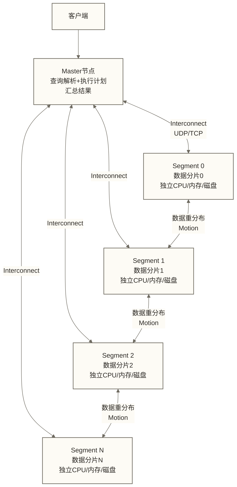

> [!warning] 关联材料边界
> 以下原引用目标缺失或无法唯一确认，已取消跳转并保留提及：10-Greenplum性能调优实战；11-Greenplum数仓建模实践；Apache Hive；Apache Spark。相关素材/延伸说明暂不可用，不能据此声称已经提供配套材料。

# Greenplum架构原理与核心特性深度解析

> [!abstract] 学习目标
> - 深入理解MPP架构的分布式查询执行原理，而不只是知道"多节点并行"
> - 掌握分布键的选择策略——这是Greenplum最重要的设计决策
> - 理解行存/列存/AO表的底层差异与适用场景
> - 建立Greenplum与Hive/Spark SQL的场景定位清晰认知
> - 了解PXF外部表的数据联邦查询能力

> [!quote] 核心洞察
> Greenplum的本质是：将一个大查询切割成若干并行子任务，分发到N个节点同时执行，再汇总结果。这听起来简单，但背后的核心挑战是：数据分布决定了并行的效率。如果数据分布不均（倾斜），所有节点都要等最慢的那个——并行变成了串行。理解这一点，你就理解了分布键选择为什么是Greenplum最关键的设计决策。

## MPP架构：分布式查询执行的内核

### 什么是Shared Nothing架构

Greenplum采用Shared Nothing MPP架构：每个Segment节点拥有独立的CPU、内存和磁盘，节点之间不共享存储，通过高速网络（Interconnect）交换数据。

这与以下架构形成对比：
- **Shared Everything**（传统SMP）：所有CPU共享内存和磁盘，扩展上限受限
- **Shared Disk**（Oracle RAC）：多节点共享存储，存储层成为瓶颈
- **Shared Nothing**（Greenplum/Redshift等）：具备横向扩展能力；仅在负载可充分并行、数据均衡且网络等资源不构成瓶颈时，增加节点才可能接近线性提升性能



### 一条SQL的完整执行流程

以一条聚合查询为例，展示Greenplum如何分布式执行：

```sql
SELECT city, SUM(amount) AS total
FROM orders
WHERE status = 1
GROUP BY city
ORDER BY total DESC
LIMIT 10;
```

**执行流程：**

1. **Master接收SQL**：解析器生成查询树，由所选优化器（如ORCA）基于统计信息和代价估算生成分布式执行计划，不保证全局最优
2. **生成Slice（切片）**：执行计划按Motion边界划分为多个Slice；各Slice依执行计划在协调节点或相应Segment执行，并非都在所有Segment上执行
3. **Segment并行执行**：每个Segment在本地数据上执行过滤（WHERE status=1）和本地聚合（GROUP BY city的本地SUM）
4. **Motion（数据重分布）**：需要汇总跨Segment的city数据时，通过Redistribute Motion将相同city的数据发送到同一个Segment
5. **最终聚合**：各Segment对接收到的数据完成最终SUM聚合
6. **Gather Motion**：所有Segment的结果汇聚到Master，Master做最终排序和LIMIT

> [!note] Motion的代价
> Motion（数据网络传输）是Greenplum最主要的性能代价。好的分布键设计可以让关联操作在本地完成（Collocated Join），避免大量数据跨网络传输。这就是为什么分布键的选择如此关键。

### Motion的三种类型

| Motion类型 | 触发场景 | 代价 |
|-----------|---------|------|
| **Redistribute Motion** | 按某列的哈希值重新分布数据 | 中等，数据量决定代价 |
| **Broadcast Motion** | 将一个表的全量数据广播到所有Segment | 高，仅适合小表 |
| **Gather Motion** | 将所有Segment结果汇聚到Master | 低，结果集通常小 |

## 数据分布机制：分布键的选择

### 三种数据分布策略

```sql
-- 1. 哈希分布（此处显式指定；默认策略受版本、配置和建表方式影响）
CREATE TABLE orders (
    order_id   BIGINT,
    user_id    INT,
    amount     DECIMAL(10,2)
) DISTRIBUTED BY (user_id);  -- user_id的哈希值决定存储在哪个Segment

-- 2. 随机分布（Round Robin）
CREATE TABLE temp_result (
    col1 INT, col2 TEXT
) DISTRIBUTED RANDOMLY;  -- 数据均匀轮询分配，无法做Collocated Join

-- 3. 复制分布（每个Segment都有完整副本，6.x新增）
CREATE TABLE dim_calendar (
    date_key DATE, year INT, month INT
) DISTRIBUTED REPLICATED;  -- 适合小维度表
```

### 分布键选择：最重要的设计决策

**核心原则：兼顾数据均衡与主要JOIN模式选择分布键；两表分布策略、键类型及连接条件兼容时，可使相关数据落在同一Segment，减少连接重分布，但不保证整个查询没有Motion。**

**原则1：选择高基数列**

```sql
-- 错误示例：分布键选择性太低
CREATE TABLE orders (...) DISTRIBUTED BY (status);
-- status只有0/1/2，大量行落在同一个Segment，严重倾斜

-- 正确：高基数列
CREATE TABLE orders (...) DISTRIBUTED BY (order_id);  -- 或user_id
```

**原则2：与最频繁的JOIN对齐**

```sql
-- orders表和order_items表经常JOIN
-- 让两表按相同分布键分布，JOIN可在本地完成（Collocated Join）

CREATE TABLE orders (
    order_id BIGINT, user_id INT, amount DECIMAL
) DISTRIBUTED BY (order_id);

CREATE TABLE order_items (
    item_id BIGINT, order_id BIGINT, product_id INT, quantity INT
) DISTRIBUTED BY (order_id);  -- 与orders表相同分布键

-- 此JOIN可在本地完成（Collocated Join）；最终结果汇总仍可能需要Gather Motion
SELECT o.order_id, SUM(i.quantity)
FROM orders o
JOIN order_items i ON o.order_id = i.order_id
GROUP BY o.order_id;
```

**原则3：避免NULL值多的列**

NULL值在哈希分布中通常映射到同一个Segment，造成倾斜。

**原则4：复合分布键的使用**

```sql
-- 当单列无法均匀分布时，使用复合分布键
CREATE TABLE user_behavior (
    user_id INT, event_date DATE, event_type VARCHAR(50)
) DISTRIBUTED BY (user_id, event_date);
-- 注意：复合分布键的JOIN条件需要两列都相同才能Collocated
```

### 验证数据分布是否均匀

```sql
-- 检查各Segment的数据分布（倾斜检测）
SELECT gp_segment_id, COUNT(*) AS row_count
FROM orders
GROUP BY gp_segment_id
ORDER BY row_count DESC;

-- 原稿未核实的教学参考：各Segment行数相差不超过10%
-- 原稿未核实的教学参考：最大值/最小值 > 2；非通用判定标准
-- 无行的Segment不会出现在上述结果中，需结合Segment清单补零检查

-- 也可以用内置函数检测存储倾斜
SELECT * FROM gp_toolkit.gp_skew_coefficients
WHERE skcrelname = 'orders';
-- 视图系数字段为skccoeff；原稿的 > 1.5 为未核实教学阈值，不能直接作为显著倾斜的通用判据
```

## 存储格式：行存/列存/AO表

### 堆表（Heap Table）

默认存储格式，与PostgreSQL相同，支持UPDATE/DELETE，适合写入频繁的表。

```sql
CREATE TABLE hot_data (...);  -- 默认堆表
```

### AO表（Append-Optimized Table）

针对批量写入和分析查询优化，仍支持MVCC可见性语义，但实现不同于堆表；通过辅助可见性映射记录删除状态，数据写入及日志机制也不同于堆表，具体开销取决于版本和工作负载。

```sql
-- 行存AO表：适合宽表（列多但每次查询需要大部分列）
CREATE TABLE fact_orders (...) WITH (appendoptimized=true, compresstype=zstd, compresslevel=1);

-- 列存AO表：适合分析查询（通常只访问少数几列）
CREATE TABLE fact_orders_col (...) WITH (appendoptimized=true, orientation=column,
                                         compresstype=zstd, compresslevel=1);
```

### 行存 vs 列存的深度对比

**行存储**（每行数据物理连续存储）：

```text
物理存储：[row1_col1|row1_col2|...|row1_colN] [row2_col1|row2_col2|...|row2_colN]
适合查询：SELECT * FROM t WHERE id = 1  （取整行，一次I/O）
不适合：  SELECT AVG(amount) FROM t      （只需amount列，却读了全部列）
```

**列存储**（同一列的数据物理连续存储）：

```text
物理存储：[col1_row1|col1_row2|...|col1_rowN] [col2_row1|col2_row2|...|col2_rowN]
适合查询：SELECT AVG(amount), SUM(quantity) FROM t  （只读两列，I/O大幅减少）
另一优势：同列数据类型相同，通常有利于压缩，可降低存储成本和I/O；5-10倍为原稿未核实示例，实际压缩比取决于数据分布和压缩算法
不适合：  频繁UPDATE/DELETE操作（AO通常通过删除可见性标记及更新时追加新数据实现，可能增加回收与维护开销）
```

| 场景 | 推荐格式 |
|------|---------|
| 宽表 + 需要查询大部分列 | 行存AO |
| 分析查询 + 只访问少数列 + 大数据量 | 列存AO（主流选择） |
| 有频繁UPDATE/DELETE | 堆表 |
| 维度表（小表，频繁访问） | 堆表 或 REPLICATED |

```sql
-- 原稿未核实的教学性能示例（百亿行表，只查2列；未提供实测环境）
-- 列存：扫描数据量 ≈ 全表 × (2/总列数) × 压缩率
-- 行存：扫描全表数据
-- 原稿示例称宽表（50+列）场景下性能差距可达10-50倍；该数字未经核实，不作为性能保证
```

## Greenplum vs Hive/Spark SQL：场景定位

### 核心差异

| 对比维度 | Greenplum | Hive | Spark SQL |
|---------|---------|------|----------|
| 计算模型 | MPP（进程级并行） | MR/Tez（DAG批处理） | DAG内存计算 |
| 数据位置 | 数据存在本地磁盘 | 数据在HDFS | 数据在HDFS/对象存储 |
| 查询延迟 | 秒级（OLAP首选） | 分钟级 | 秒到分钟级 |
| 并发查询 | 支持（资源队列控制） | 较差 | 中等 |
| 数据规模 | 十TB到百TB | PB级 | PB级 |
| 事务支持 | 支持事务，分布式约束需按版本确认 | 原生支持ACID事务表，受版本、表类型和配置限制，并非必须使用Hudi/Iceberg | Spark SQL本身不提供通用数据库事务；表级事务能力取决于数据源、表格式及集成方式 |
| 适用场景 | 交互式查询、BI报表 | 离线批量计算、ETL | 机器学习、实时+批量统一 |

### Greenplum最擅长的场景

1. **复杂SQL分析查询**：适合多表JOIN + GROUP BY + 窗口函数；能否秒级返回取决于数据量、执行计划、硬件和并发负载
2. **高并发BI报表**：多个用户同时查询，通过资源队列隔离
3. **联邦分析查询**：通过PXF连接Hadoop，在同一SQL中查询Greenplum本地数据和HDFS外部数据；这不等同于具备HTAP事务与分析混合负载能力

### Greenplum不擅长的场景

- 流数据处理（选Flink/Kafka Streams）
- 机器学习特征工程（选Spark）
- 超大规模（PB级）非结构化数据处理（选Hive/Spark）
- 频繁的点更新（选MySQL/PostgreSQL）

## PXF：数据联邦查询

PXF（Platform Extension Framework）是Greenplum的数据联邦查询框架，允许通过外部表访问Hadoop、S3、数据库等外部数据源。

```sql
-- 创建PXF外部表，以HdfsTextSimple和CSV格式读取HDFS上的文本文件
CREATE EXTERNAL TABLE ext_hive_orders (
    order_id BIGINT,
    user_id  INT,
    amount   DECIMAL(10,2),
    dt       DATE
)
LOCATION ('pxf://hadoop-namenode/data/orders/?PROFILE=HdfsTextSimple')
FORMAT 'CSV';

-- 或者读取S3上的Parquet文件
CREATE EXTERNAL TABLE ext_s3_logs (
    event_time TIMESTAMP,
    user_id    INT,
    action     VARCHAR(50)
)
LOCATION ('pxf://my-bucket/logs/?PROFILE=s3:parquet&SERVER=s3')
FORMAT 'CUSTOM' (FORMATTER='pxfwritable_import');

-- 联邦查询：Greenplum本地数据 + S3外部数据
SELECT l.user_id, COUNT(l.event_time) AS event_count, SUM(o.amount) AS total_amount
FROM ext_s3_logs l
JOIN orders o ON l.user_id = o.user_id
WHERE l.action = 'purchase'
  AND o.status = 1
GROUP BY l.user_id;
```

> [!note] PXF的性能特点
> PXF查询的性能瓶颈通常在外部数据源的读取速度和网络带宽，而非Greenplum本身。大量数据从外部拉入Greenplum进行计算时，Predicate Pushdown（谓词下推）至关重要——让过滤条件尽可能在外部数据源侧执行，减少传输数据量。

## 高可用：Primary/Mirror机制

在已配置Segment镜像且镜像健康的集群中，每个Primary Segment有对应的Mirror（镜像）；应通过部署策略使对应Primary和Mirror位于不同物理机。Primary故障后，集群检测故障并在条件允许时将Mirror提升为新Primary，更新相关路由。原稿所称1-3分钟为未核实的切换时间示例，实际耗时取决于检测配置、故障类型和集群状态，不构成可用性承诺。

```sql
-- 查看当前Segment状态（是否有Primary/Mirror故障）
SELECT * FROM gp_segment_configuration
ORDER BY content;
-- status: 'u' = up（正常）, 'd' = down（故障）
-- role: 'p' = primary, 'm' = mirror
-- preferred_role: 最初配置的角色
```

> [!warning] 恢复被降级的Mirror
> 生产环境中Primary/Mirror状态不一致会持续积累，需要定期执行`gprecoverseg`恢复Mirror，并在合适时机执行`gprecoverseg -r`将Primary/Mirror恢复到preferred状态，避免长期运行在不平衡状态。

## 关联知识

- [[【技术与工具】/Greenplum/02-Greenplum架构原理|02-Greenplum架构原理]] - MPP基础架构入门
- [[【技术与工具】/Greenplum/07-表设计与分区|07-表设计与分区]] - 分区表与分布键的组合设计
- 10-Greenplum性能调优实战（原引用“10-Greenplum性能调优实战”未能确定有效目标，暂不可跳转） - 基于架构理解的调优实践
- 11-Greenplum数仓建模实践（原引用“11-Greenplum数仓建模实践”未能确定有效目标，暂不可跳转） - 数仓场景下的架构应用
- Apache Hive（原引用“Apache Hive”未能确定有效目标，暂不可跳转） - Hive与Greenplum的场景对比
- Apache Spark（原引用“Apache Spark”未能确定有效目标，暂不可跳转） - Spark与Greenplum的协作模式
