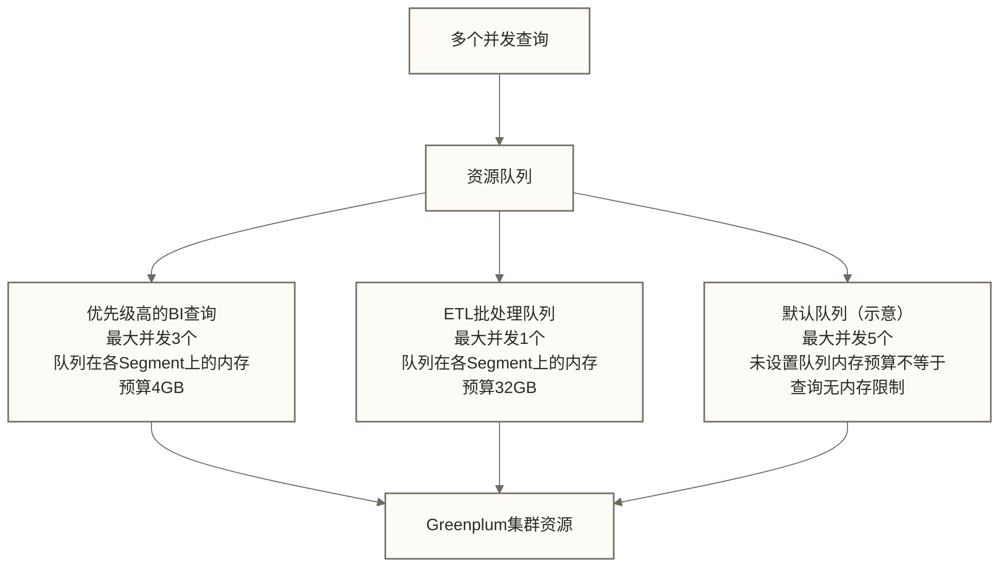

> [!warning] 关联材料边界
> 以下原引用目标缺失或无法唯一确认，已取消跳转并保留提及：11-Greenplum数仓建模实践；13-Greenplum高频面试题。相关素材/延伸说明暂不可用，不能据此声称已经提供配套材料。

# Greenplum性能调优实战 - EXPLAIN ANALYZE到资源管理

> [!abstract] 学习目标
> - 读懂EXPLAIN ANALYZE的每个关键算子，定位性能瓶颈
> - 掌握数据倾斜的检测方法与多种解决思路
> - 理解分区表设计与分区裁剪的工作机制
> - 了解统计信息（ANALYZE）对查询计划的决定性影响
> - 学会配置资源队列控制并发查询，避免资源竞争

> [!quote] 核心洞察
> Greenplum的性能调优与单机数据库有根本不同。单机数据库调优关注索引和缓存命中率；Greenplum调优的核心是减少Motion（网络数据传输）和消除数据倾斜（Skew）。一个看起来简单的查询，如果触发了大量Redistribute Motion或者某个Segment的数据量是其他Segment的10倍，性能就会崩塌。

## EXPLAIN ANALYZE深度解读

### 获取执行计划

```sql
-- 基础执行计划（不执行查询）
EXPLAIN SELECT * FROM orders WHERE status = 1;

-- 实际执行并返回性能数据；会消耗查询资源，先在受控环境评估执行成本
EXPLAIN ANALYZE SELECT city, SUM(amount) FROM orders WHERE status = 1 GROUP BY city;

-- 更详细的格式（Greenplum 6+）
EXPLAIN (ANALYZE, VERBOSE, COSTS, BUFFERS, FORMAT TEXT)
SELECT city, SUM(amount) FROM orders WHERE status = 1 GROUP BY city;
```

### 执行计划示例解读

```text
Gather Motion 4:1  (slice1; segments: 4)  (cost=0.00..1200.00 rows=100 width=40)
  ->  HashAggregate  (cost=0.00..600.00 rows=25 width=40)
      Group Key: city
      ->  Redistribute Motion 4:4  (slice2)  (cost=0.00..300.00 rows=25 width=40)
          Hash Key: city
          ->  HashAggregate  (cost=0.00..200.00 rows=25 width=40)
              Group Key: city
              ->  Seq Scan on orders  (cost=0.00..100.00 rows=12500 width=20)
                    Filter: (status = 1)
```

**从内到外逐层解读：**

1. **Seq Scan on orders**：每个参与执行的Segment顺序扫描本地orders数据，并应用过滤条件（是否需要优化应结合选择性与存储类型判断）
2. **HashAggregate（本地）**：每个Segment先做本地GROUP BY，减少传输数据量
3. **Redistribute Motion 4:4**：将本地聚合结果按city的哈希值重新分布，确保同一city的数据汇聚到同一Segment
4. **HashAggregate（最终）**：在重分布后的数据上完成最终聚合
5. **Gather Motion 4:1**：将各Segment的结果汇聚到Master返回

### EXPLAIN ANALYZE的关键指标

```sql
-- 带有实际执行数据的输出示例
Seq Scan on orders  (cost=0.00..100.00 rows=12500 width=20)
                    (actual time=0.5..85.2 rows=234567 loops=1)
```

| 关键字 | 含义 | 关注点 |
|--------|------|--------|
| `cost=0.00..100.00` | 优化器估算的代价（启动代价..总代价） | 仅供参考 |
| `rows=12500` | 优化器估算的输出行数 | 与actual rows差距大时需检查统计信息、数据相关性及估算口径，不能仅据此认定统计信息过时 |
| `actual time=0.5..85.2` | 实际执行时间（毫秒，第一行..最后一行） | 越大越需要关注 |
| `actual rows=234567` | 实际输出行数 | 先确认与估算值的Segment汇总口径一致，再检查统计信息是否需要更新 |
| `Redistribute Motion` | 数据重分布（网络传输） | 频繁大量重分布是性能杀手 |
| `Broadcast Motion` | 全量广播（代价高） | 只适合小表 |

### 识别性能瓶颈算子

```sql
-- 关注点1：Seq Scan大表；结合过滤选择性、分区谓词和存储类型判断，全表扫描不一定是错误计划
-- 关注点2：Redistribute/Broadcast Motion的数据量过大
-- 关注点3：Hash Join的inner side过大；检查构建侧数据量、内存与溢出，匹配分布键可减少Motion但不保证缩小构建侧
-- 关注点4：Sort算子（可能导致磁盘溢出）
-- 关注点5：估算行数与实际行数差距超过10倍时，先确认Segment汇总口径，再检查统计信息、数据相关性与估算偏差；需要时执行ANALYZE

-- 查看实际每个Segment的行数分布（发现倾斜）
EXPLAIN ANALYZE SELECT city, SUM(amount)
FROM orders WHERE status = 1 GROUP BY city;
-- 输出中若某Segment的actual rows远大于其他，说明数据倾斜
```

## 数据倾斜：检测与解决

### 数据倾斜的检测

```sql
-- 方法1：直接统计各Segment行数
SELECT gp_segment_id, COUNT(*) AS row_count,
       ROUND(COUNT(*) * 100.0 / SUM(COUNT(*)) OVER(), 2) AS pct
FROM orders
GROUP BY gp_segment_id
ORDER BY row_count DESC;

-- 方法2：使用GP内置工具
SELECT * FROM gp_toolkit.gp_skew_coefficients
WHERE skcrelname = 'orders';
-- skccoeff: 行数分布的变异系数，值越大表示分布越不均匀
-- 不采用此处原稿的0.5/1.0分级；应先确认指标单位，再结合Segment数量和实际查询影响判断

-- 方法3：查看表扫描的空闲比例指标；该视图不是各Segment磁盘占用统计
SELECT * FROM gp_toolkit.gp_skew_idle_fractions
WHERE sifrelname = 'orders';
```

### 解决倾斜的策略

**策略1：更换分布键**

```sql
-- 发现orders表按status分布严重倾斜
-- 解决：改为高基数的order_id分布
ALTER TABLE orders SET DISTRIBUTED BY (order_id);
-- 注意：ALTER TABLE会重写数据，对大表耗时，需在维护窗口执行
```

**策略2：使用复合分布键**

```sql
-- 单列基数不够，使用复合分布键
ALTER TABLE user_behavior SET DISTRIBUTED BY (user_id, event_date);
```

**策略3：检查倾斜聚合的两阶段执行计划**

```sql
-- 场景：orders的city列倾斜（北京数据占50%），但查询必须按city GROUP BY
-- 以下嵌套聚合在结果语义上可合并，不保证强制生成Segment本地聚合与全局聚合两个阶段
SELECT city, SUM(local_sum) AS total
FROM (
    SELECT city, SUM(amount) AS local_sum
    FROM orders
    WHERE status = 1
    GROUP BY city
) t
GROUP BY city;
-- 是否生成两阶段聚合应以EXPLAIN为准；此处未提供可用的hint机制或语法
```

**策略4：倾斜数据单独处理**

```sql
-- 场景：user_id=0（游客）的数据占总量30%
-- 方案：将user_id=0分支拆出进行计划对比；UNION ALL不保证分支独立调度或消除倾斜，并可能增加扫描成本
SELECT user_id, COUNT(*) FROM orders WHERE user_id = 0 GROUP BY user_id
UNION ALL
SELECT user_id, COUNT(*) FROM orders WHERE user_id != 0 GROUP BY user_id;
```

### 计算倾斜（Compute Skew）

数据倾斜会导致计算倾斜，但即使数据均匀，某些操作也会产生计算倾斜：

```sql
-- 场景：GROUP BY的key在某个Segment上集中
-- 例：按city GROUP BY，北京的数据都在Segment 0，导致Segment 0计算量最大
-- EXPLAIN ANALYZE的输出中会显示每个Segment的实际执行时间
-- 若某Segment时间是其他的3倍以上，说明计算倾斜

-- 排查方向：结合Motion和各Segment耗时评估分布键或预聚合；窗口函数与GROUP BY通常不等价，不能直接替换
```

## 分区表与分区裁剪

### 分区设计原则

```sql
-- 按日期范围分区（最常用，对时序数据极有效）
CREATE TABLE fact_orders (
    order_id   BIGINT,
    user_id    INT,
    amount     DECIMAL(10,2),
    order_date DATE,
    city       VARCHAR(50)
)
DISTRIBUTED BY (user_id)
PARTITION BY RANGE (order_date) (
    START ('2023-01-01') END ('2026-01-01')
    EVERY (INTERVAL '1 month'),
    DEFAULT PARTITION other
);

-- 查看分区信息
SELECT schemaname, tablename, partitionname, partitionrangestart, partitionrangeend
FROM pg_partitions
WHERE tablename = 'fact_orders'
ORDER BY partitionrangestart;
```

### 验证分区裁剪是否生效

```sql
-- 分区裁剪：优化器只扫描满足WHERE条件的分区，忽略其他分区
EXPLAIN SELECT * FROM fact_orders WHERE order_date = '2024-06-15';

-- 期望输出：只扫描order_date_2024_06这一个分区
-- Append
--   -> Seq Scan on fact_orders_1_prt_2024_06
--          Filter: order_date = '2024-06-15'

-- 如果看到扫描了所有分区：检查WHERE条件是否能静态推断
-- 常见导致分区裁剪失效的情况：
-- 1. 对分区键应用函数可能妨碍裁剪；查询2024年时优先使用order_date >= DATE '2024-01-01' AND order_date < DATE '2025-01-01'，并以执行计划确认
-- 2. 分区键与WHERE条件类型不匹配（隐式转换）
-- 3. 动态分区裁剪取决于版本、优化器及查询形态；不能仅据此断言5.x只能使用静态WHERE条件
```

### 分区维护

```sql
-- 添加新分区
ALTER TABLE fact_orders ADD PARTITION jan2026
    START ('2026-01-01') END ('2026-02-01');

-- 删除旧分区（高效：直接删除分区文件，不扫描数据）
ALTER TABLE fact_orders DROP PARTITION FOR ('2020-01-01');

-- 交换分区（高效数据加载：先加载到临时表，再原子性交换）
-- Step1：将新数据加载到普通表
CREATE TABLE tmp_jan2025 (...) DISTRIBUTED BY (user_id);
INSERT INTO tmp_jan2025 SELECT ... FROM staging WHERE order_date >= '2025-01-01'...;

-- Step2：交换分区；执行时间取决于锁等待、约束校验等因素，不能保证微秒级或不影响并发查询
ALTER TABLE fact_orders EXCHANGE PARTITION jan2025 WITH TABLE tmp_jan2025;
```

## 统计信息对查询计划的影响

### 为什么统计信息至关重要

ORCA优化器基于统计信息估算行数，选择JOIN算法（Hash Join vs Nested Loop）、Motion类型、是否广播小表。统计信息过时会导致优化器做出错误决策，例如：高估维度表大小导致使用Redistribute Motion而非Broadcast Motion。

```sql
-- 查看表的统计信息
SELECT attname, n_distinct, correlation
FROM pg_stats
WHERE tablename = 'orders';
-- n_distinct: 列的唯一值数量估计（负值表示占总行数的比例）
-- correlation: 物理存储顺序与逻辑排序的相关性（1.0表示完全有序）

-- 查看表的统计信息采集时间
SELECT relname, last_analyze, last_autoanalyze
FROM pg_stat_user_tables
WHERE relname = 'orders';
```

### ANALYZE的最佳实践

```sql
-- 手动更新统计信息（大批量数据加载后必须执行）
ANALYZE orders;

-- 只分析指定列（节省时间，对已知的过滤/JOIN列分析）
ANALYZE orders (user_id, status, order_date);

-- 分区表：分析所有分区
ANALYZE fact_orders;

-- 设置统计信息目标值（不是固定采样率，也不保证固定采样30000行；提高目标值可能增加采样与统计开销）
SET default_statistics_target = 100;  -- 会话级
ALTER TABLE orders ALTER COLUMN user_id SET STATISTICS 200;  -- 针对具体列
```

> [!warning] 生产环境的ANALYZE策略
> 不要将autovacuum与统计信息是否自动更新等同；自动统计信息行为需按Greenplum版本及相关配置确认。数据加载后应检查统计信息，并在需要时执行ANALYZE。建议在ETL流程中安排统计信息检查或更新，并结合last_analyze与last_autoanalyze设置监控告警。

## 资源队列与并发查询管理

### 为什么需要资源队列

Greenplum的全局资源是有限的（内存、CPU）。如果不加控制，多个大查询同时执行，每个查询都试图使用全部资源，导致内存溢出（spill to disk）、查询互相竞争、整体吞吐量下降。



### 资源队列配置

```sql
-- 创建高优先级BI查询队列
CREATE RESOURCE QUEUE bi_queue
    WITH (
        ACTIVE_STATEMENTS = 3,           -- 最大并发查询数
        MEMORY_LIMIT = '4GB',            -- 资源队列在各Segment上的内存预算，不是每条查询的集群总内存上限
        PRIORITY = HIGH,                 -- 优先级（LOW/MEDIUM/HIGH/MAX）
        MAX_COST = 1e6                   -- 最大估算代价（防止全表扫描的大查询进入）
    );

-- 创建ETL批处理队列
CREATE RESOURCE QUEUE etl_queue
    WITH (
        ACTIVE_STATEMENTS = 1,
        MEMORY_LIMIT = '32GB',
        PRIORITY = MEDIUM
    );

-- 将用户分配到资源队列
ALTER ROLE bi_user RESOURCE QUEUE bi_queue;
ALTER ROLE etl_user RESOURCE QUEUE etl_queue;

-- 查看资源队列状态（是否有查询在等待）
SELECT * FROM pg_resqueue_status;
SELECT * FROM gp_toolkit.gp_resqueue_status;
```

### statement_mem：控制单查询内存

```sql
-- 全局设置（postgresql.conf；不使用MySQL的my.cnf）
gp_resqueue_memory_policy = auto     -- 自动根据active_statements分配内存
statement_mem = 256MB                -- 查询在各Segment上的内存预算参数；与资源队列的关系取决于内存管理策略
max_statement_mem = 4096MB           -- 限制statement_mem的可设上限，不代表整条查询的集群总内存上限

-- 会话级临时调整（处理特别大的查询）
SET statement_mem = '2GB';
SELECT ...;  -- 示意占位语句；2GB不是整条查询跨所有Segment的总内存上限
RESET statement_mem;
```

### 监控查询执行

```sql
-- 查看当前正在执行的查询
SELECT pid, usename, query_start, state,
       wait_event_type, wait_event,
       LEFT(query, 100) AS query_snippet
FROM pg_stat_activity
WHERE state != 'idle'
ORDER BY query_start;

-- 查看等待队列（被资源队列阻塞的查询）
SELECT * FROM gp_toolkit.gp_resqueue_status
WHERE rsqnumcurrunqueuedqueries > 0;

-- 终止一个长时间运行的查询
SELECT pg_cancel_backend(pid);  -- 发送SIGINT，可能需要时间响应
SELECT pg_terminate_backend(pid);  -- 发送SIGTERM，强制终止
```

## ORCA优化器实战

### 开启ORCA

ORCA的默认启用状态需按Greenplum版本、发行版及部署配置确认，不能仅按5.x与6.x划分；请先使用SHOW optimizer检查当前会话。

```sql
-- 检查ORCA是否开启
SHOW optimizer;

-- 开启ORCA（会话级）
SET optimizer = on;

-- 全局开启（postgresql.conf）
optimizer = on

-- 对比legacy planner（调试用）
SET optimizer = off;
EXPLAIN SELECT ...;  -- legacy planner的执行计划
SET optimizer = on;
EXPLAIN SELECT ...;  -- ORCA的执行计划
```

### ORCA的优势场景

ORCA对以下场景有明显优化效果：
- 多表JOIN（ORCA有更好的JOIN Reorder算法）
- 分区表查询（更好的分区裁剪）
- 子查询和CTE（更好的子查询提升/内联）
- 窗口函数
- 统计信息质量高时，ORCA的代价估算更准确

### optimizer_analyze_root_partition

```sql
-- Greenplum 6推荐开启：ANALYZE时同时收集根分区统计信息
-- 让ORCA能更准确估算分区表的行数
SET optimizer_analyze_root_partition = on;
ANALYZE fact_orders;
```

## 常见性能问题的诊断清单

```sql
-- 诊断步骤1：找到慢查询
SELECT pid, query_start, state,
       EXTRACT(EPOCH FROM (NOW() - query_start)) AS duration_seconds,
       LEFT(query, 200)
FROM pg_stat_activity
WHERE state = 'active'
  AND EXTRACT(EPOCH FROM (NOW() - query_start)) > 30
ORDER BY duration_seconds DESC;

-- 诊断步骤2：对慢查询执行EXPLAIN ANALYZE
-- 关注：Redistribute Motion数据量、Broadcast Motion、各算子实际时间

-- 诊断步骤3：检查数据倾斜
SELECT gp_segment_id, COUNT(*) FROM problem_table GROUP BY gp_segment_id;

-- 诊断步骤4：检查统计信息是否过时
SELECT relname, last_analyze
FROM pg_stat_user_tables
WHERE last_analyze < NOW() - INTERVAL '7 days'
  AND relname NOT LIKE 'pg_%';

-- 诊断步骤5：检查是否有磁盘溢出（spill）
SELECT * FROM gp_toolkit.gp_workfile_entries;

-- 诊断步骤6：检查资源队列等待
SELECT * FROM gp_toolkit.gp_resqueue_status;
```

## 关联知识

- [[【技术与工具】/Greenplum/09-架构原理与核心特性深度解析|09-架构原理与核心特性深度解析]] - MPP架构与Motion类型
- [[【技术与工具】/Greenplum/07-表设计与分区|07-表设计与分区]] - 分区表基础设计
- 11-Greenplum数仓建模实践（原引用“11-Greenplum数仓建模实践”未能确定有效目标，暂不可跳转） - 数仓场景下的性能优化
- 13-Greenplum高频面试题（原引用“13-Greenplum高频面试题”未能确定有效目标，暂不可跳转） - 性能调优相关面试题
