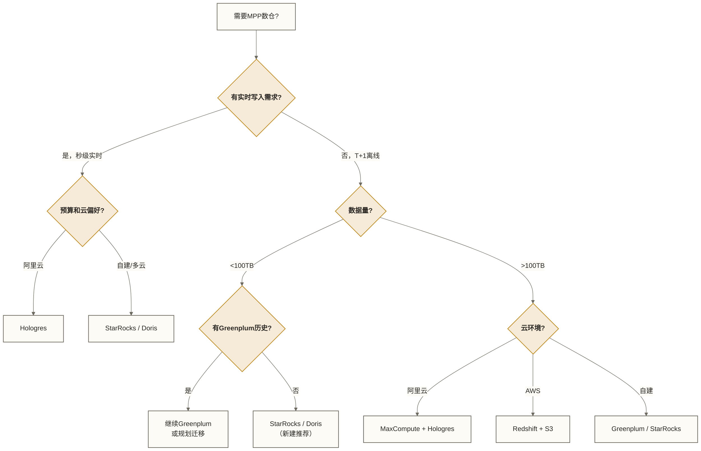

> [!warning] 关联材料边界
> 以下原引用目标缺失或无法唯一确认，已取消跳转并保留提及：10-性能调优实战；13-Greenplum高频面试题；Apache Hive；数据仓库选型指南。相关素材/延伸说明暂不可用，不能据此声称已经提供配套材料。

# Greenplum生态与云化演进 - 从开源社区到国产MPP竞争格局

> [!abstract] 学习目标
> - 了解Greenplum开源社区的现状与发展走向（VMware/Broadcom收购后的影响）
> - 理解Greenplum与PostgreSQL的深度关系及兼容性边界
> - 建立云上MPP选型的决策框架（Greenplum/Redshift/MaxCompute/Hologres）
> - 理解StarRocks/Doris等国产MPP的技术差异与竞争态势
> - 明确Greenplum的适用场景边界，知道什么时候不应该选它

> [!quote] 核心洞察
> Greenplum的最大挑战不是技术，而是生态和商业。VMware被Broadcom收购后，Greenplum的开源前景存在不确定性；国产MPP（StarRocks/Doris）在实时性和易用性上已经超越；云厂商的托管MPP（Redshift/MaxCompute）大幅降低了运维门槛。选择Greenplum，本质上是选择一个成熟稳定但增长放缓的技术。理解这个背景，才能做出符合业务实际的选型决策。

## Greenplum开源社区现状

### 历史沿革

```text
时间线：
2003年  Greenplum公司成立，MPP数据库产品发布
2010年  EMC收购Greenplum
2015年  Greenplum数据库以Apache License 2.0开源
2013年  Pivotal成立，Greenplum业务归入Pivotal
2015年  Dell宣布收购EMC，交易于2016年完成
2019年  VMware收购Pivotal，Greenplum并入VMware
2022年  Broadcom宣布收购VMware
2023年  Broadcom完成对VMware的收购

影响分析：
- Broadcom收购VMware的战略重心是虚拟化和云基础设施
- Greenplum数据库不在Broadcom的核心业务范围内
- 社区版（github.com/greenplum-db/gpdb）仍然开源维护
- 商业版（Tanzu Greenplum）的未来路径不明确
- 部分核心开发者已转向Apache Cloudberry（Greenplum的社区分支）
```

### Apache Cloudberry：Greenplum的社区接班人

2023年，部分Greenplum社区成员基于Greenplum开源代码创建了Apache Cloudberry（孵化中），目标是在Apache基金会下维持一个独立的MPP数据库社区。

```text
Apache Cloudberry的关键特性：
- 完全基于Greenplum 7.x代码分支
- 与PostgreSQL 14+深度对齐
- Apache License 2.0：仍须核对目标发行版本、依赖和分发方式的许可义务，不能据此认定无商业版权风险
- 增加了向量化执行引擎支持
- 云原生存储（对象存储）支持
```

### 对用户的实际影响

- 短期（2-3年）：影响不大，Greenplum 7.x仍然稳定可用，社区继续维护
- 中期（3-5年）：新功能开发会放缓，建议评估向StarRocks/Doris或云MPP迁移的可行性
- 长期：Greenplum的历史遗留系统将成为主要形态，新建系统应优先考虑替代方案

## Greenplum与PostgreSQL的关系

### Greenplum基于PostgreSQL，但并非其功能超集

Greenplum基于PostgreSQL构建，继承了PostgreSQL的大部分特性：

```sql
-- 以下PostgreSQL特性在Greenplum中同样支持：
-- 1. 丰富的数据类型（JSON, JSONB, ARRAY, hstore等）
SELECT '{"name":"张三","age":25}'::jsonb ->> 'name' AS name;

-- 2. 窗口函数（ANSI SQL标准）
SELECT user_id, amount,
       SUM(amount) OVER (PARTITION BY user_id ORDER BY order_date) AS running_total
FROM orders;

-- 3. CTE（公用表表达式）
WITH monthly_summary AS (
    SELECT EXTRACT(MONTH FROM order_date) AS month, SUM(amount) AS total
    FROM orders
    GROUP BY 1
)
SELECT month, total, total / SUM(total) OVER() AS pct
FROM monthly_summary;

-- 4. 存储过程和函数（PL/pgSQL）
CREATE OR REPLACE FUNCTION get_user_tier(p_amount DECIMAL)
RETURNS TEXT AS $$
BEGIN
    IF p_amount >= 10000 THEN RETURN 'platinum';
    ELSIF p_amount >= 1000 THEN RETURN 'gold';
    ELSE RETURN 'silver';
    END IF;
END;
$$ LANGUAGE plpgsql;
```

### Greenplum与PostgreSQL的差异

| 特性 | PostgreSQL | Greenplum | 说明 |
|------|-----------|---------|------|
| 主键/唯一索引强制 | 强制 | 在支持的表类型和分布策略下强制 | 唯一键通常须包含全部分布键；具体限制须按Greenplum版本和表类型确认 |
| 外键约束 | 强制 | 支持定义，不强制检查 | 同上 |
| 序列/自增 | 同一序列正常使用时生成不同值，但不保证连续 | 同一序列通过协调机制生成不同值，并非各Segment独立编号 | 序列值可以有间隙；序列本身不能替代唯一约束，重置或循环使用须另行控制 |
| 触发器 | 完整支持 | 有限支持 | 部分触发器场景不支持 |
| 常规索引 | 大量使用 | 较少使用（MPP全表扫描有时更优） | Greenplum倾向于分区裁剪而非索引 |
| VACUUM | 自动 | 需要手动或AO表的自动vacuum | 需要定期维护 |

```sql
-- Greenplum特有的注意事项
-- 1. 序列在分布式环境下不保证连续（有间隙），这是正常的
-- 2. RETURNING子句在分布式下有限制
-- 3. 不支持INHERITS（继承表）在分区表上的某些操作
-- 4. 某些PostgreSQL扩展（extension）需要重新编译才能用于Greenplum
```

## 云上MPP选型：多维度对比

### 主流云MPP数据库对比

| 对比维度 | Greenplum | Redshift | MaxCompute | Hologres | BigQuery |
|---------|---------|---------|-----------|---------|---------|
| 云厂商 | 自建/VMware | AWS | 阿里云 | 阿里云 | Google Cloud |
| 架构 | MPP(Shared Nothing) | MPP | 分布式计算 | MPP+行列混存 | 无服务器列存 |
| SQL兼容 | PostgreSQL | PostgreSQL 8.x | 有差异 | PostgreSQL | 有差异 |
| 实时写入 | 有限 | 有限 | 批处理为主 | 优秀(实时+批量) | 流式写入 |
| 运维复杂度 | 高（自建） | 低（托管） | 低（托管） | 低（托管） | 极低（无服务器） |
| 成本模式 | 固定（自建服务器） | 按实例+存储 | 按量计费 | 按量计费 | 按查询量 |
| 适合场景 | 传统数仓、金融行业 | AWS生态 | 阿里云生态 | 实时OLAP | GCP生态、临时查询 |

### 阿里云Hologres：Greenplum的重要替代

Hologres是阿里云自研的实时OLAP数据库，定位是Greenplum+实时写入的替代方案：

```text
Hologres的核心优势（相比Greenplum）：
1. 实时写入：支持高吞吐实时INSERT，与Flink深度集成
2. 行列混存：同一张表同时支持行存（点查）和列存（分析）
3. 托管运维：无需自建集群，弹性扩缩容
4. MaxCompute深度集成：通过外部表直接查询MaxCompute数据

适用场景判断：
- 需要实时数据（秒级）+ 离线分析（T+1） → Hologres
- 纯离线分析，数据量极大（PB+）       → MaxCompute
- 已有Greenplum，迁移成本高            → 保持Greenplum
```

## 国产MPP：StarRocks与Doris

### StarRocks（鼎石）

StarRocks由Doris的部分核心开发者创立，2021年开源，目前是国内最活跃的MPP数据库项目之一。

**技术特点：**

```sql
-- StarRocks的向量化执行引擎（SIMD加速）
-- 原稿给出“在单节点上，某些聚合查询性能是传统MPP的3-5倍”的未核实示例；未提供测试版本、硬件、数据集或基线，不可用作性能承诺或选型依据

-- 支持实时更新（Primary Key模型）
-- 传统MPP（包括Greenplum）更新代价高，StarRocks Primary Key表支持高效UPSERT
CREATE TABLE orders_primary (
    order_id   BIGINT,
    status     TINYINT,
    amount     DECIMAL
)
PRIMARY KEY (order_id)
DISTRIBUTED BY HASH(order_id) BUCKETS 16;

-- 支持物化视图自动刷新
CREATE MATERIALIZED VIEW mv_daily_gmv
REFRESH ASYNC START('2024-01-01 00:00:00') EVERY (INTERVAL 1 HOUR)
AS SELECT DATE(order_date) AS dt, SUM(amount) AS gmv
   FROM orders GROUP BY dt;
```

**与Greenplum对比：**

| 对比点 | Greenplum | StarRocks |
|--------|---------|---------|
| 实时写入 | 弱 | 强（支持高并发UPSERT） |
| 向量化 | 部分（6.x开始） | 全面（核心竞争力） |
| 物化视图 | 有限 | 完整（自动刷新） |
| 外部表 | PXF | 支持Hive/Iceberg/S3等 |
| 学习曲线 | 陡（运维复杂） | 中等（易于上手） |
| PostgreSQL兼容性 | 高 | 中（MySQL方言为主） |
| 社区活跃度 | 下降 | 非常活跃 |

### Apache Doris

Doris是百度捐赠给Apache基金会的MPP OLAP数据库，与StarRocks同源（StarRocks基于早期Doris分支发展）。

```text
Doris的特点：
- MySQL协议兼容，接入成本极低
- 内置支持多副本（HA），运维相对简单
- 向量化执行（Doris 2.0+）
- 正在逐步追平与StarRocks的功能差距
- 社区活跃，中文文档完善

适合场景：
- 有MySQL技术栈团队，迁移成本低
- 中小规模（几十TB以内）实时+离线混合分析
- 预算有限，不希望购买商业MPP
```

### GaussDB（华为）

华为GaussDB 200（原FusionInsight LibrA）同样基于Greenplum开发，专注于金融、电信、政府等行业的离线数仓场景，在国内大型央企、国企有广泛应用。

## Greenplum的适用场景边界

### 应该选Greenplum的场景

1. **已有Greenplum系统的存量维护**：迁移成本高，继续维护是合理选择
2. **金融/电信/政府行业的合规要求**：数据不能上云，需要本地化部署，Greenplum是最成熟的选择
3. **PostgreSQL深度特性依赖**：大量使用PL/pgSQL存储过程、GIS扩展（PostGIS）等
4. **传统SQL数仓场景**：纯T+1离线分析，不需要实时，数据量在百TB以内

### 不应该选Greenplum的场景

1. **需要秒级实时数据**：Greenplum的写入延迟通常是分钟级，选StarRocks/Hologres
2. **数据量超过PB级**：Greenplum的MPP架构扩展有成本，PB级数据选Hive/Spark/MaxCompute
3. **高并发点查（>100 QPS）**：Greenplum的MPP架构不适合点查，选MySQL/Redis/HBase
4. **新建数据平台，无历史包袱**：建议直接考虑StarRocks或云托管MPP
5. **团队缺乏DBA**：Greenplum的运维复杂度高，无DBA支持的团队选托管云服务



## Greenplum DBA/数仓工程师的求职市场

### 技能需求现状

目前市场上Greenplum相关岗位主要集中在：

- **金融行业**（银行、保险、证券）：风控数仓、监管报送系统，大量使用Greenplum
- **电信行业**：流量分析、用户画像，部分仍使用Greenplum
- **互联网**：已基本迁移到StarRocks/Doris/云MPP，Greenplum需求下降

### 技能组合建议

```text
如果你的目标是数仓工程师/大数据工程师岗位（2026年）：

核心技能（必须）：
- SQL优化（基本思路可迁移，具体优化规则须按MPP引擎验证）
- 数仓建模（维度建模，各MPP通用）
- Flink/Spark数据处理

差异化技能（按目标行业选择）：
- 金融/电信/政府：掌握Greenplum + 数仓运维
- 互联网/新零售：掌握StarRocks或Doris + 云数仓
- 阿里云生态：掌握MaxCompute + Hologres + Flink

Greenplum的技能迁移价值：
- SQL基础能力可迁移；PostgreSQL方言、函数、类型及存储过程需要按目标系统适配
- MPP调优中的分布键、倾斜和数据交换思想具有迁移价值；Motion是Greenplum术语，其他MPP系统的实现与调优方式可能不同
- 数仓运维经验（分区管理、统计信息、资源队列）理念相通
```

## 关联知识

- [[【技术与工具】/Greenplum/09-架构原理与核心特性深度解析|09-架构原理与核心特性深度解析]] - Greenplum技术基础
- 10-性能调优实战（原引用“10-性能调优实战”未能确定有效目标，暂不可跳转） - Greenplum性能优化
- [[【技术与工具】/Greenplum/11-数仓建模实践|11-数仓建模实践]] - Greenplum数仓建模
- 13-Greenplum高频面试题（原引用“13-Greenplum高频面试题”未能确定有效目标，暂不可跳转） - 面试题与求职准备
- Apache Hive（原引用“Apache Hive”未能确定有效目标，暂不可跳转） - 大规模离线处理对比
- 数据仓库选型指南（原引用“数据仓库选型指南”未能确定有效目标，暂不可跳转） - 完整的数仓选型框架
