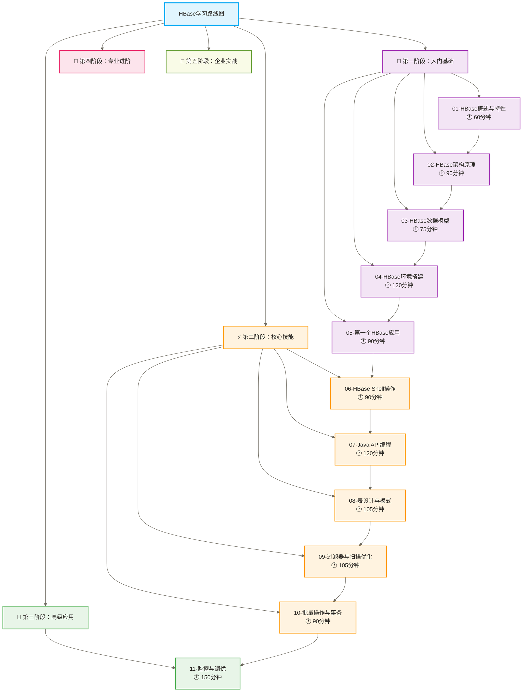
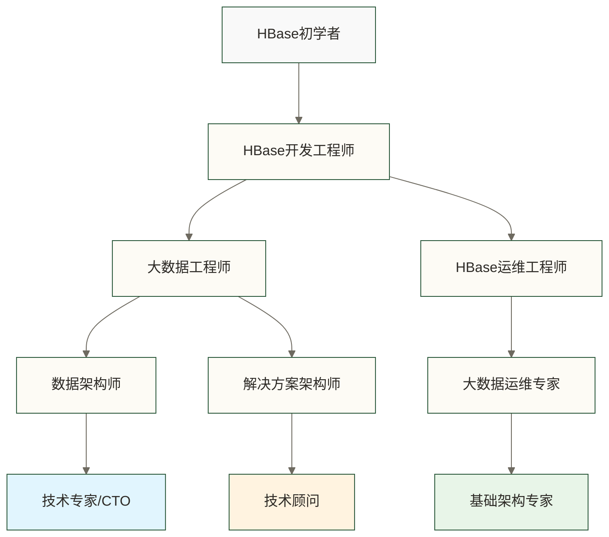

# 🗄️ HBase学习路线图 - 从零到NoSQL数据库专家

> [!tip] 💝 给HBase学习者的温暖指导
> 
> 🤗 **学习HBase就像学会建造高效的数据仓库！**
> 
> 如果你现在对HBase感到困惑：
> - "NoSQL数据库和关系型数据库有什么区别？"
> - "HBase在大数据生态中扮演什么角色？"
> - "什么时候选择HBase，什么时候选择其他数据库？"
> 
> **别担心！** 每个大数据专家都是从第一个HBase表开始的 ✨
> 
> 🏗️ **想象HBase就像智能仓储系统**
> 
> 现代仓储的特点：
> - 🗂️ **宽列存储** = 按列族组织存储（数据按行键排序，不等同于分析型数据库逐列存储）
> - 📊 **大数据量** = 海量商品管理（PB级数据存储）
> - ⚡ **快速检索** = 智能货架系统（面向低延迟随机读写，实际延迟取决于数据模型、配置和负载）
> - 🔄 **实时更新** = 库存实时同步（支持高并发写入）
> - 📈 **弹性扩展** = 仓库按需扩建（水平扩展能力）
> 
> **掌握HBase，有助于你为适合的海量随机读写场景设计存储方案，效率仍需通过实际负载测试验证。** 🌟

## 🎯 HBase学习全景图

### 📊 完整学习路径设计

### 🎯 学习阶段目标与里程碑

| 学习阶段 | 核心目标 | 时间投入 | 技能获得 | 实战产出 |
|---|---|---|---|---|
| **🌱 入门基础** | 理解HBase核心概念 | 7-10小时 | NoSQL基础理论 | 环境搭建成功 |
| **⚡ 核心技能** | 掌握HBase操作技能 | 8-12小时 | 数据库操作能力 | 完成CRUD操作 |
| **🚀 高级应用** | 优化设计能力 | 10-15小时 | 性能优化技能 | 设计高效表结构 |
| **💎 专业进阶** | 运维管理能力 | 12-18小时 | 企业级运维 | 搭建生产集群 |
| **🎯 企业实战** | 架构设计能力 | 15-25小时 | 解决方案设计 | 完整项目交付 |

## 🌱 第一阶段：入门基础（预计7-10小时）

### 📚 学习目标
建立HBase基础认知，理解NoSQL数据库概念，掌握环境搭建技能。

### 📖 核心内容

#### [[【技术与工具】/HBase/01-HBase概述与特性|HBase概述与特性]] 🕐 60分钟
- **💡 学习重点**：理解HBase在大数据生态中的定位
- **🎯 核心概念**：NoSQL vs SQL、宽列存储特点、应用场景分析
- **🏆 实战技能**：能够判断何时选择HBase解决业务问题
- **📝 温度设计**：用"智能图书馆"比喻解释HBase存储原理

#### [[【技术与工具】/HBase/02-HBase架构原理|HBase架构]] 🕐 90分钟  
- **💡 学习重点**：掌握HBase分布式架构设计
- **🎯 核心概念**：Master/RegionServer架构、Zookeeper协调机制
- **🏆 实战技能**：理解数据在集群中的分布和访问流程
- **📝 温度设计**：用"城市管理"比喻解释分布式协调机制

#### [[【技术与工具】/HBase/03-HBase数据模型|HBase数据]] 🕐 75分钟
- **💡 学习重点**：理解行键、列族、列限定符概念
- **🎯 核心概念**：多维映射表、时间戳版本机制、稀疏表特性
- **🏆 实战技能**：设计符合HBase特点的数据模型
- **📝 温度设计**：用"个人档案柜"比喻解释数据组织方式

#### [[【技术与工具】/HBase/04-HBase环境搭建|HBase环境搭建]] 🕐 120分钟
- **💡 学习重点**：搭建完整的HBase开发环境
- **🎯 核心概念**：单机模式、伪分布式、完全分布式部署
- **🏆 实战技能**：独立完成HBase集群安装配置
- **📝 温度设计**：提供详细的故障排查指南和常见问题解决

#### [[【技术与工具】/HBase/05-第一个HBase应用|第一个HBase]] 🕐 90分钟
- **💡 学习重点**：通过实践建立HBase操作信心
- **🎯 核心概念**：基本的表操作、数据插入、简单查询
- **🏆 实战技能**：能够创建表并进行基础数据操作
- **📝 温度设计**：从用户注册系统场景切入，降低学习门槛

### 🎯 阶段学习成果
- ✅ 理解HBase与传统数据库的根本差异
- ✅ 掌握HBase架构组件和工作原理
- ✅ 搭建可用的HBase开发环境
- ✅ 完成第一个HBase数据表的创建和操作

## ⚡ 第二阶段：核心技能（预计8-12小时）

### 📚 学习目标  
掌握HBase核心操作技能，熟练使用Shell和API进行数据库开发。

### 📖 核心内容

#### [[【技术与工具】/HBase/06-HBase Shell操作|HBase Shell操作]] 🕐 90分钟
- **💡 学习重点**：熟练掌握HBase命令行操作
- **🎯 核心概念**：DDL操作、DML操作、管理命令
- **🏆 实战技能**：通过Shell完成所有常用数据库操作
- **📝 温度设计**：提供完整的命令速查手册和实用技巧

#### [[【技术与工具】/HBase/07-Java API编程|Java API编程]] 🕐 120分钟
- **💡 学习重点**：使用Java客户端进行HBase开发
- **🎯 核心概念**：Connection管理、Table操作、异步编程
- **🏆 实战技能**：开发完整的HBase客户端应用程序
- **📝 温度设计**：从简单的CRUD操作开始，逐步深入复杂场景

#### [[【技术与工具】/HBase/08-表设计与模式|表设计与]] 🕐 105分钟  
- **💡 学习重点**：设计高效的HBase表结构
- **🎯 核心概念**：列族设计原则、表预分区、热点避免
- **🏆 实战技能**：针对具体业务设计优化的表结构
- **📝 温度设计**：通过电商订单系统案例讲解设计思路

#### [[【技术与工具】/HBase/09-过滤器与扫描优化|过滤器与扫描优化]] 🕐 90分钟
- **💡 学习重点**：实现复杂的数据查询需求
- **🎯 核心概念**：Filter链、Scan优化、自定义过滤器
- **🏆 实战技能**：设计高效的数据检索方案
- **📝 温度设计**：通过用户行为分析案例展示过滤器应用

#### [[【技术与工具】/HBase/10-批量操作与事务|批量操作与事务]] 🕐 105分钟
- **💡 学习重点**：掌握批量数据读写及原子性边界
- **🎯 核心概念**：Get/Put/Delete操作、批量操作、异步操作、单行原子性；批量操作不等于跨行事务
- **🏆 实战技能**：实现高性能的数据读写逻辑，并正确处理批量操作中的部分失败
- **📝 温度设计**：提供性能对比测试和最佳实践建议

### 🎯 阶段学习成果
- ✅ 熟练使用HBase Shell进行数据库管理
- ✅ 开发完整的HBase Java客户端应用
- ✅ 设计符合业务需求的表结构
- ✅ 实现复杂的数据查询和过滤逻辑

## 🚀 第三阶段：高级应用（预计10-15小时）

### 📚 学习目标
掌握HBase性能优化技能，深入理解存储机制，集成大数据生态工具。

### 📖 核心内容

#### [[【技术与工具】/Hadoop/20-性能监控与调优|性能监控与调优]] 🕐 120分钟
- **💡 学习重点**：设计高效的行键策略
- **🎯 核心概念**：热点避免、散列设计、复合键设计、反转技巧
- **🏆 实战技能**：针对不同场景设计最优RowKey方案
- **📝 温度设计**：通过IoT传感器数据存储案例详解设计思路

#### 12-列族优化设计 🕐 90分钟
- **💡 学习重点**：优化列族配置提升性能
- **🎯 核心概念**：压缩算法选择、块大小配置、版本管理
- **🏆 实战技能**：根据数据特点选择最佳存储配置
- **📝 温度设计**：提供不同数据类型的配置模板和性能对比

#### 13-Region分裂与负载 🕐 105分钟
- **💡 学习重点**：理解HBase自动扩展机制
- **🎯 核心概念**：Region分裂策略、负载均衡、预分区设计
- **🏆 实战技能**：设计可扩展的表分区方案
- **📝 温度设计**：用"城市扩建"比喻解释分布式扩展原理

#### 14-数据压缩与存储 🕐 90分钟
- **💡 学习重点**：优化存储空间和I/O性能
- **🎯 核心概念**：压缩算法对比、存储格式选择、缓存策略
- **🏆 实战技能**：根据业务特点选择最佳存储策略
- **📝 温度设计**：提供压缩效果测试工具和配置建议

#### 15-HBase与MapReduce 🕐 120分钟
- **💡 学习重点**：实现大规模数据处理集成
- **🎯 核心概念**：TableInputFormat、TableOutputFormat、批量导入
- **🏆 实战技能**：开发HBase批处理任务
- **📝 温度设计**：通过数据迁移项目展示集成应用场景

### 🎯 阶段学习成果
- ✅ 设计高性能的RowKey和列族方案
- ✅ 理解HBase内部存储和分布机制
- ✅ 实现HBase与Hadoop生态的集成
- ✅ 具备解决复杂业务场景的能力

## 💎 第四阶段：专业进阶（预计12-18小时）

### 📚 学习目标
具备企业级HBase集群运维能力，掌握性能调优和故障处理技能。

### 📖 核心内容

#### 16-性能调优实战 🕐 150分钟
- **💡 学习重点**：全面提升HBase集群性能
- **🎯 核心概念**：读写性能优化、内存配置、GC调优、网络优化
- **🏆 实战技能**：诊断性能瓶颈并制定优化方案
- **📝 温度设计**：提供性能监控工具和调优案例库

#### 17-集群管理运维 🕐 135分钟
- **💡 学习重点**：掌握生产环境集群管理技能
- **🎯 核心概念**：集群部署、配置管理、滚动升级、容量规划
- **🏆 实战技能**：独立管理企业级HBase集群
- **📝 温度设计**：提供运维自动化脚本和最佳实践手册

#### 18-故障诊断修复 🕐 120分钟
- **💡 学习重点**：快速定位和解决集群故障
- **🎯 核心概念**：常见故障类型、日志分析、修复策略、预防措施
- **🏆 实战技能**：建立完整的故障处理流程
- **📝 温度设计**：构建故障案例库和应急处理手册

#### 19-安全权限管理 🕐 105分钟
- **💡 学习重点**：建立企业级安全防护体系
- **🎯 核心概念**：认证机制、授权策略、数据加密、审计日志
- **🏆 实战技能**：设计和实施HBase安全方案
- **📝 温度设计**：提供安全配置模板和合规检查清单

#### 20-监控与告警 🕐 90分钟
- **💡 学习重点**：建立全面的集群监控体系
- **🎯 核心概念**：指标监控、日志监控、告警策略、可视化展示
- **🏆 实战技能**：搭建完整的HBase监控平台
- **📝 温度设计**：提供监控仪表板模板和告警规则库

### 🎯 阶段学习成果
- ✅ 具备企业级HBase集群运维能力
- ✅ 掌握全面的性能调优技能
- ✅ 建立完善的安全防护和监控体系
- ✅ 能够快速诊断和解决各类故障

## 🎯 第五阶段：企业实战（预计15-25小时）

### 📚 学习目标
具备企业级架构设计能力，能够设计和实施完整的HBase解决方案。

### 📖 核心内容

#### 21-生态集成应用 🕐 135分钟
- **💡 学习重点**：构建完整的大数据处理管道
- **🎯 核心概念**：与Spark集成、Kafka集成、Hive集成、Phoenix SQL
- **🏆 实战技能**：设计多组件协作的数据处理架构
- **📝 温度设计**：通过实时推荐系统展示生态集成价值

#### 22-实时数据处理 🕐 120分钟
- **💡 学习重点**：构建实时数据处理解决方案
- **🎯 核心概念**：流式数据接入、实时计算项目、增量更新、延迟优化
- **🏆 实战技能**：设计低延迟的实时数据处理管道
- **📝 温度设计**：通过用户行为实时分析项目展示应用价值

#### 23-企业级架构设计 🕐 150分钟
- **💡 学习重点**：设计可扩展的企业级架构
- **🎯 核心概念**：多租户设计、跨数据中心、灾备策略、成本优化
- **🏆 实战技能**：制定完整的HBase企业级部署方案
- **📝 温度设计**：提供不同规模企业的架构设计模板

#### 24-项目实战案例 🕐 180分钟
- **💡 学习重点**：端到端完成真实项目交付
- **🎯 核心概念**：需求分析、技术选型、架构设计、开发实施、运维部署
- **🏆 实战技能**：独立承担HBase项目的全生命周期管理
- **📝 温度设计**：提供金融风控、物联网、社交网络等行业案例

### 🎯 阶段学习成果
- ✅ 设计企业级HBase解决方案架构
- ✅ 构建完整的实时数据处理管道  
- ✅ 集成多个大数据生态组件
- ✅ 交付端到端的项目解决方案

## 🎯 学习成果与职业发展

### 💼 职业技能图谱

> [!success] 🌟 **通过学习与充分实践逐步培养的目标能力（不代表完成路线即可获得专家资质）**
> 
> **技术技能**：
> - ✅ **NoSQL数据库专家**：深度理解HBase架构和优化
> - ✅ **大数据存储专家**：设计PB级数据存储方案
> - ✅ **性能调优专家**：解决复杂的性能瓶颈问题
> - ✅ **系统架构师**：设计企业级分布式存储架构
> 
> **业务技能**：
> - ✅ **需求分析能力**：将业务需求转化为技术方案
> - ✅ **项目管理能力**：管理HBase项目全生命周期
> - ✅ **团队协作能力**：与开发、运维、产品团队高效协作
> - ✅ **解决方案设计**：提供完整的数据存储解决方案

### 🚀 职业发展路径

### 💰 薪资水平参考

以下经验与薪资数字为原稿未核实示例，未提供地区、币种、统计时间、样本及薪酬口径，不代表当前市场行情或完成学习后的收入预期。

| 职位级别 | 经验要求 | 薪资范围（年薪） | 核心技能要求 |
|---|---|---|---|
| **HBase开发工程师** | 1-3年 | 15-35万 | 熟练使用HBase API，理解数据模型 |
| **大数据工程师** | 2-5年 | 25-50万 | HBase + Spark和Hadoop生态系统 |
| **数据架构师** | 5-8年 | 40-80万 | 企业级架构设计，性能调优 |
| **技术专家** | 8年以上 | 60-150万 | 解决方案设计，团队管理 |

### 🏢 就业方向和应用领域

**互联网公司**：
- 🔍 **搜索推荐**：用户行为数据存储，实时推荐系统
- 📱 **社交媒体**：用户关系图谱，消息存储系统  
- 🛒 **电商平台**：商品信息管理，订单数据存储

**金融行业**：
- 💳 **风控系统**：实时交易监控，风险评估数据
- 📊 **量化交易**：高频交易数据，市场数据分析
- 🏦 **银行核心**：客户信息管理，交易流水存储

**物联网领域**：
- 🌡️ **传感器数据**：海量时序数据存储和查询
- 🚗 **车联网**：车辆轨迹数据，实时位置服务
- 🏭 **工业互联网**：设备监控数据，预测性维护

## 📚 学习资源推荐

### 📖 必读书籍
- 《HBase权威指南》- 全面深入的HBase技术手册
- 《NoSQL数据库技术》- 理解NoSQL数据库设计思想
- 《大数据架构设计》- 学习企业级架构设计

### 🌐 在线资源
- **Apache HBase官方文档** - 最权威的技术文档
- **HBase中文社区** - 交流学习的好地方
- **Cloudera大学** - 专业的大数据培训课程

### 🛠️ 实践环境
- **Hortonworks Sandbox** - 完整的HBase学习环境
- **Cloudera QuickStart VM** - 用于学习和测试的虚拟机环境，使用前需确认版本及兼容性，不应作为生产级部署依据
- **Docker HBase** - 轻量级的开发环境

## 💡 学习建议和成功秘诀

### 🎯 高效学习策略

> [!tip] 💪 **让学习更高效的秘诀**
> 
> **1. 理论与实践结合**
> - 📚 每学完一个概念，立即动手实践
> - 🔧 搭建自己的HBase实验环境
> - 💻 用真实数据验证学习效果
> 
> **2. 循序渐进深入**
> - 🌱 先掌握基础概念，再深入高级特性
> - 🔄 定期回顾前面的内容，加深理解
> - 📈 逐步挑战更复杂的项目案例
> 
> **3. 主动解决问题**
> - 🤔 遇到问题先自己思考和尝试
> - 🔍 学会查阅官方文档和社区资源
> - 💬 积极参与技术社区讨论

### 🌟 避免常见学习误区

**❌ 误区一**：急于求成，跳过基础概念
**✅ 正确做法**：扎实掌握NoSQL和分布式基础

**❌ 误区二**：只看不练，缺乏动手实践  
**✅ 正确做法**：每个知识点都要亲自验证

**❌ 误区三**：孤立学习，不理解生态关系
**✅ 正确做法**：结合Hadoop生态全局学习

### 🎉 学习激励机制

**设定阶段性目标**：
- 🎯 第1周：搭建环境，完成第一个表操作
- 🎯 第1月：掌握HBase Shell和Java API  
- 🎯 第3月：设计完整的HBase应用方案
- 🎯 第6月：以完成企业级项目交付练习为目标，实际交付能力需通过项目评审和充分实践验证

**建立学习反馈**：
- 📝 记录学习笔记和心得体会
- 🏆 完成每阶段的实战项目
- 👥 与同行交流分享学习成果
- 💼 将学习成果应用到实际工作中

---

> [!quote] 💭 **HBase学习的智慧**
> 
> **HBase不仅是一门技术，更是一种思维方式**：
> - 🎯 **分布式思维**：理解数据在集群中的分布和协调
> - 📊 **NoSQL思维**：跳出关系型数据库的思维框架
> - ⚡ **性能思维**：始终考虑大数据场景下的性能优化
> - 🔧 **工程思维**：注重实际应用中的稳定性和可维护性
> 
> **掌握HBase，就是掌握了大数据时代的核心竞争力！** ✨

**创建时间**：2024-12-11  
**预计完成时间**：3-6个月（根据个人基础和投入时间）  
**温度指数**：⭐⭐⭐⭐⭐ (循序渐进，温暖陪伴)  
**成功率预期**：原稿列为95%（按路线图学习并完成实践），但未提供统计依据、样本或成功标准；仅保留为未核实示例，不代表实际成功概率或效果承诺。

#HBase #NoSQL #大数据 #分布式存储 #数据架构 #学习路线图
