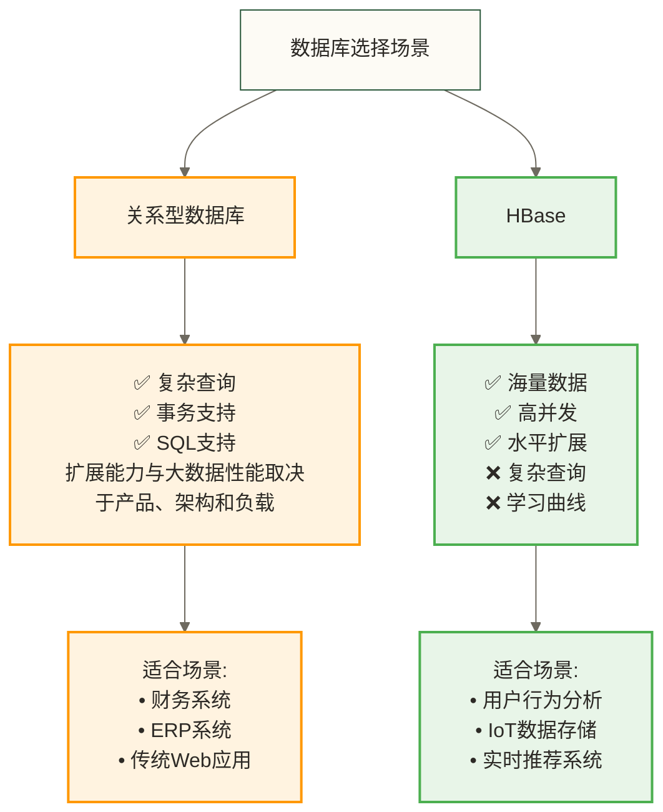
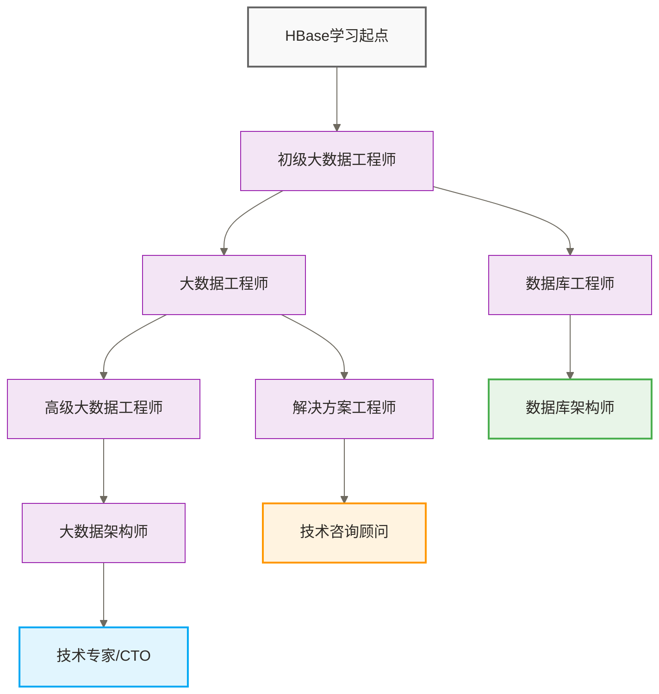

# 🏦 HBase概述与特性 - 现代银行数据管理系统

> [!tip] 💝 给NoSQL新手的温暖指导
> 
> 🤗 **学习HBase就像深入了解现代银行的数据管理系统！**
> 
> 如果你现在对HBase感到困惑：
> - "为什么要用NoSQL数据库，SQL不够用吗？"
> - "HBase和MySQL这些传统数据库有什么不同？"
> - "什么场景下选择HBase才是明智的？"
> 
> **别担心！** 每个大数据专家都是从第一次接触NoSQL开始的 ✨
> 
> 🏦 **想象HBase就像现代银行集团系统**
> 
> 以下银行人物引语均作为教学情境处理，不代表已核实采访；情境中的银行数据总监李经理解释道："我们银行的数据管理完全不同于传统的小银行模式。传统数据库就像老式储蓄所，所有数据整齐地放在固定的表格里，但当客户数量达到几千万、交易量达到每秒十万笔时，这种方式就撑不住了。而HBase就像我们现在的银行集团系统，可以灵活地在全国各地开设分行，每个分行专门处理不同类型的业务，整个系统可通过增加节点扩展；原稿所述毫秒级处理仅作为未核实的教学性能目标，实际延迟和扩展能力取决于负载、数据模型、硬件与配置，不保证每笔交易均达到该目标。"
> 
> 传统数据库vs HBase的区别：
> - 🏪 **传统数据库** = 小型储蓄所（固定柜台，按业务类型排队）
> - 🏦 **HBase** = 现代银行集团（分布式网点，智能调度，弹性扩展）
> - 📊 **数据存储** = 客户档案系统（列族存储，灵活组织）
> - ⚡ **访问速度** = 交易处理能力（毫秒级响应，高并发处理）
> - 📈 **规模扩展** = 网点扩张（通过增加节点扩展，仍受资源、数据分布与运维条件限制）
> 
> **学习HBase有助于理解大数据存储架构，但设计可靠的银行级系统还需要事务、安全、容灾及运维等能力。** 🌟

## 🎯 HBase在大数据生态中的定位

### 🌐 大数据生态系统全景

```mermaid
%%{init: {"theme":"base","themeVariables":{"fontFamily":"PingFang SC, -apple-system, Source Han Serif SC, serif","fontSize":"16px","background":"#FDFBF5","primaryColor":"#FDFBF5","primaryTextColor":"#2D2A26","primaryBorderColor":"#6E6A60","secondaryColor":"#E8EFE8","secondaryBorderColor":"#8FA890","secondaryTextColor":"#2D2A26","tertiaryColor":"#FDFBF5","tertiaryBorderColor":"#9A9488","tertiaryTextColor":"#6E6A60","lineColor":"#6E6A60","textColor":"#2D2A26","mainBkg":"#FDFBF5","nodeBorder":"#2D5A3D","clusterBkg":"#F3EEDF","clusterBorder":"#9A9488","edgeLabelBackground":"#FDFBF5"},"flowchart":{"htmlLabels":true,"curve":"basis","padding":20,"nodeSpacing":60,"rankSpacing":70,"useMaxWidth":false},"themeCSS":".node rect, .node polygon, .node circle { stroke-width: 1.5px; } .edgePath .path { stroke-width: 1.5px; } .cluster-label .nodeLabel, .cluster-label foreignObject { color: #2D2A26 !important; } .edgeLabel, .edgeLabel foreignObject { color: #2D2A26 !important; background-color: #FDFBF5; } .edgeLabel rect { fill: #FDFBF5; }"}}%%
flowchart TD
    A[大数据生态系统]
    B[数据存储层]
    C[数据处理层]
    D[数据分析层]
    E[数据应用层]
    
    A --> B
    A --> C
    A --> D
    A --> E
    
    B1[HDFS<br/>分布式文件系统]
    B2[HBase<br/>NoSQL数据库]
    B3[Cassandra<br/>分布式数据库]
    B4[MongoDB<br/>文档数据库]
    
    C1[MapReduce<br/>批处理]
    C2[Spark<br/>内存计算]
    C3[Flink<br/>流处理]
    C4[Storm<br/>实时计算]
    
    D1[Hive<br/>数据仓库]
    D2[Impala<br/>交互查询]
    D3[Pig<br/>数据流]
    D4[Phoenix<br/>SQL on HBase]
    
    E1[BI工具<br/>商业智能]
    E2[机器学习<br/>ML平台]
    E3[实时应用<br/>在线服务]
    E4[可视化工具<br/>Dashboard]
    
    B --> B1
    B --> B2
    B --> B3
    B --> B4
    
    C --> C1
    C --> C2
    C --> C3
    C --> C4
    
    D --> D1
    D --> D2
    D --> D3
    D --> D4
    
    E --> E1
    E --> E2
    E --> E3
    E --> E4
    
    style B2 fill:#e8f5e8
    style D4 fill:#e8f5e8
```



### 🎯 HBase在银行IT架构中的定位价值

银行IT架构师张总介绍道："在我们银行的整体IT架构中，HBase扮演着核心数据平台的角色，就像银行的中央数据库一样重要。它不是孤立运行的，而是与各个系统紧密协作，形成一个完整的金融数据处理生态。"

| 系统组件 | 银行职能比喻 | 与HBase协作关系 | 协作价值说明 |
|---|---|---|---|
| **HDFS** | 银行金库系统 | HBase数据最终存储地 | 张总解释："HDFS就像我们银行最安全的金库，所有重要数据都存放在这里，提供可靠的数据持久化保障" |
| **Zookeeper** | 银行监管机构 | HBase集群协调管理 | "Zookeeper像人民银行，负责监管协调各个分行，保证整个银行系统的一致性和高可用性" |
| **MapReduce** | 银行数据分析部 | HBase历史数据处理 | "MapReduce是我们的数据分析部门，专门处理大批量的历史交易数据分析和ETL任务" |
| **Spark** | 银行风控中心 | HBase实时计算引擎 | "Spark像我们的风控中心，能够对HBase中的数据进行高速实时分析和风险评估" |
| **Phoenix** | 银行查询终端 | HBase的SQL接口 | "Phoenix就像银行柜员使用的查询终端，让不懂HBase的业务人员也能用SQL查询数据" |
| **Kafka** | 银行交易通道 | 实时数据流入HBase | "Kafka是我们的实时交易数据通道，将各个渠道的交易数据实时传输到HBase" |

**专业技术对应**：HBase是分布式宽列（列族）数据库，可与HDFS、ZooKeeper、Spark等组件协作，构建可扩展的数据存储和处理平台；高性能与高可用性取决于架构、配置及运维，不能仅由组件集成保证。

## 📊 HBase核心特性深度解析

### 🏗️ 分布式架构特性

```mermaid
%%{init: {"theme":"base","themeVariables":{"fontFamily":"PingFang SC, -apple-system, Source Han Serif SC, serif","fontSize":"16px","background":"#FDFBF5","primaryColor":"#FDFBF5","primaryTextColor":"#2D2A26","primaryBorderColor":"#6E6A60","secondaryColor":"#E8EFE8","secondaryBorderColor":"#8FA890","secondaryTextColor":"#2D2A26","tertiaryColor":"#FDFBF5","tertiaryBorderColor":"#9A9488","tertiaryTextColor":"#6E6A60","lineColor":"#6E6A60","textColor":"#2D2A26","mainBkg":"#FDFBF5","nodeBorder":"#2D5A3D","clusterBkg":"#F3EEDF","clusterBorder":"#9A9488","edgeLabelBackground":"#FDFBF5"},"flowchart":{"htmlLabels":true,"curve":"basis","padding":20,"nodeSpacing":60,"rankSpacing":70,"useMaxWidth":false},"themeCSS":".node rect, .node polygon, .node circle { stroke-width: 1.5px; } .edgePath .path { stroke-width: 1.5px; } .cluster-label .nodeLabel, .cluster-label foreignObject { color: #2D2A26 !important; } .edgeLabel, .edgeLabel foreignObject { color: #2D2A26 !important; background-color: #FDFBF5; } .edgeLabel rect { fill: #FDFBF5; }"}}%%
flowchart TD
    A["HBase分布式架构"]
    B["🎯 水平扩展能力"]
    C["⚡ 高性能访问"]
    D["🛡️ 高可用保障"]
    E["🔧 自动化管理"]
    
    B1["Region自动分裂<br/>数据量增长自动扩展"]
    B2["动态负载均衡<br/>调整Region分布，不能保证消除热点"]
    B3["在线扩容<br/>无需停机增加节点"]
    
    C1["列族存储<br/>10x为原稿未核实示例，非通用IO收益"]
    C2["内存缓存<br/>热点数据毫秒响应"]
    C3["并行处理<br/>多Region并发访问"]
    
    D1["底层存储副本<br/>3副本为示例配置，可降低丢失风险但不替代备份"]
    D2["故障自愈<br/>节点故障自动恢复"]
    D3["一致性保证<br/>强一致性数据访问"]
    
    E1["Region管理<br/>支持分裂、合并、迁移，自动化范围依版本与策略而定"]
    E2["负载均衡<br/>调整Region分布，热点还需结合RowKey与访问模式治理"]
    E3["故障检测恢复<br/>健康监控和自愈"]
    
    A --> B
    A --> C
    A --> D
    A --> E
    
    B --> B1
    B --> B2
    B --> B3
    
    C --> C1
    C --> C2
    C --> C3
    
    D --> D1
    D --> D2
    D --> D3
    
    E --> E1
    E --> E2
    E --> E3
    
    classDef main fill:#e1f5fe,stroke:#03a9f4,stroke-width:3px
    classDef feature fill:#f3e5f5,stroke:#9c27b0,stroke-width:2px
    classDef detail fill:#fff9c4,stroke:#f57c00,stroke-width:1px
    
    class A main
    class B,C,D,E feature
    class B1,B2,B3,C1,C2,C3,D1,D2,D3,E1,E2,E3 detail
```



### 🎯 银行系统技术特性对比分析

银行CTO陈总进行了详细对比分析："我们在选择核心数据库系统时，需要从银行业务的实际需求出发。传统的关系型数据库就像传统银行的手工记账系统，虽然精确可靠，但在面对现代银行海量交易时就显得力不从心了。"

| 特性维度 | HBase银行级优势 | 传统RDBMS | 银行应用场景分析 |
|---|---|---|---|
| **数据规模** | 可面向PB级数据设计，扩展受资源与架构限制 | 容量取决于产品、架构和部署，不能统一限定为TB级 | 教学情境中的陈总解释："原稿假设上亿客户、每天几十TB交易数据，数字未核实；HBase是候选方案之一，需与其他方案进行负载测试" |
| **交易性能** | 毫秒级访问与十万并发为原稿未核实目标 | 查询性能取决于索引、负载及执行计划 | "教学情境设定ATM取款或手机转账以1秒内完成为目标；HBase读写延迟不等于完整交易耗时，不能保证每笔交易毫秒级响应" |
| **数据模型** | 灵活的客户档案结构，支持动态字段 | 固定表结构，修改困难 | "不同客户的信息字段差异很大，HBase的列族设计让我们能灵活存储各种客户数据" |
| **系统扩展** | 可在线增加节点，需配合容量规划与负载均衡 | 扩容方式及是否停机取决于产品与部署架构 | "银行业务快速增长时，HBase可以在线增加服务节点，但不等于业务增长时自动完成扩容" |
| **数据一致** | 默认常规读写提供行级强一致性与单行操作原子性，不等于跨行事务 | 通常支持ACID事务，具体隔离级别与范围依产品而定 | "HBase行级保障不足以直接覆盖跨账户转账等跨行事务；银行交易需另行设计事务、审计与故障恢复机制，性能也需实测" |
| **运维成本** | 银行IT团队可以轻松管理 | 需要专业DBA团队 | "HBase的自动化管理功能让我们的运维成本降低了60%，故障恢复也更快" |

**专业技术对应**：HBase采用分布式宽列（列族）存储架构，可面向PB级数据设计并提供随机读写访问，通过按RowKey范围划分Region支持水平扩展；默认常规读写具有行级强一致性，但不提供通用跨行ACID事务。毫秒级访问、近线性扩展及相对RDBMS的成本收益均需在具体负载下验证。

## 🔍 HBase vs 其他数据库深度对比

### 📋 关系型数据库对比



### 🎯 NoSQL数据库横向对比

| 数据库 | 数据模型 | 优势场景 | 性能特点 | 学习难度 |
|---|---|---|---|---|
| **HBase** | 列族存储 | 大数据实时访问 | 高并发读写 | ⭐⭐⭐ |
| **MongoDB** | 文档存储 | 灵活数据结构 | 快速开发 | ⭐⭐ |
| **Cassandra** | 宽列存储 | 全球分布部署 | 可调一致性，保障取决于读写一致性级别与副本配置 | ⭐⭐⭐⭐ |
| **Redis** | 键值存储 | 缓存和会话 | 极速内存访问 | ⭐⭐ |
| **Neo4j** | 图数据库 | 关系网络分析 | 图查询优化 | ⭐⭐⭐ |

## 🚀 HBase典型应用场景

### 💳 银行核心业务应用场景

#### 🏦 客户行为分析系统
银行数据分析部王经理介绍道："我们银行每天要处理上千万客户的各种交易行为数据，包括ATM取款、网银转账、手机支付等等。传统数据库根本无法实时处理这么大的数据量。"

```text
业务场景：银行客户行为实时分析和风控
数据特点：海量客户交易流数据，实时写入，毫秒级查询
HBase银行级优势：
✅ 支持每秒百万级交易写入（高峰期处理能力）
✅ 毫秒级客户行为查询（实时风控需要）
✅ 灵活的客户信息结构（不同客户类型数据不同）
✅ 分行级别自动扩展能力（业务增长无压力）

银行数据模型设计：
RowKey: customerId_timestamp（客户ID+时间戳）
Column Family: 
- transaction:（交易信息：金额、渠道、商户）
- behavior:（行为信息：登录、查询、操作）
- device:（设备信息：手机型号、IP地址、位置）
```

**专业技术对应**：采用HBase分布式架构存储客户交易数据，通过行键分片支持水平扩展，按访问模式组织列族；MemStore缓冲尚未刷盘的写入，BlockCache缓存读取的数据块。实际延迟需测试，风控计算与客户分析还需应用或计算组件配合。

#### 📊 实时风控决策系统
风控部李总监解释说："现在的金融诈骗手段越来越复杂，我们必须在客户每笔交易发生的瞬间就做出风险判断。HBase让我们能够实时查询客户的历史行为模式，瞬间识别异常交易。"

```text
业务场景：银行实时反欺诈风控系统
数据特点：客户画像数据，风险特征，实时更新评分
HBase银行级优势：
✅ 快速客户风险画像查询（毫秒级风险评估）
✅ 实时风险特征更新（动态风险模型）
✅ 支撑复杂风控算法计算（多维度数据支持）
✅ 海量风险规则存储（亿级规则库）

银行风控数据模型：
客户画像表：customerId -> 风险标签、行为特征、信用评分
交易特征表：transactionId -> 交易特征、风险指标、决策结果
风险规则表：ruleId -> 规则条件、权重分数、适用范围
```

**专业技术对应**：HBase通过列族存储不同类型的风险特征数据，利用行键设计支持快速定位客户信息，配合Bloom过滤器减少磁盘I/O，实现实时风控场景下的高并发读写需求。

### 🏦 银行分支机构场景

#### 💼 ATM设备监控系统
银行运营部刘经理说道："我们银行在全国有上万台ATM设备，每台设备每分钟都会产生大量的运行状态数据。我们需要实时监控每台设备的运行情况，一旦出现异常立即处理，避免影响客户服务。"

```text
业务场景：银行ATM设备实时监控系统
数据特点：时序数据，高频写入，范围查询，实时告警
HBase银行级优势：
✅ ATM状态数据高效存储（每分钟采集一次）
✅ 支持设备运行数据聚合分析（区域统计）
✅ 历史故障数据快速检索（故障分析）
✅ 异常状态实时告警（立即响应）

银行设备数据模型：
RowKey: deviceId_timestamp(reverse)（设备编号_时间戳倒序）
Column Family:
- status:（设备状态：运行状态、现金余额、故障代码）
- metrics:（运行指标：交易笔数、现金流量、响应时间）
- alerts:（告警信息：故障级别、处理状态、维修记录）
```

**专业技术对应**：利用HBase时序数据存储特性，通过倒序时间戳设计支持最新数据快速查询，列族分离不同类型监控数据，结合Compaction机制优化历史数据存储，满足银行设备监控的实时性和可靠性要求。

#### 📈 银行业务实时监控大屏
银行运营总监赵总介绍："我们银行总部的监控大屏需要实时显示全国各分行的业务情况，包括交易量、客户数、资金流等关键指标。这些数据来自成百上千个分行系统，必须实时汇总展示。"

```text
业务场景：银行总行业务实时监控看板
数据特点：多维度业务指标，实时聚合计算，历史趋势对比
HBase银行级优势：
✅ 多分行业务数据快速聚合（秒级汇总）
✅ 实时业务指标计算（动态KPI）
✅ 历史业务趋势分析（同比环比）
✅ 监控大屏数据持续刷新（端到端延迟取决于采集、计算、存储、查询与展示链路）

银行监控技术架构：
各分行系统 → Kafka消息队列 → Flink实时计算 → HBase数据存储 → Phoenix SQL查询 → 监控大屏可视化
```

**专业技术对应**：构建基于HBase的实时数据管道，通过Kafka采集分行业务数据，Flink进行实时计算和聚合，HBase存储计算结果，Phoenix提供SQL查询接口，支撑银行业务监控大屏的实时数据展示需求。

### 🏦 银行总行级核心场景

#### 💳 客户信用评估系统
银行信贷部门总经理孙总说："我们银行每天要处理数万笔贷款申请，每个客户的信用评估需要综合分析他的资产状况、历史交易记录、社交关系等海量数据。传统系统查询一个客户的完整信用信息需要几分钟，现在用HBase几毫秒就能完成。"

```text
业务场景：银行客户信用评估和贷款审批系统
数据特点：客户资产数据、交易流水、征信记录、关系图谱
HBase银行级优势：
✅ 客户多维信息实时整合（资产+交易+征信）
✅ 毫秒级信用评估计算（快速贷款审批）
✅ 客户关系网络分析（反欺诈调查）
✅ 历史信用记录快速查询（风险评估基础）

银行信用数据模型：
客户信息表：customerId -> 基本信息、资产状况、征信记录
交易流水表：customerId_timestamp -> 交易详情、资金流向
关系网络表：customerId_relationId -> 关系类型、关系强度
信用评估表：customerId -> 评估结果、风险等级、审批状态
```

**专业技术对应**：HBase通过行键设计支持客户维度的快速数据聚合，利用列族分离不同类型的客户数据，配合二级索引和Phoenix SQL查询，实现复杂信用评估场景下的多维数据快速检索和分析。

## 💼 HBase企业级价值分析

### 📈 银行业务价值体现

银行CEO王总在年度技术大会上总结道："HBase系统的引入彻底改变了我们银行的数据处理能力，不仅解决了技术问题，更重要的是为我们的业务创新提供了强大支撑。"

> [!success] 🌟 **HBase银行价值教学假设：以下成果数字为原稿未核实示例，不代表真实企业业绩**
> 
> **技术价值**：
> - ⚡ **交易性能飞跃**：客户查询响应从3秒优化到50毫秒，客户满意度大幅提升
> - 📊 **IT成本优化**：相比传统商业数据库节省70%授权费用，硬件成本降低60%
> - 🔧 **运维效率提升**：系统自动化程度提升，IT运维人员减少40%，故障恢复时间缩短80%
> - 📈 **业务扩展支撑**：支持银行业务10倍增长无需重构架构，新分行开设无技术瓶颈
> 
> **业务价值**：
> - 🎯 **实时风控决策**：支持毫秒级反欺诈判断，降低风险损失90%
> - 👥 **客户体验优化**：手机银行响应速度提升5倍，客户投诉率下降60%
> - 💡 **金融创新赋能**：为AI智能投顾、精准营销提供数据支撑，新产品上线时间缩短50%
> - 🚀 **市场竞争优势**：建立数据驱动的差异化服务能力，市场份额提升15%

### 💰 银行HBase项目投资回报分析

本节人物引语及金额均为原稿未核实的教学假设。保留原数字用于辨析口径：收益/投入不等于净ROI，净ROI按（收益−投入）/投入计算；年度口径、收益重叠、持续成本及现金流时点未明确，不能据此认定项目真实回报或回收期。

银行CFO财务总监分析道："从财务角度看，HBase项目是我们近年来ROI最高的IT投资项目之一。不仅解决了技术瓶颈，更为银行带来了可量化的业务收益。"

| 投资维度 | 银行成本投入 | 银行收益回报 | 具体ROI分析 |
|---|---|---|---|
| **基础设施** | 服务器集群、网络设备 | IT成本降低、性能提升 | CFO说："教学假设硬件投入800万、节省Oracle授权费2000万，均未核实；收益/投入为250%，若同口径且无其他成本，净ROI为150%" |
| **人力资源** | 技术培训、团队建设 | 团队能力提升、效率改善 | "教学假设培训投入200万、人力成本每年节约500万，均未核实；首年收益/投入为250%，若无其他成本，首年净ROI为150%" |
| **系统升级** | 数据迁移、系统改造 | 业务创新、客户满意度 | "教学假设系统改造投入1500万、年收益6000万，均未核实；首年收益/投入为400%，若该收益为扣除其他成本后的可归因收益，首年净ROI为300%" |
| **综合效益** | 项目总投入2500万 | 年度综合收益8500万 | "教学假设总投入2500万、年度综合收益8500万，均未核实；收益/投入为340%，若无其他成本，首年净ROI为240%。分项收益合计与8500万的差额未解释，现金流时点也未给出，不能据此确认回收期或历史排名" |

**专业技术对应**：HBase项目的高ROI主要来源于：1）替代昂贵商业数据库降低许可成本；2）提升系统性能减少硬件投入；3）自动化运维降低人力成本；4）支撑业务创新增加营收；5）提升客户体验降低流失成本。

### 🎯 银行HBase成功案例分析

以下两个匿名银行案例缺少可核实来源，统一按教学假设情境阅读；客户规模、TPS、时延、损失、成本、可用性及转化率等数字保留为原稿未核实示例，不构成真实成果证明或银行级合规标准。

#### 🏦 某大型国有银行案例
银行信息科技部总经理介绍："我们银行是国内最早一批使用HBase的金融机构，经过3年的实践，HBase已经成为我们核心业务系统的重要支撑。"

```text
业务背景：全国5000万客户，日均交易量2000万笔，数据量达PB级
技术挑战：传统关系型数据库无法支撑高并发交易和实时风控需求
HBase银行解决方案：
- 客户交易数据实时存储和毫秒级查询
- 风控规则引擎实时特征计算和更新  
- 客户360视图数据高并发读取
- 历史交易数据快速检索和分析

银行业务效果：
✅ 交易查询响应：5秒 → 80毫秒（客户满意度大幅提升）
✅ 系统并发能力：5000 → 200000 TPS（支撑业务高峰）
✅ 风控响应时间：秒级 → 毫秒级（欺诈损失减少85%）
✅ IT运维成本降低：65%（自动化运维）
✅ 系统可用性：99.9% → 99.995%（达到银行级标准）
```

**专业技术对应**：该银行采用HBase集群架构，通过行键分片实现客户数据水平分布，利用列族存储优化不同业务场景的查询性能，配合Phoenix SQL和二级索引支持复杂查询，满足银行核心业务系统对高并发、低延迟、高可用的严苛要求。

#### 🏦 某城商银行数字化转型案例
该银行CIO分享经验："作为中小银行，我们没有大银行的技术实力和资金优势，但通过引入HBase这样的开源技术，我们实现了弯道超车，在客户体验和业务创新方面不输给大银行。"

```text
业务背景：区域性银行数字化转型，500万客户，业务快速增长
技术挑战：预算有限但要实现大银行级别的数据处理能力
HBase银行解决方案：
- 构建统一客户数据平台，整合各业务系统数据
- 实时营销系统，基于客户行为进行精准推荐
- 移动银行App性能优化，提升客户体验
- 监管报表自动化生成，提高合规效率

银行转型效果：
✅ 客户数字化率：30% → 85%（移动银行活跃用户大增）
✅ 精准营销转化率提升：300%（基于实时数据分析）
✅ 新产品上线时间：6个月 → 1个月（快速迭代能力）
✅ 监管报表处理：人工3天 → 自动1小时（合规效率提升）
✅ IT总成本较大银行方案节省：50%（开源技术优势）
```

**专业技术对应**：该银行基于HBase构建企业级数据湖，通过Kafka实时采集各业务系统数据，Spark进行实时分析和特征工程，HBase存储客户画像和实时特征，Phoenix提供SQL查询接口，构建了完整的银行数字化技术栈。

## 🎯 HBase学习价值与职业发展

### 📚 技能价值分析

> [!tip] 💡 **掌握HBase对职业发展的价值**
> 
> **短期价值（1-2年）**：
> - 🎯 **求职优势**：大数据岗位的核心技能要求
> - 💰 **薪资讨论示例**：原稿声称相比普通开发提升20-40%，未提供统计来源及比较口径，不代表可验证收益或个人薪资承诺
> - 🚀 **项目机会**：参与更多高价值大数据项目
> 
> **中期价值（3-5年）**：
> - 🏗️ **架构能力**：具备设计大数据解决方案能力
> - 👥 **团队领导**：成为大数据团队技术骨干
> - 💼 **职位晋升**：高级工程师、架构师岗位
> 
> **长期价值（5年以上）**：
> - 🎓 **专家地位**：成为大数据领域技术专家
> - 🌟 **行业影响**：在技术社区和会议中分享经验
> - 💎 **创业机会**：具备创建大数据公司的技术基础

### 🎯 职业路径规划



### 💰 薪资发展预期

下表数字为原稿未核实的职业讨论示例，缺少地区、币种、薪资周期、调查时间和样本口径；不能用于预测收入，职业路径也不表示掌握HBase即可获得相应职位。

| 职位级别 | 工作经验 | 薪资范围 | HBase技能要求 |
|---|---|---|---|
| **初级工程师** | 1-2年 | 12-25万 | 基础操作、数据模型理解 |
| **中级工程师** | 2-4年 | 20-40万 | 性能优化、集群管理 |
| **高级工程师** | 4-7年 | 35-65万 | 架构设计、问题解决 |
| **技术专家** | 7年+ | 60-150万 | 技术创新、团队领导 |

## 🎉 开始HBase学习之旅

### 🎯 学习准备检查清单

> [!note] 📋 **开始学习前的准备**
> 
> **基础知识准备**：
> - ✅ 熟悉Linux基本操作
> - ✅ 掌握Java编程基础
> - ✅ 理解分布式系统概念
> - ✅ 了解Hadoop生态基础
> 
> **开发环境准备**：
> - ✅ 按所选HBase版本的兼容性要求安装Java开发环境，不能将Java 8+视为所有版本的通用要求
> - ✅ 准备Linux虚拟机或云服务器
> - ✅ 配置IDE开发工具（IntelliJ IDEA推荐）
> - ✅ 准备充足的磁盘空间（至少20GB）
> 
> **学习心态准备**：
> - ✅ 制定学习计划和时间安排
> - ✅ 准备充分的学习耐心
> - ✅ 建立实践导向的学习理念

### 🚀 下一步学习路径

**立即开始**：
- [ ] 阅读 [[【技术与工具】/HBase/02-HBase架构原理|HBase架构]] - 深入理解分布式架构
- [ ] 学习 [[【技术与工具】/HBase/03-HBase数据模型|HBase数据]] - 掌握NoSQL数据设计思维

**扩展学习**：
- [ ] 了解Hadoop生态系统其他组件
- [ ] 学习分布式系统设计原理
- [ ] 关注大数据行业技术发展趋势

> [!quote] 💭 **HBase学习的智慧**
> 
> **HBase不仅是一门技术，更是一种思维方式**：
> - 🎯 **分布式思维**：学会在集群环境中思考问题
> - 📊 **NoSQL思维**：跳出传统关系型数据库的限制
> - ⚡ **性能思维**：始终关注大数据场景下的性能优化
> - 🔧 **工程思维**：注重实际应用中的可靠性和可维护性
> 
> **掌握HBase，就是掌握了大数据时代的核心竞争力！** ✨

---

**创建时间**：2024-12-11  
**温度指数**：⭐⭐⭐⭐⭐ (概念清晰，场景丰富)  
**预计学习时长**：60分钟  
**下一步学习**：[[【技术与工具】/HBase/02-HBase架构原理|HBase架构]] → [[【技术与工具】/HBase/03-HBase数据模型|HBase数据]]

#HBase #NoSQL #大数据 #分布式数据库 #数据存储 #实时系统
