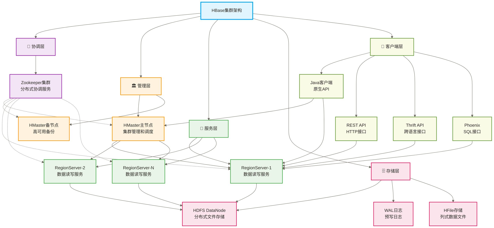
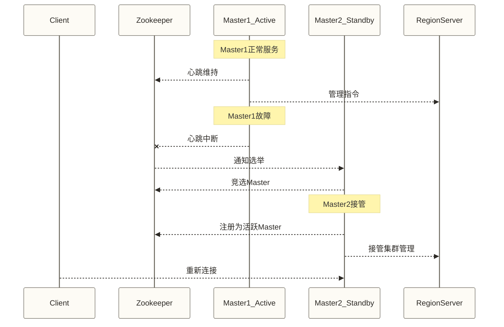
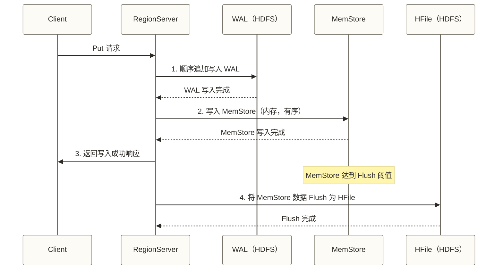
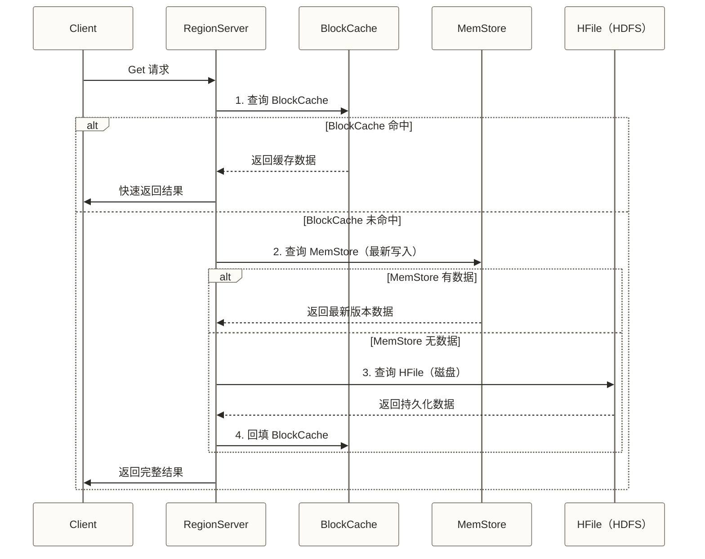
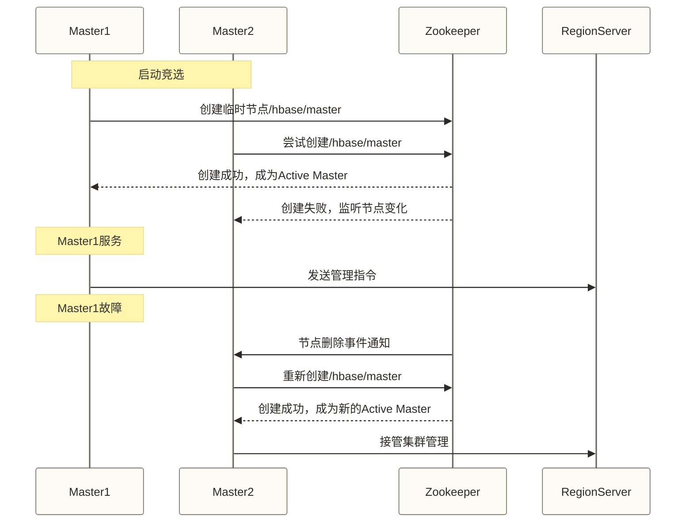
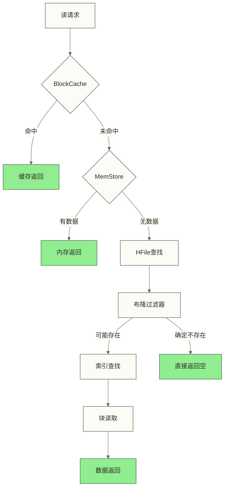
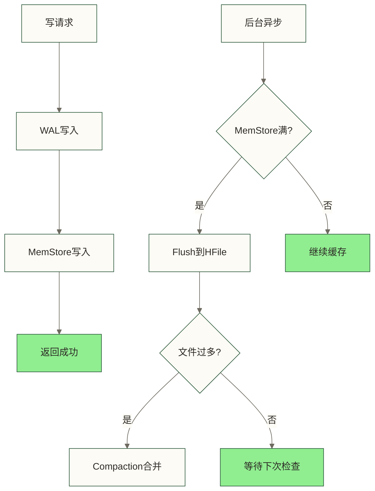

# HBase架构原理

HBase 是构建在 HDFS 之上的分布式列式存储数据库，采用主从架构设计，各核心组件分工明确：

- **HMaster**：集群管理节点，负责元数据管理、Region 分配和负载均衡，不参与实际数据读写
- **RegionServer**：数据服务节点，直接处理客户端读写请求，管理本节点上的所有 Region
- **Zookeeper**：分布式协调服务，负责 HMaster 选举、RegionServer 心跳监控和集群状态存储
- **HDFS**：底层存储引擎，提供 WAL 日志和 HFile 数据文件的可靠持久化
- **Region**：数据分片单元，每个 Region 负责一段连续的行键范围

## 🎯 HBase架构全景图

### 🏗️ 整体架构组件关系



### 🎯 组件职责矩阵

| 组件 | 核心职责 | 关键特性 | 故障影响 |
|---|---|---|---|
| **Zookeeper** | 分布式协调、Master 选举 | 强一致性、高可用 | 失去可用多数派时无法正常选举和注册；会话失效可能导致服务退出并中断读写，单节点故障不必然中断集群 |
| **HMaster** | 元数据管理、Region 分配 | 主备模式，可选主 | 短时间故障不影响数据读写，但无法执行 DDL 操作和 Region 迁移 |
| **RegionServer** | 数据读写服务 | 水平扩展 | 单节点故障只影响该节点负责的 Region，HMaster 会将其 Region 重新分配 |
| **HDFS** | 数据持久化存储 | 多副本冗余 | 底层存储故障影响最大，依赖 HDFS 自身的副本机制保障数据安全 |

## 🏛️ HMaster深度解析

### 🎯 HMaster核心功能

```mermaid
%%{init: {"theme":"base","themeVariables":{"fontFamily":"PingFang SC, -apple-system, Source Han Serif SC, serif","fontSize":"16px","background":"#FDFBF5","primaryColor":"#FDFBF5","primaryTextColor":"#2D2A26","primaryBorderColor":"#6E6A60","secondaryColor":"#E8EFE8","secondaryBorderColor":"#8FA890","secondaryTextColor":"#2D2A26","tertiaryColor":"#FDFBF5","tertiaryBorderColor":"#9A9488","tertiaryTextColor":"#6E6A60","lineColor":"#6E6A60","textColor":"#2D2A26","mainBkg":"#FDFBF5","nodeBorder":"#2D5A3D","clusterBkg":"#F3EEDF","clusterBorder":"#9A9488","edgeLabelBackground":"#FDFBF5"},"flowchart":{"htmlLabels":true,"curve":"basis","padding":20,"nodeSpacing":60,"rankSpacing":70,"useMaxWidth":false},"themeCSS":".node rect, .node polygon, .node circle { stroke-width: 1.5px; } .edgePath .path { stroke-width: 1.5px; } .cluster-label .nodeLabel, .cluster-label foreignObject { color: #2D2A26 !important; } .edgeLabel, .edgeLabel foreignObject { color: #2D2A26 !important; background-color: #FDFBF5; } .edgeLabel rect { fill: #FDFBF5; }"}}%%
flowchart TD
    A["HMaster核心功能"]
    B["📋 元数据管理"]
    C["⚖️ 负载均衡"]
    D["🔧 集群运维"]
    E["📊 监控告警"]
    
    B1["表Schema管理<br/>DDL操作处理"]
    B2["Region分配信息<br/>RegionServer映射"]
    B3["命名空间管理<br/>权限控制"]
    C1["Region分裂<br/>自动分裂触发"]
    C2["Region迁移<br/>负载重新分布"]
    C3["故障恢复<br/>Region重新分配"]
    D1["集群启停<br/>服务生命周期"]
    D2["节点管理<br/>RegionServer注册"]
    D3["配置同步<br/>参数分发更新"]
    E1["性能监控<br/>集群健康检查"]
    E2["异常告警<br/>故障及时通知"]
    E3["资源统计<br/>使用情况报告"]
    
    A --> B
    A --> C
    A --> D
    A --> E
    B --> B1
    B --> B2
    B --> B3
    C --> C1
    C --> C2
    C --> C3
    D --> D1
    D --> D2
    D --> D3
    E --> E1
    E --> E2
    E --> E3
    
    classDef main fill:#e1f5fe,stroke:#03a9f4,stroke-width:3px
    classDef metadata fill:#f3e5f5,stroke:#9c27b0,stroke-width:2px
    classDef balance fill:#fff3e0,stroke:#ff9800,stroke-width:2px
    classDef ops fill:#e8f5e8,stroke:#4caf50,stroke-width:2px
    classDef monitor fill:#fce4ec,stroke:#e91e63,stroke-width:2px
    
    class A main
    class B,B1,B2,B3 metadata
    class C,C1,C2,C3 balance
    class D,D1,D2,D3 ops
    class E,E1,E2,E3 monitor
```



### 🚀 HMaster 核心工作流程

#### 📊 表创建流程（DDL操作）

```text
HBase 表创建流程：
1. 客户端发起 DDL 请求 → 发送至 HMaster
2. HMaster 校验 Schema → 检查表名、列族配置合法性
3. 持久化表描述及相关元数据 → hbase:meta 主要记录 Region 等元数据，表状态与协调信息的保存位置随版本而异，并非将全部表信息同时写入 hbase:meta 和 ZooKeeper
4. 分配初始 Region → 将新表的初始 Region 分配给合适的 RegionServer；未预分区时通常为一个，预分区时可为多个
5. Region 上线 → 目标 RegionServer 打开所分配的 Region，新表可提供服务
```

#### ⚖️ 负载均衡流程

```text
HBase 负载均衡流程：
1. 负载检测 → HMaster 定期统计各 RegionServer 的 Region 数量和请求负载
2. 均衡决策 → 负载均衡器（默认 StochasticLoadBalancer）计算最优迁移方案
3. Region 迁移 → 将过载节点的部分 Region 迁移至负载较轻的节点
4. 元数据更新 → 更新 hbase:meta 表中的 Region 归属信息
5. 均衡完成 → 各 RegionServer 负载趋于均匀
```

#### 🔧 RegionServer 故障恢复流程

```text
RegionServer 故障恢复流程：
1. 故障检测 → Zookeeper 检测到 RegionServer 心跳超时，通知 HMaster
2. WAL 日志切分 → HMaster 将故障节点的 WAL 日志按 Region 切分
3. Region 重分配 → 将故障节点管理的 Region 分配给其他 RegionServer
4. WAL 回放 → 新节点回放对应 Region 的 WAL 日志，恢复未刷写的数据
5. 服务恢复 → Region 重新上线，对外提供读写服务
```

### 🛡️ HMaster 高可用配置

HBase 支持 HMaster 的主备模式：集群中同时运行多个 HMaster 进程，通过 Zookeeper 选举产生唯一的 Active Master，其余为 Standby。Active Master 故障时，Standby Master 自动竞选接管。以下是相关配置：

```properties
# hbase-site.xml：HMaster 高可用核心配置
hbase.master.port=16000                          # HMaster RPC 服务端口
hbase.master.info.port=16010                     # HMaster Web UI 端口

# 分布式日志回放历史参数示例；不等同于启用分布式日志切分，须核对目标版本是否支持
hbase.master.distributed.log.replay=true
hbase.client.operation.timeout=600000            # 客户端操作总超时（含重试）

# Zookeeper 集群配置（奇数节点，建议 3 或 5）
hbase.zookeeper.quorum=zk1,zk2,zk3
hbase.zookeeper.property.clientPort=2181
```

### 📝 关键配置说明

- **`hbase.master.port`**：HMaster 提供 RPC 服务的端口，RegionServer 和客户端通过此端口与 Master 通信
- **`hbase.master.info.port`**：HMaster Web UI 端口，用于集群状态监控
- **`hbase.master.distributed.log.replay`**：历史版本中的分布式日志回放相关参数，不等同于分布式日志切分开关；支持情况与恢复流程须按目标版本核对，不能保证缩短恢复时间
- **`hbase.zookeeper.quorum`**：ZooKeeper 节点列表；投票节点通常推荐配置为 3 或 5 个，以提高容错资源效率，但形成多数派并不要求节点总数必须为奇数

### 🔍 HMaster 高可用工作原理

- 主备 Master 同时注册到 Zookeeper，通过争抢临时节点确定 Active 身份
- Active Master 故障后，其 ZooKeeper 会话失效使临时节点消失，Standby Master 竞选接管；切换耗时取决于会话超时、故障检测与恢复过程，不能保证秒级完成
- 切换期间，健康 RegionServer 通常仍可处理已上线 Region 的读写；若同时发生 RegionServer 故障、Region 迁移或协调服务异常，相关访问仍可能受影响

#### 📊 故障切换时序图


## 💼 RegionServer深度解析

### 🏗️ RegionServer内部架构

```mermaid
%%{init: {"theme":"base","themeVariables":{"fontFamily":"PingFang SC, -apple-system, Source Han Serif SC, serif","fontSize":"16px","background":"#FDFBF5","primaryColor":"#FDFBF5","primaryTextColor":"#2D2A26","primaryBorderColor":"#6E6A60","secondaryColor":"#E8EFE8","secondaryBorderColor":"#8FA890","secondaryTextColor":"#2D2A26","tertiaryColor":"#FDFBF5","tertiaryBorderColor":"#9A9488","tertiaryTextColor":"#6E6A60","lineColor":"#6E6A60","textColor":"#2D2A26","mainBkg":"#FDFBF5","nodeBorder":"#2D5A3D","clusterBkg":"#F3EEDF","clusterBorder":"#9A9488","edgeLabelBackground":"#FDFBF5"},"flowchart":{"htmlLabels":true,"curve":"basis","padding":20,"nodeSpacing":60,"rankSpacing":70,"useMaxWidth":false},"themeCSS":".node rect, .node polygon, .node circle { stroke-width: 1.5px; } .edgePath .path { stroke-width: 1.5px; } .cluster-label .nodeLabel, .cluster-label foreignObject { color: #2D2A26 !important; } .edgeLabel, .edgeLabel foreignObject { color: #2D2A26 !important; background-color: #FDFBF5; } .edgeLabel rect { fill: #FDFBF5; }"}}%%
flowchart TD
    WAL[WAL Node]
    A[RegionServer架构]
    B[🎯 服务层]
    C[💾 存储层]
    D[🔄 处理层]
    E[📊 管理层]
    
    B1[RPC服务<br/>客户端请求处理]
    B2[HTTP服务<br/>RegionServer Web界面；REST由独立网关提供]
    B3[Region管理<br/>Region生命周期]
    C1[MemStore<br/>内存存储缓冲]
    C2[BlockCache<br/>读缓存]
    C3[WAL<br/>预写日志]
    C4[HFile<br/>磁盘存储文件]
    D1[Flush处理器<br/>内存数据持久化]
    D2[Compaction处理器<br/>文件合并压缩]
    D3[Split处理器<br/>Region分裂]
    E1[指标收集<br/>性能监控]
    E2[配置管理<br/>参数动态更新]
    E3[资源管理<br/>内存和线程池]
    
    A --> B
    A --> C
    A --> D
    A --> E
    B --> B1
    B --> B2
    B --> B3
    C --> C1
    C --> C2
    C --> C3
    C --> C4
    D --> D1
    D --> D2
    D --> D3
    E --> E1
    E --> E2
    E --> E3
    
    style A fill:#e1f5fe
    style B fill:#f3e5f5
    style C fill:#fff3e0
    style D fill:#e8f5e8
    style E fill:#fce4ec
```



### 🎯 RegionServer 三大核心存储组件

#### 💾 MemStore（内存写缓冲）

MemStore 是 RegionServer 的写缓冲区；每个 Region 内的每个列族对应一个 Store，Store 管理其 MemStore，而不是整个 RegionServer 的同名列族共用一个 MemStore：

```text
MemStore 核心特性：
- 数据写入时先写 WAL，再写 MemStore（保证可靠性）
- MemStore 内部以 ConcurrentSkipListMap 结构按行键有序存储
- 达到 hbase.hregion.memstore.flush.size（默认 128MB）时触发自动 Flush
- RegionServer 级别的全局内存水位（heapsize × 0.4）也会触发强制 Flush

关键参数：
- hbase.hregion.memstore.flush.size=134217728   # Region 级 MemStore 大小刷写阈值示例；默认值及具体刷写策略需按版本核对
- hbase.regionserver.global.memstore.size=0.4   # RegionServer 内存中 MemStore 的最大占比
```

#### 🗃️ BlockCache（读缓存）

BlockCache 缓存从 HFile 读取的数据块，减少磁盘 IO：

```text
BlockCache 核心特性：
- 默认使用 LRUBlockCache（Java 堆内），生产环境建议 BucketCache（堆外）避免 GC 压力
- 缓存的单位是 HFile Block（默认 64KB），而非行数据
- 支持数据块（DATA）、索引块（INDEX）、布隆过滤器块（BLOOM）分级缓存
- 缓存命中避免磁盘 IO，是随机读性能的关键

关键参数：
- hfile.block.cache.size=0.4                     # 分配给 BlockCache 的 JVM 堆比例
- hbase.bucketcache.size=8192                    # BucketCache 大小（MB），使用堆外内存
```

#### 📝 WAL（预写日志）

WAL（Write-Ahead Log）是 HBase 数据可靠性的基础保障：

```text
WAL 核心机制：
- 每次写操作先顺序追加到 WAL，再写 MemStore，确保 MemStore 数据不会因宕机丢失
- WAL 文件存储在 HDFS 上，RegionServer 故障后可由其他节点回放恢复数据
- 写入时可设置 Durability.ASYNC_WAL 异步同步 WAL，可能提升吞吐，但故障时可能丢失已返回成功、尚未持久化的写入；损失范围不能概括为“少量”，须按业务容忍度评估

性能优化选项：
- WAL 文件块大小：hbase.regionserver.hlog.blocksize=134217728  # 不等同于客户端批量写入设置
- 压缩存储：hbase.regionserver.hlog.compression.enable=true  # 开启 WAL 压缩
- 分布式回放历史参数：hbase.master.distributed.log.replay=true  # 须核对目标版本是否支持，不等同于日志切分开关
```

### 🔄 RegionServer数据处理流程

#### ✍️ 写入流程（WAL → MemStore → HFile）

HBase 写入遵循"先写日志，再写内存"的顺序，确保宕机后数据可通过 WAL 回放恢复：



#### 📖 读取流程（BlockCache → MemStore → HFile）

读取需要合并 MemStore 与相关 HFile 中的候选数据，并处理版本、删除标记及读取可见性；读取 HFile 块时可利用 BlockCache，符合缓存策略的块可回填缓存。下图仅展示组件，不是实际读取算法：BlockCache 命中不能直接返回完整结果，MemStore 有数据也不能一律跳过 HFile。



### 📊 Region管理机制

#### 🔀 Region 自动分裂

当 Region 数据量超过阈值时，HBase 自动触发分裂，将一个 Region 拆分为两个子 Region，实现水平扩展：

```text
Region 分裂触发条件：
1. Region 大小超过 hbase.hregion.max.filesize（默认 10GB）
2. StoreFile 数量过多通常触发 Compaction，严重时可能阻塞写入；它不是通用的独立 Region 分裂条件
3. 手动执行 split 命令强制触发

Region 分裂执行步骤：
1. 确定分裂点 → 根据分裂策略及 StoreFile 数据分布选择分裂键（Split Key），不保证是所有行键的精确中位数
2. 创建子 Region → 生成两个引用原 HFile 的子 Region（reference file）
3. 更新元数据 → 在 hbase:meta 表中注册两个子 Region 的范围和位置
4. 子 Region 上线 → 两个子 Region 开始独立对外服务
5. 后台 Compaction → 异步将 reference file 合并为独立的 HFile，完成真正的数据分裂
```

#### 🔄 Compaction 机制

Compaction 通过合并 HFile 文件优化读性能（减少文件数）和释放存储空间（清理过期数据和删除标记）：

| 类型 | 触发条件 | 操作范围 | 副作用 |
|---|---|---|---|
| **Minor Compaction** | Store 内 HFile 数达到策略条件；参数及默认值需按版本核对 | 按策略合并部分 HFile | 可按扫描规则清理部分过期或多余版本，通常保留仍有必要的删除标记；IO 开销取决于参与文件规模 |
| **Major Compaction** | 定时触发（默认7天）或手动执行 | 合并 Store 内所有 HFile 为一个 | 清理删除标记和过期版本，IO 开销大 |

> [!warning] 生产环境建议
> Major Compaction 会产生大量 IO，生产环境通常关闭自动 Major Compaction（`hbase.hregion.majorcompaction=0`），改为在业务低峰期手动执行 `major_compact` 命令。

## 🎯 Zookeeper协调机制

### 🏛️ Zookeeper在HBase中的作用

```mermaid
%%{init: {"theme":"base","themeVariables":{"fontFamily":"PingFang SC, -apple-system, Source Han Serif SC, serif","fontSize":"16px","background":"#FDFBF5","primaryColor":"#FDFBF5","primaryTextColor":"#2D2A26","primaryBorderColor":"#6E6A60","secondaryColor":"#E8EFE8","secondaryBorderColor":"#8FA890","secondaryTextColor":"#2D2A26","tertiaryColor":"#FDFBF5","tertiaryBorderColor":"#9A9488","tertiaryTextColor":"#6E6A60","lineColor":"#6E6A60","textColor":"#2D2A26","mainBkg":"#FDFBF5","nodeBorder":"#2D5A3D","clusterBkg":"#F3EEDF","clusterBorder":"#9A9488","edgeLabelBackground":"#FDFBF5"},"flowchart":{"htmlLabels":true,"curve":"basis","padding":20,"nodeSpacing":60,"rankSpacing":70,"useMaxWidth":false},"themeCSS":".node rect, .node polygon, .node circle { stroke-width: 1.5px; } .edgePath .path { stroke-width: 1.5px; } .cluster-label .nodeLabel, .cluster-label foreignObject { color: #2D2A26 !important; } .edgeLabel, .edgeLabel foreignObject { color: #2D2A26 !important; background-color: #FDFBF5; } .edgeLabel rect { fill: #FDFBF5; }"}}%%
flowchart TD
    A[Zookeeper协调功能]
    B[🗳️ Master选举]
    C[📋 元数据存储]
    D[📡 状态监控]
    E[🔄 配置同步]
    
    A --> B
    A --> C
    A --> D
    A --> E
    
    B --> B1[Master竞选<br/>分布式锁机制]
    B --> B2[故障转移<br/>自动选举新Master]
    B --> B3[脑裂预防<br/>确保单Master]
    
    C --> C1[集群信息<br/>节点注册状态]
    C --> C2[表状态<br/>启用禁用状态]
    C --> C3[Region分配<br/>分配关系映射]
    
    D --> D1[节点监控<br/>RegionServer健康]
    D --> D2[服务发现<br/>客户端连接路由]
    D --> D3[故障检测<br/>心跳超时处理]
    
    E --> E1[配置分发<br/>参数动态更新]
    E --> E2[版本管理<br/>配置变更追踪]
    E --> E3[一致性保证<br/>配置同步确认]
    
    style A fill:#e1f5fe
    style B fill:#f3e5f5
    style C fill:#fff3e0
    style D fill:#e8f5e8
    style E fill:#fce4ec
```



### 🗳️ Zookeeper关键ZNode结构

| ZNode 路径 | 说明 |
|-----------|------|
| `/hbase` | 根节点 |
| `/hbase/master` | Master 信息 |
| `/hbase/rs` | RegionServer 列表 |
| `/hbase/rs/rs1:60020` | RegionServer 1 |
| `/hbase/rs/rs2:60020` | RegionServer 2 |
| `/hbase/rs/rs3:60020` | RegionServer 3 |
| `/hbase/meta-region-server` | Meta 表位置 |
| `/hbase/table` | 表状态信息 |
| `/hbase/table/users` | users 表状态 |
| `/hbase/table/orders` | orders 表状态 |
| `/hbase/table/products` | products 表状态 |
| `/hbase/region-in-transition` | Region 状态转换 |
| `/hbase/backup-masters` | 备 Master 列表 |

### 🔄 分布式协调流程

#### 🗳️ Master选举流程


#### 📊 RegionServer注册流程
```text
1. 启动连接 → RegionServer 连接 ZooKeeper
2. 创建节点 → 在配置的根路径下的 rs 目录创建临时节点，节点名通常包含主机、端口和启动标识，并非临时顺序节点
3. 上报信息 → RegionServer 向 HMaster 注册并报告负载；ZooKeeper 节点不应被理解为完整负载信息库
4. 会话维持 → ZooKeeper 客户端通过协议心跳维持会话，不依赖定期改写节点内容
5. 故障检测 → 会话失效后临时节点被删除，触发相关故障处理
```

## 🗄️ HDFS存储层集成

### 📁 HBase在HDFS上的文件组织

| HDFS 路径 | 说明 |
|----------|------|
| `/hbase` | HBase 根目录 |
| `/hbase/WALs` | 预写日志目录 |
| `/hbase/WALs/rs1,60020,timestamp` | RegionServer 1 的 WAL |
| `/hbase/WALs/rs2,60020,timestamp` | RegionServer 2 的 WAL |
| `/hbase/WALs/rs3,60020,timestamp` | RegionServer 3 的 WAL |
| `/hbase/data` | 表数据目录 |
| `/hbase/data/default` | 默认命名空间 |
| `/hbase/data/default/users` | users 用户表 |
| `/hbase/data/default/users/region1/cf1` | region1 列族 1（含 file1.hfile、file2.hfile） |
| `/hbase/data/default/users/region1/cf2` | region1 列族 2 |
| `/hbase/data/default/orders` | orders 订单表 |
| `/hbase/data/custom_ns` | 自定义命名空间 |
| `/hbase/oldWALs` | 历史 WAL 目录 |
| `/hbase/.tmp` | 临时文件目录 |

### 🎯 HDFS集成优势

| 集成特性 | 技术实现 | 业务价值 | 性能影响 |
|---|---|---|---|
| **可靠性** | 3副本冗余存储 | 数据安全保障 | 写入延迟增加 |
| **扩展性** | 水平扩展存储 | 支持PB级数据 | 性能增长取决于负载、数据分布和存储瓶颈，不保证线性提升 |
| **成本优化** | 商用硬件集群 | 降低存储成本 | 性价比提升 |
| **容错能力** | 自动故障恢复 | 提高可用性，效果取决于故障类型与冗余配置 | 故障恢复期间仍可能出现访问中断或延迟 |

### 📊 存储性能优化策略

#### 🎯 HFile优化配置

```xml

<!-- HBase配置文件hbase-site.xml -->
<configuration>
<!-- BlockCache堆内存比例配置 -->
<property>
<name>hfile.block.cache.size</name>
<value>0.4</value>
<description>读缓存占堆内存比例</description>
</property>

<!-- 压缩配置 -->
<property>
<name>hbase.hregion.default.compression</name>
<value>SNAPPY</value>
<description>默认压缩算法</description>
</property>

<!-- MemStore配置 -->
<property>
<name>hbase.hregion.memstore.flush.size</name>
<value>134217728</value>
<description>MemStore刷写阈值128MB</description>
</property>
</configuration>
```

### 📝 **配置项解释**

## 🎯 架构性能特性分析

### ⚡ 读写性能特征

#### 📖 读性能优化路径

下图仅表示缓存、布隆过滤器和索引的局部优化作用。实际读取须合并相关 MemStore 与 StoreFile 的数据；单个缓存块命中不代表完整结果，某个 HFile 的布隆过滤器判定不存在也只排除该文件，不能直接判定整个请求为空。



#### ✍️ 写性能优化路径


### 📊 架构扩展性分析

#### 🔄 水平扩展机制
```text
扩展维度：
1. 存储扩展 → 添加HDFS DataNode节点
2. 计算扩展 → 添加RegionServer节点
3. 协调扩展 → 扩展Zookeeper集群

扩展效果：
✅ 增加同规格存储节点通常可提高容量，实际可用容量还受副本数和预留空间影响
✅ 增加 RegionServer 可提高吞吐，但是否近似线性取决于分区、热点、负载与底层存储瓶颈
✅ 支持在线扩容，但迁移与均衡可能影响延迟，不能保证全过程无业务影响
✅ 可通过负载均衡重新分配 Region，效果取决于配置与数据分布
```

#### 📈 性能扩展曲线

以下数字保留自原稿，尚无可核验的测试来源，仅作为讨论扩展趋势的教学示例，不是实测结果。节点硬件、容量口径、读写负载、数据规模、复制与持久化策略均未说明，不可用于 SLA、容量规划或采购估算。
| 节点数量 | 存储容量 | 读QPS | 写QPS | 响应延迟 |
|---|---|---|---|---|
| **3节点** | 30TB | 30K | 20K | 1-3ms |
| **10节点** | 100TB | 90K | 60K | 1-5ms |
| **50节点** | 500TB | 400K | 250K | 2-8ms |
| **100节点** | 1PB | 700K | 400K | 3-15ms |

## 🛡️ 架构可靠性保障

### 🔧 故障容错机制

#### 💥 RegionServer故障处理
```text
故障检测：
1. Zookeeper心跳超时检测
2. HMaster主动健康检查
3. 客户端连接异常报告

恢复流程：
1. 故障确认 → 确认RegionServer不可用
2. WAL 恢复准备 → 处理故障节点 WAL，恢复已持久化但尚未刷写到 HFile 的数据；实际回放通常在目标 Region 打开过程中完成，不等同于恢复所有未提交操作
3. Region重分配 → 将Region分配给其他节点
4. 服务恢复 → 新节点开始提供服务
5. 客户端重路由 → 更新客户端连接信息
```

#### 🏛️ HMaster故障处理
```text
故障影响：
✅ 健康 RegionServer 上已上线 Region 的读写通常可继续；涉及故障恢复、迁移或协调异常的访问仍可能受影响
❌ DDL操作无法执行
❌ 负载均衡停止
❌ Region分裂受阻

恢复机制：
1. 备Master自动接管
2. 从Zookeeper恢复状态
3. 重新建立与RegionServer连接
4. 继续执行未完成的管理任务
```

### 📊 数据一致性保证

#### 🎯 强一致性设计
```text
一致性级别：
✅ 行级保证 → 支持单行原子更新，默认对主 Region 的读取提供强一致性语义
❌ 同 Region 多行操作 → 不因此自动获得多行事务或完整扫描快照保证
❌ 跨 Region 多行操作 → 不提供通用跨行事务保证，不能简单称为“最终一致性”；副本读取与跨集群复制须另论

实现机制：
1. WAL 预写日志 → 在相应持久化策略和存储可靠性条件下支持故障恢复，不是无条件零丢失保证
2. MVCC → 控制并发操作的读取可见性
3. 原子操作 → 支持单行多列原子更新
4. 时间戳版本 → 标识单元格的数据版本，不等同于 MVCC 内部并发控制
```

## 🎉 架构学习收获总结

> [!success] 🌟 **恭喜！你已经掌握了HBase架构的核心原理！**
> 
> **你现在理解的关键概念**：
> - ✅ **分布式协调**：Zookeeper如何保证集群一致性
> - ✅ **主从架构**：HMaster和RegionServer的分工协作
> - ✅ **数据分布**：Region如何实现水平扩展
> - ✅ **存储机制**：MemStore、BlockCache、HFile的协作
> - ✅ **容错设计**：如何实现高可用和数据安全
> 
> **这些概念可作为学习分布式系统设计的起点；是否具备设计能力，还需通过建模、测试和工程实践验证。** 🚀

### 🎯 架构设计思想总结

> [!tip] 💡 **HBase架构设计的核心思想**
> 
> **分层设计原则**：
> - 🎯 **职责分离**：每个组件专注于特定功能
> - 🔄 **松耦合**：组件间通过标准接口交互
> - 📈 **可扩展**：支持水平扩展和垂直扩展
> - 🛡️ **容错性**：通过冗余与恢复机制降低单点故障影响，但相关请求仍可能中断或延迟
> 
> **分布式系统设计模式**：
> - 🗳️ **选举机制**：解决分布式环境下的领导者选择
> - 📋 **元数据管理**：集中管理分布式系统状态
> - 🔄 **一致性边界**：区分单行原子性与强一致读取、多行事务限制，以及副本读取和跨集群复制语义
> - ⚡ **读写分离**：优化不同访问模式的性能

### 🎯 下一步学习建议

**立即实践**：
- [ ] 搭建HBase测试环境验证架构原理
- [ ] 观察各组件的交互过程和日志输出
- [ ] 模拟故障场景测试容错机制

**深入学习**：
- [ ] 学习 [[【技术与工具】/HBase/03-HBase数据模型|HBase数据]] - 理解NoSQL数据组织方式
- [ ] 学习 [[【技术与工具】/HBase/04-HBase环境搭建|HBase环境搭建]] - 动手搭建完整集群

> [!quote] 💭 **分布式架构的智慧**
> 
> **好的架构设计是技术与艺术的完美结合**：
> - 🎯 **技术维度**：确保系统的高性能、高可用、可扩展
> - 🎨 **艺术维度**：平衡复杂性与可维护性
> - 🚀 **演进思维**：设计要考虑未来的变化和成长
> - 🤝 **团队协作**：架构要便于团队理解和协作开发
> 
> **理解架构原理，是迈向分布式系统专家的第一步！** ✨

---

**创建时间**：2024-12-11  
**温度指数**：⭐⭐⭐⭐⭐ (原理清晰，图解丰富)  
**预计学习时长**：90分钟  
**下一步学习**：[[【技术与工具】/HBase/03-HBase数据模型|HBase数据]] → [[【技术与工具】/HBase/04-HBase环境搭建|HBase环境搭建]]

#HBase #分布式架构 #NoSQL #集群设计 #高可用 #数据一致性
