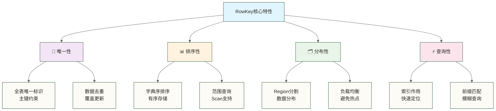
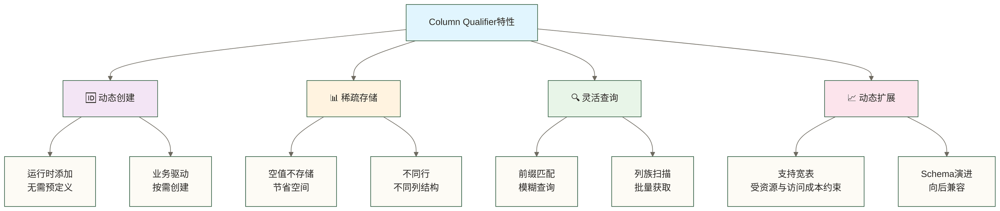

> [!warning] 关联材料边界
> 以下原引用目标缺失或无法唯一确认，已取消跳转并保留提及：01-HBase概述与应用场景。相关素材/延伸说明暂不可用，不能据此声称已经提供配套材料。

# HBase 数据模型

> [!info] 前置知识
> - HBase 概述（原引用“01-HBase概述与应用场景”未能确定有效目标，暂不可跳转） — 了解 HBase 的定位和适用场景
> - [[【技术与工具】/HBase/02-HBase架构原理|HBase 架构原理]] — 理解 Region、HFile、MemStore 等底层结构
> - 关系型数据库基础（理解 HBase 与 RDBMS 的差异更有帮助）

HBase 的数据模型是一个稀疏、多维、有序的映射表，与关系型数据库的二维表格结构差异显著。理解数据模型是设计高效 HBase 应用的基础——错误的 RowKey 设计会导致写入热点，错误的列族设计会浪费存储和降低查询性能。

HBase 中每一条数据由四个维度唯一确定：

```text
(RowKey, ColumnFamily, ColumnQualifier, Timestamp) → Value
```

这四个维度决定了数据的存储位置、访问路径和版本历史。

## HBase 数据模型核心概念

### 📊 多维映射表结构

```mermaid
%%{init: {"theme":"base","themeVariables":{"fontFamily":"PingFang SC, -apple-system, Source Han Serif SC, serif","fontSize":"16px","background":"#FDFBF5","primaryColor":"#FDFBF5","primaryTextColor":"#2D2A26","primaryBorderColor":"#6E6A60","secondaryColor":"#E8EFE8","secondaryBorderColor":"#8FA890","secondaryTextColor":"#2D2A26","tertiaryColor":"#FDFBF5","tertiaryBorderColor":"#9A9488","tertiaryTextColor":"#6E6A60","lineColor":"#6E6A60","textColor":"#2D2A26","mainBkg":"#FDFBF5","nodeBorder":"#2D5A3D","clusterBkg":"#F3EEDF","clusterBorder":"#9A9488","edgeLabelBackground":"#FDFBF5"},"flowchart":{"htmlLabels":true,"curve":"basis","padding":20,"nodeSpacing":60,"rankSpacing":70,"useMaxWidth":false},"themeCSS":".node rect, .node polygon, .node circle { stroke-width: 1.5px; } .edgePath .path { stroke-width: 1.5px; } .cluster-label .nodeLabel, .cluster-label foreignObject { color: #2D2A26 !important; } .edgeLabel, .edgeLabel foreignObject { color: #2D2A26 !important; background-color: #FDFBF5; } .edgeLabel rect { fill: #FDFBF5; }"}}%%
flowchart TD
    A["HBase逻辑数据模型"]
    B["🆔 RowKey维度"]
    C["📁 Column Family维度"]
    D["📄 Column Qualifier维度"]
    E["⏰ Timestamp维度"]
    
    B1["唯一标识<br/>排序键"]
    B2["数据分布<br/>Region分割"]
    B3["查询入口<br/>快速定位"]
    
    C1["存储单元<br/>物理分组"]
    C2["性能配置<br/>独立优化"]
    C3["访问模式<br/>读写特性"]
    
    D1["具体字段<br/>动态列"]
    D2["稀疏存储<br/>节省空间"]
    D3["灵活扩展<br/>Schema自由"]
    
    E1["版本管理<br/>多版本数据"]
    E2["数据历史<br/>时间序列"]
    E3["TTL控制<br/>自动过期"]
    
    A --> B
    A --> C
    A --> D
    A --> E
    
    B --> B1
    B --> B2
    B --> B3
    
    C --> C1
    C --> C2
    C --> C3
    
    D --> D1
    D --> D2
    D --> D3
    
    E --> E1
    E --> E2
    E --> E3
    
    classDef main fill:#e1f5fe,stroke:#03a9f4,stroke-width:3px
    classDef rowkey fill:#f3e5f5,stroke:#9c27b0,stroke-width:2px
    classDef cf fill:#fff3e0,stroke:#ff9800,stroke-width:2px
    classDef qualifier fill:#e8f5e8,stroke:#4caf50,stroke-width:2px
    classDef timestamp fill:#fce4ec,stroke:#e91e63,stroke-width:2px
    
    class A main
    class B,B1,B2,B3 rowkey
    class C,C1,C2,C3 cf
    class D,D1,D2,D3 qualifier
    class E,E1,E2,E3 timestamp
```



### 🎯 银行客户档案组织公式

教学假设中的银行档案管理专家王专家解释（非已核实真人引语）："我们银行的客户档案组织就像一个多层文件柜系统，每个客户的信息都有严格的层次结构。"

```text
银行客户档案 = {
    客户编号 → {
        业务分类 → {
            具体字段 → {
                更新时间 → 数据值
            }
        }
    }
}
```

**银行档案理解公式**：
```text
(客户编号, 业务分类, 具体字段, 更新时间) → 客户信息
```

上述教学人物王专家举例说明："比如查找客户张三的手机号码，我们需要：张三的客户编号 → 个人信息分类 → 手机号字段 → 最新更新时间，这样就能准确找到他目前使用的手机号。"

**专业技术对应**：HBase采用多维映射表结构，通过(RowKey, ColumnFamily, ColumnQualifier, Timestamp)四元组唯一定位一个数据单元，实现了灵活的NoSQL数据组织方式，支持稀疏数据存储和多版本数据管理。

## 🆔 银行客户编号设计原理

### 📋 客户编号特性与作用

教学假设中的银行客户管理部刘部长介绍（非已核实真人引语）："客户编号是我们银行最重要的设计，就像身份证号一样，必须保证唯一性、有序性，同时还要考虑业务分布的均匀性。"



### 🎯 RowKey设计策略

#### 🔥 银行客户编号热点问题与解决方案

教学假设中的银行系统架构师张架构师分享模拟经历（非已核实真实案例）："我们在设计客户编号时遇到过严重的热点问题，当时所有新客户都被分配到同一个分行系统，导致该分行压力巨大。"

**RowKey 热点问题的核心原因**：HBase 按 RowKey 字典序将数据分配到各个 Region。若 RowKey 以递增时间戳开头（如 `20241201001, 20241201002...`），所有新写入都集中在最后一个 Region，其所在的 RegionServer 成为热点节点，而其他节点几乎空闲。

**两种解决思路：**
1. **散列前缀**：取 RowKey 的散列值（或业务分区键）作为前缀，将写入分散到多个 Region
2. **反转时间戳**：`Long.MAX_VALUE - timestamp`，在采用保持数值顺序的定长编码时，使最新数据排在相同业务前缀的前部，便于倒序读取；单独使用仍会把持续写入集中到键范围的一端，不能消除热点，需结合散列或分桶前缀及匹配的预分区分散写入

实际选择取决于查询模式：如果需要"按时间倒序拉取最新数据"，用反转时间戳；如果需要"按用户 ID 查该用户历史"，用 `userId + reverseTimestamp` 复合键。

#### 🎯 常用RowKey设计模式
> 以下是RowKey设计伪代码，实际实现需明确字段分隔、定长编码及字节序：

```java
// 1. 反向时间戳设计（最新数据优先）
RowKey = userId + (Long.MAX_VALUE - timestamp)

// 2. 复合键设计（多维查询支持）
RowKey = region + date + storeId + productId

// 3. 散列+时间设计（负载均衡）
RowKey = md5(userId).substring(0,4) + timestamp + userId

// 4. 分桶设计（预分区支持）
RowKey = bucket(0-99) + businessKey

// 5. 层次设计（树形结构）
RowKey = department + team + employee + date
```

上面五种 RowKey 模式的适用场景：

| 设计模式 | 核心解决的问题 | 适用场景 |
|---|---|---|
| 反向时间戳 | 在保持数值顺序的定长编码下，最新数据排在同一业务前缀的键范围前部，可限定前缀读取最新记录 | 消息列表、日志查询、时序数据倒序 |
| 复合键 | 支持按键字段顺序组织的前缀和连续范围查询，不等于任意维度独立索引 | 报表查询（按地区+日期+门店） |
| 散列+时间 | 避免时间顺序导致的写入热点 | 高并发写入场景 |
| 分桶设计 | 配合预分区，数据均匀分布 | 数据量可预估、分区数固定的场景 |
| 层次设计 | 按组织层级前缀扫描 | 组织架构、文件系统、权限体系 |

> [!tip] RowKey 设计的核心矛盾
> 避免热点（需要散列/随机化）和支持范围查询（需要有序性）是矛盾的。设计时要根据读写比例做取舍：写多读少时优先避热点；读查询有明确范围时优先有序性。

#### 🎯 Column Family数量建议

```text
原稿未核实的Column Family数量经验分档（不是硬性上限，需按工作负载验证）：
✅ 最佳实践：1-3个Column Family
⚠️ 可接受：4-6个Column Family  
❌ 避免：7个以上Column Family

原因分析：
- Region分裂时需要考虑所有CF
- MemStore为每个CF分配内存
- Compaction需要处理所有CF
- 监控和维护复杂度随CF数量及配置差异增加，不能据此断言指数增长
```

### 📊 Column Family配置优化

```java
// Column Family创建和配置
create 'user_events',
{
    NAME => 'cf1',
    COMPRESSION => 'SNAPPY',           // 压缩算法
    BLOCKCACHE => true,                // 开启块缓存
    BLOCKSIZE => '65536',              // 块大小64KB
    REPLICATION_SCOPE => '0',          // 复制范围
    VERSIONS => '3',                   // 保留版本数
    TTL => '2592000',                  // 数据TTL 30天
    IN_MEMORY => false,                // 是否常驻内存
    BLOOMFILTER => 'ROW'               // 布隆过滤器
}
```

列族属性说明：

| 属性 | 含义 | 建议值 |
|---|---|---|
| `COMPRESSION` | 数据压缩算法 | SNAPPY（通用）、LZ4（低延迟）、GZ（高压缩率） |
| `BLOCKCACHE` | 是否启用读缓存 | true（默认，读频繁时保持开启） |
| `BLOCKSIZE` | HFile 数据块大小 | 65536（64 KB，默认）；顺序扫描可调大到 256 KB |
| `VERSIONS` | 保留历史版本数 | 1（默认，无多版本需求时不要调大） |
| `TTL` | 数据自动过期时间（秒） | 按业务需求设置，日志类数据建议 7-30 天 |
| `IN_MEMORY` | 是否优先驻留内存 | false（默认）；小型高频访问表可开启 |
| `BLOOMFILTER` | 布隆过滤器类型 | ROW（按行过滤）、ROWCOL（按行+列过滤） |
| `REPLICATION_SCOPE` | 跨集群复制范围 | 0（不复制）、1（异步复制到从集群） |

## 📄 Column Qualifier动态列设计

### 🔄 动态列特性



### 🎯 Column Qualifier设计模式

#### 📊 时序数据模式

```java
// 用户行为事件表设计
RowKey: userId_date
Column Family: events
Column Qualifier: timestamp_eventType_action

示例数据：
user001_20241211 → {
    events: {
        1671234567001_click_button → "homepage_login",
        1671234567125_view_page → "product_detail_123",
        1671234567890_purchase → "order_456"
    }
}
```

这种设计将 **时间戳 + 事件类型** 编码到 Column Qualifier 中，把一个用户在某天的所有行为压缩到单行内。优点是读取某用户某天行为只需一次 Get；代价是 Column Qualifier 数量随事件增多会膨胀，建议配合 TTL 定期清理历史数据。

#### 🗂️ 多属性存储模式

```java
// 商品信息表设计
RowKey: productId
Column Family: attributes
Column Qualifier: 属性名称

示例数据：
product_123 → {
    attributes: {
        name → "iPhone 15 Pro",
        brand → "Apple",
        color_red → "available",
        color_blue → "sold_out",
        size_128GB → "in_stock",
        size_256GB → "low_stock"
    }
}
```

将**属性名**（如颜色规格）直接编码到 Column Qualifier 中，形成"宽表"结构。这样查询某商品所有属性只需一次 Get，无需 join。这类场景在电商商品详情页中非常典型，每个商品的属性数量和类型差异很大，HBase 的稀疏存储特性使得没有某属性的商品不会浪费空间。

#### 📈 计数器模式

```java
// 统计数据表设计
RowKey: metricType_date
Column Family: counters
Column Qualifier: 维度组合

示例数据：
pageview_20241211 → {
    counters: {
        total → 1500000,
        mobile → 900000,
        desktop → 600000,
        region_beijing → 400000,
        region_shanghai → 350000
    }
}
```

HBase 提供原子性 `increment` 操作（Java API：`table.incrementColumnValue()`），可以对 Column Qualifier 存储的数值做原子递增，无需先 get 再 put。这是计数器模式的核心：将不同统计维度作为 Column Qualifier，每次事件触发时原子累加对应的列，避免并发写入冲突。

## ⏰ Timestamp版本控制机制

### 🕒 多版本数据管理

```mermaid
%%{init: {"theme":"base","themeVariables":{"fontFamily":"PingFang SC, -apple-system, Source Han Serif SC, serif","fontSize":"16px","background":"#FDFBF5","primaryColor":"#FDFBF5","primaryTextColor":"#2D2A26","primaryBorderColor":"#6E6A60","secondaryColor":"#E8EFE8","secondaryBorderColor":"#8FA890","secondaryTextColor":"#2D2A26","tertiaryColor":"#FDFBF5","tertiaryBorderColor":"#9A9488","tertiaryTextColor":"#6E6A60","lineColor":"#6E6A60","textColor":"#2D2A26","mainBkg":"#FDFBF5","nodeBorder":"#2D5A3D","clusterBkg":"#F3EEDF","clusterBorder":"#9A9488","edgeLabelBackground":"#FDFBF5"},"flowchart":{"htmlLabels":true,"curve":"basis","padding":20,"nodeSpacing":60,"rankSpacing":70,"useMaxWidth":false},"themeCSS":".node rect, .node polygon, .node circle { stroke-width: 1.5px; } .edgePath .path { stroke-width: 1.5px; } .cluster-label .nodeLabel, .cluster-label foreignObject { color: #2D2A26 !important; } .edgeLabel, .edgeLabel foreignObject { color: #2D2A26 !important; background-color: #FDFBF5; } .edgeLabel rect { fill: #FDFBF5; }"}}%%
flowchart TD
    A[Timestamp版本控制]
    B[📊 多版本存储]
    C[⏰ 时间维度]
    D[🗂️ 版本管理]
    E[🔄 自动清理]
    A --> B
    A --> C
    A --> D
    A --> E
    B --> B1[同一Cell<br/>多个版本]
    B --> B2[时间戳唯一<br/>版本标识]
    B --> B3[最新优先<br/>查询默认行为]
    C --> C1[毫秒精度<br/>高精度时间]
    C --> C2[用户指定<br/>自定义时间戳]
    C --> C3[系统生成<br/>自动分配]
    D --> D1[版本数限制<br/>VERSIONS配置]
    D --> D2[历史查询<br/>指定版本读取]
    D --> D3[版本对比<br/>数据变更追踪]
    E --> E1[TTL过期<br/>时间驱动清理]
    E --> E2[版本清理<br/>数量驱动清理]
    E --> E3[压缩清理<br/>存储优化]
    style A fill:#e1f5fe
    style B fill:#f3e5f5
    style C fill:#fff3e0
    style D fill:#e8f5e8
    style E fill:#fce4ec
```



### 🎯 版本控制配置

```java
// 1. 列族级版本配置（以下alter为HBase Shell命令）
alter 'user_profile', {NAME => 'cf1', VERSIONS => 5}

// 2. 写入时指定时间戳
Put put = new Put(Bytes.toBytes("user001"));
put.addColumn(
    Bytes.toBytes("cf1"), 
    Bytes.toBytes("name"), 
    1671234567000L,  // 指定时间戳
    Bytes.toBytes("John")
);

// 3. 查询历史版本
Get get = new Get(Bytes.toBytes("user001"));
get.setMaxVersions(3);  // 获取最近3个版本

// 4. 查询指定时间版本
get.setTimestamp(1671234567000L);  // 获取指定时间版本
```

通过上面的代码可以看到：写入时可以手动指定毫秒级时间戳（常用于数据补录场景）；读取时 `setMaxVersions(n)` 返回最近 n 个版本，`setTimestamp(ts)` 返回恰好等于该时间戳的版本，`setTimeRange(min, max)` 将读取限定到左闭右开的时间范围 `[min, max)`；实际返回版本数仍受读取请求的版本数上限、列族保留策略及TTL等约束，不会自动返回范围内的所有版本。

### 📊 版本控制应用场景

| 应用场景 | 版本策略 | 配置建议 | 典型用例 |
|---|---|---|---|
| **审计日志** | 按审计要求设计留存 | VERSIONS=Integer.MAX_VALUE 仅为版本数上限示例，不能单独保证永久留存 | 还需评估TTL、删除、备份及不可篡改要求 |
| **配置管理** | 保留最近几版 | VERSIONS=3-5 | 配置回滚 |
| **用户画像** | 保留当前版本 | VERSIONS=1 | 最新状态 |
| **时序数据** | 基于时间TTL | TTL=30天 | 监控数据 |
| **缓存数据** | 短期保留 | TTL=1小时 | 临时存储 |

## 📦 Cell存储单元

### 🎯 Cell数据结构

```java
// Cell的完整结构
Cell = {
    RowKey: byte[],           // 行键
    Family: byte[],           // 列族
    Qualifier: byte[],        // 列限定符
    Timestamp: long,          // 时间戳
    Type: byte,               // 操作类型 (Put/Delete)
    Value: byte[]             // 数据值
}

// Cell在HBase中的逻辑表示
(RowKey, ColumnFamily, ColumnQualifier, Timestamp) → Value
```

Cell 中的 `Type` 字段区分了 `Put`（写入）和 `Delete`（删除标记，又称 Tombstone）。这解释了为什么 HBase 的删除是软删除：delete 操作实质上是写入相应类型的删除标记，读取时依据标记屏蔽被删除的数据；被覆盖数据与标记的物理清理通常在符合条件的 Major Compaction 中完成，具体还受保留策略等配置影响。所有字段（RowKey、Family、Qualifier）在存储时都是 `byte[]`，HBase 本身不理解内容，序列化/反序列化由客户端负责。

### 📊 Cell存储优化

#### 🗜️ 数据压缩策略

```java
// 1. 列族级压缩配置
alter 'user_data', {
    NAME => 'cf1', 
    COMPRESSION => 'SNAPPY'  // 压缩算法选择
}

// 压缩算法对比
NONE     - 无压缩，读写最快，存储空间最大
SNAPPY   - 平衡压缩，性能好，推荐日常使用
LZO      - 快速压缩，适合实时场景
GZIP     - 高压缩比，适合存储密集型场景
LZ4      - 偏重低压缩开销，是否适用需结合环境和数据实测
```

压缩算法对比（原稿压缩率与性能等级为未核实示例，未提供数据集、硬件和版本条件，不代表实际结果）：

| 算法 | 压缩率 | CPU 开销 | 读写速度 | 推荐场景 |
|---|---|---|---|---|
| NONE | 1x | 无 | 最快 | 数据已压缩（图片、视频） |
| LZ4 | ~2x | 极低 | 极快 | 低延迟实时场景 |
| SNAPPY | ~2x | 低 | 快 | 通用场景（默认推荐） |
| LZO | ~2.5x | 中 | 中 | 快速压缩读多写少 |
| GZIP | ~4x | 高 | 慢 | 冷数据归档，存储成本敏感 |

> [!note] SNAPPY 需要安装 native 库
> 生产环境使用 SNAPPY 时，需根据 Hadoop/HBase 版本和分发包，在实际执行压缩或解压的节点配置所需的 native 依赖，并确保相应进程能够加载。`hadoop checknative` 可辅助检查 Hadoop native 支持，但不能单独证明 HBase 的 SNAPPY 压缩读写可用，还需在目标环境验证。

#### 📏 Cell大小控制

```java
// Cell大小建议
原稿未核实的Cell大小经验分档（不是通用推荐或允许上限，需检查目标环境的Cell/RPC限制并实测）：
✅ 最佳范围：1KB - 10MB
⚠️ 可接受：100B - 50MB
❌ 避免：>100MB的大Cell

// 大Cell处理策略
// 1. 文件引用模式
Cell Value = "/hdfs/path/to/large/file.dat"

// 2. 分块存储模式
RowKey: fileId_chunk0, fileId_chunk1, fileId_chunk2
Value: 文件的分块数据

// 3. 外部存储模式
Cell Value = "s3://bucket/key" // 存储外部位置引用
```

大 Cell 处理的核心原则：HBase 单次 RPC 返回超大 Cell 会显著增加 GC 压力并阻塞其他请求。对于二进制大文件，推荐存储路径引用而非文件本身；如果必须存 HBase，使用分块模式将大文件切成固定大小的块（如 1 MB），每块一行，并额外存储一行 metadata 记录块数和 schema 信息。

## 🎯 数据模型设计实战案例

### 📱 社交媒体应用案例

#### 🗂️ 用户信息表设计

```java
// 表名：user_profiles
// RowKey设计：userId (散列前缀避免热点)

create 'user_profiles',
{NAME => 'basic'},      // 基本信息：姓名、头像、生日
{NAME => 'social'},     // 社交信息：关注数、粉丝数、状态
{NAME => 'privacy'}     // 隐私设置：可见性、权限配置

// 数据示例
user_12345 → {
    basic: {
        name → "张三",
        avatar → "/images/user_12345.jpg",
        birthday → "1990-01-01",
        location → "北京"
    },
    social: {
        followers_count → 1500,
        following_count → 800,
        posts_count → 320,
        last_active → "2024-12-11 15:30:00"
    },
    privacy: {
        profile_visible → "public",
        allow_messages → "friends",
        show_location → "false"
    }
}
```

三个列族按照**访问频率和数据更新特征**分组：`basic` 相对静态，`social` 计数频繁更新，`privacy` 几乎不变。分成三个 CF 的好处是可以为每个 CF 单独配置压缩、缓存策略，并将不同列族的数据分开存储；但不能保证高频更新的 `social` 不会间接影响 `privacy` CF 的 Flush 或 Compaction，实际效果取决于刷新策略、版本和工作负载。

#### 📝 动态消息表设计

```java
// 表名：user_posts
// RowKey设计：userId_reverseTimestamp

// 反向时间戳确保最新动态排在前面
RowKey = userId + (Long.MAX_VALUE - timestamp)

user_12345_9223370036854775807 → {
    content: {
        text → "今天天气真好！#美好一天",
        images → "img1.jpg,img2.jpg",
        location → "北京·朝阳公园",
        post_type → "image_text"
    },
    stats: {
        likes_count → 25,
        comments_count → 8,
        shares_count → 3,
        view_count → 156
    },
    metadata: {
        created_time → "2024-12-11 15:30:00",
        device → "iPhone",
        app_version → "2.1.0"
    }
}
```

反向时间戳 RowKey 的核心技巧：`Long.MAX_VALUE - currentTimeMillis`。在相同用户前缀内，采用保持数值顺序的定长字节编码或定长补零字符串时，最新动态对应更小的反向时间戳，因此 scan 可按时间倒序返回；同毫秒多条动态还需附加唯一标识以避免键冲突。读取某用户最新 N 条动态只需 `scan` 该用户前缀、设置 LIMIT=N 即可。

#### 🔔 关注关系表设计

```java
// 表名：user_relationships
// 双向关系存储设计

// 关注关系（A关注B）
following_userId_targetUserId → {
    relation: {
        type → "following",
        created_time → "2024-12-11 10:00:00",
        source → "recommendation"
    }
}

// 被关注关系（B被A关注）
follower_targetUserId_userId → {
    relation: {
        type → "follower", 
        created_time → "2024-12-11 10:00:00",
        notification_sent → "true"
    }
}
```

关注关系采用**双向冗余存储**：A 关注 B 时，同时写入 `following_A_B`（查"A 关注了谁"）和 `follower_B_A`（查"B 的粉丝是谁"）两条记录。这是 HBase 中典型的以空间换查询效率的设计思路——关系型数据库可以通过 join 解决，而 HBase 没有 join，必须在写入时维护多视角的数据副本。

### 🛒 电商平台应用案例

#### 📦 订单数据表设计

```java
// 表名：order_details
// RowKey设计：customerId_reverseTimestamp_orderId

create 'order_details',
{NAME => 'order_info'},    // 订单基本信息
{NAME => 'payment'},       // 支付信息
{NAME => 'logistics'}      // 物流信息

// 数据示例
customer_001_9223370036854775807_order_456 → {
    order_info: {
        order_id → "order_456",
        total_amount → 299.99,
        currency → "CNY",
        order_status → "shipped",
        created_time → "2024-12-11 14:00:00"
    },
    payment: {
        payment_method → "alipay",
        payment_time → "2024-12-11 14:05:00",
        transaction_id → "txn_789",
        payment_status → "success"
    },
    logistics: {
        shipping_company → "顺丰速运",
        tracking_number → "SF1234567890",
        estimated_delivery → "2024-12-13",
        current_location → "北京分拣中心"
    }
}
```

RowKey 设计为 `customerId_reverseTimestamp_orderId` 的好处：按客户 ID 前缀 scan 就能获取该客户的所有历史订单，反向时间戳保证最新订单排在前面。三个列族分离了三种不同更新频率的数据：订单基本信息创建后很少变更，物流信息每次扫件更新，支付信息一旦支付成功基本不变。

#### 📊 商品库存表设计

```java
// 表名：product_inventory
// RowKey设计：productId_warehouseId

create 'product_inventory',
{NAME => 'stock'},         // 库存信息
{NAME => 'reservation'},   // 预留信息
{NAME => 'history'}        // 历史记录

// 数据示例（支持多仓库库存）
product_123_warehouse_bj → {
    stock: {
        available_qty → 150,
        reserved_qty → 20,
        total_qty → 170,
        last_updated → "2024-12-11 16:00:00"
    },
    reservation: {
        order_456 → 2,         // 订单预留数量
        order_789 → 1,
        expire_time → "2024-12-11 17:00:00"
    },
    history: {
        "2024-12-11_14:00" → "inbound_100",
        "2024-12-11_15:00" → "outbound_30"
    }
}
```

`reservation` 列族将 Column Qualifier 设计为 `orderId`，值为预留数量。这样一次 Get 就能获取某商品在某仓库的所有预留情况，也便于原子地对特定订单的预留数量做 increment/delete。`history` CF 配合 TTL（如 90 天），自动清理过期的出入库记录，无需手动维护。

### 🌡️ IoT传感器数据案例

#### 📡 传感器数据表设计

```java
// 表名：sensor_data
// RowKey设计：deviceId_reverseTimestamp

// 反向时间戳设计便于查询最新数据
RowKey = deviceId + (Long.MAX_VALUE - timestamp)

create 'sensor_data',
{NAME => 'metrics'},       // 监控指标
{NAME => 'alerts'},        // 告警信息
{NAME => 'metadata'}       // 设备元数据

// 数据示例
device_001_9223370036854775807 → {
    metrics: {
        temperature → 25.5,
        humidity → 65.2,
        pressure → 1013.25,
        battery_level → 85
    },
    alerts: {
        high_temp_alert → "false",
        low_battery_alert → "false",
        connection_alert → "false"
    },
    metadata: {
        device_type → "environmental_sensor",
        location → "warehouse_a_zone_1",
        firmware_version → "1.2.3",
        last_maintenance → "2024-11-15"
    }
}
```

IoT 时序数据的典型特征：高频写入（每秒数千个设备上报）、按设备+时间范围查询。这里 `metadata` CF 几乎不变（设备类型、固件版本），设置 `IN_MEMORY => true` 可在支持该策略的缓存实现中提高相关块的保留优先级，但不保证常驻 BlockCache，也不能保证每次查询都避免磁盘读取。`metrics` CF 配合较短的 TTL（如 30 天）自动清理，`alerts` 只在有告警时写入，充分利用稀疏存储特性。

## 🎯 数据模型设计最佳实践

### 📋 设计原则总结

> [!success] 🌟 **HBase数据模型设计黄金法则**
> 
> **1. RowKey设计为王**
> - ✅ 根据查询模式设计RowKey
> - ✅ 避免热点，确保数据分布均匀
> - ✅ 支持范围查询和精确查询
> - ✅ 保持合理长度，通常10-100字节
> 
> **2. Column Family精简有效**
> - ✅ 按访问模式分组，通常1-3个CF
> - ✅ 相同访问频率的字段放在同一CF
> - ✅ 不同生命周期的数据分离存储
> - ✅ 合理配置压缩和缓存策略
> 
> **3. Column Qualifier灵活运用**
> - ✅ 充分利用动态列特性
> - ✅ 设计有意义的列名
> - ✅ 避免过长的列限定符
> - ✅ 考虑稀疏数据的存储效率

### 🎯 常见设计误区避免

**❌ 误区一**：把HBase当关系型数据库使用
**✅ 正确做法**：拥抱NoSQL思维，设计宽表结构

**❌ 误区二**：忽略RowKey设计导致热点
**✅ 正确做法**：提前考虑数据分布和访问模式

**❌ 误区三**：创建过多Column Family
**✅ 正确做法**：合理归并相关字段，控制CF数量

**❌ 误区四**：存储过大的Cell数据
**✅ 正确做法**：大数据采用引用或分块存储

### 🚀 性能优化建议

```java
// 1. RowKey长度优化
推荐长度：10-100字节
避免：过长的RowKey增加内存开销

// 2. Column Family配置优化
alter 'my_table', {
    NAME => 'cf1',
    COMPRESSION => 'SNAPPY',      // 启用压缩
    BLOOMFILTER => 'ROW',         // 启用布隆过滤器
    BLOCKSIZE => '65536'          // 优化块大小
}

// 3. 批量操作优化
List<Put> puts = new ArrayList<>();
// 批量提交提升写入性能
table.put(puts);

// 4. 扫描优化
Scan scan = new Scan();
scan.setCaching(100);             // 设置缓存行数
scan.setBatch(10);                // 设置批处理大小
scan.addFamily(Bytes.toBytes("cf1")); // 只扫描需要的CF
```

上面代码展示了几个性能优化关键点：`BLOOMFILTER => 'ROW'` 让 Get 操作在读取 HFile 之前先查布隆过滤器，当行不存在时可以跳过该 HFile，降低 IO；`scan.setCaching(100)` 控制客户端每次 RPC 拉取的行数，调大可减少网络往返；`scan.setBatch(10)` 控制每次 next() 返回的 Cell 数量上限，对宽表（单行列数很多）有意义。

## 关系型思维 vs HBase 思维

| 设计维度 | 关系型数据库 | HBase |
|---|---|---|
| 表结构 | 预定义固定 Schema | 列族预定义，列动态扩展 |
| 数据冗余 | 范式化，避免冗余 | 反范式化，以空间换查询速度 |
| 多表关联 | JOIN 操作 | 通过宽表设计或冗余存储替代 |
| 索引 | 多列索引 | 只有 RowKey 主索引，二级索引需借助 Phoenix 或自建 |
| 查询灵活性 | 任意列 WHERE | 高效查询依赖 RowKey 设计 |
| 事务 | 完整 ACID | 单行事务（行级原子性），跨行无事务 |

---

## 掌握检查

- [ ] 能写出 HBase 数据定位的四元组公式，并说明每个维度的含义
- [ ] 知道 RowKey 顺序写入为什么会导致热点，以及两种解决思路
- [ ] 能说出 Column Family 数量控制在 1-3 个的原因
- [ ] 理解 `VERSIONS`、`TTL`、`BLOOMFILTER` 三个列族属性各自的作用
- [ ] 能区分时序数据模式、宽表模式和计数器模式的适用场景

## 实践练习

1. **基础题**：为一个电商订单系统设计 HBase 表结构，要求支持"按用户查最近 30 天订单"和"按订单 ID 查询详情"两种查询。写出表名、RowKey 设计思路和列族划分。
2. **进阶题**：分析以下 RowKey 设计的问题：`timestamp + userId + eventType`，说明会产生什么问题，并给出改进方案。
3. **挑战题**：设计一个支持用户标签系统的 HBase 表，要求：单个用户最多有 10000 个标签，标签可以随时增删，需要支持"查询某用户所有标签"的高效查询。

## 下一步

- [[【技术与工具】/HBase/04-HBase环境搭建|HBase 环境搭建]] — 搭建实验环境，动手验证数据模型设计
- [[【技术与工具】/HBase/06-HBase Shell操作|HBase Shell 操作]] — 通过 Shell 命令实践 create/put/get/scan
- [[【技术与工具】/HBase/08-表设计与模式|表设计与模式]] — 深入宽表、版本控制、时序数据等高级设计模式

---

**创建时间**：2024-12-11
**更新时间**：2026-03-21
**预计学习时长**：60 分钟

#HBase #NoSQL #数据模型 #RowKey设计 #ColumnFamily #分布式存储
