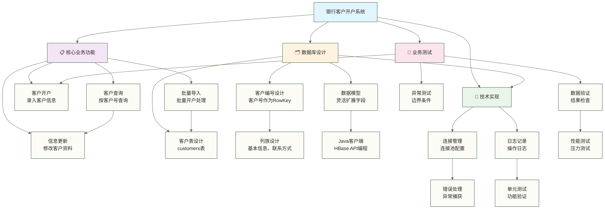

# 🏦 第一个HBase应用 - 银行客户开户系统开发

> [!tip] 💝 给HBase开发新手的温暖指导
> 
> 🤗 **开发第一个HBase应用就像为银行开发第一个客户开户系统！**
> 
> 如果你现在面对HBase编程时想：
> - "从来没有接触过NoSQL编程，不知道从哪里开始？"
> - "这么多API和操作，怎么才能写出正确的代码？"
> - "担心程序出错，怎么调试和验证结果？"
> 
> **别担心！** 每个HBase专家都是从第一行代码开始的 ✨
> 
> 🏦 **想象开发HBase应用就像开发银行客户开户系统**
> 
> 以下为教学假设中的角色引语，并非已核实的银行实践：银行软件开发部主管张主管介绍："开发银行的客户开户系统是我们新员工的第一个项目，通过这个系统练习银行业务数据的处理流程。"
> 
> 银行系统开发的完整流程：
> - 📋 **业务需求分析** = 开户流程设计（明确客户开户业务需求）
> - 🛒 **开发环境准备** = 系统环境搭建（准备银行开发环境和组件）
> - 🏦 **基础业务操作** = 核心功能开发（掌握客户CRUD操作）
> - 💼 **完整业务系统** = 开户系统（实现完整开户业务逻辑）
> - 🔍 **系统测试验证** = 业务测试（功能测试和数据验证）
> 
> **完成本练习可熟悉HBase基础应用开发；实际代码为学生管理示例，不代表已掌握金融级NoSQL开发能力。** 🌟

## 🎯 第一个应用项目规划

### 📊 应用需求设计



### 🎯 应用功能特性

| 功能模块 | 核心操作 | 学习重点 | 难度级别 |
|---|---|---|---|
| **数据插入** | Put操作 | HBase写入机制 | ⭐⭐ |
| **数据查询** | Get/Scan操作 | 查询模式设计 | ⭐⭐ |
| **数据更新** | Put覆盖 | 版本控制理解 | ⭐⭐⭐ |
| **数据删除** | Delete操作 | 删除策略选择 | ⭐⭐ |
| **批量操作** | Batch处理 | 性能优化技巧 | ⭐⭐⭐ |

## 🛠️ 开发环境准备

### 📦 Maven项目创建

```xml
<project xmlns="http://maven.apache.org/POM/4.0.0"
         xmlns:xsi="http://www.w3.org/2001/XMLSchema-instance"
         xsi:schemaLocation="http://maven.apache.org/POM/4.0.0 
         http://maven.apache.org/xsd/maven-4.0.0.xsd">
</project>
```

### 📝 **XML配置说明**
- **project标签**: `<project xmlns="http://maven.apache.org/POM/4.0.0"` - Maven项目根元素，定义项目基本信息
- **命名空间声明**: `xmlns:xsi="http://www.w3.org/2001/XMLSchema-instance"` - XML Schema实例命名空间
- **Schema位置**: `xsi:schemaLocation="http://maven.apache.org/POM/4.0.0"` - 指定Maven POM模式的位置

### ⚙️ 配置文件设置

```xml
<?xml version="1.0"?>
<!-- src/main/resources/hbase-site.xml -->
<configuration>
    <!-- HBase集群配置 -->
    <property>
        <name>hbase.zookeeper.quorum</name>
        <value>master,worker1,worker2</value>
    </property>
    
    <property>
        <name>hbase.zookeeper.property.clientPort</name>
        <value>2181</value>
    </property>
    
    <property>
        <name>hbase.rootdir</name>
        <value>hdfs://master:9000/hbase</value>
    </property>
    
    <property>
        <name>hbase.cluster.distributed</name>
        <value>true</value>
    </property>
    
    <!-- 客户端超时配置 -->
    <property>
        <name>hbase.client.scanner.timeout.period</name>
        <value>60000</value>
    </property>
    
    <property>
        <name>hbase.rpc.timeout</name>
        <value>60000</value>
    </property>
</configuration>
```

```xml
<?xml version="1.0" encoding="UTF-8"?>
<!-- src/main/resources/logback.xml -->
<configuration>

<appender name="CONSOLE" class="ch.qos.logback.core.ConsoleAppender">
<encoder>
<pattern>%d{yyyy-MM-dd HH:mm:ss.SSS} [%thread] %-5level %logger{36} - %msg%n</pattern>
</encoder>
</appender>

<appender name="FILE" class="ch.qos.logback.core.rolling.RollingFileAppender">
<file>logs/hbase-app.log</file>
<rollingPolicy class="ch.qos.logback.core.rolling.TimeBasedRollingPolicy">
<fileNamePattern>logs/hbase-app.%d{yyyy-MM-dd}.log</fileNamePattern>
<maxHistory>30</maxHistory>
</rollingPolicy>
<encoder>
<pattern>%d{yyyy-MM-dd HH:mm:ss.SSS} [%thread] %-5level %logger{36} - %msg%n</pattern>
</encoder>
</appender>

<!-- HBase相关日志级别 -->
<logger name="org.apache.hadoop" level="WARN"/>
<logger name="org.apache.hbase" level="INFO"/>
<logger name="org.apache.zookeeper" level="WARN"/>

<root level="INFO">
<appender-ref="CONSOLE"/>
<appender-ref="FILE"/>
</root>

</configuration>
```

## 🏗️ 数据模型设计

### 📋 学生信息表设计

>
> /**
> ✅ 学生信息表设计
> *
> ✅ 表名: students
> ✅ RowKey: 学号 (student_id)
> *
> ✅ Column Family设计:
> ✅ - basic_info: 基本信息（姓名、性别、年龄、专业等）
> ✅ - contact: 联系方式（电话、邮箱、地址等）
> */

> // 表结构定义
> Table Name: students

> RowKey Design:
> ✅ student_id (例如: 2024001, 2024002...)
> ✅ 优势: 自然排序，查询方便
> ✅ 长度: 7位数字，便于管理

> Column Families:
> 🎯 **第1步**：basic_info:
> ✅ name: 姓名
> ✅ gender: 性别
> ✅ age: 年龄
> ✅ major: 专业
> ✅ class: 班级
> ✅ entrance_year: 入学年份

> 🔍 **第2步**：contact:
> ✅ phone: 手机号
> ✅ email: 邮箱
> ✅ address: 家庭地址
> ✅ emergency_contact: 紧急联系人
> ✅ emergency_phone: 紧急联系电话

### 🎯 RowKey设计考虑

```java
// RowKey设计方案对比

// 方案1: 纯学号 (推荐用于学习)
RowKey = "2024001"
优点: 简单直观，自然排序
缺点: 可能存在热点问题（大规模时）

// 方案2: 反向学号 (实际项目考虑)
RowKey = "1004202" // 反向2024001
优点: 对部分递增学号访问模式可能分散热点，效果取决于键分布和Region划分
缺点: 不直观，需要转换

// 方案3: 散列前缀 (大规模项目)
RowKey = hash(student_id) % 100 + student_id
优点: 可降低热点风险，但需明确散列算法、前缀编码及预分区方案，不能保证完全消除热点
缺点: 失去排序特性

// 本示例采用方案1，专注于功能学习
```

## 💻 核心代码实现

### 🔗 连接管理工具类

```java
package com.example.hbase.util;

import org.apache.hadoop.conf.Configuration;
import org.apache.hadoop.hbase.HBaseConfiguration;
import org.apache.hadoop.hbase.client.Admin;
import org.apache.hadoop.hbase.client.Connection;
import org.apache.hadoop.hbase.client.ConnectionFactory;
import org.slf4j.Logger;
import org.slf4j.LoggerFactory;

import java.io.IOException;

/**
 * HBase连接管理工具类
 * 负责管理HBase连接的创建、获取和关闭
 */
public class HBaseConnectionUtil {
    
    private static final Logger logger = LoggerFactory.getLogger(HBaseConnectionUtil.class);
    
    private static Connection connection;
    private static Configuration configuration;
    
    // 静态初始化块，程序启动时执行
    static {
        try {
            initConnection();
        } catch (IOException e) {
            logger.error("初始化HBase连接失败", e);
            throw new RuntimeException("HBase连接初始化失败", e);
        }
    }
    
    /**
     * 初始化HBase连接
     */
    private static void initConnection() throws IOException {
        logger.info("正在初始化HBase连接...");
        
        // 创建HBase配置对象
        configuration = HBaseConfiguration.create();
        
        // 从hbase-site.xml读取配置，也可以手动设置
        // configuration.set("hbase.zookeeper.quorum", "master,worker1,worker2");
        // configuration.set("hbase.zookeeper.property.clientPort", "2181");
        
        // 创建连接
        connection = ConnectionFactory.createConnection(configuration);
        
        logger.info("HBase连接初始化成功");
    }
    
    /**
     * 获取HBase连接
     */
    public static Connection getConnection() {
        if (connection == null || connection.isClosed()) {
            try {
                initConnection();
            } catch (IOException e) {
                logger.error("重新初始化HBase连接失败", e);
                throw new RuntimeException("HBase连接获取失败", e);
            }
        }
        return connection;
    }
    
    /**
     * 获取Admin对象，用于表管理操作
     */
    public static Admin getAdmin() throws IOException {
        return getConnection().getAdmin();
    }
    
    /**
     * 关闭连接
     */
    public static void closeConnection() {
        if (connection != null && !connection.isClosed()) {
            try {
                connection.close();
                logger.info("HBase连接已关闭");
            } catch (IOException e) {
                logger.error("关闭HBase连接失败", e);
            }
        }
    }
    
    /**
     * 测试连接是否可用
     */
    public static boolean testConnection() {
        try {
            Admin admin = getAdmin();
            admin.listTableNames();
            admin.close();
            logger.info("HBase连接测试成功");
            return true;
        } catch (Exception e) {
            logger.error("HBase连接测试失败", e);
            return false;
        }
    }
}
```

- **连接检查**: `if (connection == null || connection.isClosed())` - 检查连接对象是否为空或已关闭；这不等同于验证集群可达或连接实际可用。

- **Admin admin**: 通过 `getAdmin()` 获取表管理对象；使用结束后必须关闭，异常路径也应确保释放资源。

### 🏠 表管理工具类

```java
package com.example.hbase.util;

import org.apache.hadoop.hbase.HColumnDescriptor;
import org.apache.hadoop.hbase.HTableDescriptor;
import org.apache.hadoop.hbase.TableName;
import org.apache.hadoop.hbase.client.Admin;
import org.apache.hadoop.hbase.io.compress.Compression;
import org.slf4j.Logger;
import org.slf4j.LoggerFactory;

import java.io.IOException;

/**
 * HBase表管理工具类
 * 负责表的创建、删除、检查等操作
 */
public class HBaseTableUtil {
    
    private static final Logger logger = LoggerFactory.getLogger(HBaseTableUtil.class);
    
    /**
     * 创建表
     * 
     * @param tableName 表名
     * @param columnFamilies 列族名称数组
     */
    public static void createTable(String tableName, String[] columnFamilies) throws IOException {
        Admin admin = HBaseConnectionUtil.getAdmin();
        
        try {
            TableName table = TableName.valueOf(tableName);
            
            // 检查表是否已存在
            if (admin.tableExists(table)) {
                logger.warn("表 {} 已存在，跳过创建", tableName);
                return;
            }
            
            // 创建表描述符
            HTableDescriptor tableDescriptor = new HTableDescriptor(table);
            
            // 添加列族
            for (String family : columnFamilies) {
                HColumnDescriptor columnDescriptor = new HColumnDescriptor(family);
                
                // 设置列族属性
                columnDescriptor.setCompressionType(Compression.Algorithm.SNAPPY); // 压缩
                columnDescriptor.setMaxVersions(3); // 最大版本数
                columnDescriptor.setTimeToLive(86400 * 30); // TTL 30天
                
                tableDescriptor.addFamily(columnDescriptor);
            }
            
            // 创建表
            admin.createTable(tableDescriptor);
            logger.info("成功创建表: {}", tableName);
            
        } finally {
            admin.close();
        }
    }
    
    /**
     * 删除表
     */
    public static void deleteTable(String tableName) throws IOException {
        Admin admin = HBaseConnectionUtil.getAdmin();
        
        try {
            TableName table = TableName.valueOf(tableName);
            
            if (!admin.tableExists(table)) {
                logger.warn("表 {} 不存在，跳过删除", tableName);
                return;
            }
            
            // 禁用表
            if (admin.isTableEnabled(table)) {
                admin.disableTable(table);
                logger.info("已禁用表: {}", tableName);
            }
            
            // 删除表
            admin.deleteTable(table);
            logger.info("成功删除表: {}", tableName);
            
        } finally {
            admin.close();
        }
    }
    
    /**
     * 检查表是否存在
     */
    public static boolean tableExists(String tableName) throws IOException {
        Admin admin = HBaseConnectionUtil.getAdmin();
        
        try {
            TableName table = TableName.valueOf(tableName);
            return admin.tableExists(table);
        } finally {
            admin.close();
        }
    }
    
    /**
     * 列出所有表
     */
    public static void listTables() throws IOException {
        Admin admin = HBaseConnectionUtil.getAdmin();
        
        try {
            TableName[] tables = admin.listTableNames();
            logger.info("集群中共有 {} 个表:", tables.length);
            
            for (TableName table : tables) {
                logger.info("- {}", table.getNameAsString());
            }
        } finally {
            admin.close();
        }
    }
}
```

### 👨‍🎓 学生信息实体类

```java
package com.example.hbase.entity;

import java.time.LocalDateTime;

/**
 * 学生信息实体类
 * 对应HBase表中的一行数据
 */
public class Student {
    
    // 基本信息
    private String studentId;    // 学号 (RowKey)
    private String name;         // 姓名
    private String gender;       // 性别
    private Integer age;         // 年龄
    private String major;        // 专业
    private String className;    // 班级
    private String entranceYear; // 入学年份
    
    // 联系信息
    private String phone;           // 手机号
    private String email;           // 邮箱
    private String address;         // 地址
    private String emergencyContact; // 紧急联系人
    private String emergencyPhone;   // 紧急联系电话
    
    // 系统信息
    private LocalDateTime createTime; // 创建时间
    private LocalDateTime updateTime; // 更新时间
    
    // 构造函数
    public Student() {}
    
    public Student(String studentId, String name) {
        this.studentId = studentId;
        this.name = name;
        this.createTime = LocalDateTime.now();
        this.updateTime = LocalDateTime.now();
    }
    
    // Getter和Setter方法
    public String getStudentId() { return studentId; }
    public void setStudentId(String studentId) { this.studentId = studentId; }
    
    public String getName() { return name; }
    public void setName(String name) { this.name = name; }
    
    public String getGender() { return gender; }
    public void setGender(String gender) { this.gender = gender; }
    
    public Integer getAge() { return age; }
    public void setAge(Integer age) { this.age = age; }
    
    public String getMajor() { return major; }
    public void setMajor(String major) { this.major = major; }
    
    public String getClassName() { return className; }
    public void setClassName(String className) { this.className = className; }
    
    public String getEntranceYear() { return entranceYear; }
    public void setEntranceYear(String entranceYear) { this.entranceYear = entranceYear; }
    
    public String getPhone() { return phone; }
    public void setPhone(String phone) { this.phone = phone; }
    
    public String getEmail() { return email; }
    public void setEmail(String email) { this.email = email; }
    
    public String getAddress() { return address; }
    public void setAddress(String address) { this.address = address; }
    
    public String getEmergencyContact() { return emergencyContact; }
    public void setEmergencyContact(String emergencyContact) { this.emergencyContact = emergencyContact; }
    
    public String getEmergencyPhone() { return emergencyPhone; }
    public void setEmergencyPhone(String emergencyPhone) { this.emergencyPhone = emergencyPhone; }
    
    public LocalDateTime getCreateTime() { return createTime; }
    public void setCreateTime(LocalDateTime createTime) { this.createTime = createTime; }
    
    public LocalDateTime getUpdateTime() { return updateTime; }
    public void setUpdateTime(LocalDateTime updateTime) { this.updateTime = updateTime; }
    
    @Override
    public String toString() {
        return String.format(
            "Student{studentId='%s', name='%s', gender='%s', age=%d, major='%s', " +
            "className='%s', phone='%s', email='%s'}",
            studentId, name, gender, age, major, className, phone, email
        );
    }
}
```

### 📚 学生管理数据访问类

```java
package com.example.hbase.dao;

import com.example.hbase.entity.Student;
import com.example.hbase.util.HBaseConnectionUtil;
import org.apache.hadoop.hbase.TableName;
import org.apache.hadoop.hbase.client.*;
import org.apache.hadoop.hbase.util.Bytes;
import org.slf4j.Logger;
import org.slf4j.LoggerFactory;

import java.io.IOException;
import java.time.LocalDateTime;
import java.time.format.DateTimeFormatter;
import java.util.ArrayList;
import java.util.List;

/**
 * 学生信息数据访问类
 * 封装对HBase students表的所有操作
 */
public class StudentDAO {
    
    private static final Logger logger = LoggerFactory.getLogger(StudentDAO.class);
    
    // 表名和列族常量
    public static final String TABLE_NAME = "students";
    public static final String CF_BASIC = "basic_info";
    public static final String CF_CONTACT = "contact";
    
    // 基本信息列
    public static final String COL_NAME = "name";
    public static final String COL_GENDER = "gender";
    public static final String COL_AGE = "age";
    public static final String COL_MAJOR = "major";
    public static final String COL_CLASS = "class";
    public static final String COL_ENTRANCE_YEAR = "entrance_year";
    public static final String COL_CREATE_TIME = "create_time";
    public static final String COL_UPDATE_TIME = "update_time";
    
    // 联系信息列
    public static final String COL_PHONE = "phone";
    public static final String COL_EMAIL = "email";
    public static final String COL_ADDRESS = "address";
    public static final String COL_EMERGENCY_CONTACT = "emergency_contact";
    public static final String COL_EMERGENCY_PHONE = "emergency_phone";
    
    private static final DateTimeFormatter TIME_FORMATTER = 
        DateTimeFormatter.ofPattern("yyyy-MM-dd HH:mm:ss");
    
    /**
     * 添加学生信息
     */
    public void addStudent(Student student) throws IOException {
        if (student == null || student.getStudentId() == null) {
            throw new IllegalArgumentException("学生信息或学号不能为空");
        }
        
        Table table = HBaseConnectionUtil.getConnection().getTable(TableName.valueOf(TABLE_NAME));
        
        try {
            Put put = new Put(Bytes.toBytes(student.getStudentId()));
            
            // 添加基本信息
            addColumnIfNotNull(put, CF_BASIC, COL_NAME, student.getName());
            addColumnIfNotNull(put, CF_BASIC, COL_GENDER, student.getGender());
            addColumnIfNotNull(put, CF_BASIC, COL_AGE, 
                student.getAge() != null ? student.getAge().toString() : null);
            addColumnIfNotNull(put, CF_BASIC, COL_MAJOR, student.getMajor());
            addColumnIfNotNull(put, CF_BASIC, COL_CLASS, student.getClassName());
            addColumnIfNotNull(put, CF_BASIC, COL_ENTRANCE_YEAR, student.getEntranceYear());
            
            // 添加时间戳
            LocalDateTime now = LocalDateTime.now();
            addColumnIfNotNull(put, CF_BASIC, COL_CREATE_TIME, TIME_FORMATTER.format(now));
            addColumnIfNotNull(put, CF_BASIC, COL_UPDATE_TIME, TIME_FORMATTER.format(now));
            
            // 添加联系信息
            addColumnIfNotNull(put, CF_CONTACT, COL_PHONE, student.getPhone());
            addColumnIfNotNull(put, CF_CONTACT, COL_EMAIL, student.getEmail());
            addColumnIfNotNull(put, CF_CONTACT, COL_ADDRESS, student.getAddress());
            addColumnIfNotNull(put, CF_CONTACT, COL_EMERGENCY_CONTACT, student.getEmergencyContact());
            addColumnIfNotNull(put, CF_CONTACT, COL_EMERGENCY_PHONE, student.getEmergencyPhone());
            
            // 执行插入
            table.put(put);
            logger.info("成功添加学生信息: {}", student.getStudentId());
            
        } finally {
            table.close();
        }
    }
    
    /**
     * 根据学号查询学生信息
     */
    public Student getStudent(String studentId) throws IOException {
        if (studentId == null || studentId.trim().isEmpty()) {
            throw new IllegalArgumentException("学号不能为空");
        }
        
        Table table = HBaseConnectionUtil.getConnection().getTable(TableName.valueOf(TABLE_NAME));
        
        try {
            Get get = new Get(Bytes.toBytes(studentId));
            Result result = table.get(get);
            
            if (result.isEmpty()) {
                logger.info("未找到学号为 {} 的学生", studentId);
                return null;
            }
            
            return resultToStudent(result);
            
        } finally {
            table.close();
        }
    }
    
    /**
     * 更新学生信息
     */
    public void updateStudent(Student student) throws IOException {
        if (student == null || student.getStudentId() == null) {
            throw new IllegalArgumentException("学生信息或学号不能为空");
        }
        
        // 检查学生是否存在
        if (getStudent(student.getStudentId()) == null) {
            throw new IllegalArgumentException("学号为 " + student.getStudentId() + " 的学生不存在");
        }
        
        Table table = HBaseConnectionUtil.getConnection().getTable(TableName.valueOf(TABLE_NAME));
        
        try {
            Put put = new Put(Bytes.toBytes(student.getStudentId()));
            
            // 只更新非空字段
            addColumnIfNotNull(put, CF_BASIC, COL_NAME, student.getName());
            addColumnIfNotNull(put, CF_BASIC, COL_GENDER, student.getGender());
            addColumnIfNotNull(put, CF_BASIC, COL_AGE, 
                student.getAge() != null ? student.getAge().toString() : null);
            addColumnIfNotNull(put, CF_BASIC, COL_MAJOR, student.getMajor());
            addColumnIfNotNull(put, CF_BASIC, COL_CLASS, student.getClassName());
            addColumnIfNotNull(put, CF_BASIC, COL_ENTRANCE_YEAR, student.getEntranceYear());
            
            // 更新时间戳
            addColumnIfNotNull(put, CF_BASIC, COL_UPDATE_TIME, 
                TIME_FORMATTER.format(LocalDateTime.now()));
            
            // 更新联系信息
            addColumnIfNotNull(put, CF_CONTACT, COL_PHONE, student.getPhone());
            addColumnIfNotNull(put, CF_CONTACT, COL_EMAIL, student.getEmail());
            addColumnIfNotNull(put, CF_CONTACT, COL_ADDRESS, student.getAddress());
            addColumnIfNotNull(put, CF_CONTACT, COL_EMERGENCY_CONTACT, student.getEmergencyContact());
            addColumnIfNotNull(put, CF_CONTACT, COL_EMERGENCY_PHONE, student.getEmergencyPhone());
            
            table.put(put);
            logger.info("成功更新学生信息: {}", student.getStudentId());
            
        } finally {
            table.close();
        }
    }
    
    /**
     * 删除学生信息
     */
    public void deleteStudent(String studentId) throws IOException {
        if (studentId == null || studentId.trim().isEmpty()) {
            throw new IllegalArgumentException("学号不能为空");
        }
        
        Table table = HBaseConnectionUtil.getConnection().getTable(TableName.valueOf(TABLE_NAME));
        
        try {
            Delete delete = new Delete(Bytes.toBytes(studentId));
            table.delete(delete);
            logger.info("成功删除学生信息: {}", studentId);
            
        } finally {
            table.close();
        }
    }
    
    /**
     * 查询所有学生信息
     */
    public List<Student> getAllStudents() throws IOException {
        return getAllStudents(null, null);
    }
    
    /**
     * 按RowKey范围查询学生信息（起始行包含，结束行不包含）
     * 不限制返回条数，也未实现分页游标
     */
    public List<Student> getAllStudents(String startRow, String endRow) throws IOException {
        Table table = HBaseConnectionUtil.getConnection().getTable(TableName.valueOf(TABLE_NAME));
        List<Student> students = new ArrayList<>();
        
        try {
            Scan scan = new Scan();
            
            // 设置扫描范围
            if (startRow != null) {
                scan.setStartRow(Bytes.toBytes(startRow));
            }
            if (endRow != null) {
                scan.setStopRow(Bytes.toBytes(endRow));
            }
            
            // 设置缓存大小，提升扫描性能
            scan.setCaching(100);
            
            ResultScanner scanner = table.getScanner(scan);
            
            for (Result result : scanner) {
                Student student = resultToStudent(result);
                if (student != null) {
                    students.add(student);
                }
            }
            
            scanner.close();
            logger.info("查询到 {} 个学生信息", students.size());
            
        } finally {
            table.close();
        }
        
        return students;
    }
    
    /**
     * 批量添加学生信息
     */
    public void addStudentsBatch(List<Student> students) throws IOException {
        if (students == null || students.isEmpty()) {
            logger.warn("批量添加的学生列表为空");
            return;
        }
        
        Table table = HBaseConnectionUtil.getConnection().getTable(TableName.valueOf(TABLE_NAME));
        
        try {
            List<Put> puts = new ArrayList<>();
            
            for (Student student : students) {
                if (student.getStudentId() == null) {
                    logger.warn("跳过学号为空的学生: {}", student);
                    continue;
                }
                
                Put put = new Put(Bytes.toBytes(student.getStudentId()));
                
                // 添加基本信息
                addColumnIfNotNull(put, CF_BASIC, COL_NAME, student.getName());
                addColumnIfNotNull(put, CF_BASIC, COL_GENDER, student.getGender());
                addColumnIfNotNull(put, CF_BASIC, COL_AGE, 
                    student.getAge() != null ? student.getAge().toString() : null);
                addColumnIfNotNull(put, CF_BASIC, COL_MAJOR, student.getMajor());
                addColumnIfNotNull(put, CF_BASIC, COL_CLASS, student.getClassName());
                addColumnIfNotNull(put, CF_BASIC, COL_ENTRANCE_YEAR, student.getEntranceYear());
                
                // 添加时间戳
                LocalDateTime now = LocalDateTime.now();
                addColumnIfNotNull(put, CF_BASIC, COL_CREATE_TIME, TIME_FORMATTER.format(now));
                addColumnIfNotNull(put, CF_BASIC, COL_UPDATE_TIME, TIME_FORMATTER.format(now));
                
                // 添加联系信息
                addColumnIfNotNull(put, CF_CONTACT, COL_PHONE, student.getPhone());
                addColumnIfNotNull(put, CF_CONTACT, COL_EMAIL, student.getEmail());
                addColumnIfNotNull(put, CF_CONTACT, COL_ADDRESS, student.getAddress());
                addColumnIfNotNull(put, CF_CONTACT, COL_EMERGENCY_CONTACT, student.getEmergencyContact());
                addColumnIfNotNull(put, CF_CONTACT, COL_EMERGENCY_PHONE, student.getEmergencyPhone());
                
                puts.add(put);
            }
            
            // 批量插入
            table.put(puts);
            logger.info("成功批量添加 {} 个学生信息", puts.size());
            
        } finally {
            table.close();
        }
    }
    
    /**
     * 辅助方法：添加非空列
     */
    private void addColumnIfNotNull(Put put, String family, String qualifier, String value) {
        if (value != null && !value.trim().isEmpty()) {
            put.addColumn(Bytes.toBytes(family), Bytes.toBytes(qualifier), Bytes.toBytes(value));
        }
    }
    
    /**
     * 辅助方法：将Result转换为Student对象
     */
    private Student resultToStudent(Result result) {
        if (result == null || result.isEmpty()) {
            return null;
        }
        
        Student student = new Student();
        
        // 设置学号 (RowKey)
        student.setStudentId(Bytes.toString(result.getRow()));
        
        // 基本信息
        student.setName(getStringValue(result, CF_BASIC, COL_NAME));
        student.setGender(getStringValue(result, CF_BASIC, COL_GENDER));
        
        String ageStr = getStringValue(result, CF_BASIC, COL_AGE);
        if (ageStr != null) {
            try {
                student.setAge(Integer.parseInt(ageStr));
            } catch (NumberFormatException e) {
                logger.warn("年龄格式错误: {}", ageStr);
            }
        }
        
        student.setMajor(getStringValue(result, CF_BASIC, COL_MAJOR));
        student.setClassName(getStringValue(result, CF_BASIC, COL_CLASS));
        student.setEntranceYear(getStringValue(result, CF_BASIC, COL_ENTRANCE_YEAR));
        
        // 时间信息
        String createTimeStr = getStringValue(result, CF_BASIC, COL_CREATE_TIME);
        if (createTimeStr != null) {
            try {
                student.setCreateTime(LocalDateTime.parse(createTimeStr, TIME_FORMATTER));
            } catch (Exception e) {
                logger.warn("创建时间格式错误: {}", createTimeStr);
            }
        }
        
        String updateTimeStr = getStringValue(result, CF_BASIC, COL_UPDATE_TIME);
        if (updateTimeStr != null) {
            try {
                student.setUpdateTime(LocalDateTime.parse(updateTimeStr, TIME_FORMATTER));
            } catch (Exception e) {
                logger.warn("更新时间格式错误: {}", updateTimeStr);
            }
        }
        
        // 联系信息
        student.setPhone(getStringValue(result, CF_CONTACT, COL_PHONE));
        student.setEmail(getStringValue(result, CF_CONTACT, COL_EMAIL));
        student.setAddress(getStringValue(result, CF_CONTACT, COL_ADDRESS));
        student.setEmergencyContact(getStringValue(result, CF_CONTACT, COL_EMERGENCY_CONTACT));
        student.setEmergencyPhone(getStringValue(result, CF_CONTACT, COL_EMERGENCY_PHONE));
        
        return student;
    }
    
    /**
     * 辅助方法：从Result中获取字符串值
     */
    private String getStringValue(Result result, String family, String qualifier) {
        byte[] value = result.getValue(Bytes.toBytes(family), Bytes.toBytes(qualifier));
        return value != null ? Bytes.toString(value) : null;
    }
}
```

## 🧪 测试和验证

### ✅ 依赖HBase测试集群的集成测试类

```java
package com.example.hbase.test;

import com.example.hbase.dao.StudentDAO;
import com.example.hbase.entity.Student;
import com.example.hbase.util.HBaseConnectionUtil;
import com.example.hbase.util.HBaseTableUtil;
import org.junit.After;
import org.junit.Before;
import org.junit.Test;
import org.slf4j.Logger;
import org.slf4j.LoggerFactory;

import java.util.ArrayList;
import java.util.List;

import static org.junit.Assert.*;

/**
 * 学生管理系统测试类
 */
public class StudentManagementTest {
    
    private static final Logger logger = LoggerFactory.getLogger(StudentManagementTest.class);
    
    private StudentDAO studentDAO;
    
    @Before
    public void setUp() throws Exception {
        logger.info("开始测试前准备...");
        
        // 测试连接
        assertTrue("HBase连接测试失败", HBaseConnectionUtil.testConnection());
        
        // 创建表
        String[] columnFamilies = {StudentDAO.CF_BASIC, StudentDAO.CF_CONTACT};
        HBaseTableUtil.createTable(StudentDAO.TABLE_NAME, columnFamilies);
        
        // 初始化DAO
        studentDAO = new StudentDAO();
        
        logger.info("测试前准备完成");
    }
    
    @Test
    public void testAddStudent() throws Exception {
        logger.info("测试添加学生信息...");
        
        // 创建测试学生
        Student student = new Student("2024001", "张三");
        student.setGender("男");
        student.setAge(20);
        student.setMajor("计算机科学与技术");
        student.setClassName("计科2024-1班");
        student.setEntranceYear("2024");
        student.setPhone("13800138001");
        student.setEmail("zhangsan@example.com");
        student.setAddress("北京市海淀区");
        
        // 添加学生
        studentDAO.addStudent(student);
        
        // 验证添加结果
        Student savedStudent = studentDAO.getStudent("2024001");
        assertNotNull("添加的学生信息不应为空", savedStudent);
        assertEquals("学号应该匹配", "2024001", savedStudent.getStudentId());
        assertEquals("姓名应该匹配", "张三", savedStudent.getName());
        assertEquals("性别应该匹配", "男", savedStudent.getGender());
        
        logger.info("添加学生信息测试通过: {}", savedStudent);
    }
    
    @Test
    public void testUpdateStudent() throws Exception {
        logger.info("测试更新学生信息...");
        
        // 先添加一个学生
        Student student = new Student("2024002", "李四");
        student.setAge(19);
        student.setMajor("软件工程");
        studentDAO.addStudent(student);
        
        // 更新学生信息
        Student updateStudent = new Student("2024002", "李四");
        updateStudent.setAge(20); // 更新年龄
        updateStudent.setPhone("13800138002"); // 添加电话
        studentDAO.updateStudent(updateStudent);
        
        // 验证更新结果
        Student updatedStudent = studentDAO.getStudent("2024002");
        assertNotNull("更新后的学生信息不应为空", updatedStudent);
        assertEquals("年龄应该更新为20", Integer.valueOf(20), updatedStudent.getAge());
        assertEquals("电话应该被添加", "13800138002", updatedStudent.getPhone());
        assertEquals("专业应该保持不变", "软件工程", updatedStudent.getMajor());
        
        logger.info("更新学生信息测试通过: {}", updatedStudent);
    }
    
    @Test
    public void testBatchAddStudents() throws Exception {
        logger.info("测试批量添加学生信息...");
        
        // 创建测试学生列表
        List<Student> students = new ArrayList<>();
        
        for (int i = 10; i < 15; i++) {
            Student student = new Student("20240" + i, "学生" + i);
            student.setGender(i % 2 == 0 ? "男" : "女");
            student.setAge(18 + i % 5);
            student.setMajor("专业" + (i % 3 + 1));
            student.setPhone("1380013800" + i);
            students.add(student);
        }
        
        // 批量添加
        studentDAO.addStudentsBatch(students);
        
        // 验证批量添加结果
        List<Student> allStudents = studentDAO.getAllStudents();
        assertTrue("应该有至少5个学生", allStudents.size() >= 5);
        
        // 验证特定学生
        Student student = studentDAO.getStudent("2024010");
        assertNotNull("学号2024010的学生应该存在", student);
        assertEquals("姓名应该匹配", "学生10", student.getName());
        
        logger.info("批量添加学生信息测试通过，共添加 {} 个学生", students.size());
    }
    
    @Test
    public void testGetAllStudents() throws Exception {
        logger.info("测试查询所有学生信息...");
        
        // 先添加几个测试学生
        List<Student> testStudents = new ArrayList<>();
        for (int i = 20; i < 23; i++) {
            Student student = new Student("20240" + i, "测试学生" + i);
            student.setMajor("测试专业");
            testStudents.add(student);
        }
        studentDAO.addStudentsBatch(testStudents);
        
        // 查询所有学生
        List<Student> allStudents = studentDAO.getAllStudents();
        assertNotNull("学生列表不应为空", allStudents);
        assertTrue("应该有学生数据", allStudents.size() > 0);
        
        logger.info("查询所有学生信息测试通过，共查询到 {} 个学生", allStudents.size());
        
        // 打印前几个学生信息
        for (int i = 0; i < Math.min(3, allStudents.size()); i++) {
            logger.info("学生 {}: {}", i + 1, allStudents.get(i));
        }
    }
    
    @Test
    public void testDeleteStudent() throws Exception {
        logger.info("测试删除学生信息...");
        
        // 先添加一个学生
        Student student = new Student("2024999", "待删除学生");
        studentDAO.addStudent(student);
        
        // 验证学生存在
        assertNotNull("学生应该存在", studentDAO.getStudent("2024999"));
        
        // 删除学生
        studentDAO.deleteStudent("2024999");
        
        // 验证删除结果
        assertNull("学生应该被删除", studentDAO.getStudent("2024999"));
        
        logger.info("删除学生信息测试通过");
    }
    
    @After
    public void tearDown() throws Exception {
        logger.info("开始测试后清理...");
        
        // 清理测试数据（可选）
        // HBaseTableUtil.deleteTable(StudentDAO.TABLE_NAME);
        
        logger.info("测试后清理完成");
    }
}
```

### 🎮 主程序演示类

```java
package com.example.hbase;

import com.example.hbase.dao.StudentDAO;
import com.example.hbase.entity.Student;
import com.example.hbase.util.HBaseConnectionUtil;
import com.example.hbase.util.HBaseTableUtil;
import org.slf4j.Logger;
import org.slf4j.LoggerFactory;

import java.util.ArrayList;
import java.util.List;
import java.util.Scanner;

/**
 * 学生信息管理系统主程序
 * 提供交互式命令行界面
 */
public class StudentManagementApp {
    
    private static final Logger logger = LoggerFactory.getLogger(StudentManagementApp.class);
    
    private static StudentDAO studentDAO;
    private static Scanner scanner;
    
    public static void main(String[] args) {
        logger.info("===== HBase学生信息管理系统 =====");
        
        try {
            // 初始化系统
            initSystem();
            
            // 运行主程序
            runMainLoop();
            
        } catch (Exception e) {
            logger.error("系统运行出错", e);
        } finally {
            // 清理资源
            cleanup();
        }
    }
    
    /**
     * 初始化系统
     */
    private static void initSystem() throws Exception {
        logger.info("正在初始化系统...");
        
        // 测试HBase连接
        if (!HBaseConnectionUtil.testConnection()) {
            throw new RuntimeException("HBase连接失败，请检查集群状态");
        }
        
        // 创建表
        String[] columnFamilies = {StudentDAO.CF_BASIC, StudentDAO.CF_CONTACT};
        HBaseTableUtil.createTable(StudentDAO.TABLE_NAME, columnFamilies);
        
        // 初始化DAO和Scanner
        studentDAO = new StudentDAO();
        scanner = new Scanner(System.in);
        
        logger.info("系统初始化完成");
    }
    
    /**
     * 主程序循环
     */
    private static void runMainLoop() {
        while (true) {
            try {
                showMenu();
                String choice = getInput("请选择操作: ");
                
                switch (choice) {
                    case "1":
                        addStudent();
                        break;
                    case "2":
                        queryStudent();
                        break;
                    case "3":
                        updateStudent();
                        break;
                    case "4":
                        deleteStudent();
                        break;
                    case "5":
                        listAllStudents();
                        break;
                    case "6":
                        batchAddStudents();
                        break;
                    case "0":
                        System.out.println("感谢使用，再见！");
                        return;
                    default:
                        System.out.println("无效选择，请重新输入");
                }
                
                System.out.println("\n按回车键继续...");
                scanner.nextLine();
                
            } catch (Exception e) {
                logger.error("操作执行出错", e);
                System.out.println("操作失败: " + e.getMessage());
            }
        }
    }
    
    /**
     * 显示菜单
     */
    private static void showMenu() {
        System.out.println("\n" + "=".repeat(50));
        System.out.println("           HBase学生信息管理系统");
        System.out.println("=".repeat(50));
        System.out.println("1. 添加学生");
        System.out.println("2. 查询学生");
        System.out.println("3. 更新学生");
        System.out.println("4. 删除学生");
        System.out.println("5. 查看所有学生");
        System.out.println("6. 批量添加学生");
        System.out.println("0. 退出系统");
        System.out.println("=".repeat(50));
    }
    
    /**
     * 添加学生
     */
    private static void addStudent() throws Exception {
        System.out.println("\n--- 添加学生信息 ---");
        
        String studentId = getInput("学号: ");
        String name = getInput("姓名: ");
        
        Student student = new Student(studentId, name);
        student.setGender(getInputOptional("性别: "));
        
        String ageStr = getInputOptional("年龄: ");
        if (!ageStr.isEmpty()) {
            try {
                student.setAge(Integer.parseInt(ageStr));
            } catch (NumberFormatException e) {
                System.out.println("年龄格式错误，已跳过");
            }
        }
        
        student.setMajor(getInputOptional("专业: "));
        student.setClassName(getInputOptional("班级: "));
        student.setEntranceYear(getInputOptional("入学年份: "));
        student.setPhone(getInputOptional("手机号: "));
        student.setEmail(getInputOptional("邮箱: "));
        student.setAddress(getInputOptional("地址: "));
        student.setEmergencyContact(getInputOptional("紧急联系人: "));
        student.setEmergencyPhone(getInputOptional("紧急联系电话: "));
        
        studentDAO.addStudent(student);
        System.out.println("学生信息添加成功！");
    }
    
    /**
     * 查询学生
     */
    private static void queryStudent() throws Exception {
        System.out.println("\n--- 查询学生信息 ---");
        
        String studentId = getInput("请输入学号: ");
        Student student = studentDAO.getStudent(studentId);
        
        if (student != null) {
            printStudentInfo(student);
        } else {
            System.out.println("未找到该学生信息");
        }
    }
    
    /**
     * 更新学生
     */
    private static void updateStudent() throws Exception {
        System.out.println("\n--- 更新学生信息 ---");
        
        String studentId = getInput("请输入要更新的学号: ");
        Student existingStudent = studentDAO.getStudent(studentId);
        
        if (existingStudent == null) {
            System.out.println("未找到该学生信息");
            return;
        }
        
        System.out.println("当前学生信息:");
        printStudentInfo(existingStudent);
        
        System.out.println("\n请输入要更新的信息 (留空表示不更新):");
        
        Student updateStudent = new Student(studentId, existingStudent.getName());
        
        String newName = getInputOptional("姓名 [" + existingStudent.getName() + "]: ");
        if (!newName.isEmpty()) updateStudent.setName(newName);
        
        String newGender = getInputOptional("性别 [" + existingStudent.getGender() + "]: ");
        if (!newGender.isEmpty()) updateStudent.setGender(newGender);
        
        String newAgeStr = getInputOptional("年龄 [" + existingStudent.getAge() + "]: ");
        if (!newAgeStr.isEmpty()) {
            try {
                updateStudent.setAge(Integer.parseInt(newAgeStr));
            } catch (NumberFormatException e) {
                System.out.println("年龄格式错误，已跳过");
            }
        }
        
        String newMajor = getInputOptional("专业 [" + existingStudent.getMajor() + "]: ");
        if (!newMajor.isEmpty()) updateStudent.setMajor(newMajor);
        
        String newPhone = getInputOptional("手机号 [" + existingStudent.getPhone() + "]: ");
        if (!newPhone.isEmpty()) updateStudent.setPhone(newPhone);
        
        String newEmail = getInputOptional("邮箱 [" + existingStudent.getEmail() + "]: ");
        if (!newEmail.isEmpty()) updateStudent.setEmail(newEmail);
        
        studentDAO.updateStudent(updateStudent);
        System.out.println("学生信息更新成功！");
    }
    
    /**
     * 删除学生
     */
    private static void deleteStudent() throws Exception {
        System.out.println("\n--- 删除学生信息 ---");
        
        String studentId = getInput("请输入要删除的学号: ");
        Student student = studentDAO.getStudent(studentId);
        
        if (student == null) {
            System.out.println("未找到该学生信息");
            return;
        }
        
        System.out.println("要删除的学生信息:");
        printStudentInfo(student);
        
        String confirm = getInput("确认删除? (y/N): ");
        if ("y".equalsIgnoreCase(confirm) || "yes".equalsIgnoreCase(confirm)) {
            studentDAO.deleteStudent(studentId);
            System.out.println("学生信息删除成功！");
        } else {
            System.out.println("删除操作已取消");
        }
    }
    
    /**
     * 查看所有学生
     */
    private static void listAllStudents() throws Exception {
        System.out.println("\n--- 所有学生信息 ---");
        
        List<Student> students = studentDAO.getAllStudents();
        
        if (students.isEmpty()) {
            System.out.println("暂无学生信息");
            return;
        }
        
        System.out.printf("%-10s %-10s %-5s %-5s %-20s %-15s%n", 
            "学号", "姓名", "性别", "年龄", "专业", "手机号");
        System.out.println("-".repeat(80));
        
        for (Student student : students) {
            System.out.printf("%-10s %-10s %-5s %-5s %-20s %-15s%n",
                student.getStudentId(),
                student.getName(),
                student.getGender() != null ? student.getGender() : "",
                student.getAge() != null ? student.getAge().toString() : "",
                student.getMajor() != null ? student.getMajor() : "",
                student.getPhone() != null ? student.getPhone() : ""
            );
        }
        
        System.out.println("\n共 " + students.size() + " 个学生");
    }
    
    /**
     * 批量添加学生
     */
    private static void batchAddStudents() throws Exception {
        System.out.println("\n--- 批量添加学生 ---");
        
        List<Student> students = new ArrayList<>();
        
        // 创建示例数据
        students.add(createSampleStudent("2024101", "王五", "男", 20, "计算机科学", "13801010101"));
        students.add(createSampleStudent("2024102", "赵六", "女", 19, "软件工程", "13801010102"));
        students.add(createSampleStudent("2024103", "孙七", "男", 21, "信息安全", "13801010103"));
        students.add(createSampleStudent("2024104", "周八", "女", 20, "人工智能", "13801010104"));
        students.add(createSampleStudent("2024105", "吴九", "男", 19, "大数据", "13801010105"));
        
        System.out.println("将添加以下学生:");
        for (Student student : students) {
            System.out.printf("%s - %s (%s, %d岁, %s)%n",
                student.getStudentId(), student.getName(), student.getGender(),
                student.getAge(), student.getMajor());
        }
        
        String confirm = getInput("确认批量添加? (y/N): ");
        if ("y".equalsIgnoreCase(confirm) || "yes".equalsIgnoreCase(confirm)) {
            studentDAO.addStudentsBatch(students);
            System.out.println("批量添加成功！共添加 " + students.size() + " 个学生");
        } else {
            System.out.println("批量添加操作已取消");
        }
    }
    
    /**
     * 创建示例学生
     */
    private static Student createSampleStudent(String id, String name, String gender, 
                                             int age, String major, String phone) {
        Student student = new Student(id, name);
        student.setGender(gender);
        student.setAge(age);
        student.setMajor(major);
        student.setClassName(major + "2024-1班");
        student.setEntranceYear("2024");
        student.setPhone(phone);
        student.setEmail(name.toLowerCase() + "@example.com");
        return student;
    }
    
    /**
     * 打印学生详细信息
     */
    private static void printStudentInfo(Student student) {
        System.out.println("\n学生详细信息:");
        System.out.println("-".repeat(40));
        System.out.println("学号: " + student.getStudentId());
        System.out.println("姓名: " + student.getName());
        System.out.println("性别: " + (student.getGender() != null ? student.getGender() : "未设置"));
        System.out.println("年龄: " + (student.getAge() != null ? student.getAge() + "岁" : "未设置"));
        System.out.println("专业: " + (student.getMajor() != null ? student.getMajor() : "未设置"));
        System.out.println("班级: " + (student.getClassName() != null ? student.getClassName() : "未设置"));
        System.out.println("入学年份: " + (student.getEntranceYear() != null ? student.getEntranceYear() : "未设置"));
        System.out.println("手机号: " + (student.getPhone() != null ? student.getPhone() : "未设置"));
        System.out.println("邮箱: " + (student.getEmail() != null ? student.getEmail() : "未设置"));
        System.out.println("地址: " + (student.getAddress() != null ? student.getAddress() : "未设置"));
        if (student.getCreateTime() != null) {
            System.out.println("创建时间: " + student.getCreateTime());
        }
        if (student.getUpdateTime() != null) {
            System.out.println("更新时间: " + student.getUpdateTime());
        }
        System.out.println("-".repeat(40));
    }
    
    /**
     * 获取用户输入
     */
    private static String getInput(String prompt) {
        System.out.print(prompt);
        return scanner.nextLine().trim();
    }
    
    /**
     * 获取可选用户输入
     */
    private static String getInputOptional(String prompt) {
        System.out.print(prompt);
        String input = scanner.nextLine().trim();
        return input.isEmpty() ? "" : input;
    }
    
    /**
     * 清理资源
     */
    private static void cleanup() {
        if (scanner != null) {
            scanner.close();
        }
        HBaseConnectionUtil.closeConnection();
        logger.info("系统清理完成");
    }
}
```

## 🚀 运行和测试

### 📋 运行前检查清单

```bash
# 1. 确认HBase集群正常运行
jps | grep -E "(HMaster|HRegionServer)"

# 2. 测试HBase连接
echo "list" | hbase shell

# 3. 编译项目
mvn clean compile

# 4. 运行测试
mvn test

# 5. 打包应用
mvn package
```

### 🎮 运行主程序

```bash
# 方式1: 使用Maven运行
mvn exec:java -Dexec.mainClass="com.example.hbase.StudentManagementApp"

# 方式2: 使用java命令运行
java -cp target/classes:target/lib/* com.example.hbase.StudentManagementApp

# 方式3: 在IDE中直接运行
# 在IntelliJ IDEA或Eclipse中直接运行StudentManagementApp类
```

### 📊 应用演示效果

```text
===================================================
           HBase学生信息管理系统
===================================================
1. 添加学生
2. 查询学生
3. 更新学生
4. 删除学生
5. 查看所有学生
6. 批量添加学生
0. 退出系统
===================================================
请选择操作: 1

--- 添加学生信息 ---
学号: 2024001
姓名: 张三
性别: 男
年龄: 20
专业: 计算机科学与技术
班级: 计科2024-1班
入学年份: 2024
手机号: 13800138001
邮箱: zhangsan@example.com
地址: 北京市海淀区
紧急联系人: 张父
紧急联系电话: 13900139001
学生信息添加成功！
```

## 🎉 应用开发成功总结

> [!success] 🌟 **补齐构建配置并实际通过测试后，你就完成了第一个HBase练习应用！**
> 
> **你完成的核心功能**：
> - ✅ **连接管理**：演示了共享HBase Connection及资源管理，未实现连接池；并发和异常路径仍需完善
> - ✅ **表操作**：掌握了表的创建、删除、检查等管理操作
> - ✅ **数据模型**：设计了完整的学生信息数据模型
> - ✅ **CRUD操作**：实现了增删改查的完整功能
> - ✅ **批量处理**：掌握了批量操作提升性能的技巧
> - ✅ **异常处理**：演示了基础异常捕获和日志记录，异常路径资源释放及并发错误处理仍需完善
> - ✅ **用户界面**：创建了友好的交互式命令行界面
> 
> **本练习为独立开发HBase应用提供起点；仍需通过实际构建、测试与边界问题处理检验掌握程度。** 🚀

### 🎯 技能收获总结

> [!tip] 💡 **通过这个项目，你掌握了**
> 
> **编程技能**：
> - 🔗 **HBase API**：熟练使用HBase Java客户端API
> - 🏗️ **项目架构**：理解分层架构设计原则
> - 🧪 **单元测试**：掌握JUnit测试框架使用
> - 📝 **代码规范**：学会编写清晰可维护的代码
> 
> **NoSQL思维**：
> - 🗂️ **数据建模**：从关系型思维转向NoSQL思维
> - ⚡ **性能优化**：理解批量操作和连接管理重要性
> - 🔧 **异常处理**：掌握分布式环境下的错误处理
> - 📊 **监控调试**：学会使用日志进行问题排查

### 🚀 应用扩展建议

**立即可以尝试的改进**：
- [ ] 添加数据验证功能（手机号格式、邮箱格式验证）
- [ ] 实现按专业、班级的条件查询功能
- [ ] 添加数据导入导出功能（CSV格式）
- [ ] 实现简单的统计功能（按专业统计人数）

**进阶功能开发**：
- [ ] 添加Web界面（Spring Boot + Thymeleaf）
- [ ] 集成权限管理和用户认证
- [ ] 实现数据备份和恢复功能
- [ ] 添加性能监控和指标收集

### 🎯 下一步学习路径

**继续HBase学习**：
- [ ] 学习 [[【技术与工具】/HBase/06-HBase Shell操作|HBase Shell操作]] - 掌握命令行管理技能
- [ ] 学习 [[【技术与工具】/HBase/07-Java API编程|Java API编程]] - 深入API高级特性

**扩展技术栈**：
- [ ] 学习Spring Boot集成HBase
- [ ] 了解HBase与大数据生态的集成
- [ ] 学习HBase性能调优技巧

> [!quote] 💭 **第一个应用的意义**
> 
> **完成第一个HBase应用是技术成长的重要里程碑**：
> - 🎯 **实战经验**：从理论学习转向实际开发
> - 💪 **信心建立**：证明自己有能力掌握新技术
> - 🚀 **技能基础**：为后续高级应用开发打下基础
> - 🌱 **成长起点**：开启NoSQL和大数据技术学习之旅
> 
> **每个技术专家都是从第一行代码开始的，继续保持学习热情！** ✨

---

**创建时间**：2024-12-11  
**温度指数**：⭐⭐⭐⭐⭐ (完整实战，成就感满满)  
**预计学习时长**：90分钟  
**项目代码行数**：约1000行  
**下一步学习**：[[【技术与工具】/HBase/06-HBase Shell操作|HBase Shell操作]] → [[【技术与工具】/HBase/07-Java API编程|Java API编程]]

#HBase #NoSQL #Java开发 #数据管理系统 #CRUD操作 #项目实战
