# HBase Java API编程

HBase Java API 是与 HBase 交互的原生方式，提供丰富的客户端功能；实际性能取决于版本、访问模式、配置和集群负载。本文档涵盖从连接管理到高级操作的完整 API 使用指南，学习路径建议按以下顺序推进：

1. **连接管理**：`ConnectionFactory`、`Connection` 的生命周期与连接池配置
2. **基础 CRUD**：`Put`、`Get`、`Delete`、`Scan` 四类核心操作
3. **批量操作**：`BufferedMutator` 与批量 Get 的性能优化
4. **过滤器**：`Filter` 体系实现服务端数据过滤，减少网络传输
5. **异步 API**：`AsyncConnection` 与 `CompletableFuture` 实现非阻塞操作

## 🎯 Java API体系架构

### 📊 API类体系结构

```mermaid
%%{init: {"theme":"base","themeVariables":{"fontFamily":"PingFang SC, -apple-system, Source Han Serif SC, serif","fontSize":"16px","background":"#FDFBF5","primaryColor":"#FDFBF5","primaryTextColor":"#2D2A26","primaryBorderColor":"#6E6A60","secondaryColor":"#E8EFE8","secondaryBorderColor":"#8FA890","secondaryTextColor":"#2D2A26","tertiaryColor":"#FDFBF5","tertiaryBorderColor":"#9A9488","tertiaryTextColor":"#6E6A60","lineColor":"#6E6A60","textColor":"#2D2A26","mainBkg":"#FDFBF5","nodeBorder":"#2D5A3D","clusterBkg":"#F3EEDF","clusterBorder":"#9A9488","edgeLabelBackground":"#FDFBF5"},"flowchart":{"htmlLabels":true,"curve":"basis","padding":20,"nodeSpacing":60,"rankSpacing":70,"useMaxWidth":false},"themeCSS":".node rect, .node polygon, .node circle { stroke-width: 1.5px; } .edgePath .path { stroke-width: 1.5px; } .cluster-label .nodeLabel, .cluster-label foreignObject { color: #2D2A26 !important; } .edgeLabel, .edgeLabel foreignObject { color: #2D2A26 !important; background-color: #FDFBF5; } .edgeLabel rect { fill: #FDFBF5; }"}}%%
flowchart TD
    A[HBase Java API架构]
    A --> B[🔗 连接层]
    A --> C[🏛️ 管理层]
    A --> D[📊 数据层]
    A --> E[⚡ 异步层]
    A --> F[🔧 工具层]
    B --> B1[ConnectionFactory<br/>连接工厂]
    B --> B2[Connection<br/>连接管理]
    B --> B3[ConnectionConfiguration<br/>连接配置]
    C --> C1[Admin<br/>集群管理]
    C --> C2[TableDescriptor<br/>表描述]
    C --> C3[ColumnFamilyDescriptor<br/>列族描述]
    D --> D1[Table<br/>表操作接口]
    D --> D2[Put/Get/Delete<br/>数据操作]
    D --> D3[Scan/Result<br/>扫描结果]
    D --> D4[Filter<br/>过滤器]
    E --> E1[AsyncConnection<br/>异步连接]
    E --> E2[AsyncTable<br/>异步表操作]
    E --> E3[CompletableFuture<br/>异步结果]
    F --> F1[Bytes<br/>字节转换工具]
    F --> F2[TableName<br/>表名工具]
    F --> F3[CellUtil<br/>单元格工具]
    F --> F4[Durability<br/>持久性控制]
    style A fill:#e1f5fe
    style B fill:#f3e5f5
    style C fill:#fff3e0
    style D fill:#e8f5e8
    style E fill:#fce4ec
    style F fill:#f9fbe7
```



### 🎯 API学习优先级

| API层级 | 重要程度 | 学习难度 | 应用场景 | 掌握要求 |
|---|---|---|---|---|
| **连接管理** | ⭐⭐⭐⭐⭐ | ⭐⭐ | 所有应用 | 必须掌握 |
| **基础CRUD** | ⭐⭐⭐⭐⭐ | ⭐⭐ | 日常开发 | 熟练运用 |
| **批量操作** | ⭐⭐⭐⭐ | ⭐⭐⭐ | 性能优化 | 深入理解 |
| **过滤器** | ⭐⭐⭐⭐ | ⭐⭐⭐ | 复杂查询 | 灵活应用 |
| **异步API** | ⭐⭐⭐ | ⭐⭐⭐⭐ | 高并发 | 进阶掌握 |
| **表管理** | ⭐⭐⭐ | ⭐⭐ | 运维开发 | 理解原理 |

## 🔗 连接管理核心技术

### 🏗️ 连接工厂与配置

HBase 的连接管理需要关注四个核心方面：客户端执行线程池与并发任务限制、超时参数（rpc/operation/scanner）、重试策略（次数与退避间隔）、以及写入缓冲配置；这些参数的含义和生效范围需按客户端版本核对。`Connection` 对象是线程安全的，应在应用生命周期内以单例方式持有，而 `Table` 对象不是线程安全的，需要每次操作后关闭。

以下是采用双重检查锁单例模式的连接管理器示例，尚未完成生产可用性验证，资源清理和并发生命周期仍需完善：

```java
package com.example.hbase.connection;

import org.apache.hadoop.conf.Configuration;
import org.apache.hadoop.hbase.HBaseConfiguration;
import org.apache.hadoop.hbase.client.Connection;
import org.apache.hadoop.hbase.client.ConnectionFactory;
import org.slf4j.Logger;
import org.slf4j.LoggerFactory;

import java.io.IOException;
import java.util.concurrent.ExecutorService;
import java.util.concurrent.Executors;
import java.util.concurrent.TimeUnit;

/**
 * HBase连接管理器
 * 提供连接池管理和配置优化
 */
public class HBaseConnectionManager {
    
    private static final Logger logger = LoggerFactory.getLogger(HBaseConnectionManager.class);
    
    private static volatile HBaseConnectionManager instance;
    private Connection connection;
    private Configuration configuration;
    private ExecutorService executorService;
    
    private HBaseConnectionManager() {
        initializeConnection();
    }
    
    /**
     * 获取单例实例
     */
    public static HBaseConnectionManager getInstance() {
        if (instance == null) {
            synchronized (HBaseConnectionManager.class) {
                if (instance == null) {
                    instance = new HBaseConnectionManager();
                }
            }
        }
        return instance;
    }
    
    /**
     * 初始化连接
     */
    private void initializeConnection() {
        try {
            logger.info("初始化HBase连接...");
            
            // 创建配置对象
            configuration = HBaseConfiguration.create();
            
            // 基础连接配置
            configuration.set("hbase.zookeeper.quorum", "master,worker1,worker2");
            configuration.set("hbase.zookeeper.property.clientPort", "2181");
            configuration.set("hbase.rootdir", "hdfs://master:9000/hbase");
            
            // 连接池配置
            configuration.setInt("hbase.client.connection.pool.size", 10);
            configuration.setInt("hbase.client.max.total.tasks", 100);
            configuration.setInt("hbase.client.max.perserver.tasks", 20);
            configuration.setInt("hbase.client.max.perregion.tasks", 10);
            
            // 超时配置
            configuration.setInt("hbase.rpc.timeout", 60000);  // 60秒
            configuration.setInt("hbase.client.operation.timeout", 120000);  // 2分钟
            configuration.setInt("hbase.client.scanner.timeout.period", 180000);  // 3分钟
            
            // 重试配置
            configuration.setInt("hbase.client.retries.number", 3);
            configuration.setInt("hbase.client.pause", 1000);
            
            // 缓存配置
            configuration.setInt("hbase.client.write.buffer", 2097152);  // 2MB
            configuration.setBoolean("hbase.client.autoflush.clear", true);
            
            // 创建线程池
            executorService = Executors.newFixedThreadPool(
                configuration.getInt("hbase.client.connection.pool.size", 10)
            );
            
            // 创建连接
            connection = ConnectionFactory.createConnection(configuration, executorService);
            
            logger.info("HBase连接初始化成功");
            
        } catch (IOException e) {
            logger.error("HBase连接初始化失败", e);
            throw new RuntimeException("无法建立HBase连接", e);
        }
    }
    
    /**
     * 获取连接
     */
    public Connection getConnection() {
        if (connection == null || connection.isClosed()) {
            synchronized (this) {
                if (connection == null || connection.isClosed()) {
                    initializeConnection();
                }
            }
        }
        return connection;
    }
    
    /**
     * 获取配置
     */
    public Configuration getConfiguration() {
        return configuration;
    }
    
    /**
     * 关闭连接
     */
    public void closeConnection() {
        if (connection != null && !connection.isClosed()) {
            try {
                connection.close();
                logger.info("HBase连接已关闭");
            } catch (IOException e) {
                logger.error("关闭HBase连接失败", e);
            }
        }
        
        if (executorService != null && !executorService.isShutdown()) {
            executorService.shutdown();
            try {
                if (!executorService.awaitTermination(10, TimeUnit.SECONDS)) {
                    executorService.shutdownNow();
                }
            } catch (InterruptedException e) {
                executorService.shutdownNow();
                Thread.currentThread().interrupt();
            }
        }
    }
    
    /**
     * 测试连接可用性
     */
    public boolean testConnection() {
        try {
            connection.getAdmin().listTableNames();
            return true;
        } catch (Exception e) {
            logger.error("连接测试失败", e);
            return false;
        }
    }
}
```

### 📝 关键配置参数说明

**连接池配置**：
- `hbase.client.connection.pool.size=10`：本示例将此键读取为自建 ExecutorService 的线程数，不应将其解释为已核实的 HBase 标准 RPC 连接池容量参数；仅设置该键不代表客户端连接池会相应变化
- `hbase.client.max.total.tasks=100`：客户端全局最大并发任务数
- `hbase.client.max.perserver.tasks=20`：单个 RegionServer 最大并发任务数，防止单点压力过大

**三层超时配置**（从小到大）：
- `hbase.rpc.timeout=60000`：单次 RPC 调用的超时时间（60秒）
- `hbase.client.operation.timeout=120000`：单个操作（含重试）的总超时时间（2分钟）
- `hbase.client.scanner.timeout.period=180000`：Scanner 保持活跃的超时时间（3分钟）

**重试策略**：
- `hbase.client.retries.number=3`：最大重试次数，生产环境建议 3-5 次
- `hbase.client.pause=1000`：重试退避基础间隔（毫秒），实际等待间隔取决于客户端版本的退避规则及具体错误处理路径

**写入缓冲**：
- `hbase.client.write.buffer=2097152`：2MB 写缓冲，配合 `BufferedMutator` 使用可显著提升批量写吞吐

### 📋 连接管理器核心设计要点

- **单例持有**：`Connection` 创建成本高（需要连接 ZooKeeper 和 RegionServer），应用内单例持有
- **Table 即用即关**：通过 try-with-resources 确保每次操作后 `Table` 对象被关闭
- **优雅关闭**：线程池需要 `awaitTermination` 等待任务完成，避免强制中断导致数据丢失

### 🎛️ 场景化连接配置

不同应用场景对连接参数的要求差异显著：高吞吐写入场景需要更大的连接池和写缓冲；可靠性优先的批处理场景需要更长的超时和更多重试次数；开发调试环境则应使用轻量配置并开启详细日志。以下是三种典型场景的配置实现：

```java
/**
 * 高级连接配置类
 * 提供更详细的连接参数配置
 */
public class AdvancedConnectionConfig {
    
    /**
     * 创建高性能连接配置
     */
    public static Configuration createHighPerformanceConfig() {
        Configuration config = HBaseConfiguration.create();
        
        // 基础连接配置
        config.set("hbase.zookeeper.quorum", "master,worker1,worker2");
        config.set("hbase.zookeeper.property.clientPort", "2181");
        config.set("hbase.rootdir", "hdfs://master:9000/hbase");
        
        // 高性能配置
        config.setInt("hbase.client.connection.pool.size", 20);
        config.setInt("hbase.client.max.total.tasks", 200);
        config.setInt("hbase.client.max.perserver.tasks", 50);
        config.setInt("hbase.client.max.perregion.tasks", 20);
        
        // 网络配置
        config.setInt("hbase.ipc.client.connect.max.retries", 3);
        config.setInt("hbase.ipc.client.connection.maxidletime", 900000); // 15分钟
        config.setBoolean("hbase.ipc.client.tcpnodelay", true);
        config.setBoolean("hbase.ipc.client.tcpkeepalive", true);
        
        // 写入缓冲配置
        config.setLong("hbase.client.write.buffer", 8388608);  // 8MB
        config.setBoolean("hbase.client.autoflush.clear", false);
        
        // 扫描配置
        config.setInt("hbase.client.scanner.caching", 1000);
        config.setInt("hbase.client.scanner.max.result.size", 10485760); // 10MB
        
        return config;
    }
    
    /**
     * 创建可靠性优先配置
     */
    public static Configuration createReliabilityConfig() {
        Configuration config = HBaseConfiguration.create();
        
        // 基础连接配置
        config.set("hbase.zookeeper.quorum", "master,worker1,worker2");
        config.set("hbase.zookeeper.property.clientPort", "2181");
        
        // 可靠性配置
        config.setInt("hbase.client.retries.number", 10);
        config.setLong("hbase.client.pause", 2000);
        config.setInt("hbase.rpc.timeout", 180000);  // 3分钟
        config.setInt("hbase.client.operation.timeout", 600000);  // 10分钟
        
        // 故障恢复配置
        config.setBoolean("hbase.client.primaryCallTimeout.multiget", true);
        config.setInt("hbase.client.primaryCallTimeout.get", 10000);
        config.setInt("hbase.client.primaryCallTimeout.multiget", 10000);
        
        return config;
    }
    
    /**
     * 创建开发测试配置
     */
    public static Configuration createDevelopmentConfig() {
        Configuration config = HBaseConfiguration.create();
        
        // 基础配置
        config.set("hbase.zookeeper.quorum", "localhost");
        config.set("hbase.zookeeper.property.clientPort", "2181");
        
        // 开发优化配置
        config.setInt("hbase.client.connection.pool.size", 5);
        config.setInt("hbase.client.retries.number", 3);
        config.setInt("hbase.rpc.timeout", 30000);
        config.setInt("hbase.client.operation.timeout", 60000);
        
        // 调试配置
        config.setBoolean("hbase.client.log.scanner.activity", true);
        
        return config;
    }
}
```

## 📊 数据操作API详解

### ✍️ 高级Put操作

`Put` 是 HBase 最基础的写入操作，支持多种变体以满足不同场景需求：

- **基础Put**：写入单条数据到指定行、列族、列限定符
- **带时间戳Put**：指定版本时间戳，用于数据回溯或历史数据导入
- **多列Put**：一次 Put 写入同一行的多个列，减少 RPC 次数
- **批量Put**：`table.put(List<Put>)` 或 `BufferedMutator` 批量提交，大幅提升写吞吐
- **条件Put（Check and Put）**：`checkAndMutate` 实现 CAS 语义，保证原子条件写
- **带TTL的Put**：`put.setTTL()` 设置单元格存活时间（毫秒）；过期数据通常不再返回，但物理清理并非到期立即发生，还需考虑列族 TTL 与版本保留设置

```java
package com.example.hbase.operations;

import org.apache.hadoop.hbase.TableName;
import org.apache.hadoop.hbase.client.*;
import org.apache.hadoop.hbase.util.Bytes;
import org.slf4j.Logger;
import org.slf4j.LoggerFactory;

import java.io.IOException;
import java.util.ArrayList;
import java.util.List;
import java.util.concurrent.TimeUnit;

/**
 * 高级Put操作实现
 * 包含各种写入模式和优化技巧
 */
public class AdvancedPutOperations {
    
    private static final Logger logger = LoggerFactory.getLogger(AdvancedPutOperations.class);
    private final Connection connection;
    
    public AdvancedPutOperations(Connection connection) {
        this.connection = connection;
    }
    
    /**
     * 基础Put操作
     */
    public void basicPut(String tableName, String rowKey, String family, 
                        String qualifier, String value) throws IOException {
        
        try (Table table = connection.getTable(TableName.valueOf(tableName))) {
            Put put = new Put(Bytes.toBytes(rowKey));
            put.addColumn(Bytes.toBytes(family), Bytes.toBytes(qualifier), 
                         Bytes.toBytes(value));
            
            table.put(put);
            logger.debug("Put操作完成: {}", rowKey);
        }
    }
    
    /**
     * 带时间戳的Put操作
     */
    public void putWithTimestamp(String tableName, String rowKey, String family,
                               String qualifier, String value, long timestamp) throws IOException {
        
        try (Table table = connection.getTable(TableName.valueOf(tableName))) {
            Put put = new Put(Bytes.toBytes(rowKey));
            put.addColumn(Bytes.toBytes(family), Bytes.toBytes(qualifier), 
                         timestamp, Bytes.toBytes(value));
            
            table.put(put);
            logger.debug("带时间戳Put操作完成: {} at {}", rowKey, timestamp);
        }
    }
    
    /**
     * 多列Put操作
     */
    public void multiColumnPut(String tableName, String rowKey, 
                              List<ColumnValue> columns) throws IOException {
        
        try (Table table = connection.getTable(TableName.valueOf(tableName))) {
            Put put = new Put(Bytes.toBytes(rowKey));
            
            for (ColumnValue column : columns) {
                put.addColumn(
                    Bytes.toBytes(column.getFamily()),
                    Bytes.toBytes(column.getQualifier()),
                    Bytes.toBytes(column.getValue())
                );
            }
            
            table.put(put);
            logger.debug("多列Put操作完成: {}, 共{}列", rowKey, columns.size());
        }
    }
    
    /**
     * 批量Put操作
     */
    public void batchPut(String tableName, List<RowData> rows) throws IOException {
        try (Table table = connection.getTable(TableName.valueOf(tableName))) {
            List<Put> puts = new ArrayList<>();
            
            for (RowData row : rows) {
                Put put = new Put(Bytes.toBytes(row.getRowKey()));
                
                for (ColumnValue column : row.getColumns()) {
                    put.addColumn(
                        Bytes.toBytes(column.getFamily()),
                        Bytes.toBytes(column.getQualifier()),
                        Bytes.toBytes(column.getValue())
                    );
                }
                
                puts.add(put);
            }
            
            // 批量提交
            table.put(puts);
            logger.info("批量Put操作完成: {}行", rows.size());
        }
    }
    
    /**
     * 条件Put操作 (Check and Put)
     */
    public boolean conditionalPut(String tableName, String rowKey, 
                                String checkFamily, String checkQualifier, String checkValue,
                                String putFamily, String putQualifier, String putValue) throws IOException {
        
        try (Table table = connection.getTable(TableName.valueOf(tableName))) {
            Put put = new Put(Bytes.toBytes(rowKey));
            put.addColumn(Bytes.toBytes(putFamily), Bytes.toBytes(putQualifier), 
                         Bytes.toBytes(putValue));
            
            boolean success = table.checkAndMutate(Bytes.toBytes(rowKey), Bytes.toBytes(checkFamily))
                .qualifier(Bytes.toBytes(checkQualifier))
                .ifEquals(Bytes.toBytes(checkValue))
                .thenPut(put);
            
            logger.debug("条件Put操作: {}, 结果: {}", rowKey, success);
            return success;
        }
    }
    
    /**
     * 带TTL的Put操作
     */
    public void putWithTTL(String tableName, String rowKey, String family,
                          String qualifier, String value, long ttlSeconds) throws IOException {
        
        try (Table table = connection.getTable(TableName.valueOf(tableName))) {
            Put put = new Put(Bytes.toBytes(rowKey));
            put.addColumn(Bytes.toBytes(family), Bytes.toBytes(qualifier), 
                         Bytes.toBytes(value));
            
            // 设置TTL
            put.setTTL(ttlSeconds * 1000);  // TTL以毫秒为单位
            
            table.put(put);
            logger.debug("带TTL Put操作完成: {}, TTL: {}秒", rowKey, ttlSeconds);
        }
    }
    
    /**
     * 原子递增操作
     */
    public long incrementColumn(String tableName, String rowKey, String family,
                              String qualifier, long amount) throws IOException {
        
        try (Table table = connection.getTable(TableName.valueOf(tableName))) {
            long result = table.incrementColumnValue(
                Bytes.toBytes(rowKey),
                Bytes.toBytes(family),
                Bytes.toBytes(qualifier),
                amount
            );
            
            logger.debug("递增操作完成: {}, 结果: {}", rowKey, result);
            return result;
        }
    }
    
    /**
     * 高性能批量Put（带缓冲）
     */
    public void bufferedBatchPut(String tableName, List<RowData> rows, 
                               int batchSize) throws IOException {
        
        try (Table table = connection.getTable(TableName.valueOf(tableName));
             BufferedMutator mutator = connection.getBufferedMutator(TableName.valueOf(tableName))) {
            
            List<Put> batch = new ArrayList<>();
            int processedRows = 0;
            
            for (RowData row : rows) {
                Put put = new Put(Bytes.toBytes(row.getRowKey()));
                
                for (ColumnValue column : row.getColumns()) {
                    put.addColumn(
                        Bytes.toBytes(column.getFamily()),
                        Bytes.toBytes(column.getQualifier()),
                        Bytes.toBytes(column.getValue())
                    );
                }
                
                batch.add(put);
                
                // 达到批次大小时提交
                if (batch.size() >= batchSize) {
                    mutator.mutate(batch);
                    processedRows += batch.size();
                    batch.clear();
                    
                    logger.debug("已处理{}行数据", processedRows);
                }
            }
            
            // 提交剩余数据
            if (!batch.isEmpty()) {
                mutator.mutate(batch);
                processedRows += batch.size();
            }
            
            mutator.flush();
            logger.info("缓冲批量Put操作完成: 总共{}行", processedRows);
        }
    }
    
    // 辅助类定义
    public static class RowData {
        private String rowKey;
        private List<ColumnValue> columns;
        
        public RowData(String rowKey, List<ColumnValue> columns) {
            this.rowKey = rowKey;
            this.columns = columns;
        }
        
        // Getter methods
        public String getRowKey() { return rowKey; }
        public List<ColumnValue> getColumns() { return columns; }
    }
    
    public static class ColumnValue {
        private String family;
        private String qualifier;
        private String value;
        
        public ColumnValue(String family, String qualifier, String value) {
            this.family = family;
            this.qualifier = qualifier;
            this.value = value;
        }
        
        // Getter methods
        public String getFamily() { return family; }
        public String getQualifier() { return qualifier; }
        public String getValue() { return value; }
    }
}
```

### 🔍 高级Get操作

`Get` 基于行键进行精确查询，支持以下变体：

- **全行查询**：`new Get(rowKey)` 获取该行所有列族的最新版本数据
- **列族过滤**：`get.addFamily()` 只返回指定列族，减少网络传输
- **单列查询**：`get.addColumn()` 精确获取某一列，适合字段级别读取
- **多版本查询**：`get.readVersions(n)` 获取最近 n 个版本，用于数据审计
- **时间范围查询**：`get.setTimeRange(start, end)` 获取指定时间段内的版本
- **批量Get**：`table.get(List<Get>)` 批量获取多行，客户端可能按 Region 和服务器拆分为多个 RPC；延迟收益取决于数据分布与负载

```java
package com.example.hbase.operations;

import org.apache.hadoop.hbase.Cell;
import org.apache.hadoop.hbase.CellUtil;
import org.apache.hadoop.hbase.TableName;
import org.apache.hadoop.hbase.client.*;
import org.apache.hadoop.hbase.util.Bytes;
import org.slf4j.Logger;
import org.slf4j.LoggerFactory;

import java.io.IOException;
import java.util.ArrayList;
import java.util.HashMap;
import java.util.List;
import java.util.Map;

/**
 * 高级Get操作实现
 * 包含各种查询模式和优化技巧
 */
public class AdvancedGetOperations {
    
    private static final Logger logger = LoggerFactory.getLogger(AdvancedGetOperations.class);
    private final Connection connection;
    
    public AdvancedGetOperations(Connection connection) {
        this.connection = connection;
    }
    
    /**
     * 基础Get操作
     */
    public Map<String, String> basicGet(String tableName, String rowKey) throws IOException {
        try (Table table = connection.getTable(TableName.valueOf(tableName))) {
            Get get = new Get(Bytes.toBytes(rowKey));
            Result result = table.get(get);
            
            return resultToMap(result);
        }
    }
    
    /**
     * 获取指定列族
     */
    public Map<String, String> getColumnFamily(String tableName, String rowKey, 
                                             String family) throws IOException {
        try (Table table = connection.getTable(TableName.valueOf(tableName))) {
            Get get = new Get(Bytes.toBytes(rowKey));
            get.addFamily(Bytes.toBytes(family));
            
            Result result = table.get(get);
            return resultToMap(result);
        }
    }
    
    /**
     * 获取指定列
     */
    public String getColumn(String tableName, String rowKey, 
                          String family, String qualifier) throws IOException {
        try (Table table = connection.getTable(TableName.valueOf(tableName))) {
            Get get = new Get(Bytes.toBytes(rowKey));
            get.addColumn(Bytes.toBytes(family), Bytes.toBytes(qualifier));
            
            Result result = table.get(get);
            byte[] value = result.getValue(Bytes.toBytes(family), Bytes.toBytes(qualifier));
            
            return value != null ? Bytes.toString(value) : null;
        }
    }
    
    /**
     * 获取多个版本
     */
    public List<VersionedValue> getVersions(String tableName, String rowKey,
                                          String family, String qualifier, int maxVersions) throws IOException {
        try (Table table = connection.getTable(TableName.valueOf(tableName))) {
            Get get = new Get(Bytes.toBytes(rowKey));
            get.addColumn(Bytes.toBytes(family), Bytes.toBytes(qualifier));
            get.readVersions(maxVersions);
            
            Result result = table.get(get);
            List<VersionedValue> versions = new ArrayList<>();
            
            for (Cell cell : result.getColumnCells(Bytes.toBytes(family), Bytes.toBytes(qualifier))) {
                versions.add(new VersionedValue(
                    Bytes.toString(CellUtil.cloneValue(cell)),
                    cell.getTimestamp()
                ));
            }
            
            return versions;
        }
    }
    
    /**
     * 时间范围查询
     */
    public Map<String, String> getTimeRange(String tableName, String rowKey,
                                          long startTime, long endTime) throws IOException {
        try (Table table = connection.getTable(TableName.valueOf(tableName))) {
            Get get = new Get(Bytes.toBytes(rowKey));
            get.setTimeRange(startTime, endTime);
            
            Result result = table.get(get);
            return resultToMap(result);
        }
    }
    
    /**
     * 批量Get操作
     */
    public List<Map<String, String>> batchGet(String tableName, List<String> rowKeys) throws IOException {
        try (Table table = connection.getTable(TableName.valueOf(tableName))) {
            List<Get> gets = new ArrayList<>();
            
            for (String rowKey : rowKeys) {
                gets.add(new Get(Bytes.toBytes(rowKey)));
            }
            
            Result[] results = table.get(gets);
            List<Map<String, String>> resultList = new ArrayList<>();
            
            for (Result result : results) {
                resultList.add(resultToMap(result));
            }
            
            return resultList;
        }
    }
    
    /**
     * 条件Get操作
     */
    public Map<String, String> conditionalGet(String tableName, String rowKey,
                                            String checkFamily, String checkQualifier, 
                                            String checkValue) throws IOException {
        try (Table table = connection.getTable(TableName.valueOf(tableName))) {
            Get get = new Get(Bytes.toBytes(rowKey));
            
            // 先检查条件
            Result checkResult = table.get(new Get(Bytes.toBytes(rowKey))
                .addColumn(Bytes.toBytes(checkFamily), Bytes.toBytes(checkQualifier)));
            
            byte[] actualValue = checkResult.getValue(Bytes.toBytes(checkFamily), 
                                                    Bytes.toBytes(checkQualifier));
            
            if (actualValue != null && Bytes.toString(actualValue).equals(checkValue)) {
                Result result = table.get(get);
                return resultToMap(result);
            }
            
            return new HashMap<>();
        }
    }
    
    /**
     * 缓存优化Get操作
     */
    public Map<String, String> cachedGet(String tableName, String rowKey,
                                       boolean cacheBlocks) throws IOException {
        try (Table table = connection.getTable(TableName.valueOf(tableName))) {
            Get get = new Get(Bytes.toBytes(rowKey));
            get.setCacheBlocks(cacheBlocks);  // 设置是否缓存数据块
            
            Result result = table.get(get);
            return resultToMap(result);
        }
    }
    
    /**
     * 检查行是否存在
     */
    public boolean exists(String tableName, String rowKey) throws IOException {
        try (Table table = connection.getTable(TableName.valueOf(tableName))) {
            Get get = new Get(Bytes.toBytes(rowKey));
            return table.exists(get);
        }
    }
    
    /**
     * 批量检查行是否存在
     */
    public boolean[] batchExists(String tableName, List<String> rowKeys) throws IOException {
        try (Table table = connection.getTable(TableName.valueOf(tableName))) {
            List<Get> gets = new ArrayList<>();
            
            for (String rowKey : rowKeys) {
                gets.add(new Get(Bytes.toBytes(rowKey)));
            }
            
            return table.existsAll(gets);
        }
    }
    
    /**
     * 获取行的最新时间戳
     */
    public long getLatestTimestamp(String tableName, String rowKey,
                                 String family, String qualifier) throws IOException {
        try (Table table = connection.getTable(TableName.valueOf(tableName))) {
            Get get = new Get(Bytes.toBytes(rowKey));
            get.addColumn(Bytes.toBytes(family), Bytes.toBytes(qualifier));
            get.readVersions(1);
            
            Result result = table.get(get);
            Cell[] cells = result.rawCells();
            
            if (cells != null && cells.length > 0) {
                return cells[0].getTimestamp();
            }
            
            return -1;
        }
    }
    
    /**
     * 辅助方法：将Result转换为Map
     */
    private Map<String, String> resultToMap(Result result) {
        Map<String, String> map = new HashMap<>();
        
        if (result != null && !result.isEmpty()) {
            for (Cell cell : result.rawCells()) {
                String key = Bytes.toString(CellUtil.cloneFamily(cell)) + ":" +
                           Bytes.toString(CellUtil.cloneQualifier(cell));
                String value = Bytes.toString(CellUtil.cloneValue(cell));
                map.put(key, value);
            }
        }
        
        return map;
    }
    
    // 版本化值类
    public static class VersionedValue {
        private String value;
        private long timestamp;
        
        public VersionedValue(String value, long timestamp) {
            this.value = value;
            this.timestamp = timestamp;
        }
        
        public String getValue() { return value; }
        public long getTimestamp() { return timestamp; }
        
        @Override
        public String toString() {
            return String.format("VersionedValue{value='%s', timestamp=%d}", value, timestamp);
        }
    }
}
```

### 🗑️ 高级Delete操作

```java
package com.example.hbase.operations;

import org.apache.hadoop.hbase.TableName;
import org.apache.hadoop.hbase.client.*;
import org.apache.hadoop.hbase.util.Bytes;
import org.slf4j.Logger;
import org.slf4j.LoggerFactory;

import java.io.IOException;
import java.util.ArrayList;
import java.util.List;

/**
 * 高级Delete操作实现
 * 包含各种删除模式和优化技巧
 */
public class AdvancedDeleteOperations {
    
    private static final Logger logger = LoggerFactory.getLogger(AdvancedDeleteOperations.class);
    private final Connection connection;
    
    public AdvancedDeleteOperations(Connection connection) {
        this.connection = connection;
    }
    
    /**
     * 删除整行
     */
    public void deleteRow(String tableName, String rowKey) throws IOException {
        try (Table table = connection.getTable(TableName.valueOf(tableName))) {
            Delete delete = new Delete(Bytes.toBytes(rowKey));
            table.delete(delete);
            
            logger.debug("删除整行: {}", rowKey);
        }
    }
    
    /**
     * 删除列族
     */
    public void deleteFamily(String tableName, String rowKey, String family) throws IOException {
        try (Table table = connection.getTable(TableName.valueOf(tableName))) {
            Delete delete = new Delete(Bytes.toBytes(rowKey));
            delete.addFamily(Bytes.toBytes(family));
            
            table.delete(delete);
            logger.debug("删除列族: {} in {}", family, rowKey);
        }
    }
    
    /**
     * 删除指定列的最新版本，不是该列的所有版本
     */
    public void deleteColumn(String tableName, String rowKey, 
                           String family, String qualifier) throws IOException {
        try (Table table = connection.getTable(TableName.valueOf(tableName))) {
            Delete delete = new Delete(Bytes.toBytes(rowKey));
            delete.addColumn(Bytes.toBytes(family), Bytes.toBytes(qualifier));
            
            table.delete(delete);
            logger.debug("删除列: {}:{} in {}", family, qualifier, rowKey);
        }
    }
    
    /**
     * 删除指定时间戳的数据
     */
    public void deleteByTimestamp(String tableName, String rowKey,
                                String family, String qualifier, long timestamp) throws IOException {
        try (Table table = connection.getTable(TableName.valueOf(tableName))) {
            Delete delete = new Delete(Bytes.toBytes(rowKey));
            delete.addColumn(Bytes.toBytes(family), Bytes.toBytes(qualifier), timestamp);
            
            table.delete(delete);
            logger.debug("删除指定时间戳数据: {}:{} at {} in {}", family, qualifier, timestamp, rowKey);
        }
    }
    
    /**
     * 删除时间戳小于或等于指定时间的所有版本
     */
    public void deleteVersions(String tableName, String rowKey,
                             String family, String qualifier, long timestamp) throws IOException {
        try (Table table = connection.getTable(TableName.valueOf(tableName))) {
            Delete delete = new Delete(Bytes.toBytes(rowKey));
            delete.addColumns(Bytes.toBytes(family), Bytes.toBytes(qualifier), timestamp);
            
            table.delete(delete);
            logger.debug("删除时间戳之前的版本: {}:{} before {} in {}", family, qualifier, timestamp, rowKey);
        }
    }
    
    /**
     * 条件删除操作
     */
    public boolean conditionalDelete(String tableName, String rowKey,
                                   String checkFamily, String checkQualifier, String checkValue,
                                   String deleteFamily, String deleteQualifier) throws IOException {
        try (Table table = connection.getTable(TableName.valueOf(tableName))) {
            Delete delete = new Delete(Bytes.toBytes(rowKey));
            delete.addColumn(Bytes.toBytes(deleteFamily), Bytes.toBytes(deleteQualifier));
            
            boolean success = table.checkAndMutate(Bytes.toBytes(rowKey), Bytes.toBytes(checkFamily))
                .qualifier(Bytes.toBytes(checkQualifier))
                .ifEquals(Bytes.toBytes(checkValue))
                .thenDelete(delete);
            
            logger.debug("条件删除操作: {}, 结果: {}", rowKey, success);
            return success;
        }
    }
    
    /**
     * 批量删除操作
     */
    public void batchDelete(String tableName, List<String> rowKeys) throws IOException {
        try (Table table = connection.getTable(TableName.valueOf(tableName))) {
            List<Delete> deletes = new ArrayList<>();
            
            for (String rowKey : rowKeys) {
                deletes.add(new Delete(Bytes.toBytes(rowKey)));
            }
            
            table.delete(deletes);
            logger.info("批量删除操作完成: {}行", rowKeys.size());
        }
    }
    
    /**
     * 批量删除指定列
     */
    public void batchDeleteColumns(String tableName, List<String> rowKeys,
                                 String family, String qualifier) throws IOException {
        try (Table table = connection.getTable(TableName.valueOf(tableName))) {
            List<Delete> deletes = new ArrayList<>();
            
            for (String rowKey : rowKeys) {
                Delete delete = new Delete(Bytes.toBytes(rowKey));
                delete.addColumn(Bytes.toBytes(family), Bytes.toBytes(qualifier));
                deletes.add(delete);
            }
            
            table.delete(deletes);
            logger.info("批量删除列操作完成: {}行, 列: {}:{}", rowKeys.size(), family, qualifier);
        }
    }
    
    /**
     * 软删除操作（通过标记实现）
     */
    public void softDelete(String tableName, String rowKey) throws IOException {
        try (Table table = connection.getTable(TableName.valueOf(tableName))) {
            Put put = new Put(Bytes.toBytes(rowKey));
            put.addColumn(Bytes.toBytes("meta"), Bytes.toBytes("deleted"), 
                         Bytes.toBytes("true"));
            put.addColumn(Bytes.toBytes("meta"), Bytes.toBytes("delete_time"), 
                         Bytes.toBytes(System.currentTimeMillis()));
            
            table.put(put);
            logger.debug("软删除操作: {}", rowKey);
        }
    }
    
    /**
     * 恢复软删除
     */
    public void restoreSoftDelete(String tableName, String rowKey) throws IOException {
        try (Table table = connection.getTable(TableName.valueOf(tableName))) {
            Delete delete = new Delete(Bytes.toBytes(rowKey));
            delete.addColumn(Bytes.toBytes("meta"), Bytes.toBytes("deleted"));
            delete.addColumn(Bytes.toBytes("meta"), Bytes.toBytes("delete_time"));
            
            table.delete(delete);
            logger.debug("恢复软删除: {}", rowKey);
        }
    }
}
```

## 🔍 扫描和过滤器高级应用

### 📊 智能扫描器

```java
package com.example.hbase.scanner;

import org.apache.hadoop.hbase.Cell;
import org.apache.hadoop.hbase.CellUtil;
import org.apache.hadoop.hbase.TableName;
import org.apache.hadoop.hbase.client.*;
import org.apache.hadoop.hbase.filter.*;
import org.apache.hadoop.hbase.util.Bytes;
import org.slf4j.Logger;
import org.slf4j.LoggerFactory;

import java.io.IOException;
import java.util.*;
import java.util.function.Consumer;

/**
 * 智能扫描器实现
 * 提供高级扫描功能和性能优化
 */
public class SmartScanner {
    
    private static final Logger logger = LoggerFactory.getLogger(SmartScanner.class);
    private final Connection connection;
    
    public SmartScanner(Connection connection) {
        this.connection = connection;
    }
    
    /**
     * 基础表扫描
     */
    public List<Map<String, String>> scanTable(String tableName) throws IOException {
        try (Table table = connection.getTable(TableName.valueOf(tableName))) {
            Scan scan = new Scan();
            return performScan(table, scan);
        }
    }
    
    /**
     * 范围扫描
     */
    public List<Map<String, String>> scanRange(String tableName, String startRow, 
                                             String stopRow) throws IOException {
        try (Table table = connection.getTable(TableName.valueOf(tableName))) {
            Scan scan = new Scan();
            scan.withStartRow(Bytes.toBytes(startRow));
            scan.withStopRow(Bytes.toBytes(stopRow));
            
            return performScan(table, scan);
        }
    }
    
    /**
     * 前缀扫描
     */
    public List<Map<String, String>> scanByPrefix(String tableName, String prefix) throws IOException {
        try (Table table = connection.getTable(TableName.valueOf(tableName))) {
            Scan scan = new Scan();
            scan.setRowPrefixFilter(Bytes.toBytes(prefix));
            
            return performScan(table, scan);
        }
    }
    
    /**
     * 列族扫描
     */
    public List<Map<String, String>> scanFamily(String tableName, String family) throws IOException {
        try (Table table = connection.getTable(TableName.valueOf(tableName))) {
            Scan scan = new Scan();
            scan.addFamily(Bytes.toBytes(family));
            
            return performScan(table, scan);
        }
    }
    
    /**
     * 列扫描
     */
    public List<Map<String, String>> scanColumn(String tableName, String family, 
                                              String qualifier) throws IOException {
        try (Table table = connection.getTable(TableName.valueOf(tableName))) {
            Scan scan = new Scan();
            scan.addColumn(Bytes.toBytes(family), Bytes.toBytes(qualifier));
            
            return performScan(table, scan);
        }
    }
    
    /**
     * 时间范围扫描
     */
    public List<Map<String, String>> scanTimeRange(String tableName, long startTime, 
                                                  long endTime) throws IOException {
        try (Table table = connection.getTable(TableName.valueOf(tableName))) {
            Scan scan = new Scan();
            scan.setTimeRange(startTime, endTime);
            
            return performScan(table, scan);
        }
    }
    
    /**
     * 过滤器扫描
     */
    public List<Map<String, String>> scanWithFilter(String tableName, Filter filter) throws IOException {
        try (Table table = connection.getTable(TableName.valueOf(tableName))) {
            Scan scan = new Scan();
            scan.setFilter(filter);
            
            return performScan(table, scan);
        }
    }
    
    /**
     * 复合条件扫描
     */
    public List<Map<String, String>> scanWithConditions(String tableName, ScanConditions conditions) throws IOException {
        try (Table table = connection.getTable(TableName.valueOf(tableName))) {
            Scan scan = buildScanFromConditions(conditions);
            
            return performScan(table, scan);
        }
    }
    
    /**
     * 分页扫描
     */
    public ScanResult scanWithPagination(String tableName, String startRow, 
                                       int pageSize) throws IOException {
        try (Table table = connection.getTable(TableName.valueOf(tableName))) {
            Scan scan = new Scan();
            if (startRow != null) {
                scan.withStartRow(Bytes.toBytes(startRow));
            }
            
            // 设置分页过滤器
            scan.setFilter(new PageFilter(pageSize + 1));  // +1用于判断是否还有下一页
            scan.setCaching(pageSize);
            
            List<Map<String, String>> results = new ArrayList<>();
            String nextStartRow = null;
            boolean hasMore = false;
            
            try (ResultScanner scanner = table.getScanner(scan)) {
                int count = 0;
                for (Result result : scanner) {
                    if (count < pageSize) {
                        results.add(resultToMap(result));
                        nextStartRow = Bytes.toString(result.getRow());
                    } else {
                        hasMore = true;
                        break;
                    }
                    count++;
                }
            }
            
            return new ScanResult(results, nextStartRow, hasMore);
        }
    }
    
    /**
     * 同步逐行扫描并调用处理回调；此方法未使用异步API
     */
    public void scanAsync(String tableName, Consumer<Map<String, String>> processor) throws IOException {
        try (Table table = connection.getTable(TableName.valueOf(tableName))) {
            Scan scan = new Scan();
            scan.setCaching(1000);  // 设置缓存大小
            
            try (ResultScanner scanner = table.getScanner(scan)) {
                for (Result result : scanner) {
                    Map<String, String> row = resultToMap(result);
                    processor.accept(row);
                }
            }
        }
    }
    
    /**
     * 统计扫描
     */
    public ScanStatistics scanStatistics(String tableName) throws IOException {
        try (Table table = connection.getTable(TableName.valueOf(tableName))) {
            Scan scan = new Scan();
            scan.setFilter(new KeyOnlyFilter());  // 只扫描键，提升性能
            
            long rowCount = 0;
            long totalCells = 0;
            long totalSize = 0;
            
            try (ResultScanner scanner = table.getScanner(scan)) {
                for (Result result : scanner) {
                    rowCount++;
                    totalCells += result.size();
                    totalSize += result.rawCells().length;
                }
            }
            
            return new ScanStatistics(rowCount, totalCells, totalSize);
        }
    }
    
    /**
     * 构建扫描条件
     */
    private Scan buildScanFromConditions(ScanConditions conditions) {
        Scan scan = new Scan();
        
        // 设置行范围
        if (conditions.getStartRow() != null) {
            scan.withStartRow(Bytes.toBytes(conditions.getStartRow()));
        }
        if (conditions.getStopRow() != null) {
            scan.withStopRow(Bytes.toBytes(conditions.getStopRow()));
        }
        
        // 设置列族和列
        if (conditions.getFamily() != null) {
            if (conditions.getQualifier() != null) {
                scan.addColumn(Bytes.toBytes(conditions.getFamily()), 
                             Bytes.toBytes(conditions.getQualifier()));
            } else {
                scan.addFamily(Bytes.toBytes(conditions.getFamily()));
            }
        }
        
        // 设置时间范围
        if (conditions.getStartTime() > 0 && conditions.getEndTime() > 0) {
            try {
                scan.setTimeRange(conditions.getStartTime(), conditions.getEndTime());
            } catch (IOException e) {
                logger.warn("设置时间范围失败", e);
            }
        }
        
        // 设置过滤器
        if (conditions.getFilter() != null) {
            scan.setFilter(conditions.getFilter());
        }
        
        // 设置性能参数
        scan.setCaching(conditions.getCaching());
        scan.setBatch(conditions.getBatch());
        scan.setMaxVersions(conditions.getMaxVersions());
        scan.setCacheBlocks(conditions.isCacheBlocks());
        
        return scan;
    }
    
    /**
     * 执行扫描
     */
    private List<Map<String, String>> performScan(Table table, Scan scan) throws IOException {
        List<Map<String, String>> results = new ArrayList<>();
        
        try (ResultScanner scanner = table.getScanner(scan)) {
            for (Result result : scanner) {
                results.add(resultToMap(result));
            }
        }
        
        logger.debug("扫描完成，返回{}行数据", results.size());
        return results;
    }
    
    /**
     * Result转Map工具方法
     */
    private Map<String, String> resultToMap(Result result) {
        Map<String, String> map = new HashMap<>();
        map.put("rowKey", Bytes.toString(result.getRow()));
        
        for (Cell cell : result.rawCells()) {
            String key = Bytes.toString(CellUtil.cloneFamily(cell)) + ":" +
                       Bytes.toString(CellUtil.cloneQualifier(cell));
            String value = Bytes.toString(CellUtil.cloneValue(cell));
            map.put(key, value);
        }
        
        return map;
    }
    
    // 扫描条件类
    public static class ScanConditions {
        private String startRow;
        private String stopRow;
        private String family;
        private String qualifier;
        private long startTime;
        private long endTime;
        private Filter filter;
        private int caching = 100;
        private int batch = -1;
        private int maxVersions = 1;
        private boolean cacheBlocks = true;
        
        // Builder模式构造器
        public ScanConditions startRow(String startRow) {
            this.startRow = startRow;
            return this;
        }
        
        public ScanConditions stopRow(String stopRow) {
            this.stopRow = stopRow;
            return this;
        }
        
        public ScanConditions family(String family) {
            this.family = family;
            return this;
        }
        
        public ScanConditions qualifier(String qualifier) {
            this.qualifier = qualifier;
            return this;
        }
        
        public ScanConditions timeRange(long startTime, long endTime) {
            this.startTime = startTime;
            this.endTime = endTime;
            return this;
        }
        
        public ScanConditions filter(Filter filter) {
            this.filter = filter;
            return this;
        }
        
        public ScanConditions caching(int caching) {
            this.caching = caching;
            return this;
        }
        
        public ScanConditions batch(int batch) {
            this.batch = batch;
            return this;
        }
        
        public ScanConditions maxVersions(int maxVersions) {
            this.maxVersions = maxVersions;
            return this;
        }
        
        public ScanConditions cacheBlocks(boolean cacheBlocks) {
            this.cacheBlocks = cacheBlocks;
            return this;
        }
        
        // Getter方法
        public String getStartRow() { return startRow; }
        public String getStopRow() { return stopRow; }
        public String getFamily() { return family; }
        public String getQualifier() { return qualifier; }
        public long getStartTime() { return startTime; }
        public long getEndTime() { return endTime; }
        public Filter getFilter() { return filter; }
        public int getCaching() { return caching; }
        public int getBatch() { return batch; }
        public int getMaxVersions() { return maxVersions; }
        public boolean isCacheBlocks() { return cacheBlocks; }
    }
    
    // 扫描结果类
    public static class ScanResult {
        private List<Map<String, String>> results;
        private String nextStartRow;
        private boolean hasMore;
        
        public ScanResult(List<Map<String, String>> results, String nextStartRow, boolean hasMore) {
            this.results = results;
            this.nextStartRow = nextStartRow;
            this.hasMore = hasMore;
        }
        
        public List<Map<String, String>> getResults() { return results; }
        public String getNextStartRow() { return nextStartRow; }
        public boolean hasMore() { return hasMore; }
    }
    
    // 扫描统计类
    public static class ScanStatistics {
        private long rowCount;
        private long totalCells;
        private long totalSize;
        
        public ScanStatistics(long rowCount, long totalCells, long totalSize) {
            this.rowCount = rowCount;
            this.totalCells = totalCells;
            this.totalSize = totalSize;
        }
        
        public long getRowCount() { return rowCount; }
        public long getTotalCells() { return totalCells; }
        public long getTotalSize() { return totalSize; }
        
        @Override
        public String toString() {
            return String.format("ScanStatistics{rows=%d, cells=%d, size=%d bytes}", 
                               rowCount, totalCells, totalSize);
        }
    }
}
```

## ⚡ 异步API编程

### 🚀 异步操作管理器

```java
package com.example.hbase.async;

import org.apache.hadoop.hbase.TableName;
import org.apache.hadoop.hbase.client.*;
import org.apache.hadoop.hbase.util.Bytes;
import org.slf4j.Logger;
import org.slf4j.LoggerFactory;

import java.io.IOException;
import java.util.List;
import java.util.concurrent.CompletableFuture;
import java.util.concurrent.ExecutionException;
import java.util.concurrent.TimeUnit;
import java.util.concurrent.TimeoutException;
import java.util.stream.Collectors;

/**
 * 异步操作管理器
 * 提供高性能的异步HBase操作
 */
public class AsyncOperationManager {
    
    private static final Logger logger = LoggerFactory.getLogger(AsyncOperationManager.class);
    private final AsyncConnection asyncConnection;
    
    public AsyncOperationManager(Connection connection) throws java.io.IOException, ExecutionException, InterruptedException {
        this.asyncConnection = ConnectionFactory.createAsyncConnection(connection.getConfiguration()).get();
    }
    
    /**
     * 异步Put操作
     */
    public CompletableFuture<Void> putAsync(String tableName, String rowKey, 
                                          String family, String qualifier, String value) {
        AsyncTable<AdvancedScanResultConsumer> table = 
            asyncConnection.getTable(TableName.valueOf(tableName));
        
        Put put = new Put(Bytes.toBytes(rowKey));
        put.addColumn(Bytes.toBytes(family), Bytes.toBytes(qualifier), Bytes.toBytes(value));
        
        return table.put(put)
            .whenComplete((result, throwable) -> {
                if (throwable == null) {
                    logger.debug("异步Put操作完成: {}", rowKey);
                } else {
                    logger.error("异步Put操作失败: " + rowKey, throwable);
                }
            });
    }
    
    /**
     * 异步Get操作
     */
    public CompletableFuture<Result> getAsync(String tableName, String rowKey) {
        AsyncTable<AdvancedScanResultConsumer> table = 
            asyncConnection.getTable(TableName.valueOf(tableName));
        
        Get get = new Get(Bytes.toBytes(rowKey));
        
        return table.get(get)
            .whenComplete((result, throwable) -> {
                if (throwable == null) {
                    logger.debug("异步Get操作完成: {}", rowKey);
                } else {
                    logger.error("异步Get操作失败: " + rowKey, throwable);
                }
            });
    }
    
    /**
     * 异步批量Put操作
     */
    public CompletableFuture<Void> batchPutAsync(String tableName, List<RowData> rows) {
        AsyncTable<AdvancedScanResultConsumer> table = 
            asyncConnection.getTable(TableName.valueOf(tableName));
        
        List<Put> puts = rows.stream()
            .map(this::createPutFromRowData)
            .collect(Collectors.toList());
        
        return table.putAll(puts)
            .whenComplete((results, throwable) -> {
                if (throwable == null) {
                    logger.info("异步批量Put操作完成: {}行", rows.size());
                } else {
                    logger.error("异步批量Put操作失败", throwable);
                }
            });
    }
    
    /**
     * 异步批量Get操作
     */
    public CompletableFuture<List<Result>> batchGetAsync(String tableName, List<String> rowKeys) {
        AsyncTable<AdvancedScanResultConsumer> table = 
            asyncConnection.getTable(TableName.valueOf(tableName));
        
        List<Get> gets = rowKeys.stream()
            .map(rowKey -> new Get(Bytes.toBytes(rowKey)))
            .collect(Collectors.toList());
        
        return table.getAll(gets)
            .whenComplete((results, throwable) -> {
                if (throwable == null) {
                    logger.info("异步批量Get操作完成: {}行", rowKeys.size());
                } else {
                    logger.error("异步批量Get操作失败", throwable);
                }
            });
    }
    
    /**
     * 异步Delete操作
     */
    public CompletableFuture<Void> deleteAsync(String tableName, String rowKey) {
        AsyncTable<AdvancedScanResultConsumer> table = 
            asyncConnection.getTable(TableName.valueOf(tableName));
        
        Delete delete = new Delete(Bytes.toBytes(rowKey));
        
        return table.delete(delete)
            .whenComplete((result, throwable) -> {
                if (throwable == null) {
                    logger.debug("异步Delete操作完成: {}", rowKey);
                } else {
                    logger.error("异步Delete操作失败: " + rowKey, throwable);
                }
            });
    }
    
    /**
     * 异步扫描操作
     */
    public CompletableFuture<List<Result>> scanAsync(String tableName, String startRow, String stopRow) {
        AsyncTable<AdvancedScanResultConsumer> table = 
            asyncConnection.getTable(TableName.valueOf(tableName));
        
        Scan scan = new Scan();
        if (startRow != null) {
            scan.withStartRow(Bytes.toBytes(startRow));
        }
        if (stopRow != null) {
            scan.withStopRow(Bytes.toBytes(stopRow));
        }
        
        return table.scanAll(scan)
            .whenComplete((results, throwable) -> {
                if (throwable == null) {
                    logger.info("异步扫描操作完成: {}行", results.size());
                } else {
                    logger.error("异步扫描操作失败", throwable);
                }
            });
    }
    
    /**
     * 并行异步操作
     */
    public CompletableFuture<Void> parallelOperations(String tableName, List<RowData> rows) {
        // 将操作分组并行执行
        List<CompletableFuture<Void>> futures = rows.stream()
            .map(row -> putAsync(tableName, row.getRowKey(), 
                               row.getFamily(), row.getQualifier(), row.getValue()))
            .collect(Collectors.toList());
        
        // 等待所有操作完成
        return CompletableFuture.allOf(futures.toArray(new CompletableFuture<?>[0]))
            .whenComplete((result, throwable) -> {
                if (throwable == null) {
                    logger.info("并行异步操作完成: {}个操作", futures.size());
                } else {
                    logger.error("并行异步操作失败", throwable);
                }
            });
    }
    
    /**
     * 超时控制的异步操作
     */
    public Result getWithTimeout(String tableName, String rowKey, long timeoutSeconds) 
            throws ExecutionException, InterruptedException, TimeoutException {
        
        CompletableFuture<Result> future = getAsync(tableName, rowKey);
        return future.get(timeoutSeconds, TimeUnit.SECONDS);
    }
    
    /**
     * 异步操作错误处理
     */
    public CompletableFuture<Result> getWithErrorHandling(String tableName, String rowKey) {
        return getAsync(tableName, rowKey)
            .handle((result, throwable) -> {
                if (throwable != null) {
                    logger.warn("Get操作失败，使用默认值: " + rowKey, throwable);
                    // 返回空结果或默认值
                    return Result.EMPTY_RESULT;
                }
                return result;
            });
    }
    
    /**
     * 异步操作链式处理
     */
    public CompletableFuture<String> getAndProcess(String tableName, String rowKey, 
                                                 String family, String qualifier) {
        return getAsync(tableName, rowKey)
            .thenApply(result -> {
                byte[] value = result.getValue(Bytes.toBytes(family), Bytes.toBytes(qualifier));
                return value != null ? Bytes.toString(value) : "";
            })
            .thenApply(String::toUpperCase)  // 处理数据
            .whenComplete((processedValue, throwable) -> {
                if (throwable == null) {
                    logger.debug("数据处理完成: {}", processedValue);
                } else {
                    logger.error("数据处理失败", throwable);
                }
            });
    }
    
    /**
     * 关闭异步连接
     */
    public void close() throws IOException {
        if (asyncConnection != null && !asyncConnection.isClosed()) {
            asyncConnection.close();
            logger.info("异步连接已关闭");
        }
    }
    
    /**
     * 辅助方法：从RowData创建Put对象
     */
    private Put createPutFromRowData(RowData rowData) {
        Put put = new Put(Bytes.toBytes(rowData.getRowKey()));
        put.addColumn(Bytes.toBytes(rowData.getFamily()), 
                     Bytes.toBytes(rowData.getQualifier()), 
                     Bytes.toBytes(rowData.getValue()));
        return put;
    }
    
    // RowData辅助类
    public static class RowData {
        private String rowKey;
        private String family;
        private String qualifier;
        private String value;
        
        public RowData(String rowKey, String family, String qualifier, String value) {
            this.rowKey = rowKey;
            this.family = family;
            this.qualifier = qualifier;
            this.value = value;
        }
        
        // Getter方法
        public String getRowKey() { return rowKey; }
        public String getFamily() { return family; }
        public String getQualifier() { return qualifier; }
        public String getValue() { return value; }
    }
}
```

## 🎉 API编程成果总结

> [!success] 🌟 **本节汇总了HBase Java API编程的核心技能，掌握程度需通过实践验证。**
> 
> **需要通过实践验证的技术能力**：
> - ✅ **连接管理**：掌握连接池、配置优化和资源管理
> - ✅ **同步操作**：熟练使用Put、Get、Delete、Scan等API
> - ✅ **批量处理**：掌握高性能的批量操作技巧
> - ✅ **异步编程**：理解CompletableFuture和异步操作模式
> - ✅ **过滤器应用**：灵活使用各种过滤器实现复杂查询
> - ✅ **性能优化**：掌握缓存、缓冲和并发优化策略
> 
> **这些内容可作为企业级HBase应用开发的学习起点，实际能力仍需通过版本适配、故障测试和项目实践验证。** 🚀

### 🎯 编程技能进阶建议

**立即可以实践的项目**：
- [ ] 开发一个用户行为分析系统
- [ ] 实现一个高并发的缓存层
- [ ] 创建数据导入导出工具

**深入学习方向**：
- [ ] 学习 [[【技术与工具】/HBase/08-表设计与模式|表设计与]] - 进阶数据建模
- [ ] 学习 数据读写操作 - 深入操作优化

### 🎯 从API到企业应用

> [!tip] 💡 **API编程的实战价值**
> 
> **开发能力提升**：
> - 🔧 **框架整合**：能够将HBase集成到Spring Boot等框架
> - ⚡ **性能调优**：掌握高并发场景下的性能优化
> - 🛠️ **工具开发**：能够开发数据迁移、监控等工具
> - 📊 **业务应用**：实现复杂的业务逻辑和数据处理
> 
> **职业发展价值**：
> - 🚀 **技术深度**：从会用API到精通API调优
> - 💼 **项目经验**：通过完整项目实践，逐步培养独立负责HBase项目的能力
> - 🎯 **解决方案**：能够设计完整的技术解决方案
> - 👥 **团队协作**：为团队提供技术指导和最佳实践

> [!quote] 💭 **API编程的成长意义**
> 
> **从Shell命令到API编程是技术能力的质的飞跃**：
> - 🎯 **编程思维**：从操作思维转向编程思维
> - 🏗️ **架构能力**：理解大型系统的设计模式
> - 💪 **解决能力**：能够解决复杂的技术挑战
> - 🌟 **创新能力**：具备创造新产品和功能的基础
> 
> **掌握API编程，就是掌握了构建现代应用的核心技能！** ✨

---

**创建时间**：2024-12-11  
**温度指数**：⭐⭐⭐⭐⭐ (代码丰富，实战性强)  
**预计学习时长**：120分钟  
**代码示例**：原稿标注为“2000+行完整可运行代码”，行数及完整运行状态未核实；本文保留示例供阅读与调试，不作为可直接运行的交付承诺  
**下一步学习**：[[【技术与工具】/HBase/08-表设计与模式|表设计与]] → 数据读写操作

#HBase #Java #API编程 #异步编程 #性能优化 #企业开发
