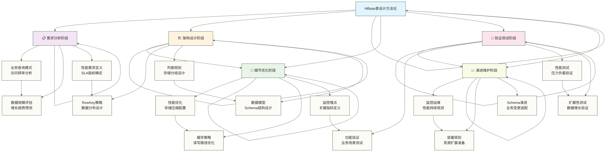
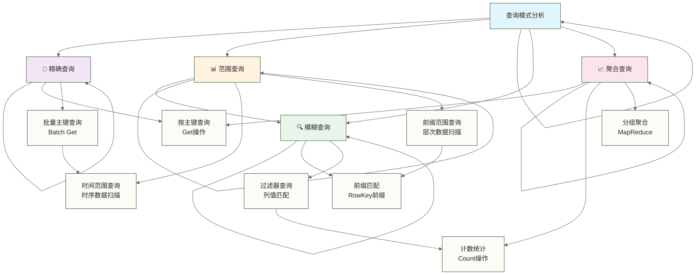

> [!warning] 关联材料边界
> 以下原引用目标缺失或无法唯一确认，已取消跳转并保留提及：09-HBase与MapReduce集成。相关素材/延伸说明暂不可用，不能据此声称已经提供配套材料。

# HBase 表设计与模式

> [!info] 前置知识
> - [[【技术与工具】/HBase/03-HBase数据模型|HBase 数据模型]] — 理解 RowKey、ColumnFamily、Cell 的四元组结构
> - [[【技术与工具】/HBase/06-HBase Shell操作|HBase Shell 操作]] — 能用 create/put/get/scan 进行基本操作
> - [[【技术与工具】/HBase/02-HBase架构原理|HBase 架构原理]] — 了解 Region 分裂、MemStore、BlockCache 的工作机制

HBase 的表设计与关系型数据库最大的不同在于：**查询模式决定表结构**，而不是数据关系决定表结构。设计前必须先明确读写模式，再反推 RowKey 设计和列族划分。一个错误的 RowKey 设计可能导致集群热点；原稿中的“损失 80% 的性能”和“支撑 10 倍以上的吞吐量”是未核实的性能示例，不代表通用收益，实际影响需在相同硬件、数据分布与负载下进行基准测试。

本文系统梳理 HBase 表设计的核心原则、常用模式和教学场景案例；文中人物对话及业务数字未提供真实项目核验材料。

## 表设计全景图

### 📊 设计方法论架构



### 🎯 设计决策矩阵

| 设计维度 | 主要考虑因素 | 设计权重 | 影响范围 |
|---|---|---|---|
| **查询模式** | 精确查询 vs 范围查询 | ⭐⭐⭐⭐⭐ | RowKey设计 |
| **访问频率** | 热点数据 vs 冷数据 | ⭐⭐⭐⭐ | 列族分组 |
| **数据规模** | 存储成本 vs 查询性能 | ⭐⭐⭐⭐ | 压缩策略 |
| **一致性** | 强一致性 vs 最终一致性 | ⭐⭐⭐ | 架构选择 |
| **扩展性** | 当前需求 vs 未来增长 | ⭐⭐⭐ | 整体设计 |

## 📋 需求分析与建模原则

### 🔍 业务需求分析框架

#### 📊 查询模式分析



#### 🎯 访问模式特征

**银行数据分析师张分析师正在向架构团队介绍客户行为分析方法：**

张分析师："各位，在设计银行表结构之前，我们必须深入了解客户的行为模式。就像银行网点要根据客户流量来安排柜台数量一样。"

小陈问："张分析师，我们主要分析哪些方面呢？"

张分析师："很好的问题！银行客户行为分析包括三个核心维度，让我给你们展示具体的分析方法："

> [!example] 💻 **银行客户行为分析方法**
> 以下是银行系统的客户行为特征分析：

```java
// 银行客户行为三维度分析模型

// 1. 读写比例分析（基于银行业务特征）
银行业务读写特征：
✅ 查询密集型业务：90% Read, 10% Write  
   → 如账户余额查询、交易历史查询
   → 设计策略：启用多级缓存，优化读路径

⚠️ 业务处理均衡型：60% Read, 40% Write  
   → 如转账业务、客户信息更新
   → 设计策略：平衡读写性能，关注一致性

❗ 交易写入密集型：30% Read, 70% Write  
   → 如ATM交易、POS交易记录
   → 设计策略：批量写入优化，异步处理

// 2. 时间模式分析（银行营业时间特征）
银行业务时间分布：
📈 实时交易：9:00-17:00营业时间，毫秒级响应
   → 设计策略：内存缓存，SSD存储，热数据预加载

📊 批量处理：21:00-01:00夜间批处理，分钟级可接受  
   → 设计策略：磁盘优化，数据压缩，成本控制

📉 历史查询：偶发性查询，小时级延迟可接受
   → 设计策略：冷数据归档，按需加载

// 3. 并发访问分析（银行系统负载特征）
银行系统并发模式：
🔥 核心交易系统：>10,000 QPS（工作日高峰期）
   → 设计策略：分片均衡，避免热点，读写分离

📊 客户服务系统：1,000-5,000 QPS（日常操作）
   → 设计策略：标准分布式设计，实时监控

📝 管理后台系统：<500 QPS（内部操作）
   → 设计策略：简化架构，成本优先
```

### 📋 **银行业务行为分析总结**

张分析师总结道："通过这三个维度的分析，我们能够：
- 🎯 **精准定位**：确定每个业务的访问特征
- ⚙️ **优化策略**：制定针对性的设计方案  
- 📊 **资源配置**：合理分配存储和计算资源
- 🔍 **性能预期**：设定合理的性能指标"

小王点头："这样分析确实很清楚，那下一步怎么根据这些分析来设计表结构呢？"

张分析师："好问题！接下来我们看看如何进行容量规划..."

### 📐 数据规模与增长预测

#### 📊 容量规划模型

**银行容量规划专家刘专家正在指导团队进行银行系统容量预测：**

刘专家："各位，银行系统的容量规划至关重要。就像银行要预测客户增长来规划网点数量一样，我们必须准确预测数据增长来设计存储架构。"

小陈问："刘专家，银行系统的容量规划有什么特别的考虑吗？"

刘专家："银行系统的容量规划有几个关键特点：
- **准确性要求高**：容量不足会影响业务，过量则浪费资源
- **合规要求严**：必须满足监管部门的数据保留要求
- **增长可预测**：银行业务增长相对稳定，便于预测
- **安全冗余**：需要考虑灾备和数据副本

让我展示银行级别的容量计算模型："

```java
// 银行系统容量规划计算模型

// 基础计算公式
总存储需求 = 原始数据大小 × 副本数 × 压缩比例 × 增长系数 × 合规系数

// 教学假设：某银行客户交易记录系统，以下参数和数字为原稿未核实示例
银行业务参数：
原始数据：每日 500GB (包含所有客户交易记录)
副本数：3 (本教学示例假设的HDFS副本数，不等同于满足异地灾备要求)
压缩比例：0.25 (GZIP压缩75%空间节省，金融数据压缩率高)
增长系数：1.4 (考虑索引、元数据和查询优化结构)
合规系数：1.2 (监管要求额外审计和备份数据)
年业务增长率：1.3 (银行业务相对稳定增长)

// 容量计算过程
日存储需求计算：
= 500GB × 3 × 0.25 × 1.4 × 1.2
= 500GB × 1.26
= 630GB/天

月存储需求计算：
= 630GB × 30 × 1.3 (考虑月度增长)
= 24.57TB/月

年存储需求计算：
= 630GB × 365 × 1.3 (年度增长)
= 299.3TB/年（原稿未核实示例结果；按上述算式及十进制单位计算应约为 298.9TB/年）

// 银行级安全冗余计算
灾备存储需求：
= 299.3TB × 1.5 (异地灾备)
= 449TB (包含灾备)

// 五年规划总容量
五年总容量 = 449TB × 5 × 1.15^5 (复合增长)
≈ 3.68PB（保留原稿未核实示例数字；该算式按十进制单位计算约为 4.52PB，且不能替代逐年增长后的容量累加）

// 分层存储策略
热数据 (近3个月): 449TB × 0.25 = 112TB (SSD)
温数据 (3-12个月): 449TB × 0.35 = 157TB (高速HDD) 
冷数据 (1年以上): 449TB × 0.40 = 180TB (归档存储)
```

### 📝 **银行容量规划关键参数说明**

刘专家详细解释："让我说明每个参数的银行业务含义：

📊 **核心计算参数**：
- **原始数据量**：基于银行客户数量和交易频率的历史统计
- **副本数**：本例假设为3；原稿未提供人民银行相关监管条款，不能据此认定满足数据可用性或灾备要求
- **压缩比例**：金融交易数据结构化程度高，压缩效果显著
- **增长系数**：包含索引、审计日志、元数据的实际空间开销
- **合规系数**：监管部门要求的额外数据保留和审计需求

🏛️ **银行特有考虑**：
- **灾备要求**：本例假设采用异地双活并使用1.5倍容量系数；该系数未经核实，实际容量需按复制拓扑、备份策略与恢复目标计算
- **合规保留**：原稿以交易记录7年、查询记录3年作为未核实示例，不是通用监管要求；需按业务、记录类型与适用法规确认
- **增长预测**：基于银行历史业务增长数据，相对保守
- **分层存储**：根据数据访问频率进行成本优化"

小王问："这样计算出来的容量，在实际项目中准确吗？"

刘专家："这里是教学假设，原稿所称‘基于多家银行的实际数据验证，误差通常在5%以内’未提供验证材料，不能视为真实成果或准确性保证。接下来我们看看如何根据这些分析来设计具体的表结构..."

#### 🎨 RowKey设计模式库

```java
// 模式1：时序数据设计
// 适用场景：监控数据、日志数据、用户行为数据
RowKey = metricName + reverseTimestamp + deviceId
示例：cpu_usage_9223370036854775807_server001

优点：
✅ 最新数据排在前面，符合查询习惯
✅ 按时间范围查询性能优秀
✅ 支持按设备分组统计

缺点：
⚠️ 写入可能存在轻微热点
⚠️ 不支持按设备快速查询所有历史

// 模式2：用户维度设计
// 适用场景：用户数据、账户信息、个人资料
RowKey = userId + timestamp + eventType
示例：user_12345_1671234567890_login

优点：
✅ 按用户聚合所有相关数据
✅ 支持用户维度的时序查询
✅ 天然支持用户级别的数据分区

缺点：
⚠️ 活跃用户可能成为热点
⚠️ 需要用户ID才能高效查询

// 模式3：复合维度设计
// 适用场景：多维分析、地理数据、分类统计
RowKey = region + date + category + subKey
示例：beijing_20241211_electronics_mobile_001

优点：
✅ 支持多维度组合查询
✅ 数据按业务逻辑自然分组
✅ 便于分区和并行处理

缺点：
⚠️ RowKey较长，占用更多存储
⚠️ 查询必须按维度顺序进行

// 模式4：散列分布设计
// 适用场景：高并发写入、负载均衡要求
RowKey = hash(businessKey) % buckets + businessKey + timestamp
示例：05_order_123456_1671234567890

优点：
✅ 在桶分布均匀且 Region 划分匹配时，可缓解写入热点
✅ 负载均衡效果需通过实际键分布与并发负载验证
✅ 支持预分区优化

缺点：
⚠️ 范围查询性能下降
⚠️ 数据局部性被破坏
```

### 📊 热点避免策略

#### 🔥 热点识别与预防

```java
// 热点场景识别
常见热点模式：

1. 时间戳开头：
   ❌ 错误：timestamp + userId
   ✅ 正确：userId + reverseTimestamp

2. 递增序列：
   ❌ 错误：autoIncrement + data
   ✅ 正确：hash(id) + autoIncrement + data

3. 固定前缀：
   ❌ 错误：type + timestamp + id
   ✅ 正确：hash(id) + type + timestamp + id

4. 地理区域：
   ❌ 错误：region + timestamp + event
   ✅ 正确：hash(region+timestamp) + region + timestamp + event
```

上面四种热点模式的共同原因是：写入时数据的 RowKey 都落在当前 Region 的末尾或特定区间内。解决方案核心是**在 RowKey 开头加入均匀分布的前缀**，配合匹配散列桶的预分区与 Region 分布，使写入分散到多个 Region；同一高频业务键仍可能形成热点。

#### 🎯 散列策略设计

```java
// 1. 取模散列策略
public String generateRowKey(String businessKey, long timestamp) {
    int bucket = Math.floorMod(businessKey.hashCode(), 100);
    String prefix = String.format("%02d", bucket);
    return prefix + "_" + businessKey + "_" + timestamp;
}

// 2. MD5散列策略
public String generateRowKey(String businessKey, long timestamp) {
    String md5 = DigestUtils.md5Hex(businessKey);
    String prefix = md5.substring(0, 4); // 取前4位
    return prefix + "_" + businessKey + "_" + timestamp;
}

// 3. 一致性哈希策略
public String generateRowKey(String businessKey, long timestamp) {
    int hash = Hashing.consistentHash(
        Hashing.murmur3_128().hashString(businessKey, Charsets.UTF_8), 
        100
    );
    return String.format("%02d_%s_%d", hash, businessKey, timestamp);
}

// 4. 分桶轮转策略
private static final AtomicInteger counter = new AtomicInteger(0);
public String generateRowKey(String businessKey, long timestamp) {
    int bucket = counter.getAndIncrement() % 100;
    return String.format("%02d_%s_%d", bucket, businessKey, timestamp);
}
```

### 🎨 复合RowKey设计艺术

#### 📐 多维度组合策略

```java
// 电商订单表复合RowKey设计
public class OrderRowKeyDesigner {
    
    // 设计目标：
    // 1. 支持按用户查询所有订单
    // 2. 支持按时间范围查询订单
    // 3. 支持按状态筛选订单
    // 4. 避免用户热点问题
    
    public String designOrderRowKey(String customerId, long timestamp, 
                                   String status, String orderId) {
        // 方案1：用户优先设计
        // 适用：用户订单查询为主要场景
        String userHash = String.valueOf(Math.abs(customerId.hashCode()) % 10);
        return String.format("%s_%s_%d_%s_%s", 
                           userHash, customerId, 
                           Long.MAX_VALUE - timestamp, status, orderId);
        
        // 方案2：时间优先设计
        // 适用：时间范围查询为主要场景
        String dateStr = new SimpleDateFormat("yyyyMMdd").format(new Date(timestamp));
        String customerHash = String.valueOf(Math.abs(customerId.hashCode()) % 100);
        return String.format("%s_%s_%s_%d_%s", 
                           dateStr, customerHash, customerId, timestamp, orderId);
        
        // 方案3：混合优化设计
        // 适用：多种查询模式并存
        String hourHash = String.valueOf((timestamp / 3600000) % 24); // 按小时散列
        return String.format("%s_%s_%d_%s_%s", 
                           hourHash, customerId, timestamp, status, orderId);
    }
}

// IoT传感器数据RowKey设计
public class SensorRowKeyDesigner {
    
    public String designSensorRowKey(String deviceId, long timestamp, 
                                   String metricType, String location) {
        // 设计目标：
        // 1. 支持按设备查询时序数据
        // 2. 支持按地区统计分析
        // 3. 支持按指标类型查询
        // 4. 优化时序查询性能
        
        // 时间分桶策略（按小时分桶）
        long hourBucket = timestamp / 3600000; // 小时级别的时间戳
        String deviceHash = String.valueOf(Math.abs(deviceId.hashCode()) % 16);
        
        return String.format("%s_%s_%s_%d_%s_%d", 
                           deviceHash,           // 散列前缀
                           location,             // 地理位置
                           deviceId,             // 设备ID
                           Long.MAX_VALUE - hourBucket, // 反向时间桶
                           metricType,           // 指标类型
                           timestamp);           // 精确时间戳
    }
}
```

## 📁 Column Family设计策略

### 🎯 列族分组原则

#### 📊 访问模式驱动分组

```java
// 列族设计的核心原则
1. 访问模式一致性：相似访问频率的字段归为一组
2. 生命周期一致性：相同TTL要求的字段归为一组  
3. 物理特性一致性：相同压缩需求的字段归为一组
4. 业务逻辑一致性：相关业务含义的字段归为一组

// 用户信息表列族设计示例
CREATE TABLE 'user_profiles',
{
    // 高频访问数据：登录、认证、基本展示
    NAME => 'basic',
    COMPRESSION => 'SNAPPY',     // 快速压缩
    VERSIONS => 1,               // 只保留最新版本
    TTL => 0,                    // 永久保存
    BLOCKCACHE => true,          // 启用块缓存
    IN_MEMORY => false
},
{
    // 中频访问数据：个人资料、偏好设置
    NAME => 'profile', 
    COMPRESSION => 'LZ4',        // 平衡压缩
    VERSIONS => 3,               // 保留3个版本
    TTL => 0,                    // 永久保存
    BLOCKCACHE => true,
    IN_MEMORY => false
},
{
    // 低频访问数据：隐私设置、高级配置
    NAME => 'settings',
    COMPRESSION => 'GZIP',       // 高压缩比
    VERSIONS => 5,               // 保留更多版本
    TTL => 0,                    // 永久保存
    BLOCKCACHE => false,         // 不使用块缓存
    IN_MEMORY => false
},
{
    // 临时数据：会话信息、临时状态
    NAME => 'session',
    COMPRESSION => 'SNAPPY',
    VERSIONS => 1,
    TTL => 86400,                // 24小时过期
    BLOCKCACHE => true,
    IN_MEMORY => true            // 缓存优先级提示，不保证常驻内存
}
```

#### 🎨 列族配置优化

```java
// 1. 压缩策略选择
压缩算法选择指南：

SNAPPY：
✅ 适用场景：实时数据、高频访问、CPU敏感
✅ 特点：压缩速度快、CPU占用低、压缩比中等
✅ 推荐用于：用户会话、实时监控、缓存数据

LZ4：
✅ 适用场景：通用数据、平衡需求
✅ 特点：速度与压缩比平衡、新一代推荐算法
✅ 推荐用于：用户资料、订单数据、日志数据

GZIP：
✅ 适用场景：冷数据、存储敏感、网络传输
✅ 特点：压缩比高、CPU占用较高、速度较慢
✅ 推荐用于：历史数据、归档数据、大文本数据

LZO：
✅ 适用场景：大数据处理、批量分析
✅ 特点：分片支持、MapReduce友好
✅ 推荐用于：日志分析、数据仓库、ETL处理

// 2. 缓存策略配置
缓存策略选择：

BlockCache = true：
✅ 适用：热点数据、随机读访问
✅ 效果：提升读性能、减少磁盘IO
✅ 注意：占用RegionServer内存

BlockCache = false：
✅ 适用：冷数据、顺序扫描
✅ 效果：节省内存、避免缓存污染
✅ 注意：读性能依赖磁盘性能

IN_MEMORY = true：
✅ 适用：超热数据、毫秒级响应要求
✅ 效果：在支持该属性的缓存实现中提高缓存保留优先级，不保证驻留或最快访问速度
✅ 注意：内存资源稀缺，谨慎使用

// 3. 版本控制策略
版本数量设置：

VERSIONS = 1：
✅ 适用：状态数据、配置数据
✅ 特点：节省存储、简化逻辑
✅ 场景：用户状态、系统配置

VERSIONS = 3-5：
✅ 适用：重要业务数据
✅ 特点：支持回滚、审计友好
✅ 场景：订单信息、账户数据

VERSIONS = 无限制：
✅ 适用：审计数据、合规要求
✅ 特点：可增加历史版本保留，但仍受 TTL、删除操作与版本策略影响，不能据此保证完整历史或法律合规
✅ 场景：金融交易、操作日志
```

### 📊 多列族架构设计

#### 🏗️ 复杂业务场景设计

```java
// 电商平台商品信息表设计
CREATE TABLE 'product_catalog',

// 列族1：基础信息（高频访问）
{
    NAME => 'basic',
    DESCRIPTION => '商品基础信息：名称、价格、描述等',
    COMPRESSION => 'SNAPPY',
    VERSIONS => 1,
    TTL => 0,
    BLOCKCACHE => true,
    BLOOMFILTER => 'ROW'
},

// 列族2：库存信息（超高频访问）
{
    NAME => 'inventory',  
    DESCRIPTION => '库存数据：数量、预留、状态等',
    COMPRESSION => 'LZ4',
    VERSIONS => 3,                // 保留历史便于审计
    TTL => 0,
    BLOCKCACHE => true,
    IN_MEMORY => true             // 库存数据缓存优先级提示，不保证常驻内存
},

// 列族3：营销信息（中频访问）
{
    NAME => 'marketing',
    DESCRIPTION => '营销数据：促销、标签、推荐等',
    COMPRESSION => 'SNAPPY',
    VERSIONS => 5,                // 营销活动变更历史
    TTL => 2592000,              // 30天过期
    BLOCKCACHE => true
},

// 列族4：媒体资源（低频访问）
{
    NAME => 'media',
    DESCRIPTION => '媒体文件：图片URL、视频链接等',
    COMPRESSION => 'GZIP',        // 高压缩比
    VERSIONS => 2,
    TTL => 0,
    BLOCKCACHE => false,          // 媒体链接不需要缓存
    BLOCKSIZE => '131072'         // 较大块提升读取效率
},

// 列族5：统计数据（分析用途）
{
    NAME => 'analytics',
    DESCRIPTION => '统计数据：浏览量、销量、评分等',
    COMPRESSION => 'LZ4',
    VERSIONS => 无限制,            // 仅示意增加版本保留，仍受90天TTL和删除操作限制，不保证完整统计历史
    TTL => 7776000,              // 90天保留期
    BLOCKCACHE => false
}

// 数据示例
product_12345 → {
    basic: {
        name → "iPhone 15 Pro",
        category → "electronics",
        brand → "Apple", 
        price → 7999.00,
        description → "最新款iPhone..."
    },
    inventory: {
        total_stock → 150,
        available_stock → 120,
        reserved_stock → 25,
        warehouse_bj → 50,
        warehouse_sh → 70,
        last_updated → "2024-12-11 15:30:00"
    },
    marketing: {
        promotion_id → "winter_sale_2024",
        discount_rate → 0.15,
        tags → "新品,热销,推荐",
        campaign_end → "2024-12-31"
    },
    media: {
        main_image → "/images/iphone15pro_main.jpg",
        gallery → "/images/iphone15pro_1.jpg,/images/iphone15pro_2.jpg",
        video_review → "/videos/iphone15pro_review.mp4"
    },
    analytics: {
        view_count → 15420,
        purchase_count → 89,
        rating_avg → 4.8,
        review_count → 34
    }
}
```

## 🎨 Schema设计模式

### 📊 宽表设计模式

#### 🗂️ 反范式设计思维

```java
// 关系型数据库 vs HBase设计思维对比

// ❌ 关系型思维（范式化设计）
// 用户表
users: {user_id, name, email, phone}
// 订单表  
orders: {order_id, user_id, product_id, quantity, price}
// 产品表
products: {product_id, name, category, price}

// 查询：需要多表JOIN
SELECT u.name, o.quantity, p.name 
FROM users u 
JOIN orders o ON u.user_id = o.user_id
JOIN products p ON o.product_id = p.product_id

// ✅ HBase思维（宽表设计）
// 用户订单宽表
user_orders: {
    RowKey: userId_timestamp_orderId,
    user_info: {name, email, phone, ...},
    order_info: {quantity, price, status, ...},
    product_info: {name, category, description, ...}
}

// 查询：单表直接获取
Get get = new Get(Bytes.toBytes("user123_1671234567890_order456"));
Result result = table.get(get);
// 一次操作获取所有相关信息
```

#### 🎯 数据冗余策略

```java
// 合理冗余的设计原则

1. 冗余决策矩阵：
   ✅ 查询频率高 + 数据变更少 = 推荐冗余
   ⚠️ 查询频率高 + 数据变更多 = 谨慎冗余  
   ⚠️ 查询频率低 + 数据变更少 = 可选冗余
   ❌ 查询频率低 + 数据变更多 = 避免冗余

2. 冗余粒度控制：
   ✅ 冗余关键字段：ID、名称、状态等
   ✅ 冗余稳定字段：类型、分类、基础属性
   ❌ 避免冗余：大文本、二进制数据
   ❌ 避免冗余：频繁变更的计算字段

// 电商订单表冗余设计示例
order_details: {
    RowKey: customerId_timestamp_orderId,
    
    // 订单核心信息（原始数据）
    order_info: {
        order_id → "ORD_123456",
        total_amount → 299.99,
        order_status → "shipped",
        created_time → "2024-12-11 14:00:00"
    },
    
    // 用户信息冗余（减少用户表查询）
    customer_info: {
        customer_id → "CUST_789",
        customer_name → "张三",      // 冗余：查询频率高
        customer_level → "VIP",      // 冗余：影响订单处理
        customer_phone → "138***"    // 冗余：用于物流联系
        // 不冗余：邮箱、详细地址等低频字段
    },
    
    // 商品信息冗余（避免商品表JOIN）
    product_info: {
        product_id → "PROD_456", 
        product_name → "iPhone 15",  // 冗余：订单展示必需
        product_price → 7999.00,     // 冗余：订单快照价格
        product_category → "电子产品" // 冗余：用于分析统计
        // 不冗余：详细描述、规格参数等
    }
}
```

### 🔄 时序数据设计模式

#### 📈 时间序列数据架构

```java
// 时序数据表设计最佳实践

// 1. 监控指标数据表
CREATE TABLE 'metrics_data',
{
    NAME => 'metrics',
    COMPRESSION => 'SNAPPY',      // 数值数据压缩效果好
    VERSIONS => 1,                // 时序数据不需要版本
    TTL => 2592000,              // 30天数据保留
    BLOCKCACHE => false,          // 时序数据多为顺序扫描
    BLOOMFILTER => 'NONE'         // 时序查询不需要布隆过滤器
}

// RowKey设计：metricName_reverseTimestamp_deviceId
// 反向时间戳确保最新数据在前面

示例数据：
cpu_usage_9223370036854775807_server001 → {
    metrics: {
        value → 85.5,
        unit → "percent", 
        datacenter → "beijing",
        cluster → "prod"
    }
}

memory_usage_9223370036854775807_server001 → {
    metrics: {
        value → 16384,
        unit → "MB",
        total → 32768,
        available → 16384
    }
}

// 2. 用户行为事件表
CREATE TABLE 'user_events',
{
    NAME => 'events',
    COMPRESSION => 'LZ4',
    VERSIONS => 1,
    TTL => 7776000,              // 90天事件保留
    BLOCKCACHE => true,          // 用户事件可能有随机查询
    BLOOMFILTER => 'ROW'
}

// RowKey设计：userId_reverseTimestamp_eventId
user_12345_9223370036854775807_evt_001 → {
    events: {
        event_type → "page_view",
        page_url → "/product/iphone15",
        session_id → "sess_abc123",
        user_agent → "Mozilla/5.0...",
        ip_address → "192.168.1.100",
        duration → 45000
    }
}
```

#### 🎯 分桶策略优化

```java
// 时序数据分桶策略

// 方案1：时间分桶策略
public class TimeBasedBucketing {
    
    public String generateRowKey(String metricName, long timestamp, String deviceId) {
        // 按小时分桶，避免单个Region过热
        long hourBucket = timestamp / 3600000;
        String timeBucket = String.format("%010d", Long.MAX_VALUE - hourBucket);
        
        return String.format("%s_%s_%d_%s", 
                           metricName, timeBucket, timestamp, deviceId);
    }
    
    // 查询最近1小时数据
    public Scan createRecentDataScan(String metricName, int hours) {
        long currentHour = System.currentTimeMillis() / 3600000;
        long startHour = currentHour - hours;
        
        String startKey = String.format("%s_%010d", 
                                       metricName, 
                                       Long.MAX_VALUE - currentHour);
        String endKey = String.format("%s_%010d", 
                                     metricName, 
                                     Long.MAX_VALUE - startHour);
        
        Scan scan = new Scan();
        scan.setStartRow(Bytes.toBytes(startKey));
        scan.setStopRow(Bytes.toBytes(endKey));
        return scan;
    }
}

// 方案2：设备分桶策略  
public class DeviceBasedBucketing {
    
    public String generateRowKey(String deviceId, long timestamp, String metricName) {
        // 设备散列分桶，平衡设备间负载
        int deviceBucket = Math.abs(deviceId.hashCode()) % 100;
        String reverseTime = String.format("%019d", Long.MAX_VALUE - timestamp);
        
        return String.format("%02d_%s_%s_%s_%d", 
                           deviceBucket, deviceId, reverseTime, metricName, timestamp);
    }
    
    // 查询特定设备的时序数据
    public Scan createDeviceDataScan(String deviceId, long startTime, long endTime) {
        int deviceBucket = Math.abs(deviceId.hashCode()) % 100;
        String startKey = String.format("%02d_%s_%019d", 
                                       deviceBucket, deviceId, 
                                       Long.MAX_VALUE - endTime);
        String endKey = String.format("%02d_%s_%019d", 
                                     deviceBucket, deviceId, 
                                     Long.MAX_VALUE - startTime);
        
        Scan scan = new Scan();
        scan.setStartRow(Bytes.toBytes(startKey));
        scan.setStopRow(Bytes.toBytes(endKey));
        return scan;
    }
}
```

### 🔗 多维关联设计模式

#### 🌐 图关系数据建模

```java
// 社交网络关系表设计

// 1. 关注关系表（支持双向查询）
CREATE TABLE 'user_relationships',
{
    NAME => 'relation',
    COMPRESSION => 'SNAPPY',
    VERSIONS => 1,
    BLOCKCACHE => true,
    BLOOMFILTER => 'ROW'
}

// 双向存储策略：
// 正向关系：A关注B
following_userA_userB → {
    relation: {
        type → "following",
        created_time → "2024-12-11 10:00:00",
        source → "recommendation",
        status → "active"
    }
}

// 反向关系：B被A关注
follower_userB_userA → {
    relation: {
        type → "follower", 
        created_time → "2024-12-11 10:00:00",
        notification_sent → "true",
        status → "active"
    }
}

// 2. 好友推荐表（基于共同关注）
CREATE TABLE 'friend_recommendations',
{
    NAME => 'recommendation',
    COMPRESSION => 'LZ4',
    VERSIONS => 1,
    TTL => 604800,               // 7天推荐有效期
    BLOCKCACHE => true
}

// RowKey：userId_score_recommendedUserId
user_12345_95_user_67890 → {
    recommendation: {
        recommended_user → "user_67890",
        recommendation_score → 95,
        common_friends_count → 8,
        common_interests → "tech,music,travel",
        recommendation_reason → "8个共同好友",
        generated_time → "2024-12-11 12:00:00"
    }
}
```

#### 📊 多维度分析表设计

```java
// 电商分析立方体表设计

// 1. 销售分析主表
CREATE TABLE 'sales_analytics',
{
    NAME => 'metrics',
    COMPRESSION => 'LZ4', 
    VERSIONS => 1,
    BLOCKCACHE => false          // 分析数据主要为批量扫描
}

// RowKey设计：dimension1_dimension2_dimension3_timeperiod
// 支持多维度钻取分析

// 按地区-品类-时间分析
region_beijing_category_electronics_date_20241211 → {
    metrics: {
        sales_amount → 1250000.00,
        order_count → 345,
        avg_order_value → 3623.19,
        customer_count → 298,
        top_product → "iPhone15",
        growth_rate → 0.15
    }
}

// 按品牌-渠道-时间分析  
brand_apple_channel_online_date_20241211 → {
    metrics: {
        sales_amount → 2100000.00,
        order_count → 267,
        return_rate → 0.02,
        customer_satisfaction → 4.8,
        inventory_turnover → 12.5
    }
}

// 2. 实时指标汇总表
CREATE TABLE 'realtime_metrics',
{
    NAME => 'counters',
    COMPRESSION => 'SNAPPY',
    VERSIONS => 1, 
    TTL => 86400,               // 实时数据24小时保留
    IN_MEMORY => true           // 实时指标缓存优先级提示，不保证常驻内存
}

// RowKey：metricType_timeWindow_dimension
pv_hour_20241211_15 → {
    counters: {
        total_pv → 150000,
        mobile_pv → 120000,
        desktop_pv → 30000,
        unique_visitors → 45000,
        bounce_rate → 0.35
    }
}

order_minute_20241211_1530 → {
    counters: {
        order_count → 125,
        order_amount → 89500.00,
        payment_success_rate → 0.98,
        avg_response_time → 850
    }
}
```

## 🎯 表设计实战案例

### 📱 社交媒体平台设计

#### 🏗️ 完整表结构设计

```java
// 1. 用户信息主表
CREATE TABLE 'user_profiles',
{NAME => 'basic'},      // 基础信息：姓名、头像、签名
{NAME => 'social'},     // 社交统计：关注数、粉丝数、动态数  
{NAME => 'privacy'}     // 隐私设置：可见性、权限配置

// RowKey: userId (添加随机前缀避免热点)
// 格式：hashPrefix(2位) + userId

02_user_123456 → {
    basic: {
        username → "张三",
        avatar → "/avatar/user_123456.jpg",
        signature → "热爱生活，热爱技术",
        verified → "true",
        registration_date → "2024-01-15"
    },
    social: {
        following_count → 256,
        followers_count → 1024,
        posts_count → 89,
        likes_received → 2340,
        last_active → "2024-12-11 15:30:00"
    },
    privacy: {
        profile_visible → "public",
        allow_messages → "followers",
        show_online_status → "false",
        allow_tag → "friends"
    }
}

// 2. 用户动态表
CREATE TABLE 'user_posts',
{NAME => 'content'},    // 动态内容：文字、图片、视频
{NAME => 'engagement'}, // 互动数据：点赞、评论、转发
{NAME => 'metadata'}    // 元数据：设备、位置、标签

// RowKey: userId_reverseTimestamp_postId
// 确保用户最新动态排在前面

user_123456_9223370036854775807_post_789 → {
    content: {
        text → "今天天气真好！去公园散步了 #美好一天",
        images → "img1.jpg,img2.jpg,img3.jpg",
        video → "",
        location → "北京·朝阳公园",
        post_type → "image_text",
        visibility → "public"
    },
    engagement: {
        likes_count → 42,
        comments_count → 8,
        shares_count → 3,
        views_count → 256,
        last_interaction → "2024-12-11 16:45:00"
    },
    metadata: {
        device_type → "iPhone",
        app_version → "2.1.0",
        location_precise → "39.12345,116.54321",
        hashtags → "#美好一天",
        mentions → "@朋友A,@朋友B"
    }
}

// 3. 关注关系表
CREATE TABLE 'user_relationships',
{NAME => 'relationship'}

// 双向存储，支持"我关注的"和"关注我的"查询

// A关注B的关系
following_user_123456_user_654321 → {
    relationship: {
        type → "following",
        status → "active", 
        created_time → "2024-11-15 10:30:00",
        source → "search",           // 关注来源
        interaction_level → "high",   // 互动程度
        last_interaction → "2024-12-10 14:20:00"
    }
}

// B被A关注的反向关系
follower_user_654321_user_123456 → {
    relationship: {
        type → "follower",
        status → "active",
        created_time → "2024-11-15 10:30:00", 
        mutual_following → "false",   // 是否互关
        notification_read → "true"    // 通知是否已读
    }
}

// 4. 动态时间线表（Feed流）
CREATE TABLE 'user_timeline',
{NAME => 'feed_item'}

// RowKey: userId_reverseTimestamp_postId_authorId
// 为每个用户维护个性化时间线

user_123456_9223370036854775807_post_789_author_654321 → {
    feed_item: {
        post_id → "post_789",
        author_id → "user_654321",
        author_name → "李四",
        post_type → "image_text",
        post_summary → "今天天气真好！去公园散步了...",
        thumbnail → "img1_thumb.jpg",
        created_time → "2024-12-11 15:30:00",
        feed_score → 85.5,           // 推荐算法评分
        interaction_predicted → 0.7   // 预测互动概率
    }
}
```

### 🛒 电商平台订单系统

#### 💼 订单全生命周期设计

```java
// 1. 订单主表
CREATE TABLE 'order_master',
{NAME => 'order_info'},      // 订单基础信息
{NAME => 'payment_info'},    // 支付相关信息
{NAME => 'logistics_info'},  // 物流跟踪信息
{NAME => 'service_info'}     // 售后服务信息

// RowKey: customerId_reverseTimestamp_orderId
// 支持按用户查询历史订单，按时间倒序排列

customer_123456_9223370036854775807_order_ORD001 → {
    order_info: {
        order_id → "ORD_20241211_001",
        order_status → "delivered",
        total_amount → 1299.99,
        currency → "CNY",
        order_source → "mobile_app",
        created_time → "2024-12-11 10:30:00",
        expected_delivery → "2024-12-13 18:00:00"
    },
    payment_info: {
        payment_method → "alipay",
        payment_status → "paid",
        payment_time → "2024-12-11 10:35:00",
        transaction_id → "TXN_789456123",
        payment_amount → 1299.99,
        discount_amount → 200.00
    },
    logistics_info: {
        shipping_company → "顺丰速运", 
        tracking_number → "SF7889567123",
        shipping_status → "delivered",
        shipping_address → "北京市朝阳区...",
        estimated_delivery → "2024-12-13",
        actual_delivery → "2024-12-12 16:30:00"
    },
    service_info: {
        customer_service_rating → 5,
        delivery_rating → 4,
        overall_satisfaction → 4.5,
        review_submitted → "true",
        return_window_end → "2024-12-19"
    }
}

// 2. 订单商品明细表
CREATE TABLE 'order_items',
{NAME => 'product_info'},    // 商品基础信息
{NAME => 'pricing_info'},    // 价格优惠信息
{NAME => 'fulfillment'}      // 履约配送信息

// RowKey: orderId_itemSequence
order_ORD001_001 → {
    product_info: {
        product_id → "PROD_iPhone15",
        product_name → "iPhone 15 Pro 256GB 深空黑色",
        product_sku → "SKU_IP15P_256_BLACK",
        category → "电子产品/手机", 
        brand → "Apple",
        specifications → "256GB存储,6.1英寸屏幕",
        quantity → 1
    },
    pricing_info: {
        unit_price → 7999.00,
        original_price → 8999.00,
        discount_type → "promotion",
        discount_amount → 1000.00,
        final_price → 7999.00,
        tax_amount → 0.00
    },
    fulfillment: {
        warehouse_id → "WH_BEIJING_001",
        stock_allocated → "true",
        pick_time → "2024-12-11 14:20:00",
        pack_time → "2024-12-11 15:45:00",
        ship_time → "2024-12-11 18:30:00"
    }
}

// 3. 库存流水表
CREATE TABLE 'inventory_transactions',
{NAME => 'transaction'}

// RowKey: productId_timestamp_transactionType_orderId
PROD_iPhone15_1671234567890_sale_ORD001 → {
    transaction: {
        transaction_type → "sale",
        quantity_change → -1,
        before_quantity → 150,
        after_quantity → 149,
        warehouse_id → "WH_BEIJING_001",
        order_id → "ORD_20241211_001",
        operator → "system_auto",
        transaction_time → "2024-12-11 10:35:00",
        reference_doc → "ORDER_PAYMENT_CONFIRMED"
    }
}

// 4. 用户购买行为分析表
CREATE TABLE 'customer_purchase_analytics',
{NAME => 'behavior_metrics'}

// RowKey: customerId_analysisDate
customer_123456_20241211 → {
    behavior_metrics: {
        total_orders_today → 1,
        total_amount_today → 1299.99,
        total_orders_month → 5,
        total_amount_month → 5999.95,
        favorite_category → "电子产品",
        avg_order_value → 1199.99,
        preferred_payment → "alipay",
        preferred_delivery_time → "18:00-20:00",
        customer_lifetime_value → 25999.75,
        last_purchase_date → "2024-12-11",
        purchase_frequency → 2.5,      // 每月平均订单数
        return_rate → 0.02              // 退货率
    }
}
```

### 🌡️ IoT监控平台设计

#### 📡 海量传感器数据管理

```java
// 1. 传感器数据表
CREATE TABLE 'sensor_metrics',
{NAME => 'measurements'},    // 监测指标数据
{NAME => 'device_status'},   // 设备状态信息
{NAME => 'alerts'}          // 告警事件信息

// RowKey: deviceId_reverseHourBucket_timestamp
// 按设备和小时分桶，优化时序查询性能

device_ENV001_9223370036854775807_1671234567890 → {
    measurements: {
        temperature → 25.5,
        humidity → 65.2,
        pressure → 1013.25,
        pm2_5 → 35,
        pm10 → 42,
        co2 → 450,
        noise_level → 42.5,
        light_intensity → 1250
    },
    device_status: {
        battery_level → 85,
        signal_strength → -45,
        firmware_version → "1.2.3",
        last_maintenance → "2024-11-15",
        calibration_date → "2024-10-01",
        device_health → "good",
        uptime_hours → 720
    },
    alerts: {
        high_temperature → "false",
        low_battery → "false", 
        connection_lost → "false",
        calibration_needed → "false",
        maintenance_due → "false"
    }
}

// 2. 设备告警历史表
CREATE TABLE 'device_alerts',
{NAME => 'alert_info'}

// RowKey: alertLevel_timestamp_deviceId_alertType
// 按告警级别文本的字节序排序；如需按严重度优先处理，应使用显式排序编码

critical_1671234567890_device_ENV001_high_temperature → {
    alert_info: {
        alert_id → "ALT_20241211_001",
        device_id → "ENV_001",
        alert_type → "high_temperature",
        alert_level → "critical",
        alert_message → "温度超过安全阈值: 45.2°C > 40°C",
        threshold_value → 40.0,
        actual_value → 45.2,
        alert_time → "2024-12-11 15:30:00",
        acknowledged → "true",
        acknowledged_by → "operator_zhang",
        acknowledged_time → "2024-12-11 15:32:00",
        resolved → "true",
        resolved_time → "2024-12-11 16:15:00",
        resolution_action → "调整空调设置",
        location → "机房A-服务器区"
    }
}

// 3. 设备维护记录表  
CREATE TABLE 'device_maintenance',
{NAME => 'maintenance_record'}

// RowKey: deviceId_reverseTimestamp_maintenanceType
device_ENV001_9223370036854775807_calibration → {
    maintenance_record: {
        maintenance_id → "MAINT_20241211_001",
        maintenance_type → "calibration",
        maintenance_date → "2024-12-11 09:00:00",
        technician → "技术员李工",
        duration_minutes → 45,
        maintenance_items → "温湿度传感器校准,清洁设备外壳",
        calibration_data → "temp_offset:-0.2,humidity_offset:+1.5",
        next_maintenance → "2025-01-11",
        maintenance_cost → 150.00,
        maintenance_result → "正常",
        notes → "设备运行良好，各项指标正常"
    }
}

// 4. 聚合统计表
CREATE TABLE 'sensor_aggregates',
{NAME => 'hourly_stats'},   // 小时级统计
{NAME => 'daily_stats'},    // 日级统计
{NAME => 'monthly_stats'}   // 月级统计

// RowKey: aggregateLevel_location_date_hour
hourly_floor3_20241211_15 → {
    hourly_stats: {
        avg_temperature → 24.8,
        max_temperature → 26.2,
        min_temperature → 23.1,
        avg_humidity → 62.5,
        max_humidity → 68.0,
        min_humidity → 58.2,
        device_count → 12,
        online_device_count → 11,
        alert_count → 2,
        data_points → 720
    }
}

daily_building_a_20241211 → {
    daily_stats: {
        avg_temperature → 23.5,
        temperature_variance → 2.8,
        avg_humidity → 61.2,
        humidity_variance → 5.1,
        total_alerts → 15,
        critical_alerts → 2,
        device_uptime_rate → 0.995,
        energy_consumption → 450.5,
        maintenance_events → 3
    }
}
```

## 🎯 表设计最佳实践总结

### 📋 设计检查清单

> [!success] 🌟 **HBase表设计完整检查清单**
> 
> **1. 需求分析确认**
> - ✅ 主要查询模式是否已识别和优先级排序？
> - ✅ 数据访问频率和模式是否已分析？
> - ✅ 数据规模和增长趋势是否已评估？
> - ✅ 性能SLA指标是否已明确定义？
> 
> **2. RowKey设计验证**
> - ✅ RowKey是否支持80%以上的主要查询？
> - ✅ 是否避免了明显的热点问题？
> - ✅ 长度是否在合理范围（10-100字节）？
> - ✅ 是否具有良好的可读性和可维护性？
> 
> **3. 列族配置优化**
> - ✅ 列族数量是否控制在合理范围（1-6个）？
> - ✅ 访问模式相似的字段是否归组？
> - ✅ 压缩算法是否针对数据特性选择？
> - ✅ 缓存策略是否根据访问频率配置？
> 
> **4. 性能与扩展性**
> - ✅ 是否进行了性能基准测试？
> - ✅ 是否考虑了未来业务增长？
> - ✅ 是否建立了监控和告警机制？
> - ✅ 是否制定了容量规划方案？

### 🎨 设计模式选择指南

```java
// 表设计模式选择决策树

if (查询模式 == "主要为精确查询") {
    if (数据规模 == "小到中等") {
        推荐模式: "简单RowKey设计";
        RowKey: "businessKey + timestamp";
    } else {
        推荐模式: "散列RowKey设计";  
        RowKey: "hash(businessKey) + businessKey + timestamp";
    }
} else if (查询模式 == "主要为范围查询") {
    if (数据特征 == "时序数据") {
        推荐模式: "时序数据设计";
        RowKey: "entityId + reverseTimestamp";
    } else {
        推荐模式: "复合维度设计";
        RowKey: "dimension1 + dimension2 + timestamp";
    }
} else if (查询模式 == "多维度分析") {
    推荐模式: "宽表设计";
    策略: "适度冗余 + 多列族分组";
}

// 列族数量决策
if (字段数量 < 10 && 访问模式单一) {
    列族数量: 1个;
} else if (字段数量 < 50 && 访问模式明确) {
    列族数量: 2-3个;
} else {
    列族数量: 3-6个;
    注意: "严格按访问模式分组";
}
```

### 🚀 性能优化建议

```java
// 1. 写入性能优化
写入优化策略：
✅ 使用批量写入：List<Put> + table.put(puts)
✅ 异步写入：AsyncTable接口
✅ 预分区：避免Region分裂影响性能
✅ 关闭WAL：非关键数据可关闭WAL
✅ 增大客户端缓存：hbase.client.write.buffer

// 2. 读取性能优化  
读取优化策略：
✅ 启用布隆过滤器：减少磁盘IO
✅ 合理设置缓存：BlockCache + 列族缓存配置
✅ 使用批量读取：List<Get> + table.get(gets)
✅ 优化Scan参数：setCaching() + setBatch()
✅ 选择性查询：只获取需要的列族和列

// 3. 存储优化
存储优化策略：
✅ 启用压缩：SNAPPY/LZ4/GZIP根据场景选择
✅ 设置TTL：自动清理过期数据
✅ 版本控制：合理设置VERSIONS数量
✅ 大Cell处理：>10MB数据考虑外部存储
✅ 定期压缩：Major Compaction清理删除数据
```

上述优化策略是 HBase 性能调优的通用清单。写入优化中"关闭 WAL"仅适用于可重新生成的数据（如日志聚合），对业务关键数据绝对不能关闭，否则 RegionServer 故障时会丢失 MemStore 中的数据。读取优化中 `setCaching()` 影响服务端到客户端的 RPC 批量大小，`setBatch()` 影响单次 next() 返回的 Cell 数量，二者需要根据行宽和网络带宽综合调整。

---

## 掌握检查

- [ ] 能说出"查询模式决定表结构"的具体含义，并给出一个例子
- [ ] 知道 RowKey 热点的 4 种常见成因，以及对应的解决方案
- [ ] 能判断一个业务场景应该用宽表模式还是时序模式
- [ ] 理解为什么通常优先采用少量列族（如 1-3 个），更多列族需按访问模式与实际负载验证，而不是越多越好
- [ ] 知道散列前缀会带来什么副作用（原有连续范围通常需拆为多桶扫描并合并结果，未必需要全表扫描），以及如何权衡

## 实践练习

1. **基础题**：为微博的"用户关注列表"设计 HBase 表结构，支持"查询某用户关注了谁"和"查询某用户的粉丝列表"两种查询，写出表名、RowKey 和列族设计。
2. **进阶题**：有一张用户行为日志表，RowKey 设计为 `userId_timestamp`，现在发现热门用户的 Region 成为热点。分析问题根因，并提出至少两种改进方案，说明各自的权衡。
3. **挑战题**：设计一个支持多租户的 IoT 传感器时序数据表，要求：支持按设备查最近 N 条数据、按时间范围查询某租户所有设备数据、数据 30 天后自动过期。写出完整的 HBase Shell create 语句。

## 下一步

- [[【技术与工具】/HBase/11-监控与调优|监控与调优]] — 掌握 JMX 指标采集、GC 调优和 RegionServer 内存配置
- HBase 与 MapReduce 集成（原引用“09-HBase与MapReduce集成”未能确定有效目标，暂不可跳转） — 学习大批量数据处理和 BulkLoad 导入

---

**创建时间**：2024-12-11
**更新时间**：2026-03-21
**预计学习时长**：90 分钟

#HBase #表设计 #数据建模 #RowKey设计 #NoSQL架构 #性能优化
