> [!warning] 关联材料边界
> 以下原引用目标缺失或无法唯一确认，已取消跳转并保留提及：01-HBase概述与核心概念；05-Java API开发实战。相关素材/延伸说明暂不可用，不能据此声称已经提供配套材料。

# HBase 过滤器与扫描优化

HBase 提供了丰富的服务端过滤器体系，使查询条件在 RegionServer 侧执行，大幅减少网络传输量。与全表扫描或客户端过滤相比，合理使用服务端过滤器可能减少传输与处理开销；原稿所述“查询延迟降低一个数量级”为未核实的性能示例，实际收益需结合扫描范围、数据分布和集群配置测试。本文系统介绍过滤器继承体系、各类过滤器的使用场景与性能特征，以及 Scan 参数调优方法。

> [!note] 阅读前置知识
> 本文假设读者已了解 HBase 基本数据模型（RowKey、列族、列限定符、版本）以及 HBase Java API 的基本用法。如需补充，请先阅读 HBase概述与核心概念（原引用“01-HBase概述与核心概念”未能确定有效目标，暂不可跳转） 和 Java API开发实战（原引用“05-Java API开发实战”未能确定有效目标，暂不可跳转）。

## 核心概念：服务端过滤 vs 客户端过滤

HBase 过滤器的核心价值在于**将计算下推到数据所在位置**。理解这一点，才能理解为何过滤器的选择对性能至关重要。

| 维度 | 服务端过滤（Filter） | 客户端过滤（应用层逻辑） |
|------|---------------------|------------------------|
| 执行位置 | RegionServer，数据就近处理 | 客户端 JVM，数据已传输 |
| 网络开销 | 只传输符合条件的数据 | 传输全量数据再过滤 |
| CPU 消耗 | 分布在各 RegionServer | 集中在客户端 |
| 适用场景 | 过滤率高（大量数据被过滤掉）| 过滤率低（大多数数据需要返回）|
| 性能比较边界 | 原稿的 10x-100x 为未核实示例，不是通用收益；需进行同条件基准测试 | 数据量小时代码可能更简单，但仍需比较传输与处理开销 |

> [!warning] 服务端过滤并非万能
> ValueFilter 和 SingleColumnValueFilter 需要访问 Cell 的值进行比较，是否解码取决于比较器，在宽表场景下可能有较大开销。能由 RowKey 表达条件时，应优先用 `setStartRow`/`setStopRow` 限定范围；PrefixFilter 可表达前缀条件，但并非所有查询都需要叠加，也不能保证性能最高。

## FilterBase 继承体系

HBase 过滤器的抽象基类是 `Filter`，`FilterBase` 继承 `Filter` 并提供默认实现，常用于编写自定义过滤器。以下列出部分方法，其中 `filterRowKey(byte[], int, int)` 和 `filterKeyValue(Cell)` 属于旧版签名，目标版本可能推荐使用 Cell 参数的 `filterRowKey` 和 `filterCell`：

| 方法 | 作用 | 返回值含义 |
|------|------|-----------|
| `filterRowKey(byte[] buffer, int offset, int length)` | 判断是否跳过整行 | `true` = 跳过该行 |
| `filterKeyValue(Cell v)` | 判断是否跳过单个 Cell | `ReturnCode` 枚举 |
| `filterRow()` | 行内所有 Cell 处理完后，判断是否丢弃整行 | `true` = 丢弃 |
| `hasFilterRow()` | 声明是否使用 `filterRow()` | 影响执行路径 |
| `filterAllRemaining()` | 是否终止整个 Scan | `true` = 提前终止 |

`ReturnCode` 枚举的各个值：

| ReturnCode | 含义 |
|-----------|------|
| `INCLUDE` | 包含该 Cell |
| `INCLUDE_AND_NEXT_COL` | 包含该 Cell，跳转到下一列 |
| `SKIP` | 跳过该 Cell |
| `NEXT_COL` | 跳过当前列的所有版本，转到下一列 |
| `NEXT_ROW` | 跳过当前行剩余所有 Cell |
| `SEEK_NEXT_USING_HINT` | 根据 `getNextCellHint()` 提示跳转 |

## 🎯 过滤器体系全景图

### 📊 HBase过滤器架构

```mermaid
%%{init: {"theme":"base","themeVariables":{"fontFamily":"PingFang SC, -apple-system, Source Han Serif SC, serif","fontSize":"16px","background":"#FDFBF5","primaryColor":"#FDFBF5","primaryTextColor":"#2D2A26","primaryBorderColor":"#6E6A60","secondaryColor":"#E8EFE8","secondaryBorderColor":"#8FA890","secondaryTextColor":"#2D2A26","tertiaryColor":"#FDFBF5","tertiaryBorderColor":"#9A9488","tertiaryTextColor":"#6E6A60","lineColor":"#6E6A60","textColor":"#2D2A26","mainBkg":"#FDFBF5","nodeBorder":"#2D5A3D","clusterBkg":"#F3EEDF","clusterBorder":"#9A9488","edgeLabelBackground":"#FDFBF5"},"flowchart":{"htmlLabels":true,"curve":"basis","padding":20,"nodeSpacing":60,"rankSpacing":70,"useMaxWidth":false},"themeCSS":".node rect, .node polygon, .node circle { stroke-width: 1.5px; } .edgePath .path { stroke-width: 1.5px; } .cluster-label .nodeLabel, .cluster-label foreignObject { color: #2D2A26 !important; } .edgeLabel, .edgeLabel foreignObject { color: #2D2A26 !important; background-color: #FDFBF5; } .edgeLabel rect { fill: #FDFBF5; }"}}%%
flowchart TD
    A[HBase过滤器体系]
    A --> B[🔑 行级过滤器]
    A --> C[📁 列族过滤器]
    A --> D[📄 列过滤器]
    A --> E[💎 值过滤器]
    A --> F[⚡ 特殊过滤器]
    A --> G[🔗 复合过滤器]
    B --> B1[PrefixFilter<br/>前缀匹配]
    B --> B2[KeyOnlyFilter<br/>只返回键]
    B --> B3[FirstKeyOnlyFilter<br/>每行首键]
    B --> B4[InclusiveStopFilter<br/>包含停止键]
    C --> C1[FamilyFilter<br/>列族筛选]
    D --> C2[MultipleColumnPrefixFilter<br/>多列限定符前缀]
    D --> D1[QualifierFilter<br/>列限定符筛选]
    D --> D2[ColumnPrefixFilter<br/>列前缀匹配]
    D --> D3[ColumnRangeFilter<br/>列范围筛选]
    E --> E1[ValueFilter<br/>值匹配]
    E --> E2[SingleColumnValueFilter<br/>单列值筛选]
    E --> E3[BinaryComparator<br/>比较器，非过滤器]
    E --> E4[RegexStringComparator<br/>比较器，非过滤器]
    F --> F1[PageFilter<br/>分页过滤]
    F --> F2[RandomRowFilter<br/>随机采样]
    F --> F3[TimestampsFilter<br/>时间戳筛选]
    F --> F4[ColumnCountGetFilter<br/>列数限制]
    G --> G1[FilterList<br/>过滤器列表]
    G --> G2[WhileMatchFilter<br/>匹配直到]
    G --> G3[SkipFilter<br/>跳过匹配行]
    style A fill:#e1f5fe
    style B fill:#f3e5f5
    style C fill:#fff3e0
    style D fill:#e8f5e8
    style E fill:#fce4ec
    style F fill:#f9fbe7
    style G fill:#ede7f6
```



### 🎯 过滤器性能特征

| 过滤器类型 | 执行位置 | 性能影响 | 使用场景 | 推荐程度 |
|---|---|---|---|---|
| **行级过滤器** | RegionServer | ⭐⭐⭐⭐⭐ | 大范围筛选 | 优先使用 |
| **列族过滤器** | RegionServer | ⭐⭐⭐⭐ | 数据类型筛选 | 推荐使用 |
| **列过滤器** | RegionServer | ⭐⭐⭐ | 字段级筛选 | 合理使用 |
| **值过滤器** | RegionServer | ⭐⭐ | 内容筛选 | 谨慎使用 |
| **复合过滤器** | RegionServer | ⭐⭐⭐ | 复杂条件 | 按需使用 |

## 🔑 行级过滤器详解

### 🎯 RowKey前缀过滤器

#### 📋 PrefixFilter应用

```java
// 1. 基础前缀过滤
// 查询所有以"user_2024"开头的用户数据
Filter prefixFilter = new PrefixFilter(Bytes.toBytes("user_2024"));
Scan scan = new Scan();
scan.setFilter(prefixFilter);

// Java代码示例
public class PrefixFilterExample {
    
    public void queryUsersByPrefix(Table table, String prefix) throws IOException {
        // 创建前缀过滤器
        Filter filter = new PrefixFilter(Bytes.toBytes(prefix));
        
        Scan scan = new Scan();
        scan.setFilter(filter);
        scan.setCaching(100);  // 设置缓存大小
        
        try (ResultScanner scanner = table.getScanner(scan)) {
            for (Result result : scanner) {
                String rowKey = Bytes.toString(result.getRow());
                System.out.println("找到用户: " + rowKey);
                
                // 获取用户基本信息
                Cell nameCell = result.getColumnLatestCell(
                    Bytes.toBytes("basic"), 
                    Bytes.toBytes("name")
                );
                if (nameCell != null) {
                    String name = Bytes.toString(CellUtil.cloneValue(nameCell));
                    System.out.println("  姓名: " + name);
                }
            }
        }
    }
    
    // 高级前缀查询：按地区和时间前缀
    public void queryOrdersByRegionAndDate(Table table, String region, String date) 
            throws IOException {
        // RowKey格式：region_date_orderId
        String prefix = region + "_" + date;
        Filter filter = new PrefixFilter(Bytes.toBytes(prefix));
        
        Scan scan = new Scan();
        scan.setFilter(filter);
        scan.addFamily(Bytes.toBytes("order_info"));  // 只查询订单信息列族
        
        int count = 0;
        double totalAmount = 0.0;
        
        try (ResultScanner scanner = table.getScanner(scan)) {
            for (Result result : scanner) {
                count++;
                
                // 统计订单金额
                Cell amountCell = result.getColumnLatestCell(
                    Bytes.toBytes("order_info"), 
                    Bytes.toBytes("amount")
                );
                if (amountCell != null) {
                    double amount = Bytes.toDouble(CellUtil.cloneValue(amountCell));
                    totalAmount += amount;
                }
            }
        }
        
        System.out.println(String.format(
            "%s地区%s的订单统计：总数%d，总金额%.2f", 
            region, date, count, totalAmount
        ));
    }
}
```

#### 🎨 高级前缀组合技巧

```java
// 多级前缀查询策略
public class AdvancedPrefixQueries {
    
    // 1. 分层前缀查询
    public void hierarchicalPrefixQuery(Table table) throws IOException {
        // 查询结构：department_team_employee_
        
        // 第一层：查询所有部门
        List<String> departments = queryPrefixes(table, "", 1);
        
        for (String dept : departments) {
            System.out.println("部门: " + dept);
            
            // 第二层：查询部门下的团队
            List<String> teams = queryPrefixes(table, dept + "_", 2);
            
            for (String team : teams) {
                System.out.println("  团队: " + team);
                
                // 第三层：查询团队下的员工
                List<String> employees = queryPrefixes(table, dept + "_" + team + "_", 3);
                System.out.println("    员工数: " + employees.size());
            }
        }
    }
    
    private List<String> queryPrefixes(Table table, String prefix, int level) 
            throws IOException {
        Set<String> prefixes = new HashSet<>();
        
        Filter filter = new PrefixFilter(Bytes.toBytes(prefix));
        Scan scan = new Scan();
        scan.setFilter(filter);
        scan.addColumn(Bytes.toBytes("info"), Bytes.toBytes("name"));
        
        try (ResultScanner scanner = table.getScanner(scan)) {
            for (Result result : scanner) {
                String rowKey = Bytes.toString(result.getRow());
                String[] parts = rowKey.split("_");
                
                if (parts.length > level) {
                    // 提取到指定层级的前缀
                    String levelPrefix = String.join("_", 
                        Arrays.copyOfRange(parts, 0, level + 1));
                    prefixes.add(parts[level]);
                }
            }
        }
        
        return new ArrayList<>(prefixes);
    }
    
    // 2. 时间窗口前缀查询
    public void timeWindowPrefixQuery(Table table, String startDate, String endDate) 
            throws IOException {
        // RowKey格式：date_deviceId_timestamp
        
        SimpleDateFormat sdf = new SimpleDateFormat("yyyyMMdd");
        try {
            Date start = sdf.parse(startDate);
            Date end = sdf.parse(endDate);
            Calendar cal = Calendar.getInstance();
            cal.setTime(start);
            
            while (!cal.getTime().after(end)) {
                String dateStr = sdf.format(cal.getTime());
                
                // 查询当天数据
                Filter filter = new PrefixFilter(Bytes.toBytes(dateStr));
                Scan scan = new Scan();
                scan.setFilter(filter);
                
                int dailyCount = 0;
                try (ResultScanner scanner = table.getScanner(scan)) {
                    for (Result result : scanner) {
                        dailyCount++;
                    }
                }
                
                System.out.println(dateStr + ": " + dailyCount + " 条记录");
                cal.add(Calendar.DAY_OF_MONTH, 1);
            }
        } catch (ParseException e) {
            throw new IOException("日期格式错误", e);
        }
    }
}
```

### 🔍 KeyOnly过滤器

```java
// KeyOnlyFilter：只返回键，不返回值
// 适用场景：统计、索引构建、键存在性检查

public class KeyOnlyFilterExample {
    
    // 1. 快速统计表中行数
    public long countRows(Table table) throws IOException {
        Filter filter = new KeyOnlyFilter();
        Scan scan = new Scan();
        scan.setFilter(filter);
        scan.setCaching(1000);  // 大缓存提升统计性能
        
        long count = 0;
        try (ResultScanner scanner = table.getScanner(scan)) {
            for (Result result : scanner) {
                count++;
            }
        }
        
        return count;
    }
    
    // 2. 构建RowKey索引
    public Set<String> buildRowKeyIndex(Table table, String prefix) 
            throws IOException {
        Set<String> rowKeys = new TreeSet<>();
        
        // 组合前缀过滤器和KeyOnly过滤器
        FilterList filterList = new FilterList(FilterList.Operator.MUST_PASS_ALL);
        filterList.addFilter(new PrefixFilter(Bytes.toBytes(prefix)));
        filterList.addFilter(new KeyOnlyFilter());
        
        Scan scan = new Scan();
        scan.setFilter(filterList);
        
        try (ResultScanner scanner = table.getScanner(scan)) {
            for (Result result : scanner) {
                rowKeys.add(Bytes.toString(result.getRow()));
            }
        }
        
        return rowKeys;
    }
    
    // 3. 检查数据完整性
    public void checkDataIntegrity(Table sourceTable, Table targetTable) 
            throws IOException {
        System.out.println("检查数据完整性...");
        
        // 获取源表所有RowKey
        Set<String> sourceKeys = buildRowKeyIndex(sourceTable, "");
        System.out.println("源表记录数: " + sourceKeys.size());
        
        // 获取目标表所有RowKey
        Set<String> targetKeys = buildRowKeyIndex(targetTable, "");
        System.out.println("目标表记录数: " + targetKeys.size());
        
        // 找出差异
        Set<String> missingInTarget = new HashSet<>(sourceKeys);
        missingInTarget.removeAll(targetKeys);
        
        Set<String> extraInTarget = new HashSet<>(targetKeys);
        extraInTarget.removeAll(sourceKeys);
        
        if (!missingInTarget.isEmpty()) {
            System.out.println("目标表缺失记录数: " + missingInTarget.size());
            missingInTarget.stream().limit(10).forEach(key -> 
                System.out.println("  缺失: " + key));
        }
        
        if (!extraInTarget.isEmpty()) {
            System.out.println("目标表多余记录数: " + extraInTarget.size());
            extraInTarget.stream().limit(10).forEach(key -> 
                System.out.println("  多余: " + key));
        }
        
        if (missingInTarget.isEmpty() && extraInTarget.isEmpty()) {
            System.out.println("✓ 数据完整性检查通过");
        }
    }
}
```

## 📄 列级过滤器

### 🏷️ 列族过滤器

```java
// FamilyFilter：按列族筛选数据
public class FamilyFilterExample {
    
    // 1. 只查询特定列族
    public void querySpecificFamily(Table table, String familyName) 
            throws IOException {
        // 创建列族过滤器
        Filter filter = new FamilyFilter(
            CompareFilter.CompareOp.EQUAL,
            new BinaryComparator(Bytes.toBytes(familyName))
        );
        
        Scan scan = new Scan();
        scan.setFilter(filter);
        
        try (ResultScanner scanner = table.getScanner(scan)) {
            for (Result result : scanner) {
                String rowKey = Bytes.toString(result.getRow());
                System.out.println("行键: " + rowKey);
                
                // 遍历该行的所有列
                for (Cell cell : result.rawCells()) {
                    String family = Bytes.toString(CellUtil.cloneFamily(cell));
                    String qualifier = Bytes.toString(CellUtil.cloneQualifier(cell));
                    String value = Bytes.toString(CellUtil.cloneValue(cell));
                    
                    System.out.println(String.format("  %s:%s = %s", 
                        family, qualifier, value));
                }
            }
        }
    }
    
    // 2. 排除特定列族
    public void excludeFamily(Table table, String excludeFamilyName) 
            throws IOException {
        Filter filter = new FamilyFilter(
            CompareFilter.CompareOp.NOT_EQUAL,
            new BinaryComparator(Bytes.toBytes(excludeFamilyName))
        );
        
        Scan scan = new Scan();
        scan.setFilter(filter);
        
        try (ResultScanner scanner = table.getScanner(scan)) {
            for (Result result : scanner) {
                System.out.println("行键: " + Bytes.toString(result.getRow()));
                
                // 统计各列族的列数
                Map<String, Integer> familyColumnCount = new HashMap<>();
                
                for (Cell cell : result.rawCells()) {
                    String family = Bytes.toString(CellUtil.cloneFamily(cell));
                    familyColumnCount.merge(family, 1, Integer::sum);
                }
                
                familyColumnCount.forEach((family, count) -> 
                    System.out.println("  " + family + ": " + count + " 列"));
            }
        }
    }
    
    // 3. 多列限定符前缀过滤（不按列族名称匹配）
    public void multipleColumnPrefixFilter(Table table, String... prefixes) 
            throws IOException {
        byte[][] prefixBytes = Arrays.stream(prefixes)
            .map(Bytes::toBytes)
            .toArray(byte[][]::new);
        
        Filter filter = new MultipleColumnPrefixFilter(prefixBytes);
        
        Scan scan = new Scan();
        scan.setFilter(filter);
        
        System.out.println("查询列前缀: " + Arrays.toString(prefixes));
        
        try (ResultScanner scanner = table.getScanner(scan)) {
            for (Result result : scanner) {
                String rowKey = Bytes.toString(result.getRow());
                System.out.println("行键: " + rowKey);
                
                for (Cell cell : result.rawCells()) {
                    String family = Bytes.toString(CellUtil.cloneFamily(cell));
                    String qualifier = Bytes.toString(CellUtil.cloneQualifier(cell));
                    String value = Bytes.toString(CellUtil.cloneValue(cell));
                    
                    System.out.println(String.format("  %s:%s = %s", 
                        family, qualifier, value));
                }
            }
        }
    }
}
```

### 📊 列限定符过滤器

```java
// QualifierFilter：按列限定符筛选
public class QualifierFilterExample {
    
    // 1. 精确匹配列限定符
    public void exactQualifierMatch(Table table, String qualifier) 
            throws IOException {
        Filter filter = new QualifierFilter(
            CompareFilter.CompareOp.EQUAL,
            new BinaryComparator(Bytes.toBytes(qualifier))
        );
        
        Scan scan = new Scan();
        scan.setFilter(filter);
        
        try (ResultScanner scanner = table.getScanner(scan)) {
            for (Result result : scanner) {
                String rowKey = Bytes.toString(result.getRow());
                System.out.println("行键: " + rowKey);
                
                for (Cell cell : result.rawCells()) {
                    String family = Bytes.toString(CellUtil.cloneFamily(cell));
                    String qual = Bytes.toString(CellUtil.cloneQualifier(cell));
                    String value = Bytes.toString(CellUtil.cloneValue(cell));
                    
                    System.out.println(String.format("  %s:%s = %s", 
                        family, qual, value));
                }
            }
        }
    }
    
    // 2. 正则表达式匹配列限定符
    public void regexQualifierMatch(Table table, String pattern) 
            throws IOException {
        Filter filter = new QualifierFilter(
            CompareFilter.CompareOp.EQUAL,
            new RegexStringComparator(pattern)
        );
        
        Scan scan = new Scan();
        scan.setFilter(filter);
        
        System.out.println("列限定符正则模式: " + pattern);
        
        try (ResultScanner scanner = table.getScanner(scan)) {
            for (Result result : scanner) {
                String rowKey = Bytes.toString(result.getRow());
                System.out.println("行键: " + rowKey);
                
                for (Cell cell : result.rawCells()) {
                    String family = Bytes.toString(CellUtil.cloneFamily(cell));
                    String qualifier = Bytes.toString(CellUtil.cloneQualifier(cell));
                    String value = Bytes.toString(CellUtil.cloneValue(cell));
                    
                    // 验证正则匹配
                    if (Pattern.matches(pattern, qualifier)) {
                        System.out.println(String.format("  ✓ %s:%s = %s", 
                            family, qualifier, value));
                    }
                }
            }
        }
    }
    
    // 3. 列范围过滤器
    public void columnRangeFilter(Table table, String minColumn, String maxColumn) 
            throws IOException {
        Filter filter = new ColumnRangeFilter(
            Bytes.toBytes(minColumn), true,    // 包含最小值
            Bytes.toBytes(maxColumn), false    // 不包含最大值
        );
        
        Scan scan = new Scan();
        scan.setFilter(filter);
        
        System.out.println(String.format("列范围: [%s, %s)", minColumn, maxColumn));
        
        try (ResultScanner scanner = table.getScanner(scan)) {
            for (Result result : scanner) {
                String rowKey = Bytes.toString(result.getRow());
                System.out.println("行键: " + rowKey);
                
                for (Cell cell : result.rawCells()) {
                    String family = Bytes.toString(CellUtil.cloneFamily(cell));
                    String qualifier = Bytes.toString(CellUtil.cloneQualifier(cell));
                    String value = Bytes.toString(CellUtil.cloneValue(cell));
                    
                    System.out.println(String.format("  %s:%s = %s", 
                        family, qualifier, value));
                }
            }
        }
    }
    
    // 4. 动态列分析
    public void analyzeColumnDistribution(Table table, String familyName) 
            throws IOException {
        // 使用KeyOnly + Family过滤器分析列分布
        FilterList filterList = new FilterList(FilterList.Operator.MUST_PASS_ALL);
        filterList.addFilter(new KeyOnlyFilter());
        filterList.addFilter(new FamilyFilter(
            CompareFilter.CompareOp.EQUAL,
            new BinaryComparator(Bytes.toBytes(familyName))
        ));
        
        Scan scan = new Scan();
        scan.setFilter(filterList);
        
        Map<String, Integer> columnStats = new HashMap<>();
        
        try (ResultScanner scanner = table.getScanner(scan)) {
            for (Result result : scanner) {
                for (Cell cell : result.rawCells()) {
                    String qualifier = Bytes.toString(CellUtil.cloneQualifier(cell));
                    columnStats.merge(qualifier, 1, Integer::sum);
                }
            }
        }
        
        System.out.println("列族 " + familyName + " 的列分布统计:");
        columnStats.entrySet().stream()
            .sorted(Map.Entry.<String, Integer>comparingByValue().reversed())
            .forEach(entry -> 
                System.out.println(String.format("  %s: %d 次出现", 
                    entry.getKey(), entry.getValue())));
    }
}
```

## 💎 值过滤器

### 🎯 单列值过滤器

```java
// SingleColumnValueFilter：基于特定列的值进行过滤
public class SingleColumnValueFilterExample {
    
    // 1. 数值范围过滤
    public void numericRangeFilter(Table table, double minValue, double maxValue) 
            throws IOException {
        // 查询价格在指定范围内的商品
        Filter minFilter = new SingleColumnValueFilter(
            Bytes.toBytes("product_info"),      // 列族
            Bytes.toBytes("price"),             // 列限定符
            CompareFilter.CompareOp.GREATER_OR_EQUAL,
            new BinaryComparator(Bytes.toBytes(minValue))
        );
        
        Filter maxFilter = new SingleColumnValueFilter(
            Bytes.toBytes("product_info"),
            Bytes.toBytes("price"),
            CompareFilter.CompareOp.LESS_OR_EQUAL,
            new BinaryComparator(Bytes.toBytes(maxValue))
        );
        
        // 组合过滤器
        FilterList filterList = new FilterList(FilterList.Operator.MUST_PASS_ALL);
        filterList.addFilter(minFilter);
        filterList.addFilter(maxFilter);
        
        Scan scan = new Scan();
        scan.setFilter(filterList);
        
        System.out.println(String.format("价格范围: %.2f - %.2f", minValue, maxValue));
        
        try (ResultScanner scanner = table.getScanner(scan)) {
            for (Result result : scanner) {
                String rowKey = Bytes.toString(result.getRow());
                
                Cell priceCell = result.getColumnLatestCell(
                    Bytes.toBytes("product_info"), 
                    Bytes.toBytes("price")
                );
                
                if (priceCell != null) {
                    double price = Bytes.toDouble(CellUtil.cloneValue(priceCell));
                    System.out.println(String.format("商品: %s, 价格: %.2f", 
                        rowKey, price));
                }
            }
        }
    }
    
    // 2. 字符串模式匹配
    public void stringPatternFilter(Table table, String category) 
            throws IOException {
        Filter filter = new SingleColumnValueFilter(
            Bytes.toBytes("product_info"),
            Bytes.toBytes("category"),
            CompareFilter.CompareOp.EQUAL,
            new SubstringComparator(category)    // 子串匹配
        );
        
        // 设置过滤器属性
        ((SingleColumnValueFilter) filter).setFilterIfMissing(true);  // 过滤掉没有该列的行
        ((SingleColumnValueFilter) filter).setLatestVersionOnly(true); // 只检查最新版本
        
        Scan scan = new Scan();
        scan.setFilter(filter);
        
        System.out.println("查询分类包含: " + category);
        
        try (ResultScanner scanner = table.getScanner(scan)) {
            for (Result result : scanner) {
                String rowKey = Bytes.toString(result.getRow());
                
                Cell categoryCell = result.getColumnLatestCell(
                    Bytes.toBytes("product_info"), 
                    Bytes.toBytes("category")
                );
                
                if (categoryCell != null) {
                    String cat = Bytes.toString(CellUtil.cloneValue(categoryCell));
                    System.out.println(String.format("商品: %s, 分类: %s", rowKey, cat));
                }
            }
        }
    }
    
    // 3. 时间戳过滤
    public void timestampFilter(Table table, long startTime, long endTime) 
            throws IOException {
        Filter filter = new SingleColumnValueFilter(
            Bytes.toBytes("order_info"),
            Bytes.toBytes("created_time"),
            CompareFilter.CompareOp.GREATER_OR_EQUAL,
            new LongComparator(startTime)
        );
        
        Scan scan = new Scan();
        scan.setFilter(filter);
        scan.setTimeRange(startTime, endTime);  // 结合时间范围扫描
        
        SimpleDateFormat sdf = new SimpleDateFormat("yyyy-MM-dd HH:mm:ss");
        System.out.println(String.format("时间范围: %s - %s",
            sdf.format(new Date(startTime)),
            sdf.format(new Date(endTime))
        ));
        
        try (ResultScanner scanner = table.getScanner(scan)) {
            for (Result result : scanner) {
                String rowKey = Bytes.toString(result.getRow());
                
                Cell timeCell = result.getColumnLatestCell(
                    Bytes.toBytes("order_info"), 
                    Bytes.toBytes("created_time")
                );
                
                if (timeCell != null) {
                    long timestamp = Bytes.toLong(CellUtil.cloneValue(timeCell));
                    String timeStr = sdf.format(new Date(timestamp));
                    System.out.println(String.format("订单: %s, 时间: %s", 
                        rowKey, timeStr));
                }
            }
        }
    }
    
    // 4. 复杂业务条件过滤
    public void complexBusinessFilter(Table table) throws IOException {
        // 查询VIP用户的高价值订单
        Filter vipFilter = new SingleColumnValueFilter(
            Bytes.toBytes("customer_info"),
            Bytes.toBytes("level"),
            CompareFilter.CompareOp.EQUAL,
            new BinaryComparator(Bytes.toBytes("VIP"))
        );
        
        Filter highValueFilter = new SingleColumnValueFilter(
            Bytes.toBytes("order_info"),
            Bytes.toBytes("amount"),
            CompareFilter.CompareOp.GREATER,
            new BinaryComparator(Bytes.toBytes(1000.0))
        );
        
        Filter statusFilter = new SingleColumnValueFilter(
            Bytes.toBytes("order_info"),
            Bytes.toBytes("status"),
            CompareFilter.CompareOp.EQUAL,
            new BinaryComparator(Bytes.toBytes("completed"))
        );
        
        // 组合所有条件
        FilterList filterList = new FilterList(FilterList.Operator.MUST_PASS_ALL);
        filterList.addFilter(vipFilter);
        filterList.addFilter(highValueFilter);
        filterList.addFilter(statusFilter);
        
        Scan scan = new Scan();
        scan.setFilter(filterList);
        
        double totalAmount = 0;
        int orderCount = 0;
        
        try (ResultScanner scanner = table.getScanner(scan)) {
            for (Result result : scanner) {
                String rowKey = Bytes.toString(result.getRow());
                
                Cell amountCell = result.getColumnLatestCell(
                    Bytes.toBytes("order_info"), 
                    Bytes.toBytes("amount")
                );
                
                Cell customerCell = result.getColumnLatestCell(
                    Bytes.toBytes("customer_info"), 
                    Bytes.toBytes("name")
                );
                
                if (amountCell != null && customerCell != null) {
                    double amount = Bytes.toDouble(CellUtil.cloneValue(amountCell));
                    String customerName = Bytes.toString(CellUtil.cloneValue(customerCell));
                    
                    totalAmount += amount;
                    orderCount++;
                    
                    System.out.println(String.format(
                        "VIP订单: %s, 客户: %s, 金额: %.2f", 
                        rowKey, customerName, amount));
                }
            }
        }
        
        System.out.println(String.format(
            "VIP高价值订单统计: 总数=%d, 总金额=%.2f, 平均金额=%.2f",
            orderCount, totalAmount, 
            orderCount > 0 ? totalAmount / orderCount : 0));
    }
}
```

### 🎨 值比较器详解

```java
// 各种比较器的应用场景
public class ComparatorExamples {
    
    // 1. 二进制比较器 - 精确匹配
    public void binaryComparatorExample(Table table) throws IOException {
        Filter filter = new ValueFilter(
            CompareFilter.CompareOp.EQUAL,
            new BinaryComparator(Bytes.toBytes("active"))
        );
        
        Scan scan = new Scan();
        scan.setFilter(filter);
        
        System.out.println("精确匹配值为 'active' 的记录:");
        
        try (ResultScanner scanner = table.getScanner(scan)) {
            for (Result result : scanner) {
                System.out.println("行键: " + Bytes.toString(result.getRow()));
            }
        }
    }
    
    // 2. 正则表达式比较器 - 模式匹配
    public void regexComparatorExample(Table table) throws IOException {
        // 匹配邮箱格式
        String emailPattern = "^[a-zA-Z0-9._%+-]+@[a-zA-Z0-9.-]+\\.[a-zA-Z]{2,}$";
        
        Filter filter = new SingleColumnValueFilter(
            Bytes.toBytes("contact_info"),
            Bytes.toBytes("email"),
            CompareFilter.CompareOp.EQUAL,
            new RegexStringComparator(emailPattern)
        );
        
        Scan scan = new Scan();
        scan.setFilter(filter);
        
        System.out.println("有效邮箱地址的用户:");
        
        try (ResultScanner scanner = table.getScanner(scan)) {
            for (Result result : scanner) {
                String rowKey = Bytes.toString(result.getRow());
                
                Cell emailCell = result.getColumnLatestCell(
                    Bytes.toBytes("contact_info"), 
                    Bytes.toBytes("email")
                );
                
                if (emailCell != null) {
                    String email = Bytes.toString(CellUtil.cloneValue(emailCell));
                    System.out.println(String.format("用户: %s, 邮箱: %s", 
                        rowKey, email));
                }
            }
        }
    }
    
    // 3. 子串比较器 - 包含匹配
    public void substringComparatorExample(Table table) throws IOException {
        Filter filter = new SingleColumnValueFilter(
            Bytes.toBytes("product_info"),
            Bytes.toBytes("description"),
            CompareFilter.CompareOp.EQUAL,
            new SubstringComparator("智能")    // 包含"智能"的商品
        );
        
        Scan scan = new Scan();
        scan.setFilter(filter);
        
        System.out.println("包含'智能'关键词的商品:");
        
        try (ResultScanner scanner = table.getScanner(scan)) {
            for (Result result : scanner) {
                String rowKey = Bytes.toString(result.getRow());
                
                Cell descCell = result.getColumnLatestCell(
                    Bytes.toBytes("product_info"), 
                    Bytes.toBytes("description")
                );
                
                if (descCell != null) {
                    String description = Bytes.toString(CellUtil.cloneValue(descCell));
                    System.out.println(String.format("商品: %s", rowKey));
                    System.out.println(String.format("  描述: %s", description));
                }
            }
        }
    }
    
    // 4. 数值比较器 - 数值比较
    public void numericComparatorExample(Table table) throws IOException {
        // 查询库存少于10的商品
        Filter filter = new SingleColumnValueFilter(
            Bytes.toBytes("inventory"),
            Bytes.toBytes("stock_quantity"),
            CompareFilter.CompareOp.LESS,
            new LongComparator(10L)
        );
        
        Scan scan = new Scan();
        scan.setFilter(filter);
        
        System.out.println("库存不足的商品 (< 10):");
        
        try (ResultScanner scanner = table.getScanner(scan)) {
            for (Result result : scanner) {
                String rowKey = Bytes.toString(result.getRow());
                
                Cell stockCell = result.getColumnLatestCell(
                    Bytes.toBytes("inventory"), 
                    Bytes.toBytes("stock_quantity")
                );
                
                if (stockCell != null) {
                    long stock = Bytes.toLong(CellUtil.cloneValue(stockCell));
                    System.out.println(String.format("商品: %s, 库存: %d", 
                        rowKey, stock));
                }
            }
        }
    }
    
    // 5. 自定义比较器
    public static class DateRangeComparator extends ByteArrayComparable {
        private final long startDate;
        private final long endDate;
        
        public DateRangeComparator(long startDate, long endDate) {
            super(Bytes.toBytes("date_range"));
            this.startDate = startDate;
            this.endDate = endDate;
        }
        
        @Override
        public int compareTo(byte[] value, int offset, int length) {
            try {
                // 假设value是日期字符串格式 "yyyy-MM-dd"
                String dateStr = Bytes.toString(value, offset, length);
                SimpleDateFormat sdf = new SimpleDateFormat("yyyy-MM-dd");
                long date = sdf.parse(dateStr).getTime();
                
                if (date >= startDate && date <= endDate) {
                    return 0;  // 在范围内
                } else if (date < startDate) {
                    return -1;
                } else {
                    return 1;
                }
            } catch (Exception e) {
                return -1;
            }
        }
    }
    
    public void customComparatorExample(Table table, String startDate, String endDate) 
            throws IOException {
        try {
            SimpleDateFormat sdf = new SimpleDateFormat("yyyy-MM-dd");
            long start = sdf.parse(startDate).getTime();
            long end = sdf.parse(endDate).getTime();
            
            Filter filter = new SingleColumnValueFilter(
                Bytes.toBytes("order_info"),
                Bytes.toBytes("order_date"),
                CompareFilter.CompareOp.EQUAL,
                new DateRangeComparator(start, end)
            );
            
            Scan scan = new Scan();
            scan.setFilter(filter);
            
            System.out.println(String.format("日期范围: %s - %s", startDate, endDate));
            
            try (ResultScanner scanner = table.getScanner(scan)) {
                for (Result result : scanner) {
                    String rowKey = Bytes.toString(result.getRow());
                    
                    Cell dateCell = result.getColumnLatestCell(
                        Bytes.toBytes("order_info"), 
                        Bytes.toBytes("order_date")
                    );
                    
                    if (dateCell != null) {
                        String orderDate = Bytes.toString(CellUtil.cloneValue(dateCell));
                        System.out.println(String.format("订单: %s, 日期: %s", 
                            rowKey, orderDate));
                    }
                }
            }
        } catch (ParseException e) {
            throw new IOException("日期格式错误", e);
        }
    }
}
```

## ⚡ 特殊过滤器

### 📄 分页过滤器

```java
// PageFilter：实现分页查询
public class PageFilterExample {
    
    // 1. 基础分页实现
    public void basicPagination(Table table, int pageSize, int pageNum) 
            throws IOException {
        Filter filter = new PageFilter(pageSize);
        
        Scan scan = new Scan();
        scan.setFilter(filter);
        scan.setCaching(pageSize);
        
        // 如果不是第一页，需要设置起始行
        if (pageNum > 1) {
            // 这里需要记住上一页的最后一个RowKey
            // 实际应用中通常存储在客户端或缓存中
            String lastRowKey = getLastRowKeyFromPreviousPage(pageNum - 1);
            if (lastRowKey != null) {
                scan.setStartRow(Bytes.toBytes(lastRowKey + "\0")); // 排除上一页最后一行
            }
        }
        
        System.out.println(String.format("第 %d 页 (每页 %d 条):", pageNum, pageSize));
        
        int count = 0;
        String lastRowKey = null;
        
        try (ResultScanner scanner = table.getScanner(scan)) {
            for (Result result : scanner) {
                count++;
                lastRowKey = Bytes.toString(result.getRow());
                
                System.out.println(String.format("  %d. %s", count, lastRowKey));
                
                // 显示部分列信息
                Cell nameCell = result.getColumnLatestCell(
                    Bytes.toBytes("basic"), 
                    Bytes.toBytes("name")
                );
                if (nameCell != null) {
                    String name = Bytes.toString(CellUtil.cloneValue(nameCell));
                    System.out.println(String.format("     姓名: %s", name));
                }
            }
        }
        
        System.out.println(String.format("本页共 %d 条记录", count));
        
        // 保存最后一个RowKey供下一页使用
        saveLastRowKeyForPage(pageNum, lastRowKey);
    }
    
    // 2. 游标分页实现（推荐）
    public PaginationResult cursorBasedPagination(Table table, String cursor, int pageSize) 
            throws IOException {
        Filter filter = new PageFilter(pageSize + 1); // 多查一条判断是否有下一页
        
        Scan scan = new Scan();
        scan.setFilter(filter);
        scan.setCaching(pageSize + 1);
        
        if (cursor != null && !cursor.isEmpty()) {
            scan.setStartRow(Bytes.toBytes(cursor + "\0"));
        }
        
        List<String> results = new ArrayList<>();
        String nextCursor = null;
        boolean hasNextPage = false;
        
        try (ResultScanner scanner = table.getScanner(scan)) {
            int count = 0;
            for (Result result : scanner) {
                count++;
                String rowKey = Bytes.toString(result.getRow());
                
                if (count <= pageSize) {
                    results.add(rowKey);
                    nextCursor = rowKey;
                } else {
                    // 第pageSize+1条记录，说明有下一页
                    hasNextPage = true;
                    break;
                }
            }
        }
        
        return new PaginationResult(results, nextCursor, hasNextPage);
    }
    
    // 3. 分页结果类
    public static class PaginationResult {
        private final List<String> data;
        private final String nextCursor;
        private final boolean hasNextPage;
        
        public PaginationResult(List<String> data, String nextCursor, boolean hasNextPage) {
            this.data = data;
            this.nextCursor = nextCursor;
            this.hasNextPage = hasNextPage;
        }
        
        // getters...
        public List<String> getData() { return data; }
        public String getNextCursor() { return nextCursor; }
        public boolean hasNextPage() { return hasNextPage; }
    }
    
    // 4. 复杂分页：带过滤条件的分页
    public PaginationResult filteredPagination(Table table, String cursor, int pageSize, 
                                              String category) throws IOException {
        // 创建复合过滤器
        FilterList filterList = new FilterList(FilterList.Operator.MUST_PASS_ALL);
        
        // 分页过滤器
        filterList.addFilter(new PageFilter(pageSize + 1));
        
        // 业务条件过滤器
        if (category != null && !category.isEmpty()) {
            filterList.addFilter(new SingleColumnValueFilter(
                Bytes.toBytes("product_info"),
                Bytes.toBytes("category"),
                CompareFilter.CompareOp.EQUAL,
                new BinaryComparator(Bytes.toBytes(category))
            ));
        }
        
        Scan scan = new Scan();
        scan.setFilter(filterList);
        scan.setCaching(pageSize + 1);
        
        if (cursor != null && !cursor.isEmpty()) {
            scan.setStartRow(Bytes.toBytes(cursor + "\0"));
        }
        
        List<String> results = new ArrayList<>();
        String nextCursor = null;
        boolean hasNextPage = false;
        
        try (ResultScanner scanner = table.getScanner(scan)) {
            int count = 0;
            for (Result result : scanner) {
                count++;
                String rowKey = Bytes.toString(result.getRow());
                
                if (count <= pageSize) {
                    results.add(rowKey);
                    nextCursor = rowKey;
                } else {
                    hasNextPage = true;
                    break;
                }
            }
        }
        
        return new PaginationResult(results, nextCursor, hasNextPage);
    }
    
    // 辅助方法（实际应用中应该使用持久化存储）
    private static final Map<Integer, String> pageLastKeys = new HashMap<>();
    
    private String getLastRowKeyFromPreviousPage(int pageNum) {
        return pageLastKeys.get(pageNum);
    }
    
    private void saveLastRowKeyForPage(int pageNum, String lastRowKey) {
        pageLastKeys.put(pageNum, lastRowKey);
    }
}
```

### 🎲 随机采样过滤器

```java
// RandomRowFilter：随机采样数据
public class RandomSamplingExample {
    
    // 1. 随机采样分析
    public void randomSampling(Table table, float sampleRate) throws IOException {
        Filter filter = new RandomRowFilter(sampleRate);
        
        Scan scan = new Scan();
        scan.setFilter(filter);
        scan.setCaching(1000);
        
        System.out.println(String.format("随机采样率: %.2f%%", sampleRate * 100));
        
        int totalSamples = 0;
        Map<String, Integer> categoryStats = new HashMap<>();
        
        try (ResultScanner scanner = table.getScanner(scan)) {
            for (Result result : scanner) {
                totalSamples++;
                
                Cell categoryCell = result.getColumnLatestCell(
                    Bytes.toBytes("product_info"), 
                    Bytes.toBytes("category")
                );
                
                if (categoryCell != null) {
                    String category = Bytes.toString(CellUtil.cloneValue(categoryCell));
                    categoryStats.merge(category, 1, Integer::sum);
                }
            }
        }
        
        System.out.println(String.format("采样总数: %d", totalSamples));
        final int sampleCount = totalSamples;
        System.out.println("分类分布:");
        categoryStats.entrySet().stream()
            .sorted(Map.Entry.<String, Integer>comparingByValue().reversed())
            .forEach(entry -> {
                double percentage = sampleCount > 0 ? (double) entry.getValue() / sampleCount * 100 : 0;
                System.out.println(String.format("  %s: %d (%.1f%%)", 
                    entry.getKey(), entry.getValue(), percentage));
            });
    }
    
    // 2. 分层随机采样
    public void stratifiedRandomSampling(Table table, Map<String, Float> stratumSampleRates) 
            throws IOException {
        System.out.println("分层随机采样:");
        
        for (Map.Entry<String, Float> entry : stratumSampleRates.entrySet()) {
            String category = entry.getKey();
            float sampleRate = entry.getValue();
            
            System.out.println(String.format("\n分层: %s (采样率: %.2f%%)", 
                category, sampleRate * 100));
            
            // 创建复合过滤器：分类过滤 + 随机采样
            FilterList filterList = new FilterList(FilterList.Operator.MUST_PASS_ALL);
            
            filterList.addFilter(new SingleColumnValueFilter(
                Bytes.toBytes("product_info"),
                Bytes.toBytes("category"),
                CompareFilter.CompareOp.EQUAL,
                new BinaryComparator(Bytes.toBytes(category))
            ));
            
            filterList.addFilter(new RandomRowFilter(sampleRate));
            
            Scan scan = new Scan();
            scan.setFilter(filterList);
            scan.setCaching(500);
            
            int count = 0;
            double totalPrice = 0.0;
            
            try (ResultScanner scanner = table.getScanner(scan)) {
                for (Result result : scanner) {
                    count++;
                    
                    Cell priceCell = result.getColumnLatestCell(
                        Bytes.toBytes("product_info"), 
                        Bytes.toBytes("price")
                    );
                    
                    if (priceCell != null) {
                        double price = Bytes.toDouble(CellUtil.cloneValue(priceCell));
                        totalPrice += price;
                    }
                }
            }
            
            System.out.println(String.format("  采样数量: %d", count));
            if (count > 0) {
                System.out.println(String.format("  平均价格: %.2f", totalPrice / count));
            }
        }
    }
    
    // 3. 时间窗口随机采样
    public void timeWindowRandomSampling(Table table, long startTime, long endTime, 
                                       float sampleRate) throws IOException {
        FilterList filterList = new FilterList(FilterList.Operator.MUST_PASS_ALL);
        
        // 时间范围过滤
        filterList.addFilter(new SingleColumnValueFilter(
            Bytes.toBytes("order_info"),
            Bytes.toBytes("created_time"),
            CompareFilter.CompareOp.GREATER_OR_EQUAL,
            new LongComparator(startTime)
        ));
        
        filterList.addFilter(new SingleColumnValueFilter(
            Bytes.toBytes("order_info"),
            Bytes.toBytes("created_time"),
            CompareFilter.CompareOp.LESS_OR_EQUAL,
            new LongComparator(endTime)
        ));
        
        // 随机采样
        filterList.addFilter(new RandomRowFilter(sampleRate));
        
        Scan scan = new Scan();
        scan.setFilter(filterList);
        scan.setTimeRange(startTime, endTime);
        
        SimpleDateFormat sdf = new SimpleDateFormat("yyyy-MM-dd HH:mm:ss");
        System.out.println(String.format("时间窗口随机采样: %s - %s (采样率: %.2f%%)",
            sdf.format(new Date(startTime)),
            sdf.format(new Date(endTime)),
            sampleRate * 100));
        
        int orderCount = 0;
        double totalAmount = 0.0;
        Map<String, Integer> hourlyStats = new TreeMap<>();
        
        try (ResultScanner scanner = table.getScanner(scan)) {
            for (Result result : scanner) {
                orderCount++;
                
                Cell timeCell = result.getColumnLatestCell(
                    Bytes.toBytes("order_info"), 
                    Bytes.toBytes("created_time")
                );
                
                Cell amountCell = result.getColumnLatestCell(
                    Bytes.toBytes("order_info"), 
                    Bytes.toBytes("amount")
                );
                
                if (timeCell != null && amountCell != null) {
                    long timestamp = Bytes.toLong(CellUtil.cloneValue(timeCell));
                    double amount = Bytes.toDouble(CellUtil.cloneValue(amountCell));
                    
                    totalAmount += amount;
                    
                    // 按小时统计
                    Calendar cal = Calendar.getInstance();
                    cal.setTimeInMillis(timestamp);
                    String hourKey = String.format("%02d:00", cal.get(Calendar.HOUR_OF_DAY));
                    hourlyStats.merge(hourKey, 1, Integer::sum);
                }
            }
        }
        
        System.out.println(String.format("采样订单数: %d", orderCount));
        System.out.println(String.format("总金额: %.2f", totalAmount));
        if (orderCount > 0) {
            System.out.println(String.format("平均订单金额: %.2f", totalAmount / orderCount));
        }
        
        System.out.println("小时分布:");
        hourlyStats.forEach((hour, count) -> 
            System.out.println(String.format("  %s: %d 订单", hour, count)));
    }
    
    // 4. A/B测试样本选择
    public void abTestSampling(Table table, String testGroup, float sampleRate) 
            throws IOException {
        // 使用RowKey的哈希值进行确定性采样
        Filter filter = new RandomRowFilter(sampleRate) {
            @Override
            public ReturnCode filterKeyValue(Cell cell) throws IOException {
                // 自定义采样逻辑：基于RowKey哈希
                byte[] rowKey = CellUtil.cloneRow(cell);
                int hash = Arrays.hashCode(rowKey);
                
                // 根据testGroup决定采样逻辑
                boolean inTestGroup;
                if ("A".equals(testGroup)) {
                    inTestGroup = (hash % 100) < (sampleRate * 100);
                } else {
                    inTestGroup = (hash % 100) >= (sampleRate * 100);
                }
                
                return inTestGroup ? ReturnCode.INCLUDE : ReturnCode.SKIP;
            }
        };
        
        Scan scan = new Scan();
        scan.setFilter(filter);
        
        System.out.println(String.format("A/B测试组 %s 采样 (采样率: %.2f%%)", 
            testGroup, sampleRate * 100));
        
        Set<String> userIds = new HashSet<>();
        
        try (ResultScanner scanner = table.getScanner(scan)) {
            for (Result result : scanner) {
                String rowKey = Bytes.toString(result.getRow());
                
                // 提取用户ID（假设RowKey格式包含用户ID）
                String userId = extractUserIdFromRowKey(rowKey);
                if (userId != null) {
                    userIds.add(userId);
                }
            }
        }
        
        System.out.println(String.format("测试组 %s 用户数: %d", testGroup, userIds.size()));
        
        // 输出部分用户ID作为示例
        userIds.stream().limit(10).forEach(userId -> 
            System.out.println("  用户: " + userId));
    }
    
    private String extractUserIdFromRowKey(String rowKey) {
        // 根据实际RowKey格式提取用户ID
        // 这里假设RowKey格式为 "user_12345_..."
        String[] parts = rowKey.split("_");
        return parts.length > 1 ? parts[1] : null;
    }
}
```

## 🔗 复合过滤器设计

### 📊 FilterList高级应用

```java
// FilterList：组合多个过滤器
public class ComplexFilterExample {
    
    // 1. AND逻辑组合 - 所有条件必须满足
    public void andFilterCombination(Table table) throws IOException {
        FilterList filterList = new FilterList(FilterList.Operator.MUST_PASS_ALL);
        
        // 条件1：价格大于100
        filterList.addFilter(new SingleColumnValueFilter(
            Bytes.toBytes("product_info"),
            Bytes.toBytes("price"),
            CompareFilter.CompareOp.GREATER,
            new BinaryComparator(Bytes.toBytes(100.0))
        ));
        
        // 条件2：评分大于4.0
        filterList.addFilter(new SingleColumnValueFilter(
            Bytes.toBytes("product_info"),
            Bytes.toBytes("rating"),
            CompareFilter.CompareOp.GREATER,
            new BinaryComparator(Bytes.toBytes(4.0))
        ));
        
        // 条件3：库存大于0
        filterList.addFilter(new SingleColumnValueFilter(
            Bytes.toBytes("inventory"),
            Bytes.toBytes("stock"),
            CompareFilter.CompareOp.GREATER,
            new BinaryComparator(Bytes.toBytes(0))
        ));
        
        // 条件4：分类子串匹配
        filterList.addFilter(new SingleColumnValueFilter(
            Bytes.toBytes("product_info"),
            Bytes.toBytes("category"),
            CompareFilter.CompareOp.EQUAL,
            new SubstringComparator("电子")
        ));
        
        Scan scan = new Scan();
        scan.setFilter(filterList);
        
        System.out.println("查询条件 (AND逻辑):");
        System.out.println("- 价格 > 100");
        System.out.println("- 评分 > 4.0");
        System.out.println("- 库存 > 0");
        System.out.println("- 分类包含'电子'");
        
        int count = 0;
        double totalPrice = 0.0;
        double totalRating = 0.0;
        
        try (ResultScanner scanner = table.getScanner(scan)) {
            for (Result result : scanner) {
                count++;
                String rowKey = Bytes.toString(result.getRow());
                
                // 获取商品信息
                Map<String, String> productInfo = extractProductInfo(result);
                
                System.out.println(String.format("商品 %d: %s", count, rowKey));
                productInfo.forEach((key, value) -> 
                    System.out.println(String.format("  %s: %s", key, value)));
                
                // 统计数据
                try {
                    double price = Double.parseDouble(productInfo.get("价格"));
                    double rating = Double.parseDouble(productInfo.get("评分"));
                    totalPrice += price;
                    totalRating += rating;
                } catch (NumberFormatException e) {
                    // 忽略格式错误
                }
            }
        }
        
        if (count > 0) {
            System.out.println(String.format("\n统计结果: 符合条件商品 %d 个", count));
            System.out.println(String.format("平均价格: %.2f", totalPrice / count));
            System.out.println(String.format("平均评分: %.2f", totalRating / count));
        } else {
            System.out.println("没有找到符合条件的商品");
        }
    }
    
    // 2. OR逻辑组合 - 任一条件满足即可
    public void orFilterCombination(Table table) throws IOException {
        FilterList filterList = new FilterList(FilterList.Operator.MUST_PASS_ONE);
        
        // 条件1：VIP用户
        filterList.addFilter(new SingleColumnValueFilter(
            Bytes.toBytes("customer_info"),
            Bytes.toBytes("level"),
            CompareFilter.CompareOp.EQUAL,
            new BinaryComparator(Bytes.toBytes("VIP"))
        ));
        
        // 条件2：高价值订单 (>1000)
        filterList.addFilter(new SingleColumnValueFilter(
            Bytes.toBytes("order_info"),
            Bytes.toBytes("amount"),
            CompareFilter.CompareOp.GREATER,
            new BinaryComparator(Bytes.toBytes(1000.0))
        ));
        
        // 条件3：新用户（注册时间在最近30天）
        long thirtyDaysAgo = System.currentTimeMillis() - (30L * 24 * 60 * 60 * 1000);
        filterList.addFilter(new SingleColumnValueFilter(
            Bytes.toBytes("customer_info"),
            Bytes.toBytes("registration_time"),
            CompareFilter.CompareOp.GREATER,
            new LongComparator(thirtyDaysAgo)
        ));
        
        Scan scan = new Scan();
        scan.setFilter(filterList);
        
        System.out.println("查询条件 (OR逻辑):");
        System.out.println("- VIP用户 OR");
        System.out.println("- 高价值订单(>1000) OR");
        System.out.println("- 新用户(最近30天)");
        
        Map<String, Integer> categoryStats = new HashMap<>();
        
        try (ResultScanner scanner = table.getScanner(scan)) {
            for (Result result : scanner) {
                String rowKey = Bytes.toString(result.getRow());
                
                // 分析满足的条件类型
                String matchedCondition = analyzeMatchedCondition(result, thirtyDaysAgo);
                categoryStats.merge(matchedCondition, 1, Integer::sum);
                
                System.out.println(String.format("记录: %s, 匹配条件: %s", 
                    rowKey, matchedCondition));
            }
        }
        
        System.out.println("\n条件匹配统计:");
        categoryStats.forEach((condition, count) -> 
            System.out.println(String.format("  %s: %d 条", condition, count)));
    }
    
    // 3. 嵌套复合过滤器
    public void nestedFilterCombination(Table table) throws IOException {
        // 外层OR: (高价值用户) OR (促销商品)
        FilterList outerOr = new FilterList(FilterList.Operator.MUST_PASS_ONE);
        
        // 内层AND1: 高价值用户 = VIP用户 AND 历史消费>5000
        FilterList highValueUser = new FilterList(FilterList.Operator.MUST_PASS_ALL);
        highValueUser.addFilter(new SingleColumnValueFilter(
            Bytes.toBytes("customer_info"),
            Bytes.toBytes("level"),
            CompareFilter.CompareOp.EQUAL,
            new BinaryComparator(Bytes.toBytes("VIP"))
        ));
        highValueUser.addFilter(new SingleColumnValueFilter(
            Bytes.toBytes("customer_info"),
            Bytes.toBytes("total_spent"),
            CompareFilter.CompareOp.GREATER,
            new BinaryComparator(Bytes.toBytes(5000.0))
        ));
        
        // 内层AND2: 促销商品 = 有折扣 AND 库存充足
        FilterList promotionProduct = new FilterList(FilterList.Operator.MUST_PASS_ALL);
        promotionProduct.addFilter(new SingleColumnValueFilter(
            Bytes.toBytes("promotion"),
            Bytes.toBytes("discount_rate"),
            CompareFilter.CompareOp.GREATER,
            new BinaryComparator(Bytes.toBytes(0.0))
        ));
        promotionProduct.addFilter(new SingleColumnValueFilter(
            Bytes.toBytes("inventory"),
            Bytes.toBytes("stock"),
            CompareFilter.CompareOp.GREATER,
            new BinaryComparator(Bytes.toBytes(10))
        ));
        
        // 组合嵌套过滤器
        outerOr.addFilter(highValueUser);
        outerOr.addFilter(promotionProduct);
        
        Scan scan = new Scan();
        scan.setFilter(outerOr);
        
        System.out.println("嵌套复合过滤器查询:");
        System.out.println("(VIP用户 AND 历史消费>5000) OR (有折扣 AND 库存>10)");
        
        int highValueCount = 0;
        int promotionCount = 0;
        int bothCount = 0;
        
        try (ResultScanner scanner = table.getScanner(scan)) {
            for (Result result : scanner) {
                String rowKey = Bytes.toString(result.getRow());
                
                boolean isHighValue = checkHighValueUser(result);
                boolean isPromotion = checkPromotionProduct(result);
                
                if (isHighValue && isPromotion) {
                    bothCount++;
                    System.out.println(String.format("✓✓ %s: 高价值用户+促销商品", rowKey));
                } else if (isHighValue) {
                    highValueCount++;
                    System.out.println(String.format("✓  %s: 高价值用户", rowKey));
                } else if (isPromotion) {
                    promotionCount++;
                    System.out.println(String.format(" ✓ %s: 促销商品", rowKey));
                }
            }
        }
        
        System.out.println(String.format("\n匹配统计:"));
        System.out.println(String.format("  高价值用户: %d", highValueCount));
        System.out.println(String.format("  促销商品: %d", promotionCount));
        System.out.println(String.format("  两者兼备: %d", bothCount));
        System.out.println(String.format("  总计: %d", highValueCount + promotionCount + bothCount));
    }
    
    // 4. 动态过滤器构建
    public void dynamicFilterBuilder(Table table, Map<String, Object> conditions) 
            throws IOException {
        FilterList dynamicFilter = new FilterList(FilterList.Operator.MUST_PASS_ALL);
        
        System.out.println("动态构建过滤器:");
        
        // 价格范围
        if (conditions.containsKey("minPrice")) {
            double minPrice = (Double) conditions.get("minPrice");
            dynamicFilter.addFilter(new SingleColumnValueFilter(
                Bytes.toBytes("product_info"),
                Bytes.toBytes("price"),
                CompareFilter.CompareOp.GREATER_OR_EQUAL,
                new BinaryComparator(Bytes.toBytes(minPrice))
            ));
            System.out.println(String.format("- 最低价格: %.2f", minPrice));
        }
        
        if (conditions.containsKey("maxPrice")) {
            double maxPrice = (Double) conditions.get("maxPrice");
            dynamicFilter.addFilter(new SingleColumnValueFilter(
                Bytes.toBytes("product_info"),
                Bytes.toBytes("price"),
                CompareFilter.CompareOp.LESS_OR_EQUAL,
                new BinaryComparator(Bytes.toBytes(maxPrice))
            ));
            System.out.println(String.format("- 最高价格: %.2f", maxPrice));
        }
        
        // 分类过滤
        if (conditions.containsKey("category")) {
            String category = (String) conditions.get("category");
            dynamicFilter.addFilter(new SingleColumnValueFilter(
                Bytes.toBytes("product_info"),
                Bytes.toBytes("category"),
                CompareFilter.CompareOp.EQUAL,
                new SubstringComparator(category)
            ));
            System.out.println(String.format("- 分类包含: %s", category));
        }
        
        // 评分过滤
        if (conditions.containsKey("minRating")) {
            double minRating = (Double) conditions.get("minRating");
            dynamicFilter.addFilter(new SingleColumnValueFilter(
                Bytes.toBytes("product_info"),
                Bytes.toBytes("rating"),
                CompareFilter.CompareOp.GREATER_OR_EQUAL,
                new BinaryComparator(Bytes.toBytes(minRating))
            ));
            System.out.println(String.format("- 最低评分: %.1f", minRating));
        }
        
        // 库存状态
        if (conditions.containsKey("inStock") && (Boolean) conditions.get("inStock")) {
            dynamicFilter.addFilter(new SingleColumnValueFilter(
                Bytes.toBytes("inventory"),
                Bytes.toBytes("stock"),
                CompareFilter.CompareOp.GREATER,
                new BinaryComparator(Bytes.toBytes(0))
            ));
            System.out.println("- 有库存");
        }
        
        // 分页
        if (conditions.containsKey("pageSize")) {
            int pageSize = (Integer) conditions.get("pageSize");
            dynamicFilter.addFilter(new PageFilter(pageSize));
            System.out.println(String.format("- 分页大小: %d", pageSize));
        }
        
        Scan scan = new Scan();
        if (dynamicFilter.getFilters().size() > 0) {
            scan.setFilter(dynamicFilter);
        }
        
        System.out.println("\n查询结果:");
        
        int count = 0;
        try (ResultScanner scanner = table.getScanner(scan)) {
            for (Result result : scanner) {
                count++;
                String rowKey = Bytes.toString(result.getRow());
                Map<String, String> productInfo = extractProductInfo(result);
                
                System.out.println(String.format("%d. %s", count, rowKey));
                productInfo.entrySet().stream().limit(3).forEach(entry -> 
                    System.out.println(String.format("   %s: %s", entry.getKey(), entry.getValue())));
            }
        }
        
        System.out.println(String.format("\n共找到 %d 个符合条件的商品", count));
    }
    
    // 辅助方法
    private Map<String, String> extractProductInfo(Result result) {
        Map<String, String> info = new HashMap<>();
        
        // 提取商品基本信息
        String[] fields = {"name", "price", "category", "rating"};
        for (String field : fields) {
            Cell cell = result.getColumnLatestCell(
                Bytes.toBytes("product_info"), 
                Bytes.toBytes(field)
            );
            if (cell != null) {
                String value = Bytes.toString(CellUtil.cloneValue(cell));
                info.put(translateField(field), value);
            }
        }
        
        // 提取库存信息
        Cell stockCell = result.getColumnLatestCell(
            Bytes.toBytes("inventory"), 
            Bytes.toBytes("stock")
        );
        if (stockCell != null) {
            String stock = Bytes.toString(CellUtil.cloneValue(stockCell));
            info.put("库存", stock);
        }
        
        return info;
    }
    
    private String translateField(String field) {
        Map<String, String> translations = Map.of(
            "name", "名称",
            "price", "价格", 
            "category", "分类",
            "rating", "评分"
        );
        return translations.getOrDefault(field, field);
    }
    
    private String analyzeMatchedCondition(Result result, long thirtyDaysAgo) {
        List<String> conditions = new ArrayList<>();
        
        // 检查VIP用户
        Cell levelCell = result.getColumnLatestCell(
            Bytes.toBytes("customer_info"), 
            Bytes.toBytes("level")
        );
        if (levelCell != null && "VIP".equals(Bytes.toString(CellUtil.cloneValue(levelCell)))) {
            conditions.add("VIP用户");
        }
        
        // 检查高价值订单
        Cell amountCell = result.getColumnLatestCell(
            Bytes.toBytes("order_info"), 
            Bytes.toBytes("amount")
        );
        if (amountCell != null) {
            try {
                double amount = Bytes.toDouble(CellUtil.cloneValue(amountCell));
                if (amount > 1000.0) {
                    conditions.add("高价值订单");
                }
            } catch (Exception e) {
                // 忽略转换错误
            }
        }
        
        // 检查新用户
        Cell regTimeCell = result.getColumnLatestCell(
            Bytes.toBytes("customer_info"), 
            Bytes.toBytes("registration_time")
        );
        if (regTimeCell != null) {
            try {
                long regTime = Bytes.toLong(CellUtil.cloneValue(regTimeCell));
                if (regTime > thirtyDaysAgo) {
                    conditions.add("新用户");
                }
            } catch (Exception e) {
                // 忽略转换错误
            }
        }
        
        return conditions.isEmpty() ? "未知" : String.join("+", conditions);
    }
    
    private boolean checkHighValueUser(Result result) {
        // 检查是否为高价值用户 (VIP + 历史消费>5000)
        Cell levelCell = result.getColumnLatestCell(
            Bytes.toBytes("customer_info"), 
            Bytes.toBytes("level")
        );
        Cell spentCell = result.getColumnLatestCell(
            Bytes.toBytes("customer_info"), 
            Bytes.toBytes("total_spent")
        );
        
        boolean isVip = levelCell != null && 
            "VIP".equals(Bytes.toString(CellUtil.cloneValue(levelCell)));
        
        boolean highSpent = false;
        if (spentCell != null) {
            try {
                double spent = Bytes.toDouble(CellUtil.cloneValue(spentCell));
                highSpent = spent > 5000.0;
            } catch (Exception e) {
                // 忽略转换错误
            }
        }
        
        return isVip && highSpent;
    }
    
    private boolean checkPromotionProduct(Result result) {
        // 检查是否为促销商品 (有折扣 + 库存>10)
        Cell discountCell = result.getColumnLatestCell(
            Bytes.toBytes("promotion"), 
            Bytes.toBytes("discount_rate")
        );
        Cell stockCell = result.getColumnLatestCell(
            Bytes.toBytes("inventory"), 
            Bytes.toBytes("stock")
        );
        
        boolean hasDiscount = false;
        if (discountCell != null) {
            try {
                double discount = Bytes.toDouble(CellUtil.cloneValue(discountCell));
                hasDiscount = discount > 0.0;
            } catch (Exception e) {
                // 忽略转换错误
            }
        }
        
        boolean hasStock = false;
        if (stockCell != null) {
            try {
                int stock = Bytes.toInt(CellUtil.cloneValue(stockCell));
                hasStock = stock > 10;
            } catch (Exception e) {
                // 忽略转换错误
            }
        }
        
        return hasDiscount && hasStock;
    }
}
```

## 📈 扫描优化策略

### ⚡ Scan性能优化

```java
// Scan参数优化
public class ScanOptimizationExample {
    
    // 1. 基础Scan优化配置
    public void optimizedBasicScan(Table table) throws IOException {
        Scan scan = new Scan();
        
        // 性能优化参数
        scan.setCaching(1000);              // 客户端缓存行数
        scan.setBatch(100);                 // 每个 Result 最多返回的 Cell 数；可能拆分一行
        scan.setMaxResultSize(10 * 1024 * 1024); // 最大结果大小10MB
        scan.setAllowPartialResults(true);  // 允许部分结果
        scan.setLoadColumnFamiliesOnDemand(true); // 按需加载列族
        
        // 只扫描需要的列族和列
        scan.addFamily(Bytes.toBytes("basic_info"));
        scan.addColumn(Bytes.toBytes("contact"), Bytes.toBytes("phone"));
        scan.addColumn(Bytes.toBytes("contact"), Bytes.toBytes("email"));
        
        // 设置时间范围（如果数据有时间特征）
        long oneWeekAgo = System.currentTimeMillis() - (7L * 24 * 60 * 60 * 1000);
        scan.setTimeRange(oneWeekAgo, System.currentTimeMillis());
        
        System.out.println("优化的基础扫描配置:");
        System.out.println("- 客户端缓存: 1000 行");
        System.out.println("- 批量大小: 100");
        System.out.println("- 最大结果: 10MB");
        System.out.println("- 按需加载列族");
        System.out.println("- 时间范围: 最近一周");
        
        long startTime = System.currentTimeMillis();
        int count = 0;
        
        try (ResultScanner scanner = table.getScanner(scan)) {
            for (Result result : scanner) {
                count++;
                
                // 处理结果（这里只是简单计数）
                if (count % 1000 == 0) {
                    System.out.println(String.format("已处理 %d 行", count));
                }
            }
        }
        
        long duration = System.currentTimeMillis() - startTime;
        System.out.println(String.format("扫描完成: %d 行, 用时 %d ms", count, duration));
        System.out.println(String.format("扫描速度: %.2f 行/秒", count * 1000.0 / duration));
    }
    
    // 2. 智能范围扫描
    public void smartRangeScan(Table table, String startPrefix, String endPrefix) 
            throws IOException {
        Scan scan = new Scan();
        
        // 设置扫描范围
        scan.setStartRow(Bytes.toBytes(startPrefix));
        scan.setStopRow(Bytes.toBytes(endPrefix));
        
        // 添加前缀过滤器作为双重保险
        Filter prefixFilter = new PrefixFilter(Bytes.toBytes(startPrefix));
        scan.setFilter(prefixFilter);
        
        // 优化参数
        scan.setCaching(500);
        scan.setBatch(50);
        scan.setReadType(Scan.ReadType.PREAD);  // 随机读优化
        
        System.out.println(String.format("智能范围扫描: %s - %s", startPrefix, endPrefix));
        
        Map<String, Integer> prefixStats = new TreeMap<>();
        long totalBytes = 0;
        
        try (ResultScanner scanner = table.getScanner(scan)) {
            for (Result result : scanner) {
                String rowKey = Bytes.toString(result.getRow());
                
                // 统计前缀分布
                String prefix = extractPrefix(rowKey, 3); // 提取前3个字符作为前缀
                prefixStats.merge(prefix, 1, Integer::sum);
                
                // 统计数据大小
                for (Cell cell : result.rawCells()) {
                    totalBytes += CellUtil.cloneValue(cell).length;
                }
            }
        }
        
        System.out.println("前缀分布统计:");
        prefixStats.forEach((prefix, count) -> 
            System.out.println(String.format("  %s*: %d 行", prefix, count)));
        
        System.out.println(String.format("总数据量: %.2f KB", totalBytes / 1024.0));
    }
    
    // 3. 并行扫描实现
    public void parallelScan(Connection connection, Table table, int parallelism) throws IOException {
        System.out.println(String.format("并行扫描 (并行度: %d)", parallelism));
        
        // 获取表的Region信息
        List<HRegionLocation> regions;
        try (RegionLocator regionLocator = connection.getRegionLocator(table.getName())) {
            regions = regionLocator.getAllRegionLocations();
        }
        
        System.out.println(String.format("表共有 %d 个Region", regions.size()));
        
        // 创建线程池
        ExecutorService executor = Executors.newFixedThreadPool(parallelism);
        CompletionService<ScanResult> completionService = 
            new ExecutorCompletionService<>(executor);
        
        long overallStartTime = System.currentTimeMillis();
        
        // 为每个Region创建扫描任务
        int submittedTasks = 0;
        for (HRegionLocation region : regions) {
            HRegionInfo regionInfo = region.getRegionInfo();
            
            completionService.submit(() -> {
                try {
                    return scanRegion(table, regionInfo);
                } catch (IOException e) {
                    throw new RuntimeException("Region扫描失败", e);
                }
            });
            submittedTasks++;
        }
        
        // 收集结果
        long totalRows = 0;
        long totalBytes = 0;
        
        for (int i = 0; i < submittedTasks; i++) {
            try {
                Future<ScanResult> future = completionService.take();
                ScanResult result = future.get();
                
                totalRows += result.getRowCount();
                totalBytes += result.getByteCount();
                
                System.out.println(String.format(
                    "Region完成: %d 行, %.2f KB, 用时 %d ms",
                    result.getRowCount(),
                    result.getByteCount() / 1024.0,
                    result.getDuration()
                ));
            } catch (Exception e) {
                System.err.println("获取扫描结果时出错: " + e.getMessage());
            }
        }
        
        long totalDuration = System.currentTimeMillis() - overallStartTime;
        
        executor.shutdown();
        
        System.out.println("\n并行扫描汇总:");
        System.out.println(String.format("总行数: %d", totalRows));
        System.out.println(String.format("总数据量: %.2f MB", totalBytes / (1024.0 * 1024)));
        System.out.println(String.format("总用时: %d ms", totalDuration));
        System.out.println(String.format("扫描速度: %.2f 行/秒", totalRows * 1000.0 / totalDuration));
        System.out.println(String.format("吞吐量: %.2f MB/秒", 
            totalBytes / (1024.0 * 1024) * 1000.0 / totalDuration));
    }
    
    private ScanResult scanRegion(Table table, HRegionInfo regionInfo) throws IOException {
        long startTime = System.currentTimeMillis();
        
        Scan scan = new Scan();
        scan.setStartRow(regionInfo.getStartKey());
        scan.setStopRow(regionInfo.getEndKey());
        scan.setCaching(1000);
        scan.setBatch(100);
        
        int rowCount = 0;
        long byteCount = 0;
        
        try (ResultScanner scanner = table.getScanner(scan)) {
            for (Result result : scanner) {
                rowCount++;
                
                for (Cell cell : result.rawCells()) {
                    byteCount += CellUtil.cloneValue(cell).length;
                }
            }
        }
        
        long duration = System.currentTimeMillis() - startTime;
        return new ScanResult(rowCount, byteCount, duration);
    }
    
    // 4. 自适应扫描优化
    public void adaptiveScan(Table table, String rowKeyPrefix) throws IOException {
        System.out.println("自适应扫描优化");
        
        // 第一阶段：小范围采样，评估数据特征
        ScanMetrics metrics = sampleScan(table, rowKeyPrefix, 100);
        
        System.out.println("采样结果:");
        System.out.println(String.format("- 平均行大小: %.2f KB", metrics.getAvgRowSize() / 1024.0));
        System.out.println(String.format("- 平均列数: %.1f", metrics.getAvgColumnCount()));
        System.out.println(String.format("- 扫描速度: %.0f 行/秒", metrics.getScanRate()));
        
        // 根据采样结果调整扫描参数
        Scan optimizedScan = createOptimizedScan(rowKeyPrefix, metrics);
        
        System.out.println("\n优化后的扫描参数:");
        System.out.println(String.format("- 缓存大小: %d", optimizedScan.getCaching()));
        System.out.println(String.format("- 批量大小: %d", optimizedScan.getBatch()));
        System.out.println(String.format("- 最大结果: %d KB", 
            optimizedScan.getMaxResultSize() / 1024));
        
        // 执行优化后的全量扫描
        long startTime = System.currentTimeMillis();
        int totalRows = 0;
        
        try (ResultScanner scanner = table.getScanner(optimizedScan)) {
            for (Result result : scanner) {
                totalRows++;
                
                // 每10000行输出进度
                if (totalRows % 10000 == 0) {
                    long elapsed = System.currentTimeMillis() - startTime;
                    double currentRate = totalRows * 1000.0 / elapsed;
                    System.out.println(String.format("进度: %d 行, 当前速度: %.0f 行/秒", 
                        totalRows, currentRate));
                }
            }
        }
        
        long totalTime = System.currentTimeMillis() - startTime;
        System.out.println(String.format("\n扫描完成: %d 行, 用时 %d ms", totalRows, totalTime));
        System.out.println(String.format("最终速度: %.2f 行/秒", totalRows * 1000.0 / totalTime));
    }
    
    private ScanMetrics sampleScan(Table table, String prefix, int sampleSize) 
            throws IOException {
        Scan scan = new Scan();
        FilterList sampleFilters = new FilterList(FilterList.Operator.MUST_PASS_ALL);
        sampleFilters.addFilter(new PrefixFilter(Bytes.toBytes(prefix)));
        sampleFilters.addFilter(new PageFilter(sampleSize));
        scan.setFilter(sampleFilters); // PageFilter 是 Region 级限制，严格采样数量还需客户端限量
        scan.setCaching(sampleSize);
        
        long startTime = System.currentTimeMillis();
        int rowCount = 0;
        long totalBytes = 0;
        int totalColumns = 0;
        
        try (ResultScanner scanner = table.getScanner(scan)) {
            for (Result result : scanner) {
                rowCount++;
                totalColumns += result.size();
                
                for (Cell cell : result.rawCells()) {
                    totalBytes += CellUtil.cloneValue(cell).length;
                }
            }
        }
        
        long duration = System.currentTimeMillis() - startTime;
        
        return new ScanMetrics(
            rowCount > 0 ? (double) totalBytes / rowCount : 0,
            rowCount > 0 ? (double) totalColumns / rowCount : 0,
            rowCount * 1000.0 / duration
        );
    }
    
    private Scan createOptimizedScan(String prefix, ScanMetrics metrics) {
        Scan scan = new Scan();
        scan.setFilter(new PrefixFilter(Bytes.toBytes(prefix)));
        
        // 根据平均行大小调整缓存
        if (metrics.getAvgRowSize() < 1024) {        // 小行
            scan.setCaching(2000);
            scan.setBatch(200);
        } else if (metrics.getAvgRowSize() < 10240) { // 中等行
            scan.setCaching(500);
            scan.setBatch(50);
        } else {                                      // 大行
            scan.setCaching(100);
            scan.setBatch(10);
        }
        
        // 根据列数调整批量大小
        if (metrics.getAvgColumnCount() > 50) {
            scan.setBatch(Math.min(scan.getBatch(), 20));
        }
        
        // 设置合理的最大结果大小
        long maxResultSize = Math.max(1024 * 1024, // 最小1MB
            (long) (metrics.getAvgRowSize() * scan.getCaching() * 0.8));
        scan.setMaxResultSize(maxResultSize);
        
        // 如果扫描速度很慢，检查瓶颈及列族压缩配置；Scan 的表名属性不能启用压缩
        if (metrics.getScanRate() < 1000) {
            System.out.println("扫描较慢：请检查 IO、RPC、缓存及列族压缩配置，调整后重新测试");
        }
        
        return scan;
    }
    
    // 辅助类
    public static class ScanResult {
        private final int rowCount;
        private final long byteCount;
        private final long duration;
        
        public ScanResult(int rowCount, long byteCount, long duration) {
            this.rowCount = rowCount;
            this.byteCount = byteCount;
            this.duration = duration;
        }
        
        public int getRowCount() { return rowCount; }
        public long getByteCount() { return byteCount; }
        public long getDuration() { return duration; }
    }
    
    public static class ScanMetrics {
        private final double avgRowSize;
        private final double avgColumnCount;
        private final double scanRate;
        
        public ScanMetrics(double avgRowSize, double avgColumnCount, double scanRate) {
            this.avgRowSize = avgRowSize;
            this.avgColumnCount = avgColumnCount;
            this.scanRate = scanRate;
        }
        
        public double getAvgRowSize() { return avgRowSize; }
        public double getAvgColumnCount() { return avgColumnCount; }
        public double getScanRate() { return scanRate; }
    }
    
    // 辅助方法
    private String extractPrefix(String str, int length) {
        return str.length() >= length ? str.substring(0, length) : str;
    }
}
```

### 🎯 缓存策略优化

```java
// 缓存优化配置
public class CacheOptimizationExample {
    
    // 1. BlockCache优化配置
    public void blockCacheOptimization(Admin admin, String tableName) throws IOException {
        System.out.println("BlockCache优化配置");
        
        TableDescriptor tableDesc = admin.getDescriptor(TableName.valueOf(tableName));
        
        // 为不同访问模式的列族配置不同的缓存策略
        TableDescriptorBuilder tableBuilder = TableDescriptorBuilder.newBuilder(tableDesc);
        
        for (ColumnFamilyDescriptor cfDesc : tableDesc.getColumnFamilies()) {
            String familyName = cfDesc.getNameAsString();
            ColumnFamilyDescriptorBuilder cfBuilder = 
                ColumnFamilyDescriptorBuilder.newBuilder(cfDesc);
            
            // 根据列族特征配置缓存
            if (familyName.equals("hot_data")) {
                // 热数据：启用块缓存，优先级高
                cfBuilder.setBlockCacheEnabled(true);
                cfBuilder.setCacheDataOnWrite(true);
                cfBuilder.setCacheDataInL1(true);
                cfBuilder.setPrefetchBlocksOnOpen(true);
                System.out.println("  " + familyName + ": 高优先级缓存");
                
            } else if (familyName.equals("warm_data")) {
                // 温数据：常规缓存配置
                cfBuilder.setBlockCacheEnabled(true);
                cfBuilder.setCacheDataOnWrite(false);
                cfBuilder.setCacheDataInL1(false);
                System.out.println("  " + familyName + ": 常规缓存");
                
            } else if (familyName.equals("cold_data")) {
                // 冷数据：禁用缓存，节省内存
                cfBuilder.setBlockCacheEnabled(false);
                cfBuilder.setCacheDataOnWrite(false);
                System.out.println("  " + familyName + ": 禁用缓存");
            }
            
            tableBuilder.setColumnFamily(cfBuilder.build());
        }
        
        // 应用配置
        admin.modifyTable(tableBuilder.build());
        System.out.println("BlockCache配置已更新");
    }
    
    // 2. 客户端缓存优化
    public void clientCacheOptimization(Table table) throws IOException {
        System.out.println("客户端缓存优化示例");
        
        // 场景1：频繁访问相同数据的优化
        Map<String, Result> localCache = new ConcurrentHashMap<>();
        String[] frequentKeys = {"user_001", "user_002", "user_003"};
        
        // 预加载热点数据
        List<Get> gets = Arrays.stream(frequentKeys)
            .map(key -> new Get(Bytes.toBytes(key)))
            .collect(Collectors.toList());
        
        Result[] results = table.get(gets);
        for (int i = 0; i < results.length; i++) {
            if (results[i] != null && !results[i].isEmpty()) {
                localCache.put(frequentKeys[i], results[i]);
                System.out.println("预加载: " + frequentKeys[i]);
            }
        }
        
        // 模拟频繁访问；命中率仅统计以下访问，不包含预加载请求
        int cacheHits = 0;
        for (int i = 0; i < 100; i++) {
            String key = frequentKeys[i % frequentKeys.length];
            
            // 先检查本地缓存
            Result cached = localCache.get(key);
            if (cached != null) {
                cacheHits++;
                // 使用缓存数据
                processResult(cached, true);
            } else {
                // 从HBase获取
                Get get = new Get(Bytes.toBytes(key));
                Result result = table.get(get);
                localCache.put(key, result);
                processResult(result, false);
            }
        }
        
        System.out.println(String.format("本地缓存命中率: %.1f%%", 
            cacheHits * 100.0 / 100));
    }
    
    // 3. 扫描缓存优化
    public void scanCacheOptimization(Table table) throws IOException {
        System.out.println("扫描缓存优化");
        
        // 测试不同缓存配置的性能
        int[] cachingSizes = {100, 500, 1000, 2000};
        
        for (int caching : cachingSizes) {
            long startTime = System.currentTimeMillis();
            int count = 0;
            
            Scan scan = new Scan();
            scan.setCaching(caching);
            scan.setBatch(50);
            scan.setMaxResultSize(2 * 1024 * 1024); // 2MB
            scan.setFilter(new PageFilter(5000)); // 限制总行数用于测试
            
            try (ResultScanner scanner = table.getScanner(scan)) {
                for (Result result : scanner) {
                    count++;
                }
            }
            
            long duration = System.currentTimeMillis() - startTime;
            double rate = count * 1000.0 / duration;
            
            System.out.println(String.format(
                "缓存大小: %4d, 扫描 %d 行, 用时 %4d ms, 速度 %6.1f 行/秒",
                caching, count, duration, rate));
        }
    }
    
    // 4. 智能预取策略
    public void intelligentPrefetch(Table table, String userIdPrefix) throws IOException {
        System.out.println("智能预取策略");
        
        // 第一步：分析访问模式
        Map<String, Integer> accessPattern = analyzeAccessPattern(table, userIdPrefix);
        
        // 第二步：根据访问频率预取数据
        List<String> hotKeys = accessPattern.entrySet().stream()
            .sorted(Map.Entry.<String, Integer>comparingByValue().reversed())
            .limit(20) // 预取Top20热点数据
            .map(Map.Entry::getKey)
            .collect(Collectors.toList());
        
        System.out.println("预取热点数据:");
        hotKeys.forEach(key -> System.out.println("  " + key));
        
        // 第三步：批量预取
        List<Get> prefetchGets = hotKeys.stream()
            .map(key -> {
                Get get = new Get(Bytes.toBytes(key));
                get.setCacheBlocks(true); // 确保数据进入缓存
                return get;
            })
            .collect(Collectors.toList());
        
        long startTime = System.currentTimeMillis();
        Result[] prefetchResults = table.get(prefetchGets);
        long prefetchTime = System.currentTimeMillis() - startTime;
        
        int prefetchedCount = (int) Arrays.stream(prefetchResults)
            .filter(result -> result != null && !result.isEmpty())
            .count();
        
        System.out.println(String.format(
            "预取完成: %d/%d 成功, 用时 %d ms",
            prefetchedCount, hotKeys.size(), prefetchTime));
        
        // 第四步：验证缓存效果
        testCacheEffectiveness(table, hotKeys);
    }
    
    private Map<String, Integer> analyzeAccessPattern(Table table, String prefix) 
            throws IOException {
        Map<String, Integer> pattern = new HashMap<>();
        
        // 模拟分析最近访问日志（实际应用中从日志系统获取）
        Scan scan = new Scan();
        FilterList analysisFilters = new FilterList(FilterList.Operator.MUST_PASS_ALL);
        analysisFilters.addFilter(new PrefixFilter(Bytes.toBytes(prefix)));
        analysisFilters.addFilter(new PageFilter(1000));
        scan.setFilter(analysisFilters); // 保留前缀条件；严格限制总量还需客户端限量
        scan.addColumn(Bytes.toBytes("access_log"), Bytes.toBytes("last_access"));
        
        try (ResultScanner scanner = table.getScanner(scan)) {
            for (Result result : scanner) {
                String rowKey = Bytes.toString(result.getRow());
                
                Cell accessCell = result.getColumnLatestCell(
                    Bytes.toBytes("access_log"), 
                    Bytes.toBytes("last_access")
                );
                
                if (accessCell != null) {
                    // 根据最近访问时间计算访问权重
                    long lastAccess = Bytes.toLong(CellUtil.cloneValue(accessCell));
                    long daysSinceAccess = (System.currentTimeMillis() - lastAccess) 
                        / (24 * 60 * 60 * 1000);
                    
                    // 访问越近，权重越高
                    int weight = Math.max(1, 10 - (int) daysSinceAccess);
                    pattern.put(rowKey, weight);
                }
            }
        }
        
        return pattern;
    }
    
    private void testCacheEffectiveness(Table table, List<String> keys) throws IOException {
        System.out.println("测试缓存效果:");
        
        long startTime = System.currentTimeMillis();
        
        // 连续访问预取的数据
        for (String key : keys) {
            Get get = new Get(Bytes.toBytes(key));
            Result result = table.get(get);
            
            if (result != null && !result.isEmpty()) {
                // 简单处理数据以模拟实际使用
                @SuppressWarnings("unused")
                int cellCount = result.size();
            }
        }
        
        long duration = System.currentTimeMillis() - startTime;
        double avgLatency = (double) duration / keys.size();
        
        System.out.println(String.format(
            "访问 %d 个预取数据, 总用时 %d ms, 平均延迟 %.2f ms",
            keys.size(), duration, avgLatency));
        
        // 对比：访问未预取的随机数据
        testRandomAccess(table, keys.size());
    }
    
    private void testRandomAccess(Table table, int count) throws IOException {
        System.out.println("对比测试 - 随机访问:");
        
        long startTime = System.currentTimeMillis();
        
        // 生成随机键访问
        Random random = new Random();
        for (int i = 0; i < count; i++) {
            String randomKey = "random_" + random.nextInt(100000);
            Get get = new Get(Bytes.toBytes(randomKey));
            
            try {
                Result result = table.get(get);
                // 处理结果（可能为空）
                @SuppressWarnings("unused")
                boolean hasData = result != null && !result.isEmpty();
            } catch (Exception e) {
                // 忽略不存在的键
            }
        }
        
        long duration = System.currentTimeMillis() - startTime;
        double avgLatency = (double) duration / count;
        
        System.out.println(String.format(
            "访问 %d 个随机数据, 总用时 %d ms, 平均延迟 %.2f ms",
            count, duration, avgLatency));
    }
    
    private void processResult(Result result, boolean fromCache) {
        // 模拟数据处理
        if (result != null && !result.isEmpty()) {
            String source = fromCache ? "缓存" : "HBase";
            // System.out.println("处理数据来源: " + source);
        }
    }
}
```

## 🎉 过滤器优化总结

> [!success] 🌟 **恭喜！你已经掌握了HBase过滤器与扫描优化的精髓！**
> 
> **你现在掌握的核心技能**：
> - ✅ **过滤器体系**：理解各类过滤器的特点和适用场景
> - ✅ **性能优化**：掌握过滤器的性能影响和优化策略
> - ✅ **复合查询**：能够设计复杂的多条件过滤逻辑
> - ✅ **扫描优化**：掌握Scan参数调优和并行扫描技术
> - ✅ **缓存策略**：理解缓存机制和预取优化方法
> - ✅ **实战应用**：能够解决实际业务中的查询性能问题
> 
> **完成上述内容后，还需通过掌握检查、练习、代码修复及目标环境测试，才能评估是否具备 HBase 高级查询优化的实际能力。** 🚀

### 🎯 过滤器选择指南

```java
// 过滤器选择决策树
if (查询条件 == "RowKey模式") {
    if (精确前缀匹配) {
        使用 PrefixFilter;
    } else if (正则表达式匹配) {
        使用 RowFilter + RegexStringComparator;
    } else if (范围查询) {
        使用 Scan.setStartRow/setStopRow;
    }
} else if (查询条件 == "列值条件") {
    if (单列简单条件) {
        使用 SingleColumnValueFilter;
    } else if (多列复杂条件) {
        使用 FilterList组合;
    } else if (值模式匹配) {
        使用 ValueFilter + 合适的Comparator;
    }
} else if (查询需求 == "性能优化") {
    if (需要分页) {
        使用 PageFilter;
    } else if (需要采样) {
        使用 RandomRowFilter;
    } else if (只需要统计) {
        使用 KeyOnlyFilter;
    }
}
```

## 过滤器性能对比

以下按常见访问阶段列出定性开销参考，不是经验证的固定效率排名；即使数据量与过滤比例相同，投影、比较器、缓存及扫描范围仍会改变结果：

| 排名 | 过滤器 | 过滤粒度 | 过滤发生点 | 典型耗时（百万行） | 说明 |
|------|--------|---------|-----------|-------------------|------|
| 1 | `setStartRow` / `setStopRow` | 行级 | HFile Block 预取阶段 | 极低（Block 级跳过） | 直接跳过不在范围内的 Block，不需反序列化 |
| 2 | `PrefixFilter` | 行级 | RowKey 比较阶段 | 低 | 只比较 RowKey 字节前缀，无需读列 |
| 3 | `RowFilter` | 行级 | RowKey 比较阶段 | 低~中 | 支持正则、子串等，取决于比较器复杂度 |
| 4 | `FamilyFilter` | 列族级 | Column family 解码后 | 中 | 需读取到列族字节，不需解码列值 |
| 5 | `QualifierFilter` | 列限定符级 | Qualifier 解码后 | 中 | 需读取 Qualifier 字节，不需解码列值 |
| 6 | `SingleColumnValueFilter` | 列值级 | 指定列的 Cell 值比较阶段 | 中高 | 需访问指定列的值；是否解码及其开销取决于比较器 |
| 7 | `ValueFilter` | 列值级 | 扫描到的 Cell 值比较阶段 | 视扫描范围及比较器而定 | 对扫描到的 Cell 值进行比较，不一定反序列化，也不能断言开销总是最大 |

> [!tip] 性能优化原则
> 过滤器应尽可能作用在数据访问路径的**最早阶段**。理想顺序：RowKey 范围 → PrefixFilter → FamilyFilter → QualifierFilter → SingleColumnValueFilter。ValueFilter 应作为最后手段。

## Scan 关键参数参考

| 参数 | 方法 | 默认值 | 调优建议 |
|------|------|--------|---------|
| 行缓存 | `setCaching(n)` | 依版本及客户端配置而定 | 增大通常可减少 RPC 次数；请求行数还受结果大小、部分结果及服务端限制影响，需评估内存与处理时间 |
| Cell 批量 | `setBatch(n)` | -1（不限） | 控制每个 Result 的最大 Cell 数，可能拆分一行；不是单次 RPC 的最大列数，计行与行级处理需考虑拆分结果 |
| 最大结果大小 | `setMaxResultSize(bytes)` | 依版本及客户端配置而定 | 与 `setCaching` 配合限制响应规模，还需考虑宽行、部分结果及服务端行为；不能将 2MB 当作通用默认值 |
| 列族投影 | `addFamily(family)` | 全列族 | 只添加需要的列族，减少 IO |
| 列投影 | `addColumn(family, qualifier)` | 全列 | 精确指定需要的列，减少网络传输 |
| 起始行 | `setStartRow(row)` | 表头 | 配合 RowKey 设计实现范围扫描；包含边界 |
| 终止行 | `setStopRow(row)` | 表尾 | 不包含边界；`setStartRow + setStopRow` 是最高效的范围限定 |
| 版本数 | `setMaxVersions(n)` | 1 | 多版本场景按需设置；默认只返回最新版本 |
| 时间范围 | `setTimeRange(min, max)` | 无限制 | 按 Cell 版本时间戳筛选，范围为 [min, max)；时间戳可由客户端指定，不等同于业务时间列，也不能返回已被 TTL 清理的数据 |
| 读类型 | `setReadType(type)` | DEFAULT | `STREAM` 适合全表扫描；`PREAD` 适合随机小范围扫描 |

### Scan + Filter 组合示例

以下示例演示 FilterList + SingleColumnValueFilter + PageFilter 的完整组合，用于带条件的游标分页：

```java
// 查询 status=active 的用户，每页20条，游标分页
public PaginationResult queryActiveUsers(Table table, String cursor, int pageSize)
        throws IOException {

    FilterList filterList = new FilterList(FilterList.Operator.MUST_PASS_ALL);

    // 1. 业务条件：status 列值等于 "active"
    SingleColumnValueFilter statusFilter = new SingleColumnValueFilter(
        Bytes.toBytes("info"),
        Bytes.toBytes("status"),
        CompareFilter.CompareOp.EQUAL,
        new BinaryComparator(Bytes.toBytes("active"))
    );
    // filterIfMissing=true：没有 status 列的行视为不匹配，直接过滤掉
    statusFilter.setFilterIfMissing(true);
    filterList.addFilter(statusFilter);

    // 2. 分页控制：多取1条用于判断是否有下一页
    filterList.addFilter(new PageFilter(pageSize + 1));

    Scan scan = new Scan();
    scan.setFilter(filterList);
    scan.setCaching(pageSize + 1);
    // 列投影：只取需要的字段，减少传输量
    scan.addColumn(Bytes.toBytes("info"), Bytes.toBytes("name"));
    scan.addColumn(Bytes.toBytes("info"), Bytes.toBytes("status"));

    // 游标：从上一页最后一个 RowKey 的下一行开始
    if (cursor != null && !cursor.isEmpty()) {
        // "\0" 追加确保从 cursor 的后一行开始（不包含 cursor 本身）
        scan.setStartRow(Bytes.toBytes(cursor + "\0"));
    }

    List<String> rowKeys = new ArrayList<>();
    String nextCursor = null;
    boolean hasNextPage = false;

    try (ResultScanner scanner = table.getScanner(scan)) {
        int count = 0;
        for (Result result : scanner) {
            count++;
            String rowKey = Bytes.toString(result.getRow());
            if (count <= pageSize) {
                rowKeys.add(rowKey);
                nextCursor = rowKey;
            } else {
                hasNextPage = true;
                break;
            }
        }
    }

    return new PaginationResult(rowKeys, nextCursor, hasNextPage);
}
```

> [!note] PageFilter 的真实分页限制
> PageFilter 在每个 Region 的扫描中分别计数，而不是按 RegionServer 全局计数。跨多个 Region 的扫描可能返回多于 pageSize 行。严格分页须在客户端最多收集 pageSize 条，并多取一条判断下一页，再用最后一条已返回记录的 RowKey 续扫；PageFilter 仅作辅助限制。本文字符串追加 "\0" 的游标示例只适用于能无损往返转换的字符串 RowKey，任意二进制 RowKey 应保留原始字节并使用目标版本支持的排他起始边界。

## 掌握检查

完成本文学习后，请检验以下能力：

- [ ] 能够说明服务端过滤和客户端过滤的本质区别，并举出一个适合各自场景的例子
- [ ] 能够说明 RowFilter、ValueFilter、PrefixFilter、SingleColumnValueFilter、FamilyFilter 的访问阶段与开销来源，并解释为何不能脱离数据分布、投影和比较器给出固定效率排名
- [ ] 理解 `filterIfMissing=true` 的实际含义，以及不设置时默认行为会导致什么结果
- [ ] 能够解释 `setCaching` 和 `setBatch` 的区别，并说明各自在什么场景下需要调整
- [ ] 能够用 `FilterList(MUST_PASS_ALL)` 和 `FilterList(MUST_PASS_ONE)` 组合出 AND 和 OR 逻辑

## 练习题

**题目一：过滤器选型**

有一张 HBase 表，RowKey 格式为 `userId_timestamp`，有两个列族 `profile`（用户基本信息）和 `order`（订单信息）。现在需要查询以下数据：满足"用户 ID 以 `VIP_` 开头"且"订单金额大于 1000 元"的所有记录，每页返回 50 条。请设计过滤器组合，并说明每个过滤器的作用及加入顺序的理由。

**题目二：性能问题排查**

某团队对一个每行有 200 列的宽表执行全表 Scan，只需要其中 3 列的数据，但查询速度比预期慢 10 倍。请列举 3 个可能导致性能低下的原因，并给出对应的 API 修复方案。

---

**下一步学习**：[[【技术与工具】/HBase/10-批量操作与事务|批量操作与事务]] | [[【技术与工具】/Flume/11-监控与运维|监控与运维]]

#HBase #过滤器 #扫描优化 #性能调优 #查询优化 #缓存策略
