> [!warning] 关联材料边界
> 以下原引用目标缺失或无法唯一确认，已取消跳转并保留提及：05-Java API开发实战；06-RegionServer内部机制。相关素材/延伸说明暂不可用，不能据此声称已经提供配套材料。

# HBase 批量操作与事务

HBase 的单行操作（Put/Get/Delete）通常需要访问对应 RegionServer；逐次调用会增加网络往返，重试、定位缓存和客户端实现也会影响实际 RPC 次数。在批量写入或读取场景下，逐行操作会导致大量网络往返，成为性能瓶颈。HBase 提供了多层次的批量操作接口，以及基于 CAS（Compare-And-Swap）的行级原子操作。本文系统介绍各类批量 API 的内部机制、适用场景与事务能力边界。

> [!note] 阅读前置知识
> 本文假设读者已了解 HBase 基本 CRUD 操作和 WAL 机制。如需补充，请先阅读 Java API开发实战（原引用“05-Java API开发实战”未能确定有效目标，暂不可跳转） 和 RegionServer内部机制（原引用“06-RegionServer内部机制”未能确定有效目标，暂不可跳转）。

## 批量操作接口全景

HBase 客户端提供三个层次的批量操作接口，每个层次的吞吐量和复杂度都不同：

以下吞吐量倍数是原稿未核实的示例数字，不是性能保证；实际结果取决于版本、数据大小、Region 分布、并发和集群配置。

| 接口 | 同步/异步 | 适用数据量 | 失败处理 | 原稿未核实的吞吐量提升示例 |
|------|---------|-----------|---------|--------------|
| `Table.put(List<Put>)` | 同步批量 | 百~千条/批 | 抛异常，需重试 | 5x~10x（vs 单条） |
| `Table.get(List<Get>)` | 同步批量（并发 RPC） | 百~千条/批 | 无匹配数据返回空 Result；请求失败抛异常 | 5x~10x（vs 单条） |
| `Table.delete(List<Delete>)` | 同步批量 | 百~千条/批 | 抛异常 | 5x~10x（vs 单条） |
| `BufferedMutator` | 缓冲写入 | 持续高频写入 | 监听器或异常通知；mutate/flush/close 可能阻塞 | 10x~30x（vs 单条）|
| `BulkLoad`（HFile 导入） | 离线导入 | 百万~亿条 | MapReduce 失败重试 | 约 10x（vs 批量 Put）|

## 批量 Put 内部机制

`Table.put(List<Put>)` 的内部流程：

1. 客户端按 RowKey 将 Put 分组，定位各行所在的 RegionServer
2. 对每个 RegionServer，将该 RS 负责的所有行打包为一次 `multi` RPC 请求
3. RegionServer 收到 `multi` 请求后，逐行写入 MemStore，并写 WAL（默认同步写）
4. 等待处理完成；若重试后仍有行失败，调用可抛出 `RetriesExhaustedWithDetailsException`。其他行可能已经成功写入，整个批次不会因此自动回滚。

> [!warning] autoFlush 的废弃说明
> HBase 1.x 的 `HTable.setAutoFlush(false)` 已在 2.x 中废弃。新 API 应使用 `BufferedMutator` 实现异步缓冲写，`Table.put(List)` 始终是同步调用。

批量 Put 核心代码模式：

```java
// 批量写入基础模式
List<Put> puts = new ArrayList<>();
for (Record record : records) {
    Put put = new Put(Bytes.toBytes(record.getRowKey()));
    put.addColumn(
        Bytes.toBytes("cf"),
        Bytes.toBytes(record.getQualifier()),
        Bytes.toBytes(record.getValue())
    );
    puts.add(put);
}
// 将所有 Put 按 RegionServer 分组后合并为 multi RPC
table.put(puts);
```

## 批量 Get 的错误处理

`Table.get(List<Get>)` 返回 `Result[]`，长度与输入 `List<Get>` 相同，一一对应。若某行不存在，对应位置返回空 `Result`（`result.isEmpty() == true`），**不抛异常**。但若 RPC 本身失败（如 RegionServer 宕机），则抛异常。

```java
// 批量 Get 的正确错误处理
List<Get> gets = buildGetList(rowKeys);
Result[] results = table.get(gets);  // 长度 == rowKeys.size()

for (int i = 0; i < results.length; i++) {
    if (results[i] == null || results[i].isEmpty()) {
        // 无匹配数据（例如行不存在）；请求失败由 table.get 抛异常处理
        log.warn("No matching data: {}", rowKeys.get(i));
        continue;
    }
    processResult(results[i]);
}
```

## 批量 Delete 的三种粒度

`Delete` 对象支持三种粒度，对应不同的删除语义：

| 方法 | 删除粒度 | 说明 |
|------|---------|------|
| `new Delete(rowKey)` | 整行 | 删除该行所有列族的所有版本 |
| `delete.addFamily(family)` | 列族 | 删除指定列族的所有列所有版本 |
| `delete.addColumn(family, qualifier)` | 最新版本 | 只删除指定列的最新一个版本 |
| `delete.addColumns(family, qualifier)` | 所有版本 | 删除指定列的全部历史版本 |

```java
// 批量删除示例：删除整行
List<Delete> deletes = rowKeys.stream()
    .map(key -> new Delete(Bytes.toBytes(key)))
    .collect(Collectors.toList());
table.delete(deletes);

// 选择性列删除
Delete d = new Delete(Bytes.toBytes("user_001"));
d.addColumns(Bytes.toBytes("log"), Bytes.toBytes("access_record")); // 删除该列所有版本
table.delete(d);
```

## BufferedMutator：高吞吐异步写入

`BufferedMutator` 在客户端维护一个内存写缓冲区，累积到 `writeBufferSize` 阈值或显式调用 `flush()` 时，才将数据批量发送到 RegionServer。适合持续高频写入场景（如日志采集、埋点上报）。

```java
// BufferedMutator 标准用法
BufferedMutator.ExceptionListener listener = (exception, mutator) -> {
    // 异步写入失败回调，exception 中包含失败的具体行
    for (int i = 0; i < exception.getNumExceptions(); i++) {
        log.error("Write failed: row={}, cause={}",
            Bytes.toString(exception.getRow(i).getRow()),
            exception.getCause(i).getMessage());
    }
    // 可在此处将失败行写入死信队列，待后续重试
};

BufferedMutatorParams params = new BufferedMutatorParams(TableName.valueOf("my_table"))
    .listener(listener)
    .writeBufferSize(8 * 1024 * 1024);  // 8 MB 写缓冲

try (BufferedMutator mutator = connection.getBufferedMutator(params)) {
    for (Record record : dataStream) {
        Put put = buildPut(record);
        mutator.mutate(put);           // 写入缓冲区，不立即发送
    }
    mutator.flush();                   // 确保所有数据发送完毕
}   // try-with-resources 会自动 close，close 前会执行最终 flush
```

关键参数说明：

| 参数 | 默认值 | 说明 |
|------|--------|------|
| `writeBufferSize` | 2 MB | 缓冲区大小，达到阈值自动 flush。增大可提高吞吐，但增加 OOM 风险 |
| `maxKeyValueSize` | 10 MB | 单个 KeyValue 的最大大小，超出抛异常 |
| `ExceptionListener` | 默认监听器抛异常 | 写入失败处理器；可传播异常，或可靠记录失败行并安排重试，不能只打印后忽略 |

> [!warning] 必须处理写入失败
> 默认异常监听器会抛出异常，应用需处理 `mutate()`、`flush()` 和 `close()` 可能暴露的失败；并非必须设置自定义监听器。若自定义监听器只记录日志后返回，调用方可能误判成功；生产环境须传播失败，或将失败行可靠保存并安排幂等重试。

## BulkLoad：绕过写路径的极速导入

BulkLoad（也称 HFile 增量加载）通过直接生成 HFile 文件并移动到 HBase 数据目录，完全绕过了 RegionServer 的 MemStore 和 WAL 写入路径。

**BulkLoad 可能提高导入吞吐的机制（原稿“快约 10 倍”是未核实示例，不是通用结论）**：

| 环节 | 批量 Put | BulkLoad |
|------|---------|---------|
| WAL 写入 | 写入 WAL，按 durability 和实现进行同步；不等于每行独立 fsync | HFile 数据导入绕过逐条 Mutation 的 WAL 写入路径 |
| MemStore 写入 | 每行写入 MemStore，触发 flush | 跳过 MemStore |
| HFile 生成 | MemStore flush 生成 HFile，compaction 再合并重写 | MapReduce 直接生成，并行度可配置 |
| RegionServer 压力 | 承担正常写入、flush 和 compaction | 减少正常写路径压力，但仍有加载协调、文件处理及后续 compaction 成本 |

BulkLoad 三步流程：

```text
原始数据（CSV/Parquet/...）
    ↓  [步骤1] MapReduce 生成 HFile
    ↓  Mapper: 构造 Put 对象
    ↓  HFileOutputFormat2: 按 RowKey 排序写入 HFile
    ↓  [步骤2] 将 HFile 上传到 HDFS 临时目录
    ↓  [步骤3] LoadIncrementalHFiles: 协调将 HFile 加载到对应 Region，不保证整批跨 Region 原子提交
HBase 表（数据立即可查）
```

```java
// 步骤3：执行 BulkLoad
try (Connection conn = ConnectionFactory.createConnection(conf);
     Admin admin = conn.getAdmin();
     Table table = conn.getTable(TableName.valueOf("target_table"));
     RegionLocator locator = conn.getRegionLocator(TableName.valueOf("target_table"))) {

    LoadIncrementalHFiles loader = new LoadIncrementalHFiles(conf);
    // 将 HFile 加载到对应 Region；整个作业不保证跨 Region 全有或全无
    loader.doBulkLoad(new Path("/tmp/hfile_output"), admin, table, locator);
}
```

> [!note] BulkLoad 的数据一致性
> BulkLoad 不提供整个作业跨 Region、跨文件的全有或全无事务保证；加载过程中可能已有部分数据可见，失败后须核对加载结果并按所用版本处理重试。导入的 HFile 数据不依赖逐条 Mutation 的 WAL 重放恢复，而依赖持久化文件及文件系统可靠性。HDFS 的 3 副本是常见配置示例，不是 BulkLoad 唯一允许的可靠性配置。

## 行级事务：checkAndPut 与 checkAndMutate

HBase 不支持跨行 ACID 事务，但在**单行内**提供原子的 CAS（Compare-And-Swap）操作。

### checkAndPut：乐观锁实现

```java
// 典型场景：库存扣减（防止超卖）
byte[] row = Bytes.toBytes("product_iPhone15");
byte[] family = Bytes.toBytes("inventory");
byte[] qualifier = Bytes.toBytes("stock");

// 1. 读取当前库存
Result current = table.get(new Get(row).addColumn(family, qualifier));
long currentStock = Bytes.toLong(current.getValue(family, qualifier));

if (currentStock <= 0) {
    throw new Exception("库存不足");
}

// 2. 构造扣减后的 Put
Put put = new Put(row);
put.addColumn(family, qualifier, Bytes.toBytes(currentStock - 1));
put.addColumn(family, Bytes.toBytes("last_update"), Bytes.toBytes(System.currentTimeMillis()));

// 3. CAS：只有当前值仍等于 currentStock 时才执行 Put（原子操作）
boolean success = table.checkAndPut(
    row,
    family,
    qualifier,
    Bytes.toBytes(currentStock),  // 期望值
    put                           // 条件满足时执行的写操作
);

if (!success) {
    // 期间有并发写入修改了库存，需要重试
    throw new OptimisticLockException("Stock changed concurrently, retry needed");
}
```

### checkAndMutate：更通用的原子接口

`checkAndMutate` 是 `checkAndPut`/`checkAndDelete` 的统一接口，支持同时执行多个 Mutation（HBase 2.x 引入）：

```java
// checkAndMutate 示例：条件成立时同时更新多列
RowMutations mutations = new RowMutations(row);
mutations.add(new Put(row)
    .addColumn(family, Bytes.toBytes("status"), Bytes.toBytes("locked"))
    .addColumn(family, Bytes.toBytes("lock_time"), Bytes.toBytes(System.currentTimeMillis())));

// 只有 status 为 "active" 时才执行上述 mutations
boolean success = table.checkAndMutate(
    row, family, Bytes.toBytes("status"),
    CompareFilter.CompareOp.EQUAL,
    Bytes.toBytes("active"),
    mutations
);
```

### 多行事务的局限与应用层补偿

HBase 不支持跨行 ACID，以下是常见的应用层补偿方案：

| 场景 | 补偿方案 | 原理 |
|------|---------|------|
| 转账（A 扣款，B 入账） | 外部事务协调或应用层补偿协议 | 单纯先写流水再更新余额不构成 2PC；需持久化状态、隔离并发、幂等执行与故障恢复，补偿也不等同于自动回滚 |
| 幂等写入 | checkAndPut + 唯一 ID | 以请求 ID 为条件，已存在则幂等跳过 |
| 计数器 | `table.incrementColumnValue()` | RegionServer 原子递增，无需 CAS 重试 |
| 分布式锁 | checkAndPut（锁行不存在时写入） + TTL | 竞争写同一行；结合 TTL 防止死锁 |

### Phoenix 事务支持

Apache Phoenix 在 HBase 上通过 Tephra/Omid 框架提供跨行多版本并发控制（MVCC）：

| 特性 | Phoenix 事务 | 原生 HBase CAS |
|------|------------|---------------|
| 跨行支持 | 是 | 否 |
| 隔离级别 | Snapshot Isolation | 单行原子性 |
| 性能开销 | 较高（事务协调器开销） | 低（单 RPC） |
| 适用场景 | 复杂业务逻辑、需要回滚 | 高频简单 CAS（计数器、状态机） |

```sql
-- Phoenix 事务 DDL
CREATE TABLE accounts (
    account_id VARCHAR PRIMARY KEY,
    balance DOUBLE
) TRANSACTIONAL=true;

-- Phoenix 事务 DML
UPSERT INTO accounts VALUES ('A001', 1000.0);
UPSERT INTO accounts VALUES ('B001', 500.0);
-- 仅当两条 UPSERT 属于同一显式事务，且已配置兼容的事务提供器时，才具有整体提交/回滚语义。
-- JDBC 调用方须关闭自动提交，并在同一连接执行两条语句后 commit；失败时 rollback。
-- 仅设置 TRANSACTIONAL=true 并不能自动把这两条语句合并为同一事务。
```

## 🎯 批量操作体系全景图

### 📊 HBase批量操作架构

```mermaid
%%{init: {"theme":"base","themeVariables":{"fontFamily":"PingFang SC, -apple-system, Source Han Serif SC, serif","fontSize":"16px","background":"#FDFBF5","primaryColor":"#FDFBF5","primaryTextColor":"#2D2A26","primaryBorderColor":"#6E6A60","secondaryColor":"#E8EFE8","secondaryBorderColor":"#8FA890","secondaryTextColor":"#2D2A26","tertiaryColor":"#FDFBF5","tertiaryBorderColor":"#9A9488","tertiaryTextColor":"#6E6A60","lineColor":"#6E6A60","textColor":"#2D2A26","mainBkg":"#FDFBF5","nodeBorder":"#2D5A3D","clusterBkg":"#F3EEDF","clusterBorder":"#9A9488","edgeLabelBackground":"#FDFBF5"},"flowchart":{"htmlLabels":true,"curve":"basis","padding":20,"nodeSpacing":60,"rankSpacing":70,"useMaxWidth":false},"themeCSS":".node rect, .node polygon, .node circle { stroke-width: 1.5px; } .edgePath .path { stroke-width: 1.5px; } .cluster-label .nodeLabel, .cluster-label foreignObject { color: #2D2A26 !important; } .edgeLabel, .edgeLabel foreignObject { color: #2D2A26 !important; background-color: #FDFBF5; } .edgeLabel rect { fill: #FDFBF5; }"}}%%
flowchart TD
    A[HBase批量操作体系]
    B[📦 批量读取操作]
    C[✍️ 批量写入操作]
    D[🔄 事务控制机制]
    E[⚡ 性能优化策略]
    F[🛡️ 错误处理机制]
    A --> B
    A --> C
    A --> D
    A --> E
    A --> F
    B --> B1[BatchGet<br/>批量精确查询]
    B --> B2[MultiScan<br/>并行扫描查询]
    B --> B3[Async读取<br/>异步批量读取]
    B --> B4[Cache预热<br/>批量缓存加载]
    C --> C1[BatchPut<br/>批量插入更新]
    C --> C2[BatchDelete<br/>批量删除操作]
    C --> C3[BulkLoad<br/>大批量导入]
    C --> C4[Async写入<br/>异步批量写入]
    D --> D1[Row级事务<br/>单行ACID保证]
    D --> D2[Batch边界<br/>不保证跨行整批原子性]
    D --> D3[WAL机制<br/>写前日志保证]
    D --> D4[CheckAndMutate<br/>条件更新机制]
    E --> E1[连接池管理<br/>资源复用优化]
    E --> E2[缓冲区优化<br/>内存使用优化]
    E --> E3[并发控制<br/>线程池管理]
    E --> E4[批量大小调优<br/>最优批次配置]
    F --> F1[重试机制<br/>失败自动重试]
    F --> F2[部分失败处理<br/>错误数据隔离]
    F --> F3[应用层冲突处理<br/>条件更新与租约检查]
    F --> F4[监控告警<br/>异常状态通知]
    style A fill:#e1f5fe
    style B fill:#f3e5f5
    style C fill:#fff3e0
    style D fill:#e8f5e8
    style E fill:#fce4ec
    style F fill:#f9fbe7
```



### 🎯 操作类型性能对比

以下星级仅为原稿的定性示意，未提供实测依据；“一致性”星级不能用于判断具体读写、持久性或事务保证，须以所选 API 和配置为准。

| 操作类型 | 吞吐量 | 延迟 | 一致性 | 复杂度 | 推荐场景 |
|---|---|---|---|---|---|
| **单条操作** | ⭐⭐ | ⭐⭐⭐⭐⭐ | ⭐⭐⭐⭐⭐ | ⭐ | 实时交互 |
| **小批量操作** | ⭐⭐⭐ | ⭐⭐⭐⭐ | ⭐⭐⭐⭐ | ⭐⭐ | 常规业务 |
| **大批量操作** | ⭐⭐⭐⭐⭐ | ⭐⭐ | ⭐⭐⭐ | ⭐⭐⭐ | 数据迁移 |
| **异步操作** | ⭐⭐⭐⭐ | ⭐⭐⭐ | ⭐⭐⭐ | ⭐⭐⭐⭐ | 高并发写入 |
| **BulkLoad** | ⭐⭐⭐⭐⭐ | ⭐ | ⭐⭐ | ⭐⭐⭐⭐⭐ | 海量导入 |

## 📦 批量读取操作

### 🔍 BatchGet高效实现

```java
// 批量Get操作优化实现
public class BatchGetExample {
    
    private final Table table;
    private final ExecutorService executorService;
    
    public BatchGetExample(Table table) {
        this.table = table;
        this.executorService = Executors.newFixedThreadPool(10);
    }
    
    // 1. 基础批量Get操作
    public Map<String, Result> basicBatchGet(List<String> rowKeys) throws IOException {
        System.out.println(String.format("批量查询 %d 条记录", rowKeys.size()));
        
        // 创建Get请求列表
        List<Get> gets = rowKeys.stream()
            .map(key -> {
                Get get = new Get(Bytes.toBytes(key));
                // 优化Get配置
                get.setCacheBlocks(true);           // 启用块缓存
                get.setMaxVersions(1);              // 只获取最新版本
                get.addFamily(Bytes.toBytes("cf")); // 只查询需要的列族
                return get;
            })
            .collect(Collectors.toList());
        
        long startTime = System.currentTimeMillis();
        
        // 执行批量Get
        Result[] results = table.get(gets);
        
        long duration = System.currentTimeMillis() - startTime;
        
        // 构建结果映射
        Map<String, Result> resultMap = new HashMap<>();
        for (int i = 0; i < rowKeys.size(); i++) {
            if (results[i] != null && !results[i].isEmpty()) {
                resultMap.put(rowKeys.get(i), results[i]);
            }
        }
        
        System.out.println(String.format(
            "批量查询完成: 查询 %d 条, 命中 %d 条, 用时 %d ms",
            rowKeys.size(), resultMap.size(), duration));
        
        return resultMap;
    }
    
    // 2. 分批批量Get（处理大量数据）
    public Map<String, Result> chunkedBatchGet(List<String> rowKeys, int batchSize) 
            throws IOException {
        System.out.println(String.format(
            "分批批量查询: 总数 %d, 批次大小 %d", rowKeys.size(), batchSize));
        
        Map<String, Result> allResults = new ConcurrentHashMap<>();
        List<List<String>> batches = partitionList(rowKeys, batchSize);
        
        long totalStartTime = System.currentTimeMillis();
        int processedBatches = 0;
        
        for (List<String> batch : batches) {
            long batchStartTime = System.currentTimeMillis();
            
            try {
                Map<String, Result> batchResults = basicBatchGet(batch);
                allResults.putAll(batchResults);
                
                processedBatches++;
                long batchDuration = System.currentTimeMillis() - batchStartTime;
                
                System.out.println(String.format(
                    "批次 %d/%d 完成: %d 条记录, 用时 %d ms",
                    processedBatches, batches.size(), batch.size(), batchDuration));
                
            } catch (IOException e) {
                System.err.println(String.format(
                    "批次 %d 处理失败: %s", processedBatches + 1, e.getMessage()));
                // 可以选择跳过失败的批次或重试
                throw e;
            }
        }
        
        long totalDuration = System.currentTimeMillis() - totalStartTime;
        System.out.println(String.format(
            "分批查询完成: 总计 %d 条, 命中 %d 条, 总用时 %d ms",
            rowKeys.size(), allResults.size(), totalDuration));
        
        return allResults;
    }
    
    // 3. 并行批量Get
    public Map<String, Result> parallelBatchGet(List<String> rowKeys, int batchSize, 
                                               int parallelism) throws IOException {
        System.out.println(String.format(
            "并行批量查询: 总数 %d, 批次大小 %d, 并行度 %d",
            rowKeys.size(), batchSize, parallelism));
        
        List<List<String>> batches = partitionList(rowKeys, batchSize);
        Map<String, Result> allResults = new ConcurrentHashMap<>();
        
        // 创建并行任务
        CompletionService<Map<String, Result>> completionService = 
            new ExecutorCompletionService<>(executorService);
        
        long startTime = System.currentTimeMillis();
        
        // 提交所有批次任务
        for (int i = 0; i < batches.size(); i++) {
            final List<String> batch = batches.get(i);
            final int batchIndex = i;
            
            completionService.submit(() -> {
                try {
                    long batchStart = System.currentTimeMillis();
                    Map<String, Result> result = basicBatchGet(batch);
                    long batchDuration = System.currentTimeMillis() - batchStart;
                    
                    System.out.println(String.format(
                        "并行批次 %d 完成: %d 条记录, 用时 %d ms",
                        batchIndex + 1, batch.size(), batchDuration));
                    
                    return result;
                } catch (IOException e) {
                    throw new RuntimeException("批次处理失败", e);
                }
            });
        }
        
        // 收集所有结果
        for (int i = 0; i < batches.size(); i++) {
            try {
                Future<Map<String, Result>> future = completionService.take();
                Map<String, Result> batchResult = future.get();
                allResults.putAll(batchResult);
            } catch (Exception e) {
                System.err.println("获取批次结果失败: " + e.getMessage());
                // 根据业务需求决定是否继续处理其他批次
            }
        }
        
        long totalDuration = System.currentTimeMillis() - startTime;
        System.out.println(String.format(
            "并行查询完成: 总计 %d 条, 命中 %d 条, 总用时 %d ms",
            rowKeys.size(), allResults.size(), totalDuration));
        
        return allResults;
    }
    
    // 4. 智能批量Get（根据数据特征自适应）
    public Map<String, Result> smartBatchGet(List<String> rowKeys) throws IOException {
        // 分析数据特征
        DataCharacteristics characteristics = analyzeDataCharacteristics(rowKeys);
        
        System.out.println("数据特征分析:");
        System.out.println(String.format("- 数据量: %d", rowKeys.size()));
        System.out.println(String.format("- 预估数据分布: %s", characteristics.getDistribution()));
        System.out.println(String.format("- 推荐批次大小: %d", characteristics.getOptimalBatchSize()));
        System.out.println(String.format("- 推荐并行度: %d", characteristics.getOptimalParallelism()));
        
        // 根据特征选择最优策略
        if (rowKeys.size() <= 100) {
            // 小数据量，直接批量查询
            return basicBatchGet(rowKeys);
        } else if (rowKeys.size() <= 10000) {
            // 中等数据量，分批查询
            return chunkedBatchGet(rowKeys, characteristics.getOptimalBatchSize());
        } else {
            // 大数据量，并行查询
            return parallelBatchGet(rowKeys, 
                characteristics.getOptimalBatchSize(),
                characteristics.getOptimalParallelism());
        }
    }
    
    // 5. 缓存友好的批量Get
    public Map<String, Result> cacheAwareBatchGet(List<String> rowKeys) 
            throws IOException {
        // 本地缓存（实际应用中可使用Redis等外部缓存）
        Map<String, Result> localCache = new ConcurrentHashMap<>();
        
        // 分离缓存命中和未命中的键
        List<String> cacheHits = new ArrayList<>();
        List<String> cacheMisses = new ArrayList<>();
        
        for (String key : rowKeys) {
            if (localCache.containsKey(key)) {
                cacheHits.add(key);
            } else {
                cacheMisses.add(key);
            }
        }
        
        System.out.println(String.format(
            "缓存分析: 命中 %d 条, 未命中 %d 条",
            cacheHits.size(), cacheMisses.size()));
        
        Map<String, Result> results = new HashMap<>();
        
        // 添加缓存命中的结果
        cacheHits.forEach(key -> results.put(key, localCache.get(key)));
        
        // 批量查询未命中的数据
        if (!cacheMisses.isEmpty()) {
            Map<String, Result> fetchedResults = basicBatchGet(cacheMisses);
            results.putAll(fetchedResults);
            
            // 更新缓存
            localCache.putAll(fetchedResults);
        }
        
        return results;
    }
    
    // 辅助方法
    private <T> List<List<T>> partitionList(List<T> list, int batchSize) {
        List<List<T>> batches = new ArrayList<>();
        for (int i = 0; i < list.size(); i += batchSize) {
            int end = Math.min(i + batchSize, list.size());
            batches.add(list.subList(i, end));
        }
        return batches;
    }
    
    private DataCharacteristics analyzeDataCharacteristics(List<String> rowKeys) {
        // 简化的数据特征分析
        int size = rowKeys.size();
        
        // 根据数据量推荐配置
        int optimalBatchSize;
        int optimalParallelism;
        String distribution;
        
        if (size <= 1000) {
            optimalBatchSize = 100;
            optimalParallelism = 2;
            distribution = "小规模集中";
        } else if (size <= 50000) {
            optimalBatchSize = 500;
            optimalParallelism = 4;
            distribution = "中规模分散";
        } else {
            optimalBatchSize = 1000;
            optimalParallelism = 8;
            distribution = "大规模广泛";
        }
        
        return new DataCharacteristics(distribution, optimalBatchSize, optimalParallelism);
    }
    
    // 数据特征类
    public static class DataCharacteristics {
        private final String distribution;
        private final int optimalBatchSize;
        private final int optimalParallelism;
        
        public DataCharacteristics(String distribution, int optimalBatchSize, int optimalParallelism) {
            this.distribution = distribution;
            this.optimalBatchSize = optimalBatchSize;
            this.optimalParallelism = optimalParallelism;
        }
        
        public String getDistribution() { return distribution; }
        public int getOptimalBatchSize() { return optimalBatchSize; }
        public int getOptimalParallelism() { return optimalParallelism; }
    }
    
    public void shutdown() {
        executorService.shutdown();
    }
}
```

### 🔄 多扫描并行查询

```java
// 并行扫描实现
public class ParallelScanExample {
    
    private final Table table;
    private final ExecutorService executorService;
    
    public ParallelScanExample(Table table) {
        this.table = table;
        this.executorService = Executors.newFixedThreadPool(8);
    }
    
    // 1. 按前缀并行扫描
    public Map<String, List<Result>> parallelPrefixScan(List<String> prefixes) 
            throws IOException {
        System.out.println(String.format("并行前缀扫描: %d 个前缀", prefixes.size()));
        
        Map<String, List<Result>> allResults = new ConcurrentHashMap<>();
        CompletionService<Map.Entry<String, List<Result>>> completionService = 
            new ExecutorCompletionService<>(executorService);
        
        long startTime = System.currentTimeMillis();
        
        // 为每个前缀创建扫描任务
        for (String prefix : prefixes) {
            completionService.submit(() -> {
                try {
                    List<Result> results = scanByPrefix(prefix);
                    return new AbstractMap.SimpleEntry<>(prefix, results);
                } catch (IOException e) {
                    throw new RuntimeException("前缀扫描失败: " + prefix, e);
                }
            });
        }
        
        // 收集所有结果
        for (int i = 0; i < prefixes.size(); i++) {
            try {
                Future<Map.Entry<String, List<Result>>> future = completionService.take();
                Map.Entry<String, List<Result>> entry = future.get();
                allResults.put(entry.getKey(), entry.getValue());
                
                System.out.println(String.format(
                    "前缀 '%s' 扫描完成: %d 条记录",
                    entry.getKey(), entry.getValue().size()));
                
            } catch (Exception e) {
                System.err.println("获取扫描结果失败: " + e.getMessage());
            }
        }
        
        long totalDuration = System.currentTimeMillis() - startTime;
        int totalRecords = allResults.values().stream()
            .mapToInt(List::size)
            .sum();
        
        System.out.println(String.format(
            "并行扫描完成: %d 个前缀, 总计 %d 条记录, 用时 %d ms",
            prefixes.size(), totalRecords, totalDuration));
        
        return allResults;
    }
    
    private List<Result> scanByPrefix(String prefix) throws IOException {
        Scan scan = new Scan();
        scan.setFilter(new PrefixFilter(Bytes.toBytes(prefix)));
        scan.setCaching(1000);
        // 不设置 setBatch(100)，避免将宽行拆成多个 Result 后误当完整行处理。
        
        List<Result> results = new ArrayList<>();
        
        try (ResultScanner scanner = table.getScanner(scan)) {
            for (Result result : scanner) {
                results.add(result);
            }
        }
        
        return results;
    }
    
    // 2. 按时间范围并行扫描
    public List<Result> parallelTimeRangeScan(long startTime, long endTime, int parallelism) 
            throws IOException {
        System.out.println(String.format(
            "并行时间范围扫描: %s - %s, 并行度 %d",
            new Date(startTime), new Date(endTime), parallelism));
        
        // 计算时间分片
        long timeSpan = endTime - startTime;
        long segmentSize = timeSpan / parallelism;
        
        List<TimeRange> timeRanges = new ArrayList<>();
        for (int i = 0; i < parallelism; i++) {
            long segmentStart = startTime + i * segmentSize;
            long segmentEnd = (i == parallelism - 1) ? endTime : segmentStart + segmentSize;
            timeRanges.add(new TimeRange(segmentStart, segmentEnd));
        }
        
        // 并行扫描每个时间片
        CompletionService<List<Result>> completionService = 
            new ExecutorCompletionService<>(executorService);
        
        for (TimeRange timeRange : timeRanges) {
            completionService.submit(() -> {
                try {
                    return scanByTimeRange(timeRange.getStartTime(), timeRange.getEndTime());
                } catch (IOException e) {
                    throw new RuntimeException("时间范围扫描失败", e);
                }
            });
        }
        
        // 合并结果
        List<Result> allResults = new ArrayList<>();
        for (int i = 0; i < parallelism; i++) {
            try {
                Future<List<Result>> future = completionService.take();
                List<Result> segmentResults = future.get();
                allResults.addAll(segmentResults);
                
                System.out.println(String.format(
                    "时间片段 %d 扫描完成: %d 条记录", i + 1, segmentResults.size()));
                
            } catch (Exception e) {
                System.err.println("获取时间片段结果失败: " + e.getMessage());
            }
        }
        
        // 按时间戳排序（如果需要）
        allResults.sort((r1, r2) -> {
            // 按首个 Cell 的存储时间戳排序，不代表整行的业务事件时间。
            long ts1 = r1.rawCells()[0].getTimestamp();
            long ts2 = r2.rawCells()[0].getTimestamp();
            return Long.compare(ts1, ts2);
        });
        
        System.out.println(String.format(
            "并行时间扫描完成: 总计 %d 条记录", allResults.size()));
        
        return allResults;
    }
    
    private List<Result> scanByTimeRange(long startTime, long endTime) throws IOException {
        Scan scan = new Scan();
        try {
            scan.setTimeRange(startTime, endTime);
        } catch (IOException e) {
            throw new IOException("设置时间范围失败", e);
        }
        
        scan.setCaching(1000);
        // 不设置 setBatch(100)，避免将宽行拆成多个 Result 后误当完整行处理。
        
        List<Result> results = new ArrayList<>();
        
        try (ResultScanner scanner = table.getScanner(scan)) {
            for (Result result : scanner) {
                results.add(result);
            }
        }
        
        return results;
    }
    
    // 3. Region并行扫描
    public List<Result> parallelRegionScan(Filter filter) throws IOException {
        System.out.println("按Region并行扫描");
        
        // 获取表的Region信息
        RegionLocator regionLocator = table.getRegionLocator();
        List<HRegionLocation> regions = regionLocator.getAllRegionLocations();
        
        System.out.println(String.format("表共有 %d 个Region", regions.size()));
        
        // 为每个Region创建扫描任务
        CompletionService<List<Result>> completionService = 
            new ExecutorCompletionService<>(executorService);
        
        for (HRegionLocation region : regions) {
            completionService.submit(() -> {
                try {
                    return scanRegion(region.getRegionInfo(), filter);
                } catch (IOException e) {
                    throw new RuntimeException("Region扫描失败", e);
                }
            });
        }
        
        // 收集所有Region的结果
        List<Result> allResults = new ArrayList<>();
        for (int i = 0; i < regions.size(); i++) {
            try {
                Future<List<Result>> future = completionService.take();
                List<Result> regionResults = future.get();
                allResults.addAll(regionResults);
                
                System.out.println(String.format(
                    "Region %d 扫描完成: %d 条记录", i + 1, regionResults.size()));
                
            } catch (Exception e) {
                System.err.println("获取Region结果失败: " + e.getMessage());
            }
        }
        
        System.out.println(String.format(
            "并行Region扫描完成: 总计 %d 条记录", allResults.size()));
        
        return allResults;
    }
    
    private List<Result> scanRegion(HRegionInfo regionInfo, Filter filter) 
            throws IOException {
        Scan scan = new Scan();
        scan.setStartRow(regionInfo.getStartKey());
        scan.setStopRow(regionInfo.getEndKey());
        
        if (filter != null) {
            scan.setFilter(filter);
        }
        
        scan.setCaching(1000);
        // 不设置 setBatch(100)，避免将宽行拆成多个 Result 后误当完整行处理。
        
        List<Result> results = new ArrayList<>();
        
        try (ResultScanner scanner = table.getScanner(scan)) {
            for (Result result : scanner) {
                results.add(result);
            }
        }
        
        return results;
    }
    
    // 时间范围辅助类
    public static class TimeRange {
        private final long startTime;
        private final long endTime;
        
        public TimeRange(long startTime, long endTime) {
            this.startTime = startTime;
            this.endTime = endTime;
        }
        
        public long getStartTime() { return startTime; }
        public long getEndTime() { return endTime; }
    }
    
    public void shutdown() {
        executorService.shutdown();
    }
}
```

## ✍️ 批量写入操作

### 📝 BatchPut高效实现

```java
// 批量写入优化实现
public class BatchWriteExample {
    
    private final Table table;
    private final Configuration config;
    
    public BatchWriteExample(Table table, Configuration config) {
        this.table = table;
        this.config = config;
    }
    
    // 1. 基础批量Put操作
    public void basicBatchPut(List<Map<String, Object>> dataList) throws IOException {
        System.out.println(String.format("批量写入 %d 条记录", dataList.size()));
        
        List<Put> puts = new ArrayList<>();
        
        for (Map<String, Object> data : dataList) {
            String rowKey = (String) data.get("rowKey");
            Put put = new Put(Bytes.toBytes(rowKey));
            
            // 添加列数据
            for (Map.Entry<String, Object> entry : data.entrySet()) {
                if (!"rowKey".equals(entry.getKey())) {
                    String[] parts = entry.getKey().split(":");
                    if (parts.length == 2) {
                        put.addColumn(
                            Bytes.toBytes(parts[0]), // 列族
                            Bytes.toBytes(parts[1]), // 列限定符
                            Bytes.toBytes(String.valueOf(entry.getValue()))
                        );
                    }
                }
            }
            
            // 优化Put配置
            put.setDurability(Durability.SYNC_WAL); // 同步WAL保证持久性
            puts.add(put);
        }
        
        long startTime = System.currentTimeMillis();
        
        // 执行批量写入
        table.put(puts);
        
        long duration = System.currentTimeMillis() - startTime;
        
        System.out.println(String.format(
            "批量写入完成: %d 条记录, 用时 %d ms, 吞吐量 %.2f 条/秒",
            dataList.size(), duration, dataList.size() * 1000.0 / duration));
    }
    
    // 2. 分批批量写入（处理大量数据）
    public void chunkedBatchPut(List<Map<String, Object>> dataList, int batchSize) 
            throws IOException {
        System.out.println(String.format(
            "分批批量写入: 总数 %d, 批次大小 %d", dataList.size(), batchSize));
        
        List<List<Map<String, Object>>> batches = partitionList(dataList, batchSize);
        
        long totalStartTime = System.currentTimeMillis();
        int processedRecords = 0;
        
        for (int i = 0; i < batches.size(); i++) {
            List<Map<String, Object>> batch = batches.get(i);
            long batchStartTime = System.currentTimeMillis();
            
            try {
                basicBatchPut(batch);
                processedRecords += batch.size();
                
                long batchDuration = System.currentTimeMillis() - batchStartTime;
                
                System.out.println(String.format(
                    "批次 %d/%d 完成: %d 条记录, 用时 %d ms",
                    i + 1, batches.size(), batch.size(), batchDuration));
                
            } catch (IOException e) {
                System.err.println(String.format(
                    "批次 %d 写入失败: %s", i + 1, e.getMessage()));
                throw e;
            }
        }
        
        long totalDuration = System.currentTimeMillis() - totalStartTime;
        System.out.println(String.format(
            "分批写入完成: 总计 %d 条, 总用时 %d ms, 平均吞吐量 %.2f 条/秒",
            processedRecords, totalDuration, processedRecords * 1000.0 / totalDuration));
    }
    
    // 3. 异步批量写入
    public CompletableFuture<Void> asyncBatchPut(List<Map<String, Object>> dataList) {
        System.out.println(String.format("异步批量写入: %d 条记录", dataList.size()));
        
        return CompletableFuture.runAsync(() -> {
            try {
                basicBatchPut(dataList);
                System.out.println("异步批量写入完成");
            } catch (IOException e) {
                throw new RuntimeException("异步写入失败", e);
            }
        });
    }
    
    // 4. 缓冲批量写入
    public class BufferedBatchWriter {
        private final List<Put> buffer = new ArrayList<>();
        private final int bufferSize;
        private final long flushInterval; // 毫秒
        private volatile long lastFlushTime;
        private final ScheduledExecutorService scheduler;
        
        public BufferedBatchWriter(int bufferSize, long flushInterval) {
            this.bufferSize = bufferSize;
            this.flushInterval = flushInterval;
            this.lastFlushTime = System.currentTimeMillis();
            this.scheduler = Executors.newSingleThreadScheduledExecutor();
            
            // 定时刷新缓冲区
            scheduler.scheduleAtFixedRate(this::timeBasedFlush, 
                flushInterval, flushInterval, TimeUnit.MILLISECONDS);
        }
        
        public synchronized void addPut(Put put) throws IOException {
            buffer.add(put);
            
            // 缓冲区满时立即刷新
            if (buffer.size() >= bufferSize) {
                flush();
            }
        }
        
        public synchronized void flush() throws IOException {
            if (!buffer.isEmpty()) {
                long startTime = System.currentTimeMillis();
                
                table.put(new ArrayList<>(buffer));
                
                long duration = System.currentTimeMillis() - startTime;
                System.out.println(String.format(
                    "缓冲区刷新: %d 条记录, 用时 %d ms",
                    buffer.size(), duration));
                
                buffer.clear();
                lastFlushTime = System.currentTimeMillis();
            }
        }
        
        private void timeBasedFlush() {
            try {
                synchronized (this) {
                    long timeSinceLastFlush = System.currentTimeMillis() - lastFlushTime;
                    if (timeSinceLastFlush >= flushInterval && !buffer.isEmpty()) {
                        System.out.println("定时刷新缓冲区");
                        flush();
                    }
                }
            } catch (IOException e) {
                System.err.println("定时刷新失败: " + e.getMessage());
            }
        }
        
        public void close() throws IOException {
            scheduler.shutdown();
            flush(); // 最终刷新
        }
    }
    
    // 5. 高性能批量写入（使用HBase客户端缓冲）
    public void highPerformanceBatchPut(List<Map<String, Object>> dataList) 
            throws IOException {
        System.out.println(String.format("高性能批量写入: %d 条记录", dataList.size()));
        
        // 创建BufferedMutator进行高性能写入
        BufferedMutator.ExceptionListener listener = new BufferedMutator.ExceptionListener() {
            @Override
            public void onException(RetriesExhaustedWithDetailsException exception,
                                  BufferedMutator mutator) throws RetriesExhaustedWithDetailsException {
                for (int i = 0; i < exception.getNumExceptions(); i++) {
                    System.err.println(String.format("写入失败: Row=%s, Exception=%s",
                        Bytes.toString(exception.getRow(i).getRow()),
                        exception.getCause(i)));
                }
                throw exception;
            }
        };
        
        BufferedMutatorParams params = new BufferedMutatorParams(table.getName())
            .listener(listener)
            .writeBufferSize(16 * 1024 * 1024) // 16MB缓冲区
            .maxKeyValueSize(10 * 1024 * 1024); // 10MB最大KV大小
        
        try (BufferedMutator mutator = table.getConnection().getBufferedMutator(params)) {
            long startTime = System.currentTimeMillis();
            
            for (Map<String, Object> data : dataList) {
                String rowKey = (String) data.get("rowKey");
                Put put = new Put(Bytes.toBytes(rowKey));
                
                // 添加列数据
                for (Map.Entry<String, Object> entry : data.entrySet()) {
                    if (!"rowKey".equals(entry.getKey())) {
                        String[] parts = entry.getKey().split(":");
                        if (parts.length == 2) {
                            put.addColumn(
                                Bytes.toBytes(parts[0]),
                                Bytes.toBytes(parts[1]),
                                Bytes.toBytes(String.valueOf(entry.getValue()))
                            );
                        }
                    }
                }
                
                mutator.mutate(put);
            }
            
            // 确保所有数据被写入
            mutator.flush();
            
            long duration = System.currentTimeMillis() - startTime;
            
            System.out.println(String.format(
                "高性能写入完成: %d 条记录, 用时 %d ms, 吞吐量 %.2f 条/秒",
                dataList.size(), duration, dataList.size() * 1000.0 / duration));
        }
    }
    
    // 6. 批量删除操作
    public void batchDelete(List<String> rowKeys) throws IOException {
        System.out.println(String.format("批量删除 %d 条记录", rowKeys.size()));
        
        List<Delete> deletes = rowKeys.stream()
            .map(key -> new Delete(Bytes.toBytes(key)))
            .collect(Collectors.toList());
        
        long startTime = System.currentTimeMillis();
        
        table.delete(deletes);
        
        long duration = System.currentTimeMillis() - startTime;
        
        System.out.println(String.format(
            "批量删除完成: %d 条记录, 用时 %d ms",
            rowKeys.size(), duration));
    }
    
    // 7. 条件批量更新
    public void conditionalBatchUpdate(List<ConditionalUpdate> updates) throws IOException {
        System.out.println(String.format("条件批量更新: %d 条记录", updates.size()));
        
        int successCount = 0;
        int failureCount = 0;
        
        for (ConditionalUpdate update : updates) {
            boolean success = table.checkAndMutate(
                Bytes.toBytes(update.getRowKey()),
                Bytes.toBytes(update.getCheckFamily()),
                Bytes.toBytes(update.getCheckQualifier()),
                CompareFilter.CompareOp.EQUAL,
                Bytes.toBytes(update.getExpectedValue()),
                update.getPut()
            );
            
            if (success) {
                successCount++;
            } else {
                failureCount++;
                System.out.println(String.format(
                    "条件更新失败: %s (期望值不匹配)", update.getRowKey()));
            }
        }
        
        System.out.println(String.format(
            "条件批量更新完成: 成功 %d 条, 失败 %d 条",
            successCount, failureCount));
    }
    
    // 条件更新辅助类
    public static class ConditionalUpdate {
        private final String rowKey;
        private final String checkFamily;
        private final String checkQualifier;
        private final String expectedValue;
        private final Put put;
        
        public ConditionalUpdate(String rowKey, String checkFamily, String checkQualifier,
                               String expectedValue, Put put) {
            this.rowKey = rowKey;
            this.checkFamily = checkFamily;
            this.checkQualifier = checkQualifier;
            this.expectedValue = expectedValue;
            this.put = put;
        }
        
        // getters...
        public String getRowKey() { return rowKey; }
        public String getCheckFamily() { return checkFamily; }
        public String getCheckQualifier() { return checkQualifier; }
        public String getExpectedValue() { return expectedValue; }
        public Put getPut() { return put; }
    }
    
    // 辅助方法
    private <T> List<List<T>> partitionList(List<T> list, int batchSize) {
        List<List<T>> batches = new ArrayList<>();
        for (int i = 0; i < list.size(); i += batchSize) {
            int end = Math.min(i + batchSize, list.size());
            batches.add(list.subList(i, end));
        }
        return batches;
    }
}
```

### 🚛 BulkLoad大批量导入

```java
// BulkLoad实现大规模数据导入
public class BulkLoadExample {
    
    private final Configuration config;
    private final String tableName;
    
    public BulkLoadExample(Configuration config, String tableName) {
        this.config = config;
        this.tableName = tableName;
    }
    
    // 1. 生成HFile并导入
    public void bulkLoadFromCSV(String csvFilePath, String outputPath) throws Exception {
        System.out.println(String.format(
            "BulkLoad导入: CSV文件 %s -> HBase表 %s", csvFilePath, tableName));
        
        Job job = createBulkLoadJob(csvFilePath, outputPath);
        
        long startTime = System.currentTimeMillis();
        boolean success = job.waitForCompletion(true);
        long duration = System.currentTimeMillis() - startTime;
        
        if (success) {
            System.out.println(String.format("HFile生成完成, 用时 %d ms", duration));
            
            // 执行BulkLoad导入
            loadHFilesToTable(outputPath);
        } else {
            throw new RuntimeException("HFile生成失败");
        }
    }
    
    private Job createBulkLoadJob(String inputPath, String outputPath) throws Exception {
        Job job = Job.getInstance(config, "BulkLoad-" + tableName);
        job.setJarByClass(BulkLoadExample.class);
        
        // 设置输入输出路径
        FileInputFormat.addInputPath(job, new Path(inputPath));
        FileOutputFormat.setOutputPath(job, new Path(outputPath));
        
        // 设置Mapper
        job.setMapperClass(CSVToHFileMapper.class);
        job.setMapOutputKeyClass(ImmutableBytesWritable.class);
        job.setMapOutputValueClass(Put.class);
        
        // 设置Reducer
        job.setReducerClass(PutSortReducer.class);
        job.setOutputKeyClass(ImmutableBytesWritable.class);
        job.setOutputValueClass(KeyValue.class);
        
        // 设置HFile输出格式
        job.setOutputFormatClass(HFileOutputFormat2.class);
        
        try (Connection connection = ConnectionFactory.createConnection(config);
             Table table = connection.getTable(TableName.valueOf(tableName))) {
            
            HFileOutputFormat2.configureIncrementalLoad(job, table, table.getRegionLocator());
        }
        
        return job;
    }
    
    // CSV到HFile的Mapper
    public static class CSVToHFileMapper extends Mapper<LongWritable, Text, ImmutableBytesWritable, Put> {
        
        @Override
        protected void map(LongWritable key, Text value, Context context) 
                throws IOException, InterruptedException {
            
            String line = value.toString().trim();
            if (line.isEmpty() || line.startsWith("#")) {
                return; // 跳过空行和注释行
            }
            
            String[] fields = line.split(",");
            if (fields.length < 3) {
                System.err.println("数据格式错误: " + line);
                return;
            }
            
            try {
                // 假设CSV格式: rowkey,family:qualifier,value
                String rowKey = fields[0].trim();
                String[] columnParts = fields[1].trim().split(":");
                String columnValue = fields[2].trim();
                
                if (columnParts.length != 2) {
                    System.err.println("列格式错误: " + fields[1]);
                    return;
                }
                
                Put put = new Put(Bytes.toBytes(rowKey));
                put.addColumn(
                    Bytes.toBytes(columnParts[0]), // 列族
                    Bytes.toBytes(columnParts[1]), // 列限定符
                    Bytes.toBytes(columnValue)     // 值
                );
                
                context.write(new ImmutableBytesWritable(Bytes.toBytes(rowKey)), put);
                
            } catch (Exception e) {
                System.err.println("处理行数据失败: " + line + ", 错误: " + e.getMessage());
            }
        }
    }
    
    private void loadHFilesToTable(String hfilePath) throws Exception {
        System.out.println(String.format("加载HFile到表: %s", tableName));
        
        try (Connection connection = ConnectionFactory.createConnection(config);
             Admin admin = connection.getAdmin()) {
            
            LoadIncrementalHFiles loader = new LoadIncrementalHFiles(config);
            
            long startTime = System.currentTimeMillis();
            
            loader.doBulkLoad(
                new Path(hfilePath),
                admin,
                connection.getTable(TableName.valueOf(tableName)),
                connection.getRegionLocator(TableName.valueOf(tableName))
            );
            
            long duration = System.currentTimeMillis() - startTime;
            
            System.out.println(String.format(
                "BulkLoad导入完成, 用时 %d ms", duration));
        }
    }
    
    // 2. 从数据库批量导入
    public void bulkLoadFromDatabase(String jdbcUrl, String query, String outputPath) 
            throws Exception {
        System.out.println(String.format(
            "从数据库批量导入: %s", jdbcUrl));
        
        Job job = createDatabaseBulkLoadJob(jdbcUrl, query, outputPath);
        
        long startTime = System.currentTimeMillis();
        boolean success = job.waitForCompletion(true);
        long duration = System.currentTimeMillis() - startTime;
        
        if (success) {
            System.out.println(String.format("数据库导入HFile生成完成, 用时 %d ms", duration));
            loadHFilesToTable(outputPath);
        } else {
            throw new RuntimeException("数据库导入失败");
        }
    }
    
    private Job createDatabaseBulkLoadJob(String jdbcUrl, String query, String outputPath) 
            throws Exception {
        Job job = Job.getInstance(config, "DatabaseBulkLoad-" + tableName);
        job.setJarByClass(BulkLoadExample.class);
        
        // 设置数据库输入
        DBConfiguration.configureDB(job.getConfiguration(),
            "com.mysql.jdbc.Driver", // 假设使用MySQL
            jdbcUrl, "username", "password");
        
        String[] fieldNames = {"id", "name", "value"}; // 根据查询调整
        DBInputFormat.setInput(job, DBRecord.class, query, "SELECT COUNT(*) FROM (" + query + ") t");
        
        // 设置输出
        FileOutputFormat.setOutputPath(job, new Path(outputPath));
        
        // 设置Mapper和Reducer
        job.setMapperClass(DatabaseToHFileMapper.class);
        job.setReducerClass(PutSortReducer.class);
        
        job.setMapOutputKeyClass(ImmutableBytesWritable.class);
        job.setMapOutputValueClass(Put.class);
        job.setOutputKeyClass(ImmutableBytesWritable.class);
        job.setOutputValueClass(KeyValue.class);
        
        job.setOutputFormatClass(HFileOutputFormat2.class);
        
        try (Connection connection = ConnectionFactory.createConnection(config);
             Table table = connection.getTable(TableName.valueOf(tableName))) {
            
            HFileOutputFormat2.configureIncrementalLoad(job, table, table.getRegionLocator());
        }
        
        return job;
    }
    
    // 数据库到HFile的Mapper
    public static class DatabaseToHFileMapper extends Mapper<LongWritable, DBRecord, ImmutableBytesWritable, Put> {
        
        @Override
        protected void map(LongWritable key, DBRecord record, Context context) 
                throws IOException, InterruptedException {
            
            try {
                String rowKey = record.getString("id");
                String name = record.getString("name");
                String value = record.getString("value");
                
                Put put = new Put(Bytes.toBytes(rowKey));
                put.addColumn(Bytes.toBytes("cf"), Bytes.toBytes("name"), Bytes.toBytes(name));
                put.addColumn(Bytes.toBytes("cf"), Bytes.toBytes("value"), Bytes.toBytes(value));
                
                context.write(new ImmutableBytesWritable(Bytes.toBytes(rowKey)), put);
                
            } catch (Exception e) {
                System.err.println("处理数据库记录失败: " + e.getMessage());
            }
        }
    }
    
    // 数据库记录类
    public static class DBRecord implements Writable, DBWritable {
        private Map<String, String> fields = new HashMap<>();
        
        @Override
        public void write(DataOutput out) throws IOException {
            out.writeInt(fields.size());
            for (Map.Entry<String, String> entry : fields.entrySet()) {
                out.writeUTF(entry.getKey());
                out.writeUTF(entry.getValue() != null ? entry.getValue() : "");
            }
        }
        
        @Override
        public void readFields(DataInput in) throws IOException {
            fields.clear();
            int size = in.readInt();
            for (int i = 0; i < size; i++) {
                String key = in.readUTF();
                String value = in.readUTF();
                fields.put(key, value.isEmpty() ? null : value);
            }
        }
        
        @Override
        public void write(PreparedStatement statement) throws SQLException {
            // 用于写入数据库，这里不需要实现
        }
        
        @Override
        public void readFields(ResultSet resultSet) throws SQLException {
            ResultSetMetaData metaData = resultSet.getMetaData();
            int columnCount = metaData.getColumnCount();
            
            fields.clear();
            for (int i = 1; i <= columnCount; i++) {
                String columnName = metaData.getColumnName(i);
                String value = resultSet.getString(i);
                fields.put(columnName, value);
            }
        }
        
        public String getString(String columnName) {
            return fields.get(columnName);
        }
    }
    
    // 3. 监控BulkLoad进度
    public void monitorBulkLoadProgress(Job job) throws IOException, InterruptedException {
        System.out.println("监控BulkLoad进度...");
        
        while (!job.isComplete()) {
            Thread.sleep(5000); // 每5秒检查一次
            
            float mapProgress = job.mapProgress();
            float reduceProgress = job.reduceProgress();
            
            System.out.println(String.format(
                "进度 - Map: %.1f%%, Reduce: %.1f%%",
                mapProgress * 100, reduceProgress * 100));
            
            // 获取计数器信息
            Counters counters = job.getCounters();
            if (counters != null) {
                Counter mapInputRecords = counters.findCounter(TaskCounter.MAP_INPUT_RECORDS);
                Counter mapOutputRecords = counters.findCounter(TaskCounter.MAP_OUTPUT_RECORDS);
                
                System.out.println(String.format(
                    "记录 - 输入: %d, 输出: %d",
                    mapInputRecords.getValue(), mapOutputRecords.getValue()));
            }
        }
        
        if (job.isSuccessful()) {
            System.out.println("BulkLoad作业成功完成");
        } else {
            System.err.println("BulkLoad作业失败");
        }
    }
    
    // 4. BulkLoad性能调优
    public void optimizeBulkLoadPerformance(Job job) {
        Configuration jobConfig = job.getConfiguration();
        
        // Map阶段优化
        jobConfig.setInt("mapreduce.map.memory.mb", 2048);
        jobConfig.set("mapreduce.map.java.opts", "-Xmx1800m");
        jobConfig.setInt("mapreduce.map.cpu.vcores", 2);
        
        // Reduce阶段优化
        jobConfig.setInt("mapreduce.reduce.memory.mb", 4096);
        jobConfig.set("mapreduce.reduce.java.opts", "-Xmx3600m");
        jobConfig.setInt("mapreduce.reduce.cpu.vcores", 2);
        
        // HFile优化
        jobConfig.setInt("hfile.index.block.max.size", 131072); // 128KB
        jobConfig.set("hfile.compression", "SNAPPY");
        jobConfig.setBoolean("hfile.block.cache.enabled", true);
        
        // I/O优化
        jobConfig.setInt("io.file.buffer.size", 131072); // 128KB
        jobConfig.setBoolean("mapreduce.map.output.compress", true);
        jobConfig.set("mapreduce.map.output.compress.codec", "org.apache.hadoop.io.compress.SnappyCodec");
        
        System.out.println("BulkLoad性能优化配置已应用");
    }
}
```

## 🔄 事务控制机制

### 🛡️ HBase事务特性

```java
// HBase事务控制实现
public class TransactionExample {
    
    private final Table table;
    
    public TransactionExample(Table table) {
        this.table = table;
    }
    
    // 1. 单行事务操作
    public void singleRowTransaction(String rowKey) throws IOException {
        System.out.println(String.format("单行事务操作: %s", rowKey));
        
        byte[] row = Bytes.toBytes(rowKey);
        byte[] family = Bytes.toBytes("cf");
        byte[] balanceQualifier = Bytes.toBytes("balance");
        byte[] statusQualifier = Bytes.toBytes("status");
        
        // 获取当前数据
        Get get = new Get(row);
        Result result = table.get(get);
        
        if (result.isEmpty()) {
            System.out.println("记录不存在，创建新记录");
            
            Put put = new Put(row);
            put.addColumn(family, balanceQualifier, Bytes.toBytes("1000.00"));
            put.addColumn(family, statusQualifier, Bytes.toBytes("active"));
            
            table.put(put);
            return;
        }
        
        // 解析当前余额
        Cell balanceCell = result.getColumnLatestCell(family, balanceQualifier);
        if (balanceCell == null) {
            throw new IOException("余额信息不存在");
        }
        
        double currentBalance = Double.parseDouble(Bytes.toString(CellUtil.cloneValue(balanceCell)));
        double transferAmount = 100.00;
        
        if (currentBalance < transferAmount) {
            System.out.println("余额不足，事务失败");
            return;
        }
        
        // 计算新余额
        double newBalance = currentBalance - transferAmount;
        
        // 使用CheckAndMutate确保原子性
        Put put = new Put(row);
        put.addColumn(family, balanceQualifier, Bytes.toBytes(String.valueOf(newBalance)));
        put.addColumn(family, Bytes.toBytes("last_transaction"), Bytes.toBytes(String.valueOf(transferAmount)));
        put.addColumn(family, Bytes.toBytes("transaction_time"), Bytes.toBytes(System.currentTimeMillis()));
        
        boolean success = table.checkAndMutate(
            row,
            family,
            balanceQualifier,
            CompareFilter.CompareOp.EQUAL,
            Bytes.toBytes(String.valueOf(currentBalance)),
            put
        );
        
        if (success) {
            System.out.println(String.format(
                "事务成功: 余额从 %.2f 减少到 %.2f", currentBalance, newBalance));
        } else {
            System.out.println("事务失败: 数据在操作期间被修改");
        }
    }
    
    // 2. 批量操作示例：不是跨行事务，也不是 2PC。
    // Get 校验与后续 Put 之间存在竞态；失败时可能部分写入，不能用于保证转账原子性。
    public void batchTransaction(List<TransactionOperation> operations) throws IOException {
        System.out.println(String.format("批量事务操作: %d 个操作", operations.size()));
        
        List<Put> successfulPuts = new ArrayList<>();
        List<TransactionOperation> failedOperations = new ArrayList<>();
        
        // 第一阶段：检查所有条件
        for (TransactionOperation operation : operations) {
            try {
                if (validateOperation(operation)) {
                    Put put = createPutFromOperation(operation);
                    successfulPuts.add(put);
                } else {
                    failedOperations.add(operation);
                    System.out.println(String.format(
                        "操作验证失败: %s", operation.getRowKey()));
                }
            } catch (Exception e) {
                failedOperations.add(operation);
                System.err.println(String.format(
                    "操作预处理失败: %s, 错误: %s", operation.getRowKey(), e.getMessage()));
            }
        }
        
        // 如果有失败的操作，根据策略决定是否继续
        if (!failedOperations.isEmpty()) {
            System.out.println(String.format(
                "有 %d 个操作失败，继续处理其余 %d 个操作",
                failedOperations.size(), successfulPuts.size()));
        }
        
        // 第二阶段：执行批量提交
        if (!successfulPuts.isEmpty()) {
            long startTime = System.currentTimeMillis();
            
            try {
                table.put(successfulPuts);
                
                long duration = System.currentTimeMillis() - startTime;
                System.out.println(String.format(
                    "批量事务提交成功: %d 个操作, 用时 %d ms",
                    successfulPuts.size(), duration));
                
            } catch (IOException e) {
                System.err.println("批量事务提交失败: " + e.getMessage());
                throw e;
            }
        }
        
        // 报告结果
        System.out.println(String.format(
            "批量事务完成: 成功 %d 个, 失败 %d 个",
            successfulPuts.size(), failedOperations.size()));
    }
    
    private boolean validateOperation(TransactionOperation operation) throws IOException {
        Get get = new Get(Bytes.toBytes(operation.getRowKey()));
        Result result = table.get(get);
        
        if (result.isEmpty() && operation.getOperationType() == OperationType.UPDATE) {
            return false; // 更新操作但记录不存在
        }
        
        if (!result.isEmpty() && operation.getOperationType() == OperationType.INSERT) {
            return false; // 插入操作但记录已存在
        }
        
        // 检查条件列的值
        if (operation.getConditionFamily() != null) {
            Cell conditionCell = result.getColumnLatestCell(
                Bytes.toBytes(operation.getConditionFamily()),
                Bytes.toBytes(operation.getConditionQualifier())
            );
            
            if (conditionCell == null) {
                return operation.getExpectedValue() == null;
            }
            
            String actualValue = Bytes.toString(CellUtil.cloneValue(conditionCell));
            return Objects.equals(actualValue, operation.getExpectedValue());
        }
        
        return true;
    }
    
    private Put createPutFromOperation(TransactionOperation operation) {
        Put put = new Put(Bytes.toBytes(operation.getRowKey()));
        
        for (Map.Entry<String, String> entry : operation.getColumnValues().entrySet()) {
            String[] parts = entry.getKey().split(":");
            if (parts.length == 2) {
                put.addColumn(
                    Bytes.toBytes(parts[0]), // 列族
                    Bytes.toBytes(parts[1]), // 列限定符
                    Bytes.toBytes(entry.getValue())
                );
            }
        }
        
        return put;
    }
    
    // 3. 分布式锁实现
    public class DistributedLock {
        private final String lockTableName = "hbase_locks";
        private final String lockRowKey;
        private final long timeoutMs;
        private volatile boolean locked = false;
        
        public DistributedLock(String resource, long timeoutMs) {
            this.lockRowKey = "lock_" + resource;
            this.timeoutMs = timeoutMs;
        }
        
        public boolean tryLock() throws IOException {
            long expireTime = System.currentTimeMillis() + timeoutMs;
            
            Put lockPut = new Put(Bytes.toBytes(lockRowKey));
            lockPut.addColumn(
                Bytes.toBytes("info"),
                Bytes.toBytes("owner"),
                Bytes.toBytes(Thread.currentThread().getName())
            );
            lockPut.addColumn(
                Bytes.toBytes("info"),
                Bytes.toBytes("expire_time"),
                Bytes.toBytes(expireTime)
            );
            lockPut.addColumn(
                Bytes.toBytes("info"),
                Bytes.toBytes("create_time"),
                Bytes.toBytes(System.currentTimeMillis())
            );
            
            // 尝试获取锁（如果锁不存在或已过期）
            boolean acquired = table.checkAndMutate(
                Bytes.toBytes(lockRowKey),
                Bytes.toBytes("info"),
                Bytes.toBytes("owner"),
                CompareFilter.CompareOp.EQUAL,
                null, // 锁不存在
                lockPut
            );
            
            if (!acquired) {
                // 检查锁是否已过期
                acquired = checkAndCleanExpiredLock(lockPut);
            }
            
            locked = acquired;
            
            if (acquired) {
                System.out.println(String.format(
                    "获取分布式锁成功: %s", lockRowKey));
            } else {
                System.out.println(String.format(
                    "获取分布式锁失败: %s", lockRowKey));
            }
            
            return acquired;
        }
        
        private boolean checkAndCleanExpiredLock(Put lockPut) throws IOException {
            Get get = new Get(Bytes.toBytes(lockRowKey));
            Result result = table.get(get);
            
            if (!result.isEmpty()) {
                Cell expireCell = result.getColumnLatestCell(
                    Bytes.toBytes("info"),
                    Bytes.toBytes("expire_time")
                );
                
                if (expireCell != null) {
                    long expireTime = Bytes.toLong(CellUtil.cloneValue(expireCell));
                    
                    if (System.currentTimeMillis() > expireTime) {
                        // 锁已过期，尝试清理并获取
                        Delete delete = new Delete(Bytes.toBytes(lockRowKey));
                        
                        boolean deleted = table.checkAndMutate(
                            Bytes.toBytes(lockRowKey),
                            Bytes.toBytes("info"),
                            Bytes.toBytes("expire_time"),
                            CompareFilter.CompareOp.EQUAL,
                            Bytes.toBytes(expireTime),
                            delete
                        );
                        
                        if (deleted) {
                            // 重新尝试获取锁
                            return table.checkAndMutate(
                                Bytes.toBytes(lockRowKey),
                                Bytes.toBytes("info"),
                                Bytes.toBytes("owner"),
                                CompareFilter.CompareOp.EQUAL,
                                null,
                                lockPut
                            );
                        }
                    }
                }
            }
            
            return false;
        }
        
        public void unlock() throws IOException {
            if (!locked) {
                return;
            }
            
            Delete delete = new Delete(Bytes.toBytes(lockRowKey));
            
            boolean released = table.checkAndMutate(
                Bytes.toBytes(lockRowKey),
                Bytes.toBytes("info"),
                Bytes.toBytes("owner"),
                CompareFilter.CompareOp.EQUAL,
                Bytes.toBytes(Thread.currentThread().getName()),
                delete
            );
            
            if (released) {
                locked = false;
                System.out.println(String.format(
                    "释放分布式锁成功: %s", lockRowKey));
            } else {
                System.err.println(String.format(
                    "释放分布式锁失败: %s (可能已被其他线程释放)", lockRowKey));
            }
        }
        
        public boolean isLocked() {
            return locked;
        }
    }
    
    // 4. 事务重试机制
    public void transactionWithRetry(String rowKey, String operation, int maxRetries) 
            throws IOException {
        System.out.println(String.format(
            "事务重试机制: %s, 最大重试次数: %d", rowKey, maxRetries));
        
        int attempt = 0;
        Exception lastException = null;
        
        while (attempt < maxRetries) {
            try {
                attempt++;
                System.out.println(String.format("第 %d 次尝试", attempt));
                
                // 执行实际的事务操作
                boolean success = executeTransactionOperation(rowKey, operation);
                
                if (success) {
                    System.out.println(String.format(
                        "事务成功 (第 %d 次尝试)", attempt));
                    return;
                } else {
                    throw new IOException("事务条件不满足");
                }
                
            } catch (IOException e) {
                lastException = e;
                System.err.println(String.format(
                    "第 %d 次尝试失败: %s", attempt, e.getMessage()));
                
                if (attempt < maxRetries) {
                    // 计算退避延迟
                    long delay = calculateBackoffDelay(attempt);
                    System.out.println(String.format(
                        "等待 %d ms 后重试", delay));
                    
                    try {
                        Thread.sleep(delay);
                    } catch (InterruptedException ie) {
                        Thread.currentThread().interrupt();
                        throw new IOException("重试被中断", ie);
                    }
                }
            }
        }
        
        System.err.println(String.format(
            "事务最终失败，已重试 %d 次", maxRetries));
        throw new IOException("事务重试耗尽", lastException);
    }
    
    private boolean executeTransactionOperation(String rowKey, String operation) 
            throws IOException {
        // 这里实现具体的事务逻辑
        // 为了示例，我们模拟一个简单的更新操作
        
        byte[] row = Bytes.toBytes(rowKey);
        byte[] family = Bytes.toBytes("cf");
        byte[] qualifier = Bytes.toBytes("counter");
        
        Get get = new Get(row);
        Result result = table.get(get);
        
        long currentValue = 0;
        if (!result.isEmpty()) {
            Cell cell = result.getColumnLatestCell(family, qualifier);
            if (cell != null) {
                currentValue = Bytes.toLong(CellUtil.cloneValue(cell));
            }
        }
        
        long newValue = currentValue + 1;
        
        Put put = new Put(row);
        put.addColumn(family, qualifier, Bytes.toBytes(newValue));
        
        // 使用CheckAndMutate确保原子性
        if (result.isEmpty()) {
            // 记录不存在，直接插入
            table.put(put);
            return true;
        } else {
            // 记录存在，条件更新
            return table.checkAndMutate(
                row,
                family,
                qualifier,
                CompareFilter.CompareOp.EQUAL,
                Bytes.toBytes(currentValue),
                put
            );
        }
    }
    
    private long calculateBackoffDelay(int attempt) {
        // 指数退避策略
        long baseDelay = 100; // 100ms基础延迟
        long maxDelay = 5000;  // 5秒最大延迟
        
        long delay = Math.min(baseDelay * (1L << (attempt - 1)), maxDelay);
        
        // 添加随机抖动，避免惊群效应
        Random random = new Random();
        delay += random.nextInt(100);
        
        return delay;
    }
    
    // 事务操作定义
    public static class TransactionOperation {
        private final String rowKey;
        private final OperationType operationType;
        private final Map<String, String> columnValues;
        private final String conditionFamily;
        private final String conditionQualifier;
        private final String expectedValue;
        
        public TransactionOperation(String rowKey, OperationType operationType,
                                  Map<String, String> columnValues) {
            this(rowKey, operationType, columnValues, null, null, null);
        }
        
        public TransactionOperation(String rowKey, OperationType operationType,
                                  Map<String, String> columnValues,
                                  String conditionFamily, String conditionQualifier,
                                  String expectedValue) {
            this.rowKey = rowKey;
            this.operationType = operationType;
            this.columnValues = columnValues;
            this.conditionFamily = conditionFamily;
            this.conditionQualifier = conditionQualifier;
            this.expectedValue = expectedValue;
        }
        
        // getters...
        public String getRowKey() { return rowKey; }
        public OperationType getOperationType() { return operationType; }
        public Map<String, String> getColumnValues() { return columnValues; }
        public String getConditionFamily() { return conditionFamily; }
        public String getConditionQualifier() { return conditionQualifier; }
        public String getExpectedValue() { return expectedValue; }
    }
    
    public enum OperationType {
        INSERT, UPDATE, DELETE
    }
}
```

## ⚡ 性能优化与监控

### 📊 批量操作性能监控

```java
// 批量操作性能监控
public class BatchOperationMonitor {
    
    private final MetricRegistry metricRegistry;
    private final Timer batchGetTimer;
    private final Timer batchPutTimer;
    private final Counter successCounter;
    private final Counter failureCounter;
    private final Histogram batchSizeHistogram;
    
    public BatchOperationMonitor() {
        this.metricRegistry = new MetricRegistry();
        this.batchGetTimer = metricRegistry.timer("batch.get.duration");
        this.batchPutTimer = metricRegistry.timer("batch.put.duration");
        this.successCounter = metricRegistry.counter("batch.operations.success");
        this.failureCounter = metricRegistry.counter("batch.operations.failure");
        this.batchSizeHistogram = metricRegistry.histogram("batch.size");
    }
    
    // 1. 批量操作性能测试
    public void performanceBenchmark(Table table, int[] batchSizes, int iterations) 
            throws IOException {
        System.out.println("批量操作性能基准测试");
        
        for (int batchSize : batchSizes) {
            System.out.println(String.format("\n=== 批次大小: %d ===", batchSize));
            
            // 批量Get性能测试
            benchmarkBatchGet(table, batchSize, iterations);
            
            // 批量Put性能测试
            benchmarkBatchPut(table, batchSize, iterations);
            
            // 等待一段时间让系统稳定
            try {
                Thread.sleep(1000);
            } catch (InterruptedException e) {
                Thread.currentThread().interrupt();
                break;
            }
        }
        
        printPerformanceReport();
    }
    
    private void benchmarkBatchGet(Table table, int batchSize, int iterations) 
            throws IOException {
        System.out.println(String.format("批量Get测试: 批次大小 %d, 迭代次数 %d", batchSize, iterations));
        
        // 准备测试数据
        List<String> rowKeys = generateTestRowKeys(batchSize);
        
        long totalDuration = 0;
        long totalRecords = 0;
        int successfulIterations = 0;
        
        for (int i = 0; i < iterations; i++) {
            try (Timer.Context context = batchGetTimer.time()) {
                
                List<Get> gets = rowKeys.stream()
                    .map(key -> new Get(Bytes.toBytes(key)))
                    .collect(Collectors.toList());
                
                long startTime = System.nanoTime();
                Result[] results = table.get(gets);
                long duration = System.nanoTime() - startTime;
                
                totalDuration += duration;
                totalRecords += Arrays.stream(results)
                    .mapToInt(result -> result.isEmpty() ? 0 : 1)
                    .sum();
                
                successfulIterations++;
                successCounter.inc();
                batchSizeHistogram.update(batchSize);
                
            } catch (IOException e) {
                failureCounter.inc();
                System.err.println(String.format("批量Get失败 (迭代 %d): %s", i + 1, e.getMessage()));
            }
        }
        
        if (successfulIterations > 0) {
            double avgDurationMs = totalDuration / 1_000_000.0 / successfulIterations;
            double throughput = totalRecords * 1000.0 / (totalDuration / 1_000_000.0);
            
            System.out.println(String.format(
                "批量Get结果: 平均耗时 %.2f ms, 吞吐量 %.2f 记录/秒, 命中率 %.1f%%",
                avgDurationMs, throughput, (double) totalRecords / (batchSize * successfulIterations) * 100));
        }
    }
    
    private void benchmarkBatchPut(Table table, int batchSize, int iterations) 
            throws IOException {
        System.out.println(String.format("批量Put测试: 批次大小 %d, 迭代次数 %d", batchSize, iterations));
        
        long totalDuration = 0;
        long totalRecords = 0;
        int successfulIterations = 0;
        
        for (int i = 0; i < iterations; i++) {
            try (Timer.Context context = batchPutTimer.time()) {
                
                // 生成测试数据
                List<Put> puts = generateTestPuts(batchSize, i);
                
                long startTime = System.nanoTime();
                table.put(puts);
                long duration = System.nanoTime() - startTime;
                
                totalDuration += duration;
                totalRecords += puts.size();
                
                successfulIterations++;
                successCounter.inc();
                batchSizeHistogram.update(batchSize);
                
            } catch (IOException e) {
                failureCounter.inc();
                System.err.println(String.format("批量Put失败 (迭代 %d): %s", i + 1, e.getMessage()));
            }
        }
        
        if (successfulIterations > 0) {
            double avgDurationMs = totalDuration / 1_000_000.0 / successfulIterations;
            double throughput = totalRecords * 1000.0 / (totalDuration / 1_000_000.0);
            
            System.out.println(String.format(
                "批量Put结果: 平均耗时 %.2f ms, 吞吐量 %.2f 记录/秒",
                avgDurationMs, throughput));
        }
    }
    
    private List<String> generateTestRowKeys(int count) {
        List<String> rowKeys = new ArrayList<>();
        Random random = new Random();
        
        for (int i = 0; i < count; i++) {
            rowKeys.add(String.format("test_row_%06d", random.nextInt(1000000)));
        }
        
        return rowKeys;
    }
    
    private List<Put> generateTestPuts(int count, int iteration) {
        List<Put> puts = new ArrayList<>();
        Random random = new Random();
        
        for (int i = 0; i < count; i++) {
            String rowKey = String.format("batch_test_%d_%06d", iteration, i);
            Put put = new Put(Bytes.toBytes(rowKey));
            
            put.addColumn(Bytes.toBytes("cf"), Bytes.toBytes("data"), 
                Bytes.toBytes("test_data_" + random.nextInt(1000)));
            put.addColumn(Bytes.toBytes("cf"), Bytes.toBytes("timestamp"), 
                Bytes.toBytes(System.currentTimeMillis()));
            put.addColumn(Bytes.toBytes("cf"), Bytes.toBytes("iteration"), 
                Bytes.toBytes(iteration));
            
            puts.add(put);
        }
        
        return puts;
    }
    
    // 2. 实时性能监控
    public void startRealTimeMonitoring() {
        ScheduledExecutorService scheduler = Executors.newSingleThreadScheduledExecutor();
        
        scheduler.scheduleAtFixedRate(() -> {
            try {
                printRealTimeMetrics();
            } catch (Exception e) {
                System.err.println("监控指标输出失败: " + e.getMessage());
            }
        }, 10, 10, TimeUnit.SECONDS);
        
        System.out.println("实时性能监控已启动，每10秒输出一次指标");
    }
    
    private void printRealTimeMetrics() {
        System.out.println("\n=== 实时性能指标 ===");
        
        // 批量Get指标
        Snapshot getSnapshot = batchGetTimer.getSnapshot();
        System.out.println(String.format(
            "批量Get - 平均耗时: %.2f ms, 95%%分位: %.2f ms, 99%%分位: %.2f ms",
            getSnapshot.getMean() / 1_000_000,
            getSnapshot.get95thPercentile() / 1_000_000,
            getSnapshot.get99thPercentile() / 1_000_000));
        
        // 批量Put指标
        Snapshot putSnapshot = batchPutTimer.getSnapshot();
        System.out.println(String.format(
            "批量Put - 平均耗时: %.2f ms, 95%%分位: %.2f ms, 99%%分位: %.2f ms",
            putSnapshot.getMean() / 1_000_000,
            putSnapshot.get95thPercentile() / 1_000_000,
            putSnapshot.get99thPercentile() / 1_000_000));
        
        // 成功失败计数
        System.out.println(String.format(
            "操作计数 - 成功: %d, 失败: %d, 成功率: %.2f%%",
            successCounter.getCount(),
            failureCounter.getCount(),
            successCounter.getCount() * 100.0 / (successCounter.getCount() + failureCounter.getCount())));
        
        // 批次大小分布
        Snapshot sizeSnapshot = batchSizeHistogram.getSnapshot();
        System.out.println(String.format(
            "批次大小 - 平均: %.1f, 中位数: %.1f, 最大: %d",
            sizeSnapshot.getMean(),
            sizeSnapshot.getMedian(),
            sizeSnapshot.getMax()));
    }
    
    private void printPerformanceReport() {
        System.out.println("\n" + "=".repeat(50));
        System.out.println("批量操作性能基准测试报告");
        System.out.println("=".repeat(50));
        
        printRealTimeMetrics();
        
        System.out.println("\n性能优化建议:");
        
        Snapshot getSnapshot = batchGetTimer.getSnapshot();
        Snapshot putSnapshot = batchPutTimer.getSnapshot();
        
        if (getSnapshot.getMean() > 100_000_000) { // > 100ms
            System.out.println("- 批量Get平均耗时较高，建议:");
            System.out.println("  * 减小批次大小");
            System.out.println("  * 启用更多的客户端缓存");
            System.out.println("  * 检查网络延迟");
        }
        
        if (putSnapshot.getMean() > 200_000_000) { // > 200ms
            System.out.println("- 批量Put平均耗时较高，建议:");
            System.out.println("  * 使用BufferedMutator");
            System.out.println("  * 调整写缓冲区大小");
            System.out.println("  * 考虑异步写入");
        }
        
        if (failureCounter.getCount() > 0) {
            double failureRate = failureCounter.getCount() * 100.0 / 
                (successCounter.getCount() + failureCounter.getCount());
            if (failureRate > 1.0) {
                System.out.println(String.format(
                    "- 失败率较高 (%.2f%%)，建议检查:", failureRate));
                System.out.println("  * 网络连接稳定性");
                System.out.println("  * HBase集群状态");
                System.out.println("  * 客户端配置");
            }
        }
    }
    
    // 3. 资源使用监控
    public void monitorResourceUsage() {
        MemoryMXBean memoryBean = ManagementFactory.getMemoryMXBean();
        ThreadMXBean threadBean = ManagementFactory.getThreadMXBean();
        
        System.out.println("\n=== 资源使用情况 ===");
        
        // 内存使用
        MemoryUsage heapUsage = memoryBean.getHeapMemoryUsage();
        System.out.println(String.format(
            "堆内存使用: %.2f MB / %.2f MB (%.1f%%)",
            heapUsage.getUsed() / 1024.0 / 1024.0,
            heapUsage.getMax() / 1024.0 / 1024.0,
            heapUsage.getUsed() * 100.0 / heapUsage.getMax()));
        
        MemoryUsage nonHeapUsage = memoryBean.getNonHeapMemoryUsage();
        System.out.println(String.format(
            "非堆内存使用: %.2f MB / %.2f MB",
            nonHeapUsage.getUsed() / 1024.0 / 1024.0,
            nonHeapUsage.getMax() / 1024.0 / 1024.0));
        
        // 线程信息
        System.out.println(String.format(
            "线程数: 活跃 %d, 峰值 %d, 总计 %d",
            threadBean.getThreadCount(),
            threadBean.getPeakThreadCount(),
            threadBean.getTotalStartedThreadCount()));
        
        // GC信息
        List<GarbageCollectorMXBean> gcBeans = ManagementFactory.getGarbageCollectorMXBeans();
        for (GarbageCollectorMXBean gcBean : gcBeans) {
            System.out.println(String.format(
                "GC [%s]: 次数 %d, 时间 %d ms",
                gcBean.getName(),
                gcBean.getCollectionCount(),
                gcBean.getCollectionTime()));
        }
    }
    
    public MetricRegistry getMetricRegistry() {
        return metricRegistry;
    }
}
```

## 🎉 批量操作最佳实践总结

> [!success] 🌟 **恭喜！你已经掌握了HBase批量操作与事务的核心技术！**
> 
> **你现在掌握的核心技能**：
> - ✅ **批量读取**：掌握BatchGet、并行扫描、智能缓存等高效查询技术
> - ✅ **批量写入**：精通BatchPut、BulkLoad、异步写入等高性能写入方案
> - ✅ **事务控制**：理解HBase事务特性、分布式锁、重试机制
> - ✅ **性能优化**：掌握批量操作调优、监控和资源管理
> - ✅ **错误处理**：具备完善的异常处理和故障恢复能力
> - ✅ **生产实践**：能够设计企业级的高并发数据处理方案
> 
> **以上为学习目标，不代表仅阅读本文就已具备生产交付能力；请先完成掌握检查、练习及版本适配，并验证并发、失败恢复与性能。** 🚀

## 批量操作最佳实践对照表

| 场景 | 推荐方案 | 批次大小建议 | 关键注意点 |
|------|---------|------------|-----------|
| 低频精确查询（< 100 条） | `Table.get(List<Get>)` 单次调用 | 全量一次发送 | 设置 `addFamily`/`addColumn` 列投影 |
| 中频查询（100~10,000 条） | 分批 `Table.get`，每批 200~500 条作为起始试验值 | 200~500 | 大批次可能增加客户端及 RegionServer 内存压力；是否 OOM 取决于返回大小、并发与配置 |
| 实时写入（持续流式） | `BufferedMutator`，处理默认异常或配置自定义监听器 | `writeBufferSize`=8MB 作为起始试验值 | 必须可靠处理失败；自定义回调只打印日志并不能避免数据丢失 |
| 离线批量导入（> 百万行） | BulkLoad（MapReduce 生成 HFile） | 按目标 Region 边界配置分片 | 按数据分布评估预分区，并匹配目标表边界；BulkLoad 绕过逐条 Mutation 写路径，不保证整批原子提交 |
| 幂等更新（如状态机） | `checkAndPut` / `checkAndMutate` | 单行 | 失败返回 false，需应用层重试；注意退避策略 |
| 计数器（PV 等次数累加；UV 需另做去重） | `table.incrementColumnValue()` | 单行单次 | RegionServer 原子递增，无需应用层 CAS 循环；性能须实测，响应不确定后的重试需防止重复计数 |
| 跨行复杂事务 | Phoenix + Tephra/Omid | 按业务分组 | 性能开销显著，仅在必要时使用 |

## 掌握检查

完成本文学习后，请检验以下能力：

- [ ] 能够说明 `Table.put(List)` 和 `BufferedMutator` 的根本区别，以及各自适合什么写入频率
- [ ] 理解 `Table.get(List<Get>)` 在部分行不存在时的返回值行为，以及如何正确处理 `results[i].isEmpty()`
- [ ] 能够解释 BulkLoad 提高吞吐的机制，说明原稿“快约 10 倍”只是未核实示例，并说出其三个核心步骤及非整批原子提交的边界
- [ ] 理解 `checkAndPut` 实现乐观锁的原理，以及返回 `false` 时应如何处理
- [ ] 能够说明 HBase 行级事务和跨行事务的能力边界，以及 Phoenix 事务的使用场景

## 练习题

**题目一：方案选型**

某电商平台每天凌晨需要将 3 亿条当日订单数据从 Kafka 同步到 HBase，要求在 4 小时内完成，且不能对在线读请求产生明显影响。请说明应选择哪种批量写入方案，并给出关键参数和流程。

**题目二：并发安全**

某秒杀活动有 10,000 件商品，预计 50 万用户同时抢购。数据存储在 HBase 中，商品行的 `stock:count` 列记录库存数量。请用 `checkAndPut` 设计一个防止库存超卖的扣减方案，并讨论当大量请求同时竞争同一行时可能出现的问题及优化思路。

---

**下一步学习**：[[【技术与工具】/Flume/11-监控与运维|监控与运维]] | [[【技术与工具】/HBase/09-过滤器与扫描优化|过滤器与扫描优化]]

#HBase #批量操作 #事务控制 #性能优化 #并发处理 #BulkLoad
