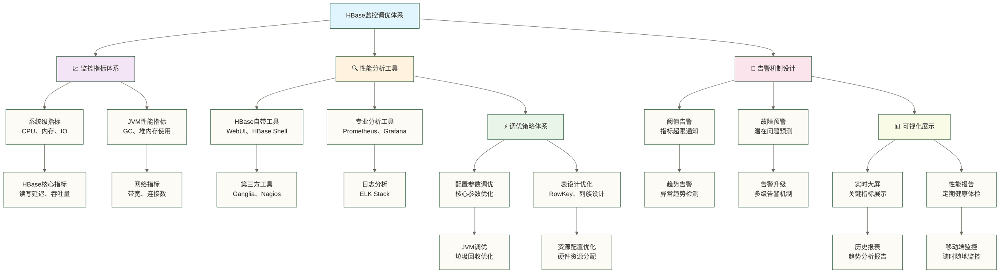

> [!warning] 关联材料边界
> 以下原引用目标缺失或无法唯一确认，已取消跳转并保留提及：12-高可用与容灾；10-性能调优实战。相关素材/延伸说明暂不可用，不能据此声称已经提供配套材料。

# HBase 监控与调优

> [!info] 前置知识
> - [[【技术与工具】/HBase/04-HBase环境搭建|HBase 环境搭建]] — 集群已搭建完成
> - [[【技术与工具】/HBase/08-表设计与模式|表设计与模式]] — 理解 RowKey 设计对性能的影响
> - [[【技术与工具】/HBase/02-HBase架构原理|HBase 架构原理]] — 熟悉 MemStore、BlockCache、WAL 等组件
> - JVM 基础知识（GC 类型、堆内存分区）有助于理解 GC 调优部分

HBase 的性能问题通常有三个来源：**设计问题**（RowKey 热点、列族数量过多）、**配置问题**（内存分配不合理、GC 频繁暂停）和**资源问题**（磁盘 IO 瓶颈、网络带宽不足）。监控的目的是快速区分这三类问题，调优的目的是针对性解决。

本文涵盖核心 JMX 指标解读、Prometheus + Grafana 监控接入、GC 调优参数配置和 RegionServer 内存优化。

## 🎯 监控调优体系全景图

### 📊 HBase监控体系架构



### 🎯 监控调优优先级

| 监控维度 | 重要程度 | 监控频率 | 调优难度 | 影响范围 |
|---|---|---|---|---|
| **核心性能指标** | ⭐⭐⭐⭐⭐ | 实时 | ⭐⭐⭐ | 整个集群 |
| **资源使用指标** | ⭐⭐⭐⭐ | 分钟级 | ⭐⭐ | 单节点 |
| **JVM性能指标** | ⭐⭐⭐⭐ | 分钟级 | ⭐⭐⭐⭐ | 单进程 |
| **网络IO指标** | ⭐⭐⭐ | 分钟级 | ⭐⭐ | 网络层 |
| **业务指标** | ⭐⭐⭐ | 小时级 | ⭐⭐⭐ | 应用层 |

## 📈 核心监控指标详解

### 🎯 HBase关键性能指标

#### 📊 读写性能指标

**1. 读操作性能指标**

| 指标名称 | 正常范围 | 告警阈值 | 监控意义 |
|---|---|---|---|
| **平均读延迟** | < 50ms | > 100ms | 用户体验直接指标 |
| **95%读延迟** | < 100ms | > 200ms | 长尾延迟控制 |
| **读取QPS** | 业务相关 | 下降30% | 系统处理能力 |
| **读取失败率** | < 0.1% | > 1% | 系统稳定性 |

**2. 写操作性能指标**

| 指标名称 | 正常范围 | 告警阈值 | 监控意义 |
|---|---|---|---|
| **平均写延迟** | < 20ms | > 50ms | 写入响应速度 |
| **95%写延迟** | < 50ms | > 100ms | 写入稳定性 |
| **写入QPS** | 业务相关 | 下降30% | 写入处理能力 |
| **写入失败率** | < 0.01% | > 0.1% | 数据可靠性 |

#### 🔧 HBase配置监控实现

```java
// HBase指标收集器
public class HBaseMetricsCollector {
    
    private final Admin admin;
    private final Connection connection;
    private final MetricRegistry metricRegistry;
    
    public HBaseMetricsCollector(Connection connection) {
        this.connection = connection;
        this.admin = connection.getAdmin();
        this.metricRegistry = new MetricRegistry();
        initializeMetrics();
    }
    
    // 1. 收集读写性能指标
    public void collectPerformanceMetrics() {
        try {
            // 获取集群状态
            ClusterMetrics clusterMetrics = admin.getClusterMetrics();
            
            // 读取性能指标
            collectReadMetrics(clusterMetrics);
            
            // 写入性能指标
            collectWriteMetrics(clusterMetrics);
            
            // 资源使用指标
            collectResourceMetrics(clusterMetrics);
            
        } catch (IOException e) {
            System.err.println("采集性能指标失败: " + e.getMessage());
        }
    }
    
    private void collectReadMetrics(ClusterMetrics metrics) {
        // 收集读取延迟
        double avgReadLatency = calculateAverageReadLatency(metrics);
        metricRegistry.histogram("hbase.read.latency.avg").update((long) avgReadLatency);
        
        // 收集读取QPS
        long readQPS = calculateReadQPS(metrics);
        metricRegistry.meter("hbase.read.qps").mark(readQPS);
        
        System.out.println(String.format("读取指标 - 平均延迟: %.2fms, QPS: %d", 
                           avgReadLatency, readQPS));
    }
    
    private void collectWriteMetrics(ClusterMetrics metrics) {
        // 收集写入延迟
        double avgWriteLatency = calculateAverageWriteLatency(metrics);
        metricRegistry.histogram("hbase.write.latency.avg").update((long) avgWriteLatency);
        
        // 收集写入QPS
        long writeQPS = calculateWriteQPS(metrics);
        metricRegistry.meter("hbase.write.qps").mark(writeQPS);
        
        System.out.println(String.format("写入指标 - 平均延迟: %.2fms, QPS: %d", 
                           avgWriteLatency, writeQPS));
    }
    
    // 2. JVM性能监控
    public void collectJVMMetrics() {
        MemoryMXBean memoryBean = ManagementFactory.getMemoryMXBean();
        
        // 堆内存使用
        MemoryUsage heapUsage = memoryBean.getHeapMemoryUsage();
        double heapUsedRatio = (double) heapUsage.getUsed() / heapUsage.getMax();
        
        metricRegistry.gauge("jvm.heap.used.ratio", () -> heapUsedRatio);
        
        // GC监控
        List<GarbageCollectorMXBean> gcBeans = ManagementFactory.getGarbageCollectorMXBeans();
        for (GarbageCollectorMXBean gcBean : gcBeans) {
            String gcName = gcBean.getName();
            long gcCount = gcBean.getCollectionCount();
            long gcTime = gcBean.getCollectionTime();
            
            metricRegistry.counter("jvm.gc.count." + gcName).inc(gcCount);
            metricRegistry.timer("jvm.gc.time." + gcName).update(gcTime, TimeUnit.MILLISECONDS);
        }
        
        System.out.println(String.format("JVM指标 - 堆内存使用率: %.2f%%", heapUsedRatio * 100));
    }
    
    // 辅助方法
    private double calculateAverageReadLatency(ClusterMetrics metrics) {
        // 计算平均读取延迟的逻辑
        return metrics.getAverageLoad(); // 简化示例
    }
    
    private long calculateReadQPS(ClusterMetrics metrics) {
        // 计算读取QPS的逻辑
        return metrics.getRegionCount(); // 简化示例
    }
    
    private double calculateAverageWriteLatency(ClusterMetrics metrics) {
        // 计算平均写入延迟的逻辑
        return metrics.getAverageLoad() * 0.8; // 简化示例
    }
    
    private long calculateWriteQPS(ClusterMetrics metrics) {
        // 计算写入QPS的逻辑
        return metrics.getRegionCount() * 2; // 简化示例
    }
}
```

上面的 `HBaseMetricsCollector` 是尚未补齐实现的 Java 指标采集框架，不能直接运行。`admin.getClusterMetrics()` 可获取集群及 RegionServer 的部分状态信息，但 `getAverageLoad()` 表示平均 Region 负载，`getRegionCount()` 表示 Region 数量，二者不能代替读写延迟或 QPS；示例中的相关计算方法仅为占位，需按目标版本接入真实延迟指标，并对累计请求数按采样时间差分计算速率。`ManagementFactory.getGarbageCollectorMXBeans()` 获取 JVM GC 信息，`gcBean.getCollectionTime()` 统计 GC 总耗时，这个指标是判断 JVM 调优是否有效的核心依据。在实际生产中，通常将这些指标推送到 Prometheus，再通过 Grafana 展示。

**教学假设的根因分析（以下数值为原稿未核实示例，不能据此认定实际根因；命中率基线需结合工作负载确定）：**
1. BlockCache命中率下降到60%（正常应该>85%）
2. Minor Compaction频繁执行
3. GC时间增长，平均GC时间200ms

**解决方案：**

```xml
<!-- 调优配置 -->
<property>
    <name>hfile.block.cache.size</name>
    <value>0.35</value> <!-- 从0.25增加到0.35 -->
</property>

<property>
    <name>hbase.hstore.compactionThreshold</name>
    <value>5</value> <!-- 从3调整到5，减少小文件合并频率 -->
</property>

<property>
    <name>hbase.hstore.blockingStoreFiles</name>
    <value>20</value> <!-- 从10调整到20 -->
</property>
```

**教学假设的效果验证（以下为原稿未核实的示例结果，不代表实测成绩）：**
- 读取延迟降回50ms以下
- BlockCache命中率提升到90%+
- GC时间减少到50ms以下

### 🚀 案例2：优化写入性能瓶颈

**问题描述（教学假设）：** 假设批量数据导入期望10万QPS，而观测值为3万QPS；数字保留自原稿，未提供实测依据。

**优化策略：**

```java
// 批量写入优化代码
public class WritePerformanceOptimizer {
    
    public void optimizedBulkWrite(Table table, List<Put> puts) throws IOException {
        System.out.println("🚀 执行优化的批量写入...");
        
        // 1. 跳过WAL（仅限源数据可重放且明确接受未持久化数据丢失的导入场景）
        puts.forEach(put -> put.setDurability(Durability.SKIP_WAL));
        
        // 2. 设置合适的批次大小
        int batchSize = 1000;
        List<List<Put>> batches = partitionList(puts, batchSize);
        
        // 3. 多线程并发写入
        ExecutorService executor = Executors.newFixedThreadPool(10);
        CountDownLatch latch = new CountDownLatch(batches.size());
        
        for (List<Put> batch : batches) {
            executor.submit(() -> {
                try {
                    table.put(batch);
                    System.out.println(String.format("✅ 批次写入完成，大小: %d", batch.size()));
                } catch (IOException e) {
                    System.err.println("❌ 批次写入失败: " + e.getMessage());
                } finally {
                    latch.countDown();
                }
            });
        }
        
        try {
            latch.await();
            System.out.println("批量写入任务均已结束；本示例未汇总失败结果，不能据此确认全部写入成功。");
        } catch (InterruptedException e) {
            Thread.currentThread().interrupt();
        } finally {
            executor.shutdown();
        }
    }
    
    private <T> List<List<T>> partitionList(List<T> list, int batchSize) {
        List<List<T>> partitions = new ArrayList<>();
        for (int i = 0; i < list.size(); i += batchSize) {
            partitions.add(list.subList(i, Math.min(i + batchSize, list.size())));
        }
        return partitions;
    }
}
```

`WritePerformanceOptimizer` 展示了批量写入优化的三个关键技术：1) `setDurability(SKIP_WAL)` 跳过 WAL 写入；原稿中的速度提升 3-5 倍是未核实的教学假设，实际收益须压测。RegionServer 崩溃时可能丢失尚未刷盘的数据，仅适用于源数据可重放且明确接受该风险的导入；2) 将大批次拆分为 1000 条的小批次，避免单次 RPC 请求过大导致超时；3) 10 线程并发提交，充分利用多 RegionServer 的并发处理能力。生产中建议使用 `BufferedMutator`（HBase 客户端的异步写入缓冲区）替代手写线程池，其内部已实现自动分批和错误重试。

**配置优化：**

```xml
<!-- 写入性能优化配置 -->
<property>
    <name>hbase.regionserver.handler.count</name>
    <value>300</value> <!-- 增加处理线程 -->
</property>

<property>
    <name>hbase.hregion.memstore.flush.size</name>
    <value>268435456</value> <!-- 256MB，增大刷盘阈值 -->
</property>

<property>
    <name>hbase.regionserver.global.memstore.size</name>
    <value>0.5</value> <!-- 增加MemStore总大小 -->
</property>
```

**教学假设的性能结果（以下数字保留自原稿，未经实测核验，不构成优化收益承诺）：**
- 写入QPS从3万提升到8万+
- 批量导入时间减少60%
- CPU利用率更加均衡

## 🎯 长期监控和容量规划

### 📊 容量规划模型

```python
# 容量规划计算器
class HBaseCapacityPlanner:
    
    def __init__(self):
        self.growth_rate = 0.3  # 年增长率30%
        self.safety_factor = 1.5  # 安全系数
        
    def calculate_storage_capacity(self, current_data_size_gb, months_ahead=12):
        """计算存储容量需求"""
        print("📊 计算存储容量需求...")
        
 # 基于增长率预测
        future_size = current_data_size_gb * (1 + self.growth_rate) ** (months_ahead / 12)
        
 # 考虑副本和安全系数
        replica_factor = 3  # HDFS默认3副本
        total_needed = future_size * replica_factor * self.safety_factor
        
        print(f"   当前数据量: {current_data_size_gb:.2f} GB")
        print(f"   预测数据量: {future_size:.2f} GB ({months_ahead}个月后)")
        print(f"   建议总容量: {total_needed:.2f} GB (含副本和安全系数)")
        
        return total_needed
    
    def calculate_server_capacity(self, peak_qps, avg_latency_ms=50):
        """计算服务器容量需求"""
        print("🖥️ 计算服务器容量需求...")
        
 # 基于QPS和延迟计算并发数
        concurrent_requests = peak_qps * (avg_latency_ms / 1000)
        
 # 每台RegionServer处理能力（经验值）
        server_capacity = 5000  # 每台服务器5000 QPS
        
        needed_servers = max(concurrent_requests / 100, peak_qps / server_capacity)
        from math import ceil
        needed_servers = max(1, ceil(needed_servers * self.safety_factor))
        
        print(f"   峰值QPS: {peak_qps}")
        print(f"   并发请求数: {concurrent_requests:.0f}")
        print(f"   建议RegionServer数量: {needed_servers}")
        
        return needed_servers

# 使用示例
planner = HBaseCapacityPlanner()

# 容量规划计算
storage_needed = planner.calculate_storage_capacity(1000)  # 当前1TB数据
servers_needed = planner.calculate_server_capacity(50000)  # 峰值5万QPS

print("\n🎯 容量规划建议:")
print(f"   💾 存储容量: {storage_needed:.0f} GB")
print(f"   🖥️ 服务器数量: {servers_needed} 台")
print(f"   💰 预估成本: ${(storage_needed * 0.1 + servers_needed * 500):.0f}/月")
```

## 💡 监控调优最佳实践

### 🌟 日常运维检查清单

> [!note]
> ## 🔍 HBase日常巡检清单
>
> ### 每日检查项 (5-10分钟)
> - [ ] 📊 检查监控大屏，确认核心指标正常
> - [ ] 🚨 查看告警记录，处理待解决问题
> - [ ] 📈 查看QPS和延迟趋势，识别异常波动
> - [ ] 💾 检查磁盘使用率，预警空间不足
> - [ ] 🔄 检查备份任务执行状态
>
> ### 每周检查项 (30分钟)
> - [ ] 📊 分析性能趋势报告
> - [ ] 🗑️ 检查GC性能，优化JVM参数
> - [ ] 🔧 检查压缩任务，确保存储效率
> - [ ] 📋 检查表和Region分布，识别热点
> - [ ] 🔍 检查慢查询日志，优化应用逻辑
>
> ### 每月检查项 (2小时)
> - [ ] 📈 进行容量规划分析
> - [ ] 🔧 评估配置参数，进行调优
> - [ ] 🧪 执行性能压测，验证系统能力
> - [ ] 📚 更新运维文档和应急预案
> - [ ] 🎓 团队技术分享和培训

### 🎯 性能调优原则

**📏 调优的黄金法则：**

1. **🎯 目标明确**：先确定具体的性能目标
2. **📊 数据驱动**：基于监控数据做决策，不凭感觉
3. **🔄 渐进优化**：一次只调整一个参数，观察效果
4. **📋 记录变更**：详细记录每次调优的参数和效果
5. **🧪 验证效果**：调优后必须验证性能改善

**⚠️ 调优的常见误区：**

- ❌ 同时调整多个参数，无法确定哪个起作用
- ❌ 盲目复制其他环境的配置
- ❌ 过度优化，为了追求极致性能牺牲稳定性
- ❌ 忽略业务特征，使用通用配置
- ❌ 调优后不监控，不知道长期效果

---

## JMX 关键指标速查

HBase 通过 JMX 暴露大量内部指标。以下是生产中最常用的指标，可通过 `http://regionserver_host:16030/jmx` 查看原始数据。

### RegionServer 核心指标

| 指标名称（JMX Bean） | 含义 | 正常范围 | 告警阈值 |
|---|---|---|---|
| `hbase.regionserver:ReadRequestCount` | 累计读请求数 | 持续增长 | 差分计算的请求速率下降 50%（示例阈值，需排除重启造成的计数重置） |
| `hbase.regionserver:WriteRequestCount` | 累计写请求数 | 持续增长 | 差分计算的请求速率下降 50%（示例阈值，需排除重启造成的计数重置） |
| `hbase.regionserver:MemStoreSize` | 当前 MemStore 使用量（字节） | < 堆内存×0.35 | > 堆内存×0.4 |
| `hbase.regionserver:BlockCacheHitCount` | BlockCache 命中次数 | 命中率 > 85% | 命中率 < 70% |
| `hbase.regionserver:BlockCacheMissCount` | BlockCache 未命中次数 | — | 未命中率 > 30% |
| `hbase.regionserver:FlushQueueLength` | Flush 队列长度 | 0-2 | > 5（写入被限速） |
| `hbase.regionserver:CompactionQueueLength` | Compaction 队列长度 | 0-5 | > 20（IO 积压） |
| `hbase.regionserver:StoreFileCount` | HFile 文件总数 | — | 单 Store > 30（Compaction 滞后）|

### JVM GC 指标

```bash
# 通过 jstat 实时查看 RegionServer GC 状态
# 找到 HRegionServer 的 PID
jps | grep HRegionServer

# 每秒打印一次 GC 统计（替换 PID）
jstat -gcutil <PID> 1000

# 关键输出列说明：
# S0/S1: Survivor 区使用率
# E: Eden 区使用率
# O: Old Gen 使用率（超过 80% 警惕 Full GC）
# M: Metaspace 使用率
# YGC/YGCT: Young GC 次数/耗时（Young GC 每次 < 100ms 为正常）
# FGC/FGCT: Full GC 次数/耗时（生产环境 Full GC 应极少发生）
```

### Prometheus 接入 HBase 指标

```yaml
# prometheus.yml — HBase JMX Exporter 配置
# 需要在每个 HMaster 和 RegionServer 上运行 jmx_prometheus_javaagent

scrape_configs:
  - job_name: 'hbase-master'
    static_configs:
      - targets: ['hbase-master:7000']   # jmx_exporter 端口

  - job_name: 'hbase-regionserver'
    static_configs:
      - targets:
          - 'hbase-worker1:7001'
          - 'hbase-worker2:7001'
```

```bash
# 在 hbase-env.sh 中添加 jmx_prometheus_javaagent
# 下载：https://repo1.maven.org/maven2/io/prometheus/jmx/jmx_prometheus_javaagent/

# HMaster
export HBASE_MASTER_OPTS="$HBASE_MASTER_OPTS \
  -javaagent:/opt/jmx_exporter/jmx_prometheus_javaagent.jar=7000:/opt/jmx_exporter/hbase.yml"

# RegionServer
export HBASE_REGIONSERVER_OPTS="$HBASE_REGIONSERVER_OPTS \
  -javaagent:/opt/jmx_exporter/jmx_prometheus_javaagent.jar=7001:/opt/jmx_exporter/hbase.yml"
```

---

## GC 调优参数详解

G1GC 可作为 HBase 的候选收集器，但选择需结合 HBase/JDK 兼容性、堆规模与压测结果；CMS 已在 JDK 14 移除，不适用于该版本及之后的 JDK。以下保留的是面向 JDK 8 HotSpot 的待验证配置示例，其中 GC 日志参数不应直接用于较新 JDK，不能视为通用生产推荐：

```bash
# hbase-env.sh — RegionServer JVM 配置（机器内存 32 GB）
export HBASE_REGIONSERVER_OPTS="\
  -Xms16g -Xmx16g \
  -XX:+UseG1GC \
  -XX:+UnlockExperimentalVMOptions \
  -XX:MaxGCPauseMillis=100 \
  -XX:G1HeapRegionSize=32m \
  -XX:InitiatingHeapOccupancyPercent=65 \
  -XX:G1NewSizePercent=10 \
  -XX:G1MaxNewSizePercent=30 \
  -XX:+ParallelRefProcEnabled \
  -XX:+DisableExplicitGC \
  -XX:+PrintGCDetails \
  -XX:+PrintGCDateStamps \
  -Xloggc:/opt/hbase/logs/gc-regionserver.log \
  -XX:+UseGCLogFileRotation \
  -XX:NumberOfGCLogFiles=5 \
  -XX:GCLogFileSize=100m"
```

| G1GC 参数 | 含义 | 建议值 |
|---|---|---|
| `-XX:MaxGCPauseMillis` | GC 停顿时间目标（ms），不是最大停顿保证 | 50-200 为待压测示例，100 不是通用必选值 |
| `-XX:G1HeapRegionSize` | G1 Region 大小（1-32 MB，2 的幂）| 堆大小 / 2048，最大 32 MB |
| `-XX:InitiatingHeapOccupancyPercent` | 并发标记触发占用率；启用自适应 IHOP 时还受预测机制影响 | 65 为原稿待验证示例；提高阈值可能使标记启动过晚，须结合分配速率、标记耗时与目标 JDK 验证 |
| `-XX:G1NewSizePercent` | Young 区最小占堆比例 | 10 |
| `-XX:G1MaxNewSizePercent` | Young 区最大占堆比例 | 30（避免 Young 区过大导致长时间 YGC） |
| `-XX:+DisableExplicitGC` | 禁止 `System.gc()` 触发 Full GC | 强烈建议开启 |

> [!warning] RegionServer 大堆需核验压缩指针与 GC 行为
> 压缩普通对象指针是否启用取决于 JVM 实现、堆大小及对象对齐等条件，32 GB 不是所有环境的固定分界。关闭压缩普通对象指针后，普通对象引用通常从 4 字节变为 8 字节；原稿中的内存开销增加 30-40% 未经核实，实际增幅取决于对象布局。16-32 GB 仅作为待压测的堆大小示例，应核验 JVM 启动信息，并同时为堆外缓存、线程栈及操作系统预留内存。

---

## RegionServer 内存分配模型

RegionServer 的堆内存（设为 H）需要容纳 MemStore、堆内 BlockCache 及其他堆对象。以下比例仅为示意，MemStore 与堆内 BlockCache 的预算需给其他堆对象留出空间；线程栈及堆外 BucketCache 等还需单独计入进程和机器内存预算：

```text
堆内存 H
├── MemStore 上限：H × 0.40（参数：hbase.regionserver.global.memstore.size）
│   └── 单个 Region 的 MemStore 刷盘阈值示例：128 MB（hbase.hregion.memstore.flush.size；其他触发条件另计）
├── BlockCache：H × 0.40（参数：hfile.block.cache.size）
│   ├── 单一 LRU 模式（默认）
│   └── BucketCache 堆外模式（大内存机器推荐，避免 GC 压力）
└── 其他堆对象（RPC 对象等）：~H × 0.20（示意；线程栈另计，RPC 缓冲可能包含堆外部分）
```

**在采用常见堆内预算校验的配置中，MemStore 与堆内 BlockCache 的配置比例之和应不高于 0.80**；超过该界限可能在配置检查时被拒绝，并非按这个总和直接触发运行期写入限制。运行期刷盘和写入阻塞还受全局 MemStore 水位、单 Region 条件及 StoreFile 数量等影响，须按目标 HBase 版本核验。

### BucketCache 配置（堆外缓存，适合 64 GB+ 内存机器）

```xml
<!-- hbase-site.xml — 启用堆外 BucketCache -->
<property>
    <name>hbase.bucketcache.ioengine</name>
    <value>offheap</value>
</property>
<property>
    <name>hbase.bucketcache.size</name>
    <!-- 堆外内存大小（MB），通常设为 JVM 堆大小的 2-4 倍 -->
    <value>32768</value>
</property>
<!-- 同时适当降低堆内 BlockCache -->
<property>
    <name>hfile.block.cache.size</name>
    <value>0.20</value>
</property>
```

---

## 掌握检查

- [ ] 能解释单 Region MemStore 大小和全局 MemStore 水位如何影响 flush，并按实际配置区分刷盘触发与写入阻塞；128 MB、40% 仅为文中示例，触发条件不止这两项
- [ ] 知道 BlockCache 命中率低于 70% 时应该排查哪些原因
- [ ] 能解释 G1GC 的 `InitiatingHeapOccupancyPercent` 参数，并通过目标 JDK 的 GC 日志和压测判断是否需要调整，而非固定调高到 65
- [ ] 能按目标 JVM 核验压缩普通对象指针是否启用，并结合 GC 压测及堆外内存预算选择堆大小，不将 32 GB 视为固定上限
- [ ] 能通过 `jstat -gcutil` 命令判断是否存在 Full GC 问题

## 实践练习

1. **基础题**：用 `jstat -gcutil` 监控一个运行中的 RegionServer 进程 30 秒，记录 Young GC 次数和平均耗时，判断 GC 是否健康。
2. **进阶题**：模拟 BlockCache 命中率下降的场景（关闭 BlockCache 或加大数据量），对比开关 BlockCache 前后 `get` 操作的延迟差异。
3. **挑战题**：部署 Prometheus + Grafana，采集 HBase JMX 指标，为 MemStore 大小和 Compaction 队列长度创建告警规则（告警阈值自行设定并说明理由）。

## 下一步

- 高可用与容灾（原引用“12-高可用与容灾”未能确定有效目标，暂不可跳转） — 学习 HBase 多 Master 配置和跨集群复制
- 性能调优实战（原引用“10-性能调优实战”未能确定有效目标，暂不可跳转） — 深入读写路径优化、Compaction 策略调整

---

**创建时间**：2024-12-11
**更新时间**：2026-03-21
**预计学习时长**：90 分钟

#HBase #监控 #调优 #JMX #GC调优 #RegionServer #Prometheus #性能