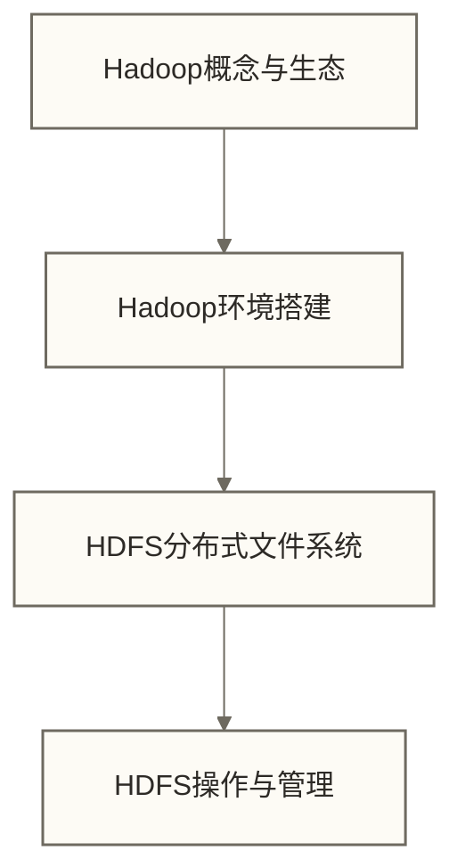
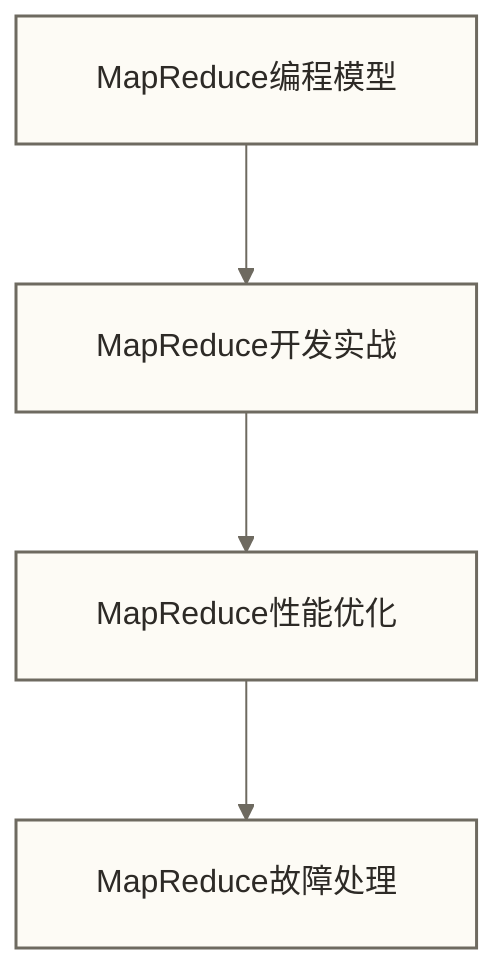
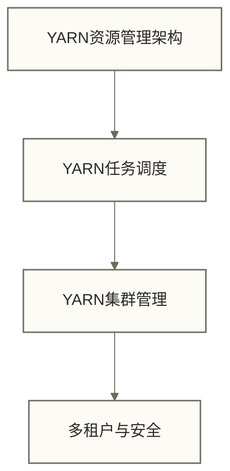
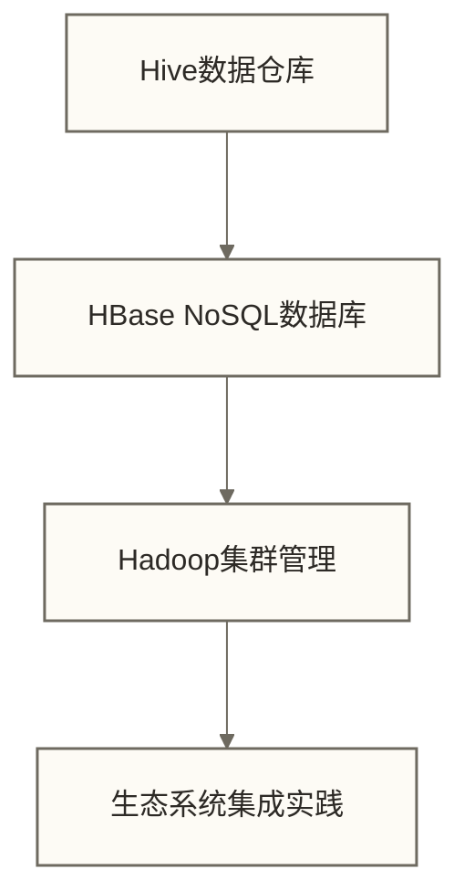
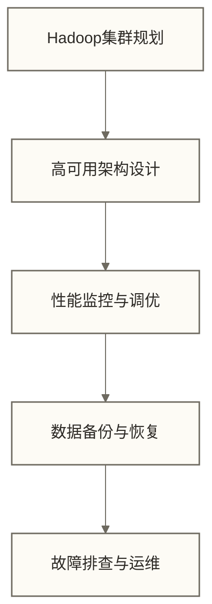
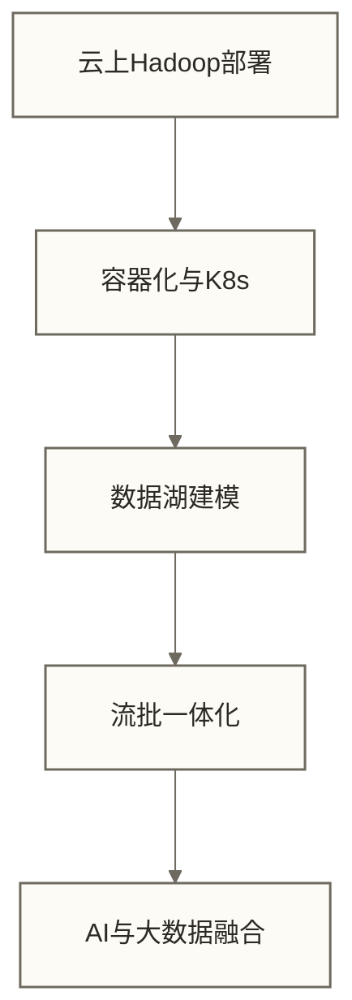
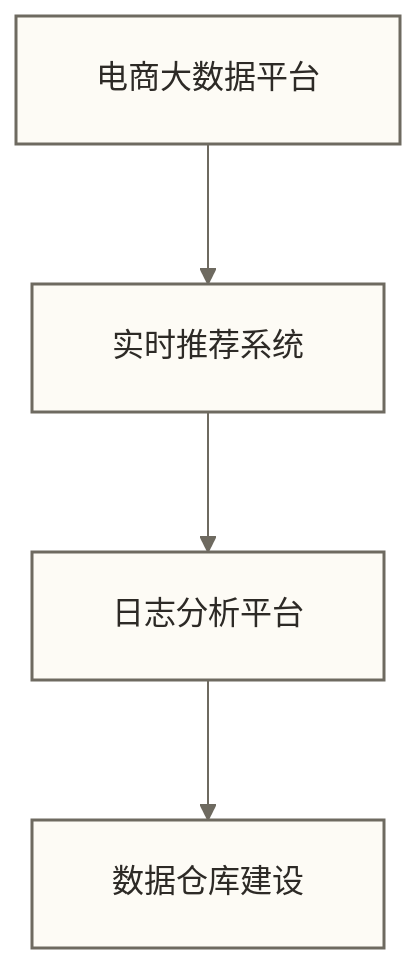

# 🐘 Hadoop学习路线图 - 大数据生态系统入门指南

> [!abstract] 📋 学习路线概览
> - 🎯 **学习目标**：系统掌握Hadoop大数据生态系统的核心组件和应用
> - 📚 **适用人群**：大数据工程师、数据分析师、后端开发者、系统架构师
> - ⏱️ **总体用时**：建议6-12个月系统学习
> - 🎓 **预期学习成果**：通过配套练习与项目验收，逐步形成大数据平台搭建、数据处理和分析能力；完成阅读或按建议时长学习不保证达到该能力

> [!tip] 💡 与其他技术栈的关系
> Hadoop是大数据处理的基础平台，与 SQL 和 Python 结合使用效果更佳

## 🎯 学习阶段划分

### 🟢 第一阶段：Hadoop基础入门（2-3周）
**目标**：理解大数据概念，掌握Hadoop核心架构



**学习文件顺序**：
1. [[【技术与工具】/Hadoop/01-Hadoop概念与生态|Hadoop概念与生态]] - 大数据背景、Hadoop生态系统、核心组件
2. [[【技术与工具】/Hadoop/02-Hadoop环境搭建|Hadoop环境搭建]] - 单机模式、伪分布式、完全分布式搭建
3. [[【技术与工具】/Hadoop/03-HDFS分布式文件系统|HDFS分布式文件系统]] - HDFS架构原理、数据存储机制
4. [[【技术与工具】/Hadoop/04-HDFS操作与管理|HDFS操作与]] - 命令行操作、Java API、管理维护

> [!tip] 💡 第一阶段重点
> - 理解分布式存储的核心思想
> - 掌握HDFS的基本操作和原理
> - 搭建可用的Hadoop开发环境
> 
> **初学者教学假设案例（原稿未提供核实材料）** 🎆
> 👨‍💻 **小李，假设的后端开发工程师（以下叙述仅用于教学，不代表已核实的真人经历或晋升承诺）**："刚开始觉得Hadoop很复杂，用'智能仓储物流中心'的比喻理解后，突然明白了分布式存储的精髓！现在我负责公司的大数据平台搭建，从普通开发晋升为大数据架构师！"

---

### 🟡 第二阶段：MapReduce计算框架（3-4周）
**目标**：掌握分布式计算编程模型和优化技巧



**学习文件顺序**：
5. [[【技术与工具】/Hadoop/05-MapReduce编程模型|MapReduce编程]] - MapReduce原理、编程范式、执行流程
6. [[【技术与工具】/Hadoop/06-MapReduce开发实战|MapReduce开发]] - Java编程、常见算法实现
7. [[【技术与工具】/Hadoop/07-MapReduce性能优化|MapReduce性能优化]] - 调优参数、数据倾斜、资源配置
8. [[【技术与工具】/Hadoop/08-MapReduce故障处理|MapReduce故障处理]] - 容错机制、任务调试、问题排查

> [!tip] 💡 第二阶段重点
> - 掌握MapReduce的编程思维
> - 学会处理大数据计算中的常见问题
> - 理解分布式计算的容错机制

---

### 🟠 第三阶段：YARN资源管理（2-3周）
**目标**：理解集群资源管理和任务调度机制



**学习文件顺序**：
9. [[【技术与工具】/Hadoop/09-YARN资源管理架构|YARN资源管理]] - ResourceManager、NodeManager、Container
10. [[【技术与工具】/Hadoop/10-YARN任务调度|YARN任务调度]] - 调度器类型、队列管理、资源分配
11. [[【技术与工具】/Hadoop/11-YARN集群管理|YARN集群]] - 集群监控、日志管理、性能调优
12. 多租户与安全 - 用户权限、资源隔离、Kerberos认证

> [!tip] 💡 第三阶段重点
> - 理解现代大数据平台的资源管理模式
> - 掌握集群运维和监控技能
> - 学会多用户环境下的资源配置

---

### 🔴 第四阶段：Hadoop生态系统（3-4周）
**目标**：掌握Hadoop生态的核心组件和集成应用



**学习文件顺序**：
13. [[【技术与工具】/Hadoop/13-Hive数据仓库|Hive数据仓库]] - Hadoop生态中的SQL引擎和数据仓库建模
14. [[【技术与工具】/Hadoop/14-HBase NoSQL数据库|HBase NoSQL数据库]] - Hadoop生态中的实时存储解决方案
15. [[【技术与工具】/Hadoop/11-YARN集群管理|YARN集群]] - 集群部署、监控和运维管理

> [!note] 🔗 生态组件深入学习
> 除了Hadoop核心组件外，生态系统还包含众多专业技术栈：
> 
> **🏢 企业级数据库与仓库**：
> - **[[【技术与工具】/Oracle/00-Oracle学习路线图|Oracle]]** - 企业级关系数据库和数据仓库解决方案
> - **[[【技术与工具】/PostgreSQL/00-PostgreSQL学习路线图|PostgreSQL]]** - 开源关系数据库，支持复杂查询和扩展
> - **[[【技术与工具】/MySQL/00-MySQL学习路线图|MySQL]]** - 轻量级关系数据库，适合中小型应用
> 
> **📊 现代化分析型数据库**：  
> - **[[【技术与工具】/ClickHouse/00-ClickHouse学习路线图|ClickHouse]]** - 高性能列式数据库，适合OLAP分析
> - **[[【技术与工具】/Greenplum/00-Greenplum学习路线图|Greenplum]]** - MPP架构的数据仓库平台
> - **[[【技术与工具】/Impala/00-Impala学习路线图|Impala]]** - Hadoop生态的高性能SQL引擎
> - **[[【技术与工具】/Presto/00-Presto学习路线图|Presto]]** - 分布式SQL查询引擎，支持多数据源
> 
> **🔄 数据集成与流处理**：
> - **[[【技术与工具】/Flume/00-Flume学习路线图|Flume]]** - 高可靠的数据采集和传输系统
> - **[[【技术与工具】/Kafka/00-Kafka学习路线图|Kafka]]** - 分布式流处理平台和消息队列
> - **[[【技术与工具】/Flink/00-Flink学习路线图|Flink]]** - 统一的流批处理计算引擎
> 
> **🚀 现代化计算与存储**：
> - **[[【技术与工具】/Spark/00-Spark学习路线图|Spark]]** - 支持内存计算的引擎；原稿“比MapReduce快100倍”为未核实的性能说法，不作为选型依据，实际性能取决于工作负载、资源与配置
> - **[[【技术与工具】/Hudi/00-Hudi学习路线图|Hudi]]** - 增量数据处理框架，支持数据湖场景
> - **[[【技术与工具】/Doris/00-Doris学习路线图|Doris]]** - 现代化MPP数据库，适合实时分析
> 
> **💻 编程语言与开发工具**：
> - **[[【技术与工具】/Java/00-Java学习路线图|Java]]** - Hadoop生态主要开发语言
> - **[[【技术与工具】/Python/00-Python学习路线图|Python]]** - 数据分析和机器学习首选语言
> - **[[【技术与工具】/Scala/00-Scala学习路线图|Scala]]** - Spark等现代大数据框架的原生语言
> - **[[【技术与工具】/PostgreSQL/00-PostgreSQL学习路线图|PostgreSQL]]** - 支持使用SQL进行数据查询和分析的关系数据库系统

> [!tip] 💡 第四阶段重点
> - 理解不同组件的适用场景和优势
> - 掌握生态系统的整体架构设计
> - 学会根据业务需求选择合适的技术栈

---

### 🟣 第五阶段：企业级部署与运维（5-6周）
**目标**：掌握生产环境的部署、监控和运维技能



**学习文件顺序**：
18. [[【技术与工具】/Hadoop/18-Hadoop集群规划|Hadoop集群规划]] - 硬件选型、网络规划、容量评估、成本控制
19. [[【技术与工具】/Hadoop/19-高可用架构设计|高可用架构]] - NameNode HA、ResourceManager HA、自动故障转移
20. [[【技术与工具】/Hadoop/20-性能监控与调优|性能监控与调优]] - 监控体系建设、性能分析、智能告警
21. [[【技术与工具】/Hadoop/21-数据备份与恢复|数据备份与恢复]] - 数据保护策略、灾备方案、自动化备份
22. [[【技术与工具】/Hadoop/22-故障排查与运维|故障排查与运维]] - 故障诊断、运维自动化、DevOps实践

> [!tip] 💡 第五阶段重点
> - 掌握企业级Hadoop集群的设计和部署
> - 学会生产环境的监控和运维
> - 具备处理大规模集群问题的能力

---

### 🔵 第六阶段：云原生与新技术（4-5周）
**目标**：了解Hadoop在云计算时代的发展和应用



**学习文件顺序**：
23. 云上Hadoop部署 - AWS EMR、Azure HDInsight、阿里云EMR
24. 容器化与Kubernetes - Docker化部署、Kubernetes Operator、云原生架构
25. 数据湖架构 - Delta Lake、Iceberg、数据湖vs数据仓库
26. 流批一体化 - Flink实时计算、Lambda架构演进
27. AI与大数据融合 - MLflow、Feature Store、大数据+AI平台

> [!tip] 💡 第六阶段重点
> - 理解大数据技术的发展趋势
> - 掌握云原生大数据平台的特点
> - 了解AI时代对大数据架构的要求

---

### 🎓 第七阶段：项目实战与案例（持续学习）
**目标**：通过实际项目提升综合解决问题的能力



**学习文件顺序**：
28. 电商大数据平台 - 用户行为分析、商品推荐、实时大屏
29. 高级分析技术学习 - 特征工程、模型训练、在线服务
30. 日志分析平台 - 日志收集、实时分析、异常检测
31. 数据仓库建设 - 维度建模、ETL流程、数据治理

---

## 📅 建议学习计划

### 🗓️ 大数据工程师学习计划（8个月）
```text
第1-3周：Hadoop基础 + HDFS掌握
第4-7周：MapReduce深入学习
第8-10周：YARN资源管理
第11-18周：生态系统组件（重点）
第19-26周：企业级部署运维
第27-32周：项目实战
```

### 🗓️ 数据分析师学习计划（6个月）
```text
第1-2周：Hadoop概念理解
第3-4周：HDFS基础操作
第5-8周：Hive数据仓库（重点）
第9-12周：Spark数据分析
第13-18周：HBase数据库
第19-24周：实际项目应用
```

### 🗓️ 后端开发者学习计划（4个月）
```text
第1-2周：Hadoop架构理解
第3-6周：MapReduce编程
第7-10周：YARN + 生态系统
第11-16周：API开发和集成
```

### 🗓️ 系统架构师学习计划（10个月）
```text
第1-4周：全面了解Hadoop生态
第5-12周：深入各核心组件
第13-20周：企业级架构设计
第21-28周：性能优化和运维
第29-40周：新技术和趋势研究
```

---

## 🛠️ 学习环境准备

### 开发环境推荐

```bash title="基础环境要求"
# 硬件要求
- CPU: 4核心以上
- 内存: 16GB以上（推荐32GB）
- 磁盘: 500GB以上SSD
- 网络: 千兆网卡

# 软件环境
- 操作系统: Ubuntu 20.04 LTS / CentOS 7+
- Java: OpenJDK 8 / 11
- Python: 3.7+
- Docker: 最新版本
```

### 学习资源清单

**官方资源**：
- [Apache Hadoop官网](https://hadoop.apache.org/)
- [Hadoop生态集成 Wiki](https://cwiki.apache.org/confluence/display/HADOOP)
- [Cloudera文档](https://docs.cloudera.com/)

**开发工具**：
- IntelliJ IDEA / Eclipse
- Ambari / Cloudera Manager  
- Hadoop命令行工具
- Spark Shell / Hive Beeline

**学习平台**：
- Cloudera University
- Hortonworks Training
- Coursera大数据课程

---

## 🎯 职业发展路径

### 👨‍💻 大数据开发工程师
**核心技能**：
- Hadoop生态系统开发
- Spark/Flink实时计算
- 数据ETL流程设计
- 性能调优和故障排查

### 🏗️ 大数据架构师
**核心技能**：
- 大数据平台架构设计
- 技术选型和方案评估
- 团队技术指导
- 新技术研究和应用

### 📊 数据工程师
**核心技能**：
- 数据管道构建
- 数据质量保障
- 数据仓库建模
- 数据治理体系

### ☁️ 云计算工程师
**核心技能**：
- 云上大数据服务
- 容器化部署
- 自动化运维
- 成本优化

---

## 🔗 学习建议

> [!tip] 💡 Hadoop学习要点
> 1. **理论与实践结合**：边学边做，多动手搭建环境
> 2. **生态系统思维**：不要孤立学习单个组件
> 3. **关注业务场景**：理解不同组件的适用场景
> 4. **持续关注发展**：大数据技术更新很快
> 5. **社区参与**：加入相关技术社区和讨论群

> [!example] 📋 实践建议
> - 使用虚拟机搭建多节点集群
> - 完成每个组件的Hello World项目
> - 尝试解决实际的数据处理问题
> - 关注性能指标和优化方法
> - 学习阅读源码和社区文档

---

## 🔗 相关知识库

学习Hadoop过程中，建议同时参考：

- **[[【技术与工具】/PostgreSQL/00-PostgreSQL学习路线图|PostgreSQL]]** - 数据查询和分析基础
- **[[【技术与工具】/Python/00-Python学习路线图|Python]]** - 数据处理和机器学习
- **[[【技术与工具】/Spark/00-Spark学习路线图|Spark]]** - 现代大数据计算引擎

---

*最后更新：2024-06-29* 