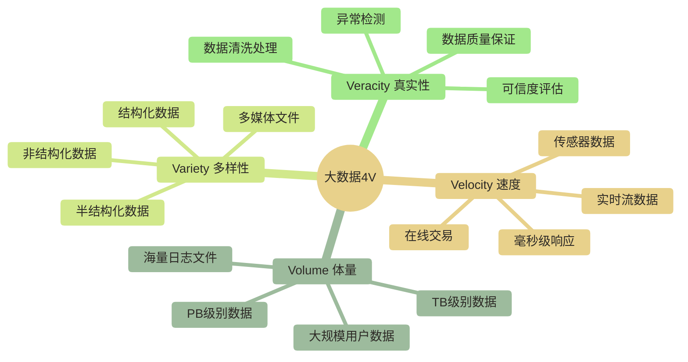
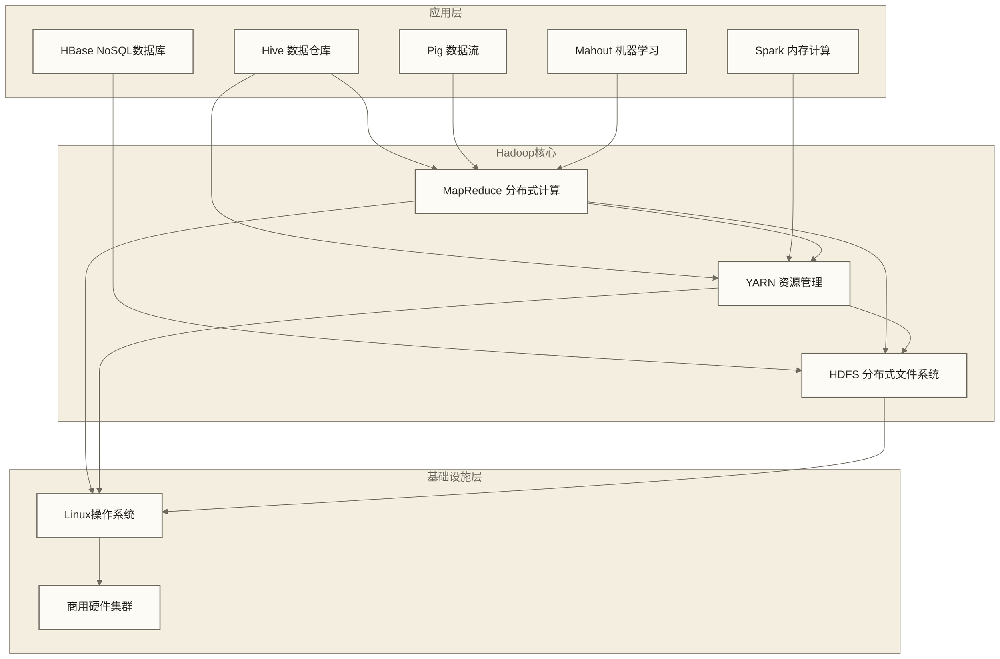
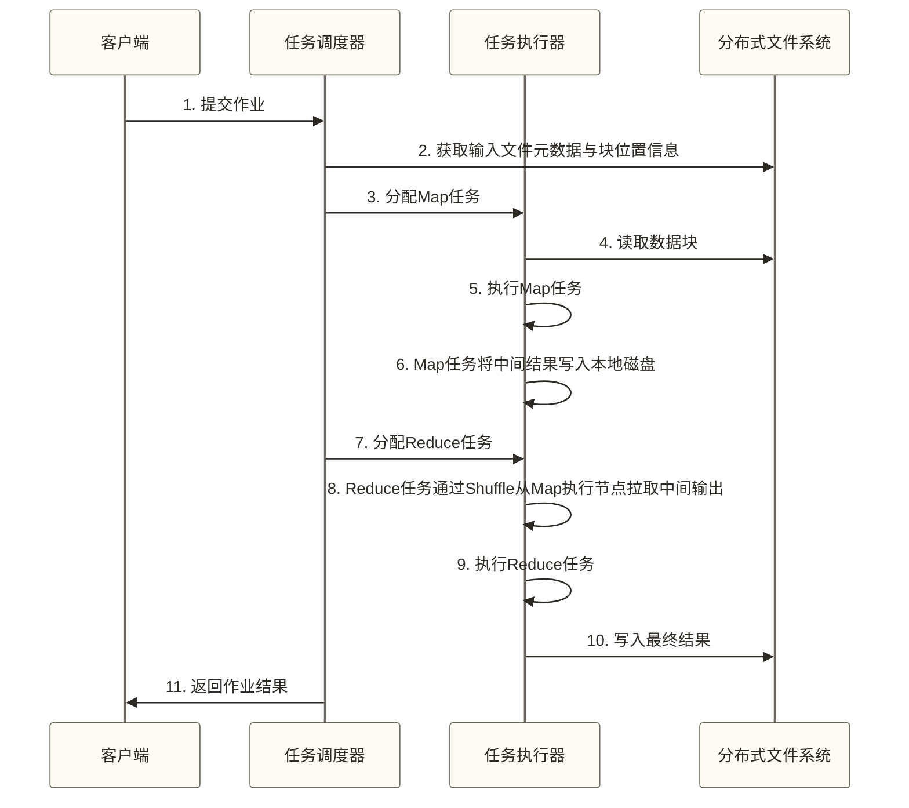
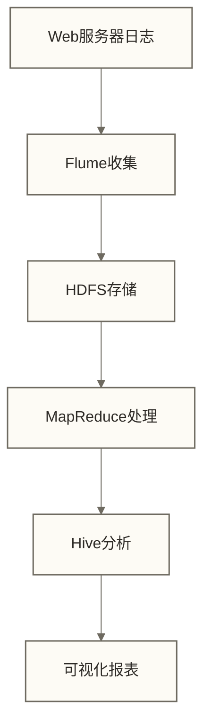
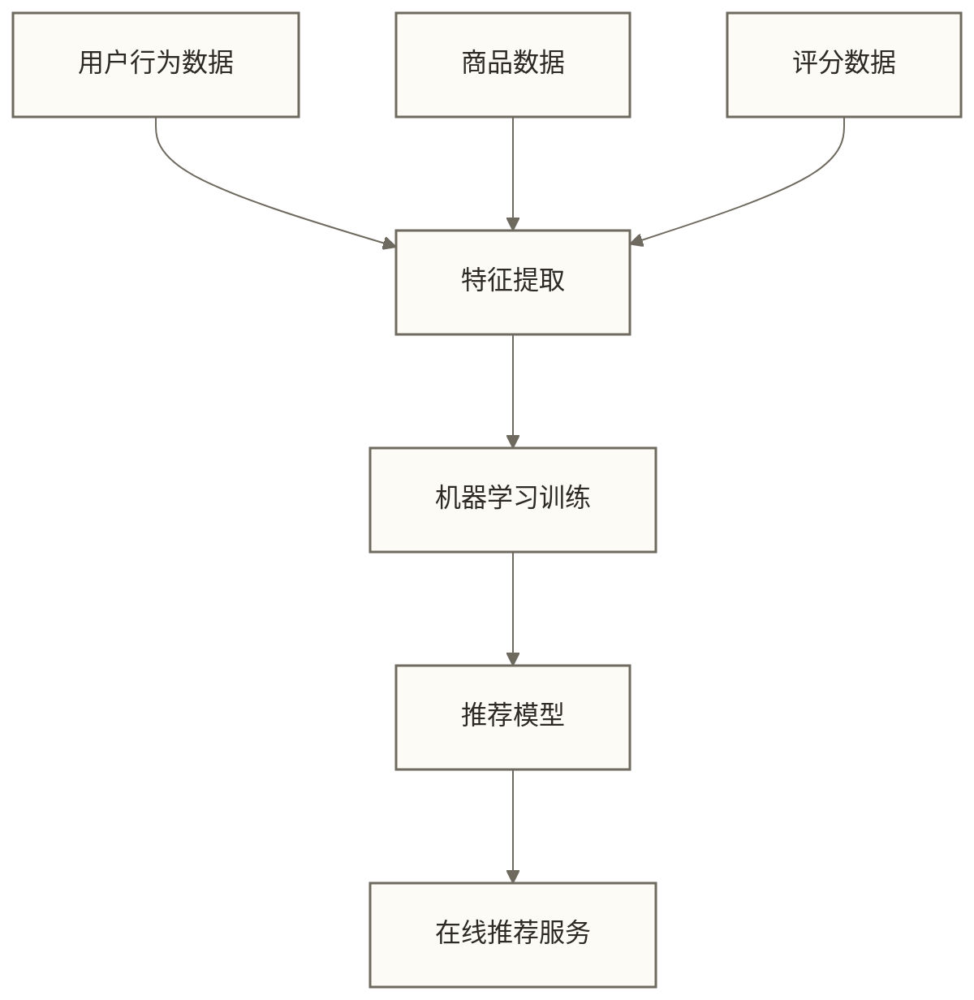
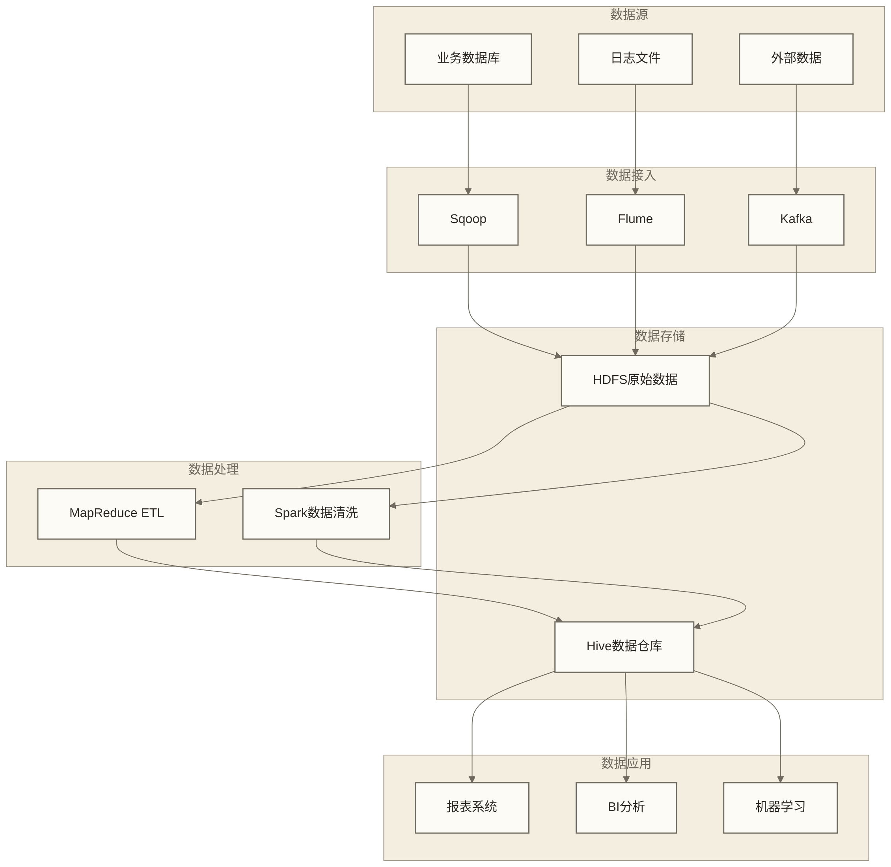
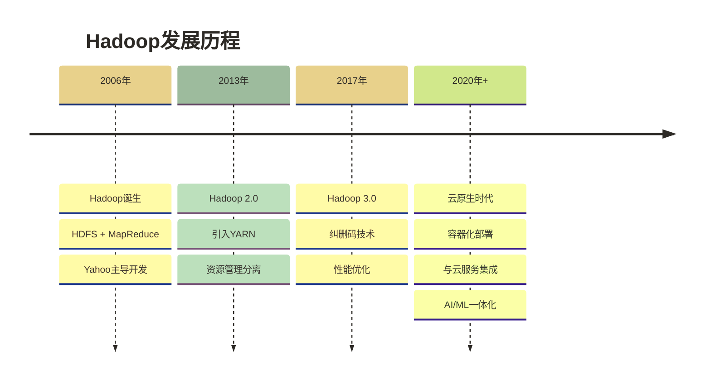

# 🐘 Hadoop概念与生态 - 大数据时代的基石

> [!abstract] 📋 本节概览
> - 🎯 **学习目标**：理解大数据概念，掌握Hadoop生态系统的整体架构
> - 📚 **前置知识**：基础Linux命令 | SQL
> - ⏱️ **预计用时**：90分钟
> - 🔧 **技术重点**：大数据4V特征、Hadoop核心组件、生态系统架构

## 🌍 什么是大数据？

> [!note] 💡 大数据就像全球贸易的货物流
> 
> 想象一下双11期间全球电商的货物处理：
> 
> - 📦 **Volume（体量）**：数亿件商品需要同时处理，相当于PB级数据
> - ⚡ **Velocity（速度）**：教学假设每秒10万+订单实时涌入，需要秒级处理；此数字不是已核实的双11业务统计
> - 🌍 **Variety（多样性）**：有服装、电子、食品等不同类别商品，就像结构化、半结构化、非结构化数据
> - ✅ **Veracity（真实性）**：需要准确的库存、价格、物流信息来保证交易
> 
> **问题来了**：传统的单一仓库无法处理如此巨大的货物流，需要像Hadoop这样的分布式智能物流系统！

### 大数据的4V特征



### 传统数据处理vs大数据处理

| 维度 | 传统数据处理 | 大数据处理 |
|---|---|---|
| **数据量** | GB级别 | TB/PB级别 |
| **处理方式** | 单机集中处理 | 分布式并行处理 |
| **存储** | 关系型数据库 | 分布式文件系统 |
| **计算模式** | 批处理为主 | 批处理+流处理 |
| **硬件成本** | 高端服务器 | 商用服务器集群 |
| **扩展性** | 垂直扩展（Scale Up） | 水平扩展（Scale Out） |

---

## 🐘 Hadoop是什么？

> [!tip] 💡 Hadoop = 世界最大的智能仓储物流中心
> 
> **想象一个超级仓储中心**（如京东、阿里的大型仓库）：
> 
> 🏢 **传统小仓库**：
> - 一个仓管员管理所有货物
> - 客户要货时需要排队等待
> - 仓库满了就无法再存储
> - 仓管员生病整个仓库停止运转
> 
> 🏭 **Hadoop智能物流中心**：
> - 📦 **分布式仓储(HDFS)**：货物分散在多个仓库，但统一编号管理
> - 👥 **并行作业(MapReduce)**：数百个工人同时分捡、打包、发货
> - 🔁 **容错机制**：每件货都有多个备份，某个仓库故障不影响业务
> - 🤖 **智能调度(YARN)**：系统自动分配任务，哪里闲着就往哪里派工人
> 
> **核心优势**：可通过分布式存储承载海量数据（如PB级数据），并通过冗余与故障恢复提高可靠性；容量和可用性取决于配置与运维，不保证零丢失或零停机。

### Hadoop的核心思想

**设计理念**：
1. **硬件故障是常态**：假设硬件一定会出故障，通过软件容错
2. **流式数据访问**：一次写入，多次读取的数据访问模式  
3. **大数据集**：针对GB到TB级别的大数据集优化
4. **简单一致性模型**：一次写入，多次读取（WORM）
5. **移动计算而非移动数据**：计算程序迁移到数据所在节点

**核心优势**：
- ✅ **高可靠性**：通过副本或纠删码提高硬件故障下的数据可恢复性，但不能保证任何故障下都不丢失数据，也不能替代独立备份
- ✅ **高扩展性**：可以从几个节点扩展到几千个节点
- ✅ **高效性**：并行处理，充分利用集群计算能力
- ✅ **高容错性**：自动检测故障并恢复
- ✅ **成本低**：使用商用硬件，而非昂贵的专用设备

---

## 🏗️ Hadoop核心组件

下文重点介绍HDFS、MapReduce和YARN；Hadoop Common提供它们使用的公共库与工具，也是Hadoop的核心模块。

### Hadoop生态系统架构



### 1. HDFS - 分布式文件系统

> [!note] 💡 HDFS就像连锁超市的仓储系统
> - **总部（NameNode）**：知道每个商品存放在哪个仓库
> - **分仓库（DataNode）**：实际存储商品的地方
> - **商品备份**：重要商品在多个仓库都有备份
> - **统一管理**：虽然分散存储，但可以统一查询和调取

**HDFS特点**：
```bash title="HDFS核心特性"
# 1. 分布式存储
- 文件被切分成块（默认128MB）
- 块分散存储在集群的不同节点上
- 每个块有多个副本（默认3个）

# 2. 主从架构
- NameNode: 管理文件系统元数据
- DataNode: 存储实际的数据块
- SecondaryNameNode: 定期合并命名空间镜像与编辑日志，生成检查点；不是NameNode的热备节点

# 3. 一次写入，多次读取
- 不支持文件内容的任意原地随机修改；支持追加，也支持截断等受版本与接口约束的操作
- 优化了大文件的顺序读取
```

### 2. MapReduce - 分布式计算框架

以下时序图采用Hadoop 1.x的JobTracker/TaskTracker旧架构，仅用于理解任务流程；Hadoop 2.x及后续版本的MapReduce运行在YARN上，由ApplicationMaster协调任务，NodeManager管理执行容器。

> [!note] 💡 MapReduce就像工厂的流水线作业
> **Map阶段（分工）**：
> - 把复杂任务分解成简单的小任务
> - 分配给不同的工人并行处理
> 
> **Reduce阶段（汇总）**：
> - 收集所有工人的处理结果
> - 按照规则进行合并和汇总



### 3. YARN - 资源管理系统

> [!note] 💡 YARN就像大型购物中心的管理系统
> - **ResourceManager（商场总管）**：统筹整个商场的资源分配
> - **NodeManager（楼层管理员）**：管理各楼层的具体资源
> - **ApplicationMaster（店铺经理）**：为每个店铺申请和管理所需资源
> - **Container（店铺空间）**：分配给每个店铺的具体空间和设施

**YARN架构组件**：

```bash title="YARN组件职责"
# ResourceManager (RM)
- 全局资源调度器
- 管理整个集群的计算资源
- 决定资源分配给哪个应用

# NodeManager (NM)  
- 单节点的资源管理
- 监控本节点的资源使用情况
- 接收ApplicationMaster的请求启动已由RM分配的Container

# ApplicationMaster (AM)
- 单个应用的资源协调器
- 向RM申请资源
- 与NM通信管理任务执行

# Container
- 资源的抽象
- 包含CPU、内存、磁盘、网络等资源
- 任务运行的环境
```

---

## 🌟 Hadoop生态系统

### 数据存储层

| 组件 | 用途 | 特点 | 适用场景 |
|---|---|---|---|
| **HDFS** | 分布式文件系统 | 高容错、高吞吐 | 大文件存储、批处理 |
| **HBase** | NoSQL数据库 | 实时读写、列式存储 | 实时查询、随机访问 |
| **Cassandra** | 分布式数据库 | 高可用、最终一致性 | 高并发写入、多数据中心 |

### 数据处理层

| 组件 | 用途 | 特点 | 适用场景 |
|---|---|---|---|
| **MapReduce** | 批处理计算 | 可靠性高、编程简单 | 大数据量批处理 |
| **Spark** | 内存计算 | 速度快、支持多种计算模式 | 迭代计算、机器学习 |
| **Flink** | 流处理 | 低延迟、精确一次语义 | 实时流计算、事件处理 |
| **Storm** | 实时计算 | 实时性强、容错性好 | 实时分析、在线决策 |

### 数据分析层

| 组件 | 用途 | 特点 | 适用场景 |
|---|---|---|---|
| **Hive** | 数据仓库 | SQL接口、元数据管理 | 数据分析、报表生成 |
| **Pig** | 数据流编程 | 脚本化、高级抽象 | 数据清洗、ETL处理 |
| **Impala** | 实时查询 | 低延迟、内存计算 | 交互式查询、即席分析 |

### 数据传输层

| 组件 | 用途 | 特点 | 适用场景 |
|---|---|---|---|
| **Kafka** | 消息队列 | 高吞吐、持久化 | 流数据传输、解耦 |
| **Flume** | 日志收集 | 可靠性、扩展性 | 日志聚合、数据采集 |
| **Sqoop** | 数据迁移 | 批量传输、增量同步 | 关系数据库与Hadoop互导 |

### 集群管理层

| 组件 | 用途 | 特点 | 适用场景 |
|---|---|---|---|
| **Ambari** | 集群管理 | Web界面、监控告警 | 集群部署、运维管理 |
| **Zookeeper** | 协调服务 | 一致性、高可用 | 配置管理、分布式锁 |
| **Oozie** | 工作流调度 | 任务编排、依赖管理 | ETL流程、定时任务 |

---

## 🎯 Hadoop典型应用场景

### 1. 日志分析系统



**业务价值**：
- 用户行为分析
- 系统性能监控
- 安全审计分析
- 业务趋势预测

### 2. 推荐系统



**技术架构**：
- HDFS存储海量用户数据
- Spark进行特征工程和模型训练
- HBase存储用户画像和推荐结果
- Kafka实时传输用户行为数据

### 3. 数据仓库建设



---

## 🆚 Hadoop与传统技术对比

### Hadoop vs 传统数据库

| 特性 | Hadoop | 传统RDBMS |
|---|---|---|
| **数据模型** | 无模式、半结构化 | 结构化、固定模式 |
| **扩展方式** | 水平扩展（添加节点） | 垂直扩展（升级硬件） |
| **查询语言** | MapReduce、HQL | SQL |
| **事务支持** | 有限支持 | 完整ACID支持 |
| **响应时间** | 高延迟（分钟级） | 低延迟（毫秒级） |
| **数据量** | PB级别 | TB级别 |
| **成本** | 低（商用硬件） | 高（专用硬件） |

### Hadoop vs 传统ETL工具

| 维度 | Hadoop | 传统ETL |
|---|---|---|
| **处理能力** | PB级别数据 | GB到TB级别 |
| **处理方式** | 分布式并行 | 单机或小集群 |
| **数据格式** | 多样化（结构化、半结构化、非结构化） | 主要是结构化数据 |
| **实时性** | 批处理为主，支持流处理 | 主要是批处理 |
| **开发复杂度** | 需要分布式编程思维 | 图形化界面配置 |
| **硬件成本** | 低 | 高 |

---

## 💡 Hadoop的优势与局限

### ✅ 主要优势

**1. 经济高效**
- 使用商用硬件，成本低廉
- 可按需增加节点进行水平扩展，但实际收益受工作负载、网络、存储与调度瓶颈影响
- 开源软件，无许可费用

**2. 高可靠性**
- 常见副本存储配置默认采用3副本，提高容错能力；副本不能替代独立备份，纠删码配置采用不同的冗余方式
- 自动故障检测和恢复
- 通过正确配置NameNode、ResourceManager等组件的高可用机制，可降低关键组件的单点故障风险；默认部署并不自动消除所有单点故障

**3. 高扩展性**
- 从几个节点扩展到几千个节点
- 增加节点通常能提升存储和计算能力，但不保证性能线性增长
- 动态添加/删除节点

**4. 灵活性强**
- 支持多种数据格式
- 无固定数据模式约束
- 丰富的生态系统组件

### ⚠️ 主要局限

**1. 不适合小数据**
- 启动开销大，小数据集不经济
- 常见默认块大小为128MB，可配置，并非文件或块的最小大小；小文件会增加元数据与任务调度开销，存储效率较低

**2. 不适合实时处理**
- MapReduce延迟较高（分钟级）
- 适合批处理，不适合交互式查询

**3. 不适合频繁更新**
- HDFS不支持随机写入
- 一次写入，多次读取的模式

**4. 学习曲线陡峭**
- 需要分布式编程思维
- 运维复杂度较高

---

## 🏢 Hadoop企业应用案例

### 成功案例分享

> [!example] 📋 原稿未核实的企业场景教学假设
> 以下企业名称、技术实践及成果数字均沿用原稿，但未提供可核查来源；本节仅按教学假设展示应用思路，不代表对应企业实际采用这些架构或取得这些成果。
> 
> **🛒 阿里巴巴**：
> - 使用Hadoop处理每日TB级交易数据
> - 通过HDFS存储用户行为日志
> - 利用MapReduce进行商品推荐算法训练
> - **假设效果（原稿未核实示例）**：支撑双11期间海量数据处理，推荐准确率提升40%；未给出准确率定义、基线及测量依据
> 
> **📱 腾讯**：
> - 基于Hadoop构建用户画像系统
> - 处理微信、QQ等产品的海量用户数据
> - 实时分析用户兴趣和行为模式
> - **假设效果（原稿未核实示例）**：广告点击率提升35%，用户活跃度增长25%；未给出统计口径、对照条件及归因依据
> 
> **🏦 中国银行**：
> - 利用Hadoop建设风控大数据平台
> - 整合内外部数据源进行风险评估
> - 实时监控异常交易和欺诈行为
> - **假设效果（原稿未核实示例）**：风险识别准确率达到95%，处理速度提升10倍；未给出样本、准确率口径及性能测试条件

### 行业应用分布

| 行业 | 主要应用 | 技术特点 | 业务价值 |
|---|---|---|---|
| **电商零售** | 推荐系统、用户画像 | 实时+批处理、机器学习 | 提升转化率、个性化服务 |
| **金融保险** | 风控分析、反欺诈 | 高可靠性、实时监控 | 降低风险、合规要求 |
| **电信运营商** | 网络优化、客户流失预测 | 大数据量、流处理 | 提升服务质量、降低流失 |
| **制造业** | 设备监控、供应链优化 | IoT数据、预测分析 | 降低成本、提升效率 |

---

## 🔮 Hadoop发展趋势

### 技术演进方向



### 现代大数据架构趋势

**1. 云原生化**
- Kubernetes部署
- 容器化运行
- 服务网格集成

**2. 湖仓一体**
- 数据湖 + 数据仓库融合
- Delta Lake、Iceberg等技术
- ACID事务支持

**3. 流批一体**
- 统一的流批处理引擎
- Flink 和 Spark Streaming
- 实时+批处理混合架构

**4. AI/ML集成**
- 特征工程自动化
- 模型训练平台化
- MLOps流程标准化

---

## 🔗 下一步学习

了解Hadoop概念后，建议继续学习：

- [[【技术与工具】/Hadoop/02-Hadoop环境搭建|Hadoop环境搭建]]
- [[【技术与工具】/Hadoop/03-HDFS分布式文件系统|HDFS分布式文件系统]]
- [[【技术与工具】/Hadoop/05-MapReduce编程模型|MapReduce编程]]

---

*最后更新：2024-06-29* 