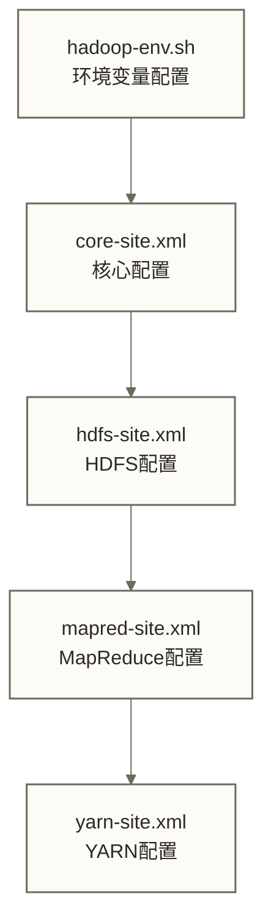

# 🛠️ Hadoop环境搭建 - 从单机到集群的完整部署指南

> [!abstract] 📋 本节概览
> - 🎯 **学习目标**：掌握Hadoop不同模式的安装配置，搭建完整的开发和测试环境
> - 📚 **前置知识**：[[【技术与工具】/Hadoop/01-Hadoop概念与生态|Hadoop概念与生态]] | 基础Linux命令 | Java环境配置
> - ⏱️ **预计用时**：120分钟
> - 🔧 **技术重点**：三种部署模式、核心配置文件、集群规划、常见问题排查

## 🎯 Hadoop部署模式概览

> [!note] 💡 Hadoop的三种部署模式就像学开车
> - **单机模式（Standalone）**：就像在空地上练车，没有交通规则，简单直接
> - **伪分布式（Pseudo-Distributed）**：就像在驾校练车场，有模拟的真实环境
> - **完全分布式（Fully Distributed）**：就像在真实道路上开车，多车协作，复杂但实用

### 三种模式对比

| 部署模式 | 进程数量 | 适用场景 | 数据存储 | 复杂度 |
|---|---|---|---|---|---|
| **单机模式** | 单个JVM进程 | 开发调试、算法验证 | 本地文件系统 | ⭐ |
| **伪分布式** | 多个JVM进程，单机运行 | 学习测试、功能验证 | HDFS | ⭐⭐⭐ |
| **完全分布式** | 多机多进程 | 生产环境、大规模数据处理 | HDFS | ⭐⭐⭐⭐⭐ |

---

## 🔧 环境准备

### 系统要求

```bash title="硬件和软件要求"
# 最小配置要求
CPU: 2核心
内存: 4GB (推荐8GB+)
磁盘: 50GB可用空间
网络: 千兆网卡

# 推荐配置
CPU: 4核心+
内存: 16GB+
磁盘: 500GB+ SSD
网络: 千兆网卡，低延迟

# 操作系统支持
- Ubuntu 18.04+ / CentOS 7+ / RHEL 7+
- macOS 10.14+ (仅用于开发)
- Windows 10 (通过WSL2)
```

### 基础软件安装

```bash title="安装Java和基础工具"
# Ubuntu/Debian系统
sudo apt update
sudo apt install -y openjdk-8-jdk openssh-server rsync

# CentOS/RHEL系统  
sudo yum update
sudo yum install -y java-1.8.0-openjdk java-1.8.0-openjdk-devel openssh-server rsync

# 验证Java安装
java -version
javac -version

# 设置JAVA_HOME环境变量
echo 'export JAVA_HOME=/usr/lib/jvm/java-8-openjdk-amd64' >> ~/.bashrc
echo 'export PATH=$PATH:$JAVA_HOME/bin' >> ~/.bashrc
source ~/.bashrc

# 验证JAVA_HOME
echo $JAVA_HOME
```

### SSH免密登录配置

> [!note] 💡 为什么需要SSH免密登录？
> 本文的Hadoop启停脚本通过SSH在目标节点执行命令，SSH免密登录就像给脚本发了一张"通行证"，避免每次远程执行都要输入密码；HDFS和YARN服务间通信本身并不依赖SSH。

```bash title="配置SSH免密登录"
# 1. 生成SSH密钥对
ssh-keygen -t rsa -P '' -f ~/.ssh/id_rsa

# 2. 将公钥添加到授权文件
cat ~/.ssh/id_rsa.pub >> ~/.ssh/authorized_keys
chmod 0600 ~/.ssh/authorized_keys

# 3. 测试SSH免密登录
ssh localhost
# 第一次连接需要确认，输入 yes

# 4. 验证免密登录成功
ssh localhost date
# 应该直接显示日期，无需密码
```

---

## 🎯 单机模式部署

> [!note] 💡 单机模式的特点
> 就像一个人的乐队，所有乐器都由一个人演奏。适合：
> - 算法开发和调试
> - 学习MapReduce编程
> - 快速原型验证

### 下载和安装Hadoop

```bash title="下载安装Hadoop"
# 1. 下载Hadoop（选择稳定版本）
cd ~
wget https://downloads.apache.org/hadoop/common/hadoop-3.3.6/hadoop-3.3.6.tar.gz

# 2. 解压安装
tar -xzf hadoop-3.3.6.tar.gz
sudo mv hadoop-3.3.6 /opt/hadoop
sudo chown -R $USER:$USER /opt/hadoop

# 3. 设置环境变量
echo 'export HADOOP_HOME=/opt/hadoop' >> ~/.bashrc
echo 'export HADOOP_CONF_DIR=$HADOOP_HOME/etc/hadoop' >> ~/.bashrc
echo 'export PATH=$PATH:$HADOOP_HOME/bin:$HADOOP_HOME/sbin' >> ~/.bashrc
source ~/.bashrc

# 4. 验证安装
hadoop version
```

### 单机模式配置

```bash title="单机模式配置文件"
# 配置hadoop-env.sh（JAVA_HOME路径需与本机Java安装位置一致）
echo 'export JAVA_HOME=/usr/lib/jvm/java-8-openjdk-amd64' >> $HADOOP_HOME/etc/hadoop/hadoop-env.sh

# 单机模式无需修改其他配置文件，使用默认配置即可
```

### 运行WordCount示例

```bash title="单机模式测试"
# 1. 创建测试数据
mkdir ~/input
echo "Hello World Bye World" > ~/input/file01.txt
echo "Hello Hadoop Goodbye Hadoop" > ~/input/file02.txt

# 2. 运行WordCount程序
hadoop jar $HADOOP_HOME/share/hadoop/mapreduce/hadoop-mapreduce-examples-3.3.6.jar wordcount ~/input ~/output

# 3. 查看结果
cat ~/output/part-r-00000

# 应该看到类似输出：
# Bye     1
# Goodbye 1
# Hadoop  2
# Hello   2
# World   2
```

---

## 🏗️ 伪分布式模式部署

> [!note] 💡 伪分布式模式的特点
> 就像一个人分饰多角，模拟真实的分布式环境。特点：
> - 所有进程在同一台机器上运行
> - 使用HDFS存储数据
> - 具备完整的Hadoop功能
> - 适合学习和开发测试

### 核心配置文件

Hadoop的配置主要涉及4个核心XML文件及hadoop-env.sh环境变量文件：



### 配置core-site.xml

```xml title="$HADOOP_HOME/etc/hadoop/core-site.xml"
<?xml version="1.0" encoding="UTF-8"?>
<configuration>
    <!-- 指定HDFS的默认文件系统地址 -->
    <property>
        <name>fs.defaultFS</name>
        <value>hdfs://localhost:9000</value>
        <description>HDFS的默认URI，所有HDFS操作的入口</description>
    </property>
    
    <!-- 指定Hadoop临时目录 -->
    <property>
        <name>hadoop.tmp.dir</name>
        <value>/opt/hadoop/tmp</value>
        <description>Hadoop的临时目录，存储临时文件</description>
    </property>
    
    <!-- 配置代理用户（可选） -->
    <property>
        <name>hadoop.proxyuser.root.hosts</name>
        <value>*</value>
    </property>
    <property>
        <name>hadoop.proxyuser.root.groups</name>
        <value>*</value>
    </property>
</configuration>
```

### 配置hdfs-site.xml

```xml title="$HADOOP_HOME/etc/hadoop/hdfs-site.xml"
<?xml version="1.0" encoding="UTF-8"?>
<configuration>
    <!-- 设置数据副本数量 -->
    <property>
        <name>dfs.replication</name>
        <value>1</value>
        <description>伪分布式模式设置为1，完全分布式通常设置为3</description>
    </property>
    
    <!-- 指定NameNode数据存储目录 -->
    <property>
        <name>dfs.namenode.name.dir</name>
        <value>file:///opt/hadoop/data/namenode</value>
        <description>NameNode存储元数据的目录</description>
    </property>
    
    <!-- 指定DataNode数据存储目录 -->
    <property>
        <name>dfs.datanode.data.dir</name>
        <value>file:///opt/hadoop/data/datanode</value>
        <description>DataNode存储数据块的目录</description>
    </property>
    
    <!-- 关闭权限检查（开发环境可选） -->
    <property>
        <name>dfs.permissions.enabled</name>
        <value>false</value>
        <description>关闭HDFS权限检查，简化开发</description>
    </property>
    
    <!-- NameNode Web UI端口 -->
    <property>
        <name>dfs.namenode.http-address</name>
        <value>0.0.0.0:9870</value>
        <description>NameNode Web界面地址</description>
    </property>
</configuration>
```

### 配置mapred-site.xml

```xml title="$HADOOP_HOME/etc/hadoop/mapred-site.xml"
<?xml version="1.0" encoding="UTF-8"?>
<configuration>
    <!-- 指定MapReduce作业运行框架 -->
    <property>
        <name>mapreduce.framework.name</name>
        <value>yarn</value>
        <description>使用YARN作为MapReduce的资源管理器</description>
    </property>
    
    <!-- MapReduce JobHistory Server地址 -->
    <property>
        <name>mapreduce.jobhistory.address</name>
        <value>localhost:10020</value>
        <description>JobHistory服务器地址</description>
    </property>
    
    <!-- MapReduce JobHistory Web UI地址 -->
    <property>
        <name>mapreduce.jobhistory.webapp.address</name>
        <value>localhost:19888</value>
        <description>JobHistory Web界面地址</description>
    </property>
    
    <!-- 配置MapReduce应用程序类路径 -->
    <property>
        <name>mapreduce.application.classpath</name>
        <value>$HADOOP_MAPRED_HOME/share/hadoop/mapreduce/*,$HADOOP_MAPRED_HOME/share/hadoop/mapreduce/lib/*</value>
    </property>
</configuration>
```

### 配置yarn-site.xml

```xml title="$HADOOP_HOME/etc/hadoop/yarn-site.xml"
<?xml version="1.0" encoding="UTF-8"?>
<configuration>
    <!-- 指定ResourceManager地址 -->
    <property>
        <name>yarn.resourcemanager.hostname</name>
        <value>localhost</value>
        <description>ResourceManager所在主机名</description>
    </property>
    
    <!-- NodeManager的附属服务 -->
    <property>
        <name>yarn.nodemanager.aux-services</name>
        <value>mapreduce_shuffle</value>
        <description>启用MapReduce的shuffle服务</description>
    </property>
    
    <!-- 配置NodeManager的资源检测 -->
    <property>
        <name>yarn.nodemanager.resource.detect-hardware-capabilities</name>
        <value>true</value>
        <description>自动检测硬件资源</description>
    </property>
    
    <!-- 配置虚拟内存比率 -->
    <property>
        <name>yarn.nodemanager.vmem-pmem-ratio</name>
        <value>3</value>
        <description>虚拟内存与物理内存的比率</description>
    </property>
    
    <!-- ResourceManager Web UI地址 -->
    <property>
        <name>yarn.resourcemanager.webapp.address</name>
        <value>0.0.0.0:8088</value>
        <description>ResourceManager Web界面地址</description>
    </property>
</configuration>
```

### 启动Hadoop集群

```bash title="启动伪分布式Hadoop"
# 1. 创建必要的目录
sudo mkdir -p /opt/hadoop/data/namenode
sudo mkdir -p /opt/hadoop/data/datanode  
sudo mkdir -p /opt/hadoop/tmp
sudo chown -R $USER:$USER /opt/hadoop/data
sudo chown -R $USER:$USER /opt/hadoop/tmp

# 2. 格式化NameNode（仅在首次初始化全新、无业务数据的集群时执行；已有集群不得重新格式化）
hdfs namenode -format

# 出现 "Storage directory ... has been successfully formatted." 表示格式化成功

# 3. 启动HDFS
start-dfs.sh

# 4. 启动YARN
start-yarn.sh

# 5. 检查进程是否启动成功
jps

# 应该看到以下进程：
# - NameNode
# - DataNode  
# - SecondaryNameNode
# - ResourceManager
# - NodeManager
```

### 验证集群状态

```bash title="验证Hadoop集群"
# 1. 检查HDFS状态
hdfs dfsadmin -report

# 2. 访问Web界面
# NameNode Web UI: http://localhost:9870
# ResourceManager Web UI: http://localhost:8088

# 3. 测试HDFS操作
hdfs dfs -mkdir /user
hdfs dfs -mkdir /user/$USER
hdfs dfs -ls /

# 4. 上传测试文件
echo "Hello Hadoop 和 HDFS" > test.txt
hdfs dfs -put test.txt /user/$USER/
hdfs dfs -ls /user/$USER/
hdfs dfs -cat /user/$USER/test.txt

# 5. 运行MapReduce测试
hdfs dfs -mkdir /input
hdfs dfs -put $HADOOP_HOME/etc/hadoop/*.xml /input
hadoop jar $HADOOP_HOME/share/hadoop/mapreduce/hadoop-mapreduce-examples-3.3.6.jar grep /input /output 'dfs[a-z.]+'
hdfs dfs -cat /output/part-r-00000
```

---

## 🏢 完全分布式模式部署

> [!note] 💡 完全分布式模式的特点
> 就像一个真正的管弦乐团，每个乐手专注于自己的乐器。特点：
> - 多台机器协同工作
> - 真实的分布式环境
> - 可通过HDFS副本提供数据块容错；本例的单NameNode和单ResourceManager不具备高可用能力，SecondaryNameNode也不是备用NameNode
> - 用于多节点教学和测试；生产部署还需另行设计高可用、安全与运维配置

### 集群规划

| 节点 | IP地址 | 运行角色 |
|------|--------|----------|
| hadoop-master | 192.168.1.100 | NameNode、SecondaryNameNode、ResourceManager、DataNode、NodeManager |
| hadoop-slave1 | 192.168.1.101 | DataNode、NodeManager |
| hadoop-slave2 | 192.168.1.102 | DataNode、NodeManager |

### 主机配置

```bash title="配置主机名和网络"
# 在所有节点执行
# 1. 设置主机名（每台机器只执行下面与其角色对应的一条命令，不要连续执行三条）
sudo hostnamectl set-hostname hadoop-master  # 在master节点
sudo hostnamectl set-hostname hadoop-slave1  # 在slave1节点
sudo hostnamectl set-hostname hadoop-slave2  # 在slave2节点

# 2. 配置hosts文件（所有节点相同）
sudo tee -a /etc/hosts << EOF
192.168.1.100 hadoop-master
192.168.1.101 hadoop-slave1
192.168.1.102 hadoop-slave2
EOF

# 3. 测试网络连通性
ping hadoop-slave1
ping hadoop-slave2
```

### 集群SSH免密配置

```bash title="配置集群SSH免密登录"
# 在master节点执行
# 1. 生成SSH密钥对（如果之前没有生成）
ssh-keygen -t rsa -P '' -f ~/.ssh/id_rsa

# 2. 将公钥复制到所有节点（包括自己）
ssh-copy-id hadoop-master
ssh-copy-id hadoop-slave1
ssh-copy-id hadoop-slave2

# 3. 测试SSH免密登录
ssh hadoop-slave1 date
ssh hadoop-slave2 date
```

### 分发Hadoop安装包

```bash title="分发Hadoop到所有节点"
# 在master节点执行
# 1. 创建安装目录
for host in hadoop-slave1 hadoop-slave2; do
    ssh $host "sudo mkdir -p /opt/hadoop && sudo chown $USER:$USER /opt/hadoop"
done

# 2. 同步Hadoop安装目录
for host in hadoop-slave1 hadoop-slave2; do
    rsync -avz /opt/hadoop/ $host:/opt/hadoop/
done

# 3. 同步环境变量配置
for host in hadoop-slave1 hadoop-slave2; do
    scp ~/.bashrc $host:~/.bashrc
    ssh $host "source ~/.bashrc"
done
```

### 集群配置文件

```xml title="完全分布式core-site.xml"
<?xml version="1.0" encoding="UTF-8"?>
<configuration>
    <property>
        <name>fs.defaultFS</name>
        <value>hdfs://hadoop-master:9000</value>
        <description>指定master为NameNode</description>
    </property>
    
    <property>
        <name>hadoop.tmp.dir</name>
        <value>/opt/hadoop/tmp</value>
    </property>
</configuration>
```

```xml title="完全分布式hdfs-site.xml"
<?xml version="1.0" encoding="UTF-8"?>
<configuration>
    <property>
        <name>dfs.replication</name>
        <value>3</value>
        <description>数据副本数设置为3</description>
    </property>
    
    <property>
        <name>dfs.namenode.name.dir</name>
        <value>file:///opt/hadoop/data/namenode</value>
    </property>
    
    <property>
        <name>dfs.datanode.data.dir</name>
        <value>file:///opt/hadoop/data/datanode</value>
    </property>
    
    <property>
        <name>dfs.namenode.http-address</name>
        <value>hadoop-master:9870</value>
    </property>
    
    <property>
        <name>dfs.namenode.secondary.http-address</name>
        <value>hadoop-master:9868</value>
    </property>
</configuration>
```

```xml title="完全分布式yarn-site.xml"
<?xml version="1.0" encoding="UTF-8"?>
<configuration>
    <property>
        <name>yarn.resourcemanager.hostname</name>
        <value>hadoop-master</value>
    </property>
    
    <property>
        <name>yarn.nodemanager.aux-services</name>
        <value>mapreduce_shuffle</value>
    </property>
    
    <property>
        <name>yarn.resourcemanager.address</name>
        <value>hadoop-master:8032</value>
    </property>
    
    <property>
        <name>yarn.resourcemanager.scheduler.address</name>
        <value>hadoop-master:8030</value>
    </property>
    
    <property>
        <name>yarn.resourcemanager.resource-tracker.address</name>
        <value>hadoop-master:8031</value>
    </property>
</configuration>
```

### 配置workers文件

```bash title="配置workers节点列表"
# 编辑workers文件（Hadoop 3.x使用workers，之前版本使用slaves）
cat > $HADOOP_HOME/etc/hadoop/workers << EOF
hadoop-slave1
hadoop-slave2
EOF

# 如果master节点也作为DataNode，可以添加
echo "hadoop-master" >> $HADOOP_HOME/etc/hadoop/workers
```

### 分发配置文件

```bash title="同步配置到所有节点"
# 在master节点执行
for host in hadoop-slave1 hadoop-slave2; do
    rsync -avz $HADOOP_HOME/etc/hadoop/ $host:$HADOOP_HOME/etc/hadoop/
done
```

### 启动完全分布式集群

```bash title="启动集群"
# 在master节点执行
# 1. 创建数据目录（所有节点）
for host in hadoop-master hadoop-slave1 hadoop-slave2; do
    ssh $host "mkdir -p /opt/hadoop/data/namenode /opt/hadoop/data/datanode /opt/hadoop/tmp"
done

# 2. 格式化NameNode（仅在master首次初始化全新集群时执行；若沿用伪分布式数据，须先制定迁移或重建方案，不得直接重格式化）
hdfs namenode -format

# 3. 启动HDFS（在master执行）
start-dfs.sh

# 4. 启动YARN（在master执行）
start-yarn.sh

# 5. 检查集群状态
hdfs dfsadmin -report
yarn node -list
```

---

## 🌐 Web界面和监控

### 主要Web界面

| 组件 | 默认端口 | 访问地址 | 功能 |
|---|---|---|---|
| **NameNode** | 9870 | http://[hadoop]-master:9870 | HDFS状态、文件浏览 |
| **SecondaryNameNode** | 9868 | http://[hadoop]-master:9868 | 检查点信息 |
| **ResourceManager** | 8088 | http://[hadoop]-master:8088 | YARN资源管理 |
| **JobHistory** | 19888 | http://[hadoop]-master:19888 | 作业历史记录 |

### 启动JobHistory服务

```bash title="启动JobHistory服务"
# 创建JobHistory目录
hdfs dfs -mkdir -p /tmp/hadoop-yarn/staging/history/done_intermediate
hdfs dfs -chmod -R 1777 /tmp/hadoop-yarn/staging

# 启动JobHistory服务
mapred --daemon start historyserver

# 验证启动
jps | grep JobHistoryServer
```

---

## 🚨 常见问题排查

### 问题1：NameNode启动失败

```bash title="NameNode启动问题排查"
# 症状：start-dfs.sh后，jps看不到NameNode进程

# 排查步骤：
# 1. 查看NameNode日志
tail -f $HADOOP_HOME/logs/hadoop-*-namenode-*.log

# 2. 常见原因和解决方法：
# - 重复格式化可能导致clusterId不一致
# 有需保留的数据时：停止相关服务、备份数据与元数据，核查VERSION和日志，优先从一致的备份恢复；不要继续格式化。
# 以下仅为可丢弃教学集群的重建示例，不是已有集群的修复方法。
# 确认全部数据可丢弃并停止HDFS后，才可手动执行；多节点重建还须统一处理各DataNode旧数据。
# rm -rf /opt/hadoop/data/namenode/*
# rm -rf /opt/hadoop/data/datanode/*
# hdfs namenode -format

# - JAVA_HOME未设置（路径需与本机Java安装位置一致）
echo 'export JAVA_HOME=/usr/lib/jvm/java-8-openjdk-amd64' >> $HADOOP_HOME/etc/hadoop/hadoop-env.sh

# - 端口被占用
netstat -tulpn | grep :9000
sudo kill -9 <PID>
```

### 问题2：DataNode连接不上NameNode

```bash title="DataNode连接问题排查"
# 症状：DataNode进程存在但不能连接到NameNode

# 排查步骤：
# 1. 检查网络连通性
ping hadoop-master
telnet hadoop-master 9000

# 2. 检查防火墙设置
sudo ufw status
sudo ufw allow 9000
sudo ufw allow 9870

# 3. 检查clusterId是否一致
cat /opt/hadoop/data/namenode/current/VERSION
cat /opt/hadoop/data/datanode/current/VERSION

# 如果clusterId不一致，先核查是否连接了错误的NameNode或曾误格式化；不要再次格式化NameNode。
# 有需保留的数据时，先停止受影响的DataNode并备份，按一致性恢复方案处理。
# 仅当该DataNode全部数据可丢弃、NameNode状态正确且集群有可用副本，或整个教学集群允许重建时，才可清空其旧数据并重新加入：
# hdfs --daemon stop datanode
# rm -rf /opt/hadoop/data/datanode/*
# hdfs --daemon start datanode
```

### 问题3：YARN NodeManager启动失败

```bash title="NodeManager启动问题排查"
# 症状：NodeManager无法启动或频繁重启

# 排查步骤：
# 1. 查看NodeManager日志
tail -f $HADOOP_HOME/logs/hadoop-*-nodemanager-*.log

# 2. 常见问题解决：
# - 内存配置问题
# 编辑yarn-site.xml，降低内存要求
<property>
    <name>yarn.nodemanager.resource.memory-mb</name>
    <value>2048</value>
</property>

# - 虚拟内存检查过严
<property>
    <name>yarn.nodemanager.vmem-check-enabled</name>
    <value>false</value>
</property>
```

### 问题4：SSH连接问题

```bash title="SSH免密登录问题排查"
# 症状：start-dfs.sh时提示密码或连接被拒绝

# 排查步骤：
# 1. 检查SSH服务状态
sudo systemctl status ssh
sudo systemctl start ssh
sudo systemctl enable ssh

# 2. 检查SSH密钥权限
chmod 700 ~/.ssh
chmod 600 ~/.ssh/id_rsa
chmod 644 ~/.ssh/id_rsa.pub
chmod 600 ~/.ssh/authorized_keys

# 3. 测试SSH连接详细信息
ssh -v hadoop-slave1
```

### 问题5：端口冲突

```bash title="端口冲突问题排查"
# 检查端口占用情况
netstat -tulpn | grep :9000
netstat -tulpn | grep :8088

# 修改配置文件中的端口
# 可以在相应的*-site.xml文件中修改端口配置
```

---

## 🔧 集群管理脚本

### 集群启停脚本

```bash title="创建集群管理脚本"
# 创建启动脚本
cat > ~/start-hadoop.sh << 'EOF'
#!/bin/bash
echo "Starting Hadoop Cluster..."
start-dfs.sh
start-yarn.sh
mapred --daemon start historyserver
echo "Hadoop Cluster Started!"
echo "Web UIs:"
echo "  NameNode: http://$(hostname):9870"
echo "  ResourceManager: http://$(hostname):8088"
echo "  JobHistory: http://$(hostname):19888"
EOF

# 创建停止脚本
cat > ~/stop-hadoop.sh << 'EOF'
#!/bin/bash
echo "Stopping Hadoop Cluster..."
mapred --daemon stop historyserver
stop-yarn.sh
stop-dfs.sh
echo "Hadoop Cluster Stopped!"
EOF

# 设置执行权限
chmod +x ~/start-hadoop.sh ~/stop-hadoop.sh
```

### 集群状态检查脚本

```bash title="集群状态检查脚本"
cat > ~/check-hadoop.sh << 'EOF'
#!/bin/bash
echo "=== Hadoop Cluster Status ==="
echo "Java Processes:"
jps
echo "HDFS Status:"
hdfs dfsadmin -report | head -20
echo "YARN Nodes:"
yarn node -list
echo "HDFS Usage:"
hdfs dfs -df -h /
EOF

chmod +x ~/check-hadoop.sh
```

---

## 🔗 下一步学习

完成Hadoop环境搭建后，建议继续学习：

- [[【技术与工具】/Hadoop/03-HDFS分布式文件系统|HDFS分布式文件系统]]
- [[【技术与工具】/Hadoop/04-HDFS操作与管理|HDFS操作与]]
- [[【技术与工具】/Hadoop/05-MapReduce编程模型|MapReduce编程]]

---

*最后更新：2024-06-29* 