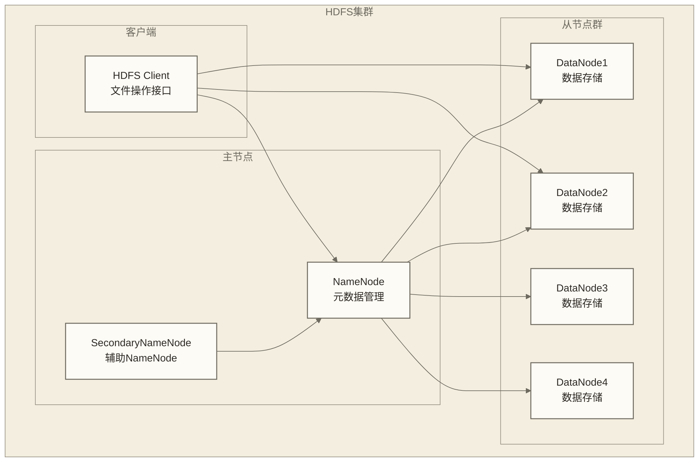
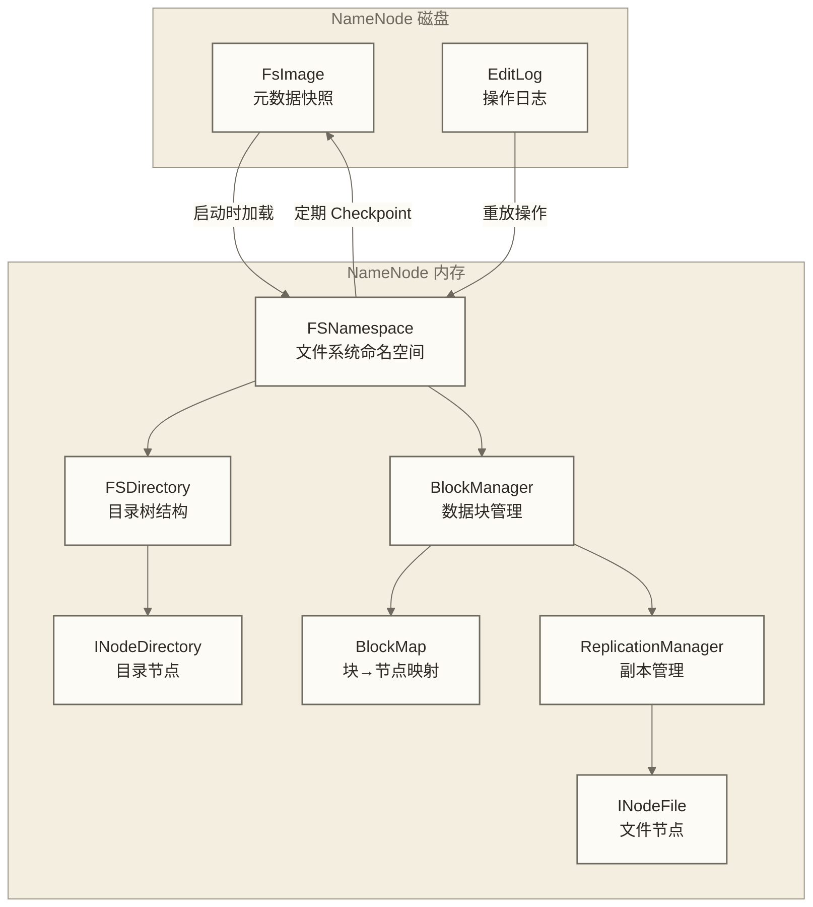
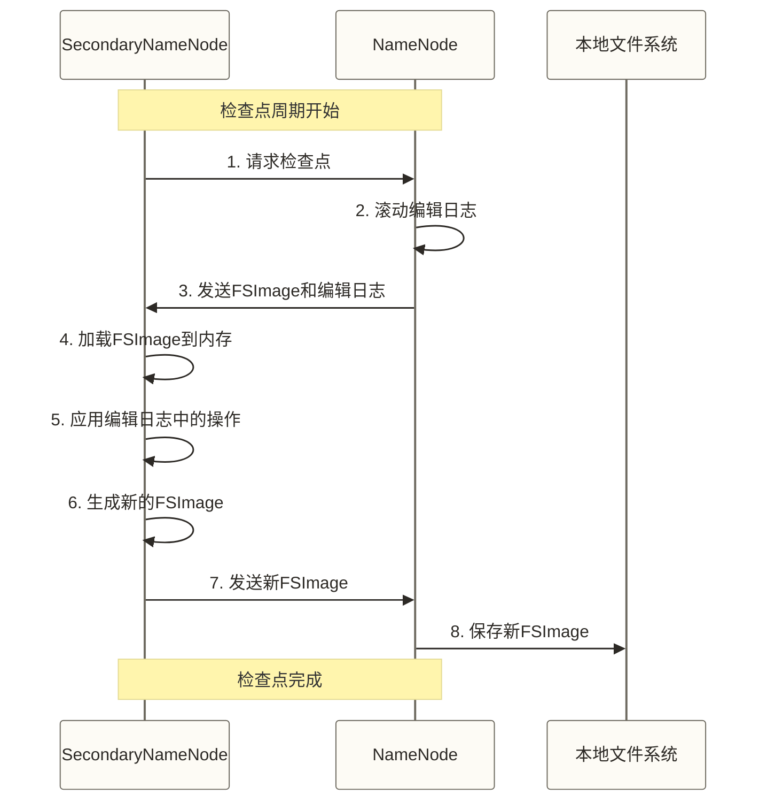
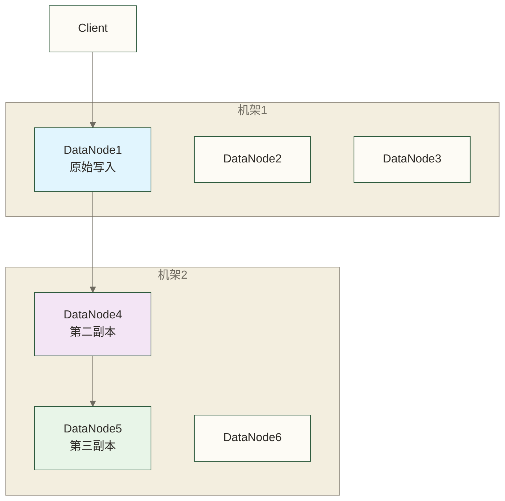
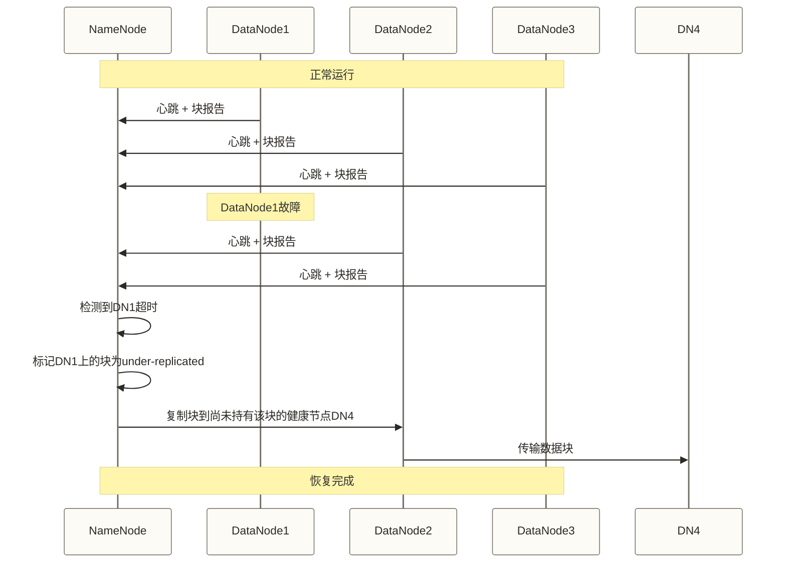
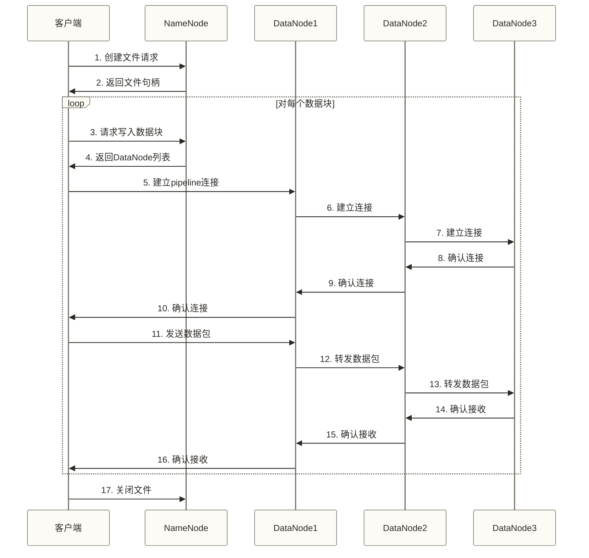
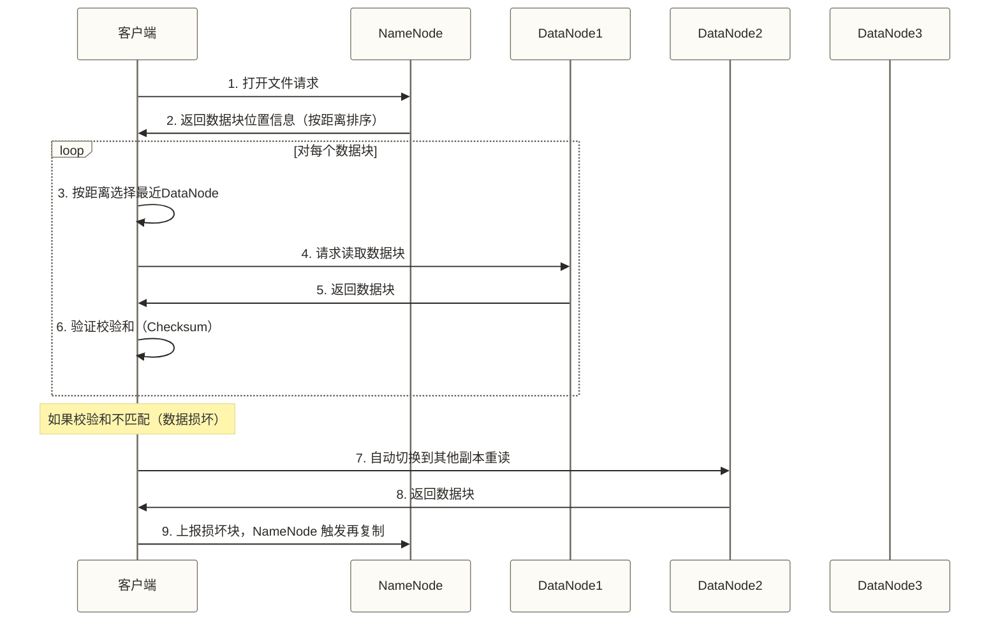
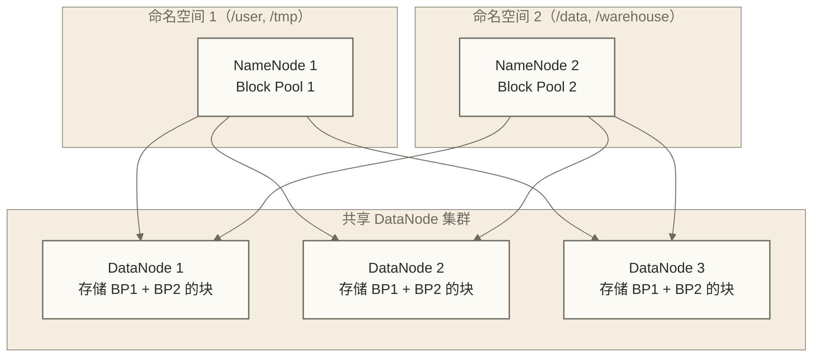

# 💾 HDFS分布式文件系统 - 海量数据存储的艺术

> [!abstract] 📋 本节概览
> - 🎯 **学习目标**：深入理解HDFS架构原理、数据存储机制和容错设计
> - 📚 **前置知识**：[[【技术与工具】/Hadoop/01-Hadoop概念与生态|Hadoop概念与生态]] | [[【技术与工具】/Hadoop/02-Hadoop环境搭建|Hadoop环境搭建]] | 文件系统基础概念
> - ⏱️ **预计用时**：100分钟
> - 🔧 **技术重点**：主从架构、数据块机制、副本策略、容错恢复

## 🏗️ HDFS架构概览

> [!note] 💡 HDFS就像一个超级图书馆系统
> 想象世界上最大的图书馆：
> - **总目录（NameNode）**：记录每本书在哪个分馆、哪个书架
> - **分馆（DataNode）**：实际存放书籍的地方
> - **分册存储**：一本大书可能分册存放在不同分馆
> - **备份机制**：重要书籍在多个分馆都有副本

### HDFS核心特性

```mermaid
%%{init: {"theme":"base","themeVariables":{"fontFamily":"PingFang SC, -apple-system, Source Han Serif SC, serif","fontSize":"16px","background":"#FDFBF5","primaryColor":"#FDFBF5","primaryTextColor":"#2D2A26","primaryBorderColor":"#6E6A60","secondaryColor":"#E8EFE8","secondaryBorderColor":"#8FA890","secondaryTextColor":"#2D2A26","tertiaryColor":"#FDFBF5","tertiaryBorderColor":"#9A9488","tertiaryTextColor":"#6E6A60","lineColor":"#6E6A60","textColor":"#2D2A26","mainBkg":"#FDFBF5","nodeBorder":"#2D5A3D","clusterBkg":"#F3EEDF","clusterBorder":"#9A9488","edgeLabelBackground":"#FDFBF5"},"flowchart":{"htmlLabels":true,"curve":"basis","padding":20,"nodeSpacing":60,"rankSpacing":70,"useMaxWidth":false},"themeCSS":".node rect, .node polygon, .node circle { stroke-width: 1.5px; } .edgePath .path { stroke-width: 1.5px; } .cluster-label .nodeLabel, .cluster-label foreignObject { color: #2D2A26 !important; } .edgeLabel, .edgeLabel foreignObject { color: #2D2A26 !important; background-color: #FDFBF5; } .edgeLabel rect { fill: #FDFBF5; }"}}%%
flowchart TD
    classDef default fill:#FDFBF5,stroke:#6E6A60,color:#2D2A26,stroke-width:1.5px
    classDef startend fill:#2D2A26,stroke:#2D2A26,color:#FDFBF5,font-weight:bold
    classDef decision fill:#F6EAD8,stroke:#C08A1A,color:#2D2A26,font-weight:bold
    classDef hub fill:#3B5A80,stroke:#3B5A80,color:#FDFBF5,font-weight:bold
    classDef io fill:#E5EAF0,stroke:#3B5A80,color:#2D2A26
    classDef accent fill:#A6432C,stroke:#A6432C,color:#FDFBF5,font-weight:bold
    classDef storage fill:#F3EEDF,stroke:#9A9488,color:#2D2A26
    root((HDFS特性))
    A[高容错性]
    B[高吞吐量] 
    C[大文件存储]
    D[简单一致性]
    A1[数据多副本]
    A2[自动故障检测]
    A3[透明恢复]
    B1[并行读写]
    B2[流式访问]
    B3[大块传输]
    C1[PB级别容量]
    C2[GB级别文件]
    C3[块式存储]
    D1[一次写入]
    D2[多次读取]
    D3[追加写入]
    
    root --> A
    root --> B
    root --> C
    root --> D
    A --> A1
    A --> A2
    A --> A3
    B --> B1
    B --> B2
    B --> B3
    C --> C1
    C --> C2
    C --> C3
    D --> D1
    D --> D2
    D --> D3
    class root accent
    class A,B,C,D,A1,A2,A3,B1,B2,B3,C1,C2,C3,D1,D2,D3 default
```



---

## 🏛️ HDFS主从架构

### 架构组件详解



### 1. NameNode - 元数据管理器

> [!note] 💡 NameNode就像图书馆的总目录系统
> - 知道每个文件存放在哪些DataNode上
> - 记录文件的权限、修改时间、访问时间、大小等信息；标准HDFS文件状态不提供通用的创建时间字段
> - 不存储实际数据，只管理"地址簿"

**NameNode职责**：
```bash title="NameNode核心功能"
# 1. 文件系统命名空间管理
- 维护文件系统的目录树结构
- 管理文件和目录的元数据
- 处理客户端的文件系统操作请求

# 2. 数据块映射管理  
- 维护文件到数据块的映射关系
- 跟踪每个数据块存储在哪些DataNode上
- 管理数据块的副本分布

# 3. 集群管理
- 监控DataNode的健康状态
- 处理DataNode的注册和心跳
- 触发数据块的复制和删除操作
```

### NameNode 内存数据结构与持久化

NameNode 将整个文件系统命名空间常驻内存，同时通过两种文件持久化到磁盘：

| 文件 | 作用 | 特点 |
|------|------|------|
| **FsImage** | 文件系统快照，记录某时刻的完整元数据 | 体积大，加载慢，不频繁写入 |
| **EditLog** | 操作日志，记录每次文件系统变更 | 顺序追加，写入快，会持续增长 |

**启动流程**：NameNode 启动时将 FsImage 加载到内存，再把 EditLog 中的操作逐条重放，合并为最新状态。

**Checkpoint 机制**：SecondaryNameNode（或 HA 模式下的 Standby NameNode）定期合并 FsImage 和 EditLog，生成新的 FsImage 并推回主 NameNode，防止 EditLog 无限增长。触发条件由以下参数控制：

| 参数 | 默认值 | 说明 |
|------|--------|------|
| `dfs.namenode.checkpoint.period` | 3600（秒） | Checkpoint 的时间间隔 |
| `dfs.namenode.checkpoint.txns` | 1000000 | EditLog 事务数达到此值时触发 |

**NameNode 内存结构**：



> [!note] 内存容量是 NameNode 的关键瓶颈
> 原稿以每个文件块约占 150 字节、1 亿个文件块约需 15GB 内存作估算示例，数值未经核实，且不是 NameNode 总堆内存需求。实际还需计入文件和目录对象、副本位置、其他运行开销，并受版本与对象布局影响；小文件会增加命名空间和块管理开销，容量规划须实测。

### 2. DataNode - 数据存储节点

> [!note] 💡 DataNode就像图书馆的各个分馆
> - 实际存储图书（数据块）
> - 定期向总馆报告库存情况
> - 接收总馆的调度指令

**DataNode职责**：
```bash title="DataNode核心功能"
# 1. 数据块存储
- 在本地文件系统存储数据块
- 为每个数据块生成校验和
- 提供数据块的读写服务

# 2. 与NameNode通信
- 启动时向NameNode注册
- 定期发送心跳和块报告
- 接收并执行NameNode的指令

# 3. 数据完整性检查
- 定期验证数据块的校验和
- 发现损坏的数据块时报告给NameNode
- 参与数据块的复制和删除操作
```

### 3. SecondaryNameNode - 检查点服务

> [!note] 💡 SecondaryNameNode就像备份总目录
> - 定期备份NameNode的元数据
> - 帮助NameNode减轻工作负担
> - **注意**：不是NameNode的热备份

**SecondaryNameNode工作流程**：



---

## 🧩 数据块机制

### 数据块的概念

> [!note] 💡 数据块就像图书的分册
> 一本很厚的百科全书太重了，图书馆把它分成多册：
> - 每册有固定大小（HDFS默认128MB）
> - 每册都有独立的编号（Block ID）
> - 可以存放在不同的书架上（不同DataNode）
> - 读者可以同时借阅多册（并行访问）

### 🏗️ Google的"意外"发明

2003年，Google工程师遇到一个头疼的问题：

搜索引擎需要存储和处理整个互联网的页面数据，传统的文件系统根本扛不住：
- **单机存储**：一台服务器硬盘最大几TB，但数据有PB级
- **单机性能**：一台机器读写速度有限，无法并行处理
- **可靠性**：硬盘会坏，服务器会死，数据容易丢失

于是Google发明了GFS（Google File System），核心思想很简单：
- **分而治之**：大文件拆成小块，分散存储
- **冗余备份**：每个数据块存3份，分布在不同机器上
- **并行处理**：多台机器同时读写，性能成倍提升

后来Doug Cutting按照GFS论文实现了开源版本，这就是**HDFS**。

原稿以阿里的数据中台和字节的推荐系统举例说明HDFS的应用价值，但未提供可核验材料；此处仅作为待核实的应用叙述，不据此判断这些企业当前的存储架构。

**一个为了搜索而生的技术，最终改变了整个数据存储的世界。**
### 数据块大小的选择

```bash title="数据块大小分析"
# HDFS块大小演进
Hadoop 1.x: 64MB (默认)
Hadoop 2.x: 128MB (默认)  
Hadoop 3.x: 128MB (默认，可配置256MB+)

# 块大小影响因素
1. 网络带宽：块越大，传输效率越高
2. 磁盘寻道时间：块越大，寻道开销占比越小
3. 内存使用：NameNode为每个块维护元数据
4. MapReduce性能：影响Map任务的数量
```

**块大小粗略估算示例（不是通用最优公式）**：
以下保留原稿的100MB计算示例，假设顺序传输耗时约为寻道耗时的100倍。用于磁盘寻道开销估算时，应使用有效磁盘顺序传输速度而非直接使用网络速度；最终块大小仍须结合存储介质、任务切分和实测确定。
```text
原稿估算式（未核实）：块大小 = 网络传输速度 × 磁盘寻道时间 × 100

例如：
网络速度: 100MB/s
寻道时间: 10ms
原稿示例结果（非最优值保证）= 100MB/s × 0.01s × 100 = 100MB
```

---

## 🔄 副本机制与容错

### 副本放置策略

> [!note] 💡 副本策略就像图书馆的备份策略
> 重要图书要有多个副本，但不能都放在一个分馆：
> - 第一份：放在主分馆（写入速度快）
> - 第二份：放在另一个机房的分馆（机架容错）
> - 第三份：放在第二份所在机架的另一节点（节点容错）

### 默认副本放置策略



**副本放置规则（机架感知策略）**：

在副本数为3、已正确配置机架感知且有足够合格节点时，HDFS默认副本放置策略通常采用「两机架三副本」布局，在写入性能与容错能力之间取得平衡；自定义策略、节点不足或纠删码存储不适用以下简化规则：

| 副本编号 | 放置位置 | 原因 |
|----------|----------|------|
| 副本 1 | 客户端所在节点（客户端在集群内）或随机选一节点 | 减少写入网络跳转 |
| 副本 2 | 与副本 1 **不同机架**的随机节点 | 机架级容错，防止交换机故障丢失所有副本 |
| 副本 3 | 与副本 2 **同机架**的不同节点 | 同机架带宽高，写入效率好；同时提供节点级冗余 |

```text
机架 1                    机架 2
┌────────────────┐        ┌────────────────┐
│  DataNode A    │        │  DataNode C    │
│  [副本1]       │        │  [副本2]       │
│                │        │                │
│  DataNode B    │        │  DataNode D    │
│                │        │  [副本3]       │
└────────────────┘        └────────────────┘
```

> [!tip] 容错能力分析
> - 任何**单节点**故障：另两个副本仍可用
> - 任何**单机架**故障（交换机断电）：另一机架至少有 1 个副本存活
> - 副本数 > 3 时：后续副本在满足节点资格、避免同节点重复及机架副本数量限制等约束下选择位置，并非无约束随机放置

机架感知需要在 `core-site.xml` 中配置拓扑脚本：

```xml
<property>
    <name>net.topology.script.file.name</name>
    <value>/etc/hadoop/topology.sh</value>
</property>
```

`topology.sh` 根据节点 IP 返回机架路径，例如 `/rack1` 或 `/dc1/rack2`。

### 容错机制



---

## 📊 HDFS读写流程

### 文件写入流程（Pipeline 写入机制）

> [!note] 💡 写入文件就像分发新书到各分馆
> 1. 先向总目录登记新书信息
> 2. 总目录分配存放地点
> 3. 按顺序将书册送到各分馆
> 4. 各分馆确认收到并存放

**Pipeline 写入**是 HDFS 的核心设计：数据包（Packet，默认 64KB）在 DataNode 链上串行传递，而非由客户端分别向每个 DataNode 发送。这大幅减少了客户端的出口带宽占用。

写入过程中，客户端维护一个**数据包队列**（dataQueue）和一个**确认队列**（ackQueue）：
- `dataQueue`：待发送的数据包
- `ackQueue`：已发出但未收到所有节点确认的数据包

当某个 DataNode 写入失败时，HDFS 会：
1. 关闭当前 Pipeline
2. 将 ackQueue 中未确认的数据包重新放回 dataQueue
3. 把故障节点从 Pipeline 中移除
4. 用剩余节点重建 Pipeline，继续写入
5. 写入完成后，NameNode 检测到副本不足，自动触发复制



### 文件读取流程

客户端读取文件时，NameNode 返回每个数据块的所有副本位置，客户端按以下优先级选择读取节点：

1. **本地节点**（客户端与持有副本的DataNode位于同一主机）：优先选择本机副本；未启用或未成功使用短路读取时，仍可能通过本机TCP连接读取
2. **同机架节点**：次优选择，机架内带宽远大于跨机架
3. **跨机架节点**：最后选择

就近读取依赖副本位置的网络拓扑距离选择，并不依赖短路读取。只有读取客户端本机的副本且满足环境条件时，`BlockReaderLocal`（短路读取，Short-Circuit Read）才可绕过DataNode数据传输路径直接读取本地块文件；下面配置还需配合受支持的本地库、Unix域套接字目录权限及客户端与DataNode配置，不能只添加两个参数就假定生效：

```xml
<!-- hdfs-site.xml 开启短路读取 -->
<property>
    <name>dfs.client.read.shortcircuit</name>
    <value>true</value>
</property>
<property>
    <name>dfs.domain.socket.path</name>
    <value>/var/lib/hadoop-hdfs/dn_socket</value>
</property>
```



---

## 🔧 HDFS配置优化

### 核心配置参数

```xml title="hdfs-site.xml关键配置"
<configuration>
    <!-- 数据块大小 -->
    <property>
        <name>dfs.blocksize</name>
        <value>134217728</value> <!-- 128MB -->
        <description>HDFS数据块大小，影响存储效率和处理性能</description>
    </property>
    
    <!-- 副本数量 -->
    <property>
        <name>dfs.replication</name>
        <value>3</value>
        <description>数据块副本数量，影响容错能力和存储开销</description>
    </property>
    
    <!-- NameNode RPC处理线程数，不是堆内存设置 -->
    <property>
        <name>dfs.namenode.handler.count</name>
        <value>64</value>
        <description>NameNode处理RPC请求的线程数</description>
    </property>
    
    <!-- DataNode磁盘目录 -->
    <property>
        <name>dfs.datanode.data.dir</name>
        <value>/disk1/hdfs/data,/disk2/hdfs/data,/disk3/hdfs/data</value>
        <description>DataNode数据存储目录，多磁盘提高并发性能</description>
    </property>
</configuration>
```

### 性能调优建议

```bash title="HDFS性能优化策略"
# 1. 硬件配置优化
- CPU: 8-16核心，主频2.4GHz+
- 内存: 原稿以NameNode每GB堆内存支持100万文件作未核实估算，不能作为容量承诺；须结合文件、目录、块和副本数量实测
- 磁盘: JBOD配置，避免RAID，12-24块SATA盘
- 网络: 万兆网卡，低延迟交换机

# 2. 操作系统优化
echo 'never' > /sys/kernel/mm/transparent_hugepage/enabled
echo 'vm.swappiness=1' >> /etc/sysctl.conf
ulimit -n 65536  # 增加文件描述符限制

# 3. JVM优化
export HADOOP_NAMENODE_OPTS="-Xmx8g -XX:+UseG1GC"
export HADOOP_DATANODE_OPTS="-Xmx4g -XX:+UseG1GC"
```

---

## 🏛️ HDFS Federation：突破单 NameNode 的瓶颈

单 NameNode 架构存在两个天花板：
- **内存限制**：所有元数据必须常驻内存，集群规模受单机内存约束
- **吞吐瓶颈**：所有元数据操作都经过同一个 NameNode，高并发下成为热点

**HDFS Federation** 通过引入多个独立 NameNode 来解决这个问题：



**核心概念**：
- 每个 NameNode 管理独立的**命名空间**（Namespace）和**块池**（Block Pool）
- DataNode 同时向所有 NameNode 注册并汇报，存储来自不同块池的数据块
- 各命名空间之间完全隔离，一个 NameNode 故障不影响其他命名空间
- 通过 **ViewFileSystem**（客户端挂载表）将多个命名空间统一呈现给用户

```xml
<!-- core-site.xml：配置 Federation 挂载表 -->
<property>
    <name>fs.viewfs.mounttable.default.link./user</name>
    <value>hdfs://nn1/user</value>
</property>
<property>
    <name>fs.viewfs.mounttable.default.link./data</name>
    <value>hdfs://nn2/data</value>
</property>
```

> [!tip] Federation 适用场景
> 原稿以集群文件数超过 3 亿作为考虑Federation的未核实示例阈值，不是通用选型界限；应根据NameNode堆内存、元数据操作吞吐及业务命名空间隔离需求评估。Federation不替代每个命名空间自身的HA设计。

---

## 📋 关键配置参数速查表

| 参数 | 默认值 | 说明 |
|------|--------|------|
| `dfs.replication` | 3 | 数据块副本数，影响容错能力和存储开销 |
| `dfs.blocksize` | 134217728（128MB） | 数据块大小，大文件可调至 256MB |
| `dfs.namenode.handler.count` | 10 | NameNode处理RPC请求的线程数；原稿提出节点数20倍的未核实建议，不应直接采用，应结合RPC排队、CPU与负载测试调整 |
| `dfs.datanode.data.dir` | `file://${hadoop.tmp.dir}/dfs/data` | DataNode 数据存储目录，多磁盘用逗号分隔 |
| `dfs.namenode.name.dir` | `file://${hadoop.tmp.dir}/dfs/name` | NameNode FsImage 和 EditLog 存储目录，建议配置多个路径做冗余 |
| `dfs.client.read.shortcircuit` | false | 是否开启短路读取（客户端本地直读） |
| `dfs.datanode.max.transfer.threads` | 4096 | DataNode 最大传输线程数 |
| `dfs.heartbeat.interval` | 3（秒） | DataNode 心跳间隔 |
| `dfs.namenode.heartbeat.recheck-interval` | 300000（毫秒） | NameNode检查DataNode心跳过期的间隔，不等于死亡判定超时；实际超时还与心跳间隔等配置有关 |
| `dfs.namenode.checkpoint.period` | 3600（秒） | Checkpoint 时间间隔 |

---

## 🔍 HDFS监控与运维

### 关键监控指标

```bash title="HDFS监控指标"
# 1. NameNode健康状态
hdfs dfsadmin -report
# 查看：集群容量、已用空间、剩余空间、节点状态

# 2. 文件系统检查
hdfs fsck /
# 检查：损坏文件、缺失块、副本不足

# 3. DataNode状态
hdfs dfsadmin -printTopology
# 查看：集群拓扑、节点分布

# 4. 块分布统计
hdfs dfsadmin -printTopology
hdfs dfsadmin -metasave /tmp/meta.txt
```

### 常见运维操作

```bash title="HDFS日常运维"
# 1. 安全模式管理
hdfs dfsadmin -safemode enter    # 进入安全模式
hdfs dfsadmin -safemode leave    # 离开安全模式
hdfs dfsadmin -safemode get      # 查看安全模式状态

# 2. 节点维护
hdfs dfsadmin -refreshNodes      # 刷新节点列表
# 节点下线：先在dfs.hosts.exclude指定的排除列表中加入目标节点，再执行上面的-refreshNodes，并检查退役状态；不存在-decommission子命令

# 3. 配额管理
hdfs dfsadmin -setQuota 1000 /user/test     # 设置命名空间配额，计入该目录及其下的文件和目录
hdfs dfsadmin -setSpaceQuota 10g /user/test # 设置空间配额

# 4. 数据均衡
hdfs balancer -threshold 10      # 启动数据均衡器
```

---

## 🚨 故障排查与恢复

### 常见故障场景

```bash title="HDFS故障排查手册"
# 1. NameNode无法启动
故障现象: start-dfs.sh后NameNode进程不存在
排查步骤:
tail -f $HADOOP_HOME/logs/hadoop-*-namenode-*.log
# 常见原因：
- FSImage损坏: 从SecondaryNameNode恢复
- 磁盘空间不足: 清理日志文件
- 端口冲突: 修改配置或杀死占用进程

# 2. DataNode连接失败
故障现象: DataNode无法连接到NameNode
排查步骤:
hdfs dfsadmin -report  # 查看Live/Dead DataNode状态；缺失数据块须结合fsck检查
# 解决方案：
- 检查网络连通性
- 验证ClusterID一致性
- 重启DataNode服务

# 3. 文件损坏
故障现象: 读取文件时报错
排查步骤:
hdfs fsck /path/to/file -files -blocks -locations
# 仅当问题是未关闭文件的租约时，才考虑以下租约恢复命令：
hdfs debug recoverLease -path /path/to/file
# 此命令不能修复损坏或缺失的数据块；须检查健康副本，并在必要时从已验证备份恢复文件
```

### 元数据恢复

> [!warning] 以下保留原稿命令用于辨识操作，不构成可直接执行的恢复流程。单独复制FsImage不能保证恢复到故障前状态，须先验证检查点、连续EditLog、存储目录信息和版本一致性，并备份现有目录。`-importCheckpoint`有目录及配置前提，应在隔离环境验证；强制格式化会重新初始化命名空间，不是数据恢复手段，不得用于需要保留数据的集群。

```bash title="NameNode元数据恢复"
# 1. 从SecondaryNameNode恢复
# 停止NameNode
stop-dfs.sh

# 复制SecondaryNameNode的FSImage
scp secondarynamenode:/path/to/fsimage /path/to/namenode/current/

# 重启NameNode
start-dfs.sh

# 2. 从检查点恢复
hdfs namenode -importCheckpoint

# 3. 危险操作示例：强制格式化，非恢复步骤；仅用于明确无需保留原数据的隔离环境
hdfs namenode -format -force
```

---

## 🔗 下一步学习

深入理解HDFS原理后，建议继续学习：

- [[【技术与工具】/Hadoop/04-HDFS操作与管理|HDFS操作与]]
- [[【技术与工具】/Hadoop/05-MapReduce编程模型|MapReduce编程]]
- [[【技术与工具】/Hadoop/09-YARN资源管理架构|YARN资源管理]]

---

*最后更新：2024-06-29* 