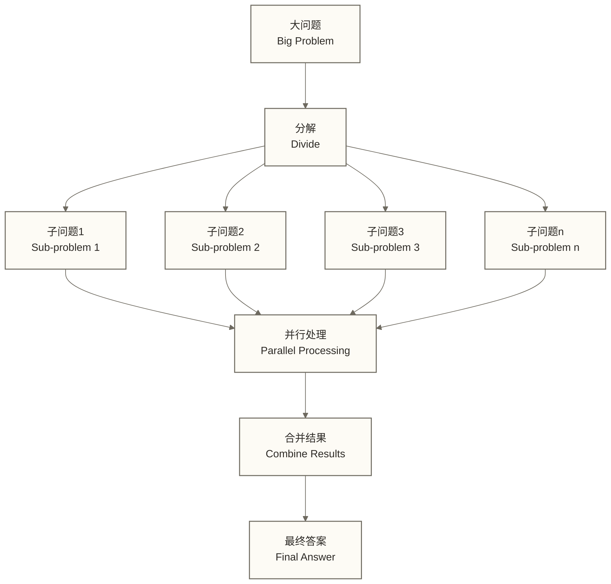
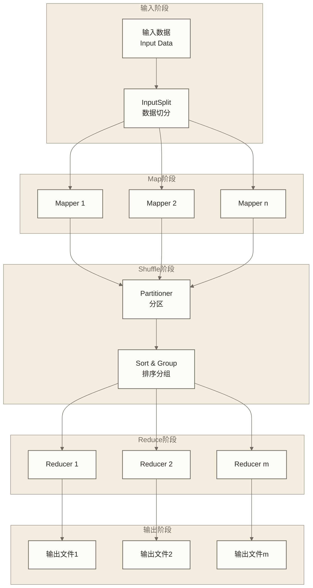
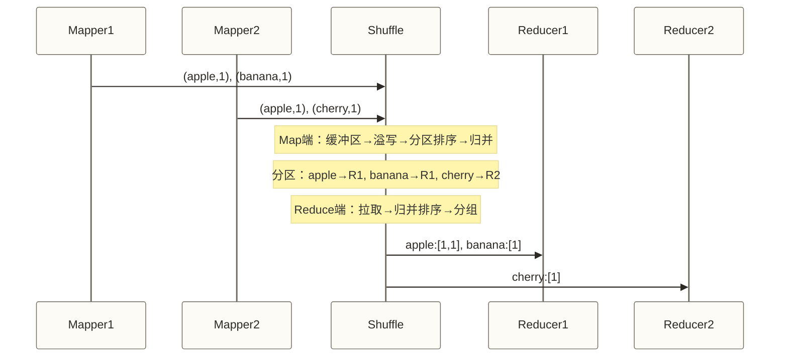

# ⚡ MapReduce编程模型 - 分而治之的计算艺术

> [!abstract] 📋 本节概览
> - 🎯 **学习目标**：掌握MapReduce编程思想、执行流程和开发技巧
> - 📚 **前置知识**：[[【技术与工具】/Hadoop/03-HDFS分布式文件系统|HDFS分布式文件系统]] | Java编程基础 | SQL
> - ⏱️ **预计用时**：110分钟
> - 🔧 **技术重点**：Map-Reduce范式、Shuffle机制、分区策略、性能优化

## 🧠 MapReduce核心思想

> [!note] 💡 MapReduce就像工厂流水线
> 想象一个大型汽车工厂：
> - **Map阶段（分工）**：把复杂的汽车组装任务分解成简单的零件加工
> - **Shuffle阶段（物流）**：将相同类型的零件收集到一起
> - **Reduce阶段（汇总）**：将零件组装成最终产品
> 
> 这样几千个工人可以同时工作，效率远超一个工人独自完成整辆车

### 分而治之的哲学



---

## 🏗️ MapReduce执行框架

### 整体执行流程



### 1. Map阶段 - 数据转换

> [!note] 💡 Map就像数据预处理工厂
> 每个Mapper负责处理一小块数据：
> - 读取输入记录
> - 执行用户定义的map函数
> - 输出键值对(key-value)

```java title="Map函数示例：词频统计"
public class WordCountMapper extends Mapper<LongWritable, Text, Text, IntWritable> {
    
    private final static IntWritable one = new IntWritable(1);
    private Text word = new Text();
    
    @Override
    protected void map(LongWritable key, Text value, Context context) 
            throws IOException, InterruptedException {
        
        // 输入：一行文本
        // 默认TextInputFormat下，key为该行起始位置的文件字节偏移量，value为文本内容
        String line = value.toString().toLowerCase();
        
        // 分词处理
        String[] words = line.split("\\s+");
        
        // 输出：(单词, 1) 键值对
        for (String w : words) {
            if (w.isEmpty()) {
                continue;
            }
            word.set(w);
            context.write(word, one);  // 输出 (word, 1)
        }
    }
}
```

### 2. Shuffle阶段 - 数据重组

> [!note] 💡 Shuffle就像快递分拣中心
> 负责将Map输出按照key重新分组：
> - **分区（Partition）**：决定数据发往哪个Reducer
> - **排序（Sort）**：按key对数据排序
> - **分组（Group）**：将相同key的值聚合在一起

Shuffle 是 MapReduce 中最复杂、也是最影响性能的阶段，分为 Map 端和 Reduce 端两部分：

**Map 端 Shuffle 流程**：

```text
Map 输出
    ↓
环形缓冲区（默认 100MB，由 mapreduce.task.io.sort.mb 控制）
    ↓（使用率达到 80%，由 mapreduce.map.sort.spill.percent 控制）
溢写（Spill）到磁盘
  ├─ 按 Partitioner 分区
  ├─ 分区内按 key 排序
  └─ 可选：调用 Combiner 做本地预聚合
    ↓（多次溢写产生多个溢写文件）
归并（Merge）：将所有溢写文件合并为一个有序文件
```

| 参数 | 默认值 | 说明 |
|------|--------|------|
| `mapreduce.task.io.sort.mb` | 100（MB） | Map 端环形缓冲区大小 |
| `mapreduce.map.sort.spill.percent` | 0.80 | 缓冲区达到此比例时触发溢写 |
| `mapreduce.task.io.sort.factor` | 10 | 归并时每次合并的文件数 |

**Reduce 端 Shuffle 流程**：

```text
从所有 Mapper 拉取（Fetch）属于自己分区的数据
    ↓（并行拉取，由 mapreduce.reduce.shuffle.parallelcopies 控制，默认 5）
内存缓冲区（默认堆内存的 70%）
    ↓（内存不足时溢写到磁盘）
归并排序（Merge Sort）：将内存和磁盘的数据合并为全局有序序列
    ↓
交给 Reducer 逐组处理
```



> [!warning] Shuffle 是性能调优的核心战场
> - 减少 Map 输出数据量（用 Combiner 预聚合，压缩中间结果）
> - 在 Map JVM 堆内存允许的范围内调整缓冲区（`mapreduce.task.io.sort.mb`），评估是否能减少溢写，避免挤占业务对象内存
> - 结合网络、磁盘和 Shuffle 服务负载调整并行拉取数（`mapreduce.reduce.shuffle.parallelcopies`），增大并发不保证提速

### 3. Reduce阶段 - 数据聚合

> [!note] 💡 Reduce就像统计汇总部门
> 每个Reducer处理一组相同key的数据：
> - 接收已排序的键值对组
> - 执行用户定义的reduce函数
> - 输出最终结果

```java title="Reduce函数示例：词频统计"
public class WordCountReducer extends Reducer<Text, IntWritable, Text, IntWritable> {
    
    private IntWritable result = new IntWritable();
    
    @Override
    protected void reduce(Text key, Iterable<IntWritable> values, Context context)
            throws IOException, InterruptedException {
        
        // 输入：(单词, [1,1,1,...]) - 相同单词的所有计数
        int sum = 0;
        
        // 累加所有的1
        for (IntWritable value : values) {
            sum += value.get();
        }
        
        // 输出：(单词, 总次数)
        result.set(sum);
        context.write(key, result);
    }
}
```

---

## 🎯 WordCount完整实例

### 程序结构

```java title="完整的WordCount程序"
import java.io.IOException;
import java.util.StringTokenizer;

import org.apache.hadoop.conf.Configuration;
import org.apache.hadoop.fs.Path;
import org.apache.hadoop.io.IntWritable;
import org.apache.hadoop.io.LongWritable;
import org.apache.hadoop.io.Text;
import org.apache.hadoop.mapreduce.Job;
import org.apache.hadoop.mapreduce.Mapper;
import org.apache.hadoop.mapreduce.Reducer;
import org.apache.hadoop.mapreduce.lib.input.FileInputFormat;
import org.apache.hadoop.mapreduce.lib.output.FileOutputFormat;

public class WordCount {
    
    // Mapper类
    public static class TokenizerMapper
            extends Mapper<LongWritable, Text, Text, IntWritable> {
        
        private final static IntWritable one = new IntWritable(1);
        private Text word = new Text();
        
        public void map(LongWritable key, Text value, Context context)
                throws IOException, InterruptedException {
            
            String line = value.toString().toLowerCase();
            StringTokenizer tokenizer = new StringTokenizer(line);
            
            while (tokenizer.hasMoreTokens()) {
                word.set(tokenizer.nextToken());
                context.write(word, one);
            }
        }
    }
    
    // Reducer类
    public static class IntSumReducer
            extends Reducer<Text, IntWritable, Text, IntWritable> {
        
        private IntWritable result = new IntWritable();
        
        public void reduce(Text key, Iterable<IntWritable> values, Context context)
                throws IOException, InterruptedException {
            
            int sum = 0;
            for (IntWritable val : values) {
                sum += val.get();
            }
            
            result.set(sum);
            context.write(key, result);
        }
    }
    
    // 主函数：配置作业
    public static void main(String[] args) throws Exception {
        Configuration conf = new Configuration();
        Job job = Job.getInstance(conf, "word count");
        
        job.setJarByClass(WordCount.class);
        job.setMapperClass(TokenizerMapper.class);
        job.setCombinerClass(IntSumReducer.class);  // 使用Reducer作为Combiner
        job.setReducerClass(IntSumReducer.class);
        
        job.setOutputKeyClass(Text.class);
        job.setOutputValueClass(IntWritable.class);
        
        FileInputFormat.addInputPath(job, new Path(args[0]));
        FileOutputFormat.setOutputPath(job, new Path(args[1]));
        
        System.exit(job.waitForCompletion(true) ? 0 : 1);
    }
}
```

### 编译和运行

```bash title="编译运行WordCount"
# 1. 编译Java代码
export HADOOP_CLASSPATH=$JAVA_HOME/lib/tools.jar
hadoop com.sun.tools.javac.Main WordCount.java

# 2. 创建JAR包
jar cf wordcount.jar WordCount*.class

# 3. 准备输入数据
hdfs dfs -mkdir /input
echo "Hello World Bye World" > input.txt
echo "Hello Hadoop Goodbye Hadoop" >> input.txt
hdfs dfs -put input.txt /input

# 4. 运行MapReduce作业
hadoop jar wordcount.jar WordCount /input /output

# 5. 查看结果
hdfs dfs -cat /output/part-r-00000
# 输出：
# bye     1
# goodbye 1
# hadoop  2
# hello   2
# world   2
```

---

## 🔧 MapReduce高级特性

### 1. Combiner - 本地聚合

> [!note] 💡 Combiner就像地区预汇总
> 在数据发送到Reducer之前，先在本地做一次预聚合：
> - 减少网络传输数据量
> - 提高整体作业性能
> - 必须满足**结合律和交换律**（不是所有操作都适合）

**Combiner 使用条件**：Combiner 的输入、输出键值类型须兼容 Map 输出的中间键值类型及 Reducer 输入类型，不要求与 Reducer 的最终输出类型相同。聚合操作应满足结合律和交换律，并保证不执行或执行多次 Combiner 都不改变最终结果。

| 操作 | 适合使用 Combiner | 原因 |
|------|------------------|------|
| 求和（sum） | 适合 | `(a+b)+c = a+(b+c)` |
| 计数（count） | 适合 | 本质是求和 |
| 最大值（max） | 适合 | `max(max(a,b), c) = max(a,b,c)` |
| 最小值（min） | 适合 | 同上 |
| 求平均值（average） | **不适合** | 平均值不满足结合律，需要传递 (sum, count) 对 |
| 中位数（median） | **不适合** | 局部中位数不等于全局中位数 |

**Combiner 与 Reducer 的关系**：
- Combiner 在 Map 端本地执行（可能执行 0 次或多次，不保证一定执行）
- Reducer 任务按分区处理数据，每个键分组调用一次 reduce；任务可能因失败重试或推测执行产生多个执行尝试，不保证只执行一次，也不保证位于远端节点
- WordCount 中可以直接用 Reducer 类作为 Combiner（因为求和满足结合律）

```java title="自定义Combiner"
public class WordCountCombiner extends Reducer<Text, IntWritable, Text, IntWritable> {
    
    @Override
    protected void reduce(Text key, Iterable<IntWritable> values, Context context)
            throws IOException, InterruptedException {
        
        int sum = 0;
        for (IntWritable value : values) {
            sum += value.get();
        }
        
        // Combiner的输出作为Reducer的输入
        context.write(key, new IntWritable(sum));
    }
}

// 在主函数中设置
job.setCombinerClass(WordCountCombiner.class);
```

### 2. Partitioner - 数据分区

> [!note] 💡 Partitioner就像快递分拣规则
> 决定Map输出的每个键值对发送到哪个Reducer：
> - 默认使用HashPartitioner
> - 可自定义分区逻辑
> - 影响数据分布和负载均衡

```java title="自定义Partitioner"
public class CustomPartitioner extends Partitioner<Text, IntWritable> {
    
    @Override
    public int getPartition(Text key, IntWritable value, int numPartitions) {
        
        // 示例：按单词首字母分区
        char firstChar = key.toString().charAt(0);
        
        if (firstChar >= 'a' && firstChar <= 'm') {
            return 0 % numPartitions;  // 前半字母表发送到第一个分区
        } else {
            return 1 % numPartitions;  // 后半字母表发送到第二个分区
        }
    }
}

// 在主函数中设置
job.setPartitionerClass(CustomPartitioner.class);
job.setNumReduceTasks(2);  // 设置Reducer数量
```

### 3. WritableComparable - 自定义数据类型

```java title="自定义数据类型"
import java.io.DataInput;
import java.io.DataOutput;
import java.io.IOException;
import org.apache.hadoop.io.WritableComparable;

public class TemperatureWritable implements WritableComparable<TemperatureWritable> {
    
    private int year;
    private int temperature;
    
    // 构造函数
    public TemperatureWritable() {}
    
    public TemperatureWritable(int year, int temperature) {
        this.year = year;
        this.temperature = temperature;
    }
    
    // 序列化：写入数据
    @Override
    public void write(DataOutput out) throws IOException {
        out.writeInt(year);
        out.writeInt(temperature);
    }
    
    // 反序列化：读取数据
    @Override
    public void readFields(DataInput in) throws IOException {
        year = in.readInt();
        temperature = in.readInt();
    }
    
    // 比较方法：用于排序
    @Override
    public int compareTo(TemperatureWritable other) {
        int result = Integer.compare(this.year, other.year);
        if (result == 0) {
            result = Integer.compare(this.temperature, other.temperature);
        }
        return result;
    }
    
    // getter和setter方法
    public int getYear() { return year; }
    public int getTemperature() { return temperature; }
    public void setYear(int year) { this.year = year; }
    public void setTemperature(int temperature) { this.temperature = temperature; }
    
    @Override
    public String toString() {
        return year + "," + temperature;
    }
}
```

### 4. InputFormat - 输入格式

InputFormat 负责两件事：
1. **数据切分（getSplits）**：将输入数据切分为 InputSplit，每个 Split 对应一个 Map 任务
2. **记录读取（createRecordReader）**：将 Split 解析为键值对，逐条喂给 Mapper

| InputFormat 类 | 适用场景 | 切分逻辑 |
|----------------|----------|----------|
| `TextInputFormat`（默认） | 普通文本文件，每行一条记录；key 为行起始位置的文件字节偏移量，value 为行内容 | 对可切分文件通常参考 Block 大小及切分配置生成 Split；行可跨 Split 边界，由 RecordReader 协调读取完整记录 |
| `KeyValueTextInputFormat` | 文本文件，每行有 tab 分隔的 key-value | 同上，自动以 tab 为分隔符解析 key |
| `NLineInputFormat` | 需要精确控制每个 Mapper 处理的行数 | 每 N 行一个 Split，N 由 `mapreduce.input.lineinputformat.linespermap` 控制 |
| `SequenceFileInputFormat` | Hadoop 二进制序列文件（高效、可压缩） | 按 Block 切分 |
| `CombineFileInputFormat` | 大量小文件场景，合并多个小文件为一个 Split | 将多个小文件合并，减少 Map 任务数 |
| `DBInputFormat` | 从关系型数据库读取数据 | 按行号范围切分 |

```java title="设置 InputFormat"
// 默认是 TextInputFormat，可显式设置
job.setInputFormatClass(SequenceFileInputFormat.class);

// NLineInputFormat：每个 Mapper 处理 100 行
job.setInputFormatClass(NLineInputFormat.class);
NLineInputFormat.setNumLinesPerSplit(job, 100);
```

### 5. OutputFormat - 输出格式

OutputFormat 控制任务结果如何写出，有 Reduce 的作业通常由 Reducer 输出，纯 Map 作业由 Mapper 输出。下表列出常用 OutputFormat 及辅助输出工具：

| OutputFormat 类 | 说明 |
|----------------|------|
| `TextOutputFormat`（默认） | 每条记录写成一行，key 和 value 以 tab 分隔 |
| `SequenceFileOutputFormat` | 输出 Hadoop 二进制序列文件，适合作为下一个 MR 作业的输入 |
| `MapFileOutputFormat` | 输出带索引的 MapFile，支持按 key 随机查找 |
| `NullOutputFormat` | 不产生任何输出（结果通过 Counter 或 Side Effect 输出） |
| `MultipleOutputs`（辅助工具，非 OutputFormat 子类） | 配合 OutputFormat 将不同数据写到不同输出文件，可通过基础输出路径组织多个目录 |

```java title="MultipleOutputs 示例：按年份分别输出"
// Driver 中注册输出路径
MultipleOutputs.addNamedOutput(job, "year2023", TextOutputFormat.class,
    Text.class, IntWritable.class);
MultipleOutputs.addNamedOutput(job, "year2024", TextOutputFormat.class,
    Text.class, IntWritable.class);

// Reducer 中按条件写入不同路径
MultipleOutputs<Text, IntWritable> mos = new MultipleOutputs<>(context);
if ("2024".equals(year)) {
    mos.write("year2024", key, value);
} else {
    mos.write("year2023", key, value);
}
mos.close();
```

### 6. Counter - 计数器

Counter 是 MapReduce 的内置监控机制，用于统计程序运行时的各种指标。

**内置计数器分类**：

| 计数器组 | 代表计数器 | 说明 |
|----------|-----------|------|
| `FileSystemCounters` | `HDFS_BYTES_READ`、`HDFS_BYTES_WRITTEN` | HDFS 读写字节数 |
| `Job Counters` | `LAUNCHED_MAP_TASKS`、`LAUNCHED_REDUCE_TASKS` | 启动的任务数 |
| `Map-Reduce Framework` | `MAP_INPUT_RECORDS`、`REDUCE_OUTPUT_RECORDS` | Map 输入记录数、Reduce 输出记录数 |
| `Map-Reduce Framework` | `SPILLED_RECORDS` | 溢写记录数；同一记录可能在溢写和归并中重复计数，高值需结合输出规模、归并次数及缓冲区配置分析 |

**自定义计数器**：

```java title="自定义计数器示例"
// 定义计数器枚举（推荐方式）
enum MyCounters {
    VALID_RECORDS,
    INVALID_RECORDS,
    EMPTY_LINES
}

// 在 Mapper/Reducer 中使用
context.getCounter(MyCounters.VALID_RECORDS).increment(1);

// 也可以使用字符串组名（不推荐，容易拼写错误）
context.getCounter("Data Quality", "Invalid Records").increment(1);

// Driver 中读取计数器结果（作业完成后）
boolean success = job.waitForCompletion(true);
Counters counters = job.getCounters();
long validCount = counters.findCounter(MyCounters.VALID_RECORDS).getValue();
System.out.println("有效记录数: " + validCount);
```

> [!tip] Counter 的实际价值
> Counter 是排查数据质量问题的利器。当结果不符合预期时，通过 INVALID_RECORDS 计数器可以快速定位是否有大量脏数据被过滤，比在日志里找报错高效得多。

---

## 📊 实际应用案例

### 案例1：网站访问日志分析

```java title="访问日志分析Mapper"
public class LogAnalysisMapper extends Mapper<LongWritable, Text, Text, IntWritable> {
    
    private final static IntWritable one = new IntWritable(1);
    private Text outputKey = new Text();
    
    @Override
    protected void map(LongWritable key, Text value, Context context)
            throws IOException, InterruptedException {
        
        // 日志格式：IP timestamp method URL status size
        // 例：192.168.1.1 [01/Jan/2024:00:00:01] GET /index.html 200 1024
        
        String line = value.toString();
        String[] fields = line.split(" ");
        
        if (fields.length >= 6) {
            String ip = fields[0];
            String url = fields[3];
            String status = fields[4];
            
            // 统计不同维度
            context.write(new Text("ip:" + ip), one);        // IP访问次数
            context.write(new Text("url:" + url), one);      // URL访问次数  
            context.write(new Text("status:" + status), one); // 状态码统计
            
            // 错误请求分析：按HTTP状态码统计4xx和5xx；非200不一定表示错误
            if (status.matches("[45]\\d{2}")) {
                context.write(new Text("error:" + ip), one);
            }
        }
    }
}
```

### 案例2：气温数据最值分析

```java title="气温最值分析"
// Mapper：提取年份和气温
public class TemperatureMapper extends Mapper<LongWritable, Text, IntWritable, IntWritable> {
    
    @Override
    protected void map(LongWritable key, Text value, Context context)
            throws IOException, InterruptedException {
        
        // 数据格式：year,month,day,temperature
        String line = value.toString();
        String[] fields = line.split(",");
        
        if (fields.length == 4) {
            int year = Integer.parseInt(fields[0]);
            int temperature = Integer.parseInt(fields[3]);
            
            context.write(new IntWritable(year), new IntWritable(temperature));
        }
    }
}

// Reducer：计算每年最高温度
public class MaxTemperatureReducer extends Reducer<IntWritable, IntWritable, IntWritable, IntWritable> {
    
    @Override
    protected void reduce(IntWritable key, Iterable<IntWritable> values, Context context)
            throws IOException, InterruptedException {
        
        int maxTemperature = Integer.MIN_VALUE;
        
        for (IntWritable temperature : values) {
            maxTemperature = Math.max(maxTemperature, temperature.get());
        }
        
        context.write(key, new IntWritable(maxTemperature));
    }
}
```

---

## ⚡ 性能优化技巧

### 1. 作业级优化

```java title="作业配置优化"
public static void optimizeJob(Job job) {
    Configuration conf = job.getConfiguration();
    
    // 1. Map端优化
    conf.set("mapreduce.map.memory.mb", "2048");           // Map任务内存
    conf.set("mapreduce.map.java.opts", "-Xmx1638m");     // Map JVM堆内存
    conf.set("mapreduce.task.io.sort.mb", "512");         // 排序缓冲区大小
    conf.set("mapreduce.map.sort.spill.percent", "0.9");  // 溢写阈值
    
    // 2. Reduce端优化  
    conf.set("mapreduce.reduce.memory.mb", "4096");       // Reduce任务内存
    conf.set("mapreduce.reduce.java.opts", "-Xmx3276m");  // Reduce JVM堆内存
    conf.set("mapreduce.reduce.shuffle.parallelcopies", "10"); // 并行拷贝数
    
    // 3. 压缩优化
    conf.set("mapreduce.map.output.compress", "true");
    conf.set("mapreduce.map.output.compress.codec", "org.apache.hadoop.io.compress.SnappyCodec");
    conf.set("mapreduce.output.fileoutputformat.compress", "true");
    conf.set("mapreduce.output.fileoutputformat.compress.codec", "org.apache.hadoop.io.compress.GzipCodec");
    
    // 4. 推测执行
    conf.set("mapreduce.map.speculative", "true");
    conf.set("mapreduce.reduce.speculative", "true");
}
```

### 2. 数据倾斜处理

> [!warning] ⚠️ 数据倾斜问题
> 就像工厂某个工位积压太多工件：
> - 现象：某些Reducer处理时间远超其他
> - 原因：数据分布不均匀，某些key对应的数据量过大
> - 影响：整个作业的完成时间取决于最慢的任务

```java title="数据倾斜解决方案"
// 方案1：使用随机前缀打散数据
public class AntiSkewMapper extends Mapper<LongWritable, Text, Text, IntWritable> {
    
    private Random random = new Random();
    
    @Override
    protected void map(LongWritable key, Text value, Context context)
            throws IOException, InterruptedException {
        
        String line = value.toString();
        String[] words = line.split("\\s+");
        
        for (String word : words) {
            // 为热点key添加随机前缀
            if (isHotKey(word)) {
                int randomPrefix = random.nextInt(10);  // 0-9随机前缀
                context.write(new Text(randomPrefix + "_" + word), new IntWritable(1));
            } else {
                context.write(new Text(word), new IntWritable(1));
            }
        }
    }
    
    private boolean isHotKey(String word) {
        // 判断是否为热点词汇的逻辑
        return word.equals("the") || word.equals("and") || word.equals("of");
    }
}

// 方案2：两阶段聚合
// 第一阶段：局部聚合，添加随机后缀
// 第二阶段：去除第一阶段添加的随机前缀或后缀，按原始key汇总局部计数；此处未提供该阶段的实现，不能把第一阶段输出直接作为最终结果
```

---

## 🔗 下一步学习

掌握MapReduce编程模型后，建议继续学习：

- [[【技术与工具】/Hadoop/06-MapReduce开发实战|MapReduce开发]]
- [[【技术与工具】/Hadoop/07-MapReduce性能优化|MapReduce性能优化]]
- [[【技术与工具】/Hadoop/09-YARN资源管理架构|YARN资源管理]]

---

*最后更新：2024-06-29* 