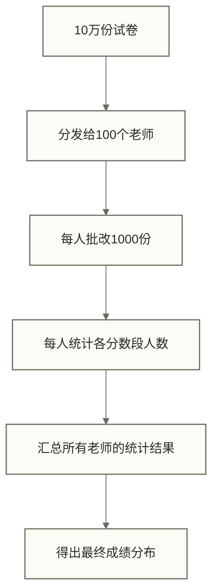

# 🔄 MapReduce开发实战 - 分布式计算编程指南

> [!abstract] 📋 学习目标
> - 🎯 **掌握MapReduce编程思维**：理解分布式计算的"分而治之"思想
> - 💻 **熟练Java/Python开发**：编写高效的MapReduce程序
> - 🛠️ **实现经典算法**：词频统计、排序、连接等常见模式
> - 🚀 **优化程序性能**：合理使用Combiner、分区器等组件

> [!tip] 💡 前置知识
> 建议先学习 [[【技术与工具】/Hadoop/05-MapReduce编程模型|MapReduce编程]] 了解MapReduce的基本原理和执行流程

---

## 🧠 分布式编程思维

### MapReduce就像组织一场"大型考试阅卷"

想象你是教育局局长，需要阅卷10万份试卷：



**这就是MapReduce的核心思想**：
- **Map阶段**：每个老师（Mapper）独立批改分配给自己的试卷
- **Shuffle阶段**：按分数段重新整理结果
- **Reduce阶段**：统计员（Reducer）汇总每个分数段的总人数

> [!tip] 💡 编程思维转换
> - **传统编程**：一个程序处理所有数据（单线程阅卷）
> - **MapReduce编程**：多个程序并行处理数据片段，然后合并结果

---

## ☕ Java开发实战

### 开发环境准备

```xml title="Maven项目配置"
<?xml version="1.0" encoding="UTF-8"?>
<project xmlns="http://maven.apache.org/POM/4.0.0">
    <modelVersion>4.0.0</modelVersion>
    
    <groupId>com.example</groupId>
    <artifactId>mapreduce-demo</artifactId>
    <version>1.0</version>
    
    <properties>
        <maven.compiler.source>8</maven.compiler.source>
        <maven.compiler.target>8</maven.compiler.target>
        <hadoop.version>3.3.4</hadoop.version>
    </properties>
    
    <dependencies>
        <!-- Hadoop核心库 -->
        <dependency>
            <groupId>org.apache.hadoop</groupId>
            <artifactId>hadoop-client</artifactId>
            <version>${hadoop.version}</version>
        </dependency>
        
        <!-- MapReduce库 -->
        <dependency>
            <groupId>org.apache.hadoop</groupId>
            <artifactId>hadoop-mapreduce-client-core</artifactId>
            <version>${hadoop.version}</version>
        </dependency>
        
        <!-- 公共库 -->
        <dependency>
            <groupId>org.apache.hadoop</groupId>
            <artifactId>hadoop-common</artifactId>
            <version>${hadoop.version}</version>
        </dependency>
    </dependencies>
    
    <build>
        <plugins>
            <!-- 打包插件 -->
            <plugin>
                <groupId>org.apache.maven.plugins</groupId>
                <artifactId>maven-shade-plugin</artifactId>
                <version>3.2.4</version>
                <executions>
                    <execution>
                        <phase>package</phase>
                        <goals>
                            <goal>shade</goal>
                        </goals>
                        <configuration>
                            <createDependencyReducedPom>false</createDependencyReducedPom>
                        </configuration>
                    </execution>
                </executions>
            </plugin>
        </plugins>
    </build>
</project>
```

### Writable 数据类型体系

MapReduce 使用自己的序列化框架（而非 Java 原生序列化），所有在 Mapper 和 Reducer 之间传递的键值类型都必须实现 `Writable` 接口。

**常用内置 Writable 类型**：

| Writable 类型 | 对应 Java 类型 | 典型用途 |
|--------------|---------------|----------|
| `IntWritable` | `int` | 计数、整数统计 |
| `LongWritable` | `long` | 行偏移量、大数值 |
| `FloatWritable` | `float` | 浮点统计 |
| `DoubleWritable` | `double` | 精度要求高的浮点计算 |
| `Text` | `String` | 文本内容，支持 UTF-8 |
| `BooleanWritable` | `boolean` | 布尔标记 |
| `BytesWritable` | `byte[]` | 二进制数据 |
| `NullWritable` | 无（null占位符） | 不需要 key 或 value 时使用（如去重场景） |
| `ArrayWritable` | 数组 | 同类型元素的数组 |
| `MapWritable` | Map | 键值对映射 |

> [!tip] 性能最佳实践
> 在 Mapper 的 `map()` 方法中，复用 Writable 对象而不是每次新建，可以显著减少 GC 压力：
> ```java
> // 正确：在类成员位置声明，map() 方法内复用
> private Text word = new Text();
> private IntWritable one = new IntWritable(1);
>
> // 错误：每次调用 map() 都创建新对象（高并发时 GC 压力大）
> context.write(new Text(word), new IntWritable(1));
> ```

**自定义 Writable**（当需要组合多个字段作为值类型时）：

```java title="自定义 Writable 示例"
import org.apache.hadoop.io.Writable;
import java.io.DataInput;
import java.io.DataOutput;
import java.io.IOException;

// 记录用户信息：姓名 + 消费金额
public class UserSpendWritable implements Writable {

    private String name;
    private double amount;

    public UserSpendWritable() {}  // 必须有无参构造函数

    public UserSpendWritable(String name, double amount) {
        this.name = name;
        this.amount = amount;
    }

    // 序列化：按固定顺序写出各字段
    @Override
    public void write(DataOutput out) throws IOException {
        out.writeUTF(name);
        out.writeDouble(amount);
    }

    // 反序列化：按与 write() 完全相同的顺序读取字段
    @Override
    public void readFields(DataInput in) throws IOException {
        name = in.readUTF();
        amount = in.readDouble();
    }

    // getter / setter
    public String getName() { return name; }
    public double getAmount() { return amount; }

    @Override
    public String toString() {
        return name + "\t" + amount;
    }
}
```

如果自定义类型还需要用作 **Map 输出的 key**（需要参与排序），则必须实现 `WritableComparable` 而非 `Writable`，并实现 `compareTo()` 方法。

---

### 案例1：词频统计（WordCount）

这是MapReduce的"Hello World"程序，就像统计一本书中每个单词出现的次数。

```java title="WordCountMapper.java - Map阶段"
package com.example.wordcount;

import org.apache.hadoop.io.IntWritable;
import org.apache.hadoop.io.LongWritable;
import org.apache.hadoop.io.Text;
import org.apache.hadoop.mapreduce.Mapper;
import java.io.IOException;
import java.util.StringTokenizer;

/**
 * 📖 WordCountMapper：单词计数的Map阶段
 * 作用：将每行文本拆分成单词，每个单词输出 (word, 1)
 */
public class WordCountMapper extends Mapper<LongWritable, Text, Text, IntWritable> {
    
    // 💡 这些变量重复使用，避免在map方法中重复创建对象（性能优化）
    private final static IntWritable one = new IntWritable(1);
    private Text word = new Text();
    
    /**
     * map方法：处理输入的每一行
     * @param key TextInputFormat提供的行起始字节偏移量（通常忽略）
     * @param value 这一行的文本内容
     * @param context 用于输出中间结果
     */
    @Override
    public void map(LongWritable key, Text value, Context context) 
            throws IOException, InterruptedException {
        
        // 📝 将文本转为小写并按空格分割
        String line = value.toString().toLowerCase();
        StringTokenizer tokenizer = new StringTokenizer(line);
        
        // 🔄 遍历每个单词
        while (tokenizer.hasMoreTokens()) {
            String currentWord = tokenizer.nextToken();
            
            // 🧹 简单的清理：移除标点符号
            currentWord = currentWord.replaceAll("[^a-zA-Z0-9]", "");
            
            if (!currentWord.isEmpty()) {
                word.set(currentWord);
                // 📤 输出 (单词, 1)
                context.write(word, one);
            }
        }
    }
}
```

```java title="WordCountReducer.java - Reduce阶段"
package com.example.wordcount;

import org.apache.hadoop.io.IntWritable;
import org.apache.hadoop.io.Text;
import org.apache.hadoop.mapreduce.Reducer;
import java.io.IOException;

/**
 * 📊 WordCountReducer：单词计数的Reduce阶段
 * 作用：将相同单词的所有计数相加
 */
public class WordCountReducer extends Reducer<Text, IntWritable, Text, IntWritable> {
    
    private IntWritable result = new IntWritable();
    
    /**
     * reduce方法：处理每个单词的所有计数
     * @param key 单词
     * @param values 这个单词的所有计数值 [1, 1, 1, ...]
     * @param context 用于输出最终结果
     */
    @Override
    public void reduce(Text key, Iterable<IntWritable> values, Context context) 
            throws IOException, InterruptedException {
        
        int sum = 0;
        
        // 🧮 将所有的1相加
        for (IntWritable value : values) {
            sum += value.get();
        }
        
        result.set(sum);
        // 📤 输出 (单词, 总次数)
        context.write(key, result);
    }
}
```

```java title="WordCountDriver.java - 主程序"
package com.example.wordcount;

import org.apache.hadoop.conf.Configuration;
import org.apache.hadoop.fs.Path;
import org.apache.hadoop.io.IntWritable;
import org.apache.hadoop.io.Text;
import org.apache.hadoop.mapreduce.Job;
import org.apache.hadoop.mapreduce.lib.input.FileInputFormat;
import org.apache.hadoop.mapreduce.lib.input.TextInputFormat;
import org.apache.hadoop.mapreduce.lib.output.FileOutputFormat;
import org.apache.hadoop.mapreduce.lib.output.TextOutputFormat;

/**
 * WordCountDriver：任务配置和启动
 */
public class WordCountDriver {

    public static void main(String[] args) throws Exception {

        // 解析Hadoop通用参数（如-D），保留输入输出路径参数
        Configuration conf = new Configuration();
        args = new org.apache.hadoop.util.GenericOptionsParser(conf, args).getRemainingArgs();

        // 检查参数
        if (args.length != 2) {
            System.err.println("用法: WordCount <输入路径> <输出路径>");
            System.err.println("示例: hadoop jar wordcount.jar com.example.wordcount.WordCountDriver /input /output");
            System.exit(-1);
        }

        // 使用已解析通用参数的配置

        // 创建 Job（作业名称显示在 YARN Web UI 上）
        Job job = Job.getInstance(conf, "word count");
        // 注意：必须是 setJarByClass，不是 setJarByFile
        job.setJarByClass(WordCountDriver.class);

        // 设置 Mapper、Combiner、Reducer
        job.setMapperClass(WordCountMapper.class);
        job.setCombinerClass(WordCountReducer.class);  // 求和满足结合律，可用 Reducer 作 Combiner
        job.setReducerClass(WordCountReducer.class);

        // 设置输出键值类型（Map 输出类型与 Reduce 输出类型相同时只需设置一次）
        job.setOutputKeyClass(Text.class);
        job.setOutputValueClass(IntWritable.class);

        // 设置输入输出格式（TextInputFormat 是默认值，可省略）
        job.setInputFormatClass(TextInputFormat.class);
        job.setOutputFormatClass(TextOutputFormat.class);

        // 设置输入输出路径
        FileInputFormat.addInputPath(job, new Path(args[0]));
        FileOutputFormat.setOutputPath(job, new Path(args[1]));

        // 提交作业并等待完成（true 表示打印进度日志）
        boolean success = job.waitForCompletion(true);
        System.exit(success ? 0 : 1);
    }
}
```

#### 编译和运行

```bash title="WordCount程序执行流程"
# 1. 编译项目（使用 maven-shade-plugin 打包含依赖的 fat jar）
mvn clean package

# 2. 准备测试数据
echo -e "Hello World\nHello Hadoop\nWorld of BigData" > input.txt
hdfs dfs -mkdir -p /wordcount_input
hdfs dfs -put input.txt /wordcount_input/

# 3. 提交到 YARN 集群运行（推荐方式）
yarn jar target/mapreduce-demo-1.0.jar \
    com.example.wordcount.WordCountDriver \
    /wordcount_input \
    /wordcount_output

# 也可以使用 hadoop jar；是否提交到YARN由mapreduce.framework.name等配置决定
hadoop jar target/mapreduce-demo-1.0.jar \
    com.example.wordcount.WordCountDriver \
    /wordcount_input \
    /wordcount_output

# 4. 查看结果
hdfs dfs -cat /wordcount_output/part-r-00000

# 预期输出：
# bigdata	1
# hadoop	1
# hello	2
# of	1
# world	2

# 5. 监控作业进度（作业提交后终端会打印进度，也可通过 Web UI 查看）
# YARN Web UI：http://ResourceManager-host:8088
# 查看历史作业：http://JobHistory-host:19888
```

#### 本地模式调试

在集群上调试 MapReduce 程序效率很低。通过将框架名称设置为 `local`，程序会在单机上以本地线程模式运行，方便 IDE 断点调试：

```java title="本地模式运行配置"
// 在 Driver 的 main() 中，创建 Configuration 后添加以下配置
Configuration conf = new Configuration();

// 关键：强制使用本地模式（不提交到 YARN）
conf.set("mapreduce.framework.name", "local");

// 本地文件系统（不使用 HDFS）
conf.set("fs.defaultFS", "file:///");

Job job = Job.getInstance(conf, "word count local");
// ... 其余配置不变

// 本地运行时输入输出路径改为本地路径
FileInputFormat.addInputPath(job, new Path("/tmp/wordcount_input"));
FileOutputFormat.setOutputPath(job, new Path("/tmp/wordcount_output"));
```

```bash
# 命令行方式：通过参数覆盖配置（无需修改代码）
hadoop jar target/mapreduce-demo-1.0.jar \
    com.example.wordcount.WordCountDriver \
    -D mapreduce.framework.name=local \
    -D fs.defaultFS=file:/// \
    file:///tmp/wordcount_input \
    file:///tmp/wordcount_output
```

> [!tip] 调试最佳实践
> 1. 先用 **本地模式 + 小数据集** 验证逻辑正确性
> 2. 再用 **本地模式 + 真实数据样本** 验证边界情况
> 3. 最后提交到 **YARN 集群** 验证性能和规模
>
> 本地模式下可以直接在 IDE 中设置断点，配合 `System.err.println()` 输出调试信息（标准错误会显示在控制台，不会混入结果文件）。

### 案例2：气温数据分析

模拟气象站数据分析，找出每年的最高温度。

```java title="TemperatureMapper.java"
package com.example.temperature;

import org.apache.hadoop.io.IntWritable;
import org.apache.hadoop.io.LongWritable;
import org.apache.hadoop.io.Text;
import org.apache.hadoop.mapreduce.Mapper;
import java.io.IOException;

/**
 * 🌡️ 气温数据Mapper
 * 输入格式：年份,月份,日期,温度
 * 例如：2024,06,15,28
 */
public class TemperatureMapper extends Mapper<LongWritable, Text, Text, IntWritable> {
    
    private Text year = new Text();
    private IntWritable temperature = new IntWritable();
    
    @Override
    public void map(LongWritable key, Text value, Context context) 
            throws IOException, InterruptedException {
        
        String line = value.toString();
        String[] fields = line.split(",");
        
        // 📊 解析数据
        if (fields.length == 4) {
            try {
                String yearStr = fields[0];
                int temp = Integer.parseInt(fields[3]);
                
                year.set(yearStr);
                temperature.set(temp);
                
                // 📤 输出 (年份, 温度)
                context.write(year, temperature);
                
            } catch (NumberFormatException e) {
                // 🚫 忽略格式错误的行
                System.err.println("数据格式错误: " + line);
            }
        }
    }
}
```

```java title="TemperatureReducer.java"
package com.example.temperature;

import org.apache.hadoop.io.IntWritable;
import org.apache.hadoop.io.Text;
import org.apache.hadoop.mapreduce.Reducer;
import java.io.IOException;

/**
 * 🌡️ 气温数据Reducer：找出每年最高温度
 */
public class TemperatureReducer extends Reducer<Text, IntWritable, Text, IntWritable> {
    
    private IntWritable maxTemp = new IntWritable();
    
    @Override
    public void reduce(Text key, Iterable<IntWritable> values, Context context) 
            throws IOException, InterruptedException {
        
        int max = Integer.MIN_VALUE;
        
        // 🔍 找出最大值
        for (IntWritable value : values) {
            max = Math.max(max, value.get());
        }
        
        maxTemp.set(max);
        // 📤 输出 (年份, 最高温度)
        context.write(key, maxTemp);
    }
}
```

### 案例3：数据去重（Deduplication）

去除数据集中的重复记录，这在数据清洗中很常见。

```java title="DeduplicationMapper.java"
package com.example.dedup;

import org.apache.hadoop.io.LongWritable;
import org.apache.hadoop.io.NullWritable;
import org.apache.hadoop.io.Text;
import org.apache.hadoop.mapreduce.Mapper;
import java.io.IOException;

/**
 * 🔄 数据去重Mapper
 * 思路：以整行数据作为key，value设为null
 */
public class DeduplicationMapper extends Mapper<LongWritable, Text, Text, NullWritable> {
    
    @Override
    public void map(LongWritable key, Text value, Context context) 
            throws IOException, InterruptedException {
        
        String line = value.toString().trim();
        
        if (!line.isEmpty()) {
            // 📤 输出 (整行数据, null)
            context.write(new Text(line), NullWritable.get());
        }
    }
}
```

```java title="DeduplicationReducer.java"
package com.example.dedup;

import org.apache.hadoop.io.NullWritable;
import org.apache.hadoop.io.Text;
import org.apache.hadoop.mapreduce.Reducer;
import java.io.IOException;

/**
 * 🔄 数据去重Reducer
 * 思路：每个key只输出一次，自然去重
 */
public class DeduplicationReducer extends Reducer<Text, NullWritable, Text, NullWritable> {
    
    @Override
    public void reduce(Text key, Iterable<NullWritable> values, Context context) 
            throws IOException, InterruptedException {
        
        // 🎯 每个key只输出一次，实现去重
        context.write(key, NullWritable.get());
    }
}
```

---

## 🐍 Python开发实战

使用Python开发MapReduce程序更简单直观，适合快速原型开发。

### Python开发环境

```bash title="环境准备"
# 📦 安装依赖
pip install hdfs3
pip install mrjob  # 简化MapReduce开发的库

# 🐍 或者使用Hadoop Streaming
# Hadoop Streaming允许使用任何语言编写MapReduce程序
```

### 案例1：Python词频统计

```python title="wordcount_mapper.py"
#!/usr/bin/env python3
# -*- coding: utf-8 -*-
"""
📖 Python版本的WordCount Mapper
"""
import sys
import re

def main():
    """主函数：处理标准输入的每一行"""
    for line in sys.stdin:
 # 🧹 清理和分割
        line = line.strip().lower()
 # 使用正则表达式分割单词
        words = re.findall(r'\b\w+\b', line)
        
 # 📤 输出每个单词
        for word in words:
            if word:  # 确保不是空字符串
                print(f"{word}\t1")

if __name__ == "__main__":
    main()
```

```python title="wordcount_reducer.py"
#!/usr/bin/env python3
# -*- coding: utf-8 -*-
"""
📊 Python版本的WordCount Reducer
"""
import sys
from collections import defaultdict

def main():
    """主函数：统计每个单词的出现次数"""
    word_count = defaultdict(int)
    
 # 📥 读取mapper的输出
    for line in sys.stdin:
        line = line.strip()
        if line:
            try:
                word, count = line.split('\t')
                word_count[word] += int(count)
            except ValueError:
 # 🚫 忽略格式错误的行
                continue
    
 # 📤 输出最终结果
    for word, count in sorted(word_count.items()):
        print(f"{word}\t{count}")

if __name__ == "__main__":
    main()
```

#### 使用Hadoop Streaming运行

```bash title="Python MapReduce运行"
# 1️⃣ 给脚本添加执行权限
chmod +x wordcount_mapper.py
chmod +x wordcount_reducer.py

# 2️⃣ 使用Hadoop Streaming运行
hadoop jar $HADOOP_HOME/share/hadoop/tools/lib/hadoop-streaming-*.jar \
    -files wordcount_mapper.py,wordcount_reducer.py \
    -mapper wordcount_mapper.py \
    -reducer wordcount_reducer.py \
    -input /wordcount_input \
    -output /wordcount_output_python

# 3️⃣ 查看结果
hdfs dfs -cat /wordcount_output_python/part-00000
```

### 案例2：使用MRJob简化开发

MRJob是一个Python库，让MapReduce开发更加简单。

```python title="wordcount_mrjob.py"
#!/usr/bin/env python3
# -*- coding: utf-8 -*-
"""
🚀 使用MRJob的WordCount程序
一个文件包含完整的MapReduce逻辑
"""
from mrjob.job import MRJob
from mrjob.step import MRStep
import re

class WordCount(MRJob):
    
    def mapper(self, _, line):
        """
        📖 Map阶段：分割单词
        """
 # 🧹 清理并分割单词
        words = re.findall(r'\b\w+\b', line.lower())
        
 # 📤 输出每个单词和计数1
        for word in words:
            yield word, 1
    
    def combiner(self, word, counts):
        """
        🔄 Combiner阶段：本地预聚合（可选）
        """
        yield word, sum(counts)
    
    def reducer(self, word, counts):
        """
        📊 Reduce阶段：汇总计数
        """
        yield word, sum(counts)

if __name__ == '__main__':
    WordCount.run()
```

```bash title="MRJob运行方式"
# 🔧 本地测试
echo "Hello World Hello Hadoop" | python wordcount_mrjob.py

# 🏃‍♂️ 在Hadoop上运行
python wordcount_mrjob.py -r hadoop hdfs:///wordcount_input/input.txt \
    --output-dir hdfs:///wordcount_output_mrjob

# 📊 查看结果
hdfs dfs -cat /wordcount_output_mrjob/part-00000
```

### 案例3：日志分析程序

分析Web服务器日志，统计每个IP的访问次数。

```python title="log_analysis.py"
#!/usr/bin/env python3
# -*- coding: utf-8 -*-
"""
📊 Web日志分析：统计IP访问频次
日志格式：192.168.1.1 - - [时间戳] "请求" 状态码 大小
"""
from mrjob.job import MRJob
from mrjob.step import MRStep
import re

class LogAnalysis(MRJob):
    
    def mapper(self, _, line):
        """
        🔍 解析日志行，提取IP地址
        """
 # 🎯 使用正则表达式提取IP地址（假设在行首）
        ip_match = re.match(r'^(\d+\.\d+\.\d+\.\d+)', line)
        
        if ip_match:
            ip = ip_match.group(1)
            yield ip, 1
    
    def combiner(self, ip, counts):
        """
        🔄 本地预聚合
        """
        yield ip, sum(counts)
    
    def reducer(self, ip, counts):
        """
        📊 汇总每个IP的访问次数
        """
        total_count = sum(counts)
        yield ip, total_count
    
    def steps(self):
        """
        🪜 定义处理步骤（可以有多个MapReduce步骤）
        """
        return [
            MRStep(mapper=self.mapper,
                   combiner=self.combiner,
                   reducer=self.reducer)
        ]

if __name__ == '__main__':
    LogAnalysis.run()
```

---

## 🛠️ 高级开发技巧

### 自定义Combiner优化

Combiner就像是"预处理员"，可以在数据传输前做局部汇总，减少网络传输，但框架不保证它一定执行，也可能重复执行。下面的平均值示例要求Mapper输出Text编码的"数值,1"，Combiner输入输出均为"总和,计数"，Reducer累加总和与计数后再相除；无论Combiner是否执行，结果都应一致。配套Mapper、Reducer与作业配置需另行实现。

```java title="自定义Combiner示例"
package com.example.combiner;

import org.apache.hadoop.io.IntWritable;
import org.apache.hadoop.io.Text;
import org.apache.hadoop.mapreduce.Reducer;
import java.io.IOException;

/**
 * 🔄 自定义Combiner：求平均值的预处理
 * 注意：平均值不能简单使用Reducer作为Combiner！
 */
public class AverageCombiner extends Reducer<Text, Text, Text, Text> {
    
    @Override
    public void reduce(Text key, Iterable<Text> values, Context context) 
            throws IOException, InterruptedException {
        
        long sum = 0;
        long count = 0;
        
        // 📊 输入为Mapper或前一轮Combiner输出的"总和,计数"
        for (Text value : values) {
            String[] pair = value.toString().split(",", -1);
            if (pair.length != 2) {
                throw new IOException("无效的总和与计数: " + value);
            }
            try {
                sum += Long.parseLong(pair[0]);
                count += Long.parseLong(pair[1]);
            } catch (NumberFormatException e) {
                throw new IOException("无效的总和与计数: " + value, e);
            }
        }
        
        // 📤 保持输入输出格式一致，支持重复合并；此示例使用整数数值
        context.write(key, new Text(sum + "," + count));
    }
}
```

### 自定义分区器（Partitioner）

分区器决定哪些数据发送给哪个Reducer，就像是"分拣员"。

```java title="自定义分区器"
package com.example.partitioner;

import org.apache.hadoop.io.IntWritable;
import org.apache.hadoop.io.Text;
import org.apache.hadoop.mapreduce.Partitioner;

/**
 * 🎯 按首字母分区：A-M发给Reducer0，N-Z发给Reducer1
 */
public class AlphabetPartitioner extends Partitioner<Text, IntWritable> {
    
    @Override
    public int getPartition(Text key, IntWritable value, int numPartitions) {
        
        if (numPartitions == 1) {
            return 0;  // 只有一个Reducer时，所有数据都发给它
        }
        
        String word = key.toString().toLowerCase();
        
        if (word.isEmpty()) {
            return 0;
        }
        
        char firstChar = word.charAt(0);
        
        // 🔤 A-M发给第一个Reducer，N-Z发给第二个Reducer
        if (firstChar >= 'a' && firstChar <= 'm') {
            return 0;
        } else {
            return 1 % numPartitions;  // 确保不超出Reducer数量
        }
    }
}
```

```java title="在Driver中使用自定义分区器"
// 在WordCountDriver中添加：
job.setPartitionerClass(AlphabetPartitioner.class);
job.setNumReduceTasks(2);  // 设置2个Reducer
```

### 计数器（Counters）监控

计数器就像是程序运行时的"仪表盘"，帮助我们监控程序状态。

```java title="使用计数器"
package com.example.counters;

import org.apache.hadoop.io.IntWritable;
import org.apache.hadoop.io.LongWritable;
import org.apache.hadoop.io.Text;
import org.apache.hadoop.mapreduce.Mapper;
import java.io.IOException;

public class CounterMapper extends Mapper<LongWritable, Text, Text, IntWritable> {
    
    // 🏷️ 定义计数器组和名称
    enum RecordCounters {
        TOTAL_RECORDS,      // 总记录数
        EMPTY_LINES,        // 空行数
        INVALID_RECORDS     // 无效记录数
    }
    
    @Override
    public void map(LongWritable key, Text value, Context context) 
            throws IOException, InterruptedException {
        
        // 📊 增加总记录数计数器
        context.getCounter(RecordCounters.TOTAL_RECORDS).increment(1);
        
        String line = value.toString().trim();
        
        if (line.isEmpty()) {
            // 📊 增加空行计数器
            context.getCounter(RecordCounters.EMPTY_LINES).increment(1);
            return;
        }
        
        // 🧹 处理数据...
        String[] fields = line.split(",");
        
        if (fields.length < 2) {
            // 📊 增加无效记录计数器
            context.getCounter(RecordCounters.INVALID_RECORDS).increment(1);
            return;
        }
        
        // 正常处理逻辑...
        context.write(new Text(fields[0]), new IntWritable(1));
    }
}
```

查看计数器结果：

```bash title="查看计数器"
# 运行任务后，会在控制台看到计数器统计：
# RecordCounters
#     EMPTY_LINES=10
#     INVALID_RECORDS=5
#     TOTAL_RECORDS=1000
```

---

## 🔧 实战项目：电商数据分析

让我们用一个综合项目来实践MapReduce开发。

### 项目场景

电商平台需要分析用户购买行为：
- 数据格式：`用户ID,商品ID,购买金额,购买时间`
- 需求：统计每个用户的总消费金额

```java title="PurchaseAnalysisMapper.java"
package com.example.ecommerce;

import org.apache.hadoop.io.DoubleWritable;
import org.apache.hadoop.io.LongWritable;
import org.apache.hadoop.io.Text;
import org.apache.hadoop.mapreduce.Mapper;
import java.io.IOException;

/**
 * 🛒 电商数据分析Mapper
 * 输入：用户ID,商品ID,购买金额,购买时间
 * 输出：(用户ID, 购买金额)
 */
public class PurchaseAnalysisMapper extends Mapper<LongWritable, Text, Text, DoubleWritable> {
    
    private Text userId = new Text();
    private DoubleWritable amount = new DoubleWritable();
    
    // 🏷️ 数据质量计数器
    enum DataQuality {
        VALID_RECORDS,
        INVALID_RECORDS,
        NEGATIVE_AMOUNTS,
        EMPTY_USER_IDS
    }
    
    @Override
    public void map(LongWritable key, Text value, Context context) 
            throws IOException, InterruptedException {
        
        String line = value.toString().trim();
        String[] fields = line.split(",");
        
        // 📊 检查数据格式
        if (fields.length != 4) {
            context.getCounter(DataQuality.INVALID_RECORDS).increment(1);
            return;
        }
        
        try {
            String userIdStr = fields[0].trim();
            double amountValue = Double.parseDouble(fields[2].trim());
            
            // 🔍 数据验证
            if (userIdStr.isEmpty()) {
                context.getCounter(DataQuality.EMPTY_USER_IDS).increment(1);
                return;
            }
            
            if (amountValue < 0) {
                context.getCounter(DataQuality.NEGATIVE_AMOUNTS).increment(1);
                return;
            }
            
            // ✅ 输出有效数据
            userId.set(userIdStr);
            amount.set(amountValue);
            context.write(userId, amount);
            
            context.getCounter(DataQuality.VALID_RECORDS).increment(1);
            
        } catch (NumberFormatException e) {
            context.getCounter(DataQuality.INVALID_RECORDS).increment(1);
        }
    }
}
```

```java title="PurchaseAnalysisReducer.java"
package com.example.ecommerce;

import org.apache.hadoop.io.DoubleWritable;
import org.apache.hadoop.io.Text;
import org.apache.hadoop.mapreduce.Reducer;
import java.io.IOException;

/**
 * 🛒 电商数据分析Reducer
 * 计算每个用户的总消费金额
 */
public class PurchaseAnalysisReducer extends Reducer<Text, DoubleWritable, Text, DoubleWritable> {
    
    private DoubleWritable totalAmount = new DoubleWritable();
    
    @Override
    public void reduce(Text key, Iterable<DoubleWritable> values, Context context) 
            throws IOException, InterruptedException {
        
        double sum = 0.0;
        
        // 💰 累加用户的所有消费
        for (DoubleWritable value : values) {
            sum += value.get();
        }
        
        totalAmount.set(sum);
        context.write(key, totalAmount);
    }
}
```

### 测试数据生成器

```java title="TestDataGenerator.java"
package com.example.ecommerce;

import java.io.FileWriter;
import java.io.IOException;
import java.util.Random;

/**
 * 🎲 生成测试数据
 */
public class TestDataGenerator {
    
    public static void main(String[] args) throws IOException {
        
        Random random = new Random();
        
        try (FileWriter writer = new FileWriter("purchase_data.csv")) {
            
            // 📊 生成10000条测试记录
            for (int i = 0; i < 10000; i++) {
                String userId = "user_" + (random.nextInt(1000) + 1);
                String productId = "prod_" + (random.nextInt(500) + 1);
                double amount = Math.round((random.nextDouble() * 1000 + 10) * 100.0) / 100.0;
                String timestamp = "2024-06-" + String.format("%02d", random.nextInt(30) + 1);
                
                writer.write(String.format("%s,%s,%.2f,%s%n", 
                    userId, productId, amount, timestamp));
            }
        }
        
        System.out.println("✅ 测试数据生成完成：purchase_data.csv");
    }
}
```

### 运行和分析

```bash title="项目运行流程"
# 1️⃣ 生成测试数据
java -cp target/classes com.example.ecommerce.TestDataGenerator

# 2️⃣ 上传到HDFS
hdfs dfs -mkdir /ecommerce_input
hdfs dfs -put purchase_data.csv /ecommerce_input/

# 3️⃣ 运行分析任务
hadoop jar target/mapreduce-demo-1.0.jar \
    com.example.ecommerce.PurchaseAnalysisDriver \
    /ecommerce_input \
    /ecommerce_output

# 4️⃣ 查看结果
hdfs dfs -cat /ecommerce_output/part-r-00000 | head -20

# 5️⃣ 按消费金额排序（后续处理）
hdfs dfs -cat /ecommerce_output/part-r-00000 | \
    sort -k2 -nr | head -10
```

---

## 🎯 实战练习

### 练习1：学生成绩分析

分析学生考试数据，计算每门课程的平均分。

```text
数据格式：学生ID,课程名,分数
示例：S001,Math,85
```

**提示**：
- Map阶段输出：(课程名, 分数)
- Reduce阶段计算：平均分
- 注意：平均值计算不能直接用Reducer做Combiner

### 练习2：网站流量分析

分析Web访问日志，统计每小时的访问量。

```text
日志格式：IP地址 - - [时间戳] "请求" 状态码 大小
示例：192.168.1.1 - - [01/Jan/2024:14:30:25 +0000] "GET /index.html HTTP/1.1" 200 1234
```

**提示**：
- 从时间戳中提取小时信息
- Map阶段输出：(小时, 1)
- Reduce阶段汇总每小时访问次数

### 练习3：二次排序

对数据按两个字段排序（如先按年份，再按温度）。

**提示**：
- 需要自定义CompositeKey
- 实现WritableComparable接口
- 使用GroupingComparator

---

## 🔗 下一步学习

完成MapReduce开发实战后，建议继续学习：

1. **[[【技术与工具】/Hadoop/07-MapReduce性能优化|MapReduce性能优化]]** - 学习程序调优技巧
2. **[[【技术与工具】/Hadoop/08-MapReduce故障处理|MapReduce故障处理]]** - 掌握问题排查方法
3. **[[【技术与工具】/Hadoop/09-YARN资源管理架构|YARN资源管理]]** - 了解任务调度机制
4. **[[【技术与工具】/Hadoop/13-Hive数据仓库|Hive数据仓库]]** - 学习SQL on Hadoop

> [!tip] 💡 开发建议
> - **先理解原理**：理解MapReduce的执行流程
> - **多写代码**：实践是掌握编程的最好方法
> - **关注性能**：合理使用Combiner和分区器
> - **监控程序**：使用计数器跟踪程序状态
> - **测试数据**：用小数据集先测试，再用大数据验证

---

*最后更新：2024-06-29* 