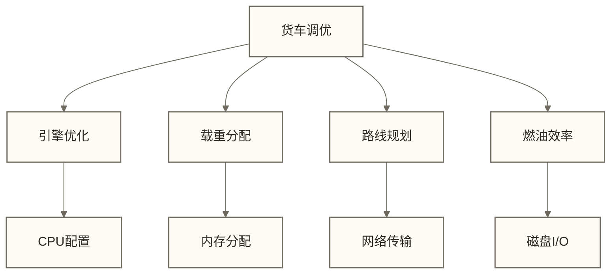

# 🚀 MapReduce性能优化 - 分布式计算调优指南

> [!abstract] 📋 学习目标
> - 🎯 **掌握性能瓶颈分析**：识别和定位MapReduce程序的性能问题
> - ⚙️ **学会参数调优**：优化内存、磁盘、网络等资源配置
> - 🔧 **解决数据倾斜**：处理分布式计算中的常见性能杀手
> - 📊 **监控和诊断**：使用工具分析程序性能指标

> [!tip] 💡 前置知识
> 建议先掌握 [[【技术与工具】/Hadoop/06-MapReduce开发实战|MapReduce开发]] 的编程技能，理解MapReduce的基本执行流程

---

## 🏎️ 性能优化思维

### MapReduce优化就像汽车调优

想象MapReduce程序是一辆需要跑长途的货车：



**MapReduce性能优化四大方面**：
- **🧠 计算优化**：提升CPU处理效率（引擎调优）
- **💾 内存优化**：合理分配内存资源（载重分配）
- **🌐 网络优化**：减少数据传输量（路线规划）
- **💿 磁盘优化**：提升I/O读写速度（燃油效率）

> [!tip] 💡 优化原则
> - **28法则**：80%的性能问题由20%的瓶颈造成
> - **木桶原理**：性能由最慢的环节决定
> - **逐步优化**：先解决最明显的问题，再精细调优

---

## 🔍 性能瓶颈识别

### 常见性能问题症状

> [!warning] 🚨 性能警报信号
> - **任务执行时间过长**：几个小时才能完成的简单计算
> - **资源利用率不均**：有的节点满载，有的节点空闲
> - **频繁的GC**：Java堆内存不足导致垃圾回收频繁
> - **大量网络传输**：Shuffle阶段数据传输量巨大

### 性能分析工具

```bash title="MapReduce性能监控命令"
# 📊 查看任务执行状态
yarn application -list -appStates RUNNING
yarn application -status application_xxx

# 🔍 详细的任务信息
mapred job -status job_xxx
mapred job -history job_xxx

# 📈 集群资源使用情况
yarn node -list -all
yarn top  # 类似Linux的top命令

# 💾 内存使用监控
jmap -histo <java_pid>
jstat -gc <java_pid> 5s
```

### Web界面监控

```bash title="重要的监控页面"
# 🖥️ YARN ResourceManager
http://namenode:8088

# 🗺️ MapReduce JobHistory
http://namenode:19888

# 📊 应用程序详情（运行时）
http://namenode:8088/cluster/app/application_xxx

# 🔧 任务详情页面提供：
# - 任务执行时间分布
# - 资源使用情况  
# - Counter统计信息
# - 日志链接
```

---

## ⚙️ 参数调优实战

### JVM内存优化

JVM内存就像是货车的"货厢大小"，配置不当会导致装不下货物或浪费空间。

```xml title="mapred-site.xml - 内存配置"
<configuration>
    <!-- 🧠 Map任务JVM内存 -->
    <property>
        <name>mapreduce.map.java.opts</name>
        <value>-Xmx2048m -XX:+UseG1GC</value>
        <description>Map任务JVM参数，包括堆内存和GC策略</description>
    </property>
    
    <!-- 🧠 Reduce任务JVM内存 -->
    <property>
        <name>mapreduce.reduce.java.opts</name>
        <value>-Xmx4096m -XX:+UseG1GC</value>
        <description>Reduce任务通常需要更多内存</description>
    </property>
    
    <!-- 💾 Map任务内存限制 -->
    <property>
        <name>mapreduce.map.memory.mb</name>
        <value>3072</value>
        <description>Map任务的物理内存限制（包括JVM和堆外内存）</description>
    </property>
    
    <!-- 💾 Reduce任务内存限制 -->
    <property>
        <name>mapreduce.reduce.memory.mb</name>
        <value>6144</value>
        <description>Reduce任务的物理内存限制</description>
    </property>
</configuration>
```

> [!tip] 💡 内存配置经验法则
> - **物理内存** = JVM堆内存 + 堆外内存 + 系统开销
> - **试验起点**：物理内存 = JVM堆内存 × 1.5仅为经验示例，须依据堆外内存、线程及容器实际用量验证
> - **Map vs Reduce**：Reduce内存为Map的1.5-2倍仅为经验示例，不是固定要求，应按各阶段负载分别测量

### 并发任务优化

```xml title="并发任务配置"
<configuration>
    <!-- 🔢 Map任务数量提示，实际数量通常由输入切片决定 -->
    <property>
        <name>mapreduce.job.maps</name>
        <value>10</value>
        <description>Map任务数量提示，不保证生成10个任务，也不控制实际并发；实际数量通常由InputFormat生成的输入切片决定，并发受YARN资源与调度约束</description>
    </property>
    
    <!-- 🔢 作业的Reduce任务总数，不等于同时运行数 -->
    <property>
        <name>mapreduce.job.reduces</name>
        <value>3</value>
        <description>此处示例设置3个Reduce任务；应结合数据量、单任务资源、可用容器容量和实测结果确定，不能仅按节点数套用固定倍数</description>
    </property>
    
    <!-- 💾 Map输出缓冲区大小 -->
    <property>
        <name>mapreduce.task.io.sort.mb</name>
        <value>512</value>
        <description>Map输出缓冲区，影响排序性能</description>
    </property>
    
    <!-- 📊 缓冲区溢写阈值 -->
    <property>
        <name>mapreduce.map.sort.spill.percent</name>
        <value>0.8</value>
        <description>缓冲区使用80%时开始溢写到磁盘</description>
    </property>
</configuration>
```

### 压缩优化

数据压缩就像是"打包"，可以大幅减少存储和传输成本。

```xml title="压缩配置优化"
<configuration>
    <!-- 🗜️ Map输出压缩 -->
    <property>
        <name>mapreduce.map.output.compress</name>
        <value>true</value>
        <description>开启Map输出压缩，减少网络传输</description>
    </property>
    
    <!-- 🗜️ Map输出压缩编解码器 -->
    <property>
        <name>mapreduce.map.output.compress.codec</name>
        <value>org.apache.hadoop.io.compress.SnappyCodec</value>
        <description>使用Snappy压缩，平衡压缩比和速度</description>
    </property>
    
    <!-- 🗜️ 最终输出压缩 -->
    <property>
        <name>mapreduce.output.fileoutputformat.compress</name>
        <value>true</value>
        <description>压缩最终输出文件</description>
    </property>
    
    <!-- 🗜️ 输出压缩编解码器 -->
    <property>
        <name>mapreduce.output.fileoutputformat.compress.codec</name>
        <value>org.apache.hadoop.io.compress.GzipCodec</value>
        <description>最终输出使用Gzip，高压缩比</description>
    </property>
</configuration>
```

> [!note] 📊 压缩算法选择
> - **Snappy**：速度快，压缩比中等，适合中间数据
> - **Gzip**：压缩比高，速度中等，适合长期存储
> - **LZ4**：通常偏重压缩和解压速度，适合频繁读写；相对速度与压缩比取决于数据、实现和配置
> - **Bzip2**：通常压缩比较高、处理较慢，可考虑用于归档存储；并非对所有数据都具有最高压缩比

---

## 🔄 Shuffle优化

Shuffle阶段就像是"物流转运中心"，是性能瓶颈的重灾区。

### Shuffle过程详解

```mermaid
%%{init: {"theme":"base","themeVariables":{"fontFamily":"PingFang SC, -apple-system, Source Han Serif SC, serif","fontSize":"16px","background":"#FDFBF5","primaryColor":"#FDFBF5","primaryTextColor":"#2D2A26","primaryBorderColor":"#6E6A60","secondaryColor":"#E8EFE8","secondaryBorderColor":"#8FA890","secondaryTextColor":"#2D2A26","tertiaryColor":"#FDFBF5","tertiaryBorderColor":"#9A9488","tertiaryTextColor":"#6E6A60","lineColor":"#6E6A60","textColor":"#2D2A26","mainBkg":"#FDFBF5","nodeBorder":"#2D5A3D","clusterBkg":"#F3EEDF","clusterBorder":"#9A9488","edgeLabelBackground":"#FDFBF5"},"flowchart":{"htmlLabels":true,"curve":"basis","padding":20,"nodeSpacing":60,"rankSpacing":70,"useMaxWidth":false},"themeCSS":".node rect, .node polygon, .node circle { stroke-width: 1.5px; } .edgePath .path { stroke-width: 1.5px; } .cluster-label .nodeLabel, .cluster-label foreignObject { color: #2D2A26 !important; } .edgeLabel, .edgeLabel foreignObject { color: #2D2A26 !important; background-color: #FDFBF5; } .edgeLabel rect { fill: #FDFBF5; }"}}%%
flowchart TD
    classDef default fill:#FDFBF5,stroke:#6E6A60,color:#2D2A26,stroke-width:1.5px
    classDef startend fill:#2D2A26,stroke:#2D2A26,color:#FDFBF5,font-weight:bold
    classDef decision fill:#F6EAD8,stroke:#C08A1A,color:#2D2A26,font-weight:bold
    classDef hub fill:#3B5A80,stroke:#3B5A80,color:#FDFBF5,font-weight:bold
    classDef io fill:#E5EAF0,stroke:#3B5A80,color:#2D2A26
    classDef accent fill:#A6432C,stroke:#A6432C,color:#FDFBF5,font-weight:bold
    classDef storage fill:#F3EEDF,stroke:#9A9488,color:#2D2A26
    subgraph "Map阶段"
        A[Map输出]
        B[内存缓冲区]
        C[排序]
        D[溢写文件]
        A --> B
        B --> C
        C --> D
    end
    subgraph "Shuffle阶段"
        E[合并文件]
        F[网络传输]
        G[Reduce拉取]
        D --> E
        E --> F
        F --> G
    end
    subgraph "Reduce阶段"
        H[合并排序]
        I[Reduce处理]
        G --> H
        H --> I
    end
    class A,B,C,D,E,F,G,H,I default
```



### Shuffle参数优化

```xml title="Shuffle性能调优"
<configuration>
    <!-- 🔄 并行拷贝线程数 -->
    <property>
        <name>mapreduce.reduce.shuffle.parallelcopies</name>
        <value>10</value>
        <description>Reduce任务同时从多少个Map任务拷贝数据</description>
    </property>
    
    <!-- 💾 Shuffle输入缓冲区 -->
    <property>
        <name>mapreduce.reduce.shuffle.input.buffer.percent</name>
        <value>0.7</value>
        <description>用于shuffle的堆内存比例</description>
    </property>
    
    <!-- 🔄 合并文件数量 -->
    <property>
        <name>mapreduce.task.io.sort.factor</name>
        <value>100</value>
        <description>同时合并的文件数，影响I/O效率</description>
    </property>
    
    <!-- ⏱️ 连接超时时间 -->
    <property>
        <name>mapreduce.reduce.shuffle.connect.timeout</name>
        <value>180000</value>
        <description>连接超时时间（毫秒）</description>
    </property>
</configuration>
```

### 代码级Shuffle优化

```java title="优化Map输出"
public class OptimizedMapper extends Mapper<LongWritable, Text, Text, IntWritable> {
    
    // 🎯 重用对象，避免频繁创建
    private Text outputKey = new Text();
    private IntWritable outputValue = new IntWritable();
    
    @Override
    public void map(LongWritable key, Text value, Context context) 
            throws IOException, InterruptedException {
        
        // 🧹 数据预处理，减少输出量
        String line = value.toString().trim();
        
        if (line.isEmpty() || line.startsWith("#")) {
            return;  // 跳过空行和注释行
        }
        
        // 🔄 合并相近的数据，减少键的数量
        String[] words = line.split("\\s+");
        Map<String, Integer> localCount = new HashMap<>();
        
        for (String word : words) {
            localCount.merge(word.toLowerCase(), 1, Integer::sum);
        }
        
        // 📤 批量输出，减少context.write调用次数
        for (Map.Entry<String, Integer> entry : localCount.entrySet()) {
            outputKey.set(entry.getKey());
            outputValue.set(entry.getValue());
            context.write(outputKey, outputValue);
        }
    }
}
```

---

## ⚖️ 数据倾斜解决方案

数据倾斜就像是"货物分配不均"，某些车辆超载，某些车辆空载。

### 数据倾斜识别

```bash title="识别数据倾斜的信号"
# 🔍 查看任务执行时间分布
# 症状：大部分Map/Reduce任务很快完成，个别任务耗时很长

# 📊 检查数据分布
hdfs dfs -du -h /input/path/
# 症状：输入文件大小差异巨大

# 💾 查看任务日志中的记录数
# 症状：某些任务处理的记录数远超其他任务
```

### 解决方案1：自定义分区器

以下示例按键的哈希值分区，可分散不同键，但不能拆分同一个热点键；其效果取决于键分布，不能保证分区负载均匀。

```java title="均匀分区器"
public class BalancedPartitioner<K, V> extends Partitioner<K, V> {
    
    @Override
    public int getPartition(K key, V value, int numPartitions) {
        
        // 🎯 基于key的hash值均匀分布
        int hashCode = key.hashCode();
        
        // 🔧 处理负数hash值
        if (hashCode == Integer.MIN_VALUE) {
            hashCode = 0;
        }
        
        return Math.abs(hashCode) % numPartitions;
    }
}
```

### 解决方案2：增加随机前缀

```java title="随机前缀法解决倾斜"
public class AntiSkewMapper extends Mapper<LongWritable, Text, Text, Text> {
    
    private Random random = new Random();
    private Text outputKey = new Text();
    
    @Override
    public void map(LongWritable key, Text value, Context context) 
            throws IOException, InterruptedException {
        
        String[] fields = value.toString().split(",");
        
        if (fields.length >= 2) {
            String originalKey = fields[0];
            String originalValue = fields[1];
            
            // 🎲 添加随机前缀，打散热点数据
            int randomPrefix = random.nextInt(10);  // 0-9的随机数
            String newKey = randomPrefix + "_" + originalKey;
            
            outputKey.set(newKey);
            context.write(outputKey, value);
        }
    }
}

// 对应的Reducer去除前缀；本示例仅转发记录，不完成按原始键的全局聚合
// 若业务要求同一原始键统一聚合，需要增加第二个作业，并确保局部结果可正确合并
public class AntiSkewReducer extends Reducer<Text, Text, Text, Text> {
    
    @Override
    public void reduce(Text key, Iterable<Text> values, Context context) 
            throws IOException, InterruptedException {
        
        // 🧹 去除随机前缀
        String originalKey = key.toString().substring(2);  // 去掉"0_"
        
        // 正常处理逻辑...
        for (Text value : values) {
            context.write(new Text(originalKey), value);
        }
    }
}
```

### 解决方案3：两阶段聚合

```java title="两阶段聚合法"
// 第一阶段：局部聚合
public class LocalAggregationMapper extends Mapper<LongWritable, Text, Text, IntWritable> {
    
    private Map<String, Integer> localCount = new HashMap<>();
    
    @Override
    public void map(LongWritable key, Text value, Context context) 
            throws IOException, InterruptedException {
        
        String word = value.toString().trim();
        localCount.merge(word, 1, Integer::sum);
        
        // 🎯 当本地缓存达到一定大小时，输出并清空
        if (localCount.size() >= 1000) {
            outputLocalCounts(context);
        }
    }
    
    @Override
    protected void cleanup(Context context) 
            throws IOException, InterruptedException {
        // 📤 输出剩余的本地统计
        outputLocalCounts(context);
    }
    
    private void outputLocalCounts(Context context) 
            throws IOException, InterruptedException {
        
        for (Map.Entry<String, Integer> entry : localCount.entrySet()) {
            context.write(new Text(entry.getKey()), new IntWritable(entry.getValue()));
        }
        localCount.clear();
    }
}
```

### 解决方案4：采样和预聚合

```java title="采样-分析-调整策略"
public class DataSkewAnalyzer {
    
    public static void analyzeDataDistribution(String inputPath) throws Exception {
        
        Configuration conf = new Configuration();
        FileSystem fs = FileSystem.get(conf);
        
        Map<String, Long> keyCount = new HashMap<>();
        
        // 📊 采样分析数据分布
        Path path = new Path(inputPath);
        FileStatus[] files = fs.listStatus(path);
        
        for (FileStatus file : files) {
            if (!file.isFile()) {
                continue;
            }
            try (BufferedReader reader = new BufferedReader(
                    new InputStreamReader(fs.open(file.getPath())))) {
                
                String line;
                int sampleCount = 0;
                
                while ((line = reader.readLine()) != null && sampleCount < 10000) {
                    String[] fields = line.split(",");
                    if (fields.length > 0) {
                        String key = fields[0];
                        keyCount.merge(key, 1L, Long::sum);
                    }
                    sampleCount++;
                }
            }
        }
        
        // 🔍 分析倾斜程度
        analyzeSkew(keyCount);
    }
    
    private static void analyzeSkew(Map<String, Long> keyCount) {
        
        long totalRecords = keyCount.values().stream().mapToLong(Long::longValue).sum();
        if (keyCount.isEmpty()) {
            System.out.println("没有可分析的采样记录");
            return;
        }
        double avgCount = (double) totalRecords / keyCount.size();
        
        System.out.println("📊 数据分布分析:");
        System.out.println("总记录数: " + totalRecords);
        System.out.println("平均每key记录数: " + avgCount);
        
        // 🚨 找出倾斜的key
        keyCount.entrySet().stream()
            .filter(entry -> entry.getValue() > avgCount * 10)  // 超过平均值10倍
            .sorted(Map.Entry.<String, Long>comparingByValue().reversed())
            .limit(10)
            .forEach(entry -> 
                System.out.println("⚠️ 倾斜key: " + entry.getKey() + 
                    " (记录数: " + entry.getValue() + ")"));
    }
}
```

---

## 💿 I/O优化

### 文件格式选择

不同的文件格式就像不同的"包装方式"，影响读写效率。

```java title="高效文件格式使用"
// 🚀 使用SequenceFile提高小文件处理效率
public class SmallFilesToSequenceFile {
    
    public static void combineSmallFiles(String inputDir, String outputFile) throws Exception {
        
        Configuration conf = new Configuration();
        FileSystem fs = FileSystem.get(conf);
        
        // 📦 创建SequenceFile写入器
        try (SequenceFile.Writer writer = SequenceFile.createWriter(
                fs, conf, new Path(outputFile),
                Text.class, Text.class,
                SequenceFile.CompressionType.BLOCK)) {
            
            // 🔄 遍历输入目录中的小文件
            FileStatus[] files = fs.listStatus(new Path(inputDir));
            
            for (FileStatus file : files) {
                if (file.isFile()) {
                    String fileName = file.getPath().getName();
                    
                    // 📖 读取文件内容
                    try (BufferedReader reader = new BufferedReader(
                            new InputStreamReader(fs.open(file.getPath())))) {
                        
                        StringBuilder content = new StringBuilder();
                        String line;
                        
                        while ((line = reader.readLine()) != null) {
                            content.append(line).append("\n");
                        }
                        
                        // ✍️ 写入SequenceFile
                        writer.append(new Text(fileName), new Text(content.toString()));
                    }
                }
            }
        }
        
        System.out.println("✅ 小文件合并完成: " + outputFile);
    }
}
```

### 读写缓冲区优化

```xml title="I/O缓冲区配置"
<configuration>
    <!-- 📖 读取缓冲区大小 -->
    <property>
        <name>io.file.buffer.size</name>
        <value>131072</value>
        <description>128KB读写缓冲区，提升I/O效率</description>
    </property>
    
    <!-- 💿 本地目录配置 -->
    <property>
        <name>mapreduce.cluster.local.dir</name>
        <value>/tmp/hadoop/mapred/local</value>
        <description>本地临时目录，使用SSD可提升性能</description>
    </property>
    
    <!-- 🔄 溢写文件压缩 -->
    <property>
        <name>mapreduce.map.output.compress</name>
        <value>true</value>
        <description>压缩溢写文件，减少磁盘I/O</description>
    </property>
</configuration>
```

---

## 📊 性能监控和诊断

### 自定义性能监控

```java title="性能监控Mapper"
public class PerformanceMonitorMapper extends Mapper<LongWritable, Text, Text, IntWritable> {
    
    private long startTime;
    private long recordCount = 0;
    
    @Override
    protected void setup(Context context) {
        startTime = System.currentTimeMillis();
    }
    
    @Override
    public void map(LongWritable key, Text value, Context context) 
            throws IOException, InterruptedException {
        
        recordCount++;
        
        // 📊 每处理10000条记录报告一次性能
        if (recordCount % 10000 == 0) {
            long currentTime = System.currentTimeMillis();
            long elapsedTime = currentTime - startTime;
            double recordsPerSecond = (double) recordCount / (elapsedTime / 1000.0);
            
            System.out.println(String.format(
                "🚀 性能报告: 已处理 %d 条记录，用时 %d 毫秒，速度 %.2f 记录/秒",
                recordCount, elapsedTime, recordsPerSecond));
        }
        
        // 正常的处理逻辑...
        context.write(new Text("processed"), new IntWritable(1));
    }
    
    @Override
    protected void cleanup(Context context) {
        long totalTime = System.currentTimeMillis() - startTime;
        double avgSpeed = (double) recordCount / (totalTime / 1000.0);
        
        System.out.println(String.format(
            "✅ 任务完成: 总计处理 %d 条记录，总用时 %d 毫秒，平均速度 %.2f 记录/秒",
            recordCount, totalTime, avgSpeed));
    }
}
```

### 资源使用监控脚本

```bash title="mapreduce_monitor.sh"
#!/bin/bash
# MapReduce任务性能监控脚本

APPLICATION_ID=$1

if [ -z "$APPLICATION_ID" ]; then
    echo "用法: $0 <application_id>"
    exit 1
fi

echo "🔍 监控MapReduce应用: $APPLICATION_ID"
echo "开始时间: $(date)"
echo "─" | tr '─' '─' | head -c 50; echo

while true; do
 # 📊 获取应用状态
    APP_STATUS=$(yarn application -status $APPLICATION_ID 2>/dev/null | grep "Final-State" | awk '{print $3}')
    
    if [ "$APP_STATUS" = "SUCCEEDED" ] || [ "$APP_STATUS" = "FAILED" ] || [ "$APP_STATUS" = "KILLED" ]; then
        echo "✅ 应用已结束，状态: $APP_STATUS"
        break
    fi
    
 # 📈 监控资源使用
    echo "⏰ $(date "+%H:%M:%S") - 资源使用情况:"
    
 # CPU和内存使用
    yarn application -status $APPLICATION_ID 2>/dev/null | grep -E "(Running Containers|Memory|VCores)"
    
 # 进度信息
    PROGRESS=$(yarn application -status $APPLICATION_ID 2>/dev/null | grep "Progress" | awk '{print $3}')
    echo "📊 进度: $PROGRESS"
    
    echo "─" | tr '─' '─' | head -c 30; echo
    
    sleep 30
done

echo "🏁 监控结束于: $(date)"
```

---

## 🎯 性能优化最佳实践

### 开发阶段优化清单

> [!success] ✅ 代码优化检查清单
> - **对象重用**：避免在map/reduce方法中频繁创建对象
> - **数据预处理**：在mapper中过滤和清洗数据
> - **合理使用Combiner**：仅用于可安全重复局部合并的聚合逻辑，通常要求满足结合律和交换律；不能依赖Combiner一定执行
> - **选择合适的数据类型**：使用Writable类型而不是普通Java对象
> - **批量输出**：减少context.write调用次数

### 配置优化检查清单

> [!success] ✅ 参数配置检查清单
> - **内存配置**：JVM堆内存 < 物理内存限制
> - **并发配置**：Map/Reduce任务数适合集群规模
> - **压缩配置**：开启合适的压缩算法
> - **I/O配置**：优化缓冲区大小和本地目录
> - **网络配置**：调整Shuffle相关参数

### 性能基准测试

```java title="MapReduce基准测试工具"
public class MapReduceBenchmark {
    
    public static void main(String[] args) throws Exception {
        
        if (args.length != 3) {
            System.err.println("用法: MapReduceBenchmark <input> <output> <记录数>");
            System.exit(-1);
        }
        
        String inputPath = args[0];
        String outputPath = args[1];
        int recordCount = Integer.parseInt(args[2]);
        
        // 🎯 生成测试数据
        generateTestData(inputPath, recordCount);
        
        // ⏱️ 执行基准测试
        long startTime = System.currentTimeMillis();
        
        Configuration conf = new Configuration();
        Job job = Job.getInstance(conf, "benchmark test");
        
        // 配置任务...
        job.setJarByFile(MapReduceBenchmark.class);
        job.setMapperClass(BenchmarkMapper.class);
        job.setReducerClass(BenchmarkReducer.class);
        
        FileInputFormat.addInputPath(job, new Path(inputPath));
        FileOutputFormat.setOutputPath(job, new Path(outputPath));
        
        boolean success = job.waitForCompletion(true);
        
        long endTime = System.currentTimeMillis();
        long duration = endTime - startTime;
        
        if (success) {
            // 📊 性能报告
            System.out.println("🏆 基准测试完成!");
            System.out.println("📊 处理记录数: " + recordCount);
            System.out.println("⏱️ 总耗时: " + duration + " 毫秒");
            System.out.println("🚀 处理速度: " + (recordCount * 1000.0 / duration) + " 记录/秒");
            
            // 📈 资源使用统计
            printJobCounters(job);
        }
    }
    
    private static void printJobCounters(Job job) throws Exception {
        
        Counters counters = job.getCounters();
        
        System.out.println("\n📈 资源使用统计:");
        
        // Map任务统计
        long mapInputRecords = counters.findCounter(TaskCounter.MAP_INPUT_RECORDS).getValue();
        long mapOutputRecords = counters.findCounter(TaskCounter.MAP_OUTPUT_RECORDS).getValue();
        
        System.out.println("Map输入记录: " + mapInputRecords);
        System.out.println("Map输出记录: " + mapOutputRecords);
        
        // Reduce任务统计
        long reduceInputRecords = counters.findCounter(TaskCounter.REDUCE_INPUT_RECORDS).getValue();
        long reduceOutputRecords = counters.findCounter(TaskCounter.REDUCE_OUTPUT_RECORDS).getValue();
        
        System.out.println("Reduce输入记录: " + reduceInputRecords);
        System.out.println("Reduce输出记录: " + reduceOutputRecords);
        
        // 文件系统统计
        long hdfsRead = counters.findCounter("HDFS", FileSystemCounter.BYTES_READ).getValue();
        long hdfsWrite = counters.findCounter("HDFS", FileSystemCounter.BYTES_WRITTEN).getValue();
        
        System.out.println("HDFS读取: " + formatBytes(hdfsRead));
        System.out.println("HDFS写入: " + formatBytes(hdfsWrite));
    }
    
    private static String formatBytes(long bytes) {
        if (bytes < 1024) return bytes + " B";
        if (bytes < 1024 * 1024) return String.format("%.2f KB", bytes / 1024.0);
        if (bytes < 1024 * 1024 * 1024) return String.format("%.2f MB", bytes / (1024.0 * 1024));
        return String.format("%.2f GB", bytes / (1024.0 * 1024 * 1024));
    }
}
```

---

## 🔗 实战项目：优化WordCount

让我们优化一个实际的WordCount程序，演示各种优化技巧。

```java title="OptimizedWordCountMapper.java"
public class OptimizedWordCountMapper extends Mapper<LongWritable, Text, Text, IntWritable> {
    
    // 🎯 对象重用，避免频繁创建
    private final static IntWritable one = new IntWritable(1);
    private Text word = new Text();
    
    // 📊 本地聚合，减少网络传输
    private Map<String, Integer> localWordCount = new HashMap<>();
    private static final int FLUSH_THRESHOLD = 1000;
    
    // 📈 性能监控
    private long recordCount = 0;
    private long startTime;
    
    @Override
    protected void setup(Context context) {
        startTime = System.currentTimeMillis();
    }
    
    @Override
    public void map(LongWritable key, Text value, Context context) 
            throws IOException, InterruptedException {
        
        recordCount++;
        
        String line = value.toString().toLowerCase();
        
        // 🧹 高效的单词分割和清理
        String[] words = line.split("\\W+");
        
        for (String w : words) {
            if (w.length() > 0) {
                // 📊 本地聚合
                localWordCount.merge(w, 1, Integer::sum);
            }
        }
        
        // 🚀 达到阈值时输出并清空本地缓存
        if (localWordCount.size() >= FLUSH_THRESHOLD) {
            flushLocalCounts(context);
        }
        
        // 📊 定期报告性能
        if (recordCount % 10000 == 0) {
            reportProgress();
        }
    }
    
    @Override
    protected void cleanup(Context context) 
            throws IOException, InterruptedException {
        
        // 📤 输出剩余的本地统计
        flushLocalCounts(context);
        
        // 📊 最终性能报告
        long totalTime = System.currentTimeMillis() - startTime;
        System.out.println(String.format(
            "✅ Mapper完成: 处理 %d 行，耗时 %d ms，速度 %.2f 行/秒",
            recordCount, totalTime, (double) recordCount * 1000 / totalTime));
    }
    
    private void flushLocalCounts(Context context) 
            throws IOException, InterruptedException {
        
        for (Map.Entry<String, Integer> entry : localWordCount.entrySet()) {
            word.set(entry.getKey());
            one.set(entry.getValue());
            context.write(word, one);
        }
        
        localWordCount.clear();
    }
    
    private void reportProgress() {
        long currentTime = System.currentTimeMillis();
        double rate = (double) recordCount * 1000 / (currentTime - startTime);
        System.out.println(String.format("📊 已处理 %d 行，速度 %.2f 行/秒", recordCount, rate));
    }
}
```

### 性能对比测试

```bash title="性能测试脚本"
#!/bin/bash
# 对比原始版本和优化版本的性能

echo "🏁 WordCount性能对比测试"

# 生成测试数据；初始化本地文件，避免重复运行时追加旧数据
: > test_data.txt
echo "📦 生成测试数据..."
for i in {1..1000}; do
    echo "This is line $i with some random words like hadoop mapreduce optimization performance" >> test_data.txt
done

hdfs dfs -rm -r /test_input /test_output_original /test_output_optimized 2>/dev/null
hdfs dfs -mkdir /test_input
hdfs dfs -put test_data.txt /test_input/

echo "🔄 测试原始版本..."
time hadoop jar wordcount-original.jar WordCount /test_input /test_output_original

echo "🚀 测试优化版本..."
time hadoop jar wordcount-optimized.jar OptimizedWordCount /test_input /test_output_optimized

echo "📊 对比结果..."
echo "原始版本输出行数: $(hdfs dfs -cat /test_output_original/part-r-00000 | wc -l)"
echo "优化版本输出行数: $(hdfs dfs -cat /test_output_optimized/part-r-00000 | wc -l)"

# 清理测试数据
rm -f test_data.txt
```

---

## 🔗 下一步学习

掌握MapReduce性能优化后，建议继续学习：

1. **[[【技术与工具】/Hadoop/08-MapReduce故障处理|MapReduce故障处理]]** - 学习问题排查和故障恢复
2. **[[【技术与工具】/Hadoop/09-YARN资源管理架构|YARN资源管理]]** - 深入理解资源调度机制
3. **[[【技术与工具】/Hadoop/20-性能监控与调优|性能监控与调优]]** - 全面的集群性能优化
4. **Spark** - 学习现代分布式计算框架

> [!tip] 💡 优化建议
> - **渐进式优化**：先解决最明显的瓶颈
> - **基准测试**：用数据说话，量化优化效果
> - **监控为王**：建立完善的性能监控体系
> - **经验积累**：记录优化过程和效果
> - **团队分享**：让优化经验在团队中传播

---

*最后更新：2024-06-29* 