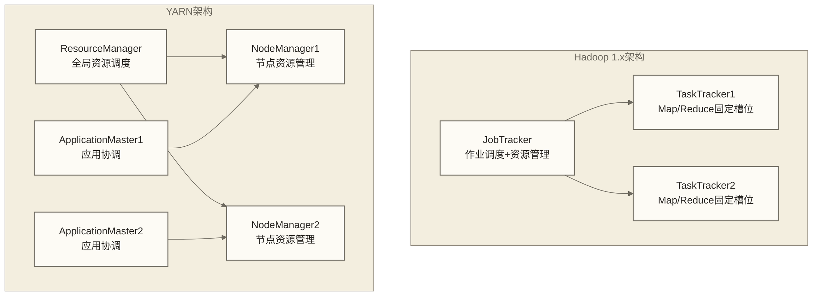
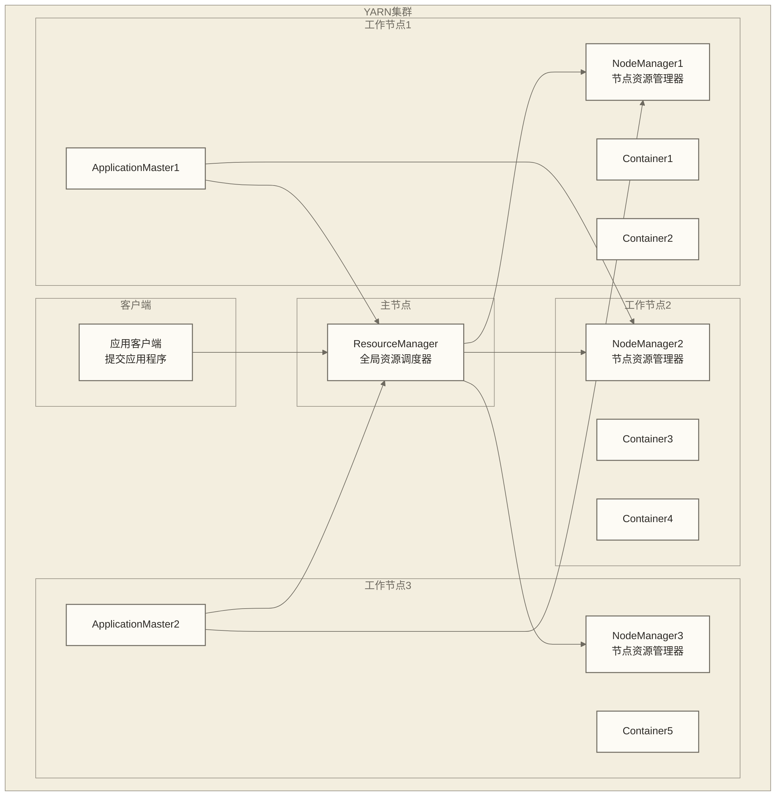
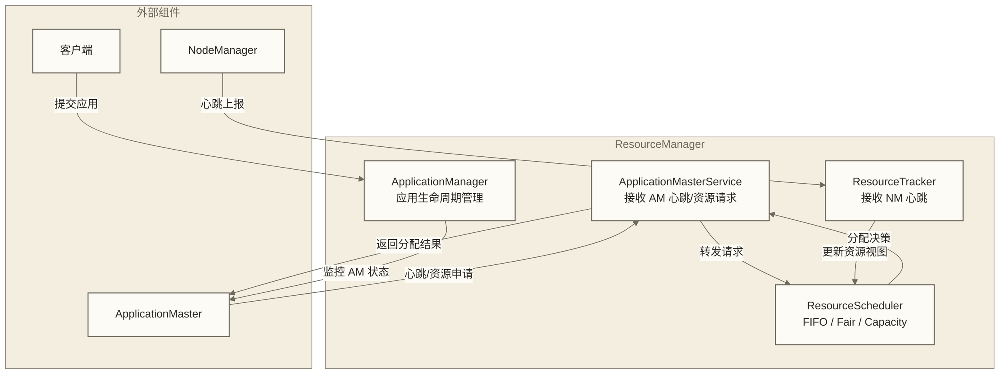
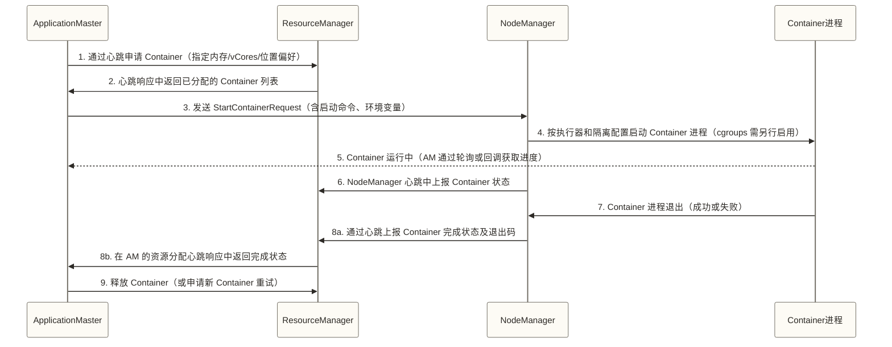
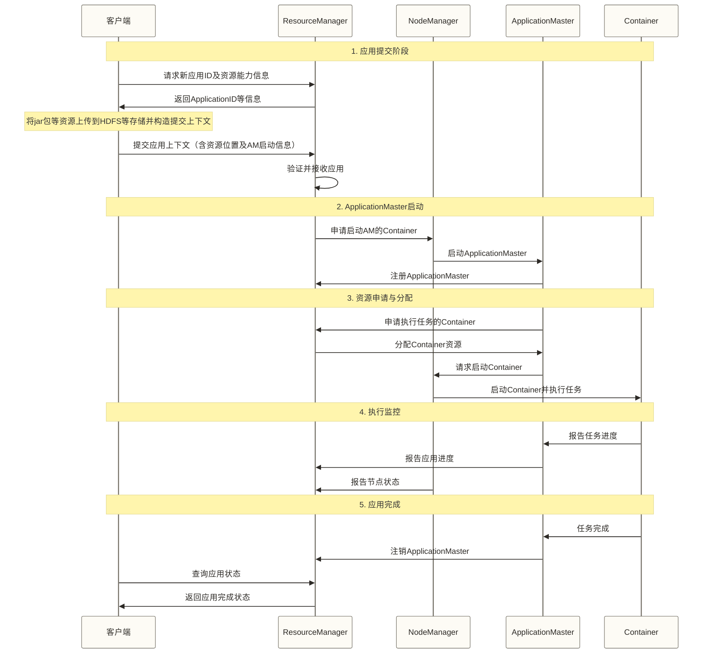
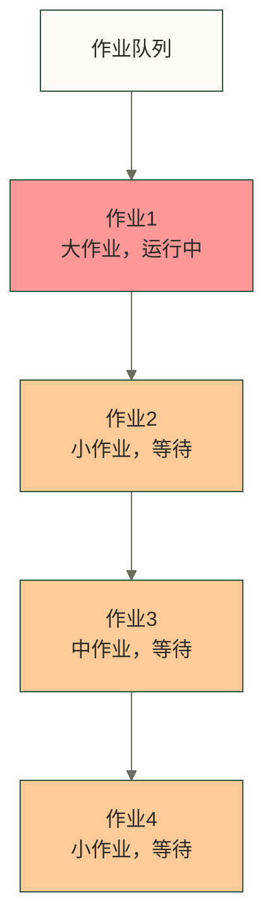
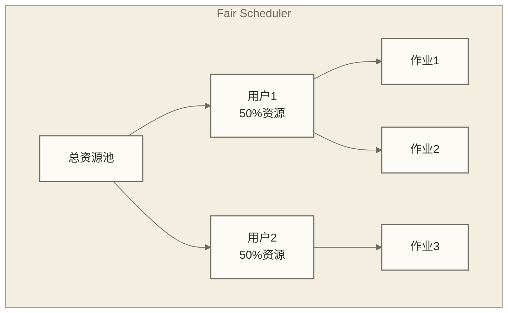
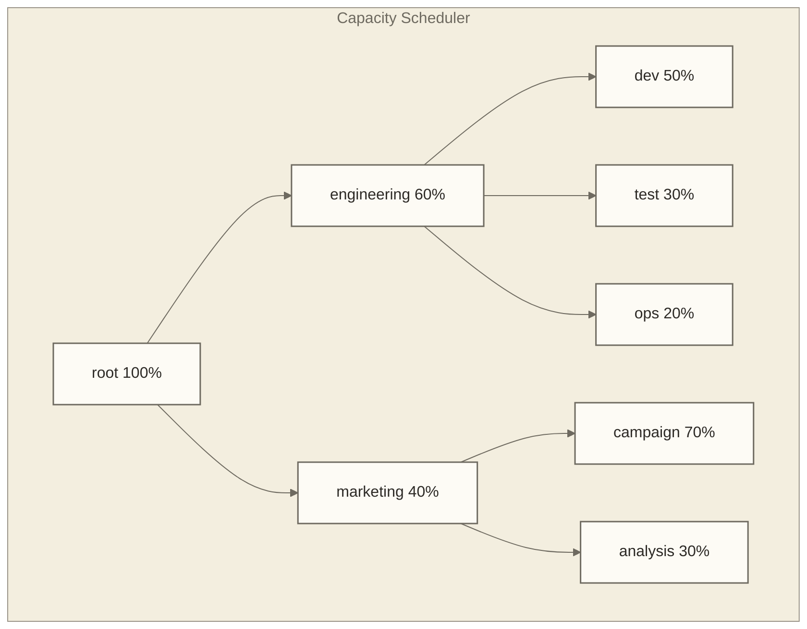

# 🎛️ YARN资源管理架构 - 现代大数据平台的资源调度中枢

> [!abstract] 📋 本节概览
> - 🎯 **学习目标**：理解YARN架构设计、资源调度机制和应用管理流程
> - 📚 **前置知识**：[[【技术与工具】/Hadoop/05-MapReduce编程模型|MapReduce编程]] | [[【技术与工具】/Hadoop/03-HDFS分布式文件系统|HDFS分布式文件系统]] | 操作系统资源管理概念
> - ⏱️ **预计用时**：95分钟
> - 🔧 **技术重点**：双层调度架构、Container资源模型、多租户管理

## 🏗️ 架构设计挑战

构建可靠的数据系统时，YARN资源管理架构是核心考虑因素，直接影响系统的稳定性和扩展性。

在实际工作环境中，这样的挑战每天都在发生。理解相关知识不仅能解决当前问题，更能提升整体的专业能力。
### Hadoop 1.x vs YARN架构对比



---

## 🏗️ YARN核心架构

### 组件关系图



### 核心组件详解

#### 1. ResourceManager - 全局资源调度器

> [!note] 💡 ResourceManager就像城市规划局
> - 掌握整个城市的土地资源
> - 根据申请审批土地使用权
> - 监督土地使用情况
> - 不参与具体建设工作

**ResourceManager职责**：
```bash title="ResourceManager核心功能"
# 1. 全局资源管理
- 维护集群可调度资源视图（通常为内存、vCores；其他资源需按版本和配置显式支持，磁盘与网络监控不等于默认参与资源调度）
- 接收NodeManager的资源心跳报告
- 根据策略分配资源给应用程序

# 2. 应用程序管理
- 接收客户端提交的应用程序
- 为应用分配ApplicationMaster
- 监控ApplicationMaster的运行状态

# 3. 调度策略执行
- 支持多种调度器（FIFO、Fair、Capacity）
- 实现多租户资源隔离
- 提供队列管理和优先级控制
```

**ResourceManager 内部组件分工**：

ResourceManager 并非铁板一块，下面列出三个与应用管理和调度相关的组件；后续图中还包括接收 NodeManager 心跳的 ResourceTracker，并非完整内部组件清单：

| 子组件 | 职责 | 通信对象 |
|---|---|---|
| **ApplicationManager** | 接收客户端提交的应用并参与应用生命周期管理；AM Container 分配由调度器完成，AM 启动及失败重试由 RM 内部相关组件协作处理 | 客户端及 RM 内部组件 |
| **ResourceScheduler** | 根据调度策略（FIFO/Fair/Capacity）决定将哪些资源分配给哪个应用；不直接跟踪应用状态，只负责资源分配 | ApplicationMaster（通过心跳返回分配结果） |
| **ApplicationMasterService** | 接收 AM 的心跳和资源请求；向 AM 返回调度器的分配结果；处理 AM 的注册和注销 | ApplicationMaster |



#### 2. NodeManager - 节点资源管理器

> [!note] 💡 NodeManager就像工厂的车间主任
> - 管理本车间的设备和工人
> - 接收总部的生产任务安排
> - 监控生产过程和质量
> - 定期向总部汇报车间状况

**NodeManager职责**：
```bash title="NodeManager核心功能"
# 1. 节点资源管理
- 监控本节点的CPU、内存、磁盘、网络使用情况
- 向ResourceManager汇报资源状态
- 执行Container的生命周期管理

# 2. Container管理
- 接收ApplicationMaster的请求启动任务Container；AM自身的Container由ResourceManager侧发起启动
- 监控Container的资源使用
- 检测和处理Container异常

# 3. 本地服务
- 提供日志聚合服务
- 执行节点健康检查
- 管理本地缓存和临时文件
```

#### 3. ApplicationMaster - 应用协调器

> [!note] 💡 ApplicationMaster就像项目经理
> - 负责单个项目的全程管理
> - 向公司申请所需资源（人员、设备）
> - 协调项目各环节的执行
> - 监控项目进度和质量

**ApplicationMaster职责**：
```bash title="ApplicationMaster核心功能"
# 1. 资源申请和管理
- 根据应用需求向ResourceManager申请Container
- 监控已分配Container的使用情况
- 在Container故障时重新申请资源

# 2. 任务调度和监控
- 将应用程序分解为具体任务
- 在Container中启动和监控任务执行
- 处理任务失败和重试逻辑

# 3. 应用生命周期管理
- 管理应用程序的启动、运行、完成
- 收集应用执行结果和统计信息
- 在应用完成后释放资源
```

**ApplicationMaster 失败重试机制**：

在由 YARN 管理 AM 的常规模式下，AM 本身也是跑在一个 Container 里的进程；如果 AM 崩溃，ResourceManager 会通过内部相关组件处理失败，并在未达到应用尝试次数上限等条件下启动新的 AM 尝试。

| 配置参数 | 默认值 | 说明 |
|---|---|---|
| `yarn.resourcemanager.am.max-attempts` | 2 | AM 最大尝试总次数（全局，包含首次尝试） |
| `mapreduce.am.max-attempts` | 2 | MapReduce AM 的最大尝试总次数（包含首次尝试） |
| `spark.yarn.maxAppAttempts` | 继承 RM 全局值 | Spark AM 的最大尝试总次数（包含首次尝试） |

> [!warning] 注意：表中的 max-attempts 限制应用尝试总次数，包含首次尝试，不是额外重试次数，也不是单个 Task 的重试次数。ResourceManager 的 StateStore 用于 RM 自身的状态恢复，不是已完成任务状态的通用恢复来源；AM 重启后的任务恢复取决于应用框架及其恢复配置，例如 MapReduce 的作业历史恢复机制。

**AM 与 RM/NM 的通信协议**：

- **AM → RM**：通过 `ApplicationMasterProtocol` 注册、发送心跳、申请/释放资源
- **AM → NM**：通过 `ContainerManagementProtocol` 启动和停止 Container
- **完成状态传递**：NM 通过心跳向 RM 上报 Container 状态，AM 通过与 RM 的资源分配心跳响应获取完成状态；AM 也可向 NM 查询 Container 状态，应用任务进度通信由具体框架实现

#### 4. Container - 资源容器

> [!note] 💡 Container就像标准化的工作间
> - 提供固定规格的工作空间
> - 包含CPU、内存、磁盘等资源
> - 可以运行各种类型的任务
> - 使用完毕后回收利用

**资源模型**：

YARN 的 Container 常用资源维度是内存和 vCores；支持自定义资源的版本还可扩展其他维度。下表保留原稿默认值记录，但未注明适用版本、发行版及核验依据，实际部署应以目标环境的配置为准：

| 资源维度 | 配置参数 | 默认值 | 说明 |
|---|---|---|---|
| 内存 | `yarn.scheduler.minimum-allocation-mb` | 1024 MB | Container 内存最小分配单位 |
| 内存 | `yarn.scheduler.maximum-allocation-mb` | 8192 MB | Container 内存最大上限 |
| 虚拟核心 | `yarn.scheduler.minimum-allocation-vcores` | 1 | Container vCores 最小分配单位 |
| 虚拟核心 | `yarn.scheduler.maximum-allocation-vcores` | 4 | Container vCores 最大上限 |
| 节点可用内存 | `yarn.nodemanager.resource.memory-mb` | 8192 MB | NodeManager 可分配给 Container 的总内存 |
| 节点可用核心 | `yarn.nodemanager.resource.cpu-vcores` | 8 | NodeManager 可分配给 Container 的总 vCores |

> [!tip] vCores 是 YARN 的抽象 CPU 资源计量单位，不保证与物理核心或硬件线程一一对应。调高 `yarn.nodemanager.resource.cpu-vcores` 可增加节点申报的调度容量，但是否形成 CPU 超卖及其实际限制效果取决于资源计算器、硬件检测和隔离配置，需结合实际 CPU 负载评估。

**Container 完整生命周期**：



---

## ⚡ YARN应用提交流程

### 完整提交流程



### 详细步骤说明

```bash title="YARN应用提交详细步骤"
# 步骤1：客户端提交应用
1. 客户端连接ResourceManager并请求新应用ID
2. ResourceManager返回ApplicationID及资源能力信息
3. 客户端上传应用程序文件到HDFS等存储并构造提交上下文
4. 客户端向ResourceManager提交应用上下文

# 步骤2：启动ApplicationMaster
5. ResourceManager在某个NodeManager上启动AM Container
6. NodeManager下载应用程序文件
7. 启动ApplicationMaster进程
8. ApplicationMaster向ResourceManager注册

# 步骤3：资源申请
9. ApplicationMaster分析应用需求
10. 向ResourceManager申请Container资源
11. ResourceManager根据调度策略分配资源
12. 返回Container分配信息给ApplicationMaster

# 步骤4：任务执行
13. ApplicationMaster联系对应的NodeManager
14. NodeManager启动Container并运行任务
15. 任务向ApplicationMaster报告进度
16. ApplicationMaster监控任务执行

# 步骤5：清理资源
17. 任务完成后释放Container
18. ApplicationMaster向ResourceManager注销
19. ResourceManager清理应用相关资源
```

---

## 🎚️ YARN调度器

### 调度器类型对比

> [!note] 💡 调度器就像不同的排队规则
> - **FIFO**：先来先服务，简单但可能饿死小任务
> - **Fair**：轮流服务，保证公平但可能效率不高
> - **Capacity**：分组服务，既保证公平又考虑优先级

| 调度器 | 多租户支持 | 优先级控制 | 资源抢占 | 适用场景 | 优势 | 劣势 |
|---|---|---|---|---|---|---|
| **FIFO** | 缺少多队列租户隔离 | 可按应用优先级及提交顺序排序，具体支持需核对版本 | 不支持 | 单用户/开发测试环境 | 实现简单 | 大作业可能占用大量资源，小作业长时间等待 |
| **Fair Scheduler** | 支持（用户/队列级别公平共享） | 支持权重（weight）控制 | 支持抢占（preemption） | 多用户交互式查询、混合型工作负载 | 公平共享、支持动态队列；响应效果取决于负载和配置 | 吞吐量取决于负载与配置，不能普遍认定低于 Capacity |
| **Capacity Scheduler** | 支持（按队列隔离，队列间可弹性借用） | 支持队列优先级和用户限额 | 支持抢占（需配置） | 企业多部门/多团队共享集群 | 可按队列规划资源容量，支持 SLA 相关资源策略但不保证达标 | 配置复杂，静态队列需手动调整 |

> [!tip] 生产环境选型建议：企业内多团队共享集群首选 **Capacity Scheduler**，它是 Hadoop 默认调度器，配合动态队列可以兼顾隔离性和弹性；大数据平台提供公平调度给多个用户时可选 **Fair Scheduler**；**FIFO** 仅适合学习和单一作业的测试场景。

### 1. FIFO调度器



### 2. Fair调度器



```xml title="Fair调度器配置示例"
<!-- fair-scheduler.xml -->
<allocations>
    <!-- 默认队列配置 -->
    <queue name="default">
        <maxResources>4096mb,4vcores</maxResources>
        <maxRunningApps>2</maxRunningApps>
        <weight>1.0</weight>
    </queue>
    
    <!-- 高优先级队列 -->
    <queue name="priority">
        <maxResources>8192mb,8vcores</maxResources>
        <maxRunningApps>5</maxRunningApps>
        <weight>2.0</weight>
        <minResources>1024mb,1vcores</minResources>
    </queue>
    
    <!-- 用户限制 -->
    <user name="hdfs">
        <maxRunningApps>10</maxRunningApps>
    </user>
    
    <!-- 队列放置规则 -->
    <queuePlacementPolicy>
        <rule name="specified" />
        <rule name="user" />
        <rule name="default" queue="default" />
    </queuePlacementPolicy>
</allocations>
```

### 3. Capacity调度器



```xml title="Capacity调度器配置示例"
<!-- capacity-scheduler.xml -->
<configuration>
    <!-- 队列层次结构 -->
    <property>
        <name>yarn.scheduler.capacity.root.queues</name>
        <value>engineering,marketing</value>
    </property>
    
    <!-- engineering队列配置 -->
    <property>
        <name>yarn.scheduler.capacity.root.engineering.capacity</name>
        <value>60</value>
    </property>
    <property>
        <name>yarn.scheduler.capacity.root.engineering.maximum-capacity</name>
        <value>80</value>
    </property>
    <property>
        <name>yarn.scheduler.capacity.root.engineering.queues</name>
        <value>dev,test,ops</value>
    </property>
    
    <!-- dev子队列配置 -->
    <property>
        <name>yarn.scheduler.capacity.root.engineering.dev.capacity</name>
        <value>50</value>
    </property>
    <property>
        <name>yarn.scheduler.capacity.root.engineering.dev.user-limit-factor</name>
        <value>2</value>
    </property>
</configuration>
```

---

## 🔧 YARN配置优化

### 资源配置

```xml title="yarn-site.xml关键配置"
<configuration>
    <!-- NodeManager资源配置 -->
    <property>
        <name>yarn.nodemanager.resource.memory-mb</name>
        <value>14336</value>
        <description>NodeManager可用内存总量</description>
    </property>
    
    <property>
        <name>yarn.nodemanager.resource.cpu-vcores</name>
        <value>8</value>
        <description>NodeManager可用虚拟CPU核心数</description>
    </property>
    
    <!-- Container资源限制 -->
    <property>
        <name>yarn.scheduler.minimum-allocation-mb</name>
        <value>512</value>
        <description>Container最小内存分配</description>
    </property>
    
    <property>
        <name>yarn.scheduler.maximum-allocation-mb</name>
        <value>8192</value>
        <description>Container最大内存分配</description>
    </property>
    
    <!-- ApplicationMaster资源 -->
    <property>
        <name>yarn.app.mapreduce.am.resource.mb</name>
        <value>1024</value>
        <description>MapReduce ApplicationMaster内存</description>
    </property>
    
    <!-- 调度器选择 -->
    <property>
        <name>yarn.resourcemanager.scheduler.class</name>
        <value>org.apache.hadoop.yarn.server.resourcemanager.scheduler.capacity.CapacityScheduler</value>
    </property>
</configuration>
```

### 内存配置计算

```bash title="节点内存配置计算"
# 假设节点总内存：16GB

# 1. 系统预留内存（1-2GB）
系统内存 = 2GB

# 2. NodeManager进程内存（1GB）
NodeManager内存 = 1GB

# 3. 其他Hadoop进程内存（如DataNode，1GB）
其他进程内存 = 1GB

# 4. YARN可用内存 = 16GB - 2GB - 1GB - 1GB = 12GB

# 5. Container内存配置
yarn.nodemanager.resource.memory-mb = 12 * 1024 = 12288MB

# 6. Container最小内存（通常为1GB的因子）
yarn.scheduler.minimum-allocation-mb = 1024MB

# 7. Container数量
仅按内存估算的Container数上限 = 12288 / 1024 = 12个（假设每个Container申请1024MB；实际并发数还受AM占用、vCores、队列限额及其他资源约束）
```

---

## 📊 YARN监控与调试

### Web界面监控

```bash title="YARN Web界面"
# ResourceManager Web UI
http://resourcemanager-host:8088

主要功能：
- 集群概览（节点数、应用数、资源使用率）
- 应用程序列表（运行中、已完成、失败）
- 调度器信息（队列状态、资源分配）
- 节点信息（活跃节点、资源详情）

# NodeManager Web UI  
http://nodemanager-host:8042

主要功能：
- 节点资源使用情况
- Container列表和日志
- 本地目录使用情况
- 节点健康状态
```

### 命令行监控

```bash title="YARN命令行工具"
# 1. 查看集群信息
yarn node -list
yarn node -status <node-id>

# 2. 查看应用程序
yarn application -list
yarn application -status <application-id>
yarn application -kill <application-id>

# 3. 查看日志
yarn logs -applicationId <application-id>
yarn logs -applicationId <application-id> -containerId <container-id>

# 4. 队列管理
yarn queue -status <queue-name>

# 5. 资源使用统计
yarn top
```

### 性能调优指标

以下数值保留为原稿未核实的教学示例，不是通用推荐阈值或性能承诺；实际目标须按工作负载、测量口径、资源余量和业务SLA制定。

```bash title="关键性能指标"
# 1. 集群资源利用率（以下“应”仅表示该教学示例的假设目标）
- CPU利用率：应保持在70-80%
- 内存利用率：应保持在70-85%
- 网络I/O：监控带宽使用情况
- 磁盘I/O：监控读写延迟

# 2. 应用程序指标
- 应用排队时间：应尽量短
- Container启动时间：应在几秒内
- 任务失败率：应低于5%
- 数据本地性：应高于80%

# 3. 调度器效率
- 资源分配延迟：应在毫秒级
- 队列吞吐量：根据业务需求评估
- 抢占频率：应控制在合理范围
```

---

## 🔗 下一步学习

理解YARN架构后，建议继续学习：

- [[【技术与工具】/Hadoop/10-YARN任务调度|YARN任务调度]]
- [[【技术与工具】/Hadoop/11-YARN集群管理|YARN集群]]
- [[【技术与工具】/Hadoop/13-Hive数据仓库|Hive数据仓库]]

---

*最后更新：2024-06-29* 