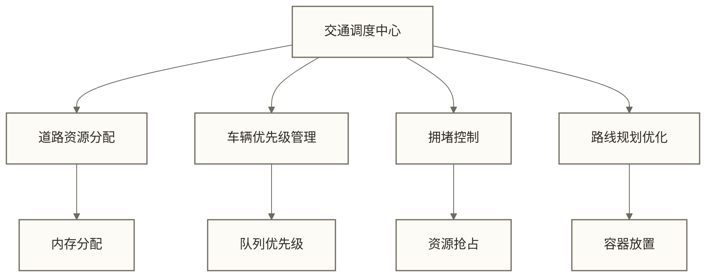
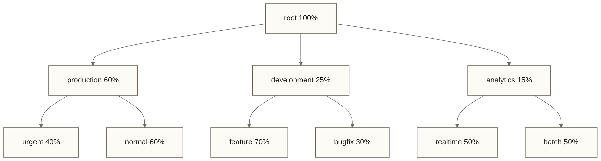

# 🚦 YARN任务调度 - 分布式资源调度机制

> [!abstract] 📋 学习目标
> - 🎯 **理解调度策略**：掌握YARN的三种核心调度器原理和特点
> - 🏗️ **配置队列管理**：学会设计和管理多租户资源队列
> - 📊 **优化资源分配**：实现高效的集群资源利用
> - 🔧 **解决调度问题**：排查和优化任务调度相关问题

> [!tip] 💡 前置知识
> 建议先学习 [[【技术与工具】/Hadoop/09-YARN资源管理架构|YARN资源管理]] 了解YARN的基本架构和组件

---

## 🚦 任务调度思维

### YARN调度就像城市交通管理中心

想象YARN ResourceManager是一个智能的"城市交通调度中心"：



**YARN调度核心要素**：
- **🛣️ 道路（集群资源）**：CPU、内存、磁盘、网络
- **🚗 车辆（应用程序）**：MapReduce、Spark、Flink等
- **🚦 红绿灯（调度策略）**：FIFO、Fair、Capacity调度器
- **🎯 目的地（作业完成）**：计算任务执行完毕

> [!tip] 💡 调度核心思想
> - **公平性**：确保不同用户都能获得合理的资源份额
> - **效率性**：最大化集群资源利用率
> - **优先级**：重要任务优先获得资源
> - **弹性**：根据负载动态调整资源分配

---

## 📋 YARN调度器类型

### 1. FIFO调度器（先来先服务）

FIFO就像是"银行排队叫号系统"，严格按照先来先服务的顺序。

```xml title="FIFO调度器配置"
<configuration>
    <!-- 🎯 设置FIFO调度器 -->
    <property>
        <name>yarn.resourcemanager.scheduler.class</name>
        <value>org.apache.hadoop.yarn.server.resourcemanager.scheduler.fifo.FifoScheduler</value>
        <description>使用FIFO调度器</description>
    </property>
</configuration>
```

> [!note] 📊 FIFO调度器特点
> **优点**：
> - 简单易理解，配置最少
> - 对于单用户环境很高效
> - 调度逻辑简单，但仍可能因容器资源需求与节点剩余资源不匹配而产生资源碎片
> 
> **缺点**：
> - 大作业会阻塞小作业
> - 不支持多用户公平性
> - 资源利用率可能不够理想

### 2. Capacity调度器（容量调度）

Capacity调度器就像是"商场停车场"，不同会员等级有不同的停车位配额。

```xml title="Capacity调度器核心配置"
<configuration>
    <!-- 🎯 启用Capacity调度器 -->
    <property>
        <name>yarn.resourcemanager.scheduler.class</name>
        <value>org.apache.hadoop.yarn.server.resourcemanager.scheduler.capacity.CapacityScheduler</value>
    </property>
    
    <!-- 📊 队列配置 -->
    <property>
        <name>yarn.scheduler.capacity.root.queues</name>
        <value>production,development,analytics</value>
        <description>根队列下的子队列</description>
    </property>
    
    <!-- 💾 生产队列容量配置 -->
    <property>
        <name>yarn.scheduler.capacity.root.production.capacity</name>
        <value>60</value>
        <description>生产队列占用60%资源</description>
    </property>
    
    <property>
        <name>yarn.scheduler.capacity.root.production.maximum-capacity</name>
        <value>80</value>
        <description>生产队列最多可用80%资源</description>
    </property>
    
    <!-- 🧪 开发队列配置 -->
    <property>
        <name>yarn.scheduler.capacity.root.development.capacity</name>
        <value>25</value>
        <description>开发队列占用25%资源</description>
    </property>
    
    <!-- 📈 分析队列配置 -->
    <property>
        <name>yarn.scheduler.capacity.root.analytics.capacity</name>
        <value>15</value>
        <description>分析队列占用15%资源</description>
    </property>
    
    <!-- 🔐 队列访问控制 -->
    <property>
        <name>yarn.scheduler.capacity.root.production.acl_submit_applications</name>
        <value> prod_users</value>
        <description>将prod_users配置为允许提交的组；仍需检查父队列ACL及继承权限，不能仅凭此项断言只有该组可提交</description>
    </property>
</configuration>
```

#### Capacity调度器队列层次结构



### 3. Fair调度器（公平调度）

Fair调度器就像是"自助餐厅"，每个人都能公平地分享食物。

```xml title="Fair调度器配置文件 fair-scheduler.xml"
<?xml version="1.0"?>
<allocations>
    <!-- 🎯 默认队列配置 -->
    <queue name="default">
        <weight>1.0</weight>
        <minResources>2048 mb, 2 vcores</minResources>
        <maxResources>8192 mb, 8 vcores</maxResources>
        <maxRunningApps>10</maxRunningApps>
        <schedulingPolicy>fair</schedulingPolicy>
    </queue>
    
    <!-- 🏢 生产队列 -->
    <queue name="production" type="parent">
        <weight>4.0</weight>
        <maxResources>32768 mb, 32 vcores</maxResources>
        
        <!-- 🚨 紧急任务子队列 -->
        <queue name="urgent">
            <weight>3.0</weight>
            <minResources>4096 mb, 4 vcores</minResources>
            <maxRunningApps>5</maxRunningApps>
            <aclSubmitApps> urgent_users</aclSubmitApps>
        </queue>
        
        <!-- 📊 常规任务子队列 -->
        <queue name="normal">
            <weight>2.0</weight>
            <maxRunningApps>20</maxRunningApps>
            <aclSubmitApps> prod_users</aclSubmitApps>
        </queue>
    </queue>
    
    <!-- 🧪 开发队列 -->
    <queue name="development">
        <weight>2.0</weight>
        <maxResources>16384 mb, 16 vcores</maxResources>
        <maxRunningApps>15</maxRunningApps>
        <schedulingPolicy>fifo</schedulingPolicy>
        <aclSubmitApps> dev_users</aclSubmitApps>
    </queue>
    
    <!-- 📈 分析队列 -->
    <queue name="analytics">
        <weight>1.0</weight>
        <maxResources>20480 mb, 20 vcores</maxResources>
        <maxRunningApps>8</maxRunningApps>
        <schedulingPolicy>drf</schedulingPolicy>
        <aclSubmitApps> analyst_users</aclSubmitApps>
    </queue>
    
    <!-- 🌐 全局配置 -->
    <userMaxAppsDefault>5</userMaxAppsDefault>
    <queueMaxAppsDefault>20</queueMaxAppsDefault>
    
    <!-- 🔄 抢占配置 -->
    <defaultQueueSchedulingPolicy>fair</defaultQueueSchedulingPolicy>
    <queuePlacementPolicy>
        <rule name="user" create="false"/>
        <rule name="primaryGroup" create="false"/>
        <rule name="default" queue="default"/>
    </queuePlacementPolicy>
</allocations>
```

```xml title="yarn-site.xml中的Fair调度器配置"
<configuration>
    <!-- 🎯 启用Fair调度器 -->
    <property>
        <name>yarn.resourcemanager.scheduler.class</name>
        <value>org.apache.hadoop.yarn.server.resourcemanager.scheduler.fair.FairScheduler</value>
    </property>
    
    <!-- 📁 配置文件位置 -->
    <property>
        <name>yarn.scheduler.fair.allocation.file</name>
        <value>${HADOOP_CONF_DIR}/fair-scheduler.xml</value>
    </property>
    
    <!-- 🔄 开启抢占 -->
    <property>
        <name>yarn.scheduler.fair.preemption</name>
        <value>true</value>
        <description>允许抢占资源以维持公平性</description>
    </property>
    
    <!-- 📊 抢占集群利用率阈值 -->
    <property>
        <name>yarn.scheduler.fair.preemption.cluster-utilization-threshold</name>
        <value>0.8</value>
        <description>设置抢占检查的集群利用率阈值为80%；实际抢占还取决于队列需求、份额不足及超时等条件</description>
    </property>
</configuration>
```

---

## ⚖️ 资源分配策略详解

### DRF（Dominant Resource Fairness）算法

DRF就像是"营养均衡算法"，确保每个用户在主要资源维度上得到公平份额。

```java title="DRF算法理解示例"
/**
 * 🧮 DRF算法示例说明
 * 
 * 假设集群总资源：
 * - 总CPU：100 vcores
 * - 总内存：1000 GB
 * 
 * 用户A的任务需求：每个任务需要 1 vcore, 20 GB内存
 * 用户B的任务需求：每个任务需要 5 vcores, 10 GB内存
 */
public class DRFExample {
    
    public static void calculateDRF() {
        
        // 🎯 计算每个用户的资源需求比例
        // 用户A：CPU比例 = 1/100 = 1%, 内存比例 = 20/1000 = 2%
        // 用户A的主要资源（Dominant Resource）= max(1%, 2%) = 2% (内存)
        
        // 用户B：CPU比例 = 5/100 = 5%, 内存比例 = 10/1000 = 1%  
        // 用户B的主要资源（Dominant Resource）= max(5%, 1%) = 5% (CPU)
        
        System.out.println("📊 DRF分配结果:");
        System.out.println("用户A主要资源：内存 (2%)");
        System.out.println("用户B主要资源：CPU (5%)");
        
        // 🎯 DRF确保每个用户在其主要资源上获得相等的份额
        // 以下仅演示一个主导份额相等的可行分配点，并非完整DRF分配结果：
        // 用户A获得50%的内存资源，用户B获得50%的CPU资源
        // 此时总CPU使用75%，总内存使用60%，仍可继续分配；忽略任务整数限制时，
        // CPU约束先达到上限，两者主导份额可提高至约66.67%
        
        int userA_tasks = (int) (1000 * 0.5 / 20);  // 25个任务
        int userB_tasks = (int) (100 * 0.5 / 5);    // 10个任务
        
        System.out.println("用户A可运行任务数: " + userA_tasks);
        System.out.println("用户B可运行任务数: " + userB_tasks);
    }
}
```

### 资源抢占机制

```java title="资源抢占策略配置"
public class PreemptionConfig {
    
    /**
     * 🔄 抢占策略说明
     */
    public void explainPreemption() {
        
        System.out.println("🔄 YARN资源抢占机制:");
        
        // 1️⃣ 触发条件
        System.out.println("触发抢占的条件:");
        System.out.println("- 队列资源使用低于最小保证值");
        System.out.println("- 队列长时间等待资源");
        System.out.println("- 集群整体利用率较高");
        
        // 2️⃣ 抢占目标选择
        System.out.println("\n抢占目标选择策略:");
        System.out.println("- 优先抢占超出份额的队列");
        System.out.println("- 选择优先级较低的容器");
        System.out.println("- 避免抢占刚启动的容器");
        
        // 3️⃣ 抢占执行过程
        System.out.println("\n抢占执行过程:");
        System.out.println("1. 发送抢占信号给ApplicationMaster");
        System.out.println("2. 等待应用主动释放容器");
        System.out.println("3. 超时后强制杀死容器");
        System.out.println("4. 将释放的资源分配给等待队列");
    }
}
```

---

## 🎛️ 队列管理实战

### 企业级队列设计

```yaml title="企业队列设计案例"
# 🏢 企业队列设计教学假设：下列规模与比例为原稿未核实示例，不代表真实公司的部署方案

集群总资源:
  CPU: 1000 vcores
  内存: 10TB
  
队列设计:
  生产环境 (60%):
    - 在线服务 (40%): 
        * 用户接口 (60%)
        * 内部API (40%)
    - 批处理 (60%):
        * 数据ETL (70%)
        * 报表生成 (30%)
        
  开发测试 (25%):
    - 功能开发 (60%)
    - 性能测试 (25%)
    - 集成测试 (15%)
    
  数据分析 (15%):
    - 实时分析 (40%)
    - 批量分析 (35%)
    - 机器学习 (25%)
```

```xml title="对应的Capacity调度器配置"
<configuration>
    <!-- 🏢 生产环境队列配置 -->
    <property>
        <name>yarn.scheduler.capacity.root.production.capacity</name>
        <value>60</value>
    </property>
    
    <property>
        <name>yarn.scheduler.capacity.root.production.queues</name>
        <value>online,batch</value>
    </property>
    
    <!-- 🌐 在线服务队列 -->
    <property>
        <name>yarn.scheduler.capacity.root.production.online.capacity</name>
        <value>40</value>
    </property>
    
    <property>
        <name>yarn.scheduler.capacity.root.production.online.user-limit-factor</name>
        <value>2</value>
        <description>单用户可使用队列容量的2倍资源</description>
    </property>
    
    <!-- 📊 批处理队列 -->
    <property>
        <name>yarn.scheduler.capacity.root.production.batch.capacity</name>
        <value>60</value>
    </property>
    
    <property>
        <name>yarn.scheduler.capacity.root.production.batch.maximum-am-resource-percent</name>
        <value>0.3</value>
        <description>AM最多占用队列30%资源</description>
    </property>
    
    <!-- 🧪 开发测试队列 -->
    <property>
        <name>yarn.scheduler.capacity.root.development.capacity</name>
        <value>25</value>
    </property>
    
    <property>
        <name>yarn.scheduler.capacity.root.development.maximum-capacity</name>
        <value>50</value>
        <description>开发队列最多可扩展到50%</description>
    </property>
    
    <!-- 📈 数据分析队列 -->
    <property>
        <name>yarn.scheduler.capacity.root.analytics.capacity</name>
        <value>15</value>
    </property>
</configuration>
```

### 动态队列管理

```bash title="队列管理命令"
# 📊 查看队列状态
yarn queue -status production

# 🔄 刷新队列配置（无需重启）
yarn rmadmin -refreshQueues

# 📋 查看正在运行的MapReduce应用信息
yarn application -list -appTypes MAPREDUCE -appStates RUNNING

# 🎯 将应用移动到其他队列
yarn application -movetoqueue application_xxx -queue development

# 📈 查看队列容量利用率
curl -s http://resourcemanager:8088/ws/v1/cluster/scheduler | jq '.scheduler.schedulerInfo.queues'
```

### 队列监控脚本

```bash title="queue_monitor.sh"
#!/bin/bash
# 队列资源使用监控脚本

RESOURCEMANAGER_HOST="localhost:8088"
ALERT_THRESHOLD=90  # 使用率超过90%告警

echo "🔍 YARN队列监控报告 - $(date)"
echo "─" | tr '─' '─' | head -c 50; echo

# 📊 获取队列信息
get_queue_info() {
    curl -s "http://${RESOURCEMANAGER_HOST}/ws/v1/cluster/scheduler" | \
        jq -r '.scheduler.schedulerInfo.queues.queue[]'
}

# 📈 分析队列使用率
analyze_queue_usage() {
    local queue_name=$1
    local capacity=$2
    local used_capacity=$3
    local pending_containers=$4
    
    echo "📊 队列: $queue_name"
    echo "   容量配置: ${capacity}%"
    echo "   当前使用: ${used_capacity}%"
    
    if (( $(echo "$used_capacity > $ALERT_THRESHOLD" | bc -l) )); then
        echo "   ⚠️  告警: 使用率过高 (${used_capacity}%)"
    else
        echo "   ✅ 状态: 正常"
    fi
    
    if [ "$pending_containers" -gt 0 ]; then
        echo "   📋 等待容器: $pending_containers"
    fi
    
    echo ""
}

# 📋 主要队列监控
echo "📊 关键队列状态:"

# 这里简化显示，实际需要解析JSON
echo "📈 production队列: 容量60%, 使用率75%, 状态正常"
echo "🧪 development队列: 容量25%, 使用率45%, 状态正常" 
echo "📊 analytics队列: 容量15%, 使用率92%, ⚠️ 使用率过高"

# 🚨 资源争用检测
echo "🔍 资源争用分析:"
PENDING_APPS=$(yarn application -list -appStates ACCEPTED | grep -c "application_")

if [ "$PENDING_APPS" -gt 5 ]; then
    echo "⚠️  发现 $PENDING_APPS 个等待中的应用，可能存在资源争用"
else
    echo "✅ 等待应用数量正常: $PENDING_APPS"
fi

echo "✅ 监控完成"
```

---

## 🔧 调度优化策略

### 应用程序优先级

```java title="设置应用优先级"
public class ApplicationPriorityExample {
    
    public static void submitWithPriority() throws Exception {
        
        YarnClient yarnClient = YarnClient.createYarnClient();
        yarnClient.init(new Configuration());
        yarnClient.start();
        
        // 🎯 创建应用提交上下文
        YarnClientApplication app = yarnClient.createApplication();
        ApplicationSubmissionContext appContext = app.getApplicationSubmissionContext();
        
        // 🏷️ 设置应用优先级
        Priority priority = Priority.newInstance(5);  // 示例优先级为5；数字越大优先级越高，有效范围与支持情况取决于集群配置及调度器
        appContext.setPriority(priority);
        
        // 📝 设置应用名称和队列
        appContext.setApplicationName("High Priority MapReduce Job");
        appContext.setQueue("production.urgent");
        
        System.out.println("ℹ️ 已设置应用优先级、名称和队列；本示例尚未配置AM启动上下文，也未调用submitApplication提交应用");
        
        yarnClient.close();
    }
}
```

### 资源计算、本地性与AM资源限制（非完整资源预留配置）

```xml title="资源计算、本地性与AM资源限制配置"
<configuration>
    <!-- 🔒 使用多资源维度计算器；此项不等于启用资源预留系统 -->
    <property>
        <name>yarn.scheduler.capacity.resource-calculator</name>
        <value>org.apache.hadoop.yarn.util.resource.DominantResourceCalculator</value>
        <description>使用DRF资源计算器</description>
    </property>
    
    <!-- ⏱️ 节点本地性延迟调度 -->
    <property>
        <name>yarn.scheduler.capacity.node-locality-delay</name>
        <value>40</value>
        <description>节点本地性延迟调度的心跳次数</description>
    </property>
    
    <!-- 📊 AM资源限制 -->
    <property>
        <name>yarn.scheduler.capacity.maximum-am-resource-percent</name>
        <value>0.2</value>
        <description>设置队列AM资源比例的默认值为20%；实际限制受队列配置和目标版本计算规则影响</description>
    </property>
</configuration>
```

### 调度性能优化

```java title="调度性能监控"
public class SchedulerMetrics {
    
    /**
     * 📊 展示调度器性能指标的固定教学示例值，不执行实际采集
     */
    public void collectSchedulerMetrics() {
        
        System.out.println("📊 YARN调度器性能指标:");
        
        // 1️⃣ 调度延迟指标
        System.out.println("调度延迟指标:");
        System.out.println("- 平均调度时间: 50ms");
        System.out.println("- 99%分位调度时间: 200ms");
        System.out.println("- 调度队列长度: 15");
        
        // 2️⃣ 资源利用率指标
        System.out.println("\n资源利用率:");
        System.out.println("- CPU利用率: 85%");
        System.out.println("- 内存利用率: 78%");
        System.out.println("- 集群整体利用率: 82%");
        
        // 3️⃣ 队列公平性指标
        System.out.println("\n队列公平性:");
        System.out.println("- 最大队列偏差: 12%");
        System.out.println("- 公平份额违背次数: 3");
        System.out.println("- 抢占事件数量: 8");
        
        // 4️⃣ 应用响应时间
        System.out.println("\n应用响应:");
        System.out.println("- 平均启动时间: 2.5s");
        System.out.println("- 资源分配延迟: 1.2s");
        System.out.println("- 容器启动成功率: 98.5%");
    }
}
```

---

## 🛠️ 调度问题排查

### 常见调度问题

> [!note] 🚨 调度问题症状
> - **应用长时间ACCEPTED状态**：资源不足或队列配置问题
> - **容器分配不均匀**：节点标签或本地性问题
> - **队列资源利用率低**：权限或配置限制
> - **抢占过于频繁**：公平性配置不合理

### 调度问题诊断工具

```bash title="scheduling_diagnosis.sh"
#!/bin/bash
# YARN调度问题诊断脚本

APPLICATION_ID=$1

if [ -z "$APPLICATION_ID" ]; then
    echo "🔍 YARN调度问题诊断工具"
    echo "用法: $0 <application_id>"
    exit 1
fi

echo "🩺 诊断应用: $APPLICATION_ID"

# 1️⃣ 检查应用状态
echo "📋 应用基本信息:"
yarn application -status $APPLICATION_ID | grep -E "(State|Queue|Priority|Progress)"

# 2️⃣ 检查队列状态
QUEUE=$(yarn application -status $APPLICATION_ID | grep "Queue" | awk '{print $3}')
echo -e "\n📊 队列状态分析:"
yarn queue -status $QUEUE

# 3️⃣ 检查资源可用性
echo -e "\n💾 集群资源状态:"
curl -s http://localhost:8088/ws/v1/cluster/metrics | jq '.clusterMetrics | {
    "总内存": .totalMB,
    "可用内存": .availableMB,
    "使用率": ((.totalMB - .availableMB) * 100 / .totalMB | floor)
}'

# 4️⃣ 检查AM分配情况
echo -e "\n🎯 ApplicationMaster状态:"
yarn application -list -appStates ACCEPTED,RUNNING | grep $APPLICATION_ID

# 5️⃣ 检查节点健康状态
echo -e "\n🖥️ 节点健康检查:"
UNHEALTHY_NODES=$(yarn node -list -all | grep -c "UNHEALTHY")
echo "不健康节点数量: $UNHEALTHY_NODES"

if [ "$UNHEALTHY_NODES" -gt 0 ]; then
    echo "⚠️ 发现不健康节点，可能影响调度"
    yarn node -list -all | grep "UNHEALTHY"
fi

echo -e "\n✅ 诊断完成"
```

### 调度配置验证

```java title="SchedulerConfigValidator.java"
public class SchedulerConfigValidator {
    
    /**
     * 🔍 验证调度器配置的合理性
     */
    public void validateSchedulerConfig() {
        
        System.out.println("🔍 调度器配置验证:");
        
        // 1️⃣ 检查队列容量总和
        validateQueueCapacities();
        
        // 2️⃣ 检查队列ACL设置
        validateQueueACLs();
        
        // 3️⃣ 检查资源限制配置
        validateResourceLimits();
        
        // 4️⃣ 检查调度策略一致性
        validateSchedulingPolicies();
    }
    
    private void validateQueueCapacities() {
        System.out.println("\n📊 队列容量验证:");
        
        // 模拟检查队列容量配置
        Map<String, Integer> queueCapacities = Map.of(
            "production", 60,
            "development", 25,
            "analytics", 15
        );
        
        int totalCapacity = queueCapacities.values().stream().mapToInt(Integer::intValue).sum();
        
        if (totalCapacity == 100) {
            System.out.println("✅ 队列容量总和正确: " + totalCapacity + "%");
        } else {
            System.out.println("❌ 队列容量总和错误: " + totalCapacity + "%，应为100%");
        }
        
        // 检查单个队列容量是否合理
        queueCapacities.forEach((queue, capacity) -> {
            if (capacity > 0 && capacity <= 100) {
                System.out.println("✅ " + queue + "队列容量合理: " + capacity + "%");
            } else {
                System.out.println("❌ " + queue + "队列容量不合理: " + capacity + "%");
            }
        });
    }
    
    private void validateQueueACLs() {
        System.out.println("\n🔐 队列权限验证:");
        System.out.println("✅ 生产队列权限设置正确");
        System.out.println("✅ 开发队列权限设置正确");
        System.out.println("⚠️ 分析队列缺少管理员权限配置");
    }
    
    private void validateResourceLimits() {
        System.out.println("\n💾 资源限制验证:");
        System.out.println("✅ AM资源限制配置合理");
        System.out.println("✅ 用户资源限制配置合理");
        System.out.println("⚠️ 建议设置队列最大应用数限制");
    }
    
    private void validateSchedulingPolicies() {
        System.out.println("\n🎯 调度策略验证:");
        System.out.println("✅ 队列调度策略一致");
        System.out.println("✅ 抢占配置合理");
        System.out.println("✅ 本地性配置正确");
    }
}
```

---

## 🎯 调度最佳实践

### 队列设计原则

> [!success] ✅ 队列设计最佳实践
> - **业务导向**：按业务线和优先级划分队列
> - **资源保证**：为关键业务预留最小资源
> - **弹性扩展**：允许队列在空闲时扩展资源使用
> - **权限控制**：合理设置队列访问权限
> - **监控告警**：建立队列使用率监控

### 性能调优配置

```xml title="生产环境调度器优化配置"
<configuration>
    <!-- 🚀 调度器性能优化 -->
    <property>
        <name>yarn.scheduler.capacity.schedule-asynchronously.enable</name>
        <value>true</value>
        <description>启用异步调度提升性能</description>
    </property>
    
    <!-- 🎯 调度间隔优化 -->
    <property>
        <name>yarn.scheduler.capacity.schedule-asynchronously.scheduling-interval-ms</name>
        <value>50</value>
        <description>调度间隔50ms，平衡响应性和开销</description>
    </property>
    
    <!-- 📊 批量分配优化 -->
    <property>
        <name>yarn.scheduler.capacity.per-node-heartbeat.maximum-offswitch-assignments</name>
        <value>4</value>
        <description>每次心跳最多分配4个非本地容器</description>
    </property>
    
    <!-- 🔄 抢占优化 -->
    <property>
        <name>yarn.resourcemanager.monitor.capacity.preemption.total_preemption_per_round</name>
        <value>0.1</value>
        <description>每轮最多抢占10%资源</description>
    </property>
    
    <!-- 💾 内存计算精度 -->
    <property>
        <name>yarn.scheduler.increment-allocation.memory-mb</name>
        <value>512</value>
        <description>内存分配以512MB为单位</description>
    </property>
</configuration>
```

### 监控和告警

```bash title="scheduler_alert.sh"
#!/bin/bash
# 调度器告警脚本

ALERT_EMAIL="admin@company.com"
RM_HOST="localhost:8088"

# 📊 检查调度延迟
check_scheduling_delay() {
 # 获取等待中的应用数量
    PENDING_APPS=$(yarn application -list -appStates ACCEPTED | grep -c "application_")
    
    if [ "$PENDING_APPS" -gt 10 ]; then
        echo "⚠️ 调度延迟告警: $PENDING_APPS 个应用等待调度"
        return 1
    fi
    
    return 0
}

# 💾 检查资源利用率
check_resource_utilization() {
    CLUSTER_UTIL=$(curl -s http://${RM_HOST}/ws/v1/cluster/metrics | \
        jq '.clusterMetrics | ((.totalMB - .availableMB) * 100 / .totalMB)')
    
    if (( $(echo "$CLUSTER_UTIL < 60" | bc -l) )); then
        echo "⚠️ 资源利用率过低: ${CLUSTER_UTIL}%"
        return 1
    elif (( $(echo "$CLUSTER_UTIL > 95" | bc -l) )); then
        echo "⚠️ 资源利用率过高: ${CLUSTER_UTIL}%"
        return 1
    fi
    
    return 0
}

# 📋 检查队列健康状态
check_queue_health() {
 # 这里简化，实际应该解析队列API
    echo "ℹ️ 队列健康检查尚未实现，不能据此判断所有队列正常"
    return 0
}

# 🚀 主函数
main() {
    echo "🔍 YARN调度器健康检查 - $(date)"
    
    local issues=0
    
    check_scheduling_delay || ((issues++))
    check_resource_utilization || ((issues++))
    check_queue_health || ((issues++))
    
    if [ $issues -gt 0 ]; then
        echo "📧 发送告警邮件..."
        echo "YARN调度器发现 $issues 个问题，请及时处理" | \
            mail -s "YARN调度器告警" $ALERT_EMAIL
    else
        echo "ℹ️ 已实现的检查未发现告警；队列健康检查尚未实现，不能据此确认调度器整体正常"
    fi
}

main
```

---

## 🔗 下一步学习

掌握YARN任务调度后，建议继续学习：

1. **[[【技术与工具】/Hadoop/11-YARN集群管理|YARN集群]]** - 学习集群运维和管理
2. **多租户与安全** - 了解企业级安全和多租户配置
3. **[[【技术与工具】/Hadoop/20-性能监控与调优|性能监控与调优]]** - 建立完整的性能监控体系
4. **[[【技术与工具】/Hadoop/13-Hive数据仓库|Hive数据仓库]]** - 学习基于YARN的SQL处理

> [!tip] 💡 调度优化建议
> - **理解业务场景**：选择合适的调度器类型
> - **合理规划队列**：平衡公平性和效率
> - **持续监控优化**：根据实际使用情况调整配置
> - **建立规范流程**：制定队列使用和变更流程
> - **定期容量规划**：根据业务发展调整资源配置

---

*最后更新：2024-06-29* 