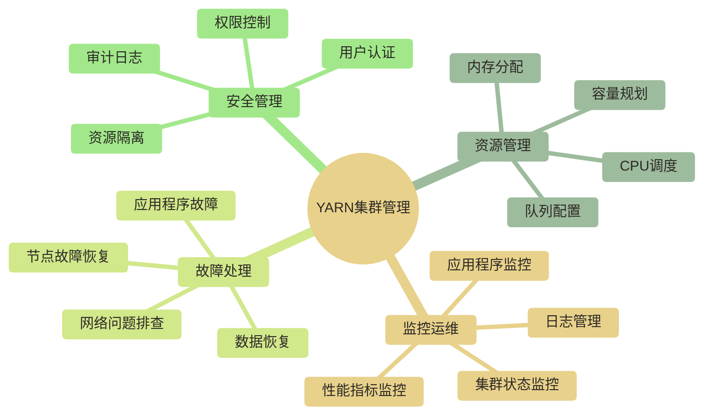

# 🎛️ YARN集群管理 - 分布式资源调度与运维

> [!abstract] 📋 本节概览
> - 🎯 **学习目标**：掌握YARN集群的日常管理、监控和运维技能
> - 📚 **前置知识**：[[【技术与工具】/Hadoop/09-YARN资源管理架构|YARN资源管理]] | [[【技术与工具】/Hadoop/10-YARN任务调度|YARN任务调度]] | Linux系统管理
> - ⏱️ **预计用时**：75分钟
> - 🔧 **技术重点**：集群监控、日志管理、性能调优、故障处理

> [!tip] 💡 前置知识
> 建议先学习 [[【技术与工具】/Hadoop/09-YARN资源管理架构|YARN资源管理]] 了解YARN的基本架构和组件

---

## 🎯 YARN集群管理概览

### 集群管理的重要性

> [!note] 💡 YARN集群管理就像管理一个大型工厂
> 想象管理一个有数百个工人的工厂：
> - **生产调度**：合理安排工人的工作任务（资源调度）
> - **设备监控**：实时监控机器运行状态（节点监控）
> - **质量控制**：确保产品质量和生产效率（性能监控）
> - **故障处理**：快速响应和处理设备故障（故障恢复）

### 管理范围



---

## 📊 集群状态监控

### 1. Web界面监控

**ResourceManager Web UI**：

| 监控项目 | 访问地址 | 主要功能 |
|---|---|---|
| **集群概览** | http://rm-host:8088 | 集群资源使用情况 |
| **应用程序** | http://rm-host:8088/cluster/apps | 运行中和历史应用 |
| **调度器** | http://rm-host:8088/cluster/scheduler | 队列和资源分配 |
| **节点管理** | http://rm-host:8088/cluster/nodes | NodeManager状态 |

**NodeManager Web UI**：

```bash
# 访问单个NodeManager
http://nm-host:8042

# 主要监控内容：
# - 容器运行状态
# - 本地资源使用情况  
# - 应用程序日志
# - 本地目录状态
```

### 2. 命令行监控

```bash title="YARN命令行监控"
# 📊 查看集群节点标签
yarn cluster -list-node-labels

# 📈 查看节点状态
yarn node -list
yarn node -status <nodeId>

# 🔍 查看队列信息
yarn queue -status <queueName>

# 📱 查看应用程序
yarn application -list
yarn application -status <applicationId>

# 📋 查看容器信息
yarn container -list <applicationAttemptId>
yarn container -status <containerId>

# 🔧 集群资源汇总
yarn top
```

### 3. 关键监控指标

```bash title="重要监控脚本"
# !/bin/bash
# 🎯 YARN集群监控脚本

check_cluster_health() {
    echo "=== YARN集群健康检查 ==="
    
 # 检查ResourceManager状态
    rm_status=$(yarn rmadmin -getServiceState rm1 2>/dev/null)
    echo "ResourceManager状态: $rm_status"
    
 # 检查活跃节点数
    active_nodes=$(yarn node -list -states RUNNING | grep -c "RUNNING")
    echo "活跃节点数: $active_nodes"
    
 # 检查总资源（示例地址需替换；依赖curl和jq）
    curl -s "http://resourcemanager:8088/ws/v1/cluster/metrics" | jq '.clusterMetrics | {totalMB, totalVirtualCores}'
    
 # 检查队列使用情况
    echo "=== 队列资源使用情况 ==="
    yarn queue -status default
}

check_resource_usage() {
    echo "=== 资源使用率分析 ==="
    
 # 获取集群资源使用率
    cluster_metrics=$(curl -s "http://resourcemanager:8088/ws/v1/cluster/metrics")
    
 # 提取关键指标
    echo $cluster_metrics | jq '{
        totalMB: .clusterMetrics.totalMB,
        allocatedMB: .clusterMetrics.allocatedMB,
        availableMB: .clusterMetrics.availableMB,
        totalVirtualCores: .clusterMetrics.totalVirtualCores,
        allocatedVirtualCores: .clusterMetrics.allocatedVirtualCores,
        availableVirtualCores: .clusterMetrics.availableVirtualCores
    }'
}

check_applications() {
    echo "=== 应用程序状态检查 ==="
    
 # 统计不同状态的应用程序数量
    echo "运行中应用: $(yarn application -list -appStates RUNNING | grep -c "application_")"
    echo "等待中应用: $(yarn application -list -appStates SUBMITTED,ACCEPTED | grep -c "application_")"
    echo "失败应用: $(yarn application -list -appStates FAILED | grep -c "application_")"
}

# 执行所有检查
main() {
    check_cluster_health
    echo
    check_resource_usage  
    echo
    check_applications
}

main
```

---

## 📋 日志管理

### 1. 日志类型和位置

```bash title="YARN日志文件分布"
# ResourceManager日志
$HADOOP_HOME/logs/yarn-*-resourcemanager-*.log
$HADOOP_HOME/logs/yarn-*-resourcemanager-*.out

# NodeManager日志  
$HADOOP_HOME/logs/yarn-*-nodemanager-*.log
$HADOOP_HOME/logs/yarn-*-nodemanager-*.out

# 应用程序日志
$YARN_LOG_DIR/application_*/container_*/
# 或者使用日志聚合目录
hdfs://namenode:port/tmp/logs/<user>/logs/application_*

# JobHistory日志
$HADOOP_HOME/logs/mapred-*-historyserver-*.log
```

### 2. 日志聚合配置

日志聚合功能将各 NodeManager 节点上的 Container 本地日志，在应用完成后自动上传到 HDFS，避免手动登录每台机器查日志。

```xml title="yarn-site.xml - 日志聚合配置"
<configuration>
    <!-- 启用日志聚合；生产环境应结合日志采集方案与保留要求评估 -->
    <property>
        <name>yarn.log-aggregation-enable</name>
        <value>true</value>
    </property>

    <!-- 日志聚合到HDFS的目录 -->
    <property>
        <name>yarn.nodemanager.remote-app-log-dir</name>
        <value>/tmp/logs</value>
    </property>

    <!-- 日志保留时间（秒） -->
    <property>
        <name>yarn.log-aggregation.retain-seconds</name>
        <value>604800</value> <!-- 7天 -->
    </property>

    <!-- 日志检查间隔 -->
    <property>
        <name>yarn.log-aggregation.retain-check-interval-seconds</name>
        <value>86400</value> <!-- 1天 -->
    </property>
</configuration>
```

> [!tip] 日志聚合最佳实践：建议将 `yarn.nodemanager.remote-app-log-dir` 设置为专用 HDFS 目录，并配合 HDFS 配额避免无限膨胀。生产环境保留时间建议 3-7 天，结合 JobHistory Server 的保留策略一起规划。

### 3. 日志查看和分析

```bash title="日志操作命令"
# 查看已完成应用的聚合日志（最常用）
yarn logs -applicationId application_1700000000000_0001

# 查看特定容器的日志
yarn logs -applicationId application_1700000000000_0001 \
          -containerId container_1700000000000_0001_01_000001

# 查看特定节点上该应用的日志
yarn logs -applicationId application_1700000000000_0001 \
          -nodeAddress datanode1:8042

# 列出保存该应用聚合日志的节点（不直接输出日志内容）
yarn logs -applicationId application_1700000000000_0001 -list_nodes

# 将完整日志输出到文件（大作业日志可能很大）
yarn logs -applicationId application_1700000000000_0001 > app_logs.txt 2>&1
```

> [!note] `yarn logs` 不限于已完成的应用；运行中日志是否可获取，取决于Hadoop版本、日志聚合方式及相关命令选项。运行中的应用也可通过 NodeManager Web UI（示例端口 8042）查看可访问的 Container 日志。

---

## 🏥 NodeManager 健康检查

NodeManager 内置了健康检查机制：当节点被判定为不健康（Unhealthy）时，ResourceManager 会停止向该节点分配新的 Container，避免在故障节点上运行任务。

### 内置磁盘健康检查

NodeManager 默认会检查本地磁盘使用率；超出阈值的目录会被判定为不健康，节点是否标记为 Unhealthy 还取决于本地目录和日志目录的健康比例：

```xml title="yarn-site.xml - 磁盘健康检查配置"
<configuration>
    <!-- 磁盘使用率超过此值时对应目录判定为不健康（默认 90%） -->
    <property>
        <name>yarn.nodemanager.disk-health-checker.max-disk-utilization-per-disk-percent</name>
        <value>90.0</value>
    </property>

    <!-- 本地目录中健康磁盘的最低比例（低于此值则 Unhealthy） -->
    <property>
        <name>yarn.nodemanager.disk-health-checker.min-healthy-disks</name>
        <value>0.25</value>
    </property>

    <!-- 磁盘健康检查间隔（毫秒，默认 2 分钟） -->
    <property>
        <name>yarn.nodemanager.disk-health-checker.interval-ms</name>
        <value>120000</value>
    </property>
</configuration>
```

### 自定义健康检查脚本

通过配置外部脚本，可以实现任意自定义的健康检查逻辑（如检查 GPU、网络、依赖服务等）：

```xml title="yarn-site.xml - 自定义健康脚本"
<configuration>
    <!-- 健康检查脚本路径 -->
    <property>
        <name>yarn.nodemanager.health-checker.script.path</name>
        <value>/etc/hadoop/scripts/node-health-check.sh</value>
    </property>

    <!-- 健康检查脚本执行间隔（毫秒） -->
    <property>
        <name>yarn.nodemanager.health-checker.interval-ms</name>
        <value>600000</value>
    </property>

    <!-- 脚本超时时间（毫秒） -->
    <property>
        <name>yarn.nodemanager.health-checker.script.timeout-ms</name>
        <value>1200000</value>
    </property>
</configuration>
```

```bash title="node-health-check.sh - 健康检查脚本示例"
#!/bin/bash
# NodeManager 健康检查脚本
# 健康检查失败时输出以 "ERROR" 开头的行并正常退出；非零退出码不能替代该报告方式

# 检查磁盘剩余空间（/data 目录可用空间需大于 10GB）
available_gb=$(df -BG /data | awk 'NR==2{print $4}' | tr -d 'G')
if [ "$available_gb" -lt 10 ]; then
    echo "ERROR: /data disk space insufficient: ${available_gb}GB available"
    exit 0
fi

# 检查内存使用率（空闲内存需大于 2GB）
free_mb=$(free -m | awk 'NR==2{print $7}')
if [ "$free_mb" -lt 2048 ]; then
    echo "ERROR: insufficient free memory: ${free_mb}MB"
    exit 0
fi

# 所有检查通过
echo "Node is healthy"
exit 0
```

> [!tip] 正常退出的健康检查脚本应以行首 "ERROR" 报告不健康；普通非零退出码通常按脚本执行失败处理，不能据此断言节点会变为 Unhealthy。超时等执行异常有单独处理规则，须核对目标版本；后续检查通过后可恢复健康状态。

### 查看节点健康状态

```bash title="查看节点健康信息"
# 列出所有节点及状态
yarn node -list -all

# 查看特定节点详情（包含健康报告）
yarn node -status datanode1:8041

# 只列出不健康的节点
yarn node -list -states UNHEALTHY

# 只列出丢失连接的节点
yarn node -list -states LOST
```

---

## 🔄 队列管理与动态刷新

### 查看队列状态

```bash title="队列管理命令"
# 查看默认队列状态
yarn queue -status default

# 查看某个子队列状态
yarn queue -status root.engineering.dev
```

### 动态刷新调度器配置

修改调度器配置（如队列容量、用户限额）后，**无需重启 ResourceManager**，可以在线热加载：

```bash title="动态刷新配置"
# 修改 capacity-scheduler.xml 或 fair-scheduler.xml 后执行刷新
yarn rmadmin -refreshQueues

# 刷新集中式节点标签配置中的节点到标签映射
yarn rmadmin -refreshNodeToLabels

# 刷新超级用户配置
yarn rmadmin -refreshSuperUserGroupsConfiguration

# 刷新 ACL 权限配置
yarn rmadmin -refreshServiceAcl
```

> [!warning] `-refreshQueues` 并非只能修改现有队列参数；CapacityScheduler支持通过刷新添加队列，删除队列则有停止队列等限制，具体能力取决于版本和配置管理方式。FairScheduler的配置重载机制不同，不应将队列增删一概视为必须重启ResourceManager；变更前应在目标版本验证并准备回滚。

### 常用运维命令速查

| 命令 | 说明 |
|---|---|
| `yarn application -list` | 列出所有运行中的应用 |
| `yarn application -list -appStates FAILED` | 列出失败的应用 |
| `yarn application -status <appId>` | 查看应用详细状态 |
| `yarn application -kill <appId>` | 强制终止应用 |
| `yarn node -list` | 默认列出RUNNING节点；所有状态使用`-all` |
| `yarn node -status <nodeId>` | 查看节点详情和健康状态 |
| `yarn rmadmin -refreshQueues` | 热加载调度器配置 |
| `yarn rmadmin -getServiceState rm1` | 查看 RM HA 状态 |
| `yarn logs -applicationId <appId>` | 查看应用聚合日志 |
| `yarn top` | 实时查看集群资源使用 |

---

## ⚙️ 性能调优

### 1. 内存管理优化

```xml title="NodeManager内存配置优化"
<configuration>
    <!-- NodeManager可用总内存 -->
    <property>
        <name>yarn.nodemanager.resource.memory-mb</name>
        <value>14336</value> <!-- 14GB，为系统预留2GB -->
    </property>
    
    <!-- 单个容器最小内存 -->
    <property>
        <name>yarn.scheduler.minimum-allocation-mb</name>
        <value>512</value>
    </property>
    
    <!-- 单个容器最大内存 -->
    <property>
        <name>yarn.scheduler.maximum-allocation-mb</name>
        <value>8192</value>
    </property>
    
    <!-- 内存检查 -->
    <property>
        <name>yarn.nodemanager.pmem-check-enabled</name>
        <value>true</value>
    </property>
    
    <!-- 虚拟内存检查比例 -->
    <property>
        <name>yarn.nodemanager.vmem-pmem-ratio</name>
        <value>2.5</value>
    </property>
</configuration>
```

### 2. CPU调度优化

```xml title="CPU资源配置"
<configuration>
    <!-- NodeManager可用CPU核心数 -->
    <property>
        <name>yarn.nodemanager.resource.cpu-vcores</name>
        <value>8</value>
    </property>
    
    <!-- 最小CPU分配 -->
    <property>
        <name>yarn.scheduler.minimum-allocation-vcores</name>
        <value>1</value>
    </property>
    
    <!-- 最大CPU分配 -->
    <property>
        <name>yarn.scheduler.maximum-allocation-vcores</name>
        <value>4</value>
    </property>
</configuration>
```

### 3. 调度器性能调优

```xml title="CapacityScheduler调优"
<configuration>
    <!-- 调度器类 -->
    <property>
        <name>yarn.resourcemanager.scheduler.class</name>
        <value>org.apache.hadoop.yarn.server.resourcemanager.scheduler.capacity.CapacityScheduler</value>
    </property>
    
    <!-- 资源计算器 -->
    <property>
        <name>yarn.scheduler.capacity.resource-calculator</name>
        <value>org.apache.hadoop.yarn.util.resource.DominantResourceCalculator</value>
    </property>
    
    <!-- 最大应用程序数 -->
    <property>
        <name>yarn.scheduler.capacity.maximum-applications</name>
        <value>1000</value>
    </property>
    
    <!-- 节点本地化延迟：等待的调度机会数，不是时间 -->
    <property>
        <name>yarn.scheduler.capacity.node-locality-delay</name>
        <value>40</value>
    </property>
</configuration>
```

---

## 🔧 故障处理

### 1. 常见故障场景

#### NodeManager故障

```bash title="NodeManager故障排查"
# 🔍 检查NodeManager状态
yarn node -list -states LOST,UNHEALTHY,DECOMMISSIONED

# 📋 查看具体节点问题
yarn node -status <nodeId>

# 🔧 重启NodeManager
# 在问题节点执行：
$HADOOP_HOME/sbin/yarn-daemon.sh stop nodemanager
$HADOOP_HOME/sbin/yarn-daemon.sh start nodemanager

# 📊 检查节点健康脚本
# !/bin/bash
check_node_health() {
    local node_id=$1
    
 # 检查磁盘使用率
    df -h | awk 'NR>1 {usage=$5; sub(/%$/, "", usage); if (usage+0 > 80) print "磁盘使用率过高: " $1 " " $5}'
    
 # 检查内存使用
    free -m | awk 'NR==2{printf "内存使用率: %.2f%%\n", $3*100/$2}'
    
 # 检查NodeManager进程
    if ! pgrep -f "NodeManager" > /dev/null; then
        echo "警告: NodeManager进程未运行"
    fi
    
 # 检查网络连接
    if ! ping -c 1 resourcemanager > /dev/null; then
        echo "警告: 无法连接到ResourceManager"
    fi
}
```

#### 应用程序故障

```bash title="应用程序故障诊断"
# 🔍 查看失败的应用程序
yarn application -list -appStates FAILED

# 📋 分析应用程序失败原因
analyze_failed_app() {
    local app_id=$1
    
    echo "分析应用程序 $app_id 失败原因..."
    
 # 获取应用程序详细信息
    yarn application -status $app_id
    
 # 查看应用程序日志中的错误
    yarn logs -applicationId $app_id | grep -i -A 5 -B 5 "error\|exception\|failed"
    
 # 检查资源不足问题
    yarn logs -applicationId $app_id | grep -i "insufficient"
}

# 🔄 重新提交失败的应用程序
retry_failed_app() {
    local app_id=$1
    
 # 杀死已有应用程序（如果还在运行）
    yarn application -kill $app_id 2>/dev/null
    
    echo "应用程序 $app_id 已准备重新提交"
    echo "请检查失败原因后手动重新提交"
}
```

### 2. 性能问题排查

```bash title="性能问题诊断工具"
# !/bin/bash
# 🎯 YARN性能诊断脚本

diagnose_performance() {
    echo "=== YARN性能诊断报告 ==="
    
 # 1. 检查资源争用
    echo "1. 资源争用分析:"
    pending_apps=$(yarn application -list -appStates SUBMITTED,ACCEPTED | grep -c "application_")
    running_apps=$(yarn application -list -appStates RUNNING | grep -c "application_")
    echo "   等待应用: $pending_apps, 运行应用: $running_apps"
    
 # 2. 检查节点负载
    echo "2. 节点负载分析:"
    yarn node -list | while read line; do
        if [[ "$line" == *"RUNNING"* ]]; then
            node_id=$(echo $line | awk '{print $1}')
            echo "   检查节点: $node_id"
 # 这里可以添加更详细的节点性能检查
        fi
    done
    
 # 3. 检查队列状态
    echo "3. 队列使用分析:"
    yarn queue -status default
    
 # 4. 检查历史性能
    echo "4. 历史性能趋势:"
 # 分析最近完成的应用程序的平均执行时间
    yarn application -list -appStates FINISHED | head -10
}

# 执行诊断
diagnose_performance
```

---

## 🔒 安全和权限管理

### 1. 队列权限配置

```xml title="capacity-scheduler.xml - 队列权限"
<configuration>
    <!-- 默认队列访问控制 -->
    <property>
        <name>yarn.scheduler.capacity.root.default.acl_submit_applications</name>
        <value>*</value>
    </property>
    
    <!-- 管理员队列 -->
    <property>
        <name>yarn.scheduler.capacity.root.admin.acl_submit_applications</name>
        <value>admin,hadoop</value>
    </property>
    
    <!-- 开发队列 -->
    <property>
        <name>yarn.scheduler.capacity.root.dev.acl_submit_applications</name>
        <value>developers</value>
    </property>
</configuration>
```

### 2. 资源隔离

```bash title="用户资源限制脚本"
# !/bin/bash
# 👥 用户资源管理

set_user_limits() {
    local user=$1
    local memory_limit=$2
    local core_limit=$3
    
    echo "设置用户 $user 的资源限制:"
    echo "  内存限制: ${memory_limit}MB"
    echo "  CPU限制: ${core_limit} 核"
    
 # 这里可以通过修改配置文件或调用API来设置限制
 # 实际实现依赖于具体的调度器配置
}

monitor_user_usage() {
    echo "=== 用户资源使用统计 ==="
    
 # 统计各用户的应用程序数量和资源使用
    yarn application -list | awk 'NR>2 {print $4}' | sort | uniq -c | sort -nr
}
```

---

## 🔗 学习路径

### 下一步学习建议

1. **[[【技术与工具】/Hadoop/11-YARN集群管理|YARN集群]]** - 学习整体Hadoop集群运维
2. **Ambari学习路线图** - 企业级集群管理工具
3. **[[【技术与工具】/ClickHouse/00-ClickHouse学习路线图|ClickHouse]]** - 列式分析数据库与OLAP实践
4. **[[【技术与工具】/Hadoop/13-Hive数据仓库|Hive数据仓库]]** - 基于YARN的SQL处理

### 实践项目建议

- 搭建多节点YARN集群
- 实现自动化监控系统
- 设计资源配额管理策略
- 建立故障响应机制

---

> [!tip] 💡 关键收获
> - YARN集群管理需要综合考虑资源、性能、稳定性
> - 监控和日志分析是运维的重要工具
> - 性能调优需要根据实际工作负载进行调整
> - 故障处理要建立标准化的流程和工具 