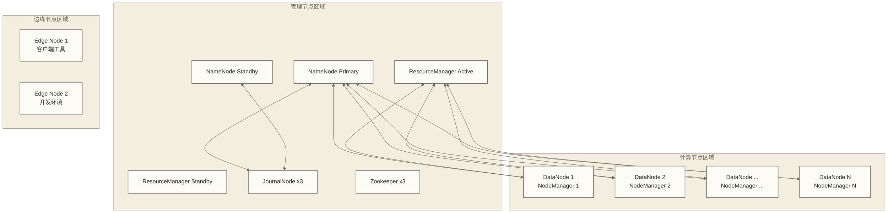

# 🏗️ Hadoop集群管理 - 生产环境部署与运维

> [!abstract] 📋 学习目标
> - 🎯 **集群规划**：掌握Hadoop集群的架构设计和硬件规划
> - 🚀 **部署实践**：学会生产环境的集群部署和配置管理
> - 📊 **监控运维**：掌握集群监控、性能调优和故障处理
> - 🔧 **高可用**：了解NameNode HA、ResourceManager HA等高可用方案

> [!tip] 💡 前置知识
> 建议先学习 [[【技术与工具】/Hadoop/03-HDFS分布式文件系统|HDFS分布式文件系统]] 和 [[【技术与工具】/Hadoop/09-YARN资源管理架构|YARN资源管理]] 和 [[【技术与工具】/Hadoop/11-YARN集群管理|YARN集群]]

---

## 🎯 集群架构规划

### 典型生产集群架构

> [!note] 💡 生产集群就像一个大型数据中心
> 想象Hadoop集群是一个现代化工厂：
> - **管理层**：NameNode、ResourceManager（管理者）
> - **生产线**：DataNode、NodeManager（工人）
> - **监控室**：监控系统（质检员）
> - **配套设施**：Zookeeper、数据库（基础设施）



### 硬件规划建议

| 节点类型 | CPU | 内存 | 存储 | 网络 | 数量建议 |
|---|---|---|---|---|---|
| **NameNode** | 16-32核 | 64-128GB | SSD 500GB-1TB | 万兆 | 2台（HA） |
| **ResourceManager** | 8-16核 | 32-64GB | SSD 200-500GB | 万兆 | 2台（HA） |
| **DataNode** | 16-32核 | 64-256GB | HDD 8-24TB | 万兆 | N台 |
| **JournalNode** | 4-8核 | 16-32GB | SSD 200GB | 千兆 | 3台（奇数） |
| **Zookeeper** | 4-8核 | 8-16GB | SSD 100GB | 千兆 | 3台（奇数） |
| **Edge Node** | 8-16核 | 32-64GB | SSD 500GB | 万兆 | 2-4台 |

---

## 🚀 集群部署实践

### 1. 环境准备

```bash title="基础环境配置"
# 🔧 系统配置优化
# 以下为原稿的安全控制停用命令，仅供风险辨识，不应作为生产部署默认操作。
# 应按实际服务端口配置防火墙，并按安全策略配置SELinux；不要直接执行以下命令。
# systemctl stop firewalld
# systemctl disable firewalld
# sed -i 's/SELINUX=enforcing/SELINUX=disabled/g' /etc/selinux/config

# 配置时间同步
yum install -y ntp
systemctl enable ntpd
systemctl start ntpd

# 优化系统参数
cat >> /etc/sysctl.conf << 'EOF'
# 网络优化
net.core.rmem_default = 262144
net.core.rmem_max = 16777216
net.core.wmem_default = 262144
net.core.wmem_max = 16777216
net.ipv4.tcp_rmem = 4096 65536 16777216
net.ipv4.tcp_wmem = 4096 65536 16777216

# 文件句柄优化
fs.file-max = 6815744
EOF

sysctl -p

# 配置ulimit
cat >> /etc/security/limits.conf << 'EOF'
* soft nofile 65536
* hard nofile 65536
* soft nproc 32768
* hard nproc 32768
EOF
```

### 2. Hadoop安装配置

```bash title="Hadoop集群安装脚本"
#!/bin/bash
# 🚀 Hadoop集群自动化安装脚本

HADOOP_VERSION="3.3.6"
JAVA_HOME="/usr/lib/jvm/java-8-openjdk"
HADOOP_HOME="/opt/hadoop"

# 📦 下载和安装Hadoop
download_hadoop() {
    echo "📦 下载Hadoop ${HADOOP_VERSION}"
    cd /tmp
    wget https://downloads.apache.org/hadoop/common/hadoop-${HADOOP_VERSION}/hadoop-${HADOOP_VERSION}.tar.gz
    
    tar -xzf hadoop-${HADOOP_VERSION}.tar.gz
    sudo mv hadoop-${HADOOP_VERSION} ${HADOOP_HOME}
    sudo chown -R hadoop:hadoop ${HADOOP_HOME}
}

# ⚙️ 配置环境变量
setup_environment() {
    echo "⚙️ 配置环境变量"
    cat >> ~/.bashrc << EOF
export JAVA_HOME=${JAVA_HOME}
export HADOOP_HOME=${HADOOP_HOME}
export HADOOP_CONF_DIR=\$HADOOP_HOME/etc/hadoop
export PATH=\$PATH:\$HADOOP_HOME/bin:\$HADOOP_HOME/sbin
EOF
    source ~/.bashrc
}

# 🔧 生成核心配置文件
generate_configs() {
    echo "🔧 生成Hadoop配置文件"
    
 # core-site.xml
    cat > ${HADOOP_HOME}/etc/hadoop/core-site.xml << 'EOF'
<configuration>
    <!-- NameNode地址 -->
    <property>
        <name>fs.defaultFS</name>
        <value>hdfs://hadoop-cluster</value>
    </property>
    
    <!-- 数据目录 -->
    <property>
        <name>hadoop.tmp.dir</name>
        <value>/data/hadoop/tmp</value>
    </property>
    
    <!-- 代理用户配置 -->
    <property>
        <name>hadoop.proxyuser.hadoop.hosts</name>
        <value>*</value>
    </property>
    <property>
        <name>hadoop.proxyuser.hadoop.groups</name>
        <value>*</value>
    </property>
</configuration>
EOF

 # hdfs-site.xml
    cat > ${HADOOP_HOME}/etc/hadoop/hdfs-site.xml << 'EOF'
<configuration>
    <!-- NameNode HA配置 -->
    <property>
        <name>dfs.nameservices</name>
        <value>hadoop-cluster</value>
    </property>
    
    <property>
        <name>dfs.ha.namenodes.hadoop-cluster</name>
        <value>nn1,nn2</value>
    </property>
    
    <property>
        <name>dfs.namenode.rpc-address.hadoop-cluster.nn1</name>
        <value>namenode1:8020</value>
    </property>
    <property>
        <name>dfs.namenode.rpc-address.hadoop-cluster.nn2</name>
        <value>namenode2:8020</value>
    </property>
    
    <property>
        <name>dfs.namenode.http-address.hadoop-cluster.nn1</name>
        <value>namenode1:9870</value>
    </property>
    <property>
        <name>dfs.namenode.http-address.hadoop-cluster.nn2</name>
        <value>namenode2:9870</value>
    </property>
    
    <!-- JournalNode配置 -->
    <property>
        <name>dfs.namenode.shared.edits.dir</name>
        <value>qjournal://journalnode1:8485;journalnode2:8485;journalnode3:8485/hadoop-cluster</value>
    </property>
    
    <!-- 数据目录 -->
    <property>
        <name>dfs.namenode.name.dir</name>
        <value>/data/hadoop/namenode</value>
    </property>
    
    <property>
        <name>dfs.datanode.data.dir</name>
        <value>/data/hadoop/datanode</value>
    </property>
    
    <!-- 副本数 -->
    <property>
        <name>dfs.replication</name>
        <value>3</value>
    </property>
    
    <!-- 块大小 -->
    <property>
        <name>dfs.blocksize</name>
        <value>134217728</value>
    </property>
</configuration>
EOF

 # yarn-site.xml
    cat > ${HADOOP_HOME}/etc/hadoop/yarn-site.xml << 'EOF'
<configuration>
    <!-- ResourceManager HA配置 -->
    <property>
        <name>yarn.resourcemanager.ha.enabled</name>
        <value>true</value>
    </property>
    
    <property>
        <name>yarn.resourcemanager.cluster-id</name>
        <value>yarn-cluster</value>
    </property>
    
    <property>
        <name>yarn.resourcemanager.ha.rm-ids</name>
        <value>rm1,rm2</value>
    </property>
    
    <property>
        <name>yarn.resourcemanager.hostname.rm1</name>
        <value>resourcemanager1</value>
    </property>
    <property>
        <name>yarn.resourcemanager.hostname.rm2</name>
        <value>resourcemanager2</value>
    </property>
    
    <!-- NodeManager配置 -->
    <property>
        <name>yarn.nodemanager.aux-services</name>
        <value>mapreduce_shuffle</value>
    </property>
    
    <property>
        <name>yarn.nodemanager.resource.memory-mb</name>
        <value>14336</value>
    </property>
    
    <property>
        <name>yarn.nodemanager.resource.cpu-vcores</name>
        <value>8</value>
    </property>
</configuration>
EOF
}

# 执行安装
main() {
    download_hadoop
    setup_environment
    generate_configs
    echo "✅ Hadoop安装配置完成"
}

main
```

### 3. 集群启动流程

```bash title="集群启动脚本"
#!/bin/bash
# 🚀 Hadoop集群启动脚本

# 1. 启动JournalNode（在所有JournalNode节点执行）
start_journalnodes() {
    echo "🚀 启动JournalNode服务"
    $HADOOP_HOME/bin/hdfs --daemon start journalnode
}

# 2. 格式化NameNode（仅第一次）
format_namenode() {
    echo "🔧 格式化NameNode"
 # 在主NameNode执行
    $HADOOP_HOME/bin/hdfs namenode -format -clusterId hadoop-cluster
    
 # 在备NameNode执行
    $HADOOP_HOME/bin/hdfs namenode -bootstrapStandby
}

# 3. 启动HDFS服务
start_hdfs() {
    echo "🚀 启动HDFS服务"
 # 在主NameNode执行
    $HADOOP_HOME/sbin/start-dfs.sh
}

# 4. 启动YARN服务
start_yarn() {
    echo "🚀 启动YARN服务"
 # 在ResourceManager执行
    $HADOOP_HOME/sbin/start-yarn.sh
}

# 5. 检查服务状态
check_services() {
    echo "🔍 检查服务状态"
    
 # 检查HDFS状态
    $HADOOP_HOME/bin/hdfs dfsadmin -report
    
 # 检查YARN状态
    $HADOOP_HOME/bin/yarn node -list
    
 # 检查进程
    jps
}

# 完整启动流程
full_start() {
    start_journalnodes
    sleep 10
    start_hdfs
    sleep 15
    start_yarn
    sleep 10
    check_services
}

case "$1" in
    "journal")
        start_journalnodes
        ;;
    "format")
        format_namenode
        ;;
    "hdfs")
        start_hdfs
        ;;
    "yarn")
        start_yarn
        ;;
    "check")
        check_services
        ;;
    "all")
        full_start
        ;;
    *)
        echo "使用方法: $0 {journal|format|hdfs|yarn|check|all}"
        exit 1
        ;;
esac
```

---

## 📊 集群监控与管理

### 1. 关键监控指标

```bash title="监控脚本示例"
#!/bin/bash
# 📊 Hadoop集群监控脚本

# 🔍 HDFS健康状态检查
check_hdfs_health() {
    echo "=== HDFS健康状态 ==="
    
 # NameNode状态
    curl -s "http://namenode1:9870/jmx?qry=Hadoop:service=NameNode,name=NameNodeStatus" | \
        jq -er '.beans[0].State' 2>/dev/null || echo "NameNode1: 请求失败或未取得有效状态"
    
 # 磁盘使用率
    echo "磁盘使用率:"
    $HADOOP_HOME/bin/hdfs dfsadmin -report | grep "DFS Used%"
    
 # 数据节点状态
    echo "DataNode状态:"
    $HADOOP_HOME/bin/hdfs dfsadmin -report | grep "Live datanodes"
    
 # 副本不足的块
    echo "副本不足的块:"
    $HADOOP_HOME/bin/hdfs fsck / -blocks -files | grep "Under-replicated blocks"
}

# 📈 YARN资源使用情况
check_yarn_resources() {
    echo "=== YARN资源状态 ==="
    
 # 列出集群节点标签（不代表资源使用量）
    $HADOOP_HOME/bin/yarn cluster -list-node-labels
    
 # 队列状态
    $HADOOP_HOME/bin/yarn queue -status default
    
 # 应用程序状态
    echo "运行中的应用程序:"
    $HADOOP_HOME/bin/yarn application -list -appStates RUNNING
}

# 🚨 告警检查
check_alerts() {
    echo "=== 系统告警检查 ==="
    
 # 检查磁盘使用率
    df -P | awk 'NR > 1 {usage=$5; sub(/%$/, "", usage); if (usage+0 > 80) print "磁盘告警: " $1 " 使用率 " $5}'
    
 # 检查内存使用率
    free -m | awk 'NR==2{printf "内存使用率: %.2f%%\n", $3*100/$2}'
    
 # 检查CPU负载
    uptime | awk '{print "系统负载: " $(NF-2) " " $(NF-1) " " $NF}'
    
 # 检查关键进程
    if ! pgrep -f "NameNode" > /dev/null; then
        echo "告警: NameNode进程未运行"
    fi
    
    if ! pgrep -f "ResourceManager" > /dev/null; then
        echo "告警: ResourceManager进程未运行"
    fi
}

# 🔄 定期执行监控
monitor_cluster() {
    while true; do
        echo "==================== $(date) ===================="
        check_hdfs_health
        echo
        check_yarn_resources
        echo
        check_alerts
        echo
        sleep 300  # 每5分钟检查一次
    done
}

case "$1" in
    "hdfs")
        check_hdfs_health
        ;;
    "yarn")
        check_yarn_resources
        ;;
    "alerts")
        check_alerts
        ;;
    "monitor")
        monitor_cluster
        ;;
    *)
        echo "使用方法: $0 {hdfs|yarn|alerts|monitor}"
        exit 1
        ;;
esac
```

### 2. Web监控界面

| 服务 | 监控地址 | 主要功能 |
|---|---|---|
| **NameNode** | http://namenode:9870 | HDFS状态、文件系统浏览 |
| **ResourceManager** | http://resourcemanager:8088 | YARN状态、应用程序管理 |
| **JobHistory** | http://jobhistory:19888 | MapReduce作业历史 |
| **DataNode** | http://datanode:9864 | 数据节点状态 |
| **NodeManager** | http://nodemanager:8042 | 节点管理器状态 |

---

## 🔧 故障排查与处理

### 常见故障场景

#### 1. NameNode故障恢复

```bash title="NameNode故障处理"
# 🚨 NameNode Safe Mode问题
# 现象：HDFS无法写入，处于安全模式

# 检查安全模式状态
hdfs dfsadmin -safemode get

# 手动退出安全模式（仅在确认安全时）
hdfs dfsadmin -safemode leave

# 检查副本不足的文件
hdfs fsck / -files -blocks -locations | grep "Under replicated"

# 恢复文件写入租约（不修复缺失副本；仅在确认原写入者不再写入且需要恢复租约时使用）
hdfs debug recoverLease -path /path/to/file -retries 3
```

#### 2. DataNode故障处理

```bash title="DataNode故障排查"
# 🔍 DataNode无法启动排查
# 1. 检查日志
tail -f $HADOOP_HOME/logs/hadoop-*-datanode-*.log

# 2. 检查磁盘空间
df -h

# 3. 检查数据目录权限
ls -la /data/hadoop/datanode/

# 4. 检查端口占用
netstat -tlnp | grep :9866

# 5. 重新启动DataNode
$HADOOP_HOME/bin/hdfs --daemon start datanode
```

#### 3. 磁盘故障处理

```bash title="DataNode磁盘故障处理"
# 🔧 磁盘故障恢复流程

# 1. 停止故障节点
$HADOOP_HOME/bin/hdfs --daemon stop datanode

# 2. 评估故障节点与副本健康状况；降低副本数不能移除节点，也不能替代退役流程。
# 原稿命令在Hadoop 3.3.6中无效，保留为错误示例，禁止执行：
# hdfs dfsadmin -setDefaultReplication 2  # 原稿意图：临时降低副本数

# 3. 检查数据完整性
hdfs fsck / -files -blocks -locations > fsck_report.txt

# 4. 替换磁盘后重新加入
# 清理会删除该目录下的本地块和元数据；须先确认故障盘路径、健康副本及恢复方案。
# 以下为原稿的破坏性命令，默认禁止执行，不得清理健康磁盘或唯一副本：
# rm -rf /data/hadoop/datanode/*

# 重新启动DataNode
$HADOOP_HOME/bin/hdfs --daemon start datanode

# 5. 核查故障恢复后的副本数与块健康状况。
# 原稿命令在Hadoop 3.3.6中无效，保留为错误示例，禁止执行：
# hdfs dfsadmin -setDefaultReplication 3
# 如确需调整既有文件的副本因子，应针对审核后的路径使用hdfs dfs -setrep，而非修改所谓全局默认值。
```

### 性能优化

#### 1. JVM调优

```bash title="JVM参数优化"
# 🚀 NameNode JVM优化
export HDFS_NAMENODE_OPTS="-Xms8g -Xmx8g -XX:+UseG1GC \
  -XX:G1HeapRegionSize=32m -XX:+UseG1GC \
  -XX:+ResizeTLAB -XX:+PrintGCDetails \
  -XX:+PrintGCTimeStamps -XX:+PrintGCApplicationStoppedTime \
  -Xloggc:$HADOOP_LOG_DIR/gc-namenode.log"

# 📊 ResourceManager JVM优化  
export YARN_RESOURCEMANAGER_OPTS="-Xms4g -Xmx4g -XX:+UseG1GC \
  -XX:+PrintGCDetails -XX:+PrintGCTimeStamps \
  -Xloggc:$HADOOP_LOG_DIR/gc-rm.log"

# 💾 DataNode JVM优化
export HDFS_DATANODE_OPTS="-Xms2g -Xmx2g -XX:+UseG1GC \
  -XX:+PrintGCDetails -Xloggc:$HADOOP_LOG_DIR/gc-datanode.log"
```

#### 2. 系统参数调优

```bash title="系统参数优化"
# 📈 网络参数优化
echo 'net.core.rmem_default = 262144' >> /etc/sysctl.conf
echo 'net.core.rmem_max = 16777216' >> /etc/sysctl.conf
echo 'net.core.wmem_default = 262144' >> /etc/sysctl.conf
echo 'net.core.wmem_max = 16777216' >> /etc/sysctl.conf

# 🗃️ 文件系统优化
echo 'vm.swappiness = 1' >> /etc/sysctl.conf
echo 'vm.dirty_ratio = 15' >> /etc/sysctl.conf
echo 'vm.dirty_background_ratio = 5' >> /etc/sysctl.conf

sysctl -p
```

---

## 🔗 学习路径

### 下一步学习建议

1. **Zookeeper学习路线** - 分布式协调服务
2. **Ambari学习路线** - 集群管理平台
3. **Kubernetes学习路线** - 容器化部署
4. **云计算学习路线** - 云上大数据

### 实践项目建议

- 搭建高可用Hadoop集群
- 设计集群监控系统
- 实现自动化运维脚本
- 制定灾备恢复方案

---

> [!tip] 💡 关键收获
> - 生产环境集群需要合理的架构规划和硬件配置
> - 高可用配置是企业级集群的必备要求
> - 监控和告警系统是集群稳定运行的保障
> - 故障排查需要系统化的方法和工具支持 